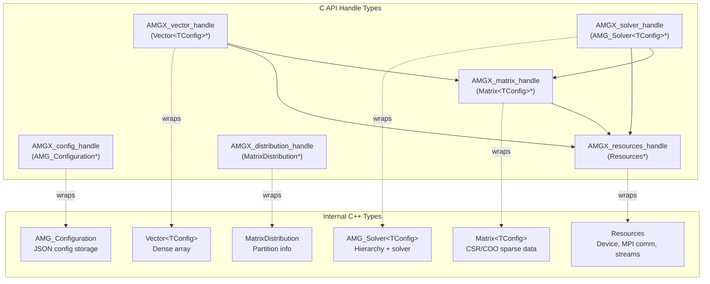
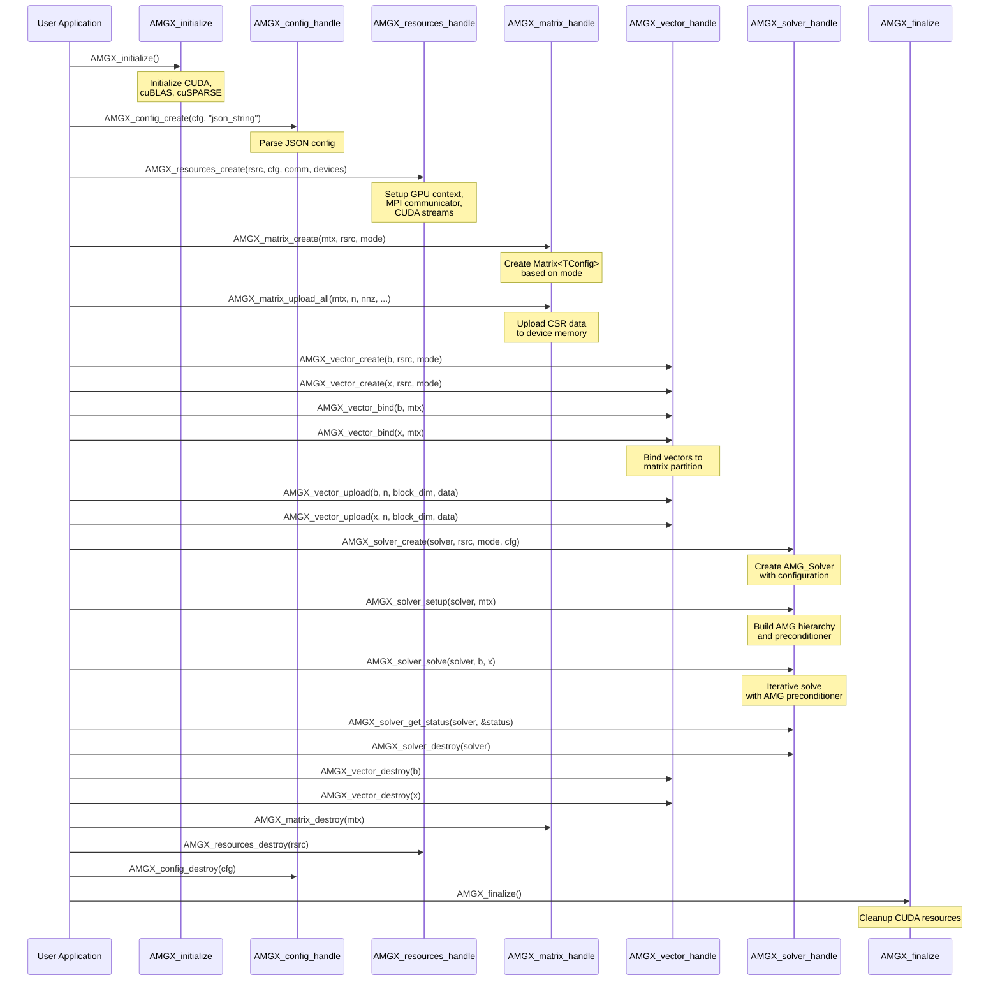
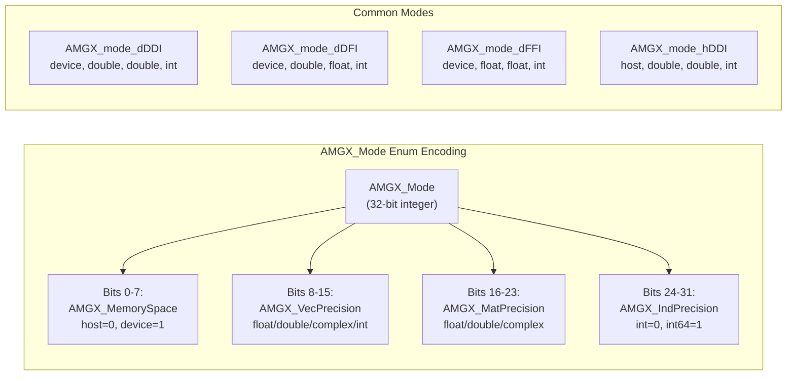
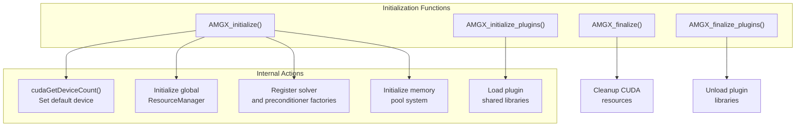
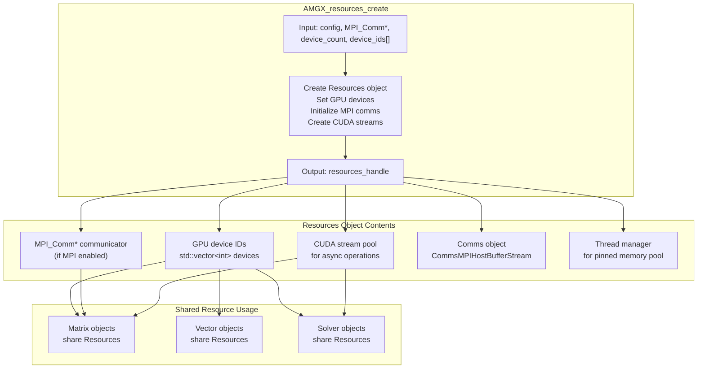
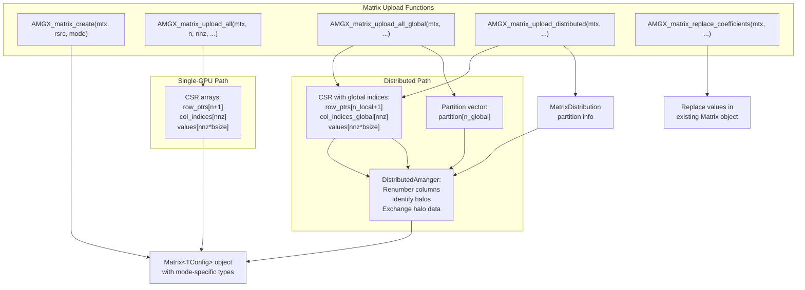
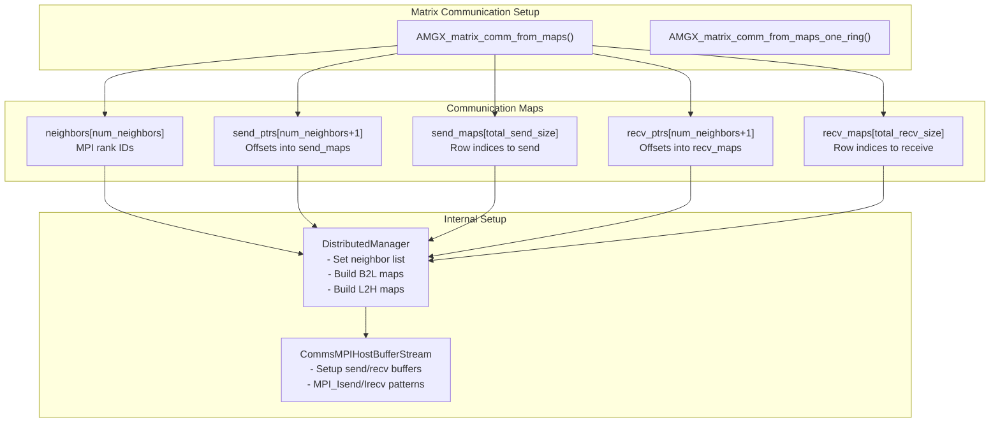

<!-- source: DeepWiki mcp.deepwiki.com · repo NVIDIA/AMGX · page 4.1 C API · fetched 2026-10-26 -->

# C API

<details>
<summary>Relevant source files</summary>

The following files were used as context for generating this wiki page:

- [examples/amgx_capi.h](examples/amgx_capi.h)
- [examples/amgx_mpi_capi.c](examples/amgx_mpi_capi.c)
- [examples/amgx_mpi_poisson7.c](examples/amgx_mpi_poisson7.c)
- [include/amgx_c.h](include/amgx_c.h)
- [src/amgx_c.cu](src/amgx_c.cu)
- [src/matrix_analysis.cu](src/matrix_analysis.cu)

</details>


The AMGX C API provides a stable, language-agnostic interface to the AMGX library. It exposes all solver functionality through a set of opaque handles and plain C functions, enabling integration from C, C++, Fortran, Python, Julia, and other languages. The C API abstracts the internal template-based implementation and provides runtime mode selection for precision and memory space.

For details on the configuration system used by the C API, see [Configuration System](#4.2). For usage examples, see [Examples and Usage](#4.3). For implementation details of the opaque handles and mode dispatch, see [API Design and Object Model](#4.1.1) and [Mode System and Template Dispatch](#4.1.2).

## API Surface Organization

The C API is defined in [include/amgx_c.h:1-612]() and implemented in [src/amgx_c.cu:1-4341](). Functions are organized into functional groups:

| Category | Purpose | Key Functions |
|----------|---------|---------------|
| **Initialization** | Library setup and teardown | `AMGX_initialize()`, `AMGX_finalize()`, `AMGX_initialize_plugins()` |
| **Configuration** | JSON-based parameter management | `AMGX_config_create()`, `AMGX_config_create_from_file()`, `AMGX_config_add_parameters()` |
| **Resources** | GPU device and MPI communicator setup | `AMGX_resources_create()`, `AMGX_resources_create_simple()`, `AMGX_resources_destroy()` |
| **Matrix** | Sparse matrix upload and manipulation | `AMGX_matrix_create()`, `AMGX_matrix_upload_all()`, `AMGX_matrix_replace_coefficients()` |
| **Vector** | Dense vector operations | `AMGX_vector_create()`, `AMGX_vector_upload()`, `AMGX_vector_download()`, `AMGX_vector_bind()` |
| **Solver** | Linear system solution | `AMGX_solver_create()`, `AMGX_solver_setup()`, `AMGX_solver_solve()`, `AMGX_solver_get_status()` |
| **Distribution** | Distributed matrix partitioning | `AMGX_distribution_create()`, `AMGX_distribution_set_partition_data()` |
| **Utilities** | I/O and system generation | `AMGX_read_system()`, `AMGX_write_system()`, `AMGX_generate_distributed_poisson_7pt()` |
| **System** | Memory and signal management | `AMGX_pin_memory()`, `AMGX_install_signal_handler()`, `AMGX_register_print_callback()` |

Sources: [include/amgx_c.h:149-508]()

## Opaque Handle System

The C API uses opaque pointer handles to encapsulate internal C++ objects. All handles are defined as pointers to incomplete struct types:



**Opaque Handle Definitions**

Each handle type is declared as an opaque pointer in [include/amgx_c.h:107-124]():

- `AMGX_config_handle` → `AMG_Configuration*` wrapper via `CWrapHandle<AMGX_config_handle, AMG_Configuration>` [src/amgx_c.cu:639]()
- `AMGX_resources_handle` → `Resources*` wrapper via `CWrapHandle<AMGX_resources_handle, Resources>` [src/amgx_c.cu:640]()
- `AMGX_matrix_handle` → `Matrix<TConfig>*` wrapper with mode stored in handle [src/amgx_c.cu:863-866]()
- `AMGX_vector_handle` → `Vector<TConfig>*` wrapper with mode stored in handle
- `AMGX_solver_handle` → `AMG_Solver<TConfig>*` wrapper with mode and status [src/amgx_c.cu:720-730]()
- `AMGX_distribution_handle` → `MatrixDistribution*` wrapper [src/amgx_c.cu:641]()

The `CWrapHandle` template class manages the association between opaque C pointers and typed C++ objects, storing the `AMGX_Mode` enum for template dispatch.

Sources: [include/amgx_c.h:107-124](), [src/amgx_c.cu:639-641](), [src/amgx_c_wrappers.inl:1-200]()

## Object Lifecycle and Dependencies



**Critical Ordering Rules**

1. `AMGX_initialize()` must be called before any other API function
2. `AMGX_resources_handle` must be created before matrix, vector, or solver handles
3. All objects must share the same `AMGX_resources_handle`
4. Vectors must be bound to a matrix via `AMGX_vector_bind()` before use in distributed settings
5. Solver must be set up with `AMGX_solver_setup()` before calling `AMGX_solver_solve()`
6. Objects must be destroyed in reverse order: solver → vectors → matrix → resources → config
7. `AMGX_finalize()` must be called after all objects are destroyed

Sources: [examples/amgx_mpi_capi.c:96-439](), [examples/amgx_mpi_poisson7.c:92-369](), [src/amgx_c.cu:45-127]()

## Mode System and Runtime Precision Selection

The `AMGX_Mode` enum encodes four template parameters into a single integer, enabling runtime selection of precision and memory space:



**Mode Extraction Macros** [include/amgx_config.h:1-100]()

```
AMGX_GET_MODE_VAL(AMGX_MemorySpace, mode) → extracts memory space bits
AMGX_GET_MODE_VAL(AMGX_VecPrecision, mode) → extracts vector precision bits
AMGX_GET_MODE_VAL(AMGX_MatPrecision, mode) → extracts matrix precision bits
AMGX_GET_MODE_VAL(AMGX_IndPrecision, mode) → extracts index precision bits
```

**Template Dispatch Mechanism** [src/amgx_c.cu:51-70]()

The C API implementation uses mode switch macros to dispatch from `AMGX_Mode` to the appropriate template instantiation:

```cpp
// Mode extraction from handle
AMGX_Mode mode = get_mode_from<AMGX_solver_handle>(slv);

// Dispatch to templated implementation
switch (mode) {
    #define AMGX_CASE_LINE(CASE) case CASE: { \
        *resources = get_mode_object_from<CASE,AMG_Solver,AMGX_solver_handle>(slv)->getResources(); \
    } break;
    
    AMGX_FORALL_BUILDS(AMGX_CASE_LINE)      // All real-valued builds
    AMGX_FORCOMPLEX_BUILDS(AMGX_CASE_LINE)  // All complex-valued builds
    
    #undef AMGX_CASE_LINE
    default:
        AMGX_CHECK_API_ERROR_NORSRC(AMGX_ERR_BAD_MODE);
}
```

The `AMGX_FORALL_BUILDS` and `AMGX_FORCOMPLEX_BUILDS` macros expand to enumerate all compiled template instantiations. For each mode, `get_mode_object_from<CASE, Type, Handle>()` performs a type-safe cast from the opaque handle to the concrete templated C++ object.

Sources: [include/amgx_config.h:1-100](), [src/amgx_c.cu:45-70](), [src/amgx_c.cu:647-709]()

## Function Categories and Implementation

### Initialization and Finalization



**AMGX_initialize()** [src/amgx_c.cu:2842-2900]()
- Calls `cudaGetDeviceCount()` to initialize CUDA runtime
- Sets up global `ResourceManager` singleton
- Registers all solver and preconditioner factory classes via `SolverFactory::registerFactories()`
- Initializes memory pool system
- Must be called exactly once before any other API calls

**AMGX_finalize()** [src/amgx_c.cu:2902-2940]()
- Destroys all remaining resources
- Cleans up CUDA contexts
- Must be called after all objects are destroyed
- Should be last API call before program exit

Sources: [src/amgx_c.cu:2842-2940](), [include/amgx_c.h:165-171]()

### Configuration Management

| Function | Purpose | Implementation |
|----------|---------|----------------|
| `AMGX_config_create(cfg, json_string)` | Create config from JSON string | Parses JSON, creates `AMG_Configuration` object [src/amgx_c.cu:2943-2990]() |
| `AMGX_config_create_from_file(cfg, path)` | Create config from JSON file | Reads file, delegates to `AMGX_config_create()` [src/amgx_c.cu:2992-3036]() |
| `AMGX_config_create_from_file_and_string(cfg, path, json)` | Merge file and string configs | Reads file, appends string, parses combined JSON [src/amgx_c.cu:3038-3089]() |
| `AMGX_config_add_parameters(cfg, json_string)` | Add/override parameters | Parses JSON, merges into existing config [src/amgx_c.cu:3091-3138]() |
| `AMGX_config_get_default_number_of_rings(cfg, *rings)` | Get halo ring count for solver | Returns 1 for aggregation AMG, 2 for classical [src/amgx_c.cu:3140-3177]() |
| `AMGX_config_destroy(cfg)` | Destroy configuration | Deletes `AMG_Configuration` object [src/amgx_c.cu:3179-3202]() |

The configuration system uses RapidJSON to parse solver parameters. Configuration objects are immutable after creation (except via `AMGX_config_add_parameters()`). Nested solver configurations are supported via the `solver:preconditioner` syntax.

Sources: [src/amgx_c.cu:2943-3202](), [include/amgx_c.h:192-215]()

### Resources Management



**AMGX_resources_create(rsrc, cfg, comm, device_num, devices)** [src/amgx_c.cu:3204-3282]()
- Creates `Resources` object managing GPU devices and MPI communicator
- `comm`: `MPI_Comm*` for distributed computing (NULL for single-GPU)
- `device_num`: number of devices to use
- `devices`: array of CUDA device IDs
- All matrix, vector, and solver objects must share the same resources handle
- Validates device compatibility and sets up inter-device communication

**AMGX_resources_create_simple(rsrc, cfg)** [src/amgx_c.cu:3284-3344]()
- Simplified interface that auto-detects GPU and uses device 0
- Equivalent to `AMGX_resources_create(rsrc, cfg, NULL, 1, {0})`
- Recommended for single-GPU applications

Sources: [src/amgx_c.cu:3204-3344](), [include/amgx_c.h:218-230]()

### Matrix Operations



**AMGX_matrix_upload_all(mtx, n, nnz, block_dimx, block_dimy, row_ptrs, col_indices, data, diag_data)** [src/amgx_c.cu:852-922]()

For single-GPU or local partition data:
- `n`: number of rows in local matrix
- `nnz`: number of nonzeros
- `block_dimx`, `block_dimy`: block dimensions (1 for scalar matrices)
- `row_ptrs`: CSR row offsets array `[n+1]` (32-bit integers)
- `col_indices`: CSR column indices array `[nnz]` (32-bit integers, local numbering)
- `data`: matrix values array `[nnz * block_dimx * block_dimy]` (precision from mode)
- `diag_data`: optional diagonal values `[n * block_dimx * block_dimy]` (NULL to extract from matrix)

**AMGX_matrix_upload_all_global(mtx, n_global, n, nnz, ..., partition_vector)** [src/amgx_c.cu:1354-1453]()

For distributed matrices with global column indices:
- `n_global`: total number of rows across all ranks
- `n`: number of owned rows on this rank
- `col_indices_global`: column indices in global numbering `[nnz]` (64-bit integers)
- `allocated_halo_depth`: number of halo rings to allocate
- `num_import_rings`: number of halo rings to populate (typically 1 or 2)
- `partition_vector`: mapping from global row to owning rank `[n_global]`

The function calls `DistributedArranger` to:
1. Renumber columns from global to local+halo indexing
2. Identify boundary nodes requiring halo exchange
3. Exchange halo matrix rows with neighbors via MPI
4. Reorder rows to separate interior from boundary

**AMGX_matrix_upload_distributed(mtx, n_global, n, nnz, ..., distribution)** [src/amgx_c.cu:1505-1601]()

Similar to `AMGX_matrix_upload_all_global()` but uses pre-configured `AMGX_distribution_handle` for partition info, enabling optimizations for contiguous partitioning.

**AMGX_matrix_replace_coefficients(mtx, n, nnz, data, diag_data)** [src/amgx_c.cu:925-1007]()

Replaces matrix values without changing structure:
- Updates `values[]` array in existing `Matrix<TConfig>` object
- Preserves row offsets and column indices
- Requires sparsity pattern to be unchanged
- Useful for nonlinear iterations or time-stepping

Sources: [src/amgx_c.cu:852-1601](), [include/amgx_c.h:262-286](), [include/amgx_c.h:545-587]()

### Vector Operations

| Function | Purpose | Key Details |
|----------|---------|-------------|
| `AMGX_vector_create(vec, rsrc, mode)` | Create vector object | Allocates `Vector<TConfig>` based on mode [src/amgx_c.cu:1834-1883]() |
| `AMGX_vector_upload(vec, n, block_dim, data)` | Upload vector data | Copies from host to device, size = `n * block_dim` [src/amgx_c.cu:1971-2045]() |
| `AMGX_vector_download(vec, data)` | Download vector data | Copies from device to host [src/amgx_c.cu:2083-2135]() |
| `AMGX_vector_bind(vec, mtx)` | Bind vector to matrix | Sets up distributed manager for halo exchange [src/amgx_c.cu:2177-2231]() |
| `AMGX_vector_set_zero(vec, n, block_dim)` | Zero initialize vector | Fills with zeros, sets size [src/amgx_c.cu:2047-2081]() |
| `AMGX_vector_set_random(vec, n)` | Random initialize vector | Fills with random values for testing [src/amgx_c.cu:3732-3772]() |
| `AMGX_vector_get_size(vec, *n, *block_dim)` | Query vector size | Returns dimensions [src/amgx_c.cu:2137-2175]() |

**Vector Binding for Distributed Systems**

The `AMGX_vector_bind()` function is critical in distributed settings:
- Associates vector with matrix's distributed manager
- Sets up vector's partition information for halo exchange
- Required before using vector in distributed solve
- Both RHS and solution vectors must be bound to the matrix

Sources: [src/amgx_c.cu:1834-2231](), [include/amgx_c.h:336-371]()

### Solver Operations

```mermaid
sequenceDiagram
    participant App as Application
    participant Create as AMGX_solver_create
    participant Setup as AMGX_solver_setup
    participant Solve as AMGX_solver_solve
    participant Status as AMGX_solver_get_status
    
    App->>Create: AMGX_solver_create(solver, rsrc, mode, cfg)
    Note over Create: Create AMG_Solver<TConfig><br/>Parse config for solver type<br/>Create preconditioner chain
    Create-->>App: solver handle
    
    App->>Setup: AMGX_solver_setup(solver, mtx)
    Note over Setup: solver->setup(A)<br/>Build AMG hierarchy<br/>- Coarsen matrix<br/>- Setup smoothers<br/>- Create restriction/prolongation
    Setup-->>App: AMGX_RC_OK
    
    App->>Solve: AMGX_solver_solve(solver, b, x)
    Note over Solve: solver->solve(b, x, status)<br/>Iterative solve loop:<br/>1. Apply preconditioner<br/>2. Krylov iteration<br/>3. Check convergence
    Solve-->>App: AMGX_RC_OK
    
    App->>Status: AMGX_solver_get_status(solver, &status)
    Note over Status: Return:<br/>AMGX_SOLVE_SUCCESS<br/>AMGX_SOLVE_DIVERGED<br/>AMGX_SOLVE_NOT_CONVERGED<br/>AMGX_SOLVE_FAILED
    Status-->>App: status enum
```

**AMGX_solver_create(solver, rsrc, mode, cfg)** [src/amgx_c.cu:2233-2308]()
- Creates `AMG_Solver<TConfig>` object based on mode
- Parses configuration to determine solver type (PCG, GMRES, BiCGSTAB, etc.)
- Creates preconditioner chain (AMG, Jacobi, ILU, etc.) from nested config
- Validates that configuration parameters match solver type

**AMGX_solver_setup(solver, mtx)** [src/amgx_c.cu:2346-2399]()
- Calls `Solver<TConfig>::setup(Matrix<TConfig>&)` 
- For AMG solvers, builds multigrid hierarchy:
  - Coarsens matrix recursively via aggregation or classical coarsening
  - Constructs interpolation/restriction operators
  - Sets up smoothers on each level
  - Allocates workspace vectors
- Validates matrix properties (symmetry, diagonal dominance if required)

**AMGX_solver_solve(solver, b, x)** [src/amgx_c.cu:2401-2451]()
- Executes iterative solve: `Solver<TConfig>::solve(Vector<TConfig>&b, Vector<TConfig>&x, status)`
- Initial guess from `x` vector (use `AMGX_solver_solve_with_0_initial_guess()` to ignore)
- Iterates until convergence criteria met or max iterations reached
- For distributed systems, performs halo exchanges during matrix-vector products
- Updates `AMGX_SOLVE_STATUS` enum stored in solver handle

**AMGX_solver_get_status(solver, *status)** [src/amgx_c.cu:2599-2637]()
- Retrieves last solve status: `AMGX_SOLVE_SUCCESS`, `AMGX_SOLVE_DIVERGED`, `AMGX_SOLVE_NOT_CONVERGED`, `AMGX_SOLVE_FAILED`
- Should be checked after each solve to determine if solution is valid

**Additional Solver Query Functions**
- `AMGX_solver_get_iterations_number(solver, *n)`: Returns number of iterations taken [src/amgx_c.cu:2532-2568]()
- `AMGX_solver_get_iteration_residual(solver, iter, idx, *res)`: Returns residual norm at specific iteration [src/amgx_c.cu:2570-2597]()
- `AMGX_solver_calculate_residual_norm(solver, mtx, b, x, *norm)`: Computes residual norm for given solution [src/amgx_c.cu:3904-3974]()

Sources: [src/amgx_c.cu:2233-2637](), [src/amgx_c.cu:3904-3974](), [include/amgx_c.h:373-416]()

## Distributed Computing Support

### Distribution Handle API

The `AMGX_distribution_handle` provides an alternative to passing partition vectors directly, enabling optimizations:

| Function | Purpose |
|----------|---------|
| `AMGX_distribution_create(dist, cfg)` | Create distribution handle from config [src/amgx_c.cu:3346-3376]() |
| `AMGX_distribution_set_partition_data(dist, info, data)` | Set partition vector or offsets [src/amgx_c.cu:3378-3427]() |
| `AMGX_distribution_set_32bit_colindices(dist, use32bit)` | Set column index type (default 64-bit) [src/amgx_c.cu:3429-3461]() |
| `AMGX_distribution_destroy(dist)` | Destroy distribution handle [src/amgx_c.cu:3463-3485]() |

**Partition Data Formats** [include/amgx_c.h:96-100]()

- `AMGX_DIST_PARTITION_VECTOR`: Full partition vector `int partition[n_global]` mapping each row to owning rank
- `AMGX_DIST_PARTITION_OFFSETS`: Contiguous partition offsets `int64_t offsets[nranks+1]` for consecutive partitioning

The offsets format enables faster matrix upload by avoiding the need to search the partition vector.

Sources: [src/amgx_c.cu:3346-3485](), [include/amgx_c.h:233-260]()

### MPI Communication Functions



**AMGX_matrix_comm_from_maps(mtx, allocated_halo_depth, num_import_rings, max_neighbors, neighbors, send_ptrs, send_maps, recv_ptrs, recv_maps)** [src/amgx_c.cu:3619-3689]()

Explicitly sets up distributed communication patterns when matrix distribution is already known:
- Used with `AMGX_read_system_maps_one_ring()` to load pre-computed communication maps
- Bypasses automatic neighbor discovery performed by `AMGX_matrix_upload_all_global()`
- Provides full control over MPI communication patterns

**AMGX_matrix_comm_from_maps_one_ring(mtx, allocated_halo_depth, num_neighbors, neighbors, send_sizes, send_maps, recv_sizes, recv_maps)** [src/amgx_c.cu:3691-3730]()

Simplified version for single ring of halo exchange.

Sources: [src/amgx_c.cu:3619-3730](), [include/amgx_c.h:314-334]()

### System I/O Functions

| Function | Purpose | Format |
|----------|---------|--------|
| `AMGX_read_system(mtx, b, x, filename)` | Read matrix and vectors | MatrixMarket or binary [src/amgx_c.cu:3976-4027]() |
| `AMGX_read_system_distributed(...)` | Read distributed system | Distributed MatrixMarket [src/amgx_c.cu:4029-4097]() |
| `AMGX_read_system_maps_one_ring(...)` | Read system with communication maps | Custom format with neighbor info [src/amgx_c.cu:4099-4164]() |
| `AMGX_read_system_global(...)` | Read system with global indices | Global column indices, partition vector [src/amgx_c.cu:1134-1214]() |
| `AMGX_write_system(mtx, b, x, filename)` | Write matrix and vectors | MatrixMarket format [src/amgx_c.cu:4166-4214]() |
| `AMGX_write_system_distributed(...)` | Write distributed system | Distributed MatrixMarket [src/amgx_c.cu:4216-4283]() |
| `AMGX_generate_distributed_poisson_7pt(...)` | Generate 7-point stencil | 3D Poisson problem on Cartesian grid [src/amgx_c.cu:4329-4341]() |

The I/O functions support both single-file and distributed formats, with automatic partitioning for distributed reads.

Sources: [src/amgx_c.cu:3976-4341](), [include/amgx_c.h:418-503]()

## Error Handling

### Return Codes

All C API functions return `AMGX_RC` enum values defined in [include/amgx_c.h:51-69]():

| Code | Value | Meaning |
|------|-------|---------|
| `AMGX_RC_OK` | 0 | Success |
| `AMGX_RC_BAD_PARAMETERS` | 1 | Invalid function arguments |
| `AMGX_RC_UNKNOWN` | 2 | Unknown error |
| `AMGX_RC_NOT_SUPPORTED_TARGET` | 3 | Operation not supported for current configuration |
| `AMGX_RC_NOT_SUPPORTED_BLOCKSIZE` | 4 | Block size not supported |
| `AMGX_RC_CUDA_FAILURE` | 5 | CUDA runtime or driver error |
| `AMGX_RC_THRUST_FAILURE` | 6 | Thrust library error |
| `AMGX_RC_NO_MEMORY` | 7 | Memory allocation failed |
| `AMGX_RC_IO_ERROR` | 8 | File I/O error |
| `AMGX_RC_BAD_MODE` | 9 | Invalid AMGX_Mode |
| `AMGX_RC_CORE` | 10 | Core library error |
| `AMGX_RC_PLUGIN` | 11 | Plugin loading error |
| `AMGX_RC_BAD_CONFIGURATION` | 12 | Invalid JSON configuration |
| `AMGX_RC_NOT_IMPLEMENTED` | 13 | Feature not implemented |
| `AMGX_RC_LICENSE_NOT_FOUND` | 14 | License file not found (deprecated) |
| `AMGX_RC_INTERNAL` | 15 | Internal error |

### AMGX_SAFE_CALL Macro

The `AMGX_SAFE_CALL` macro [include/amgx_c.h:130-144]() provides automatic error checking:

```c
AMGX_SAFE_CALL(AMGX_matrix_upload_all(mtx, n, nnz, ...));
```

This macro:
1. Captures return code from API function
2. If not `AMGX_RC_OK`, prints file and line number
3. Calls `AMGX_get_error_string()` to get human-readable message
4. Calls `AMGX_abort()` to terminate program

### Internal Exception Handling

The configuration parameter `exception_handling=1` enables internal error handling [src/amgx_c.cu:236-240]():

```c
AMGX_config_add_parameters(&cfg, "exception_handling=1");
```

When enabled, AMGX catches internal exceptions and converts them to return codes, preventing crashes. Without this setting, C++ exceptions may propagate to the caller.

### Error String Retrieval

**AMGX_get_error_string(err, buf, buf_len)** [src/amgx_c.cu:2908-2941]()
- Converts `AMGX_RC` enum to human-readable string
- Writes message to provided buffer
- Returns `AMGX_RC_OK` on success

Sources: [include/amgx_c.h:51-69](), [include/amgx_c.h:130-144](), [src/amgx_c.cu:236-240](), [src/amgx_c.cu:2908-2941]()

## Example Usage Pattern

A typical C API workflow from [examples/amgx_mpi_capi.c:97-439]():

```c
// 1. Initialize library
AMGX_initialize();
AMGX_register_print_callback(&print_callback);

// 2. Create configuration from JSON file
AMGX_config_handle cfg;
AMGX_config_create_from_file(&cfg, "config.json");

// 3. Create resources with MPI communicator
AMGX_resources_handle rsrc;
MPI_Comm mpi_comm = MPI_COMM_WORLD;
int device_id = rank % gpu_count;
AMGX_resources_create(&rsrc, cfg, &mpi_comm, 1, &device_id);

// 4. Create matrix, vectors, solver with same mode
AMGX_Mode mode = AMGX_mode_dDDI;  // device, double, double, int
AMGX_matrix_handle A;
AMGX_vector_handle b, x;
AMGX_solver_handle solver;

AMGX_matrix_create(&A, rsrc, mode);
AMGX_vector_create(&b, rsrc, mode);
AMGX_vector_create(&x, rsrc, mode);
AMGX_solver_create(&solver, rsrc, mode, cfg);

// 5. Read distributed matrix system
int nrings;
AMGX_config_get_default_number_of_rings(cfg, &nrings);
AMGX_read_system_distributed(A, b, x, "matrix.mtx", nrings, 
                              nranks, NULL, 0, NULL);

// 6. Bind vectors to matrix for distributed setup
AMGX_vector_bind(b, A);
AMGX_vector_bind(x, A);

// 7. Setup solver (builds AMG hierarchy)
AMGX_solver_setup(solver, A);

// 8. Solve system
AMGX_solver_solve(solver, b, x);

// 9. Check status
AMGX_SOLVE_STATUS status;
AMGX_solver_get_status(solver, &status);
if (status == AMGX_SOLVE_SUCCESS) {
    printf("Solver converged\n");
}

// 10. Download solution
AMGX_vector_download(x, host_buffer);

// 11. Cleanup in reverse order
AMGX_solver_destroy(solver);
AMGX_vector_destroy(x);
AMGX_vector_destroy(b);
AMGX_matrix_destroy(A);
AMGX_resources_destroy(rsrc);
AMGX_config_destroy(cfg);

// 12. Finalize library
AMGX_finalize();
```

Sources: [examples/amgx_mpi_capi.c:97-439](), [examples/amgx_mpi_poisson7.c:92-369]()

## Matrix Analysis and Utility Functions

Additional experimental functions for matrix analysis:

| Function | Purpose |
|----------|---------|
| `AMGX_matrix_check_symmetry(mtx, *struct_sym, *sym)` | Check if matrix is symmetric [src/matrix_analysis.cu:106-272]() |
| `AMGX_matrix_check_diag_dominant(mtx, *diag_dom)` | Check diagonal dominance [src/matrix_analysis.cu:275-379]() |
| `AMGX_matrix_attach_geometry(mtx, geox, geoy, geoz, n)` | Attach geometric coordinates for visualization |
| `AMGX_matrix_attach_coloring(mtx, coloring, n, ncolors)` | Attach pre-computed graph coloring |
| `AMGX_matrix_vector_multiply(mtx, x, y)` | Compute y = A*x [src/amgx_c.cu:3781-3902]() |

These functions are primarily used for debugging and analysis rather than normal solve workflows.

Sources: [src/amgx_c.cu:3781-3902](), [src/matrix_analysis.cu:106-379](), [include/amgx_c.h:512-596]()

## Dynamic Library Loading

The C API can be dynamically loaded at runtime using platform-specific APIs. Example from [examples/amgx_capi.h:530-777]():

```c
#ifdef _WIN32
    void *lib = LoadLibrary("amgxsh.dll");
    AMGX_initialize = (t_AMGX_initialize)GetProcAddress(lib, "AMGX_initialize");
#else
    void *lib = dlopen("libamgxsh.so", RTLD_LAZY);
    AMGX_initialize = (t_AMGX_initialize)dlsym(lib, "AMGX_initialize");
#endif
```

All function pointers are loaded via `amgx_liblink_all(lib_handle)`, enabling:
- Runtime selection of AMGX version
- Avoiding static linking dependencies
- Plugin-style integration

Sources: [examples/amgx_capi.h:530-777]()

---

