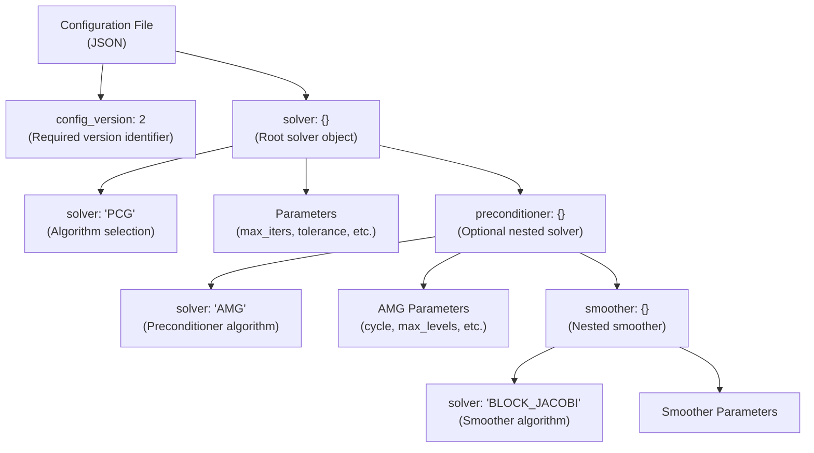
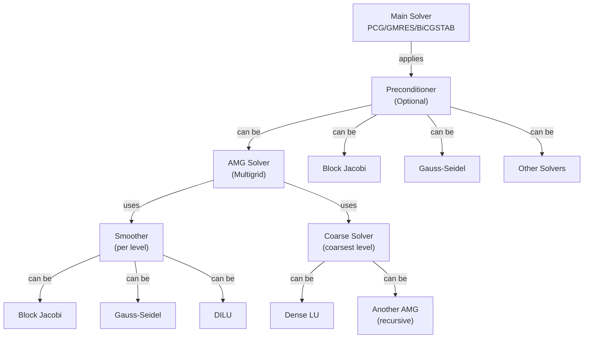
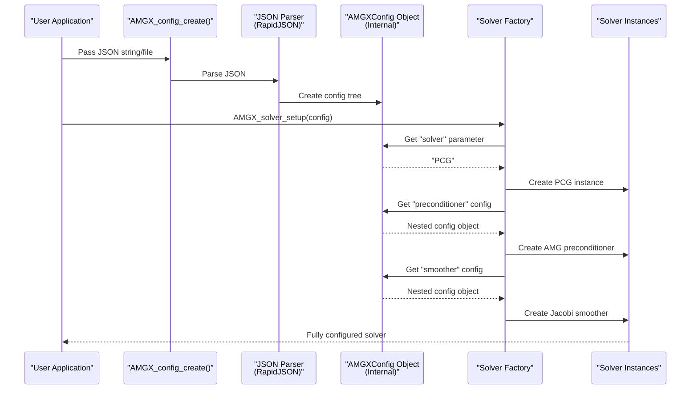
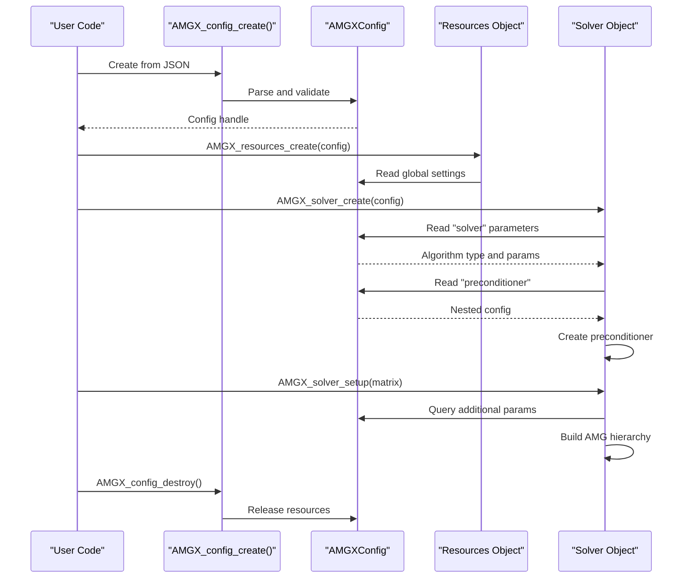

<!-- source: DeepWiki mcp.deepwiki.com · repo NVIDIA/AMGX · page 4.2 Configuration System · fetched 2026-10-26 -->

# Configuration System

<details>
<summary>Relevant source files</summary>

The following files were used as context for generating this wiki page:

- [.gitignore](.gitignore)
- [README.md](README.md)
- [doc/AMGX_Reference.pdf](doc/AMGX_Reference.pdf)
- [src/configs/PCG_F.json](src/configs/PCG_F.json)
- [src/configs/PCG_V.json](src/configs/PCG_V.json)
- [src/configs/PCG_W.json](src/configs/PCG_W.json)

</details>


The Configuration System in AMGX provides a flexible JSON-based mechanism for defining solver behavior, including nested compositions of solvers, preconditioners, and smoothers. This system allows users to control algorithm selection, parameter tuning, and hierarchical solver construction without recompiling code.

For information about the C API functions that consume configurations, see [C API](#4.1). For practical usage examples, see [Examples and Usage](#4.3).

## Purpose and Scope

The Configuration System serves as the primary interface for controlling AMGX solver behavior. It enables users to:

- Select solver algorithms (PCG, GMRES, BiCGSTAB, etc.)
- Configure preconditioners (AMG, Block Jacobi, etc.)
- Define nested solver hierarchies (solver with preconditioner, preconditioner with smoother)
- Set algorithm parameters (tolerances, iteration limits, convergence criteria)
- Control output and monitoring behavior
- Configure multi-level parameters for AMG hierarchies

Configuration objects are created via the C API function `AMGX_config_create()` and can be specified either as JSON file paths or as inline JSON strings.

Sources: [README.md:3-18](), [README.md:90-129]()

## Configuration File Format

### Basic Structure

AMGX configurations are JSON objects with a required `config_version` field and a `solver` object containing the solver hierarchy definition.



**Diagram: Configuration File Structure**

The configuration system uses nested JSON objects to define hierarchical solver compositions. Each solver object can contain a `preconditioner` field, which is itself a solver object, enabling arbitrary nesting depth.

Sources: [src/configs/PCG_V.json:1-35](), [src/configs/PCG_W.json:1-35](), [src/configs/PCG_F.json:1-35]()

### Example Configuration

```json
{
    "config_version": 2,
    "solver": {
        "solver": "PCG",
        "max_iters": 100,
        "tolerance": 1e-06,
        "convergence": "RELATIVE_INI",
        "norm": "L2",
        "monitor_residual": 1,
        "print_solve_stats": 1,
        "scope": "main",
        "preconditioner": {
            "solver": "AMG",
            "max_iters": 1,
            "cycle": "V",
            "max_levels": 50,
            "presweeps": 1,
            "postsweeps": 1,
            "scope": "amg",
            "print_grid_stats": 1,
            "smoother": {
                "solver": "BLOCK_JACOBI",
                "monitor_residual": 0,
                "print_solve_stats": 0,
                "scope": "jacobi"
            }
        }
    }
}
```

This configuration defines a three-level hierarchy:
1. **Main solver**: PCG with 100 iterations, 1e-6 tolerance
2. **Preconditioner**: AMG with V-cycle, up to 50 levels
3. **Smoother**: Block Jacobi applied at each AMG level

Sources: [src/configs/PCG_V.json:1-35]()

## Configuration Hierarchy and Nesting

### Nested Solver Composition



**Diagram: Solver Composition Hierarchy**

Each level in the hierarchy is defined by a `solver` field specifying the algorithm type. The `preconditioner` field creates nested compositions, and AMG solvers additionally support `smoother` and `coarse_solver` fields for further nesting.

Sources: [src/configs/PCG_V.json:4-23](), [README.md:13]()

### Configuration Flow Through System



**Diagram: Configuration Processing Flow**

The configuration system parses JSON into an internal tree structure that is queried during solver setup. Each nested object triggers creation of the corresponding solver component with its parameters.

Sources: [README.md:95-129](), [README.md:133-186]()

## Scope System

### Purpose of Scopes

The `scope` parameter associates a configuration object with a specific solver instance in the hierarchy. This enables:

- Parameter isolation between nested solvers
- Selective parameter overrides
- Identification of solver components in output
- Configuration reuse across multiple solvers

### Scope Naming Convention

| Scope Value | Usage | Typical Location |
|-------------|-------|------------------|
| `"main"` | Top-level solver | Root solver object |
| `"amg"` | AMG preconditioner | Preconditioner block |
| `"jacobi"` | Jacobi smoother | Smoother block in AMG |
| `"gs"` | Gauss-Seidel smoother | Smoother block |
| `"coarse"` | Coarse-level solver | AMG coarse_solver block |
| Custom names | User-defined identifiers | Any nested level |

**Table: Common Scope Values**

Scope values are arbitrary strings chosen by the user. Standard patterns use descriptive names matching the solver type, but any unique identifier is valid.

Sources: [src/configs/PCG_V.json:9](), [src/configs/PCG_V.json:20](), [src/configs/PCG_V.json:31]()

### Scope Usage Example

```json
{
    "solver": {
        "solver": "FGMRES",
        "scope": "outer_gmres",
        "preconditioner": {
            "solver": "AMG",
            "scope": "amg_precond",
            "smoother": {
                "solver": "BLOCK_JACOBI",
                "scope": "level_smoother"
            },
            "coarse_solver": {
                "solver": "DENSE_LU_SOLVER",
                "scope": "direct_solve"
            }
        }
    }
}
```

Each scope identifies its component in diagnostic output and enables independent parameter control.

Sources: [src/configs/PCG_V.json:9](), [src/configs/PCG_V.json:20](), [src/configs/PCG_V.json:31]()

## Common Configuration Parameters

### Solver-Level Parameters

| Parameter | Type | Description | Default | Example Values |
|-----------|------|-------------|---------|----------------|
| `solver` | string | Algorithm selection | (required) | `"PCG"`, `"GMRES"`, `"AMG"`, `"BLOCK_JACOBI"` |
| `max_iters` | integer | Maximum iterations | 100 | `1`, `100`, `1000` |
| `tolerance` | float | Convergence tolerance | 1e-6 | `1e-6`, `1e-10`, `1e-12` |
| `convergence` | string | Convergence criterion | `"RELATIVE_INI"` | `"ABSOLUTE"`, `"RELATIVE_INI"`, `"RELATIVE_MAX"` |
| `norm` | string | Residual norm type | `"L2"` | `"L1"`, `"L2"`, `"LINF"` |
| `monitor_residual` | integer | Print residuals | 0 | `0` (off), `1` (on) |
| `print_solve_stats` | integer | Print solve statistics | 0 | `0` (off), `1` (on) |
| `store_res_history` | integer | Store residual history | 0 | `0` (off), `1` (on) |
| `obtain_timings` | integer | Collect timing data | 0 | `0` (off), `1` (on) |

**Table: Common Solver Parameters**

These parameters apply to most solver types and control iteration behavior, convergence checking, and output.

Sources: [src/configs/PCG_V.json:25-33](), [src/configs/PCG_W.json:25-33](), [src/configs/PCG_F.json:25-33]()

### AMG-Specific Parameters

| Parameter | Type | Description | Example Values |
|-----------|------|-------------|----------------|
| `cycle` | string | Multigrid cycle type | `"V"`, `"W"`, `"F"`, `"CG"`, `"CGF"` |
| `max_levels` | integer | Maximum hierarchy levels | `50`, `100`, `1000` |
| `presweeps` | integer | Pre-smoothing iterations | `0`, `1`, `2` |
| `postsweeps` | integer | Post-smoothing iterations | `0`, `1`, `2` |
| `interpolator` | string | Interpolation method | `"D2"`, `"D1"`, `"MULTIPASS"` |
| `print_grid_stats` | integer | Print hierarchy statistics | `0` (off), `1` (on) |
| `print_vis_data` | integer | Print visualization data | `0` (off), `1` (on) |
| `coarsen` | string | Coarsening algorithm | `"PMIS"`, `"AGGRESSIVE_PMIS"`, `"HMIS"` |
| `selector` | string | Aggregation selector | `"SIZE_2"`, `"SIZE_4"`, `"SIZE_8"` |
| `coarse_solver` | object | Coarsest-level solver | Nested solver config |
| `smoother` | object | Level smoother | Nested solver config |

**Table: AMG Configuration Parameters**

AMG solvers accept specialized parameters controlling multigrid hierarchy construction and cycling behavior. The cycle type determines traversal pattern: V-cycle visits each level once, W-cycle visits coarse levels multiple times, F-cycle uses full multigrid.

Sources: [src/configs/PCG_V.json:4-23](), [src/configs/PCG_W.json:4-23](), [src/configs/PCG_F.json:4-23]()

### Cycle Type Comparison

```mermaid
graph TB
    subgraph "V-Cycle"
        V0["Finest Level"]
        V1["Level 1"]
        V2["Level 2"]
        V3["Coarsest"]
        
        V0 --> V1
        V1 --> V2
        V2 --> V3
        V3 --> V2b["Level 2"]
        V2b --> V1b["Level 1"]
        V1b --> V0b["Finest Level"]
    end
    
    subgraph "W-Cycle"
        W0["Finest Level"]
        W1["Level 1"]
        W2a["Level 2"]
        W3a["Coarsest"]
        W2b["Level 2"]
        W3b["Coarsest"]
        
        W0 --> W1
        W1 --> W2a
        W2a --> W3a
        W3a --> W2a2["Level 2"]
        W2a2 --> W1a["Level 1"]
        W1a --> W2b
        W2b --> W3b
        W3b --> W2b2["Level 2"]
        W2b2 --> W1b["Level 1"]
        W1b --> W0b["Finest Level"]
    end
    
    subgraph "F-Cycle"
        F0["Finest Level"]
        F1["Level 1"]
        F2["Level 2"]
        F3["Coarsest"]
        
        F0 --> F1
        F1 --> F2
        F2 --> F3
        F3 --> F2b["Level 2"]
        F2b --> F1b["Level 1"]
        F1b --> F2c["Level 2"]
        F2c --> F3c["Coarsest"]
        F3c --> F2d["Level 2"]
        F2d --> F1c["Level 1"]
        F1c --> F0b["Finest Level"]
    end
```



**Diagram: AMG Cycle Types**

- **V-Cycle** (`"cycle": "V"`): Single descent to coarsest, then ascent
- **W-Cycle** (`"cycle": "W"`): Multiple visits to coarse levels (more expensive, better convergence)
- **F-Cycle** (`"cycle": "F"`): Full multigrid with nested V-cycles (highest quality, most expensive)

Sources: [src/configs/PCG_V.json:22](), [src/configs/PCG_W.json:22](), [src/configs/PCG_F.json:22]()

### Krylov Solver Parameters

| Parameter | Type | Solver | Description |
|-----------|------|--------|-------------|
| `gmres_n_restart` | integer | GMRES | Restart frequency | 
| `preconditioner` | object | PCG, GMRES, BiCGSTAB | Nested preconditioner config |
| `use_scalar_norm` | integer | All Krylov | Scalar vs. block norm |
| `weighted_convergence` | integer | Block systems | Weight block components |

**Table: Krylov Method Parameters**

Sources: [src/configs/PCG_V.json:4]()

## Configuration Versioning

### Version Field

The `config_version` field ensures compatibility between configuration files and AMGX library versions. Current version is `2`.

```json
{
    "config_version": 2,
    "solver": { ... }
}
```

If the version field is missing or incompatible, AMGX attempts automatic conversion or emits a warning. Version 2 introduced:

- Hierarchical nested solver syntax
- Scope-based parameter isolation
- Expanded parameter set
- Improved JSON validation

Sources: [src/configs/PCG_V.json:2](), [src/configs/PCG_W.json:2](), [src/configs/PCG_F.json:2]()

### Legacy Configuration Format

Pre-version-2 configurations used a flattened parameter syntax with prefixes:

```
config_version=1, solver=PCG, amg:algorithm=AGGREGATION, jacobi:relaxation_factor=0.9
```

Modern configurations use JSON object nesting instead of prefixes. The library can parse legacy string-based configs but JSON is preferred.

Sources: [README.md:142-143]()

## Runtime Configuration Processing

### Configuration Object Lifecycle



**Diagram: Configuration Object Lifecycle**

Configuration objects are created early and remain valid throughout solver lifetime. They are queried during solver creation (`AMGX_solver_create`) and setup (`AMGX_solver_setup`), enabling parameter-driven behavior without recompilation.

Sources: [README.md:95-129](), [README.md:133-186]()

### Parameter Query Mechanism

The configuration system internally uses a key-value store supporting:

- **Hierarchical lookup**: Parameters searched in nested scope, then parent scopes
- **Type conversion**: JSON values automatically converted to required C++ types
- **Default values**: Missing parameters use algorithm-specific defaults
- **Validation**: Parameter ranges and dependencies checked at creation time

When a solver queries a parameter like `max_iters`, the system:
1. Looks in the current scope's configuration object
2. Applies type conversion (JSON number to C++ int)
3. Returns the value or default if not found

This design enables compile-time polymorphism (template-based solvers) with runtime configuration flexibility.

Sources: [src/configs/PCG_V.json:1-35]()

## Configuration Examples by Use Case

### Example 1: Simple Iterative Solver

```json
{
    "config_version": 2,
    "solver": {
        "solver": "BICGSTAB",
        "max_iters": 1000,
        "tolerance": 1e-8,
        "norm": "L2",
        "print_solve_stats": 1
    }
}
```

BiCGSTAB without preconditioning. Suitable for well-conditioned systems or testing.

### Example 2: Preconditioned Krylov Method

```json
{
    "config_version": 2,
    "solver": {
        "solver": "PCG",
        "tolerance": 1e-10,
        "max_iters": 200,
        "preconditioner": {
            "solver": "BLOCK_JACOBI",
            "max_iters": 1
        }
    }
}
```

PCG with one iteration of Block Jacobi preconditioning per outer iteration.

### Example 3: Multi-Level AMG with Custom Smoother

```json
{
    "config_version": 2,
    "solver": {
        "solver": "AMG",
        "max_iters": 100,
        "cycle": "W",
        "max_levels": 100,
        "presweeps": 2,
        "postsweeps": 2,
        "smoother": {
            "solver": "MULTICOLOR_DILU",
            "max_iters": 1
        },
        "coarse_solver": {
            "solver": "DENSE_LU_SOLVER"
        }
    }
}
```

Standalone AMG with W-cycle, 2 pre/post smoothing sweeps using multicolor DILU, and dense LU on coarsest level.

Sources: [src/configs/PCG_V.json:1-35](), [src/configs/PCG_W.json:1-35]()

### Example 4: Nested AMG (V-cycle preconditioner for GMRES)

```json
{
    "config_version": 2,
    "solver": {
        "solver": "FGMRES",
        "max_iters": 50,
        "gmres_n_restart": 30,
        "preconditioner": {
            "solver": "AMG",
            "max_iters": 1,
            "cycle": "V",
            "algorithm": "AGGREGATION",
            "selector": "SIZE_4",
            "smoother": {
                "solver": "BLOCK_JACOBI",
                "relaxation_factor": 0.9
            }
        }
    }
}
```

FGMRES outer solver with one V-cycle of aggregation AMG per iteration. This composition is common for difficult problems.

Sources: [README.md:95](), [src/configs/PCG_V.json:1-35]()

## Configuration File Location and Usage

### Standard Configuration Directory

AMGX provides preconfigured solver setups in the repository at `src/configs/`:

| File | Description |
|------|-------------|
| `PCG_V.json` | PCG with V-cycle AMG preconditioner |
| `PCG_W.json` | PCG with W-cycle AMG preconditioner |
| `PCG_F.json` | PCG with F-cycle AMG preconditioner |
| `FGMRES_AGGREGATION.json` | FGMRES with aggregation AMG |
| Various others | Additional preconfigured combinations |

**Table: Standard Configuration Files**

These serve as starting points for common use cases and demonstrate proper configuration syntax.

Sources: [README.md:90](), [README.md:95](), [README.md:133]()

### Usage in C API

Configurations are loaded via `AMGX_config_create()`:

**From file**:
```c
AMGX_config_handle cfg;
AMGX_config_create(&cfg, "../src/configs/PCG_V.json");
```

**From string**:
```c
const char* cfg_string = 
    "{\"config_version\":2,"
    " \"solver\":{\"solver\":\"PCG\",\"max_iters\":100}}";
AMGX_config_create(&cfg, cfg_string);
```

The function automatically detects whether input is a file path or JSON string.

Sources: [README.md:95](), [README.md:133]()

### Configuration in Command-Line Examples

Example binaries accept configuration via `-c` flag:

```bash
./amgx_capi -m matrix.mtx -c ../src/configs/PCG_V.json
```

```bash
mpirun -n 4 ./amgx_mpi_capi -m matrix.mtx -c ../src/configs/FGMRES_AGGREGATION.json
```

The configuration controls all solver behavior without code changes, enabling rapid prototyping and parameter tuning.

Sources: [README.md:95](), [README.md:133]()

## Parameter Reference by Component

### Core Solver Selection

| Solver String | Algorithm | Typical Use Case |
|---------------|-----------|------------------|
| `"PCG"` | Preconditioned Conjugate Gradient | SPD systems |
| `"GMRES"` | Generalized Minimal Residual | Non-symmetric systems |
| `"FGMRES"` | Flexible GMRES | Variable preconditioning |
| `"BICGSTAB"` | BiConjugate Gradient Stabilized | Non-symmetric systems |
| `"AMG"` | Algebraic Multigrid | Preconditioner or standalone |
| `"BLOCK_JACOBI"` | Block Jacobi | Smoother or preconditioner |
| `"MULTICOLOR_DILU"` | Distributed ILU | Advanced smoother |
| `"DENSE_LU_SOLVER"` | Dense LU factorization | Coarse-level direct solve |

**Table: Solver Algorithm Selection**

The `solver` parameter string determines which algorithm class is instantiated. This is the primary configuration decision.

Sources: [src/configs/PCG_V.json:7](), [src/configs/PCG_V.json:25](), [src/configs/PCG_V.json:9](), [README.md:14-16]()

### Convergence Control Parameters

| Parameter | Values | Meaning |
|-----------|--------|---------|
| `convergence` | `"ABSOLUTE"` | Stop when ‖r‖ < tolerance |
| | `"RELATIVE_INI"` | Stop when ‖r‖/‖r₀‖ < tolerance |
| | `"RELATIVE_MAX"` | Stop when ‖r‖/‖rₘₐₓ‖ < tolerance |
| `norm` | `"L1"` | Manhattan norm |
| | `"L2"` | Euclidean norm (default) |
| | `"LINF"` | Maximum absolute value |
| `tolerance` | Float | Convergence threshold (default 1e-6) |
| `max_iters` | Integer | Iteration limit (default 100) |

**Table: Convergence Configuration**

These parameters work together to define stopping criteria. `RELATIVE_INI` is most common, measuring relative reduction from initial residual.

Sources: [src/configs/PCG_V.json:30](), [src/configs/PCG_V.json:32-33]()

### Output and Monitoring Parameters

| Parameter | Type | Effect | Performance Impact |
|-----------|------|--------|-------------------|
| `print_solve_stats` | 0/1 | Print iteration statistics | Minimal |
| `monitor_residual` | 0/1 | Print residual each iteration | Low |
| `store_res_history` | 0/1 | Store residual history in memory | Low |
| `obtain_timings` | 0/1 | Collect detailed timing data | Low |
| `print_grid_stats` | 0/1 | Print AMG hierarchy info | Minimal |
| `print_vis_data` | 0/1 | Output visualization data | Medium |

**Table: Output Configuration Parameters**

These control diagnostic output without affecting algorithm behavior. Setting all to 0 minimizes overhead for production runs.

Sources: [src/configs/PCG_V.json:11-12](), [src/configs/PCG_V.json:14](), [src/configs/PCG_V.json:18-19](), [src/configs/PCG_V.json:27](), [src/configs/PCG_V.json:29]()

## Advanced Configuration Patterns

### Pattern 1: Multi-Stage Preconditioning

```json
{
    "config_version": 2,
    "solver": {
        "solver": "FGMRES",
        "preconditioner": {
            "solver": "BLOCK_JACOBI",
            "preconditioner": {
                "solver": "AMG",
                "cycle": "V"
            }
        }
    }
}
```

Apply Block Jacobi first, then AMG, creating a two-stage preconditioner. This pattern is rare but demonstrates nesting flexibility.

### Pattern 2: Recursive AMG

```json
{
    "config_version": 2,
    "solver": {
        "solver": "AMG",
        "cycle": "V",
        "max_levels": 10,
        "coarse_solver": {
            "solver": "AMG",
            "cycle": "V",
            "max_levels": 5,
            "coarse_solver": {
                "solver": "DENSE_LU_SOLVER"
            }
        }
    }
}
```

Use AMG as its own coarse solver, creating two-stage hierarchy. The inner AMG might use different parameters (e.g., different coarsening).

### Pattern 3: Scope-Based Parameter Override

Multiple solver instances can share a base configuration but override specific parameters using different JSON objects. This requires creating multiple `AMGX_config` handles from different JSON files.

Sources: [src/configs/PCG_V.json:1-35]()

## Configuration Best Practices

### Performance Tuning Guidelines

1. **Start simple**: Begin with `PCG` or `GMRES` without preconditioner to establish baseline
2. **Add AMG**: Most problems benefit from AMG preconditioning; start with V-cycle
3. **Tune smoothing**: Increase `presweeps` and `postsweeps` if convergence is slow
4. **Adjust levels**: Reduce `max_levels` for memory constraints, increase for faster convergence
5. **Try W-cycle**: If V-cycle converges slowly, W-cycle often helps (at higher cost)
6. **Coarse solver**: Use `DENSE_LU_SOLVER` for exact coarse-level solve when feasible

### Common Configuration Mistakes

| Mistake | Symptom | Solution |
|---------|---------|----------|
| Missing `config_version` | Parse error or warning | Add `"config_version": 2` |
| Incorrect JSON syntax | Parse failure | Validate JSON (trailing commas, quotes) |
| `max_iters: 1` on main solver | No convergence | Set higher limit on outer solver |
| No `tolerance` specified | Uses default 1e-6 | Explicitly set for clarity |
| Too many AMG levels | Memory overflow | Reduce `max_levels` |
| Missing `preconditioner` | Slow convergence | Add AMG or Jacobi preconditioner |

**Table: Common Configuration Issues**

Sources: [src/configs/PCG_V.json:1-35]()

## Integration with Other Systems

### Configuration and Mode Selection

The configuration system is independent of the Mode system (see [Mode System and Template Dispatch](#4.1.2)). The mode (precision, memory space) is specified separately when creating resources:

```c
AMGX_Mode mode = AMGX_mode_dDDI;  // double precision, device memory
AMGX_resources_create(&resources, cfg, &comm, 1, &device);
```

The same configuration JSON works across all modes; precision selection happens at the C API level.

### Configuration in Distributed Settings

MPI-parallel solvers use identical configuration syntax. The configuration applies to the local solver on each rank. Additional distributed-specific parameters may be available:

- `communicator_type`: Select communication implementation
- `separation_interior`: Enable interior/boundary separation
- `fine_level_consolidation`: Consolidate finest level to one rank

These are global settings, not per-solver parameters.

Sources: [README.md:133-186](), [README.md:95-129]()

---

**Sources for entire document**: [README.md:1-208](), [src/configs/PCG_V.json:1-35](), [src/configs/PCG_W.json:1-35](), [src/configs/PCG_F.json:1-35]()

---

