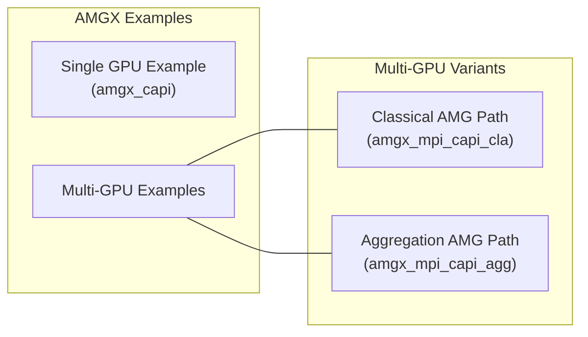
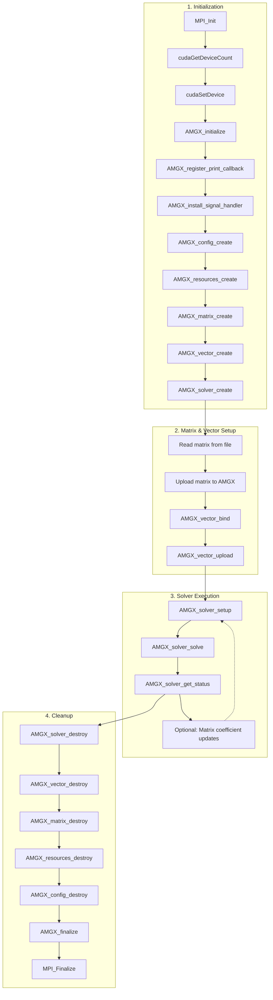
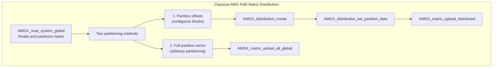
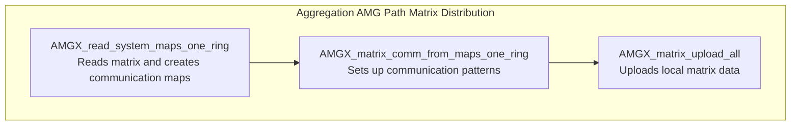
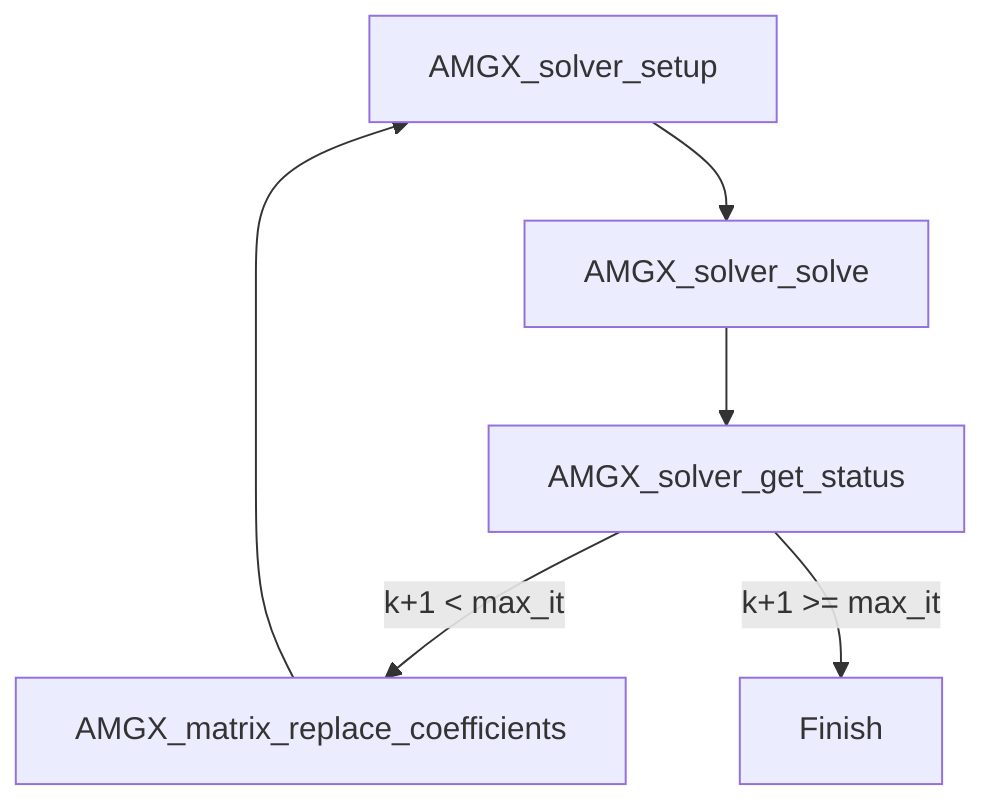
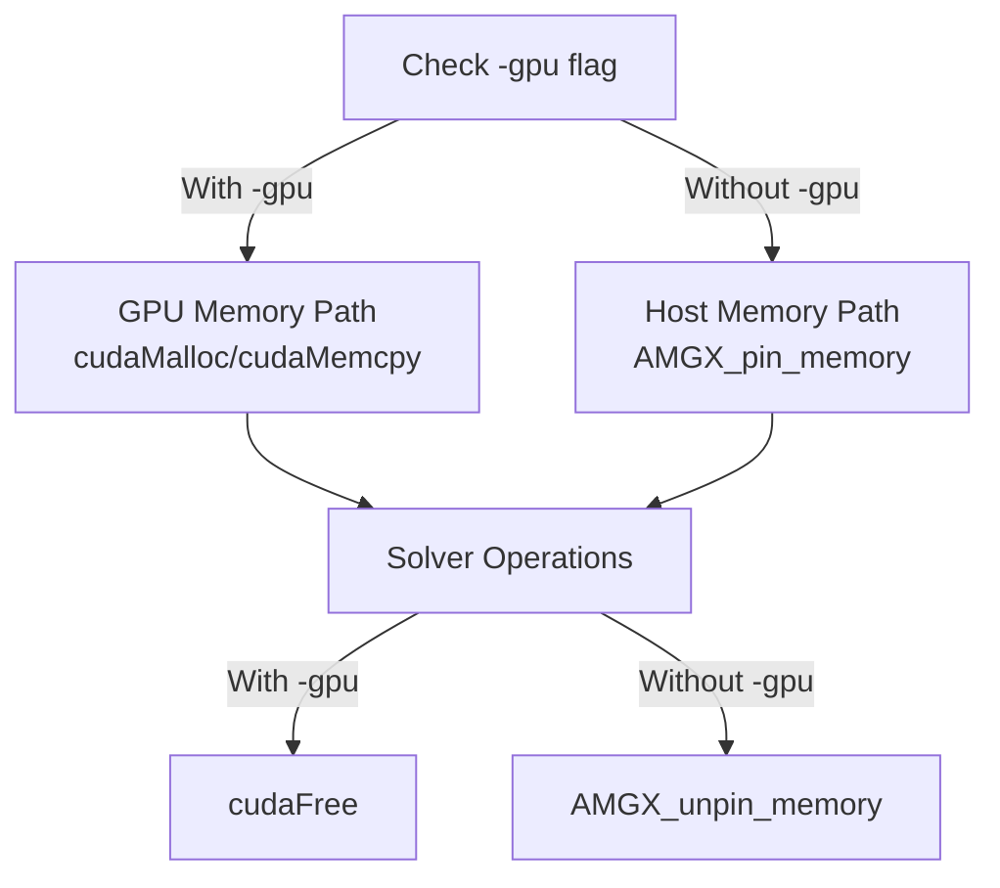

<!-- source: DeepWiki mcp.deepwiki.com · repo NVIDIA/AMGX · page 4.3 Examples and Usage · fetched 2026-10-26 -->

# Examples

<details>
<summary>Relevant source files</summary>

The following files were used as context for generating this wiki page:

- [CMakeLists.txt](CMakeLists.txt)
- [examples/CMakeLists.txt](examples/CMakeLists.txt)
- [examples/amgx_capi.h](examples/amgx_capi.h)
- [examples/amgx_mpi_capi.c](examples/amgx_mpi_capi.c)
- [examples/amgx_mpi_poisson7.c](examples/amgx_mpi_poisson7.c)
- [examples/eigen_examples/CMakeLists.txt](examples/eigen_examples/CMakeLists.txt)
- [include/amgx_c.h](include/amgx_c.h)
- [src/CMakeLists.txt](src/CMakeLists.txt)
- [src/amgx_c.cu](src/amgx_c.cu)
- [src/matrix_analysis.cu](src/matrix_analysis.cu)

</details>


This page provides an overview of the example programs included in the AMGX repository, demonstrating how to use the AMGX library for solving linear systems on NVIDIA GPUs. These examples illustrate both single GPU and multi-GPU/MPI execution patterns and serve as practical guides for using the AMGX C API.

## Example Categories

AMGX includes several example programs that demonstrate different usage scenarios:



### Single GPU Example

The single GPU example (`amgx_capi`) demonstrates how to use AMGX on a single GPU to solve a linear system. This example is suitable for problems that fit in a single GPU's memory.

### Multi-GPU Examples

For larger problems or to leverage multiple GPUs, AMGX provides two main approaches:

- **Classical AMG Path** (`amgx_mpi_capi_cla`): Uses global indices for matrix distribution, recommended for classical (Ruge-Steuben) AMG methods and uses 2 rings by default.

- **Aggregation AMG Path** (`amgx_mpi_capi_agg`): Uses one-ring exchange for matrix distribution, optimized for unsmoothed aggregation AMG methods and uses 1 ring by default.

Sources: [README.md:98-191](), [examples/amgx_mpi_capi_cla.c:1-619](), [examples/amgx_mpi_capi_agg.c:1-600]()

## Running Examples

### Command Line Arguments

All example programs accept a set of command line arguments to configure their behavior:

| Argument | Description |
|----------|-------------|
| `-mode [dDDI \| dDFI \| dFFI]` | Select the solver mode (double-double-int, etc.) |
| `-m file` | Read matrix stored in the file (Matrix Market format) |
| `-c config_file` | Set the AMG solver options from the config file |
| `-amg "param1=value1 param2=value2"` | Set the AMG solver options from the command line |
| `-gpu` | Load the matrix from the device memory |
| `-it k` | Set the number k of outer (non-linear) iterations |
| `-partvec file` | Specify a partition vector file for custom partitioning |
| `--version` | Display the AMGX version information |

### Example Commands

#### Single GPU Example
```bash
examples/amgx_capi -m ../examples/matrix.mtx -c ../src/configs/FGMRES_AGGREGATION.json
```

#### Multi-GPU Example (Classical Path)
```bash
mpirun -n 2 examples/amgx_mpi_capi_cla -m ../examples/matrix.mtx -c ../src/configs/FGMRES_AGGREGATION.json
```

#### Multi-GPU Example (Aggregation Path)
```bash
mpirun -n 2 examples/amgx_mpi_capi_agg -m ../examples/matrix.mtx -c ../src/configs/FGMRES_AGGREGATION.json
```

Sources: [README.md:98-191](), [examples/amgx_mpi_capi_cla.c:50-72](), [examples/amgx_mpi_capi_agg.c:50-62]()

## Example Code Structure

All examples follow a similar workflow pattern, varying primarily in how they handle matrix distribution for multi-GPU scenarios.

### Common Execution Flow



Sources: [examples/amgx_mpi_capi_cla.c:163-618](), [examples/amgx_mpi_capi_agg.c:163-599]()

## Distributed Matrix Handling

The key difference between example variants is how they handle distributed matrices in multi-GPU scenarios:

### Classical AMG Path (`amgx_mpi_capi_cla`)



Key features:
- Uses global indices for matrix distribution
- Suitable for classical AMG methods with 2 rings
- Supports two methods for partitioning:
  1. Using partition offsets (more scalable for contiguous partitioning)
  2. Using a full partition vector (for arbitrary partitioning)

### Aggregation AMG Path (`amgx_mpi_capi_agg`)



Key features:
- Uses one-ring exchange for matrix distribution
- Optimized for aggregation AMG methods with 1 ring
- Creates explicit communication maps:
  - `send_maps`: Maps of indices to send to each neighbor
  - `recv_maps`: Maps of indices to receive from each neighbor

Sources: [examples/amgx_mpi_capi_cla.c:345-500](), [examples/amgx_mpi_capi_agg.c:345-485]()

## Matrix Partitioning Example

Both examples include documentation explaining how matrices are partitioned in distributed scenarios:

```
Initial unpartitioned matrix:
CSR row_offsets [0 4 8 13 21 25 32 36 41 46 50 57 61]
CSR col_indices [0 1 3 8
                 0 1 2 3
                 1 2 3 4 5
                 ...]

Partitioning into three pieces with partition vector [0 0 0 0 1 1 1 1 2 2 2 2]
```

The examples show how this matrix is distributed across processes and how the necessary communication patterns are established.

Sources: [examples/amgx_mpi_capi_cla.c:368-413](), [examples/amgx_mpi_capi_agg.c:368-421]()

## Advanced Usage Patterns

### Non-linear Iterations

The examples demonstrate how to perform multiple non-linear iterations using the `-it k` parameter:



This pattern allows solving systems where the matrix coefficients change between iterations, useful for non-linear problems.

### Parameter Modification

The examples show how to modify solver parameters between iterations:

```c
// Example: Change tolerance between iterations
AMGX_config_add_parameters(&cfg, "config_version=2, default:tolerance=1e-12");
```

### Custom Callback Functions

The examples implement custom callback functions for printing, which can be customized for application needs:

```c
// Register print callback
AMGX_register_print_callback(&print_callback);

// Print callback implementation
void print_callback(const char *msg, int length) {
    int rank;
    MPI_Comm_rank(MPI_COMM_WORLD, &rank);
    if (rank == 0) { printf("%s", msg); }
}
```

Sources: [examples/amgx_mpi_capi_cla.c:494-554](), [examples/amgx_mpi_capi_agg.c:494-532](), [examples/amgx_mpi_capi_cla.c:41-57](), [examples/amgx_mpi_capi_agg.c:41-47]()

## Memory Management

The examples demonstrate proper memory management techniques for both host and device memory:

### GPU Memory Management Options

1. **Direct GPU Upload**
   - Use the `-gpu` flag
   - Allocates GPU memory with `cudaMalloc` and transfers data with `cudaMemcpy`
   - Operates directly on GPU memory

2. **Host Memory Pinning**
   - Default approach when not using `-gpu`
   - Uses `AMGX_pin_memory` to pin host memory for efficient transfers
   - AMGX internally handles data movement



Sources: [examples/amgx_mpi_capi_cla.c:416-477](), [examples/amgx_mpi_capi_agg.c:424-477](), [examples/amgx_mpi_capi_cla.c:571-601](), [examples/amgx_mpi_capi_agg.c:549-601]()

## Example Output

The examples produce detailed output showing solver performance and convergence metrics:

```
AMG Grid:
         Number of Levels: 1
            LVL         ROWS               NNZ    SPRSTY       Mem (GB)
         --------------------------------------------------------------
           0(D)           12                61     0.424       8.75e-07
         --------------------------------------------------------------
         Grid Complexity: 1
         Operator Complexity: 1
         Total Memory Usage: 8.75443e-07 GB
         --------------------------------------------------------------
           iter      Mem Usage (GB)       residual           rate
         --------------------------------------------------------------
            Ini            0.403564   3.464102e+00
              0            0.403564   1.619840e-14         0.0000
         --------------------------------------------------------------
         Total Iterations: 1
         Avg Convergence Rate:               0.0000
         Final Residual:           1.619840e-14
         Total Reduction in Residual:      4.676075e-15
         Maximum Memory Usage:                0.404 GB
         --------------------------------------------------------------
Total Time: 0.00169123
    setup: 0.00100198 s
    solve: 0.000689248 s
    solve(per iteration): 0.000689248 s
```

This output provides insights into:
- AMG grid hierarchy
- Memory usage
- Convergence history
- Performance timings

Sources: [README.md:99-135]()

## Summary

The AMGX examples provide comprehensive demonstrations of how to use the library's C API for solving linear systems on NVIDIA GPUs. They cover the full workflow from initialization to cleanup, and illustrate both single-GPU and multi-GPU/MPI execution patterns.

For MPI-based distributed computing examples, see [MPI Examples](#4.3.1) which provides more details on distributed execution patterns.

---

