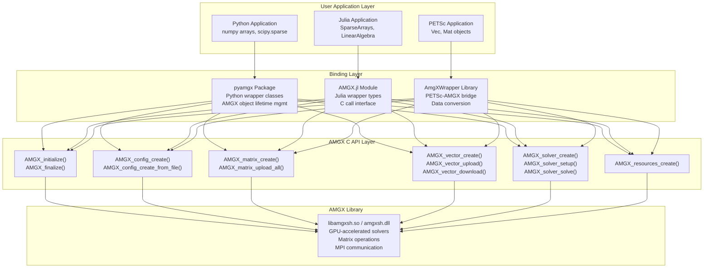
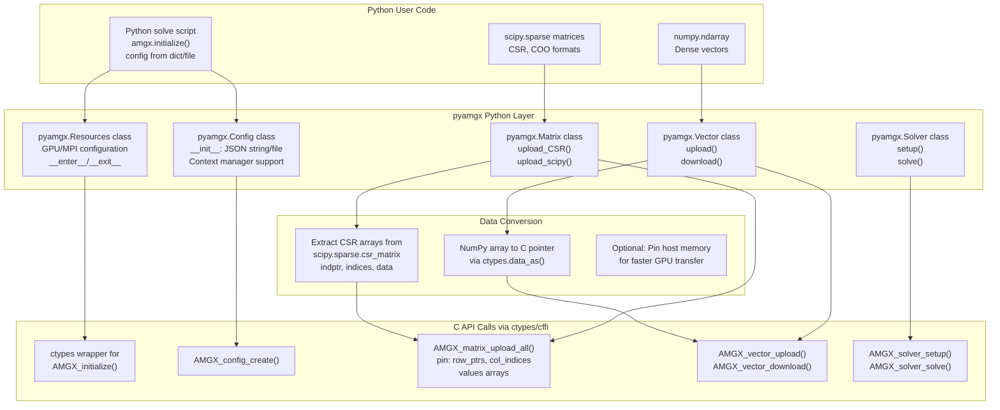
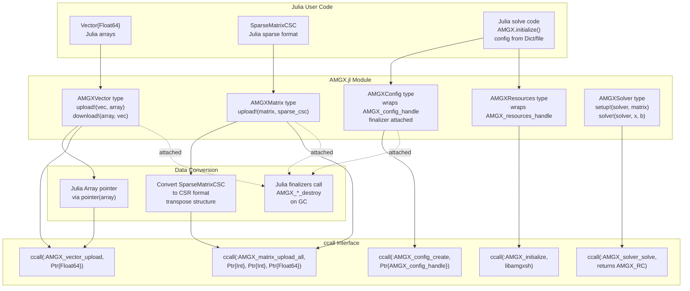
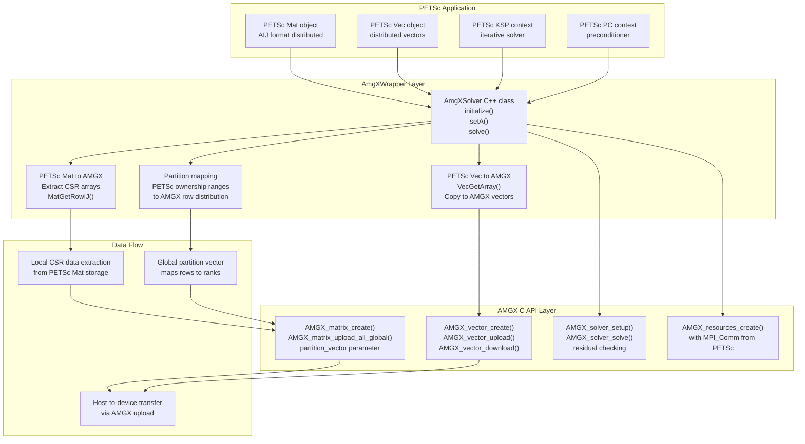
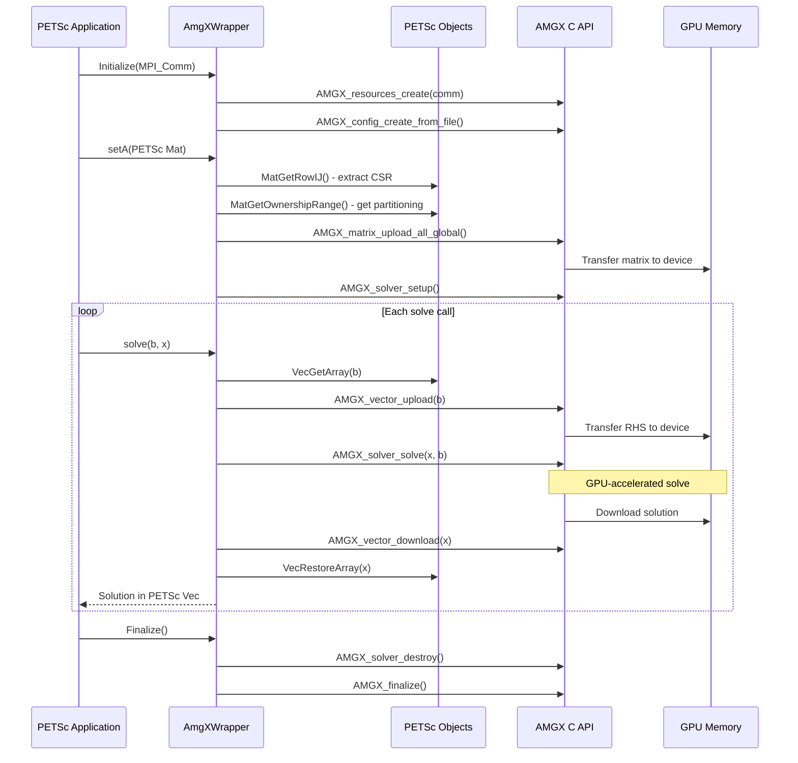
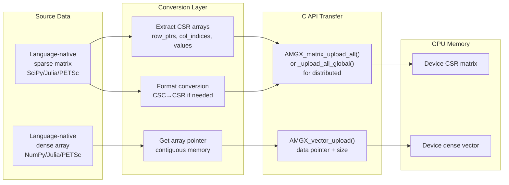

<!-- source: DeepWiki mcp.deepwiki.com · repo NVIDIA/AMGX · page 4.4 External Bindings · fetched 2026-10-26 -->

# External Bindings

<details>
<summary>Relevant source files</summary>

The following files were used as context for generating this wiki page:

- [.gitignore](.gitignore)
- [README.md](README.md)
- [doc/AMGX_Reference.pdf](doc/AMGX_Reference.pdf)

</details>


## Purpose and Scope

This document describes community-maintained language bindings and framework integrations that enable AMGX usage from Python, Julia, and PETSc. These bindings provide idiomatic interfaces to the AMGX C API, allowing applications in these environments to leverage GPU-accelerated algebraic multigrid solving without directly managing C API calls.

For information about the underlying C API that these bindings interface with, see [C API](#4.1). For direct C/C++ usage examples, see [Examples and Usage](#4.3).

**Sources**: [README.md:195-201]()

---

## Binding Architecture Overview

All external bindings follow a common architecture pattern: they wrap the AMGX C API (`amgx_c.h`) to provide language-native interfaces while maintaining the underlying performance characteristics of GPU-accelerated solving.

### General Binding Architecture



**Description**: All bindings interface with AMGX through the C API defined in `amgx_c.h`. The binding layer translates language-specific data structures (numpy arrays, Julia arrays, PETSc vectors) into the opaque handle-based C API calls. This architecture ensures that bindings benefit from all AMGX features (GPU acceleration, MPI distribution, configuration flexibility) without reimplementation.

**Sources**: [README.md:195-201]()

---

## Python Bindings (pyamgx)

### Overview

The `pyamgx` package, developed by @shwina, provides Pythonic access to AMGX functionality. It wraps AMGX C API objects as Python classes with automatic resource management and integrates with NumPy arrays and SciPy sparse matrices.

**Repository**: https://github.com/shwina/pyamgx

### Architecture and API Mapping



**Description**: `pyamgx` wraps each AMGX C API object type (Config, Resources, Matrix, Vector, Solver) as a Python class. These classes implement context managers (`__enter__`/`__exit__`) for automatic resource cleanup. The binding uses `ctypes` or `cffi` to call C functions, converting Python data structures: SciPy sparse matrices extract CSR arrays (`indptr`, `indices`, `data`) which are passed to `AMGX_matrix_upload_all()`, while NumPy arrays are passed directly as C pointers to vector upload/download functions.

### Key Features

| Feature | Implementation |
|---------|---------------|
| **Resource Management** | Python context managers automatically call cleanup functions (`AMGX_*_destroy`) |
| **Data Conversion** | Direct zero-copy when possible via NumPy array interface and C pointers |
| **Configuration** | Python dictionaries or JSON files convert to AMGX configuration strings |
| **MPI Support** | Interfaces with `mpi4py` for distributed solving |
| **Error Handling** | C API return codes raise Python exceptions with descriptive messages |

**Sources**: [README.md:196]()

---

## Julia Bindings (AMGX.jl)

### Overview

The `AMGX.jl` package provides Julia-native access to AMGX, integrating with Julia's `SparseArrays` and `LinearAlgebra` standard libraries. It leverages Julia's C interoperability (`ccall`) for direct function invocation without intermediate layers.

**Repository**: https://github.com/JuliaGPU/AMGX.jl

### Architecture and API Mapping



**Description**: `AMGX.jl` defines Julia types that wrap AMGX C API handles. Julia's `ccall` mechanism invokes C functions directly from the shared library (`libamgxsh.so`) without intermediate layers. Julia's garbage collector automatically calls `AMGX_*_destroy` functions via finalizers attached to wrapper types. Julia's `SparseMatrixCSC` format (column-compressed) is converted to CSR (row-compressed) before upload. Array pointers are obtained directly via `pointer()` function.

### Key Features

| Feature | Implementation |
|---------|---------------|
| **Type Safety** | Julia's type system wraps C handles as distinct Julia types |
| **Zero-Copy Operations** | Direct pointer passing via `pointer()` for arrays |
| **Automatic Cleanup** | Julia finalizers invoke `AMGX_*_destroy` on garbage collection |
| **Native Integration** | Works with standard Julia arrays and `SparseArrays` |
| **Mode System** | Julia enums map to `AMGX_Mode` values for precision/location selection |

**Sources**: [README.md:200]()

---

## PETSc Integration (AmgXWrapper)

### Overview

The `AmgXWrapper` library, developed by @piyueh at Barba group, provides a PETSc-compatible interface to AMGX, allowing PETSc-based applications to use AMGX as a KSP (Krylov Subspace) solver or PC (Preconditioner) without code restructuring.

**Repository**: https://github.com/barbagroup/AmgXWrapper

### Architecture and Integration Pattern



**Description**: `AmgXWrapper` bridges PETSc and AMGX by extracting data from PETSc objects and uploading to AMGX. For matrices, `MatGetRowIJ()` extracts local CSR arrays, while a global partition vector maps each row to its owning MPI rank. PETSc vectors are accessed via `VecGetArray()` and copied to AMGX vector objects. The wrapper manages MPI communicator translation, using the same communicator for both PETSc and AMGX operations to ensure consistent distributed topology.

### Key Features

| Feature | Implementation |
|---------|---------------|
| **PETSc Compatibility** | Drop-in replacement for PETSc KSP/PC without application changes |
| **Distributed Handling** | Translates PETSc's distributed matrix/vector layout to AMGX format |
| **MPI Communicator** | Uses PETSc's `MPI_Comm` for AMGX resources creation |
| **Configuration** | PETSc options database can specify AMGX JSON configuration file |
| **Memory Management** | Handles data copying between CPU (PETSc) and GPU (AMGX) transparently |

### Integration Flow



**Description**: The wrapper initializes AMGX with PETSc's MPI communicator, extracts CSR data and partitioning from PETSc matrices using PETSc API calls, uploads to AMGX format with global partition information, performs setup once, then for each solve: uploads vectors to GPU, executes solve on GPU, downloads solution back to PETSc vectors.

**Sources**: [README.md:198]()

---

## Common Patterns Across Bindings

All three binding implementations share common architectural patterns:

### Resource Lifecycle Management

| Phase | Pattern | Implementation |
|-------|---------|---------------|
| **Initialization** | Call `AMGX_initialize()` once per process | All bindings wrap in module/package initialization |
| **Object Creation** | Create opaque handles via `AMGX_*_create()` | Wrapped as language-native types/classes |
| **Resource Binding** | Associate objects (matrix with solver, etc.) | Maintain handle references in wrapper objects |
| **Cleanup** | Call `AMGX_*_destroy()` in reverse order | Automatic via finalizers/destructors/context managers |
| **Finalization** | Call `AMGX_finalize()` at shutdown | Module cleanup or explicit user call |

### Data Transfer Patterns



**Description**: All bindings follow a conversion-upload pattern: extract data from language-native formats into C-compatible arrays (CSR components, dense array pointers), perform any necessary format conversions (e.g., CSC to CSR), then call AMGX upload functions which transfer data to GPU memory.

### Configuration Handling

All bindings support AMGX's JSON configuration system through one or both of:

1. **File-based**: Pass path to JSON configuration file directly to `AMGX_config_create_from_file()`
2. **String-based**: Convert language-native dictionaries/structures to JSON strings for `AMGX_config_create()`

Example configuration elements commonly exposed:

```json
{
  "config_version": 2,
  "solver": {
    "solver": "PCG",
    "preconditioner": {
      "solver": "AMG",
      "algorithm": "AGGREGATION",
      "max_levels": 10
    },
    "convergence": "RELATIVE_INI_CORE",
    "tolerance": 1e-6,
    "max_iters": 100
  }
}
```

### MPI Integration Pattern

For distributed solving, all bindings:

1. Accept an MPI communicator from the host environment (Python: `mpi4py.MPI.COMM_WORLD`, Julia: `MPI.COMM_WORLD`, PETSc: existing `MPI_Comm`)
2. Pass communicator to `AMGX_resources_create()` with `MPI_COMM` device specifier
3. Handle partition information when uploading matrices (partition vector or global indexing)
4. Coordinate solution download across ranks

**Sources**: [README.md:195-201]()

---

## Implementation Requirements

### Binding Developer Checklist

To create a new AMGX binding, the following C API functions must be wrapped:

| Category | Required Functions |
|----------|-------------------|
| **Lifecycle** | `AMGX_initialize()`, `AMGX_finalize()`, `AMGX_get_api_version()` |
| **Configuration** | `AMGX_config_create()`, `AMGX_config_create_from_file()`, `AMGX_config_destroy()` |
| **Resources** | `AMGX_resources_create()`, `AMGX_resources_destroy()` |
| **Matrix** | `AMGX_matrix_create()`, `AMGX_matrix_upload_all()`, `AMGX_matrix_upload_all_global()`, `AMGX_matrix_destroy()` |
| **Vector** | `AMGX_vector_create()`, `AMGX_vector_upload()`, `AMGX_vector_download()`, `AMGX_vector_destroy()` |
| **Solver** | `AMGX_solver_create()`, `AMGX_solver_setup()`, `AMGX_solver_solve()`, `AMGX_solver_destroy()` |
| **Error Handling** | `AMGX_get_error_string()`, `AMGX_register_print_callback()` |

### Data Type Mapping

Bindings must map language-native types to AMGX C API types:

| AMGX Type | C Type | Python | Julia | Notes |
|-----------|--------|--------|-------|-------|
| `AMGX_Mode` | `enum` | `int` constant | Julia enum | Encodes precision/memory space |
| `AMGX_*_handle` | `void*` | `ctypes.c_void_p` | `Ptr{Cvoid}` | Opaque pointer |
| Matrix row pointers | `int*` or `int64_t*` | `numpy.int32/64` | `Vector{Int32/64}` | CSR format |
| Matrix column indices | `int*` | `numpy.int32` | `Vector{Int32}` | CSR format |
| Matrix values | `double*` | `numpy.float64` | `Vector{Float64}` | Can be float32/complex |
| Vector values | `double*` | `numpy.float64` | `Vector{Float64}` | Dense array |

**Sources**: [README.md:195-201]()

---

## Performance Considerations

### Memory Transfer Optimization

All bindings should consider:

1. **Pinned Memory**: Use pinned (page-locked) host memory for faster CPU↔GPU transfers
2. **Data Reuse**: Upload matrix once during setup, reuse across multiple solves
3. **Vector Pooling**: Reuse vector handles rather than creating/destroying per solve
4. **Asynchronous Operations**: Overlap data transfer with computation where possible

### MPI Communication

For distributed bindings:

1. **Partition Locality**: Ensure matrix partitioning matches MPI rank distribution
2. **Communicator Reuse**: Use the same communicator for all AMGX objects in a solve
3. **Halo Exchange**: Let AMGX handle halo exchange; don't duplicate in binding layer

### Configuration Caching

- Parse JSON configuration once and reuse `AMGX_config_handle` across multiple solver instances
- Cache commonly-used configurations at module level

**Sources**: [README.md:195-201]()

---

## Summary

External bindings extend AMGX accessibility to Python, Julia, and PETSc ecosystems by wrapping the C API with language-idiomatic interfaces. The three major community bindings are:

- **pyamgx**: Python bindings using `ctypes`/`cffi`, integrates with NumPy/SciPy
- **AMGX.jl**: Julia bindings using `ccall`, integrates with SparseArrays
- **AmgXWrapper**: PETSc integration enabling drop-in AMGX usage as KSP/PC

All bindings share common patterns: automatic resource management via language features (finalizers, context managers), data conversion from native formats to CSR/dense arrays, JSON configuration support, and MPI integration for distributed solving. The C API provides a stable, feature-complete interface that enables these bindings to leverage full AMGX capabilities without reimplementation.

**Sources**: [README.md:195-201]()

---

