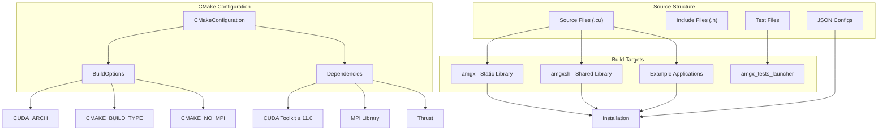
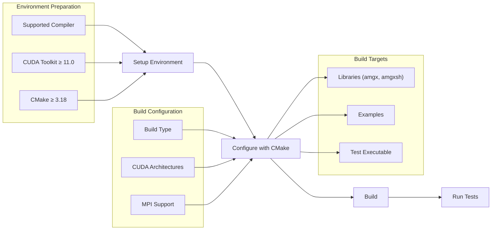
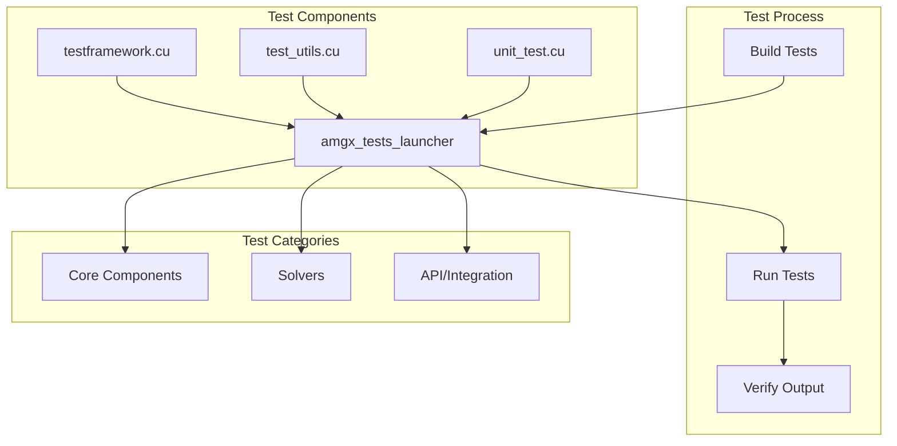
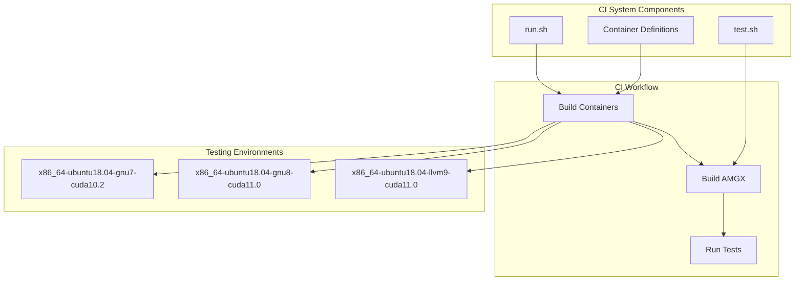

<!-- source: DeepWiki mcp.deepwiki.com · repo NVIDIA/AMGX · page 5 Development · fetched 2026-10-26 -->

# Development

<details>
<summary>Relevant source files</summary>

The following files were used as context for generating this wiki page:

- [CMakeLists.txt](CMakeLists.txt)
- [ci/README.md](ci/README.md)
- [ci/containers/x86_64-ubuntu18.04-gnu7-cuda10.2.py](ci/containers/x86_64-ubuntu18.04-gnu7-cuda10.2.py)
- [ci/containers/x86_64-ubuntu18.04-gnu8-cuda11.0.py](ci/containers/x86_64-ubuntu18.04-gnu8-cuda11.0.py)
- [ci/containers/x86_64-ubuntu18.04-llvm9-cuda11.0.py](ci/containers/x86_64-ubuntu18.04-llvm9-cuda11.0.py)
- [ci/run.sh](ci/run.sh)
- [ci/test.sh](ci/test.sh)
- [examples/CMakeLists.txt](examples/CMakeLists.txt)
- [examples/eigen_examples/CMakeLists.txt](examples/eigen_examples/CMakeLists.txt)
- [src/CMakeLists.txt](src/CMakeLists.txt)

</details>


## Overview

This page provides essential information for developers working with the AMGX codebase. It covers the build system, development environment setup, testing infrastructure, and continuous integration tools. This document is intended for developers who want to contribute to AMGX or build it from source for custom modifications.

For information about building AMGX as an end user, see [Build System](#1.3).

## Build System Architecture

AMGX uses CMake as its build system, allowing for cross-platform builds with consistent configuration. The build system produces both static and shared libraries, examples, and test executables.



Sources: [CMakeLists.txt:27-108](), [src/CMakeLists.txt:7-12](), [examples/CMakeLists.txt:6-107]()

### Build Types

AMGX supports multiple build configurations to support different development and deployment scenarios:

| Build Type    | Description                               | CUDA Compiler Flags                    |
|---------------|-------------------------------------------|---------------------------------------|
| Debug         | Build with debugging symbols              | `-g -G`                               |
| Release       | Optimized production build                | `-DNDEBUG`                            |
| Profile       | Build with profiling support              | `-DPROFILE`                           |
| RelWithTraces | Release with debugging symbols            | `-g -DNDEBUG`                         |

The default build type is Release if not specified.

Sources: [CMakeLists.txt:42-85]()

### Supported CUDA Architectures

AMGX requires CUDA 11.0 or newer and supports the following GPU architectures:

| CUDA Version | Supported GPU Architectures       |
|--------------|-----------------------------------|
| CUDA 12.x+   | SM 70, SM 80, SM 90 (Volta, Ampere, Hopper) |
| CUDA 11.x    | SM 70, SM 80 (Volta, Ampere)     |

Specify target architectures with `CUDA_ARCH` when configuring with CMake.

Sources: [CMakeLists.txt:193-223]()

## Development Environment Setup

### Required Dependencies

To build AMGX, you need:

1. **CUDA Toolkit**: Version 11.0 or newer
2. **CMake**: Version 3.18 or newer
3. **Thrust**: Included as a submodule
4. **MPI**: Optional, for distributed computing support

### Development Workflow



Sources: [CMakeLists.txt:27-35](), [CMakeLists.txt:193-223](), [CMakeLists.txt:236-260]()

### Building AMGX

Basic build commands:

```bash
mkdir build
cd build
cmake ..
make -j8
```

You can customize the build with CMake options:

| CMake Option        | Description                                | Default   |
|---------------------|--------------------------------------------|-----------|
| `CMAKE_BUILD_TYPE`  | Build type (Debug, Release, etc.)          | Release   |
| `CUDA_ARCH`         | Target CUDA architectures                  | 70,80     |
| `CMAKE_NO_MPI`      | Disable MPI support                        | false     |
| `AMGX_INCLUDE_EXTERNAL` | Include external libraries               | true      |
| `AMGX_NO_RPATH`     | Don't build with RPATH                     | false     |

Sources: [CMakeLists.txt:42-47](), [CMakeLists.txt:102-106](), [CMakeLists.txt:118-123](), [CMakeLists.txt:125-141]()

## Testing Infrastructure

AMGX includes a test framework to verify functionality. Tests are built as part of the main build process.



Sources: [src/CMakeLists.txt:18-41]()

### Running Tests

After building AMGX, you can run the test suite:

```bash
# From the build directory
./amgx_tests_launcher
```

The test launcher will execute all the test cases and report success or failure.

Sources: [src/CMakeLists.txt:32-36](), [ci/test.sh:20-26]()

## Continuous Integration

AMGX uses a container-based continuous integration system to ensure build quality across different environments.



Sources: [ci/run.sh:7-55](), [ci/test.sh:6-27](), [ci/README.md:7-37]()

### CI Container Configurations

The CI system tests AMGX in multiple environments, each defined as a container:

| Container                          | Base Image                       | Compiler       | CUDA Version |
|------------------------------------|----------------------------------|----------------|--------------|
| x86_64-ubuntu18.04-gnu7-cuda10.2  | nvidia/cuda:10.2-devel-ubuntu18.04 | GCC 7        | CUDA 10.2    |
| x86_64-ubuntu18.04-gnu8-cuda11.0  | nvidia/cuda:11.0-devel-ubuntu18.04 | GCC 8        | CUDA 11.0    |
| x86_64-ubuntu18.04-llvm9-cuda11.0 | nvidia/cuda:11.0-devel-ubuntu18.04 | LLVM/Clang 9 | CUDA 11.0    |

Containers are defined using NVIDIA HPC Container Maker (HPCCM).

Sources: [ci/containers/x86_64-ubuntu18.04-gnu7-cuda10.2.py:6-38](), [ci/containers/x86_64-ubuntu18.04-gnu8-cuda11.0.py:6-38](), [ci/containers/x86_64-ubuntu18.04-llvm9-cuda11.0.py:6-42]()

### Using CI Locally

You can run the CI pipeline locally to test your changes:

```bash
# Run all containers
./ci/run.sh

# Run a specific container
AMGX_CI_CONTAINERS="x86_64-ubuntu18.04-gnu8-cuda11.0.py" ./ci/run.sh

# Preserve build directories between runs
AMGX_CI_KEEP_BUILD=1 ./ci/run.sh
```

This helps verify changes across supported platforms before submitting them.

Sources: [ci/README.md:22-37](), [ci/run.sh:7-55]()

## Development Best Practices

When working on AMGX, consider the following best practices:

1. Build and test code in all supported environments using the CI system
2. Run unit tests after any significant changes
3. Ensure code works with and without MPI support
4. Test with different CUDA architectures if targeting multiple GPU generations
5. Use the same code formatting and style as existing codebase
6. Test both Debug and Release builds for critical components

---

