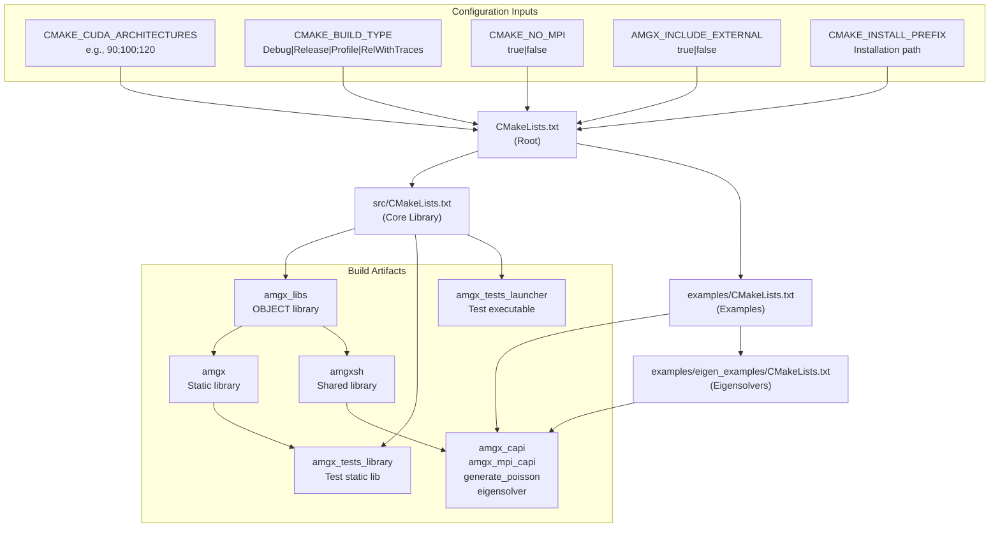
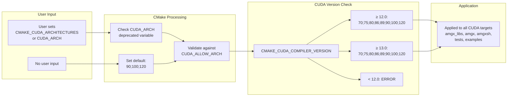
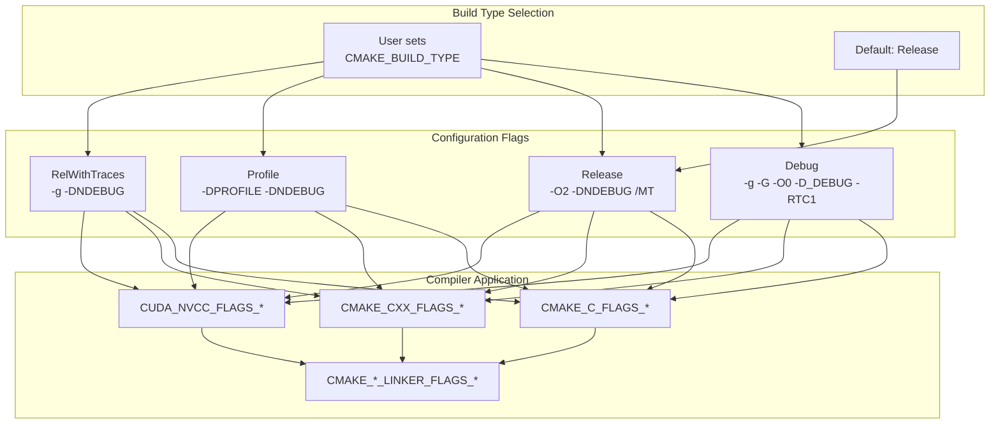
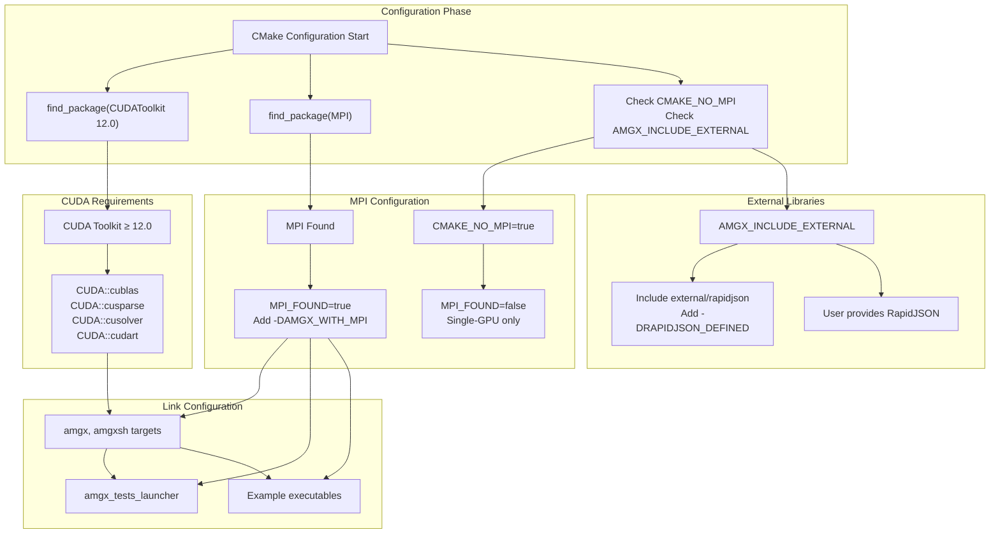
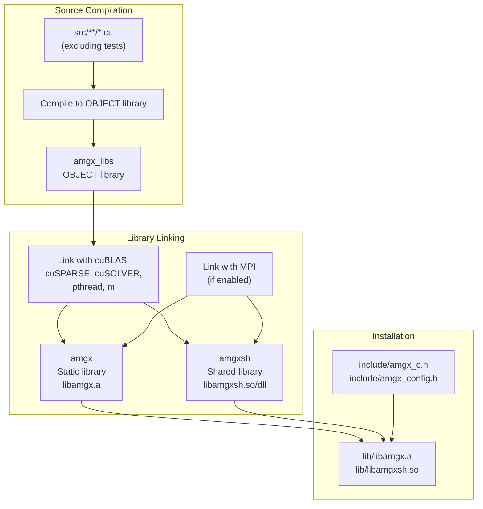

<!-- source: DeepWiki mcp.deepwiki.com · repo NVIDIA/AMGX · page 5.1 Build Configuration · fetched 2026-10-26 -->

# Build Configuration

<details>
<summary>Relevant source files</summary>

The following files were used as context for generating this wiki page:

- [CMakeLists.txt](CMakeLists.txt)
- [examples/CMakeLists.txt](examples/CMakeLists.txt)
- [examples/eigen_examples/CMakeLists.txt](examples/eigen_examples/CMakeLists.txt)
- [src/CMakeLists.txt](src/CMakeLists.txt)

</details>


This document describes the CMake-based build system for AMGX, including configuration options, compiler settings, CUDA architecture targeting, and dependency management. It is intended for developers who need to build AMGX from source with specific requirements.

For information about the continuous integration system that uses these build configurations, see [Continuous Integration](#5.3). For details on the testing infrastructure built by the system, see [Testing Framework](#5.2).

---

## CMake Overview

AMGX uses CMake version 3.18 or higher to orchestrate the build process. The build system produces static and shared libraries, test executables, and example programs. All targets are configured through a hierarchy of CMakeLists.txt files.

**Diagram: CMake Build Structure**


Sources: [CMakeLists.txt:27-278](), [src/CMakeLists.txt:1-110](), [examples/CMakeLists.txt:1-114]()

---

## CUDA Architecture Targeting

CUDA architecture targeting is configured through the `CMAKE_CUDA_ARCHITECTURES` variable, which must be set **before** the `project()` command enables CUDA.

### Architecture Selection

**Supported Architectures by CUDA Version:**

| CUDA Version | Supported Architectures |
|--------------|------------------------|
| ≥ 12.0       | 70, 75, 80, 86, 89, 90, 100, 120 |
| ≥ 13.0       | 70, 75, 80, 86, 89, 90, 100, 120 |

**Default Configuration:**
If `CMAKE_CUDA_ARCHITECTURES` is not specified, the build system defaults to modern architectures: `90;100;120` [CMakeLists.txt:37-44]()

**Legacy `CUDA_ARCH` Variable:**
The deprecated `CUDA_ARCH` variable is automatically translated to `CMAKE_CUDA_ARCHITECTURES` with a warning [CMakeLists.txt:31-34]()

**Diagram: Architecture Configuration Flow**


Sources: [CMakeLists.txt:29-44](), [CMakeLists.txt:204-221]()

### Per-Target Application

The `CMAKE_CUDA_ARCHITECTURES` variable is automatically inherited by all CUDA targets in the build. No per-target properties need to be set [CMakeLists.txt:232-234](), [CMakeLists.txt:263-264]()

---

## Build Types

AMGX supports four build configurations, each with specific compiler and linker flags:

| Build Type | Purpose | Key Flags |
|------------|---------|-----------|
| `Debug` | Development with debug symbols and runtime checks | `-g -G -O0 -D_DEBUG` |
| `Release` | Optimized production build | `-O2 -DNDEBUG` |
| `Profile` | Profiling-enabled release build | `-DPROFILE -DNDEBUG` |
| `RelWithTraces` | Release with debug symbols for profiling | `-g -DNDEBUG` |

**Default:** If no build type is specified, `Release` is used [CMakeLists.txt:62-64]()

**Diagram: Build Type Configuration**


Sources: [CMakeLists.txt:59-103](), [CMakeLists.txt:163-179]()

---

## Dependencies

### Required Dependencies

**CUDA Toolkit (≥ 12.0)**
- Required components: cuBLAS, cuSPARSE, cuSOLVER
- Detection: `find_package(CUDAToolkit 12.0 REQUIRED)`
- Linked to all library targets

[CMakeLists.txt:66](), [CMakeLists.txt:251-256]()

**RapidJSON (Header-Only)**
- Purpose: JSON configuration parsing
- Location: `external/rapidjson/include`
- Controlled by: `AMGX_INCLUDE_EXTERNAL` (default: true)
- Compile flag: `-DRAPIDJSON_DEFINED`

[CMakeLists.txt:130-135]()

### Optional Dependencies

**MPI (OpenMPI, MPICH, or compatible)**
- Purpose: Multi-GPU distributed computing
- Detection: `find_package(MPI)`
- Controlled by: `CMAKE_NO_MPI` flag (default: false)
- Compile flag when enabled: `-DAMGX_WITH_MPI`
- Special handling for Cray systems via `CRAY_MPICH2_DIR` environment variable

[CMakeLists.txt:49](), [CMakeLists.txt:137-153](), [CMakeLists.txt:258-261]()

**Intel MKL**
- Purpose: Eigensolver acceleration
- Referenced in code but configuration handled via `MKL_ROOT_DIR`
- Not explicitly configured in provided CMake files

**Diagram: Dependency Resolution**


Sources: [CMakeLists.txt:49-153](), [CMakeLists.txt:251-261]()

---

## Compiler Configuration

### Platform-Specific Settings

**Windows (MSVC)**
```
C/CXX Flags: /DWIN32 /D_WINDOWS /DNOMINMAX /W3 /GR /EHsc /bigobj
Release: /MT /O2 /Ob2 /DNDEBUG
Debug: /D_DEBUG /Zl /Zi /Ob0 /Od /RTC1
```
[CMakeLists.txt:69-81]()

**Linux/Unix (GCC/Clang)**
```
CXX Flags: -rdynamic -fPIC -fvisibility=default
GCC ≥ 6.0: -Wno-terminate (suppresses destructor exception warnings)
```
[CMakeLists.txt:84-89](), [CMakeLists.txt:194-198]()

### NVCC Flags

**Core NVCC Configuration:**
- Extended lambda support: `--extended-lambda`
- Execution space call errors: `--Werror cross-execution-space-call`
- NVTX profiling ranges: `-DNVTX_RANGES` (Linux only)
- Thrust namespace isolation: `-DTHRUST_CUB_WRAPPED_NAMESPACE=amgx`
- Host compiler flags: `-Xcompiler ${CMAKE_CXX_FLAGS}`

[CMakeLists.txt:182-226]()

**Build-Type-Specific NVCC Flags:**

| Build Type | NVCC Flags |
|------------|------------|
| Debug | `-g -G` |
| Release | `-DNDEBUG` (Windows: `-DNOMINMAX`) |
| Profile | `-DPROFILE` |
| RelWithTraces | `-g -DNDEBUG` |

[CMakeLists.txt:163-179]()

**Optional:**
- Keep intermediate files: `-keep` (when `AMGX_keep_intermediate=ON`)

[CMakeLists.txt:188-190]()

Sources: [CMakeLists.txt:160-226]()

---

## Build Flags and Options

### Core Configuration Options

| CMake Variable | Type | Default | Purpose |
|----------------|------|---------|---------|
| `CMAKE_CUDA_ARCHITECTURES` | STRING | `90;100;120` | Target GPU architectures |
| `CMAKE_BUILD_TYPE` | STRING | `Release` | Build configuration |
| `CMAKE_INSTALL_PREFIX` | PATH | `..` | Installation directory |
| `CMAKE_NO_MPI` | BOOL | `false` | Force disable MPI |
| `AMGX_INCLUDE_EXTERNAL` | BOOL | `true` | Include bundled RapidJSON |
| `AMGX_NO_RPATH` | BOOL | `false` | Disable RPATH in binaries |
| `AMGX_keep_intermediate` | BOOL | `false` | Keep CUDA intermediate files |

Sources: [CMakeLists.txt:37-44](), [CMakeLists.txt:62-64](), [CMakeLists.txt:105-124](), [CMakeLists.txt:130-151]()

### MPI Configuration

**Automatic Detection:**
MPI is detected via `find_package(MPI)` and enabled unless `CMAKE_NO_MPI=true` [CMakeLists.txt:139-151]()

**Cray Systems:**
Special handling for Cray MPIch via `CRAY_MPICH2_DIR` environment variable:
```cmake
set(MPI_C_LIBRARIES "$ENV{CRAY_MPICH2_DIR}/lib/libmpich.so")
set(MPI_C_INCLUDE_PATH "$ENV{CRAY_MPICH2_DIR}/include")
```
[CMakeLists.txt:125-128]()

**MPI-Dependent Targets:**
When MPI is enabled, additional examples are built:
- `amgx_mpi_capi`
- `amgx_mpi_capi_agg`
- `amgx_mpi_capi_cla`
- `amgx_mpi_poisson7`
- `eigensolver_mpi`

[examples/CMakeLists.txt:47-104](), [examples/eigen_examples/CMakeLists.txt:31-50]()

---

## Build Artifacts

### Library Targets

**Diagram: Library Build Process**


**Static Library (`amgx`)**
- Target name: `amgx`
- Output: `libamgx.a` (Linux) or `amgx.lib` (Windows)
- Links: CUDA libraries, MPI (if enabled), pthread, math library

[CMakeLists.txt:238-239](), [CMakeLists.txt:251-256](), [CMakeLists.txt:258-261]()

**Shared Library (`amgxsh`)**
- Target name: `amgxsh`
- Output: `libamgxsh.so` (Linux) or `amgxsh.dll` (Windows)
- Links: Same as static library
- Used by examples and external applications

[CMakeLists.txt:241-242](), [CMakeLists.txt:251-256](), [CMakeLists.txt:258-261]()

**Object Library (`amgx_libs`)**
- Intermediate target containing compiled object files
- Excludes test source files
- Used to build both static and shared libraries

[CMakeLists.txt:228](), [src/CMakeLists.txt:8-12]()

Sources: [CMakeLists.txt:228-271](), [src/CMakeLists.txt:1-14]()

### Test Suite

**Test Library (`amgx_tests_library`)**
- Static library containing test framework
- Source files: `testframework.cu`, `test_utils.cu`, `unit_test.cu`
- Depends on `amgx` static library

[src/CMakeLists.txt:18-30]()

**Test Executable (`amgx_tests_launcher`)**
- Main test runner: `utest.cu`
- Links: `amgx_tests_library`, `amgxsh`, cuSPARSE, cuBLAS
- **Installation:** Only installed for non-Release builds to `lib/tests/`

[src/CMakeLists.txt:32-60]()

Sources: [src/CMakeLists.txt:18-60]()

### Example Programs

**Single-GPU Examples:**
- `amgx_capi` - Basic C API demonstration
- `generate_poisson` - Poisson problem generator
- `generate_poisson7_dist_renum` - Distributed Poisson with renumbering

**MPI Examples (when MPI enabled):**
- `amgx_mpi_capi` - Multi-GPU C API example
- `amgx_mpi_capi_agg` - Aggregation AMG example
- `amgx_mpi_capi_cla` - Classical AMG example
- `amgx_mpi_poisson7` - 7-point Poisson distributed solver

**Eigensolver Examples:**
- `eigensolver` - Single-GPU eigensolver
- `eigensolver_mpi` - Multi-GPU eigensolver (when MPI enabled)

**Installation:** All examples installed to `lib/examples/` or `lib/eigen_examples/`

Sources: [examples/CMakeLists.txt:18-110](), [examples/eigen_examples/CMakeLists.txt:18-55]()

---

## Installation Configuration

### Installation Paths

**Default Install Prefix:** `..` (parent directory of build) [CMakeLists.txt:105-107]()

**Directory Structure:**
```
${CMAKE_INSTALL_PREFIX}/
├── lib/
│   ├── libamgx.a
│   ├── libamgxsh.so (or .dll)
│   ├── configs/
│   │   ├── *.json (solver configurations)
│   │   └── eigen_configs/
│   ├── examples/
│   │   └── (example executables)
│   └── tests/
│       └── amgx_tests_launcher (non-Release only)
└── include/
    ├── amgx_c.h
    └── amgx_config.h
```

[CMakeLists.txt:265-271](), [src/CMakeLists.txt:58-108](), [examples/CMakeLists.txt:106-110]()

### RPATH Configuration

**Automatic RPATH:**
The build system automatically adds `${CMAKE_INSTALL_PREFIX}/lib` to the RPATH unless it's a system directory [CMakeLists.txt:108-117]()

**Disabling RPATH:**
Set `AMGX_NO_RPATH=true` to skip RPATH entirely [CMakeLists.txt:120-123]()

### Configuration Files

**Solver Configurations:**
Installed to `lib/configs/`:
- Aggregation AMG configs (DILU, GS, Jacobi, Multi-Pairwise)
- Classical AMG configs (V-cycle, W-cycle, F-cycle)
- Krylov solver configs (PCG, GMRES, FGMRES, BiCGSTAB, IDR)
- Combined solver configs

[src/CMakeLists.txt:66-97]()

**Eigensolver Configurations:**
Installed to `lib/configs/eigen_configs/`:
- ARNOLDI, LANCZOS, LOBPCG
- JACOBI_DAVIDSON, INVERSE_FGMRES
- PAGERANK, POWER_ITERATION, SUBSPACE_ITERATION

[src/CMakeLists.txt:99-108]()

Sources: [CMakeLists.txt:105-124](), [CMakeLists.txt:265-271](), [src/CMakeLists.txt:58-108]()

---

## Typical Build Workflows

### Basic Build

```bash
# Configure with default architectures (90, 100, 120)
cmake -DCMAKE_BUILD_TYPE=Release -S . -B build

# Build libraries and examples
cmake --build build

# Install to default location (parent directory)
cmake --install build
```

### Custom Architecture Build

```bash
# Build for specific GPU architectures
cmake -DCMAKE_CUDA_ARCHITECTURES="80;90" \
      -DCMAKE_BUILD_TYPE=Release \
      -S . -B build

cmake --build build
```

### Non-MPI Build

```bash
# Force single-GPU build without MPI
cmake -DCMAKE_NO_MPI=true \
      -DCMAKE_BUILD_TYPE=Release \
      -S . -B build

cmake --build build
```

### Debug Build with Tests

```bash
# Build with debug symbols and tests
cmake -DCMAKE_BUILD_TYPE=Debug \
      -DCMAKE_CUDA_ARCHITECTURES="90" \
      -S . -B build

cmake --build build

# Run tests
./build/amgx_tests_launcher
```

### Profile Build with Intermediate Files

```bash
# Build for profiling with CUDA intermediate files
cmake -DCMAKE_BUILD_TYPE=Profile \
      -DAMGX_keep_intermediate=ON \
      -S . -B build

cmake --build build
```

Sources: [CMakeLists.txt:27-278]()

---

