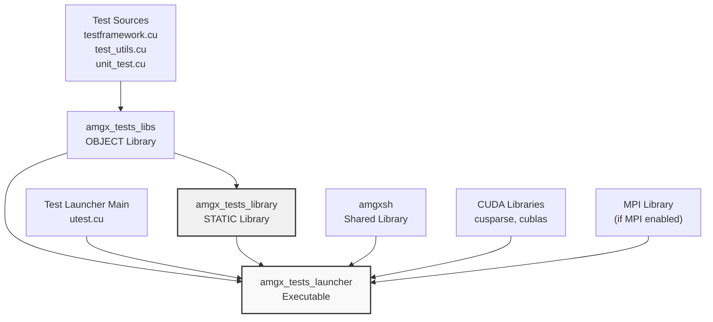
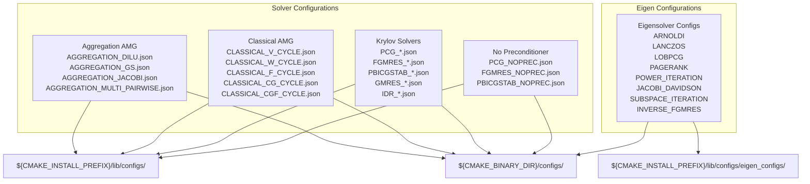
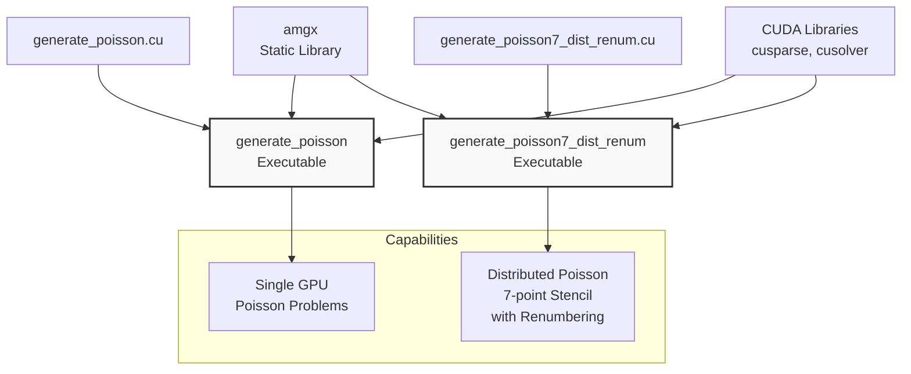
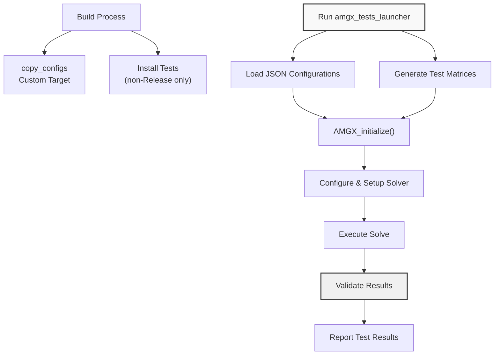
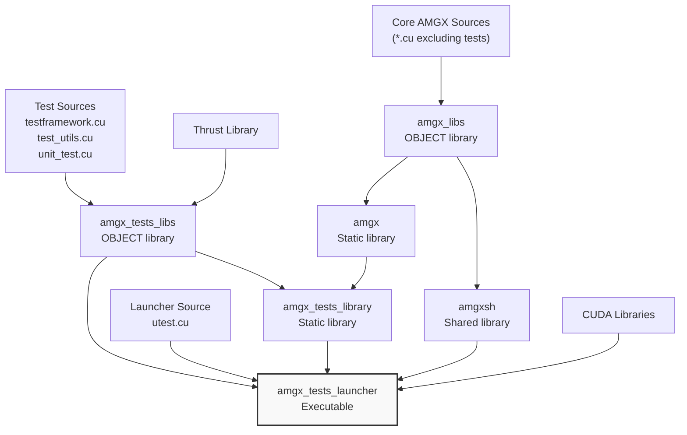

<!-- source: DeepWiki mcp.deepwiki.com · repo NVIDIA/AMGX · page 5.2 Testing Framework · fetched 2026-10-26 -->

# Testing Framework

<details>
<summary>Relevant source files</summary>

The following files were used as context for generating this wiki page:

- [CMakeLists.txt](CMakeLists.txt)
- [examples/CMakeLists.txt](examples/CMakeLists.txt)
- [examples/eigen_examples/CMakeLists.txt](examples/eigen_examples/CMakeLists.txt)
- [src/CMakeLists.txt](src/CMakeLists.txt)

</details>


## Purpose and Scope

This document describes AMGX's testing infrastructure, including the test organization, the `amgx_tests_launcher` executable, test matrix generation utilities, and how tests are built and executed. The testing framework validates solver configurations, distributed operations, and numerical correctness across different precision and memory configurations.

For information about build system configuration options, see [Build Configuration](#5.1). For details on the continuous integration pipeline that runs these tests, see [Continuous Integration](#5.3).

---

## Test Organization

AMGX's test suite is organized into several components that work together to provide comprehensive validation of library functionality.

### Test Components

| Component | File(s) | Purpose |
|-----------|---------|---------|
| Test Framework | `testframework.cu` | Core test infrastructure, test registration, execution framework |
| Test Utilities | `test_utils.cu` | Helper functions for matrix generation, comparison, validation |
| Unit Tests | `unit_test.cu` | Individual unit tests for specific components |
| Test Launcher | `utest.cu` | Main entry point, command-line interface, test orchestration |

The test source files are excluded from the main library build and compiled separately into their own library and executable.

**Test Build Structure**



Sources: [src/CMakeLists.txt:18-56]()

### Source File Filtering

The build system explicitly separates test code from production code:

```
FILE(GLOB_RECURSE SRCS "*.cu")
list(FILTER SRCS EXCLUDE REGEX "/src/tests/")
list(FILTER SRCS EXCLUDE REGEX "/utest.cu")
```

This ensures that:
- Test files in `src/tests/` directory are not included in `amgx` or `amgxsh` libraries
- The test launcher main file `utest.cu` is excluded from the main library
- Test code only appears in the dedicated test executable

Sources: [src/CMakeLists.txt:8-10]()

---

## Test Launcher Executable

The `amgx_tests_launcher` executable is the primary interface for running AMGX tests. It provides command-line options for selecting specific tests, configuring test parameters, and reporting results.

### Build Configuration

The test launcher is built with the same compilation flags as the main library, ensuring consistent behavior between production and test code:

```
add_executable(amgx_tests_launcher utest.cu $<TARGET_OBJECTS:amgx_tests_libs>)
target_compile_options(amgx_tests_launcher PUBLIC $<$<COMPILE_LANGUAGE:CUDA>: ${CUDA_NVCC_FLAGS} >)
target_link_libraries(amgx_tests_launcher amgx_tests_library amgxsh ${libs_all})
```

The launcher links against:
- `amgx_tests_library`: Static library containing test framework code
- `amgxsh`: AMGX shared library (tests validate the public API)
- `cusparse`, `cublas`: CUDA libraries for GPU operations
- MPI library (when `MPI_FOUND` is true)

Sources: [src/CMakeLists.txt:32-56]()

### Installation Behavior

The test launcher follows a conditional installation policy:

```
if(NOT ${CMAKE_BUILD_TYPE} MATCHES "Release")
  install(TARGETS amgx_tests_launcher DESTINATION "lib/tests")
endif()
```

This means:
- **Non-Release builds** (Debug, Profile, RelWithTraces): Test launcher is installed to `lib/tests/`
- **Release builds**: Test launcher is **not installed** (production deployments don't need tests)

Sources: [src/CMakeLists.txt:58-60]()

---

## Test Configuration Files

AMGX tests use JSON configuration files to specify solver settings and validate different solver combinations. These configuration files are the same ones used in production and serve as integration tests.

### Configuration Deployment

**Configuration File Types**



Sources: [src/CMakeLists.txt:62-108]()

### Build-Time Configuration Copy

During the build process, configuration files are copied to the build directory:

```
add_custom_target(copy_configs ALL)
add_custom_command(TARGET copy_configs COMMAND ${CMAKE_COMMAND} -E copy_directory 
    "${CMAKE_CURRENT_SOURCE_DIR}/configs" "${CMAKE_BINARY_DIR}/configs")
```

This ensures tests can locate configuration files during development without requiring installation.

### Installed Configurations

The build system installs **29 solver configuration files** and **8 eigensolver configuration files**:

| Category | Examples | Count |
|----------|----------|-------|
| Aggregation AMG | `AGGREGATION_DILU.json`, `AGGREGATION_JACOBI.json` | 4 |
| Classical AMG | `CLASSICAL_V_CYCLE.json`, `CLASSICAL_W_CYCLE.json` | 5 |
| PCG variants | `PCG_DILU.json`, `PCG_NOPREC.json`, `PCGF_*` | 9 |
| FGMRES variants | `FGMRES_NOPREC.json`, `FGMRES_CLASSICAL_*` | 5 |
| BiCGSTAB variants | `PBICGSTAB_AGGREGATION_W_JACOBI.json` | 3 |
| Other Krylov | `GMRES_AMG_D2.json`, `IDR_DILU.json` | 3 |
| Eigensolvers | `ARNOLDI`, `LANCZOS`, `LOBPCG`, `PAGERANK` | 8 |

Sources: [src/CMakeLists.txt:66-108]()

---

## Test Matrix Generation Utilities

AMGX includes utilities for generating test matrices with known properties. These utilities are essential for creating reproducible test cases and benchmarking.

### Matrix Generator Executables

**Matrix Generation Tools**



Sources: [examples/CMakeLists.txt:33-44]()

### Poisson Problem Generator

The `generate_poisson` executable creates structured grid Poisson problems:

```
add_executable(generate_poisson generate_poisson.cu)
target_compile_options(generate_poisson PUBLIC "-Xcompiler=-I$ENV{METIS_INSTALL_PATH}/include")
target_link_libraries(generate_poisson amgx ${libs_all})
```

This generator can create matrices with controllable:
- Grid dimensions
- Stencil patterns
- Boundary conditions
- Sparsity structure

Sources: [examples/CMakeLists.txt:33-37]()

### Distributed Poisson Generator

The `generate_poisson7_dist_renum` executable generates distributed test matrices:

```
add_executable(generate_poisson7_dist_renum generate_poisson7_dist_renum.cu)
target_compile_options(generate_poisson7_dist_renum PUBLIC "-Xcompiler=-I$ENV{METIS_INSTALL_PATH}/include")
target_link_libraries(generate_poisson7_dist_renum amgx ${libs_all})
```

This generator produces 7-point stencil Poisson problems with:
- Multi-partition decomposition
- Node renumbering for load balancing
- Halo region specification
- Neighbor connectivity information

The METIS include path suggests integration with METIS partitioning library for domain decomposition.

Sources: [examples/CMakeLists.txt:40-44]()

---

## Test Execution Workflow

The testing framework follows a standard workflow from build through execution and validation.

**Test Execution Pipeline**



Sources: [src/CMakeLists.txt:18-64]()

### Build Phase

1. **Compile Test Sources**: Test framework files are compiled into `amgx_tests_libs` object library
2. **Create Test Library**: Object files are packaged into `amgx_tests_library` static library
3. **Build Launcher**: `utest.cu` main file is linked with test library and `amgxsh` to create executable
4. **Copy Configurations**: `copy_configs` custom target copies all JSON files to build directory
5. **Install (Conditional)**: In non-Release builds, test launcher and configs are installed

### Execution Phase

The test launcher orchestrates:
- **Test Selection**: Command-line arguments specify which tests to run
- **Configuration Loading**: JSON files configure solver and preconditioner combinations
- **Matrix Preparation**: Either load existing matrices or generate test matrices
- **Solver Testing**: Initialize AMGX, create resources, setup solver, execute solve
- **Result Validation**: Compare numerical results against expected values
- **Resource Cleanup**: Destroy AMGX objects and finalize library

---

## MPI Testing Support

When AMGX is built with MPI support, the test launcher gains distributed testing capabilities.

### MPI Linking

```
if(MPI_FOUND)
    target_link_libraries(amgx_tests_launcher MPI::MPI_CXX)
endif(MPI_FOUND)
```

The test launcher links against MPI when available, enabling:
- Multi-process test execution
- Distributed matrix operations testing
- Halo exchange validation
- Partition-specific behavior verification

Sources: [src/CMakeLists.txt:54-56]()

### MPI Example Programs as Tests

The MPI example programs double as integration tests:

| Executable | Purpose |
|------------|---------|
| `amgx_mpi_capi` | Basic distributed API usage |
| `amgx_mpi_capi_agg` | Aggregation AMG in distributed setting |
| `amgx_mpi_capi_cla` | Classical AMG in distributed setting |
| `amgx_mpi_poisson7` | Distributed 7-point Poisson problem |

These executables are built with MPI flags and installed to `lib/examples/`:

```
if(MPI_FOUND)
    add_executable(amgx_mpi_capi amgx_mpi_capi.c)
    # ... similar for other MPI examples
    target_link_libraries(amgx_mpi_capi amgxsh ${MPI_C_LIBRARIES} ${dyn_libs})
    install(TARGETS amgx_mpi_capi amgx_mpi_capi_agg amgx_mpi_capi_cla amgx_mpi_poisson7 
            DESTINATION "lib/examples")
endif(MPI_FOUND)
```

Sources: [examples/CMakeLists.txt:47-110]()

---

## Template Configuration Testing

AMGX uses a template-based type system (see [Mode System and Template Dispatch](#4.1.2)) that generates multiple instantiations for different precision and memory space combinations. The testing framework must validate all supported configurations.

### Mode Coverage

Tests should validate across:

| Template Parameter | Values Tested |
|-------------------|---------------|
| `MemSpace` | `AMGX_host`, `AMGX_device` |
| `VecPrec` | `float`, `double`, `complex_float`, `complex_double` |
| `MatPrec` | `float`, `double`, `complex_float`, `complex_double` |
| `IndPrec` | `int`, `int64` |

The test launcher must dispatch to the appropriate template instantiation based on the mode being tested, using the same mode system that the C API uses.

### Test Matrix Compatibility

Test matrices must be compatible with different precision configurations:
- **Integer indices**: Support both 32-bit and 64-bit for large matrix testing
- **Floating-point values**: Provide consistent test cases across `float` and `double`
- **Complex values**: Generate Hermitian or complex-symmetric test matrices for complex modes
- **Block formats**: Test block CSR matrices with different block sizes (1x1, 2x2, 4x4, etc.)

---

## Eigensolver Testing

AMGX includes specialized eigensolver capabilities that require dedicated testing infrastructure.

### Eigensolver Example Executables

```
ADD_EXECUTABLE(eigensolver eigensolver.c)
target_link_libraries(eigensolver ${dyn_libs})
```

For MPI builds:
```
if(MPI_FOUND)
  ADD_EXECUTABLE(eigensolver_mpi eigensolver_mpi.c)
  target_link_libraries(eigensolver_mpi amgxsh ${MPI_C_LIBRARIES} ${dyn_libs})
endif(MPI_FOUND)
```

These executables test:
- ARNOLDI method for general eigenproblems
- LANCZOS method for symmetric eigenproblems
- LOBPCG (Locally Optimal Block Preconditioned Conjugate Gradient)
- PageRank algorithm
- Power Iteration
- Jacobi-Davidson method
- Subspace Iteration

Sources: [examples/eigen_examples/CMakeLists.txt:18-54]()

### Eigensolver Configuration Files

Eigensolver tests use configuration files from `src/configs/eigen_configs/`:
- Each file specifies eigensolver-specific parameters
- Configurations define shift values, number of eigenvalues to compute, convergence criteria
- Files are installed to `lib/configs/eigen_configs/`

Sources: [src/CMakeLists.txt:99-108]()

---

## Testing in Different Build Types

AMGX supports multiple build types with different testing implications.

### Build Type Behavior

| Build Type | Test Compilation | Test Installation | Debug Symbols | Optimization |
|------------|-----------------|-------------------|---------------|--------------|
| **Debug** | Yes | Yes | Full (`-g -G`) | None (`-Od`) |
| **Release** | Yes | **No** | None | Full (`-O2`) |
| **Profile** | Yes | Yes | None | Full (`-O2`) |
| **RelWithTraces** | Yes | Yes | Line info (`-g`) | Full (`-O2`) |

The test framework compiles in all build types but is only installed for non-Release builds:

```
if(NOT ${CMAKE_BUILD_TYPE} MATCHES "Release")
  install(TARGETS amgx_tests_launcher DESTINATION "lib/tests")
endif()
```

This design allows:
- **Development**: Full test suite available with debug symbols
- **Performance Analysis**: Tests available with optimizations (Profile, RelWithTraces)
- **Production**: Minimal installation without test overhead (Release)

Sources: [src/CMakeLists.txt:58-60](), [CMakeLists.txt:59-102]()

---

## Test Dependency Chain

The test build system establishes clear dependencies to ensure correct build order.

**Test Build Dependencies**



Sources: [src/CMakeLists.txt:8-56](), [CMakeLists.txt:228-248]()

### Dependency Declarations

The build system explicitly declares dependencies:

```
add_dependencies(amgx_tests_library amgx)
target_link_libraries(amgx_tests_library amgx)
target_link_libraries(amgx_tests_launcher amgx_tests_library amgxsh ${libs_all})
```

This ensures:
1. `amgx` static library is built before `amgx_tests_library`
2. Test library links against static `amgx` for internal access if needed
3. Test launcher links against shared `amgxsh` to validate the public API
4. Thrust library is available for test code (which may use thrust algorithms)

Sources: [src/CMakeLists.txt:26-52]()

---

