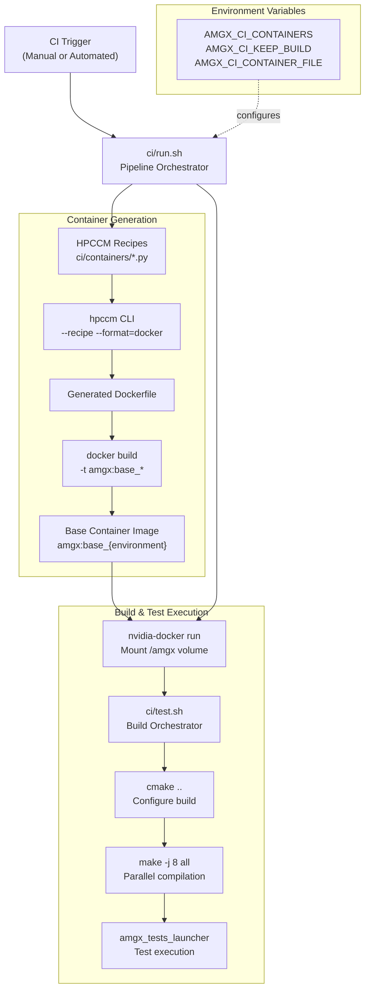
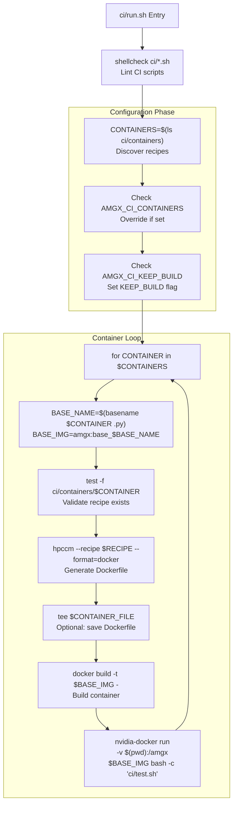
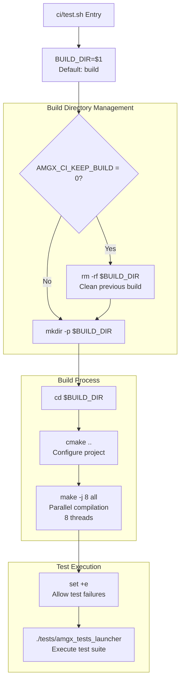
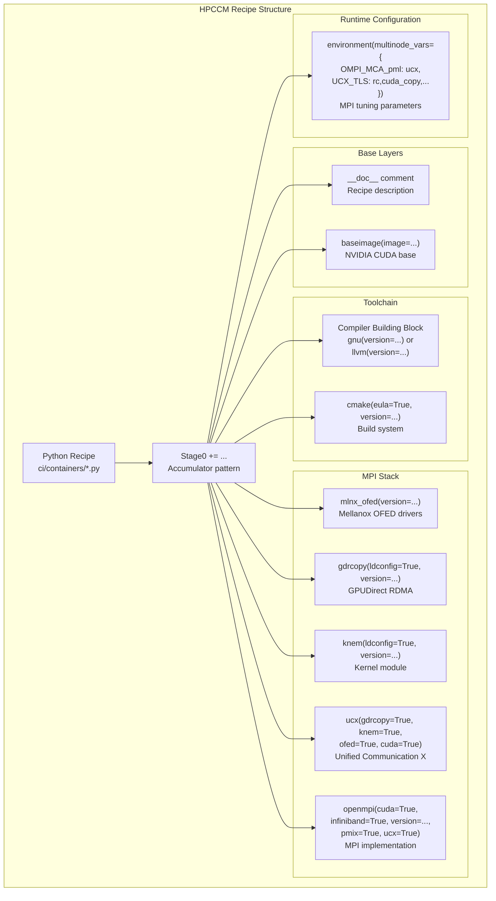

<!-- source: DeepWiki mcp.deepwiki.com · repo NVIDIA/AMGX · page 5.3 Continuous Integration · fetched 2026-10-26 -->

# Continuous Integration

<details>
<summary>Relevant source files</summary>

The following files were used as context for generating this wiki page:

- [ci/README.md](ci/README.md)
- [ci/containers/x86_64-ubuntu18.04-gnu7-cuda10.2.py](ci/containers/x86_64-ubuntu18.04-gnu7-cuda10.2.py)
- [ci/containers/x86_64-ubuntu18.04-gnu8-cuda11.0.py](ci/containers/x86_64-ubuntu18.04-gnu8-cuda11.0.py)
- [ci/containers/x86_64-ubuntu18.04-llvm9-cuda11.0.py](ci/containers/x86_64-ubuntu18.04-llvm9-cuda11.0.py)
- [ci/run.sh](ci/run.sh)
- [ci/test.sh](ci/test.sh)

</details>


## Purpose and Scope

This document describes AMGX's Continuous Integration (CI) system, which automates building and testing across multiple compiler and CUDA version combinations. The CI infrastructure uses containerized build environments defined via HPCCM (HPC Container Maker) recipes to ensure reproducible builds and tests. This page covers CI pipeline orchestration, container generation, build environment specifications, and local execution workflows.

For information about the test framework itself, see [Testing Framework](#5.2). For build system configuration details, see [Build Configuration](#5.1).

**Note**: As documented in [ci/README.md:10](), the AMGX CI system is currently a work in progress, with ongoing improvements to test coverage and automation.

## CI Pipeline Architecture

The CI system follows a multi-stage pipeline that generates containerized build environments, compiles AMGX with different configurations, and executes the test suite.



**CI Pipeline Flow**

The pipeline executes the following sequence:

1. **Orchestration**: [ci/run.sh:14-55]() iterates through container recipes
2. **Container Generation**: HPCCM converts Python recipes to Dockerfiles
3. **Image Building**: Docker builds base images tagged as `amgx:base_{environment}`
4. **Test Execution**: `nvidia-docker` mounts the source tree and runs [ci/test.sh]()
5. **Build & Test**: CMake configures, Make compiles, and test launcher executes

Sources: [ci/run.sh](), [ci/test.sh](), [ci/README.md]()

## CI Orchestration Script

The primary CI orchestrator is [ci/run.sh](), which manages the end-to-end pipeline for multiple build environments.



**Key Components**

| Component | Purpose | Implementation |
|-----------|---------|----------------|
| **Script Linting** | Validates shell script syntax | [ci/run.sh:16-18]() uses `shellcheck` |
| **Container Discovery** | Identifies available build environments | [ci/run.sh:20]() lists `ci/containers/*.py` |
| **Recipe Processing** | Converts HPCCM recipes to Dockerfiles | [ci/run.sh:46-48]() invokes `hpccm` |
| **Image Building** | Creates container images | [ci/run.sh:48]() pipes to `docker build` |
| **Test Execution** | Runs build/test in container | [ci/run.sh:49-54]() uses `nvidia-docker run` |

**Container Naming Convention**

The script generates container names following this pattern:

- Recipe: `ci/containers/x86_64-ubuntu18.04-gnu8-cuda11.0.py`
- Base name extraction: [ci/run.sh:33]() - `BASE_NAME=$(basename "${CONTAINER}" .py)`
- Image tag: `amgx:base_x86_64-ubuntu18.04-gnu8-cuda11.0`
- Build directory: `build_x86_64-ubuntu18.04-gnu8-cuda11.0`

Sources: [ci/run.sh:14-55]()

## Build and Test Script

The [ci/test.sh]() script performs the actual compilation and test execution within each container environment.



**Build Configuration**

| Step | Command | Purpose |
|------|---------|---------|
| **Clean** | `rm -rf ${BUILD_DIR}` | Removes previous build artifacts ([ci/test.sh:15]()) |
| **Configure** | `cmake ..` | Generates build files ([ci/test.sh:21]()) |
| **Compile** | `make -j 8 all` | Parallel build with 8 threads ([ci/test.sh:22]()) |
| **Test** | `./tests/amgx_tests_launcher` | Executes test suite ([ci/test.sh:25]()) |

**Test Failure Handling**

The script explicitly allows test failures with `set +e` at [ci/test.sh:24](). This is documented as intentional: "WIP: test_launcher is allowed to fail; not all tests pass" ([ci/test.sh:23]()). This indicates the CI system is still being hardened and some tests may be unstable or environment-dependent.

Sources: [ci/test.sh:1-27]()

## HPCCM Container Definitions

AMGX uses HPC Container Maker (HPCCM) to define build environments declaratively in Python. Each recipe specifies the complete software stack needed to build and test AMGX.



**HPCCM Building Blocks**

HPCCM provides reusable building blocks that encapsulate complex installation logic:

| Building Block | Purpose | Example Configuration |
|----------------|---------|----------------------|
| `baseimage` | NVIDIA CUDA base image | `image='nvidia/cuda:11.0-devel-ubuntu18.04'` ([ci/containers/x86_64-ubuntu18.04-gnu8-cuda11.0.py:10]()) |
| `gnu` / `llvm` | C/C++ compiler | `gnu(version='8')` ([ci/containers/x86_64-ubuntu18.04-gnu8-cuda11.0.py:14]()) |
| `cmake` | CMake build system | `cmake(eula=True, version='3.7.0')` ([ci/containers/x86_64-ubuntu18.04-gnu8-cuda11.0.py:18]()) |
| `mlnx_ofed` | Mellanox InfiniBand drivers | `mlnx_ofed(version='5.0-2.1.8.0')` ([ci/containers/x86_64-ubuntu18.04-gnu8-cuda11.0.py:21]()) |
| `gdrcopy` | GPUDirect RDMA support | `gdrcopy(ldconfig=True, version='2.0')` ([ci/containers/x86_64-ubuntu18.04-gnu8-cuda11.0.py:22]()) |
| `knem` | Kernel-based memory transfer | `knem(ldconfig=True, version='1.1.3')` ([ci/containers/x86_64-ubuntu18.04-gnu8-cuda11.0.py:23]()) |
| `ucx` | Unified Communication X | `ucx(gdrcopy=True, knem=True, ofed=True, cuda=True)` ([ci/containers/x86_64-ubuntu18.04-gnu8-cuda11.0.py:24]()) |
| `openmpi` | MPI implementation | `openmpi(cuda=True, infiniband=True, version='4.0.3')` ([ci/containers/x86_64-ubuntu18.04-gnu8-cuda11.0.py:25-32]()) |

**MPI Environment Tuning**

Each recipe configures OpenMPI for optimal GPU-aware communication via the `environment` building block ([ci/containers/x86_64-ubuntu18.04-gnu8-cuda11.0.py:33-38]()):

```
OMPI_MCA_pml: ucx                    # Use UCX for point-to-point messaging
OMPI_MCA_btl: ^smcuda,vader,tcp,... # Disable specific byte transfer layers
UCX_MEMTYPE_CACHE: n                 # Disable memory type cache
UCX_TLS: rc,cuda_copy,cuda_ipc,...  # Enable GPU transports
```

Sources: [ci/containers/x86_64-ubuntu18.04-gnu8-cuda11.0.py](), [ci/containers/x86_64-ubuntu18.04-llvm9-cuda11.0.py](), [ci/containers/x86_64-ubuntu18.04-gnu7-cuda10.2.py]()

## Build Environment Matrix

The CI system tests AMGX across multiple compiler and CUDA version combinations to ensure broad compatibility.

| Environment | Base Image | Compiler | CUDA Version | Recipe File |
|-------------|------------|----------|--------------|-------------|
| **Ubuntu 18.04 + GNU 7** | `nvidia/cuda:10.2-devel-ubuntu18.04` | GCC 7.x (default) | 10.2 | [ci/containers/x86_64-ubuntu18.04-gnu7-cuda10.2.py]() |
| **Ubuntu 18.04 + GNU 8** | `nvidia/cuda:11.0-devel-ubuntu18.04` | GCC 8.x | 11.0 | [ci/containers/x86_64-ubuntu18.04-gnu8-cuda11.0.py]() |
| **Ubuntu 18.04 + LLVM 9** | `nvidia/cuda:11.0-devel-ubuntu18.04` | Clang 9.x | 11.0 | [ci/containers/x86_64-ubuntu18.04-llvm9-cuda11.0.py]() |

**Compiler Version Selection Rationale**

Each environment uses the latest compiler version supported by the corresponding CUDA release:

- **CUDA 10.2**: GCC 7.x is the last supported version for Ubuntu 18.04 ([ci/containers/x86_64-ubuntu18.04-gnu7-cuda10.2.py:12-13]())
- **CUDA 11.0**: GCC 8.x is the last supported version for Ubuntu 18.04 ([ci/containers/x86_64-ubuntu18.04-gnu8-cuda11.0.py:12-13]())
- **CUDA 11.0**: LLVM 9 is tested for Clang compatibility ([ci/containers/x86_64-ubuntu18.04-llvm9-cuda11.0.py:12-13]())

**LLVM Compiler Configuration**

The LLVM recipe includes additional configuration to set Clang as the default compiler via `update-alternatives` ([ci/containers/x86_64-ubuntu18.04-llvm9-cuda11.0.py:16-19]()):

```bash
update-alternatives --install /usr/bin/cc cc /usr/bin/clang-9 40
update-alternatives --install /usr/bin/c++ c++ /usr/bin/clang++-9 60
```

Sources: [ci/containers/x86_64-ubuntu18.04-gnu7-cuda10.2.py](), [ci/containers/x86_64-ubuntu18.04-gnu8-cuda11.0.py](), [ci/containers/x86_64-ubuntu18.04-llvm9-cuda11.0.py]()

## Configuration Options

The CI system behavior is controlled through environment variables that allow selective testing and build directory management.

| Environment Variable | Type | Default | Purpose |
|---------------------|------|---------|---------|
| `AMGX_CI_CONTAINERS` | String list | All containers | Specifies which container recipes to build and test ([ci/run.sh:10-23]()) |
| `AMGX_CI_KEEP_BUILD` | Boolean (0\|1) | 0 | Preserves build directories across CI runs ([ci/run.sh:12-28]()) |
| `AMGX_CI_CONTAINER_FILE` | Path | `/dev/fd/2` | Saves generated Dockerfiles to files ([ci/run.sh:29-44]()) |

**Container Selection Example**

To test only a specific environment, set `AMGX_CI_CONTAINERS` to the recipe name:

```bash
AMGX_CI_CONTAINERS="x86_64-ubuntu18.04-gnu8-cuda11.0.py" ./ci/run.sh
```

The script checks this variable at [ci/run.sh:21-23]() and overrides the default container list if set.

**Build Directory Persistence**

By default, [ci/test.sh:14-16]() cleans the build directory on each run for reproducibility:

```bash
if [ "${AMGX_CI_KEEP_BUILD}" = "0" ]; then
    rm -rf "${BUILD_DIR}" || true
fi
```

Setting `AMGX_CI_KEEP_BUILD=1` skips this cleanup, which is useful during development to avoid full rebuilds.

**Dockerfile Export**

When `AMGX_CI_CONTAINER_FILE` is set, [ci/run.sh:42-44]() redirects the HPCCM-generated Dockerfile to a file in the current directory (`Dockerfile_${BASE_NAME}`), allowing manual inspection and customization.

Sources: [ci/README.md:21-37](), [ci/run.sh:10-44](), [ci/test.sh:14-16]()

## Local CI Execution

Developers can run the complete CI pipeline locally to validate changes before committing.

**Full Pipeline Execution**

Run all container environments:

```bash
./ci/run.sh
```

This executes the sequence documented in [ci/README.md:12-14]():
1. Builds Docker containers for each supported environment
2. Compiles AMGX in each container
3. Runs the AMGX test suite

**Selective Environment Testing**

Test a specific environment with build caching enabled:

```bash
AMGX_CI_CONTAINERS="x86_64-ubuntu18.04-gnu8-cuda11.0.py" \
AMGX_CI_KEEP_BUILD=1 \
./ci/run.sh
```

This configuration is documented in [ci/README.md:32-37]() and is recommended during iterative development.

**Manual Test Execution**

To run tests directly without the container orchestration:

```bash
./ci/test.sh build_custom
```

This script ([ci/test.sh]()) can be invoked standalone with a custom build directory name.

**Prerequisites**

Local execution requires:
- Docker installed and accessible
- `nvidia-docker` or Docker with NVIDIA Container Runtime
- HPCCM installed (`pip install hpccm`)
- Sufficient disk space for multiple container images

Sources: [ci/README.md:10-37](), [ci/run.sh](), [ci/test.sh]()

## CI System Status

The AMGX CI infrastructure is actively under development. Current status documented in [ci/README.md:10]():

**Current State**
- ✓ Container-based build environments operational
- ✓ Multi-compiler, multi-CUDA version testing implemented
- ✓ HPCCM-based reproducible container generation
- ⚠ Test suite execution allowed to fail ([ci/test.sh:23-24]())

**Work in Progress**
- Hardening test suite for full pass rate across all environments
- Integration with automated CI platforms (GitHub Actions, GitLab CI, etc.)
- Expanding compiler and CUDA version coverage
- Adding static analysis and code quality checks

The current implementation provides a solid foundation for local testing and validation, with ongoing efforts to achieve full CI automation and stability.

Sources: [ci/README.md:10](), [ci/test.sh:23-24]()