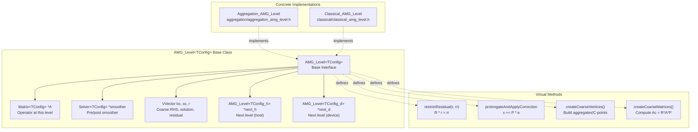
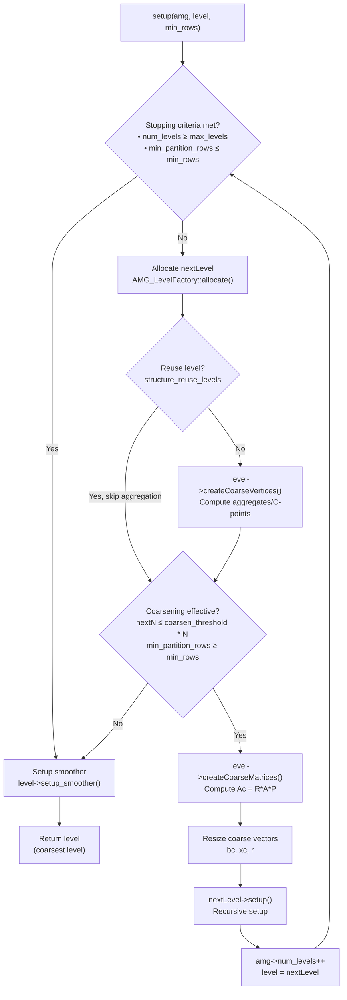
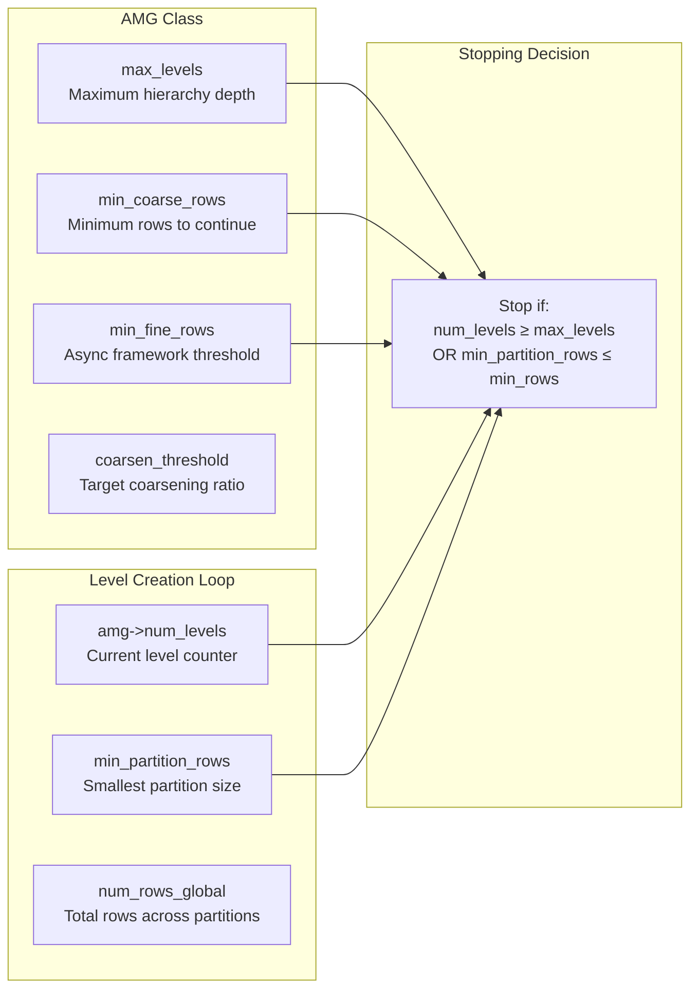
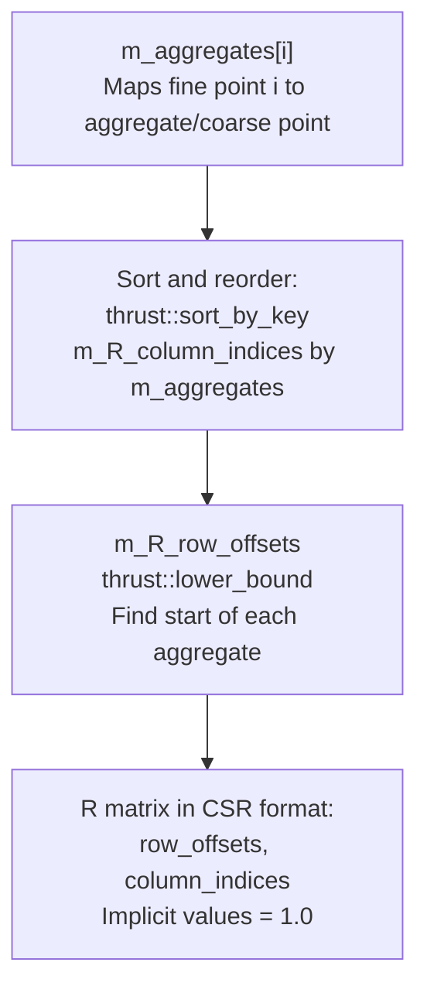
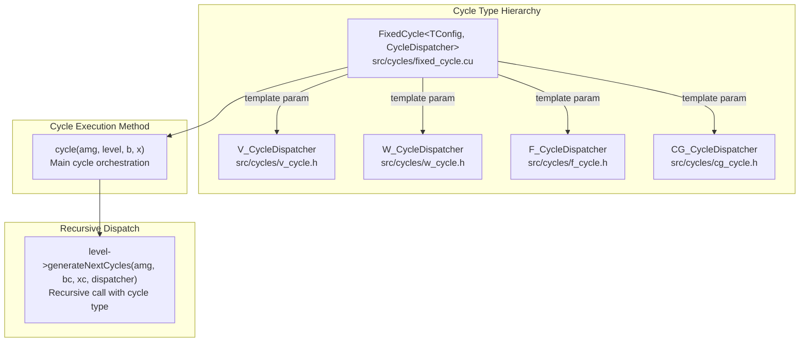
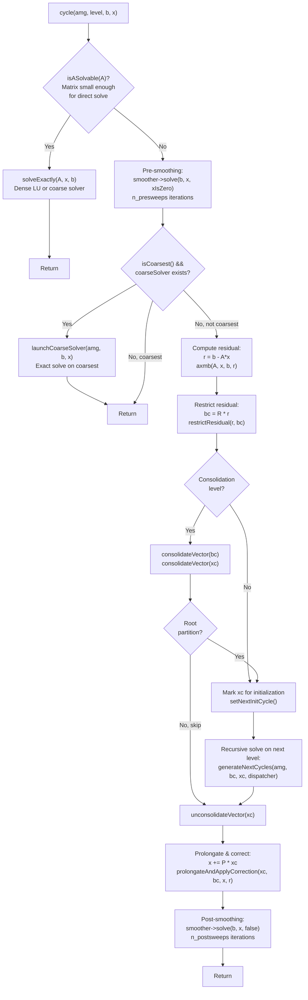
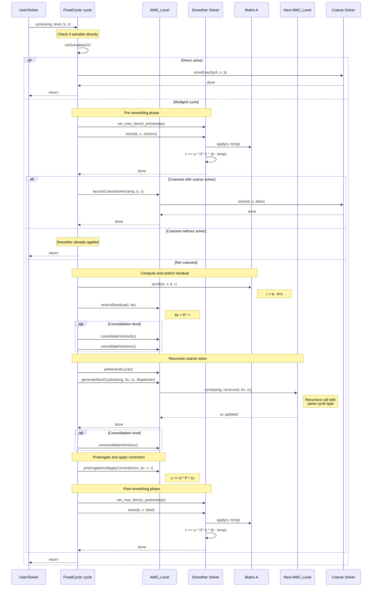

<!-- source: DeepWiki mcp.deepwiki.com · repo NVIDIA/AMGX · extra page AMG Hierarchy and Cycles · fetched 2026-10-26 -->

# AMG Hierarchy and Cycles

<details>
<summary>Relevant source files</summary>

The following files were used as context for generating this wiki page:

- [include/aggregation/aggregation_amg_level.h](include/aggregation/aggregation_amg_level.h)
- [include/amg_level.h](include/amg_level.h)
- [include/solvers/solver.h](include/solvers/solver.h)
- [src/aggregation/aggregation_amg_level.cu](src/aggregation/aggregation_amg_level.cu)
- [src/amg.cu](src/amg.cu)
- [src/cycles/fixed_cycle.cu](src/cycles/fixed_cycle.cu)
- [src/solvers/block_jacobi_solver.cu](src/solvers/block_jacobi_solver.cu)
- [src/solvers/solver.cu](src/solvers/solver.cu)
- [src/tests/fgmres_zero_initial_residual.cu](src/tests/fgmres_zero_initial_residual.cu)

</details>


## Purpose and Scope

This page describes the AMG hierarchy structure and cycle execution in AMGX. It covers:
- The `AMG_Level` class hierarchy and level-to-level connections
- Hierarchy construction algorithm and coarsening criteria
- Restriction and prolongation operators
- V/W/F cycle types and their orchestration
- Detailed cycle execution flow including smoothing, restriction, coarse solving, and prolongation

For information about specific AMG coarsening algorithms, see [Aggregation AMG](#3.2.2) and [Classical AMG](#3.2.3). For information about smoothers used within cycles, see [Smoothers](#3.4). For the overall AMG preconditioner interface, see [Algebraic Multigrid (AMG)](#3.2).

---

## AMG Level Structure

### AMG_Level Base Class

The `AMG_Level<TConfig>` class represents a single level in the AMG hierarchy. Each level contains:
- A matrix operator `A` for that level
- Coarse vectors `bc` (right-hand side) and `xc` (solution)
- A residual vector `r`
- A smoother solver
- Pointers to next coarser levels (device and/or host memory)



**Sources:** [include/amg_level.h:50-215](), [include/aggregation/aggregation_amg_level.h:34-163]()

### Level Hierarchy Organization

Levels are organized in a linked list structure where each level points to the next coarser level. The hierarchy can span both host and device memory, with automatic transfers handled by `AMG_GenerateNextCycles`.

| Property | Description | Code Location |
|----------|-------------|---------------|
| `level_id` | Level index (0 = finest) | [include/amg_level.h:203]() |
| `next_h` | Next level on host memory | [include/amg_level.h:201]() |
| `next_d` | Next level on device memory | [include/amg_level.h:202]() |
| `is_setup` | Setup completion flag | [include/amg_level.h:182]() |
| `init` | Initialization cycle flag | [include/amg_level.h:205]() |
| `m_is_consolidation_level` | Consolidation marker for distributed | [include/amg_level.h:206]() |

**Key Methods:**

- `isFinest()`: Returns true if `level_id == 0` [include/amg_level.h:100]()
- `isCoarsest()`: Returns true if both `next_d` and `next_h` are NULL [include/amg_level.h:101]()
- `isNextCoarsest()`: Checks if next level is coarsest [include/amg_level.h:102]()
- `getNextLevel(MemorySpace)`: Template method to retrieve correct next level pointer [include/amg_level.h:148-158]()

**Sources:** [include/amg_level.h:50-215](), [include/amg_level.h:100-158]()

---

## Hierarchy Construction

### Setup Algorithm

The hierarchy is constructed level-by-level in `AMG_Setup<>::setup()`. The algorithm iterates, creating successively coarser levels until stopping criteria are met.



**Sources:** [src/amg.cu:147-421]()

### Level Creation Criteria

The algorithm stops creating new levels when any of the following conditions is met:

| Criterion | Configuration Parameter | Default | Purpose |
|-----------|------------------------|---------|---------|
| Maximum levels | `max_levels` | varies | Limit hierarchy depth |
| Minimum coarse rows | `min_coarse_rows` | varies | Stop when problem is small enough |
| Coarsening ratio | `coarsen_threshold` | typically 0.5-0.9 | Ensure sufficient coarsening |
| Dense solver threshold | `dense_lu_num_rows` | 0 (disabled) | Switch to dense solver at specific size |

**Coarsening Effectiveness Check:**

The algorithm checks whether coarsening is effective using:
```
nextN <= coarsen_threshold * N && nextN != N && min_partition_rows >= min_rows
```

Where:
- `N` = current level size (rows × block_dimy)
- `nextN` = next level size
- `coarsen_threshold` = target coarsening ratio (e.g., 0.5 means aim for 50% reduction)

**Sources:** [src/amg.cu:201-226](), [src/amg.cu:364-389]()

### Hierarchy Setup Parameters



**Sources:** [src/amg.cu:38-85](), [src/amg.cu:182-226]()

---

## Restriction and Prolongation Operators

### Restriction Operator R

The restriction operator transfers residuals from fine level to coarse level: `r_coarse = R * r_fine`. In aggregation AMG, this is typically simple summation of fine-grid values within each aggregate.

**Restriction Operator Construction:**

For aggregation AMG, the restriction operator is constructed from the aggregates array:



**Key Implementation Methods:**

| Method | Format | Implementation |
|--------|--------|----------------|
| `computeRestrictionOperator_1x1()` | Scalar CSR | [src/aggregation/aggregation_amg_level.cu:369-372]() |
| `computeRestrictionOperator_4x4()` | Block CSR | [src/aggregation/aggregation_amg_level.cu:363-366]() |
| `computeRestrictionOperator_common()` | Common path | [src/aggregation/aggregation_amg_level.cu:238-299]() |

**Sources:** [src/aggregation/aggregation_amg_level.cu:234-372](), [include/aggregation/aggregation_amg_level.h:132-135]()

### Residual Restriction Kernels

**Scalar Format (1×1 blocks):**

```cpp
// src/aggregation/aggregation_amg_level.cu:91-111
__global__ void restrictResidualKernel(
    const IndexType *row_offsets, 
    const IndexType *column_indices, 
    const ValueType *r,      // fine residual
    ValueType *rr,           // coarse residual
    const int num_aggregates)
{
    for (int tid = ...) {
        ValueType temp = 0;
        int jmin = row_offsets[tid];
        int jmax = row_offsets[tid + 1];
        
        // Sum residuals within aggregate
        for (int j = jmin; j < jmax; j++) {
            int j_col = column_indices[j];
            temp += r[j_col];
        }
        rr[tid] = temp;
    }
}
```

**Block Format (b×b blocks):**

```cpp
// src/aggregation/aggregation_amg_level.cu:114-153
__global__ void restrictResidualBlockDiaCsrKernel(...)
{
    ValueType rr_temp[bsize];
    // Initialize to zero
    for (int m = 0; m < bsize; m++)
        rr_temp[m] = 0;
    
    // Sum block entries within aggregate
    for (int j = jmin; j < jmax; j++) {
        int jcol = column_indices[j];
        int offset = jcol * bsize;
        for (int m = 0; m < bsize; m++)
            rr_temp[m] += r[offset + m];
    }
    
    // Store result
    ...
}
```

**Sources:** [src/aggregation/aggregation_amg_level.cu:91-517]()

### Prolongation and Correction

Prolongation applies the coarse-grid correction to the fine-grid solution: `x_fine += α * P * e_coarse`. The prolongation operator `P` distributes coarse values to all fine points in the same aggregate.

**Basic Prolongation Kernel (scalar):**

```cpp
// src/aggregation/aggregation_amg_level.cu:156-165
__global__ void prolongateAndApplyCorrectionKernel(
    const ValueType alpha,
    const int num_rows,
    ValueType *x,              // fine solution
    const ValueType *e,        // coarse correction
    const IndexType *aggregates,
    IndexType num_aggregates)
{
    for (int tid = ...; tid < num_rows; ...) {
        IndexType I = aggregates[tid];  // coarse point
        x[tid] = x[tid] + alpha * e[I]; // apply correction
    }
}
```

**Error Scaling (Advanced):**

AMGX supports advanced error scaling techniques (`error_scaling` parameter) that compute an optimal scaling factor `α` by:
1. Prolongating the error: `e_fine = P * e_coarse`
2. Smoothing the prolongated error
3. Computing `α = <r_fine, A*e_fine> / <A*e_fine, A*e_fine>` (or variations)
4. Applying scaled correction: `x_fine += α * e_fine`

**Sources:** [src/aggregation/aggregation_amg_level.cu:156-840](), [src/aggregation/aggregation_amg_level.cu:696-840]()

---

## Cycle Types and Orchestration

### Cycle Patterns

AMGX supports multiple cycle types that differ in how they traverse the hierarchy:

**V-Cycle:**
```
Level 0:  \    /
Level 1:   \  /
Level 2:    \/
```
Visit each level once going down, once going up.

**W-Cycle:**
```
Level 0:  \        /
Level 1:   \  /\  /
Level 2:    \/  \/
```
Visit each level multiple times (typically twice) for more thorough coarse-grid correction.

**F-Cycle:**
```
Level 0:  \      /
Level 1:   \  / /
Level 2:    \/ /
```
V-cycle on the way down, additional V-cycle before going up.



**Sources:** [src/cycles/fixed_cycle.cu:24-248](), [include/cycles/v_cycle.h](), [include/cycles/w_cycle.h](), [include/cycles/f_cycle.h]()

### FixedCycle Implementation

The `FixedCycle<TConfig, CycleDispatcher>::cycle()` method orchestrates a single cycle iteration:

**Cycle Algorithm Structure:**



**Sources:** [src/cycles/fixed_cycle.cu:24-248]()

### Smoothing Configuration

The number of pre- and post-smoothing sweeps varies by level and configuration:

| Level Type | Pre-smoothing | Post-smoothing | Configuration |
|------------|---------------|----------------|---------------|
| Finest | `num_finestsweeps` (if set) or `presweeps` | `num_finestsweeps` (if set) or `postsweeps` | Lines [73-95](), [196-210]() |
| Interior | `presweeps` [+ levelnum - 2 if intensive] | `postsweeps` [+ levelnum - 2 if intensive] | Lines [88-95](), [203-210]() |
| Coarsest (no solver) | `coarsestsweeps` | 0 | Lines [79-82]() |
| Coarsest (with solver) | 0 | 0 | Lines [76-78]() |

**Intensive Smoothing:** When `intensive_smoothing` is enabled, the number of sweeps increases with level depth to compensate for reduced coarse-grid correction effectiveness.

**Sources:** [src/cycles/fixed_cycle.cu:73-223]()

---

## Cycle Execution Flow

### Complete Cycle Sequence

A complete multigrid cycle consists of the following stages:



**Sources:** [src/cycles/fixed_cycle.cu:24-248]()

### Pre-smoothing Details

Pre-smoothing applies a simple iterative method to reduce high-frequency error components before restriction:

**Process:**
1. Set smoothing direction flag: `*smoothing_direction = 0` [src/cycles/fixed_cycle.cu:70]()
2. Determine number of sweeps based on level type [src/cycles/fixed_cycle.cu:73-95]()
3. Configure smoother: `smoother->setTolerance(0.0)` and `smoother->set_max_iters(n_presweeps)` [src/cycles/fixed_cycle.cu:99-100]()
4. Execute: `smoother->solve(b, x, xIsZero)` [src/cycles/fixed_cycle.cu:101]()
5. Mark cycle as initialized: `level->unsetInitCycle()` [src/cycles/fixed_cycle.cu:108]()

**Zero Initial Guess Handling:**

If `xIsZero` is true (typically on the first cycle), the smoother can optimize by skipping the initial matrix-vector product. If no smoothing is requested but `xIsZero` is true, the solution vector is explicitly zeroed [src/cycles/fixed_cycle.cu:103-106]().

**Sources:** [src/cycles/fixed_cycle.cu:63-110]()

### Residual Restriction Process

After pre-smoothing, the residual is computed and restricted to the coarse grid:

**Steps:**

1. **Compute Residual:** `axmb(A, x, b, r, offset, size)` [src/cycles/fixed_cycle.cu:129]()
   - Performs `r = b - A*x` for owned rows
   - Uses matrix-vector multiplication followed by axpy

2. **Restrict to Coarse Grid:** `level->restrictResidual(r, bc)` [src/cycles/fixed_cycle.cu:149]()
   - Applies restriction operator: `bc = R * r`
   - For aggregation: sums residuals within each aggregate
   - For classical: uses prolongation transpose

3. **Optional Consolidation:** [src/cycles/fixed_cycle.cu:154-158]()
   - If consolidation level and distributed, gather coarse vectors to root partitions
   - `level->consolidateVector(bc)` and `level->consolidateVector(xc)`
   - Enables solving smaller systems on fewer processes

**Sources:** [src/cycles/fixed_cycle.cu:122-158]()

### Coarse Grid Solving

The coarse grid is solved recursively using the same cycle type (V/W/F):

**Recursive Dispatch:**

```cpp
// src/cycles/fixed_cycle.cu:163-180
if (level->isNextCoarsest()) {
    // If next level is coarsest, use V-cycle (single visit)
    level->generateNextCycles(amg, bc, xc, V_CycleDispatcher<...>());
} else {
    // Otherwise use the same cycle type (V/W/F)
    level->generateNextCycles(amg, bc, xc, CycleDispatcher<...>());
}
```

**Memory Space Handling:**

The `AMG_GenerateNextCycles` template class handles transfers between host and device memory when the hierarchy spans both [include/amg_level.h:41-316](). It automatically:
- Copies vectors to target memory space
- Invokes cycle on next level
- Copies results back

**Sources:** [src/cycles/fixed_cycle.cu:160-180](), [include/amg_level.h:217-316]()

### Prolongation and Post-smoothing

After the coarse solve completes, the correction is prolongated and applied to the fine-grid solution:

**Prolongation:** [src/cycles/fixed_cycle.cu:189]()
```cpp
level->prolongateAndApplyCorrection(xc, bc, x, r);
```
- Applies: `x_fine += α * P * x_coarse`
- Where `P` is the prolongation operator (transpose of restriction for aggregation)
- `α` is a scaling factor (typically 1.0, or computed with error scaling)

**Post-smoothing:** [src/cycles/fixed_cycle.cu:192-223]()
1. Set smoothing direction: `*smoothing_direction = 1` [src/cycles/fixed_cycle.cu:192]()
2. Determine number of post-sweeps (similar to pre-smoothing) [src/cycles/fixed_cycle.cu:196-215]()
3. Execute: `smoother->solve(b, x, false)` [src/cycles/fixed_cycle.cu:221]()
   - `xIsZero = false` since x contains the prolongated correction
   - Smooths out high-frequency errors introduced by prolongation

**Error Scaling Override:**

If advanced error scaling is enabled (`error_scaling > 3`), post-smoothing may be skipped as the correction already includes smoothed components [src/cycles/fixed_cycle.cu:212-215]().

**Sources:** [src/cycles/fixed_cycle.cu:189-224]()

### Distributed Synchronization

In distributed settings, additional synchronization is required:

**After Post-smoothing:** [src/cycles/fixed_cycle.cu:226-242]()

For aggregation AMG with consolidation:
- Non-root partitions: Wait for `bc` send completion (data sent during restriction)
- Root partitions: Wait for `xc` send completion (data sent during un-consolidation)

This ensures all MPI communication completes before the cycle returns.

**Sources:** [src/cycles/fixed_cycle.cu:226-243]()

---

## Level Initialization and State

### Initialization Cycle Flag

The `init` flag tracks whether the solution vector on a level needs initialization:

**Purpose:**
- When `true`, indicates the solution vector `x` should be treated as zero
- Enables optimization: skip matrix-vector product in first smoothing iteration
- Automatically set when coarser level is first created [include/amg_level.h:205]()

**Management Methods:**

| Method | Purpose | Location |
|--------|---------|----------|
| `setInitCycle()` | Mark this level for initialization | [include/amg_level.h:105]() |
| `setNextInitCycle()` | Mark next level for initialization | [include/amg_level.h:106]() |
| `unsetInitCycle()` | Clear initialization flag | [include/amg_level.h:107]() |
| `isInitCycle()` | Check initialization state | [include/amg_level.h:109]() |

**Usage in Cycle:**

Before pre-smoothing:
```cpp
bool xIsZero = false;
if (level->isInitCycle()) {
    xIsZero = true;  // Enable zero-guess optimizations
}
// ... smoothing ...
level->unsetInitCycle();  // Clear flag after first use
```

**Sources:** [include/amg_level.h:105-109](), [src/cycles/fixed_cycle.cu:63-108]()

### Level Setup State

The `is_setup` flag indicates whether a level has completed setup:

- Set to `true` after `level->setup()` completes [include/amg_level.h:182]()
- Prevents redundant setup operations
- Checked before attempting to use level for solving

**Sources:** [include/amg_level.h:103](), [include/amg_level.h:182]()

---

