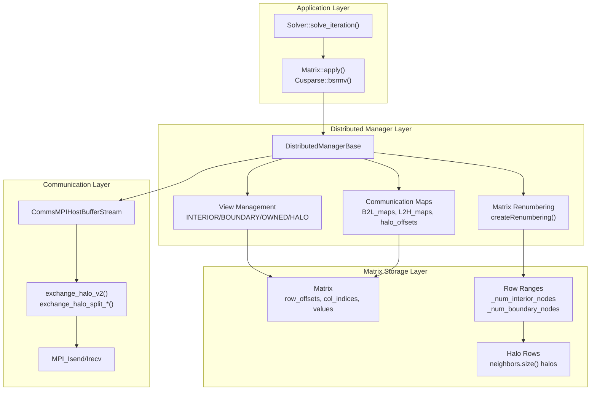
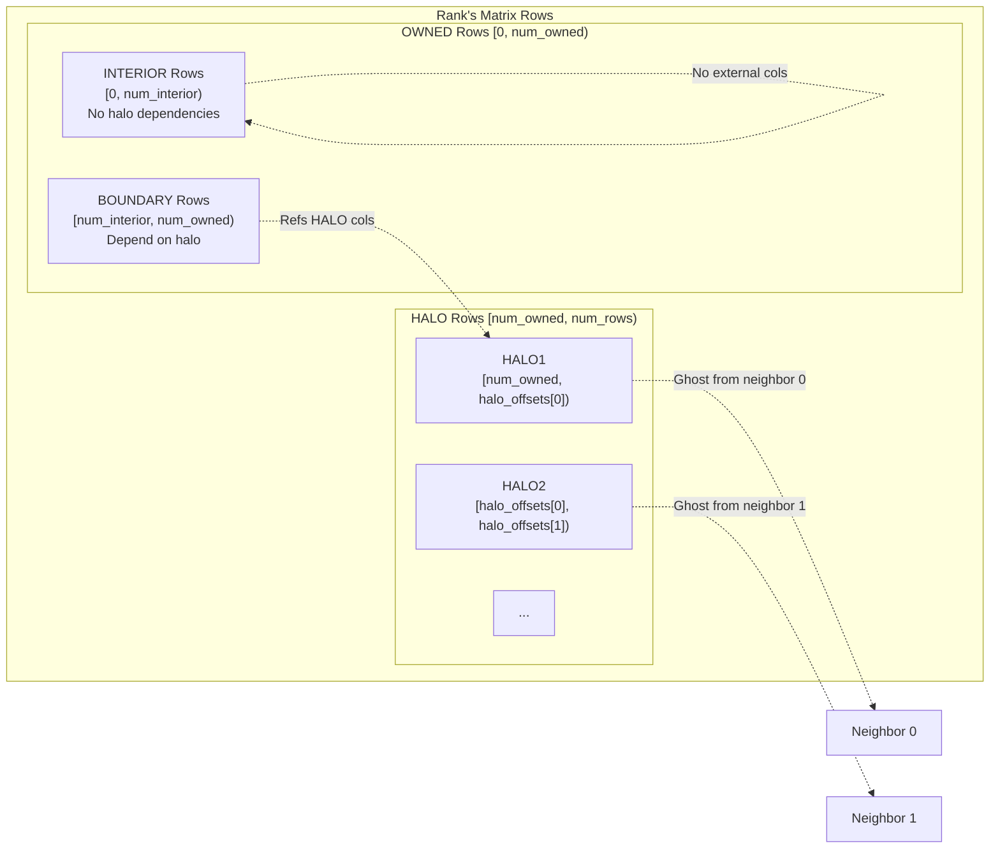
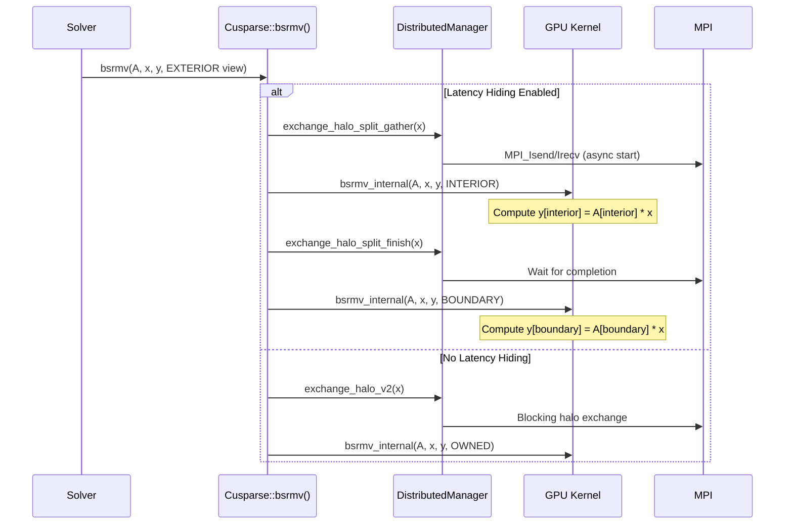
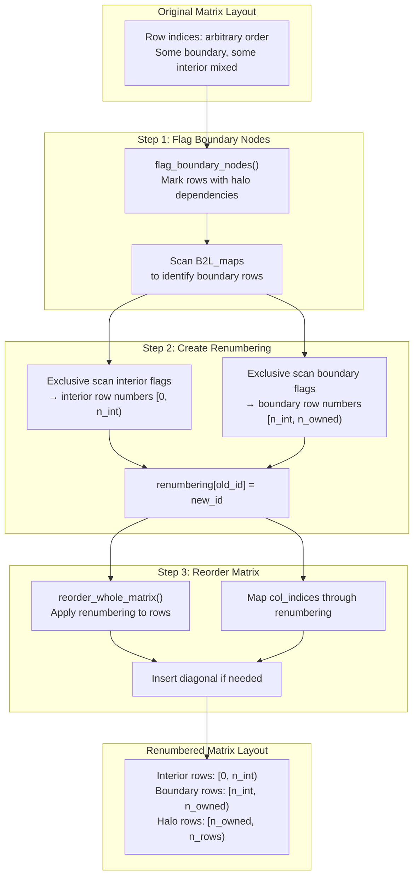
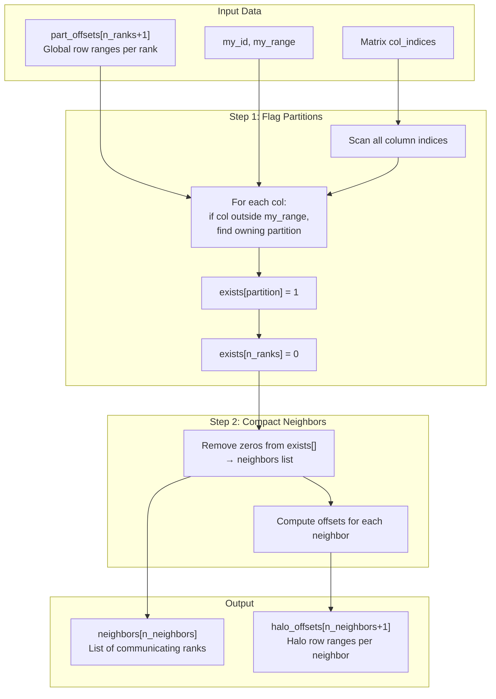
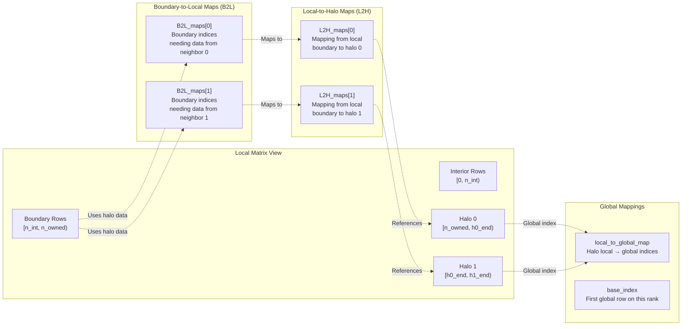
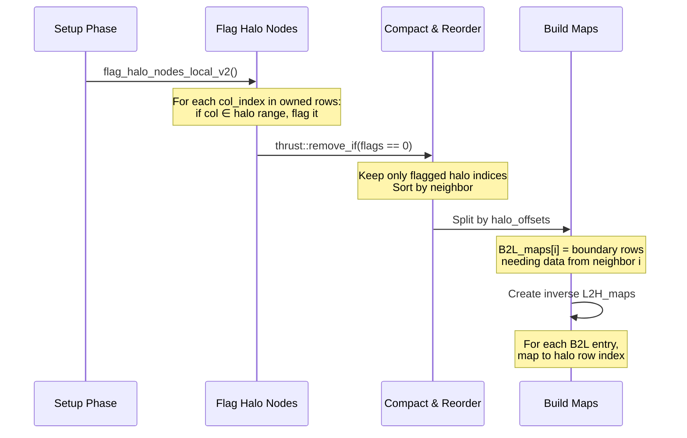
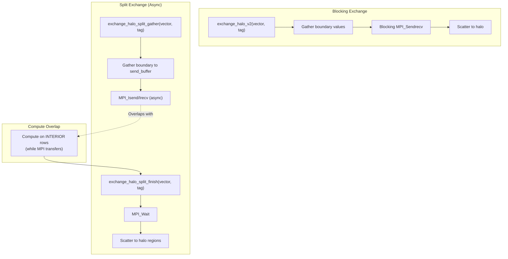
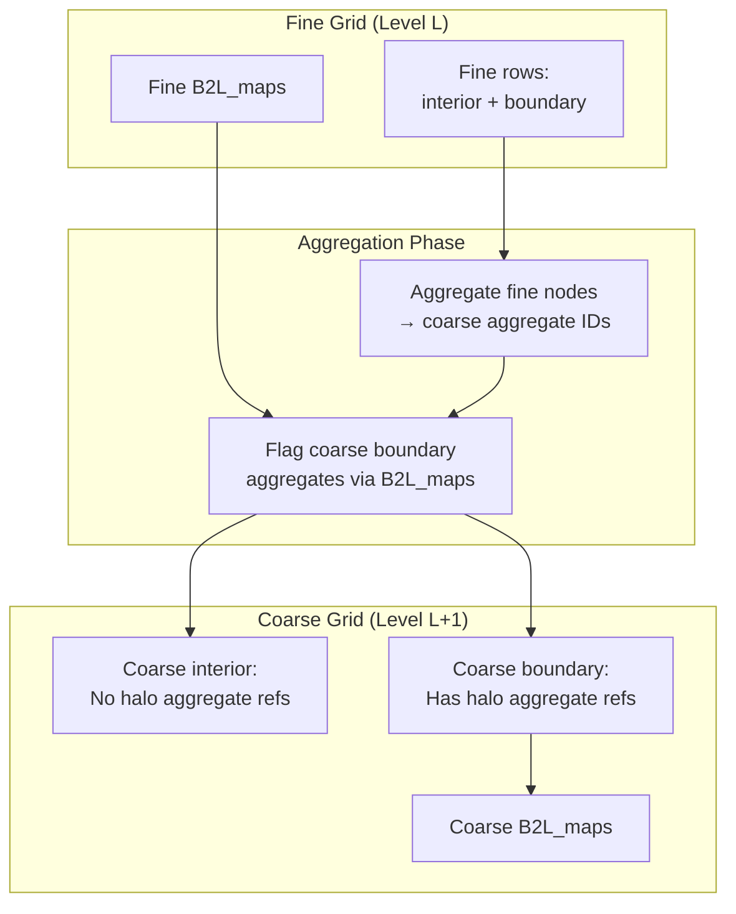
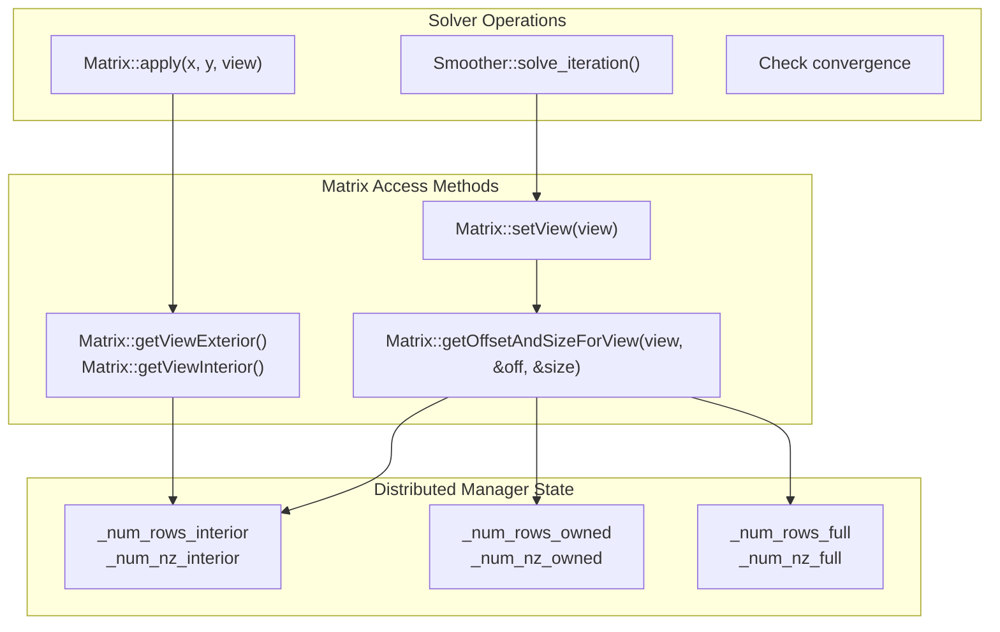

<!-- source: DeepWiki mcp.deepwiki.com · repo NVIDIA/AMGX · extra page Distributed Manager · fetched 2026-10-26 -->

# Distributed Manager

<details>
<summary>Relevant source files</summary>

The following files were used as context for generating this wiki page:

- [include/reorder_partition.h](include/reorder_partition.h)
- [src/amgx_cusparse.cu](src/amgx_cusparse.cu)
- [src/distributed/distributed_arranger.cu](src/distributed/distributed_arranger.cu)
- [src/distributed/distributed_manager.cu](src/distributed/distributed_manager.cu)
- [src/matrix.cu](src/matrix.cu)
- [src/matrix_io.cu](src/matrix_io.cu)
- [src/readers.cu](src/readers.cu)
- [src/solvers/gauss_seidel_solver.cu](src/solvers/gauss_seidel_solver.cu)
- [src/solvers/multicolor_dilu_solver.cu](src/solvers/multicolor_dilu_solver.cu)

</details>


## Purpose and Scope

The Distributed Manager subsystem handles the partitioning, communication, and coordination of matrices and vectors across multiple GPUs/nodes in distributed memory environments. It manages the separation of matrix rows into interior, boundary, and halo regions, maintains communication maps between neighboring partitions, and orchestrates halo exchange operations required for distributed sparse matrix operations.

This document covers the `DistributedManagerBase` class and related components for matrix partitioning and renumbering. For details on MPI communication implementation, see [MPI Communication](#2.4.2). For distributed matrix storage formats, see [Matrix Storage and I/O](#2.1.1).

---

## System Architecture

The Distributed Manager sits between the matrix representation and the communication layer, providing logical partitioning and index mapping services.



**Sources:** [src/distributed/distributed_manager.cu:1-2000](), [src/amgx_cusparse.cu:48-148]()

---

## Matrix Partitioning and View Types

Each MPI rank owns a contiguous block of matrix rows, which are subdivided into interior, boundary, and halo regions. This separation enables latency hiding by computing on interior rows while waiting for halo data.

### Row Region Definitions



| View Type | Row Range | Description | Use Case |
|-----------|-----------|-------------|----------|
| `INTERIOR` | `[0, _num_interior_nodes)` | Rows with no halo dependencies | Latency hiding - compute first |
| `BOUNDARY` | `[_num_interior_nodes, num_owned)` | Rows referencing halo columns | Compute after halo exchange |
| `OWNED` | `[0, _num_interior_nodes + _num_boundary_nodes)` | All locally owned rows | Full local matrix |
| `HALO` | `[num_owned, halo_offsets[neighbors.size()])` | Ghost rows from neighbors | One-ring, two-ring halos |

**Sources:** [src/distributed/distributed_manager.cu:814-854](), [src/amgx_cusparse.cu:75-89]()

### View-Based Sparse Matrix-Vector Multiplication

The `Cusparse::bsrmv()` method demonstrates latency hiding using views:



**Sources:** [src/amgx_cusparse.cu:75-102](), [src/amgx_cusparse.cu:123-148]()

---

## Matrix Renumbering

The Distributed Manager renumbers matrix rows and columns to separate interior from boundary nodes and consolidate halo regions. This renumbering is critical for efficient latency hiding and communication.

### Renumbering Process



**Sources:** [src/distributed/distributed_manager.cu:856-1095](), [src/distributed/distributed_manager.cu:647-681]()

### Renumbering Implementation

The `createRenumbering()` method performs the multi-step renumbering process:

| Step | Function | Description |
|------|----------|-------------|
| 1 | `remove_boundary()` | Set boundary flags to 0 using B2L maps |
| 2 | `thrust::exclusive_scan()` | Compute new interior indices |
| 3 | `thrust::exclusive_scan()` | Compute new boundary indices (offset by interior count) |
| 4 | `reorder_whole_matrix<>()` | Reorder matrix rows and columns |
| 5 | `calc_rowlen_reorder()` | Update row offsets for new ordering |

**Kernel Example:** The `reorder_whole_matrix` kernel applies renumbering:

```cpp
// From src/distributed/distributed_manager.cu:646-681
template <int coop, class T>
__global__ void reorder_whole_matrix(
    INDEX_TYPE *old_rows, INDEX_TYPE *old_cols, T *old_vals,
    INDEX_TYPE *rows, INDEX_TYPE *cols, T *vals,
    INDEX_TYPE *renumbering, INDEX_TYPE bsize, 
    INDEX_TYPE num_rows, INDEX_TYPE insert_diagonal)
{
    int row = blockIdx.x * blockDim.x / coop + threadIdx.x / coop;
    INDEX_TYPE src_base = old_rows[row];
    INDEX_TYPE dst_base = rows[renumbering[row]];  // Apply renumbering
    
    // Copy values to new location
    // Map column indices through renumbering
}
```

**Sources:** [src/distributed/distributed_manager.cu:856-1095](), [src/distributed/distributed_manager.cu:646-681]()

---

## Neighbor Discovery

The Distributed Manager identifies which MPI ranks need to communicate by analyzing matrix column indices and determining which partitions they reference.

### Neighbor Discovery Algorithm



**Implementation:** The `calc_num_neighbors_v2_local` kernel flags neighbors:

```cpp
// From src/distributed/distributed_arranger.cu:244-276
template <int coop>
__global__ void calc_num_neighbors_v2_local(
    INDEX_TYPE *row_offsets, INDEX_TYPE *col_indices,
    int64_t *part_offsets, INDEX_TYPE *exists,
    int64_t *local_to_global_map,
    INDEX_TYPE num_part, INDEX_TYPE my_id, INDEX_TYPE num_rows)
{
    // For each halo column reference:
    //   1. Convert local index to global
    //   2. Binary search to find owning partition
    //   3. Set exists[partition] = 1
}
```

**Sources:** [src/distributed/distributed_arranger.cu:244-276](), [src/distributed/distributed_arranger.cu:214-241]()

---

## Communication Maps

The Distributed Manager maintains several mapping structures to translate between local, global, and halo indices during communication.

### Map Types and Structure



### Key Data Members

| Member | Type | Description |
|--------|------|-------------|
| `neighbors` | `std::vector<int>` | List of neighbor rank IDs |
| `B2L_maps` | `IVector_h_vector` | Per-neighbor boundary-to-local maps |
| `L2H_maps` | `IVector_h_vector` | Per-neighbor local-to-halo maps |
| `halo_offsets` | `IVector_h` | Cumulative halo row offsets |
| `local_to_global_map` | `I64Vector_h` | Halo local → global index mapping |
| `base_index` | `int64_t` | First global row index for this rank |
| `index_range` | `int64_t` | Number of owned rows |

**Sources:** [src/distributed/distributed_manager.cu:1-100](), [include/distributed/distributed_manager.h]()

### Map Construction Process

The `create_B2L_from_neighbors()` method builds communication maps:



**Sources:** [src/distributed/distributed_manager.cu:1200-1400](), [src/distributed/distributed_arranger.cu:343-418]()

---

## Halo Exchange Operations

The Distributed Manager provides both blocking and split (asynchronous) halo exchange methods for vector communication.

### Halo Exchange Variants



### Method Signatures

| Method | Purpose | Blocking |
|--------|---------|----------|
| `exchange_halo_v2(vec, tag)` | Full blocking halo exchange | Yes |
| `exchange_halo_split_gather(vec, tag)` | Start async send/recv | No |
| `exchange_halo_split_finish(vec, tag)` | Wait and scatter | Yes (wait) |
| `add_from_halo_v2(vec, tag)` | Accumulate from halo (restriction) | Yes |
| `add_from_halo_split_gather(vec, tag)` | Start async restriction | No |
| `add_from_halo_split_finish(vec, tag)` | Wait and accumulate | Yes (wait) |

**Usage Pattern:** Split exchange for latency hiding:

```cpp
// From src/amgx_cusparse.cu:77-90
bool latencyHiding = (A.getViewInterior() != A.getViewExterior() 
                       && !A.is_matrix_singleGPU() 
                       && x.dirtybit != 0);

if (latencyHiding) {
    A.manager->exchange_halo_split_gather(x, x.tag);  // Start async
    
    // Multiply interior rows (no halo dependencies)
    bsrmv_internal(alpha, A, x, beta, y, A.getViewInterior(), stream);
    
    A.manager->exchange_halo_split_finish(x, x.tag);  // Wait & scatter
    
    // Multiply boundary rows (now have halo data)
    ViewType bnd_view = (ViewType)(~(A.getViewInterior()) & A.getViewExterior());
    bsrmv_internal(alpha, A, x, beta, y, bnd_view, stream);
}
```

**Sources:** [src/amgx_cusparse.cu:75-102](), [src/distributed/distributed_manager.cu:2000-2500]()

---

## Coarse Grid Management

For multigrid hierarchies, the Distributed Manager handles coarsening of distributed matrices, maintaining consistent partitioning across levels.

### Aggregation Renumbering

The `createAggregatesRenumbering()` method adapts renumbering for aggregated coarse grids:



**Key Steps:**
1. Scan fine-level B2L maps to find boundary nodes
2. Mark aggregates containing boundary nodes as boundary
3. Mark aggregates with halo node references as boundary
4. Renumber coarse aggregates: interior first, then boundary
5. Update coarse B2L maps based on aggregate membership

**Sources:** [src/distributed/distributed_manager.cu:856-950]()

---

## Integration with Solvers and Matrix Operations

The Distributed Manager integrates tightly with solver operations through view-based matrix access.

### View Access Pattern



### Cached View Sizes

The `set_initialized()` method caches row and nnz counts for each view:

```cpp
// From src/distributed/distributed_manager.cu:814-854
template <class TConfig>
inline void DistributedManagerBase<TConfig>::set_initialized(IVector &row_offsets)
{
    if (neighbors.size() > 0) {
        _num_rows_interior = _num_interior_nodes;
        _num_nz_interior = row_offsets[_num_rows_interior];
        
        _num_rows_owned = _num_interior_nodes + _num_boundary_nodes;
        _num_nz_owned = row_offsets[_num_rows_owned];
        
        _num_rows_full = halo_offsets[neighbors.size()];
        _num_nz_full = row_offsets[_num_rows_full];
        
        _num_rows_all = halo_offsets[halo_offsets.size() - 1];
        _num_nz_all = _num_nz_full;
    }
}
```

**Sources:** [src/distributed/distributed_manager.cu:814-854](), [src/matrix.cu:215-227]()

---

## Key Classes and Methods Reference

### DistributedManagerBase<TConfig>

Primary class implementing distributed matrix management.

**Key Members:**
- `std::vector<int> neighbors` - Neighbor rank IDs
- `IVector_h_vector B2L_maps` - Boundary-to-local communication maps
- `IVector_h_vector L2H_maps` - Local-to-halo index maps
- `IVector_h halo_offsets` - Cumulative offsets for halo regions
- `I64Vector_h local_to_global_map` - Local halo → global index mapping
- `int64_t base_index` - Starting global row index
- `int _num_interior_nodes`, `_num_boundary_nodes` - Row counts

**Key Methods:**
- `createRenumbering()` - Create interior/boundary separation renumbering
- `createAggregatesRenumbering()` - Create renumbering for coarse grids
- `exchange_halo_v2()` - Blocking halo exchange
- `exchange_halo_split_gather/finish()` - Async split halo exchange
- `add_from_halo_v2()` - Restriction operation (accumulate from halos)
- `set_initialized()` - Cache view sizes after matrix setup

**Sources:** [src/distributed/distributed_manager.cu:45-300](), [src/distributed/distributed_manager.cu:782-854]()

### DistributedArranger

Helper class for setting up distributed structures during matrix upload.

**Key Methods:**
- `create_neighbors()` - Discover neighboring partitions
- `create_B2L()` - Build boundary-to-local maps
- `createRowsLists()` - Separate interior/boundary row lists
- `flag_halo_nodes_local_v2()` - Flag halo nodes from matrix columns

**Sources:** [src/distributed/distributed_arranger.cu:1-700]()

### Key Kernel Functions

| Kernel | Purpose | Location |
|--------|---------|----------|
| `flag_boundary_nodes_P` | Identify boundary rows for interpolation matrix | [src/distributed/distributed_arranger.cu:52-103]() |
| `flag_boundary_nodes` | Mark boundary rows from B2L maps | [src/distributed/distributed_arranger.cu:106-113]() |
| `reorder_whole_matrix` | Apply renumbering to matrix structure | [src/distributed/distributed_manager.cu:646-681]() |
| `calc_num_neighbors_v2_local` | Count neighbors from column indices | [src/distributed/distributed_arranger.cu:244-276]() |
| `flag_halo_nodes_local` | Flag halo nodes using local indices | [src/distributed/distributed_arranger.cu:343-371]() |
| `renumber_col_indices_global` | Renumber column indices after partitioning | [src/distributed/distributed_arranger.cu:500-542]() |

**Sources:** [src/distributed/distributed_manager.cu:32-780](), [src/distributed/distributed_arranger.cu:32-700]()

---

