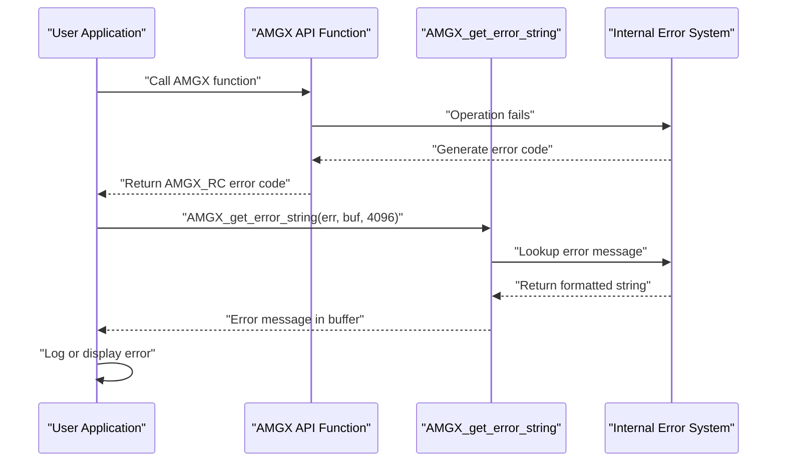
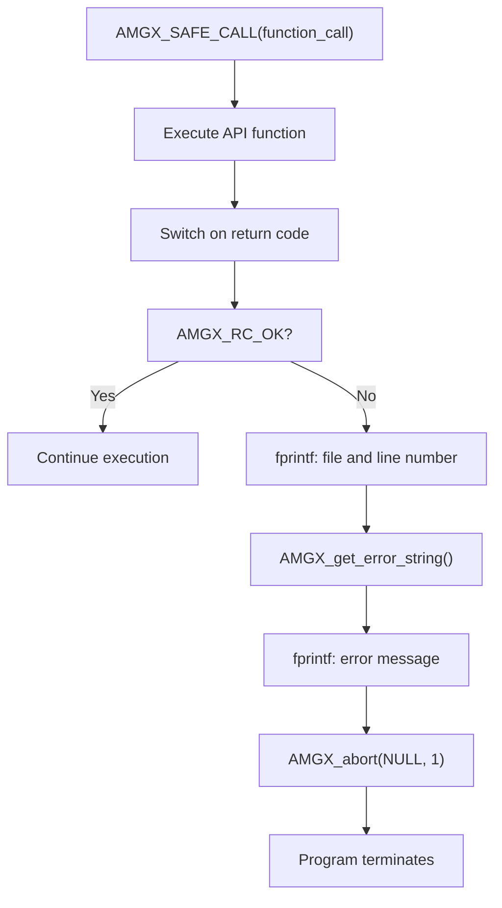
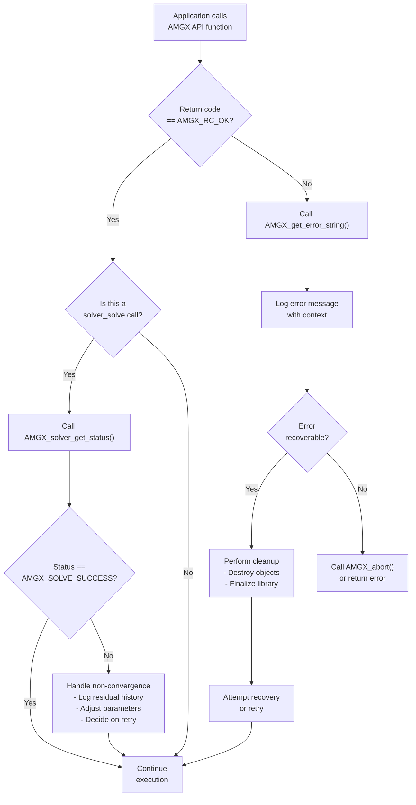

<!-- source: DeepWiki mcp.deepwiki.com · repo NVIDIA/AMGX · extra page Error Handling · fetched 2026-10-26 -->

# Error Handling

<details>
<summary>Relevant source files</summary>

The following files were used as context for generating this wiki page:

- [examples/amgx_capi.h](examples/amgx_capi.h)

</details>


This document describes the error handling mechanisms provided by the AMGX C API. It covers return codes, error string retrieval, the `AMGX_SAFE_CALL` macro, and recommended practices for handling errors in user applications. For information about the overall C API design, see [API Design and Object Model](#4.1.1).

## Overview

The AMGX C API uses a return-code-based error handling model. All API functions return an `AMGX_RC` enumeration value indicating success or failure. Additionally, solver operations return a separate `AMGX_SOLVE_STATUS` to distinguish between solver-specific outcomes (convergence, divergence) and API-level errors.

**Sources:** [examples/amgx_capi.h:32-50](), [examples/amgx_capi.h:55-61]()

## Return Code System

### AMGX_RC Enumeration

The `AMGX_RC` enum defines error codes returned by all AMGX API functions. A return value of `AMGX_RC_OK` indicates success; any other value indicates an error condition.

| Error Code | Value | Meaning |
|------------|-------|---------|
| `AMGX_RC_OK` | 0 | Operation completed successfully |
| `AMGX_RC_BAD_PARAMETERS` | 1 | Invalid parameters passed to function |
| `AMGX_RC_UNKNOWN` | 2 | Unknown error occurred |
| `AMGX_RC_NOT_SUPPORTED_TARGET` | 3 | Unsupported execution target (host/device) |
| `AMGX_RC_NOT_SUPPORTED_BLOCKSIZE` | 4 | Unsupported matrix block size |
| `AMGX_RC_CUDA_FAILURE` | 5 | CUDA runtime or driver error |
| `AMGX_RC_THRUST_FAILURE` | 6 | Thrust library error |
| `AMGX_RC_NO_MEMORY` | 7 | Memory allocation failure |
| `AMGX_RC_IO_ERROR` | 8 | File I/O error |
| `AMGX_RC_BAD_MODE` | 9 | Invalid AMGX_Mode specification |
| `AMGX_RC_CORE` | 10 | Core library error |
| `AMGX_RC_PLUGIN` | 11 | Plugin-related error |
| `AMGX_RC_BAD_CONFIGURATION` | 12 | Invalid JSON configuration |
| `AMGX_RC_NOT_IMPLEMENTED` | 13 | Feature not implemented |
| `AMGX_RC_LICENSE_NOT_FOUND` | 14 | License file not found (legacy) |
| `AMGX_RC_INTERNAL` | 15 | Internal library error |

**Sources:** [examples/amgx_capi.h:32-50]()

### Error Code Categories

```mermaid
graph TB
    AMGX_RC["AMGX_RC<br/>Return Code"]
    
    Success["AMGX_RC_OK<br/>Success"]
    
    UserError["User Input Errors"]
    BadParams["AMGX_RC_BAD_PARAMETERS"]
    BadMode["AMGX_RC_BAD_MODE"]
    BadConfig["AMGX_RC_BAD_CONFIGURATION"]
    NotImpl["AMGX_RC_NOT_IMPLEMENTED"]
    
    ResourceError["Resource Errors"]
    NoMem["AMGX_RC_NO_MEMORY"]
    IOErr["AMGX_RC_IO_ERROR"]
    
    SystemError["System Errors"]
    CudaFail["AMGX_RC_CUDA_FAILURE"]
    ThrustFail["AMGX_RC_THRUST_FAILURE"]
    
    InternalError["Internal Errors"]
    Unknown["AMGX_RC_UNKNOWN"]
    Core["AMGX_RC_CORE"]
    Internal["AMGX_RC_INTERNAL"]
    
    AMGX_RC --> Success
    AMGX_RC --> UserError
    AMGX_RC --> ResourceError
    AMGX_RC --> SystemError
    AMGX_RC --> InternalError
    
    UserError --> BadParams
    UserError --> BadMode
    UserError --> BadConfig
    UserError --> NotImpl
    
    ResourceError --> NoMem
    ResourceError --> IOErr
    
    SystemError --> CudaFail
    SystemError --> ThrustFail
    
    InternalError --> Unknown
    InternalError --> Core
    InternalError --> Internal
```



**Sources:** [examples/amgx_capi.h:32-50]()

## Solver Status Codes

The `AMGX_SOLVE_STATUS` enum is returned by `AMGX_solver_get_status()` to indicate the outcome of a solve operation. This is distinct from `AMGX_RC` return codes, which indicate API-level errors.

| Status Code | Value | Meaning |
|-------------|-------|---------|
| `AMGX_SOLVE_SUCCESS` | 0 | Solver converged successfully |
| `AMGX_SOLVE_FAILED` | 1 | Solver failed to converge |
| `AMGX_SOLVE_DIVERGED` | 2 | Solver diverged |
| `AMGX_SOLVE_NOT_CONVERGED` | 2 | Solver did not converge (alias for DIVERGED) |

Note that `AMGX_SOLVE_DIVERGED` and `AMGX_SOLVE_NOT_CONVERGED` are equivalent (both have value 2).

**Sources:** [examples/amgx_capi.h:55-61]()

## Error String Retrieval

### AMGX_get_error_string Function

The `AMGX_get_error_string()` function converts an `AMGX_RC` error code into a human-readable error message.

**Function Signature:**
```c
AMGX_RC AMGX_get_error_string(
    AMGX_RC err,        // Error code to convert
    char *buf,          // Output buffer for error string
    int buf_len         // Size of output buffer in bytes
);
```

**Parameters:**
- `err`: The error code to convert to a string
- `buf`: Pointer to character buffer that will receive the error message
- `buf_len`: Size of the buffer in bytes (typically 4096 is sufficient)

**Returns:** `AMGX_RC_OK` on success, or an error code if the operation fails

**Sources:** [examples/amgx_capi.h:127-130]()

### Error String Retrieval Flow



**Sources:** [examples/amgx_capi.h:127-130]()

## AMGX_SAFE_CALL Macro

The `AMGX_SAFE_CALL` macro provides a convenient way to check return codes and automatically handle errors by printing diagnostics and aborting execution on failure.

### Macro Definition

```c
#define AMGX_SAFE_CALL(rc) \
{ \
  AMGX_RC err;     \
  char msg[4096];   \
  switch(err = (rc)) {    \
  case AMGX_RC_OK: \
    break; \
  default: \
    fprintf(stderr, "AMGX ERROR: file %s line %6d\n", __FILE__, __LINE__); \
    AMGX_get_error_string(err, msg, 4096);\
    fprintf(stderr, "AMGX ERROR: %s\n", msg); \
    AMGX_abort(NULL,1);\
    break; \
  } \
}
```

**Sources:** [examples/amgx_capi.h:98-112]()

### AMGX_SAFE_CALL Behavior



**Sources:** [examples/amgx_capi.h:98-112]()

### Usage Pattern

The macro is typically used to wrap all AMGX API calls in example code:

```c
// Create configuration
AMGX_config_handle cfg;
AMGX_SAFE_CALL(AMGX_config_create(&cfg, "config_version=2"));

// Create resources
AMGX_resources_handle rsrc;
AMGX_SAFE_CALL(AMGX_resources_create_simple(&rsrc, cfg));

// Create matrix
AMGX_matrix_handle A;
AMGX_SAFE_CALL(AMGX_matrix_create(&A, rsrc, mode));
```

**Note:** `AMGX_SAFE_CALL` calls `AMGX_abort(NULL, 1)` on error, which terminates the program. Production applications may want to implement custom error handling instead of using this macro.

**Sources:** [examples/amgx_capi.h:98-112]()

## Abort Function

### AMGX_abort

The `AMGX_abort()` function performs cleanup and terminates execution when a fatal error occurs.

**Function Signature:**
```c
void AMGX_abort(
    AMGX_resources_handle rsc,  // Resources handle (can be NULL)
    int err                      // Error code
);
```

**Parameters:**
- `rsc`: Optional resources handle. If non-NULL, cleanup operations are performed on associated resources before aborting. Can be `NULL` if resources have not been created yet.
- `err`: Error code to pass to the system exit function

**Behavior:**
- Performs cleanup of AMGX resources if `rsc` is non-NULL
- Prints error information to stderr
- Calls system exit with the specified error code
- Does not return

**Sources:** [examples/amgx_capi.h:137-139]()

## Error Handling Patterns

### Pattern 1: AMGX_SAFE_CALL (Simple Applications)

For simple applications and examples where immediate termination on error is acceptable:

```c
// Initialize library
AMGX_SAFE_CALL(AMGX_initialize());

// All subsequent calls wrapped in AMGX_SAFE_CALL
AMGX_SAFE_CALL(AMGX_config_create(&cfg, config_string));
AMGX_SAFE_CALL(AMGX_solver_create(&solver, rsrc, mode, cfg));
AMGX_SAFE_CALL(AMGX_solver_setup(solver, A));
AMGX_SAFE_CALL(AMGX_solver_solve(solver, b, x));
```

**Advantages:**
- Simple and concise
- Automatically prints file/line information
- Good for prototyping and examples

**Disadvantages:**
- Terminates program on any error
- No opportunity for graceful recovery or cleanup
- Not suitable for library integration

**Sources:** [examples/amgx_capi.h:98-112]()

### Pattern 2: Manual Error Checking (Production Code)

For production applications that need graceful error handling and recovery:

```c
AMGX_RC rc;
char err_msg[4096];

// Initialize
rc = AMGX_initialize();
if (rc != AMGX_RC_OK) {
    AMGX_get_error_string(rc, err_msg, 4096);
    fprintf(stderr, "Initialization failed: %s\n", err_msg);
    return -1;
}

// Create configuration
rc = AMGX_config_create(&cfg, config_string);
if (rc != AMGX_RC_OK) {
    AMGX_get_error_string(rc, err_msg, 4096);
    fprintf(stderr, "Config creation failed: %s\n", err_msg);
    AMGX_finalize();
    return -1;
}

// Continue with proper cleanup on each error...
```

**Advantages:**
- Full control over error handling
- Can perform cleanup before returning
- Can attempt recovery or alternative strategies
- Suitable for library integration

**Disadvantages:**
- More verbose
- Requires careful cleanup logic

**Sources:** [examples/amgx_capi.h:32-50](), [examples/amgx_capi.h:127-130]()

### Pattern 3: Solver Status Checking

After calling `AMGX_solver_solve()`, always check both the return code and the solve status:

```c
AMGX_SOLVE_STATUS status;
AMGX_RC rc;

// Perform solve
rc = AMGX_solver_solve(solver, b, x);
if (rc != AMGX_RC_OK) {
    // API-level error occurred
    AMGX_get_error_string(rc, err_msg, 4096);
    fprintf(stderr, "Solve failed with API error: %s\n", err_msg);
    return -1;
}

// Check solve status
rc = AMGX_solver_get_status(solver, &status);
if (rc != AMGX_RC_OK) {
    AMGX_get_error_string(rc, err_msg, 4096);
    fprintf(stderr, "Failed to get solver status: %s\n", err_msg);
    return -1;
}

switch (status) {
    case AMGX_SOLVE_SUCCESS:
        printf("Solver converged successfully\n");
        break;
    case AMGX_SOLVE_DIVERGED:
        printf("Solver diverged or did not converge\n");
        // May want to retry with different parameters
        break;
    case AMGX_SOLVE_FAILED:
        printf("Solver failed\n");
        return -1;
}
```

**Sources:** [examples/amgx_capi.h:55-61](), [examples/amgx_capi.h:345-347]()

## Complete Error Handling Flow



**Sources:** [examples/amgx_capi.h:32-50](), [examples/amgx_capi.h:55-61](), [examples/amgx_capi.h:98-112](), [examples/amgx_capi.h:127-130]()

## Common Error Scenarios

### Invalid Configuration

**Error Code:** `AMGX_RC_BAD_CONFIGURATION`

**Common Causes:**
- Malformed JSON syntax in configuration string
- Unknown parameter names
- Invalid parameter values
- Incompatible parameter combinations

**Resolution:**
- Validate JSON syntax before passing to `AMGX_config_create()`
- Check configuration documentation for valid parameters
- Use `AMGX_config_create_from_file()` and verify file exists and is readable

### Memory Allocation Failures

**Error Code:** `AMGX_RC_NO_MEMORY`

**Common Causes:**
- Insufficient GPU device memory
- Insufficient CPU host memory
- Memory fragmentation
- Matrix/vector too large for available memory

**Resolution:**
- Reduce matrix size or use distributed mode
- Use smaller block sizes
- Enable memory pools with appropriate sizes
- Check available GPU memory before creating large objects

### CUDA Runtime Errors

**Error Code:** `AMGX_RC_CUDA_FAILURE`

**Common Causes:**
- GPU device error
- Out of memory on GPU
- CUDA driver/runtime version mismatch
- Invalid CUDA operations

**Resolution:**
- Check CUDA driver installation
- Verify GPU has sufficient memory
- Check for CUDA kernel launch failures
- Review CUDA compatibility requirements

### Bad Mode Specification

**Error Code:** `AMGX_RC_BAD_MODE`

**Common Causes:**
- Invalid `AMGX_Mode` value
- Mismatched modes between objects
- Attempting to use unsupported precision combination

**Resolution:**
- Verify mode is constructed correctly using mode flags
- Ensure all objects in a solve chain use compatible modes
- Check that requested precision is supported by the build

**Sources:** [examples/amgx_capi.h:32-50]()

## Debug and Diagnostic Features

### Error String Buffer Size

The recommended buffer size for `AMGX_get_error_string()` is 4096 bytes, as used by `AMGX_SAFE_CALL`:

```c
char msg[4096];
AMGX_get_error_string(err, msg, 4096);
```

This ensures sufficient space for detailed error messages including file paths and diagnostic information.

### File and Line Information

The `AMGX_SAFE_CALL` macro automatically captures the file and line number where an error occurred using `__FILE__` and `__LINE__` preprocessor macros. Production code should consider implementing similar tracking:

```c
#define CHECK_AMGX(call) \
do { \
    AMGX_RC rc = (call); \
    if (rc != AMGX_RC_OK) { \
        char msg[4096]; \
        AMGX_get_error_string(rc, msg, 4096); \
        fprintf(stderr, "[%s:%d] AMGX Error: %s\n", __FILE__, __LINE__, msg); \
        goto cleanup; \
    } \
} while(0)
```

**Sources:** [examples/amgx_capi.h:98-112]()

## MPI and Distributed Error Handling

In MPI applications, AMGX errors may occur on any rank. Applications should coordinate error handling across ranks to ensure consistent shutdown:

```c
AMGX_RC rc;
int error_occurred = 0;

// Each rank performs operation
rc = AMGX_solver_solve(solver, b, x);
if (rc != AMGX_RC_OK) {
    error_occurred = 1;
    AMGX_get_error_string(rc, err_msg, 4096);
    fprintf(stderr, "Rank %d: Solve failed: %s\n", rank, err_msg);
}

// Coordinate error status across all ranks
int global_error = 0;
MPI_Allreduce(&error_occurred, &global_error, 1, MPI_INT, MPI_MAX, MPI_COMM_WORLD);

if (global_error) {
    // All ranks perform cleanup
    AMGX_solver_destroy(solver);
    AMGX_finalize();
    MPI_Finalize();
    return -1;
}
```

This ensures that if any rank encounters an error, all ranks are notified and can perform coordinated cleanup.

**Sources:** [examples/amgx_capi.h:32-50]()

## Summary

The AMGX error handling system provides:

1. **Return Codes:** All API functions return `AMGX_RC` indicating success or specific failure modes
2. **Solve Status:** Separate `AMGX_SOLVE_STATUS` distinguishes solver convergence from API errors
3. **Error Strings:** `AMGX_get_error_string()` converts error codes to human-readable messages
4. **Convenience Macro:** `AMGX_SAFE_CALL` simplifies error checking in examples and simple applications
5. **Abort Function:** `AMGX_abort()` provides clean termination with cleanup

Applications should choose error handling patterns appropriate to their needs: `AMGX_SAFE_CALL` for simple cases, manual checking for production code requiring graceful error handling.

**Sources:** [examples/amgx_capi.h:32-50](), [examples/amgx_capi.h:55-61](), [examples/amgx_capi.h:98-112](), [examples/amgx_capi.h:127-130](), [examples/amgx_capi.h:137-139]()

---

