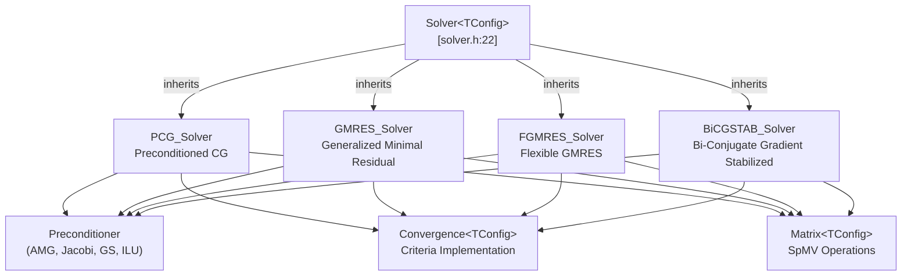
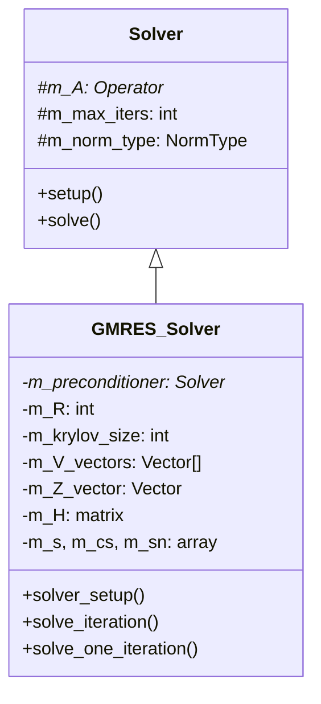
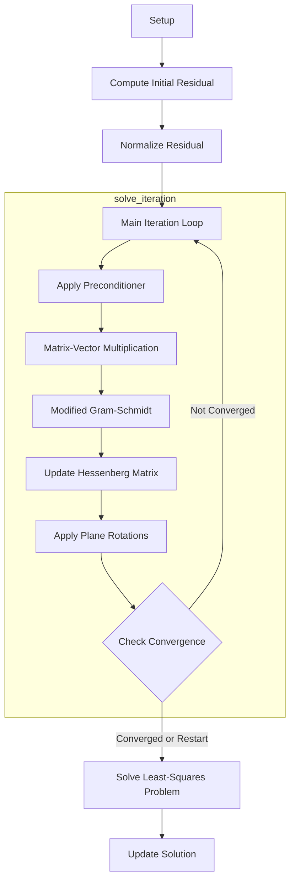
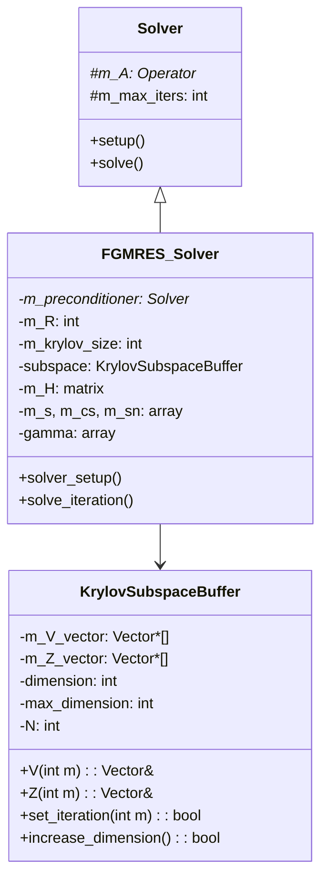
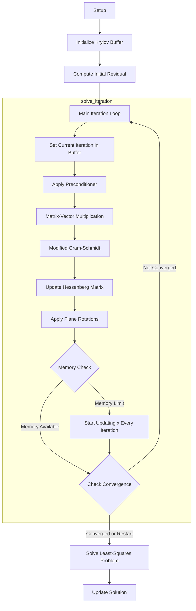
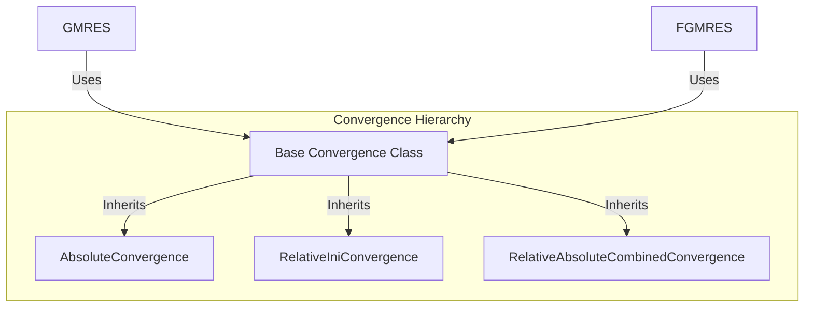

<!-- source: DeepWiki mcp.deepwiki.com · repo NVIDIA/AMGX · extra page GMRES and Other Krylov Methods · fetched 2026-10-26 -->

# GMRES and Other Krylov Methods

Relevant source files

The following files were used as context for generating this wiki page:

- [.gitignore](.gitignore)
- [README.md](README.md)
- [doc/AMGX_Reference.pdf](doc/AMGX_Reference.pdf)
- [include/aggregation/aggregation_amg_level.h](include/aggregation/aggregation_amg_level.h)
- [include/amg_level.h](include/amg_level.h)
- [include/solvers/solver.h](include/solvers/solver.h)
- [src/aggregation/aggregation_amg_level.cu](src/aggregation/aggregation_amg_level.cu)
- [src/amg.cu](src/amg.cu)
- [src/cycles/fixed_cycle.cu](src/cycles/fixed_cycle.cu)
- [src/solvers/block_jacobi_solver.cu](src/solvers/block_jacobi_solver.cu)
- [src/solvers/solver.cu](src/solvers/solver.cu)
- [src/tests/fgmres_zero_initial_residual.cu](src/tests/fgmres_zero_initial_residual.cu)

This document covers the implementation of Krylov subspace methods in AMGX, including GMRES (Generalized Minimal Residual), FGMRES (Flexible GMRES), BiCGSTAB (Bi-Conjugate Gradient Stabilized), and related iterative solvers for non-symmetric linear systems.

For information about Preconditioned Conjugate Gradient (PCG) for symmetric positive definite systems, see page 3.3.1.

## Overview

Krylov subspace methods are iterative solvers that construct solutions within successively larger Krylov subspaces K_m = span{r₀, Ar₀, A²r₀, ..., A^(m-1)r₀}. AMGX implements several Krylov methods optimized for GPU execution, each suited to different matrix properties and problem characteristics.

### Available Krylov Methods

| Method | Best For | Key Properties | Memory Cost |
|--------|----------|----------------|-------------|
| PCG | Symmetric positive definite | Optimal convergence rate | O(n) |
| GMRES | General non-symmetric | Minimizes residual norm, restart capability | O(n×m) |
| FGMRES | Variable preconditioning | Flexible preconditioner application | O(2n×m) |
| BiCGSTAB | General non-symmetric | Lower memory than GMRES, irregular convergence | O(n) |

All methods support:
- **Preconditioner integration** - AMG, Block Jacobi, Gauss-Seidel, ILU, and other smoothers
- **Multiple convergence criteria** - Absolute, relative, and combined tolerances
- **Distributed execution** - Multi-GPU solving with MPI halo exchange
- **GPU acceleration** - CUDA kernels for SpMV, BLAS operations, and vector updates

**AMGX Krylov Solver Hierarchy**

Sources: [README.md:15](), [src/solvers/solver.cu:26-52](), [include/solvers/solver.h:22-268]()

## GMRES Implementation

The GMRES solver constructs a Krylov subspace and uses a modified Gram-Schmidt process to build an orthogonal basis. It then solves a least-squares problem to find the solution that minimizes the residual norm.

### Class Structure

The `GMRES_Solver` class is templated with the configuration type and inherits from the base `Solver` class.

Sources: [src/solvers/gmres_solver.cu:23-64]()

### Key Components

1. **Krylov Vectors**:
   - `m_V_vectors` - Array of vectors forming the orthogonal basis
   - `m_Z_vector` - Used to store the preconditioned vector

2. **Hessenberg Matrix and Least-Squares Components**:
   - `m_H` - Upper Hessenberg matrix from the Arnoldi process
   - `m_s` - Right-hand side and solution of the least-squares problem
   - `m_cs`, `m_sn` - Coefficients for Givens rotations

3. **Parameters**:
   - `m_R` - Restart parameter (maximum iterations before restart)
   - `m_krylov_size` - Size of the Krylov subspace

Sources: [src/solvers/gmres_solver.cu:42-54]()

### Algorithm Flow

The GMRES algorithm in AMGX follows these steps:

1. Initial setup and memory allocation
2. Compute initial residual: r₀ = b - Ax₀
3. For each iteration, until convergence or maximum iterations:
   - Apply preconditioner to the current residual vector
   - Compute the next Krylov vector with matrix-vector multiplication
   - Orthogonalize the vector against all previous vectors (Arnoldi/Gram-Schmidt)
   - Update the Hessenberg matrix and apply Givens rotations
   - Check for convergence based on the residual estimate
4. When converged or at restart:
   - Solve the least-squares problem
   - Update the solution

Sources: [src/solvers/gmres_solver.cu:212-392]()

## FGMRES Implementation

The Flexible GMRES variant differs by storing both the Krylov basis vectors and the preconditioned vectors, allowing for variable preconditioning.

### Class Structure

FGMRES uses a specialized `KrylovSubspaceBuffer` class to manage vector allocation and access:

Sources: [src/solvers/fgmres_solver.cu:17-181](), [src/solvers/fgmres_solver.cu:214-251]()

### Key Differences from GMRES

1. **Memory Management**:
   - Dynamic allocation of Krylov vectors through `KrylovSubspaceBuffer`
   - Lazy allocation strategy to handle memory constraints
   - Circular buffer implementation to reuse memory when possible

2. **Algorithm**:
   - Stores both V-vectors (orthogonal basis) and Z-vectors (preconditioned vectors)
   - Allows preconditioner to change between iterations
   - Supports truncated GMRES when memory constraints exist

3. **Additional Parameters**:
   - `gmres_krylov_dim` - Explicit control over Krylov dimension

Sources: [src/solvers/fgmres_solver.cu:235-250](), [src/solvers/fgmres_solver.cu:283-297]()

### Algorithm Flow

The FGMRES algorithm has similar steps to GMRES but with key differences in memory handling:

Sources: [src/solvers/fgmres_solver.cu:406-569]()

## Configuration Parameters

Both GMRES and FGMRES share common configuration parameters:

| Parameter | Description | Default |
|-----------|-------------|---------|
| `gmres_n_restart` | Maximum iterations before restart | - |
| `preconditioner` | Type of preconditioner to use | "NOSOLVER" |
| `tolerance` | Convergence tolerance | - |
| `max_iters` | Maximum number of iterations | - |
| `norm_type` | Type of norm to use (L2 required for GMRES) | L2 |

FGMRES has the additional parameter:
| Parameter | Description | Default |
|-----------|-------------|---------|
| `gmres_krylov_dim` | Explicit Krylov dimension limit | - |

Sources: [src/solvers/gmres_solver.cu:42-48](), [src/solvers/fgmres_solver.cu:233-240]()

## Convergence Criteria

AMGX provides multiple convergence criteria implementations that can be used with (F)GMRES:

1. **Absolute Convergence**:
   - Converges when the residual norm is less than the tolerance: `‖r‖ < tolerance`

2. **Relative Initial Convergence**:
   - Converges when the ratio of current to initial residual is less than tolerance: `‖r‖/‖r₀‖ < tolerance`

3. **Combined Relative-Absolute Convergence**:
   - Converges when either absolute or relative criterion is satisfied

Sources: [src/convergence/absolute.cu:11-46](), [src/convergence/relative_ini.cu:11-44](), [src/convergence/combined_rel_ini_abs.cu:12-49]()

## Performance Considerations

1. **Memory Usage**:
   - GMRES uses O(n×m) memory where n is problem size and m is Krylov dimension
   - FGMRES requires roughly twice the memory of GMRES
   - Both implement restart to limit memory usage

2. **Computational Cost**:
   - Main computational components are matrix-vector multiplication, vector operations, and Gram-Schmidt orthogonalization
   - Cost increases with Krylov dimension
   - Restart trades convergence rate for reduced computational cost per iteration

3. **When to Use FGMRES vs GMRES**:
   - Use GMRES when preconditioner is fixed
   - Use FGMRES when variable preconditioning is beneficial
   - FGMRES may be more robust but requires more memory

Sources: [src/solvers/gmres_solver.cu:212-392](), [src/solvers/fgmres_solver.cu:406-569]()

---

