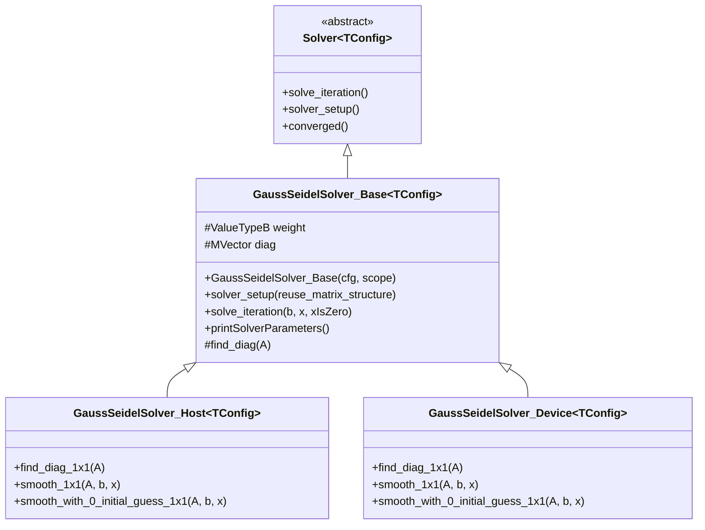
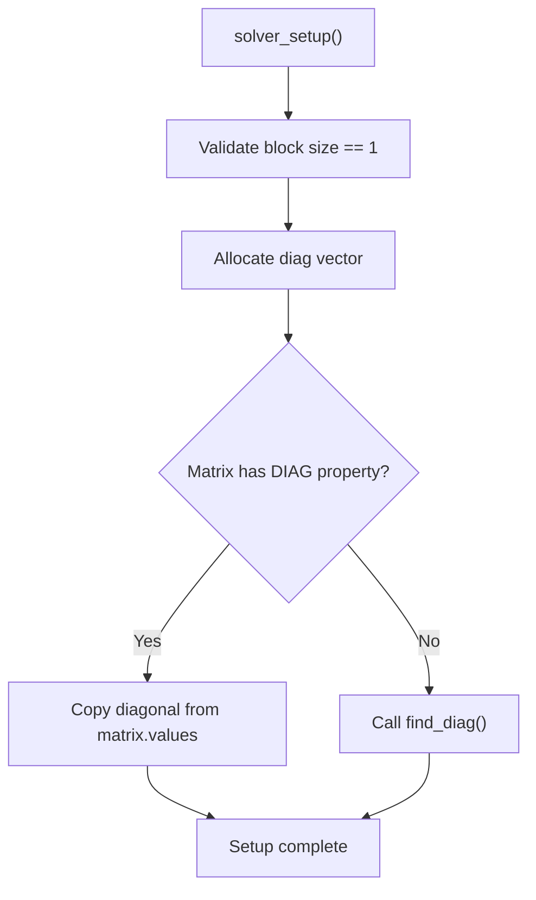
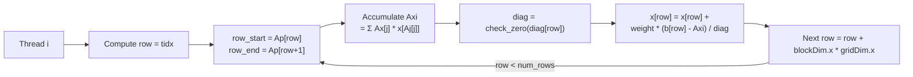
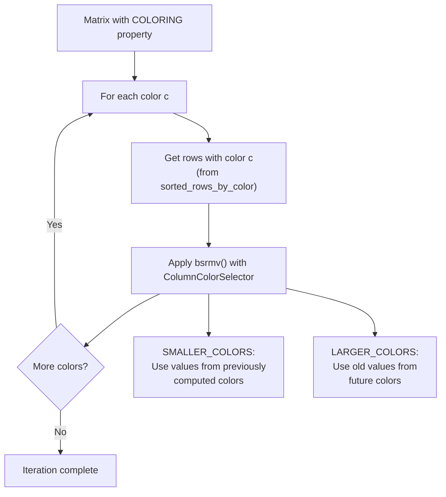
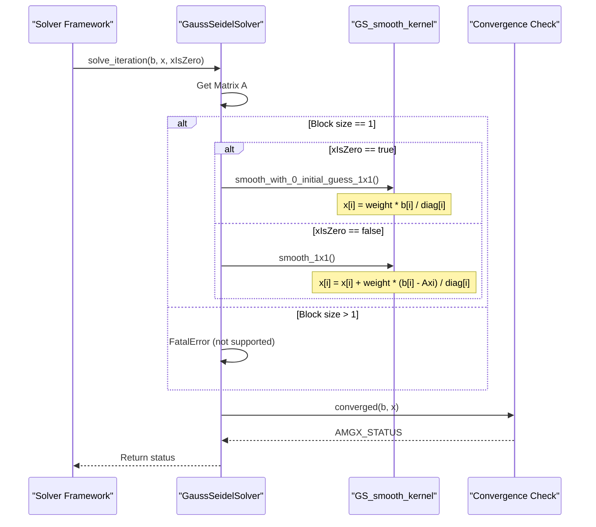

<!-- source: DeepWiki mcp.deepwiki.com · repo NVIDIA/AMGX · extra page Gauss-Seidel Solver · fetched 2026-10-26 -->

# Gauss-Seidel Solver

<details>
<summary>Relevant source files</summary>

The following files were used as context for generating this wiki page:

- [include/reorder_partition.h](include/reorder_partition.h)
- [src/amgx_cusparse.cu](src/amgx_cusparse.cu)
- [src/distributed/distributed_manager.cu](src/distributed/distributed_manager.cu)
- [src/solvers/gauss_seidel_solver.cu](src/solvers/gauss_seidel_solver.cu)

</details>


## Purpose and Scope

This page documents the Gauss-Seidel solver implementation in AMGX. The Gauss-Seidel solver is primarily used as a smoother within AMG hierarchies (see [Algebraic Multigrid (AMG)](#3.2)) and can also function as a standalone iterative solver. This page covers the scalar (1x1 block size) implementation, diagonal extraction, GPU parallelization strategy, and configuration options.

For other smoothers, see [Block Jacobi Solver](#3.4.1) and [Multicolor DILU Solver](#3.4.3). For the general solver framework, see [Solver Framework](#3.1).

---

## Overview

The Gauss-Seidel method is an iterative solver that updates solution values sequentially, using the most recently computed values. For a linear system **Ax = b**, the update formula for the i-th component is:

```
x[i] = x[i] + ω * (b[i] - Σ A[i,j] * x[j]) / A[i,i]
```

where ω is the relaxation factor (weight). The sequential dependency between updates makes direct GPU parallelization challenging. AMGX addresses this through matrix coloring, which identifies independent sets of rows that can be processed in parallel.

**Sources:** [src/solvers/gauss_seidel_solver.cu:1-269]()

---

## Class Structure



**Class Responsibilities:**

| Class | Responsibility |
|-------|---------------|
| `GaussSeidelSolver_Base<TConfig>` | Base class managing configuration, diagonal storage, and solver interface |
| `GaussSeidelSolver<Host>` | Host (CPU) implementation of Gauss-Seidel smoothing |
| `GaussSeidelSolver<Device>` | Device (GPU) implementation using CUDA kernels |

**Sources:** [src/solvers/gauss_seidel_solver.cu:16-122]()

---

## Configuration and Setup

### Constructor and Parameters

The solver reads a single configuration parameter:

| Parameter | Description | Default | Configuration Key |
|-----------|-------------|---------|-------------------|
| `weight` | Relaxation factor (ω) | 1.0 | `relaxation_factor` |

**Sources:** [src/solvers/gauss_seidel_solver.cu:16-25]()

### Solver Setup

The `solver_setup()` method performs initialization:



**Key Constraints:**
- Only scalar matrices (block size = 1) are supported
- Throws `AMGX_ERR_NOT_SUPPORTED_BLOCKSIZE` for block sizes > 1
- Requires explicit diagonal values or computes them from matrix structure

**Sources:** [src/solvers/gauss_seidel_solver.cu:40-68]()

---

## Diagonal Extraction

### Find Diagonal Methods

The solver must identify diagonal elements for each row. Two implementations exist:

#### Host Implementation

Sequential search through each row's CSR entries:

```
for each row i:
    for j in [row_offsets[i], row_offsets[i+1]):
        if col_indices[j] == i:
            diag[i] = values[j]
```

**Sources:** [src/solvers/gauss_seidel_solver.cu:127-149]()

#### Device Implementation

Uses `find_diag_kernel` for parallel diagonal extraction:

| Parameter | Value |
|-----------|-------|
| Grid size | `min(4096, ⌈num_rows / 128⌉)` |
| Block size | 128 threads |
| Kernel | `find_diag_kernel` |

The kernel iterates through row entries to locate the diagonal element where `col_indices[j] == row_index`.

**Sources:** [src/solvers/gauss_seidel_solver.cu:182-196]()

---

## Smoothing Operations

### Standard Smoothing (Non-Zero Initial Guess)

The `smooth_1x1()` method performs a Gauss-Seidel iteration with the formula:

```
x[i] = x[i] + weight * (b[i] - Axi) / diag[i]
```

where `Axi = Σ A[i,j] * x[j]` is the matrix-vector product for row i.

#### Host Implementation

Sequential row-by-row update:

**Sources:** [src/solvers/gauss_seidel_solver.cu:152-168]()

#### Device Implementation - GS_smooth_kernel



**Kernel Configuration:**

| Parameter | Value |
|-----------|-------|
| Threads per block | 128 |
| Number of blocks | `min(4096, ⌈num_rows / 128⌉)` |
| Grid-stride loop | Handles arbitrary matrix sizes |

**Zero-Division Protection:**
The kernel uses `isNotCloseToZero()` and `epsilon()` to handle near-zero diagonals, preventing numerical instability.

**Sources:** [src/solvers/gauss_seidel_solver.cu:198-248]()

---

## Optimized Zero-Initial-Guess Smoothing

When the initial solution vector is zero (`xIsZero = true`), the solver uses an optimized path:

### Simplification

With x = 0, the matrix-vector product Axi = 0, so the update reduces to:

```
x[i] = weight * b[i] / diag[i]
```

### Host Implementation

Direct computation without matrix traversal:

**Sources:** [src/solvers/gauss_seidel_solver.cu:171-179]()

### Device Implementation

The device version fills x with zeros then calls the standard `smooth_1x1()`:

**Sources:** [src/solvers/gauss_seidel_solver.cu:251-256]()

---

## Parallelization via Matrix Coloring

While Gauss-Seidel is inherently sequential, AMGX enables parallel execution through matrix coloring. The coloring scheme identifies independent sets of rows with no dependencies.

### Integration with Coloring System

The Gauss-Seidel solver can leverage matrix coloring when the matrix has the `COLORING` property set. The coloring infrastructure is provided by `Cusparse::bsrmv()` with `ColumnColorSelector`:



### Column Color Selectors

| Selector | Description | Usage |
|----------|-------------|-------|
| `ALL_COLORS` | Process all columns | Standard smoothing |
| `SMALLER_COLORS` | Only columns in earlier colors | Forward sweep |
| `LARGER_COLORS` | Only columns in later colors | Backward sweep |
| `DIAG_COL` | Only diagonal entries | Jacobi-like |

The selectors control which matrix entries contribute to the update, enabling parallelization within color sets while maintaining Gauss-Seidel semantics.

**Sources:** [src/amgx_cusparse.cu:349-431](), [src/amgx_cusparse.cu:767-899]()

---

## Solve Iteration Flow



**Sources:** [src/solvers/gauss_seidel_solver.cu:79-102]()

---

## Distributed Execution

In distributed settings, the Gauss-Seidel solver operates on the local partition only. Halo exchange is handled by the matrix-vector operations if needed, but Gauss-Seidel itself does not directly manage distributed communication.

When used within AMG with distributed matrices, the coloring must account for boundary/interior separation to maintain correct execution order across partitions.

**Sources:** [src/distributed/distributed_manager.cu:1-2500]()

---

## Block Size Limitation

The current Gauss-Seidel implementation **only supports scalar (1x1 block size) matrices**. Attempting to use block matrices results in:

```
FatalError("Unsupported block size for GaussSeidelSolver", AMGX_ERR_NOT_SUPPORTED_BLOCKSIZE)
```

This limitation exists at multiple points:
- `solver_setup()` validation [src/solvers/gauss_seidel_solver.cu:52-55]()
- `solve_iteration()` dispatch [src/solvers/gauss_seidel_solver.cu:96-98]()
- `find_diag()` method [src/solvers/gauss_seidel_solver.cu:118-121]()

For block matrices, use [Block Jacobi Solver](#3.4.1) or [Multicolor DILU Solver](#3.4.3) instead.

---

## Usage Example Configuration

### JSON Configuration

```json
{
  "solver": "AMG",
  "smoother": "GAUSS_SEIDEL",
  "relaxation_factor": 1.0,
  "presweeps": 1,
  "postsweeps": 1
}
```

### Common Use Cases

| Use Case | Configuration | Notes |
|----------|---------------|-------|
| **Pre-smoother in AMG** | `presweeps=1`, `weight=1.0` | Standard forward Gauss-Seidel |
| **Symmetric smoothing** | `presweeps=1`, `postsweeps=1` | Forward then backward sweep |
| **Damped smoothing** | `weight=0.8` | Reduced weight for stability |
| **Standalone solver** | `solver=GAUSS_SEIDEL`, `max_iters=1000` | Iterative solver mode |

---

## Performance Characteristics

### Convergence Properties

- **Sequential dependency:** True Gauss-Seidel has data dependencies that limit parallelism
- **Smoothing effectiveness:** Good high-frequency error reduction for elliptic problems
- **Convergence rate:** Generally faster than Jacobi but slower than polynomial smoothers

### GPU Implementation Considerations

| Aspect | Impact |
|--------|--------|
| **Parallelism** | Limited without coloring; full parallelism with graph coloring |
| **Memory access** | Irregular access pattern to x[] during Ax computation |
| **Arithmetic intensity** | Low (one division, few FLOPs per row) |
| **Synchronization** | Color-by-color barrier when using coloring |

Without coloring, the GPU kernel processes all rows in parallel, which violates strict Gauss-Seidel semantics but often provides acceptable smoothing behavior.

**Sources:** [src/solvers/gauss_seidel_solver.cu:198-248]()

---

## Key Code Entities

### Main Classes and Methods

| Entity | Location | Purpose |
|--------|----------|---------|
| `GaussSeidelSolver_Base<TConfig>` | [src/solvers/gauss_seidel_solver.cu:16-122]() | Base class with common logic |
| `solver_setup()` | [src/solvers/gauss_seidel_solver.cu:40-68]() | Initialize diagonal storage |
| `solve_iteration()` | [src/solvers/gauss_seidel_solver.cu:79-102]() | Perform one smoothing sweep |
| `find_diag_1x1()` | [src/solvers/gauss_seidel_solver.cu:127-196]() | Extract diagonal elements |
| `smooth_1x1()` | [src/solvers/gauss_seidel_solver.cu:152-248]() | Apply Gauss-Seidel update |
| `GS_smooth_kernel` | [src/solvers/gauss_seidel_solver.cu:198-226]() | GPU kernel for smoothing |

### Related Systems

- **Matrix coloring:** [src/amgx_cusparse.cu:767-899]() - Enables parallel execution
- **SpMV operations:** [src/amgx_cusparse.cu:48-257]() - Matrix-vector products with coloring
- **Solver framework:** See [Solver Framework](#3.1) for base interface

---

