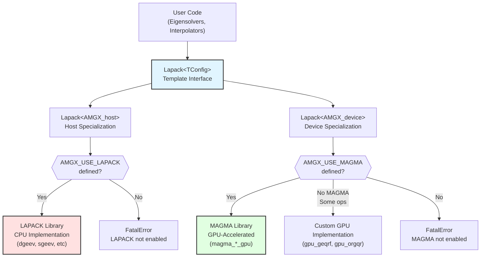
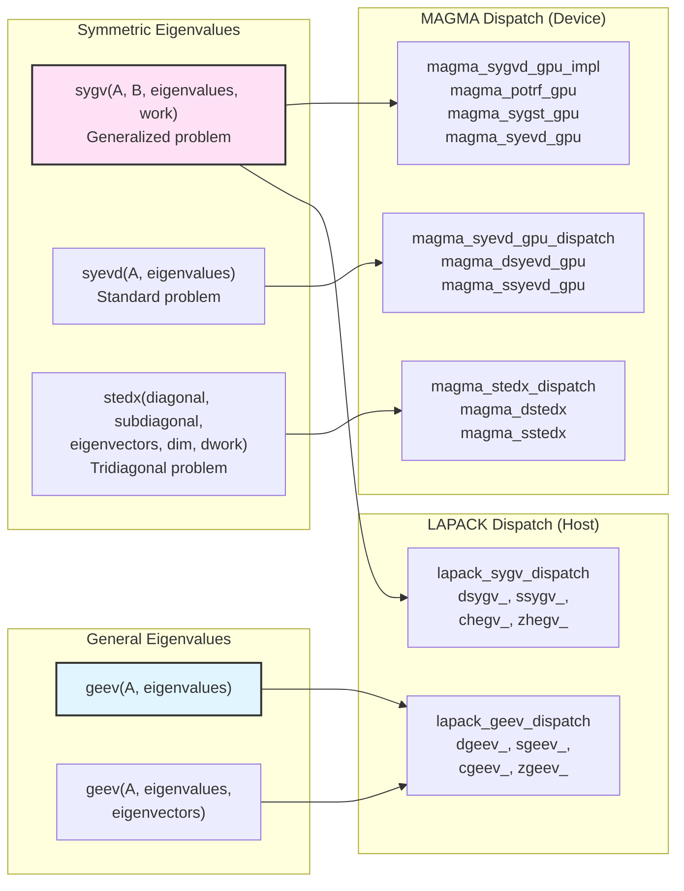
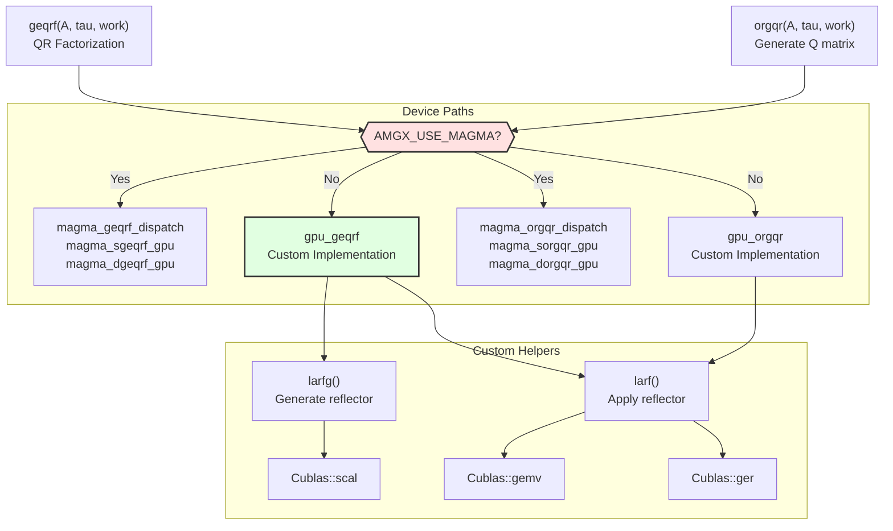
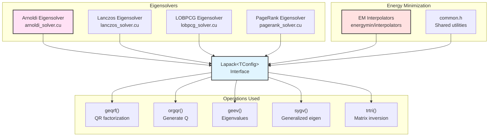

<!-- source: DeepWiki mcp.deepwiki.com · repo NVIDIA/AMGX · extra page LAPACK and MAGMA Integration · fetched 2026-10-26 -->

# LAPACK and MAGMA Integration

<details>
<summary>Relevant source files</summary>

The following files were used as context for generating this wiki page:

- [include/cutil.h](include/cutil.h)
- [include/energymin/interpolators/common.h](include/energymin/interpolators/common.h)
- [src/amgx_lapack.cu](src/amgx_lapack.cu)
- [src/hash_workspace.cu](src/hash_workspace.cu)
- [src/scalers/diagonal_symmetric.cu](src/scalers/diagonal_symmetric.cu)
- [src/solvers/dense_lu_solver.cu](src/solvers/dense_lu_solver.cu)

</details>


## Purpose and Scope

This document describes AMGX's integration with LAPACK (Linear Algebra PACKage) and MAGMA (Matrix Algebra on GPU and Multicore Architectures) libraries to provide dense linear algebra operations. These operations support eigenvalue solvers, QR factorization, and matrix inversion required by various AMGX components, particularly eigensolvers and energy minimization interpolators.

For sparse direct solvers using cuSOLVER, see [Dense LU Solver](#3.5.1). For eigensolver algorithms that consume these operations, see [Eigensolvers](#3.6).

Sources: [src/amgx_lapack.cu:1-1154]()

## Architecture Overview

The AMGX LAPACK integration provides a unified interface that dispatches to different backends based on memory location (host vs device) and build configuration. The system supports three operational modes:

**Diagram: Backend Selection Architecture**



Sources: [src/amgx_lapack.cu:47-81](), [src/amgx_lapack.cu:209-241](), [src/amgx_lapack.cu:359-371]()

The architecture separates:
- **Interface Layer**: Template class `Lapack<TConfig>` providing a unified API
- **Dispatch Layer**: Template specializations for host (`AMGX_host`) and device (`AMGX_device`)
- **Backend Layer**: LAPACK for CPU, MAGMA for GPU, or custom implementations

## Lapack Interface Class

The core of the integration is the templated `Lapack` class that provides static methods for various dense linear algebra operations. The class is specialized for host and device memory spaces.

**Diagram: Lapack Class Structure**

```mermaid
graph TB
    LapackBase["Lapack&lt;TConfig&gt;<br/>Base Template"]
    
    LapackHost["Lapack&lt;AMGX_host, VecPrec,<br/>MatPrec, IndPrec&gt;"]
    LapackDevice["Lapack&lt;AMGX_device, VecPrec,<br/>MatPrec, IndPrec&gt;"]
    
    subgraph "Host Methods"
        HostGeev["geev()<br/>Eigenvalues/vectors"]
        HostTrtri["trtri()<br/>Triangular inversion"]
        HostSygv["sygv()<br/>Generalized eigenvalue"]
        HostOther["syevd(), stedx(),<br/>geqrf(), orgqr()"]
    end
    
    subgraph "Device Methods"
        DevTrtri["trtri()<br/>via MAGMA"]
        DevSygv["sygv()<br/>via MAGMA"]
        DevSyevd["syevd()<br/>via MAGMA"]
        DevStedx["stedx()<br/>via MAGMA"]
        DevGeqrf["geqrf()<br/>via MAGMA or custom"]
        DevOrgqr["orgqr()<br/>via MAGMA or custom"]
    end
    
    subgraph "Utility Methods"
        CheckLapack["check_lapack_enabled()"]
        CheckMagma["check_magma_enabled()"]
        NotImpl["not_implemented()"]
    end
    
    LapackBase --> LapackHost
    LapackBase --> LapackDevice
    
    LapackHost --> HostGeev
    LapackHost --> HostTrtri
    LapackHost --> HostSygv
    LapackHost --> HostOther
    LapackHost --> CheckLapack
    
    LapackDevice --> DevTrtri
    LapackDevice --> DevSygv
    LapackDevice --> DevSyevd
    LapackDevice --> DevStedx
    LapackDevice --> DevGeqrf
    LapackDevice --> DevOrgqr
    LapackDevice --> CheckMagma
    
    style LapackBase fill:#e1f5ff,stroke:#333,stroke-width:2px
    style LapackHost fill:#ffe1e1,stroke:#333,stroke-width:2px
    style LapackDevice fill:#e1ffe1,stroke:#333,stroke-width:2px
```



Sources: [src/amgx_lapack.cu:47-81](), [src/amgx_lapack.cu:1148-1151]()

### Configuration Checks

Before executing operations, the system validates that the required backend is available at compile time:

| Method | Backend Required | Error if Missing |
|--------|------------------|------------------|
| `check_lapack_enabled()` | `AMGX_USE_LAPACK` defined | `AMGX_ERR_CONFIGURATION` |
| `check_magma_enabled()` | `AMGX_USE_MAGMA` defined | `AMGX_ERR_CONFIGURATION` |
| `not_implemented()` | Operation not available | `AMGX_ERR_CONFIGURATION` |

Sources: [src/amgx_lapack.cu:48-81]()

## Supported Operations

### Eigenvalue Solvers

**Diagram: Eigenvalue Operation Dispatch**



Sources: [src/amgx_lapack.cu:209-241](), [src/amgx_lapack.cu:443-456](), [src/amgx_lapack.cu:746-798]()

#### geev - General Eigenvalue Problem

Computes eigenvalues and optionally eigenvectors of a general (non-symmetric) matrix. Available only on host via LAPACK.

**Implementation**: [src/amgx_lapack.cu:170-203]()

```cpp
// Usage pattern
Vector<TConfig> A;        // Input matrix (destroyed)
Vector<TConfig> eigenvalues;
Lapack<TConfig>::geev(A, eigenvalues);

// With eigenvectors
Vector<TConfig> eigenvectors;
Lapack<TConfig>::geev(A, eigenvalues, eigenvectors);
```

**Dispatch functions**: [src/amgx_lapack.cu:116-168]() route to precision-specific LAPACK routines:
- `dgeev_` for double precision
- `sgeev_` for single precision
- `cgeev_` for complex float
- `zgeev_` for complex double

#### sygv - Generalized Symmetric Eigenvalue Problem

Solves `A*x = λ*B*x` for symmetric matrices A and B. Supports both host (LAPACK) and device (MAGMA) implementations.

**Host Implementation**: [src/amgx_lapack.cu:428-439]() calls LAPACK routines [src/amgx_lapack.cu:396-426]()

**Device Implementation**: [src/amgx_lapack.cu:746-756]() uses custom MAGMA wrapper [src/amgx_lapack.cu:708-742]() that:
1. Computes Cholesky factorization of B: `magma_potrf_gpu`
2. Transforms to standard form: `magma_sygst_gpu`
3. Solves standard problem: `magma_syevd_gpu`
4. Back-transforms eigenvectors: `cublas_trsm`

Sources: [src/amgx_lapack.cu:396-456](), [src/amgx_lapack.cu:708-756]()

#### syevd - Symmetric Eigenvalue Decomposition

Computes all eigenvalues and eigenvectors of a symmetric matrix using divide-and-conquer. Device-only via MAGMA.

**Implementation**: [src/amgx_lapack.cu:787-798]() dispatches to [src/amgx_lapack.cu:761-783]()

Sources: [src/amgx_lapack.cu:515-527](), [src/amgx_lapack.cu:761-798]()

#### stedx - Tridiagonal Eigenvalue Problem

Computes selected eigenvalues and eigenvectors of a real symmetric tridiagonal matrix. Host-based operation calling MAGMA.

**Implementation**: [src/amgx_lapack.cu:853-866]() uses MAGMA's tridiagonal solver [src/amgx_lapack.cu:830-849]()

Sources: [src/amgx_lapack.cu:810-866]()

### Matrix Inversion

#### trtri - Triangular Matrix Inversion

Inverts an upper triangular matrix. Used in eigensolver preprocessing.

**Host Implementation**: [src/amgx_lapack.cu:305-317]() calls LAPACK dispatch [src/amgx_lapack.cu:293-301]()

**Device Implementation**: [src/amgx_lapack.cu:359-371]() uses MAGMA dispatch [src/amgx_lapack.cu:346-354]()

**Dispatch functions**: [src/amgx_lapack.cu:269-291]() and [src/amgx_lapack.cu:322-344]() route to:
- LAPACK: `strtri_`, `dtrtri_`, `ctrtri_`, `ztrtri_`
- MAGMA: `magma_strtri_gpu`, `magma_dtrtri_gpu`, `magma_ctrtri_gpu`, `magma_ztrtri_gpu`

Sources: [src/amgx_lapack.cu:253-371]()

### QR Factorization

**Diagram: QR Factorization Implementation Paths**



Sources: [src/amgx_lapack.cu:1101-1145](), [src/amgx_lapack.cu:1002-1051](), [src/amgx_lapack.cu:903-939]()

#### geqrf - QR Factorization

Computes QR factorization `A = Q*R` where Q is orthogonal and R is upper triangular. Device implementation with fallback to custom GPU code.

**Device Implementation**: [src/amgx_lapack.cu:1109-1122]()
- With MAGMA: Uses `magma_sgeqrf_gpu` or `magma_dgeqrf_gpu` [src/amgx_lapack.cu:1057-1076]()
- Without MAGMA: Falls back to custom `gpu_geqrf` [src/amgx_lapack.cu:1002-1051]()

The custom implementation [src/amgx_lapack.cu:1002-1051]() uses Householder reflections:
- `larfg()` [src/amgx_lapack.cu:972-1000](): Generates elementary reflector
- `larf()` [src/amgx_lapack.cu:872-887](): Applies reflector to remaining matrix
- cuBLAS operations for matrix updates

Sources: [src/amgx_lapack.cu:1002-1122]()

#### orgqr - Generate Orthogonal Matrix from QR

Generates the orthogonal matrix Q from the QR factorization computed by `geqrf`.

**Device Implementation**: [src/amgx_lapack.cu:1132-1145]()
- With MAGMA: Uses `magma_sorgqr_gpu` or `magma_dorgqr_gpu` [src/amgx_lapack.cu:1078-1097]()
- Without MAGMA: Falls back to custom `gpu_orgqr` [src/amgx_lapack.cu:903-939]()

The custom implementation [src/amgx_lapack.cu:903-939]() applies Householder reflections in reverse order using `larf()`.

Sources: [src/amgx_lapack.cu:903-939](), [src/amgx_lapack.cu:1078-1145]()

## Precision Dispatch System

All LAPACK and MAGMA operations support multiple precisions through template dispatch. The system uses function overloading to select precision-specific implementations.

**Dispatch Pattern Example** (for `trtri`):

```cpp
// Generic template calls precision-specific dispatch
template <typename T>
void lapack_trtri(T *A, int dim, int lda) {
    char uplo = 'U';
    char diag = 'N';
    int info;
    lapack_trtri_dispatch(&uplo, &diag, &dim, A, &lda, &info);
    lapackCheckError(info);
}

// Dispatch functions select Fortran routine
int lapack_trtri_dispatch(..., float *a, ...) 
    { return strtri_(...); }
int lapack_trtri_dispatch(..., double *a, ...) 
    { return dtrtri_(...); }
int lapack_trtri_dispatch(..., fcomplex *a, ...) 
    { return ctrtri_(...); }
int lapack_trtri_dispatch(..., dcomplex *a, ...) 
    { return ztrtri_(...); }
```

This pattern applies to all operations, enabling the same high-level API to work with:
- Single precision (`float` / `AMGX_MatPrecision::AMGX_matFloat`)
- Double precision (`double` / `AMGX_MatPrecision::AMGX_matDouble`)
- Complex single (`cuComplex` / `AMGX_MatPrecision::AMGX_matComplexFloat`)
- Complex double (`cuDoubleComplex` / `AMGX_MatPrecision::AMGX_matComplexDouble`)

Sources: [src/amgx_lapack.cu:269-291](), [src/amgx_lapack.cu:322-344](), [src/amgx_lapack.cu:396-426]()

## Error Handling

The integration includes comprehensive error checking for both LAPACK and MAGMA operations:

**Error Checking Macros**:

```cpp
// LAPACK error codes: 
//   < 0: argument -status had illegal value
//   > 0: internal algorithm error
#define lapackCheckError(status)
    if (status < 0)
        FatalError("argument number " + (-status) + " had illegal value")
    else if (status > 0)
        FatalError("Lapack error: internal error.")

// MAGMA error codes: same convention
#define magmaCheckError(status)
    if (status < 0)
        FatalError("argument number " + (-status) + " had illegal value")
    else if (status > 0)
        FatalError("Magma error: internal error.")
```

Sources: [src/amgx_lapack.cu:19-45]()

**Common Error Scenarios**:

| Error Type | Cause | Error Code |
|-----------|-------|------------|
| Configuration | LAPACK/MAGMA not compiled in | `AMGX_ERR_CONFIGURATION` |
| Invalid Argument | Illegal matrix dimensions, LDA, etc | `AMGX_ERR_INTERNAL` |
| Numerical | Singular matrix, convergence failure | `AMGX_ERR_INTERNAL` |
| Not Implemented | Operation unavailable on platform | `AMGX_ERR_CONFIGURATION` |

## Integration Points

LAPACK and MAGMA operations are consumed by several AMGX subsystems:

**Diagram: LAPACK/MAGMA Usage in AMGX**



Sources: [include/energymin/interpolators/common.h:1-122](), [src/amgx_lapack.cu:1-1154]()

### Eigensolver Usage

Eigensolvers use LAPACK/MAGMA for small dense problems that arise during iterative eigenpair refinement:
- **QR factorization**: Orthogonalizing basis vectors
- **Eigenvalue computation**: Solving projected problems on Krylov subspaces
- **Matrix inversion**: Preconditioning and basis transformation

See [Eigensolvers](#3.6) for details on how these operations integrate into eigensolver algorithms.

### Energy Minimization Usage

Energy minimization interpolators use dense operations for local problem solving:
- **Triangular inversion** (`trtri`): Referenced in [include/energymin/interpolators/common.h:9]()
- Small dense matrices representing local aggregate problems
- Generalized eigenvalue problems for optimal interpolation weights

## Build Configuration

LAPACK and MAGMA integration is controlled by CMake build flags:

| CMake Variable | Effect | Default |
|---------------|--------|---------|
| `AMGX_USE_LAPACK` | Enable LAPACK host operations | OFF |
| `AMGX_USE_MAGMA` | Enable MAGMA GPU operations | OFF |
| `MKL_ROOT_DIR` | Path to Intel MKL (provides LAPACK) | Not set |
| `MAGMA_ROOT_DIR` | Path to MAGMA installation | Not set |

**Compilation Behavior**:
- Without flags: Operations call `FatalError` if invoked
- With `AMGX_USE_LAPACK`: Host operations available via system LAPACK or MKL
- With `AMGX_USE_MAGMA`: Device operations available; some operations have custom fallbacks

**Template Instantiation**: [src/amgx_lapack.cu:1148-1151]()
```cpp
#define AMGX_CASE_LINE(CASE) \
    template class Lapack<TemplateMode<CASE>::Type>;
AMGX_FORALL_BUILDS(AMGX_CASE_LINE)
```

This instantiates `Lapack` for all supported template configurations defined by the mode system (see [Mode System and Template Dispatch](#4.1.2)).

Sources: [src/amgx_lapack.cu:47-81](), [src/amgx_lapack.cu:1148-1151]()

## Related Components

- **Dense LU Solver** [#3.5.1](#3.5.1): Uses cuSOLVER for LU factorization, complementing LAPACK/MAGMA
- **Eigensolvers** [#3.6](#3.6): Primary consumers of these operations
- **cuSOLVER Integration**: Referenced in [include/energymin/interpolators/common.h:9]() via `amgx_cusolverDn.h`

The LAPACK/MAGMA integration focuses on eigenvalue problems and QR factorization, while cuSOLVER handles LU factorization and triangular solves for the Dense LU Solver.

Sources: [src/amgx_lapack.cu:1-1154](), [include/energymin/interpolators/common.h:1-122]()

---

