<!-- source: DeepWiki mcp.deepwiki.com · repo NVIDIA/AMGX · extra page MPI Communication · fetched 2026-10-26 -->

# MPI Communication

<details>
<summary>Relevant source files</summary>

The following files were used as context for generating this wiki page:

- [CHANGELOG](CHANGELOG)
- [src/distributed/comms_mpi_hostbuffer_stream.cu](src/distributed/comms_mpi_hostbuffer_stream.cu)

</details>


## Purpose and Scope

This document describes the MPI communication layer in AMGX, which enables distributed sparse matrix computations across multiple GPUs and nodes. The `CommsMPIHostBufferStream` class implements all inter-process data transfers required for distributed linear solvers, including halo exchanges, vector/matrix transfers, and collective operations.

For information about how partitions and halo regions are organized, see [Distributed Manager](#2.4.1). For details on how solvers use these communication primitives, see [Solver Framework](#3.1).

**Sources:** [src/distributed/comms_mpi_hostbuffer_stream.cu:1-1616]()

---

## Architecture Overview

The MPI communication system bridges GPU device memory across ranks using pinned host memory as an intermediate staging area. The `CommsMPIHostBufferStream` class provides a template-based interface that supports all AMGX precision types (float, double, complex, integer).

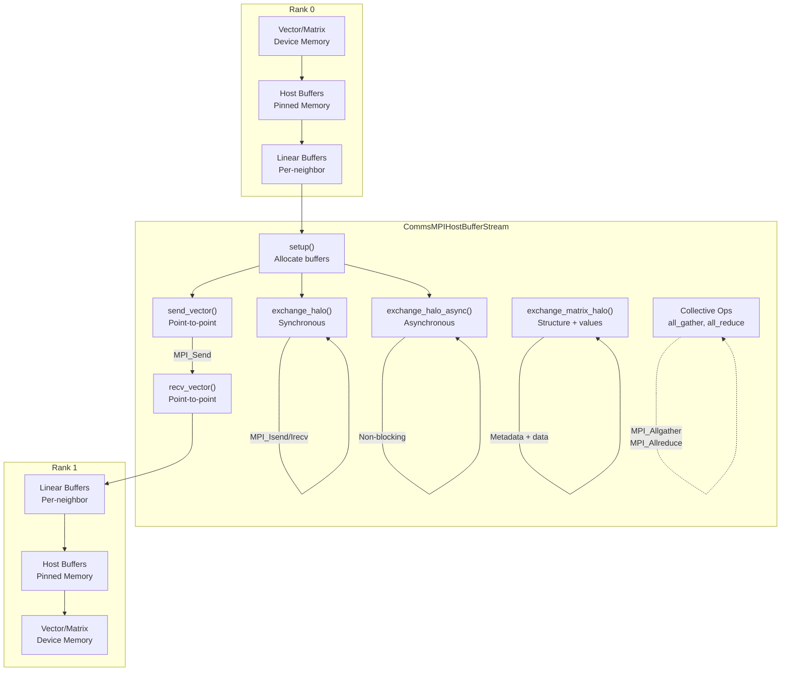

**Diagram: MPI Communication Architecture**

The communication flow follows a three-stage pattern:
1. **Gather**: Copy boundary data from device to pinned host buffers
2. **Transfer**: Execute MPI operations on host memory
3. **Scatter**: Copy received data from host buffers back to device

**Sources:** [src/distributed/comms_mpi_hostbuffer_stream.cu:1-60](), [src/distributed/comms_mpi_hostbuffer_stream.cu:111-214]()

---

## Host Buffer Strategy

AMGX uses pinned host memory as an intermediate staging area for all MPI transfers. This design choice addresses several requirements:

| Design Aspect | Implementation | Rationale |
|---------------|----------------|-----------|
| **Memory Type** | `cudaMallocHost` pinned memory | Enables async DMA transfers between host and device |
| **Buffer Organization** | Per-neighbor linear buffers | Simplifies gather/scatter operations |
| **Allocation Strategy** | Persistent, resized as needed | Amortizes allocation overhead across solver iterations |
| **GPU Direct Status** | Framework supports it, conditionally used | Standard path works universally across MPI implementations |

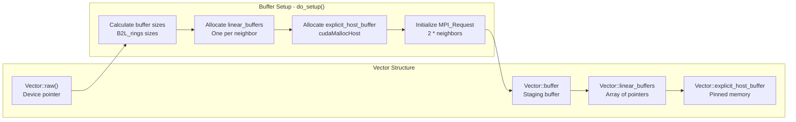

**Diagram: Host Buffer Allocation and Management**

The buffer setup process in `do_setup()` computes the total size needed based on the halo structure, allocates linear buffers pointing to per-neighbor regions, and creates persistent pinned host memory for the actual data transfers.

**Sources:** [src/distributed/comms_mpi_hostbuffer_stream.cu:111-214](), [src/distributed/comms_mpi_hostbuffer_stream.cu:155-209]()

---

## Halo Exchange Operations

Halo exchange is the core communication pattern for distributed sparse matrix-vector multiplication. Each rank must exchange its boundary values (owned rows referenced by neighbors) for halo values (ghost rows owned by neighbors).

### Synchronous Halo Exchange

The `do_exchange_halo()` method implements a three-stage finite state machine (FSM) for complete halo exchange.

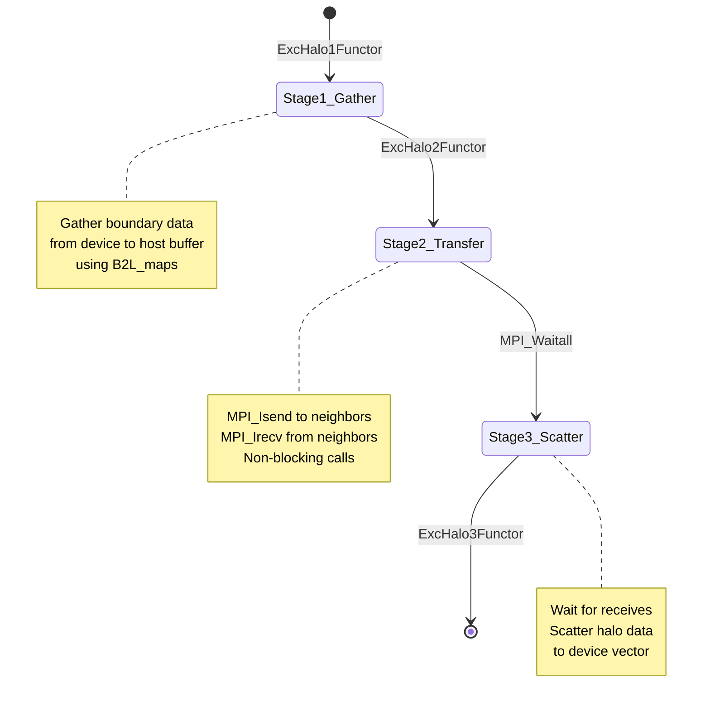

**Diagram: Synchronous Halo Exchange State Machine**

The implementation uses the FSM visitor pattern with three functors:

| Functor | Responsibility | Key Operations |
|---------|----------------|----------------|
| `ExcHalo1Functor` | Gather stage | Copy boundary elements using `B2L_maps` |
| `ExcHalo2Functor` | Transfer stage | Issue `MPI_Isend`/`MPI_Irecv` for all neighbors |
| `ExcHalo3Functor` | Scatter stage | Copy received data to halo region using `L2H_maps` |

**Sources:** [src/distributed/comms_mpi_hostbuffer_stream.cu:603-629](), [src/distributed/comms_mpi_hostbuffer_stream.cu:1004-1066]()

### Asynchronous Halo Exchange

The `do_exchange_halo_async()` method enables latency hiding by overlapping communication with interior computation.

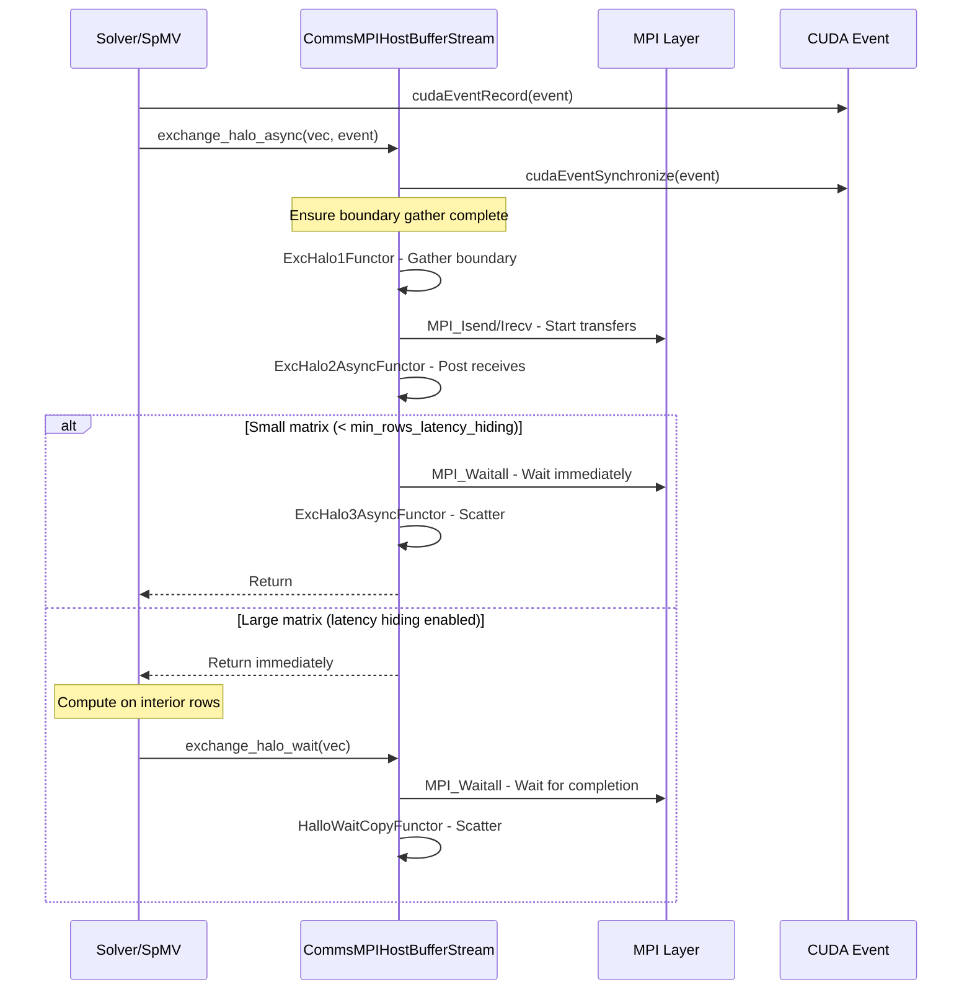

**Diagram: Asynchronous Halo Exchange with Latency Hiding**

The latency hiding optimization is controlled by `min_rows_latency_hiding` threshold:

```
if (min_rows_latency_hiding < 0 || m.manager->num_rows_all() < min_rows_latency_hiding) {
    // Small matrix: wait immediately
    MPI_Waitall(2 * neighbors, &b.requests[0], MPI_STATUSES_IGNORE);
} else {
    // Large matrix: return to caller for interior computation
}
```

**Sources:** [src/distributed/comms_mpi_hostbuffer_stream.cu:631-664](), [src/distributed/comms_mpi_hostbuffer_stream.cu:666-686](), [CHANGELOG:59]()

---

## Vector Communication

Point-to-point vector transfers support direct rank-to-rank communication beyond the halo exchange pattern.

### Synchronous Vector Operations

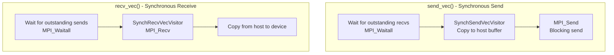

**Diagram: Synchronous Vector Send/Receive**

The synchronous methods ensure no overlap with previous operations by waiting for outstanding requests before proceeding.

**Sources:** [src/distributed/comms_mpi_hostbuffer_stream.cu:347-449]()

### Asynchronous Vector Operations

For non-blocking communication, AMGX provides async variants that maintain request queues:

| Method | Operation | Request Tracking |
|--------|-----------|------------------|
| `send_vec_async()` | Non-blocking send | Appends to `b.send_requests` |
| `send_vec_wait_all()` | Wait for sends | `MPI_Waitall` on send queue |
| `recv_vec_async()` | Non-blocking receive | Appends to `b.recv_requests` |
| `recv_vec_wait_all()` | Wait for receives | `MPI_Waitall` + copy to device |

Each vector maintains separate request queues for sends and receives, enabling fine-grained control over communication dependencies.

**Sources:** [src/distributed/comms_mpi_hostbuffer_stream.cu:376-421](), [src/distributed/comms_mpi_hostbuffer_stream.cu:451-499]()

---

## Matrix Halo Exchange

During AMG hierarchy construction, each level requires exchanging matrix structure and values for halo rows. The `exchange_matrix_halo()` methods handle this complex operation.

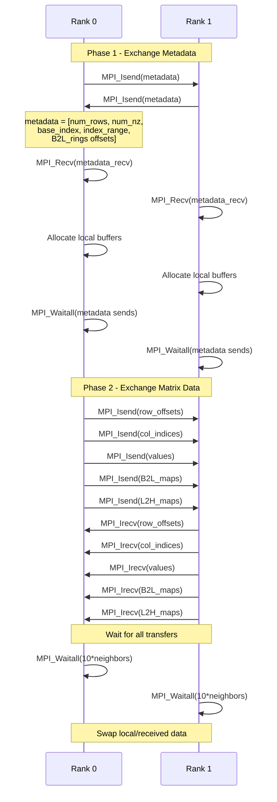

**Diagram: Matrix Halo Exchange Protocol**

The two-phase protocol first exchanges metadata to determine buffer sizes, then transfers the actual matrix data. Each matrix exchange includes:

| Component | Description | MPI Tag Pattern |
|-----------|-------------|-----------------|
| `row_offsets` | CSR row pointers | `10 * global_id + 0` |
| `col_indices` | Column indices | `10 * global_id + 1` |
| `values` | Matrix values | `10 * global_id + 4` |
| `B2L_maps[0]` | Boundary-to-local mapping | `10 * global_id + 2` |
| `L2H_maps[0]` | Local-to-halo mapping | `10 * global_id + 3` |

The tag pattern ensures messages are uniquely identified even when multiple matrices are exchanged concurrently.

**Sources:** [src/distributed/comms_mpi_hostbuffer_stream.cu:759-877](), [src/distributed/comms_mpi_hostbuffer_stream.cu:879-981]()

---

## Collective Operations

AMGX implements various MPI collective operations for global synchronization and data aggregation.

### All-Gather Operations

```mermaid
graph TB
    subgraph "Scalar All-Gather"
        ScalarInput["Single value per rank"]
        ScalarGather["all_gather()<br/>MPI_Allgather"]
        ScalarOutput["Vector of all values"]
    end
    
    subgraph "Vector All-Gather"
        VecInput["Variable-size vector per rank"]
        VecMeta["Exchange sizes<br/>MPI_Allgather(size)"]
        VecGather["all_gather_v()<br/>MPI_Allgatherv"]
        VecOutput["Concatenated vector"]
    end
    
    subgraph "Hostname Exchange"
        HostInput["Hostname string"]
        HostLen["all_gather(lengths)"]
        HostData["all_gather_v(names)"]
        HostOutput["All hostnames"]
    end
    
    ScalarInput --> ScalarGather
    ScalarGather --> ScalarOutput
    
    VecInput --> VecMeta
    VecMeta --> VecGather
    VecGather --> VecOutput
    
    HostInput --> HostLen
    HostLen --> HostData
    HostData --> HostOutput
```

**Diagram: All-Gather Operation Types**

The implementation provides multiple all-gather variants:

| Method | Signature | Use Case |
|--------|-----------|----------|
| `all_gather(int&, HIVector&)` | Single integer per rank | Gather partition sizes, ranks per node |
| `all_gather(int64_t&, HI64Vector&)` | Single 64-bit integer | Gather large counts |
| `all_gather_v(HIVector&, HIVector&)` | Variable-size vectors | Gather different-sized data arrays |
| `exchange_hostnames()` | String exchange | GPU assignment and debugging |

**Sources:** [src/distributed/comms_mpi_hostbuffer_stream.cu:1508-1604](), [src/distributed/comms_mpi_hostbuffer_stream.cu:1454-1506]()

### All-Reduce Operations

Reductions aggregate scalar values across all ranks using various operators.

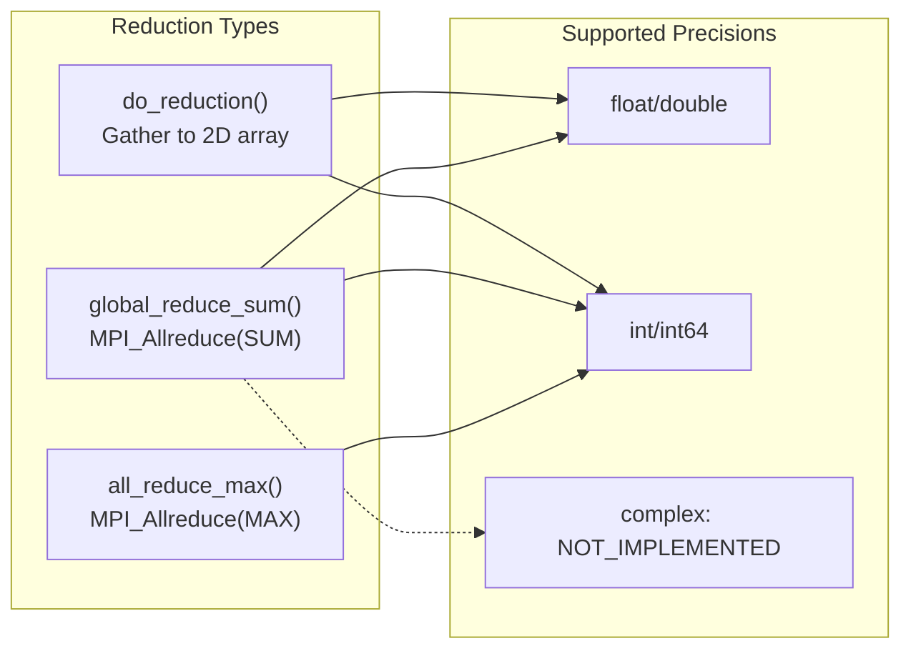

**Diagram: All-Reduce Operations**

The `global_reduce_sum()` methods support convergence checks and norm computations:

```
// Example: Sum of local vector elements across all ranks
MPI_Allreduce(&local_sum, &global_sum, 1, MPI_DOUBLE, MPI_SUM, mpi_comm);
```

**Sources:** [src/distributed/comms_mpi_hostbuffer_stream.cu:1222-1272](), [src/distributed/comms_mpi_hostbuffer_stream.cu:1518-1525]()

---

## Latency Hiding Implementation

AMGX employs a sophisticated latency hiding strategy to overlap MPI communication with interior row computation during sparse matrix operations.

```mermaid
graph TB
    subgraph "Matrix Partitioning"
        AllRows["All rows = Interior + Boundary"]
        Interior["Interior rows<br/>No halo dependencies"]
        Boundary["Boundary rows<br/>Require halo data"]
    end
    
    subgraph "Execution Flow with Latency Hiding"
        Start["exchange_halo_async()"]
        GatherBoundary["Gather boundary<br/>to host buffer"]
        IssueMPI["MPI_Isend/Irecv<br/>Non-blocking"]
        CheckSize{"Matrix size<br/>>= threshold?"}
        ComputeInterior["Compute SpMV<br/>on interior rows"]
        Wait["exchange_halo_wait()<br/>MPI_Waitall"]
        ScatterHalo["Scatter received<br/>halo data"]
        ComputeBoundary["Compute SpMV<br/>on boundary rows"]
    end
    
    AllRows --> Interior
    AllRows --> Boundary
    
    Start --> GatherBoundary
    GatherBoundary --> IssueMPI
    IssueMPI --> CheckSize
    CheckSize -->|"Yes"| ComputeInterior
    CheckSize -->|"No"| Wait
    ComputeInterior --> Wait
    Wait --> ScatterHalo
    ScatterHalo --> ComputeBoundary
```

**Diagram: Latency Hiding Strategy**

The implementation distinguishes between interior and boundary rows at the matrix level. The `min_rows_latency_hiding` parameter controls when this optimization activates:

| Condition | Behavior | Rationale |
|-----------|----------|-----------|
| `min_rows_latency_hiding < 0` | Always wait immediately | Latency hiding disabled |
| `num_rows < min_rows_latency_hiding` | Wait immediately | Too few rows to benefit from overlap |
| `num_rows >= min_rows_latency_hiding` | Return before wait | Compute interior while MPI proceeds |

This optimization was improved in v2.3.0 to ensure symmetric enable/disable across ranks.

**Sources:** [src/distributed/comms_mpi_hostbuffer_stream.cu:654-659](), [src/distributed/comms_mpi_hostbuffer_stream.cu:673-680](), [CHANGELOG:59]()

---

## GPU Direct Support

The implementation includes framework support for CUDA-aware MPI (GPU Direct), though it defaults to the host buffer path for maximum compatibility.

```mermaid
graph TB
    subgraph "Host Buffer Path - Current Default"
        DevSend["Device memory"]
        GatherHost["cudaMemcpyAsync<br/>Device to pinned host"]
        MPIHost["MPI_Isend/Irecv<br/>Host pointers"]
        ScatterDev["cudaMemcpyAsync<br/>Pinned host to device"]
        DevRecv["Device memory"]
    end
    
    subgraph "GPU Direct Path - Framework Exists"
        DevSendGD["Device memory"]
        MPIGD["MPI_Isend/Irecv<br/>Device pointers"]
        DevRecvGD["Device memory"]
    end
    
    DevSend --> GatherHost
    GatherHost --> MPIHost
    MPIHost --> ScatterDev
    ScatterDev --> DevRecv
    
    DevSendGD --> MPIGD
    MPIGD --> DevRecvGD
    
    style MPIGD fill:#f9f9f9,stroke:#666,stroke-dasharray: 5 5
    style DevSendGD fill:#f9f9f9,stroke:#666,stroke-dasharray: 5 5
    style DevRecvGD fill:#f9f9f9,stroke:#666,stroke-dasharray: 5 5
```

**Diagram: Communication Paths - Host Buffer vs GPU Direct**

The codebase includes comments indicating GPU Direct support points:

- **Visitor pattern**: `LightVisitor` with functors branches based on GPU Direct availability
- **Matrix exchange**: Comments at lines 838, 861, 894, 960, 972 note GPU Direct would use device pointers directly
- **Vector exchange**: `SynchronizerVisitor`, `SenderVisitor`, `ReceiverVisitor` support both paths

The host buffer approach provides universal compatibility across MPI implementations while the GPU Direct framework enables future optimization on supported systems.

**Sources:** [src/distributed/comms_mpi_hostbuffer_stream.cu:838-861](), [src/distributed/comms_mpi_hostbuffer_stream.cu:894](), [src/distributed/comms_mpi_hostbuffer_stream.cu:960-972](), [CHANGELOG:83]()

---

## Initialization and Configuration

The `CommsMPIHostBufferStream` class requires proper initialization and integrates with the broader AMGX initialization system.

### Class Instantiation

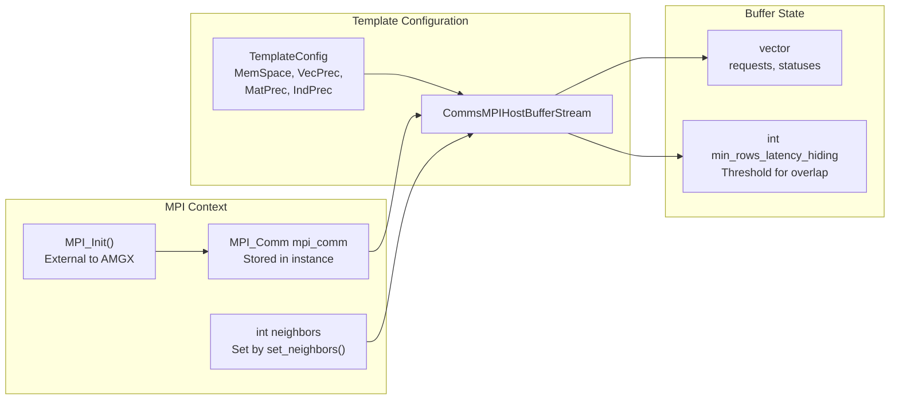

**Diagram: CommsMPIHostBufferStream Component Dependencies**

The class stores the MPI communicator and maintains state for each communication operation:

| Member Variable | Type | Purpose |
|-----------------|------|---------|
| `mpi_comm` | `MPI_Comm` | MPI communicator for all operations |
| `neighbors` | `int` | Number of neighbor partitions |
| `requests` | `std::vector<MPI_Request>` | Persistent request array for async ops |
| `min_rows_latency_hiding` | `int` | Threshold for enabling latency hiding |

**Sources:** [src/distributed/comms_mpi_hostbuffer_stream.cu:1418-1450]()

### Utility Methods

The class provides various utility methods for rank identification and synchronization:

| Method | Return Type | Description |
|--------|-------------|-------------|
| `get_num_partitions()` | `int` | Total number of MPI ranks (`MPI_Comm_size`) |
| `get_global_id()` | `int` | This rank's ID (`MPI_Comm_rank`) |
| `barrier()` | `void` | Global synchronization (`MPI_Barrier`) |
| `get_hostname()` | `void` | Get processor name (`MPI_Get_processor_name`) |
| `send_raw_data()` | `void` | Send arbitrary bytes (`MPI_Send`) |
| `recv_raw_data()` | `void` | Receive arbitrary bytes (`MPI_Recv`) |

These primitives support higher-level distributed operations like partition assignment and debugging.

**Sources:** [src/distributed/comms_mpi_hostbuffer_stream.cu:1418-1464](), [src/distributed/comms_mpi_hostbuffer_stream.cu:983-1001]()

---

## Template Instantiation Pattern

The implementation extensively uses C++ templates with explicit instantiation for all supported type combinations.

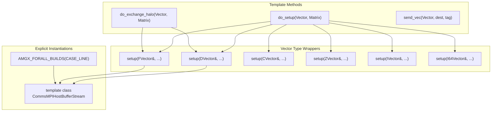

**Diagram: Template Method Delegation Pattern**

The pattern consists of:

1. **Template implementation**: Generic `do_*` methods templated on vector type
2. **Type-specific wrappers**: One public method per supported vector type (DVector, FVector, etc.)
3. **Explicit instantiation**: Macro-driven instantiation for all valid `TConfig` combinations

Example from the source:

```cpp
// Template implementation
template <class T>
void CommsMPIHostBufferStream<T_Config>::do_exchange_halo(T &b, const Matrix<TConfig> &m, int num_rings)

// Wrapper for double precision
template <class T_Config>
void CommsMPIHostBufferStream<T_Config>::exchange_halo(DVector &b, const Matrix<TConfig> &m, int tag, int num_rings) 
{ 
    do_exchange_halo(b, m, num_rings);
}

// Explicit instantiation
#define AMGX_CASE_LINE(CASE) template class CommsMPIHostBufferStream<TemplateMode<CASE>::Type>;
AMGX_FORALL_BUILDS(AMGX_CASE_LINE)
```

This design enables compile-time optimization while maintaining a clean API across all precision types.

**Sources:** [src/distributed/comms_mpi_hostbuffer_stream.cu:1004-1066](), [src/distributed/comms_mpi_hostbuffer_stream.cu:1607-1613]()

---

## Version History and Improvements

Recent AMGX versions have made significant improvements to MPI communication:

| Version | Communication Changes |
|---------|----------------------|
| **v2.4.0** (2023-10-06) | Multiple synchronization fixes for sm_70+ architectures; improved Clang compatibility |
| **v2.3.0** (2022-06-30) | Fixed asymmetric latency hiding enable/disable across ranks; fixed cuSPARSE handle deletion in SpGEMM fallback |
| **v2.2.0** (2021-04-06) | Fixed GPU Direct support (correctness and performance); fixed latency hiding bugs; Ampere support |
| **v2.1.0** (2020-03-20) | Distributed code improvements; new API for continuous partition specification |
| **v2.0.0** (2017-10-17) | Initial open source release |

The v2.2.0 and v2.3.0 releases specifically addressed distributed communication correctness and performance, with particular focus on latency hiding and GPU Direct functionality.

**Sources:** [CHANGELOG:5-119]()

---

