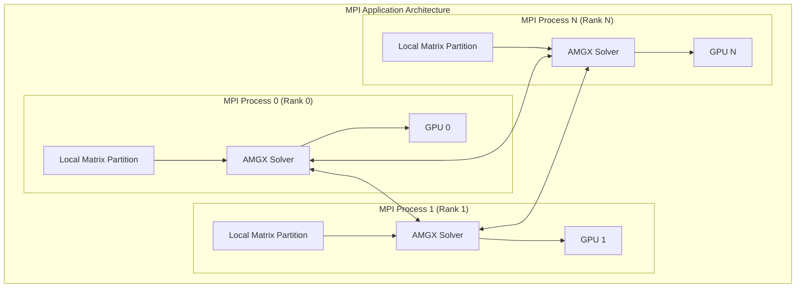
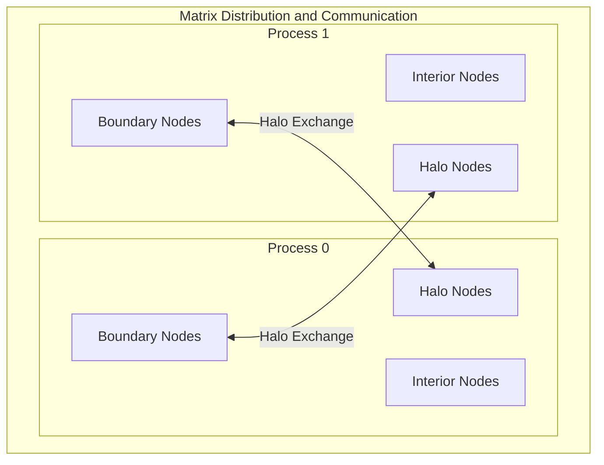
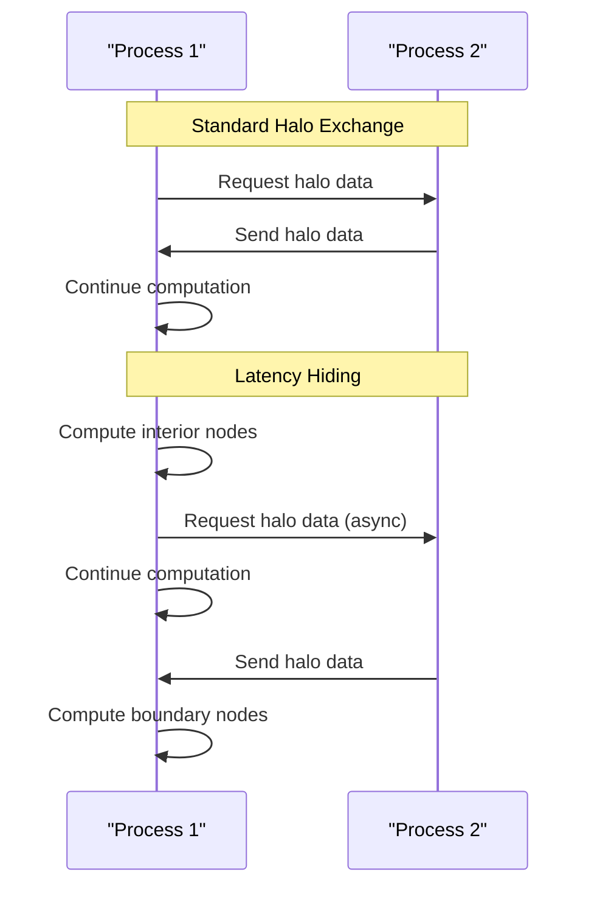
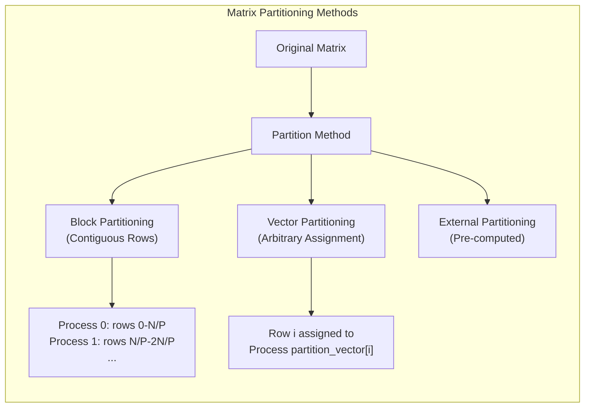
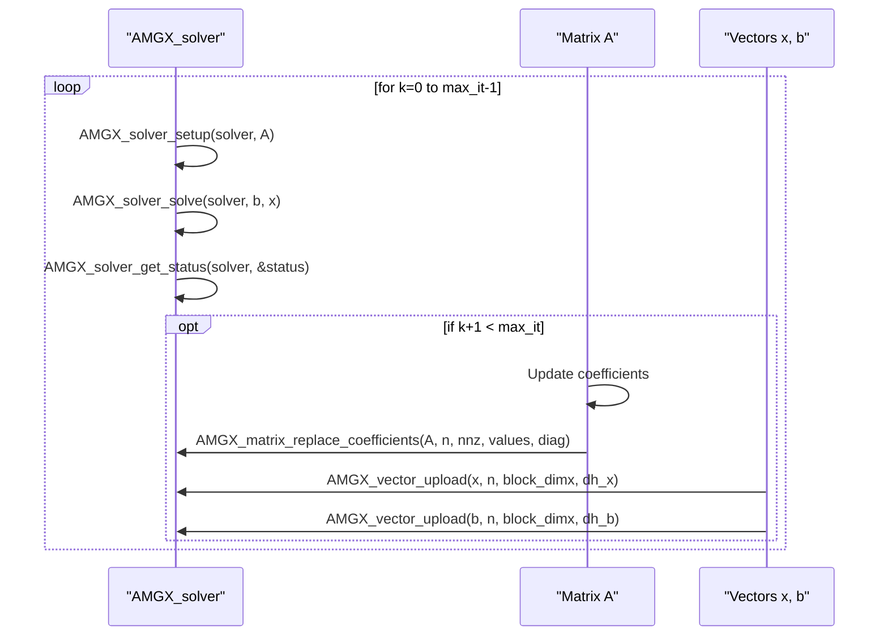

<!-- source: DeepWiki mcp.deepwiki.com · repo NVIDIA/AMGX · extra page MPI Examples · fetched 2026-10-26 -->

# MPI Examples

<details>
<summary>Relevant source files</summary>

The following files were used as context for generating this wiki page:

- [CMakeLists.txt](CMakeLists.txt)
- [examples/CMakeLists.txt](examples/CMakeLists.txt)
- [examples/amgx_mpi_capi.c](examples/amgx_mpi_capi.c)
- [examples/amgx_mpi_poisson7.c](examples/amgx_mpi_poisson7.c)
- [examples/eigen_examples/CMakeLists.txt](examples/eigen_examples/CMakeLists.txt)
- [include/amgx_c.h](include/amgx_c.h)
- [src/CMakeLists.txt](src/CMakeLists.txt)
- [src/amgx_c.cu](src/amgx_c.cu)
- [src/matrix_analysis.cu](src/matrix_analysis.cu)

</details>


This page documents the MPI (Message Passing Interface) examples provided in the AMGX library. These examples demonstrate how to utilize AMGX's distributed computing capabilities to solve large sparse linear systems across multiple GPUs and compute nodes. For information about the general API integration, see [API and Integration](#4).

## Purpose and Scope

The MPI examples showcase:
- Running AMGX solvers in multi-GPU and multi-node environments
- Partitioning and distributing matrices across processes
- Setting up proper communication patterns between processes
- Handling distributed vectors and matrices

AMGX supports two primary approaches for distributed solving:
1. Classical AMG approach with global matrix partitioning
2. Aggregation-based approach with neighbor maps

Both approaches are demonstrated through detailed examples in the codebase.

Sources: [examples/amgx_mpi_capi_cla.c](), [examples/amgx_mpi_capi_agg.c]()

## MPI Integration Architecture

AMGX's distributed computing model centers around a domain decomposition approach where the matrix is partitioned across MPI ranks, with each rank handling a subset of the rows.



The key components for MPI integration include:

1. **Distributed Manager**: Handles communication between processes
2. **Halo Exchange**: Mechanism for sharing boundary data
3. **Matrix Partitioning**: Distributes matrix rows across processes
4. **Vector Distribution**: Maintains consistency of distributed vectors

Sources: [src/distributed/distributed_manager.cu:5-30](), [src/amgx_cusparse.cu:27-102]()

## Matrix Distribution and Communication

AMGX uses a concept of "rings" to define the communication patterns between neighboring processes. The communication is managed through the distributed manager.



The diagrams shows how nodes are categorized:
- **Interior Nodes**: Owned by the process with no external dependencies
- **Boundary Nodes**: Owned by the process but have connections to external nodes
- **Halo Nodes**: Ghost copies of nodes owned by other processes

When performing operations like matrix-vector multiplication, processes need to exchange halo data to maintain consistency.

Sources: [src/distributed/distributed_manager.cu:245-345](), [src/amgx_cusparse.cu:74-102]()

## Halo Exchange Implementation

AMGX implements two main strategies for halo exchange:



The latency hiding approach allows computation to overlap with communication, improving performance on distributed systems.

Sources: [src/amgx_cusparse.cu:74-148](), [src/distributed/distributed_manager.cu:590-620]()

## MPI Example Implementations

AMGX provides two main MPI examples:

1. **Classical AMG MPI Example** (`amgx_mpi_capi_cla.c`): Uses global matrix distribution
2. **Aggregation-based MPI Example** (`amgx_mpi_capi_agg.c`): Uses neighbor map approach

### Classical AMG Example (amgx_mpi_capi_cla.c)

The classical approach uses `AMGX_read_system_global` to partition a matrix globally. This approach typically uses 2 rings of communication.

```mermaid
flowchart TD
    subgraph "Classical AMG MPI Flow"
        Init["MPI_Init()
        AMGX_initialize()"] --> Config["Create Configuration
        AMGX_config_create()"]
        Config --> Resources["Create Resources with MPI
        AMGX_resources_create()"]
        Resources --> Read["Read and Partition Matrix
        AMGX_read_system_global()"]
        Read --> SetupMatrix["Upload Matrix
        AMGX_matrix_upload_distributed()"]
        SetupMatrix --> SetupVector["Bind and Upload Vectors
        AMGX_vector_bind()
        AMGX_vector_upload()"]
        SetupVector --> Solve["Setup and Solve
        AMGX_solver_setup()
        AMGX_solver_solve()"]
        Solve --> Cleanup["Destroy Resources
        AMGX_finalize()
        MPI_Finalize()"]
    end
```



Example usage:
```
mpirun -n 4 ./amgx_mpi_capi_cla -m matrix.mtx -c config.json
```

Key features:
- Global matrix partitioning via partition vector or offsets
- Support for devices and host memory with pinning
- Handles both contiguous block partitioning and arbitrary partitioning

Sources: [examples/amgx_mpi_capi_cla.c:127-200](), [examples/amgx_mpi_capi_cla.c:352-500]()

### Aggregation-based Example (amgx_mpi_capi_agg.c)

The aggregation approach uses `AMGX_read_system_maps_one_ring` to partition a matrix with explicit specification of communication patterns. This approach typically uses 1 ring of communication.

```mermaid
flowchart TD
    subgraph "Aggregation MPI Flow"
        Init["MPI_Init()
        AMGX_initialize()"] --> Config["Create Configuration
        AMGX_config_create()"]
        Config --> Resources["Create Resources with MPI
        AMGX_resources_create()"]
        Resources --> Read["Read Matrix with Maps
        AMGX_read_system_maps_one_ring()"]
        Read --> SetComm["Set Communication
        AMGX_matrix_comm_from_maps_one_ring()"]
        SetComm --> SetupMatrix["Upload Matrix
        AMGX_matrix_upload_all()"]
        SetupMatrix --> SetupVector["Bind and Upload Vectors
        AMGX_vector_bind()
        AMGX_vector_upload()"]
        SetupVector --> Solve["Setup and Solve
        AMGX_solver_setup()
        AMGX_solver_solve()"]
        Solve --> Cleanup["Free System Maps
        AMGX_free_system_maps_one_ring()
        AMGX_finalize()
        MPI_Finalize()"]
    end
```



Example usage:
```
mpirun -n 4 ./amgx_mpi_capi_agg -m matrix.mtx -c config.json
```

Key features:
- Explicit definition of neighbor maps
- Optimized for aggregation-based solvers
- Requires less communication overhead

Sources: [examples/amgx_mpi_capi_agg.c:117-190](), [examples/amgx_mpi_capi_agg.c:353-490]()

## Communication Maps and Structure

In the aggregation-based approach, communication patterns are defined using explicit maps:

| Component | Description |
|-----------|-------------|
| `neighbors` | Array of neighboring process ranks |
| `send_sizes` | Number of elements to send to each neighbor |
| `send_maps` | Maps local row indices to data to be sent |
| `recv_sizes` | Number of elements to receive from each neighbor |
| `recv_maps` | Maps received data to local halo indices |

This example from the code shows how a 12×12 matrix partitioned across 3 processes would create these maps:

```
CSR row_offsets [0 4 8 13 21 25 32 36 41 46 50 57 61]
Partition vector [0 0 0 0 1 1 1 1 2 2 2 2]

Process 0:
num_neighbors=2; neighbors = [1 2]
send_sizes = [0 2 4] send_maps = [2 3| 0 3]
recv_sizes = [0 2 4] recv_maps = [4 5| 6 7]
```

Sources: [examples/amgx_mpi_capi_agg.c:368-421]()

## Matrix Partitioning

AMGX supports different methods of partitioning matrices across processes:



The partitioning method affects performance based on the matrix structure and communication patterns.

Sources: [examples/amgx_mpi_capi_cla.c:475-488](), [examples/amgx_mpi_capi_cla.c:308-343]()

## Best Practices and Performance Tips

When using MPI with AMGX, consider these recommendations:

1. **Number of Rings**: 
   - Classical AMG typically uses 2 rings for better convergence
   - Aggregation-based AMG typically uses 1 ring for faster performance

2. **GPU Assignment**:
   - Assign one GPU per MPI rank for best performance
   - Use `cudaSetDevice(local_rank % gpu_count)` for proper GPU selection

3. **Memory Management**:
   - Use pinned memory for host-device transfers
   - Consider GPU-direct communication if hardware supports it

4. **Synchronization**:
   - Remove synchronization barriers in production code
   - Example barriers are included for stability in the examples
   - Latency hiding is automatically used when possible

5. **Matrix Distribution**:
   - Balance matrix partitioning for even workload
   - Minimize communication boundaries for better performance

Sources: [examples/amgx_mpi_capi_cla.c:163-178](), [examples/amgx_mpi_capi_agg.c:495-503]()

## Non-linear Iterations Example

Both MPI examples demonstrate how to perform non-linear iterations where the matrix coefficients are updated between iterations:



This pattern is useful for solving non-linear problems or time-dependent problems where the coefficients change over time.

Sources: [examples/amgx_mpi_capi_cla.c:513-553](), [examples/amgx_mpi_capi_agg.c:491-531]()

## Common Command Line Arguments

Both MPI examples support similar command line arguments:

| Argument | Description |
|----------|-------------|
| `-mode [dDDI\|dDFI\|dFFI]` | Set solver mode (Default: dDDI) |
| `-m file` | Read matrix from file |
| `-c config_file` | Set AMG solver options from config file |
| `-amg "options"` | Set AMG solver options from command line |
| `-gpu` | Load matrix from device memory |
| `-it k` | Set number of outer (non-linear) iterations |
| `-partvec file` | Specify partition vector file (optional) |

Example command:
```
mpirun -n 4 ./amgx_mpi_capi_agg -mode dDDI -m matrix.mtx -c config.json -it 5
```

Sources: [examples/amgx_mpi_capi_cla.c:60-72](), [examples/amgx_mpi_capi_agg.c:50-62]()

## Summary

AMGX provides comprehensive support for distributed solving with MPI through two primary examples:

1. **Classical AMG** example with global matrix distribution
2. **Aggregation-based** example with explicit neighbor maps

These examples demonstrate how to leverage multiple GPUs across multiple nodes to solve large sparse linear systems efficiently. By using the appropriate approach based on your solver configuration and matrix structure, you can achieve optimal performance for distributed computing with AMGX.

---

