<!-- source: DeepWiki mcp.deepwiki.com · repo NVIDIA/AMGX · extra page Matrix Storage and I/O · fetched 2026-10-26 -->

# Matrix Storage and I/O

<details>
<summary>Relevant source files</summary>

The following files were used as context for generating this wiki page:

- [src/distributed/distributed_arranger.cu](src/distributed/distributed_arranger.cu)
- [src/matrix.cu](src/matrix.cu)
- [src/matrix_io.cu](src/matrix_io.cu)
- [src/readers.cu](src/readers.cu)
- [src/solvers/multicolor_dilu_solver.cu](src/solvers/multicolor_dilu_solver.cu)

</details>


## Purpose and Scope

This document describes AMGX's matrix storage formats, block structure representation, and input/output mechanisms. It covers the compressed sparse row (CSR) and coordinate (COO) formats, block matrix support, and the MatrixIO system for reading and writing matrices in MatrixMarket and binary formats.

For information about sparse matrix operations (SpMV, cuSPARSE integration), see [Sparse Matrix Operations](#2.1.2). For sparse matrix-matrix multiplication and Galerkin products, see [CSR Multiplication](#2.1.3).

## Sparse Storage Formats

AMGX supports two primary sparse matrix storage formats, both optimized for GPU execution. The `Matrix` class uses property flags (`CSR`, `COO`, `DIAG`) to track which formats are currently available.

### CSR (Compressed Sparse Row)

CSR format stores a sparse matrix using three arrays:
- **row_offsets**: Array of size `num_rows + 1` where `row_offsets[i]` points to the start of row `i` in the values/column arrays
- **col_indices**: Array of column indices for each non-zero entry
- **values**: Array of non-zero values (block size multiplies length for block matrices)

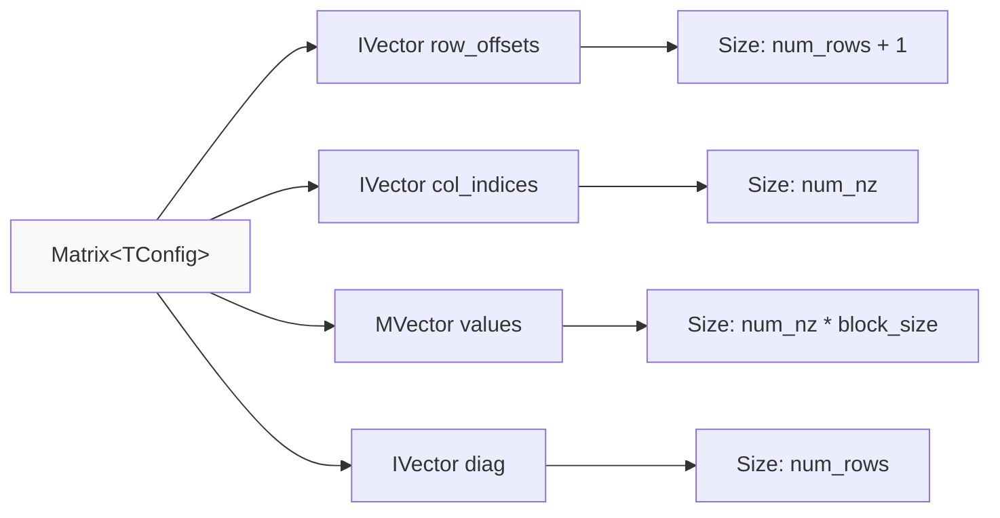

**Diagram: CSR Storage Arrays in Matrix Class**

The CSR format enables efficient row-wise operations and is the primary format for most AMGX algorithms. Row offsets are computed from COO format using `computeRowOffsetsKernel`.

Sources: [src/matrix.cu:35-58](), [src/matrix.cu:701-743]()

### COO (Coordinate)

COO format stores each non-zero as a (row, column, value) triplet:
- **row_indices**: Array of row indices for each non-zero
- **col_indices**: Array of column indices for each non-zero  
- **values**: Array of non-zero values

COO format is useful during matrix assembly and for certain operations like sorting by row and column. AMGX can convert between CSR and COO formats on demand.

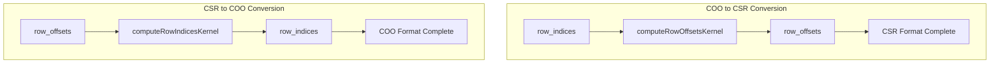

**Diagram: Format Conversion Kernels**

Sources: [src/matrix.cu:35-78]()

### Block Structure

AMGX supports block matrices where each scalar non-zero is replaced by a dense `block_dimx × block_dimy` block. Block structure is stored using:
- **block_dimx**: Number of columns per block
- **block_dimy**: Number of rows per block
- **block_size**: `block_dimx * block_dimy`

For block matrices:
- `num_rows` and `num_cols` count **block rows** and **block columns**
- `values` array size is `num_nz * block_size` (or `(num_nz + num_rows) * block_size` with separate diagonal)
- Block values are stored in row-major order within each non-zero block

| Matrix Dimension | Scalar Matrix | Block Matrix (3×3) |
|-----------------|---------------|-------------------|
| num_rows | N | N (blocks) |
| num_cols | M | M (blocks) |
| values.size() | num_nz | num_nz × 9 |
| Physical rows | N | N × 3 |
| Physical cols | M | M × 3 |

Sources: [src/matrix.cu:462-695](), [src/readers.cu:769-807]()

### Matrix Properties

The `Matrix` class uses bitwise flags to track storage properties:

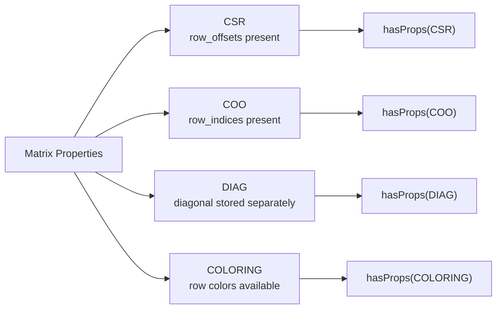

**Diagram: Matrix Property Flags**

**DIAG Property**: When set, the diagonal is stored separately at the end of the `values` array. This is common in classical AMG methods. The `diag` array maps row indices to their diagonal locations:
- Without DIAG: `values.size() = (num_nz + 1) * block_size`
- With DIAG: `values.size() = num_nz * block_size + num_rows * block_size`

Sources: [src/matrix.cu:701-743](), [include/matrix.h]()

## Diagonal Computation

The matrix diagonal location is tracked in the `diag` array, which stores the index of the diagonal element for each row. AMGX provides specialized kernels for finding diagonals in different formats:

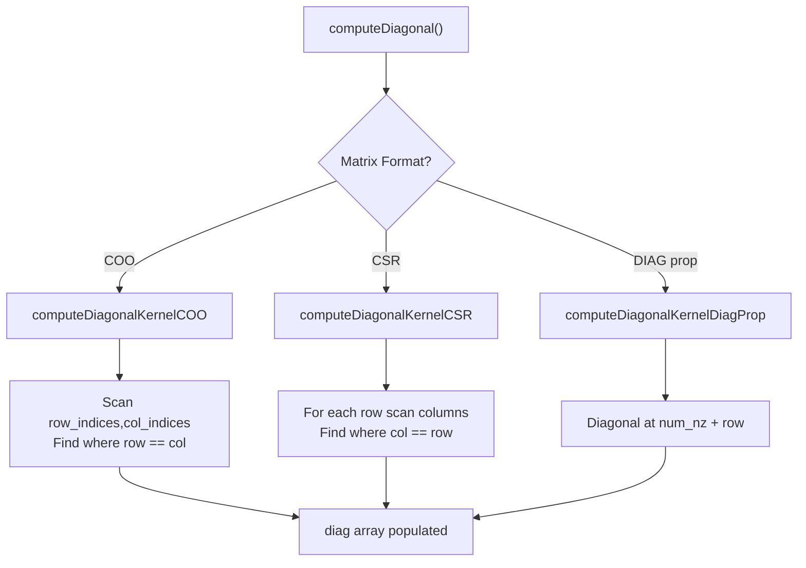

**Diagram: Diagonal Computation Dispatch**

The diagonal computation kernels are designed to handle different matrix storage configurations efficiently:

| Kernel | Format | Parallelism | Strategy |
|--------|--------|-------------|----------|
| `computeDiagonalKernelCOO` | COO | One thread per non-zero | Check if `row_indices[nz] == col_indices[nz]` |
| `computeDiagonalKernelCSR` | CSR | One thread per row | Search row's columns for `col == row` |
| `computeDiagonalKernelDiagProp` | Separate DIAG | One thread per row | Diagonal at fixed offset `num_nz + row` |

Sources: [src/matrix.cu:80-178](), [src/matrix.cu:988-1067]()

## MatrixIO System

The MatrixIO system provides a flexible plugin architecture for reading and writing matrices in different formats. It uses function registration to support multiple file formats.

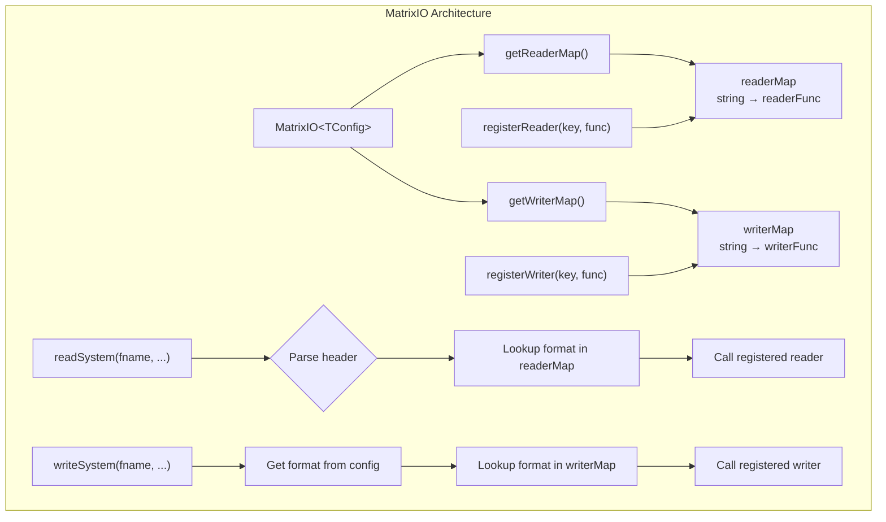

**Diagram: MatrixIO Registration and Dispatch**

### Reader/Writer Registration

The factory pattern allows formats to self-register:

- **registerReader**: Registers a reader function for a format key (e.g., "MatrixMarket")
- **registerWriter**: Registers a writer function for a format key
- **readSystem**: Reads file header, looks up format, dispatches to appropriate reader
- **writeSystem**: Gets format from configuration, dispatches to appropriate writer

Sources: [src/matrix_io.cu:35-90](), [src/matrix_io.cu:408-560]()

### File Format Detection

AMGX detects file format from the first line header:

| Header | Format | Handler |
|--------|--------|---------|
| `%%MatrixMarket` | MatrixMarket ASCII | `ReadMatrixMarket::readMatrixMarket` |
| `%%NVAMGBinary` | AMGX Binary | Binary reader |
| `%%NVAMG` or `%%AMGX` | Extended MatrixMarket | MatrixMarket with AMGX extensions |

The header line must start with `%%` followed by the format identifier. After format detection, the appropriate registered reader is invoked.

Sources: [src/matrix_io.cu:408-489](), [src/readers.cu:643-700]()

## MatrixMarket Format

MatrixMarket is the primary ASCII format for matrix I/O in AMGX. The format consists of:

1. **Header line**: `%%MatrixMarket matrix coordinate <type> <symmetry>`
2. **AMGX extensions line** (optional): `%%NVAMG <block_dimx> <block_dimy> [diagonal] [rhs] [solution]`
3. **Dimension line**: `<num_rows> <num_cols> <num_entries>`
4. **Matrix entries**: `<row> <col> <value>` (one per line)
5. **Diagonal values** (if separate diagonal)
6. **RHS vector** (if present)
7. **Solution vector** (if present)

### Reading MatrixMarket Files

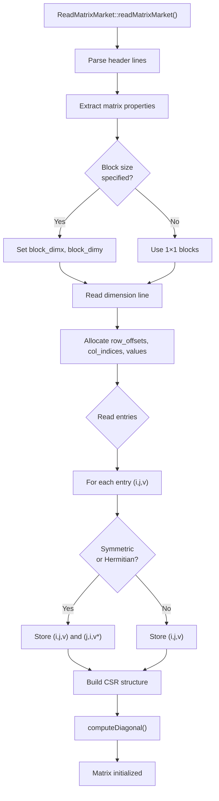

**Diagram: MatrixMarket Reading Process**

The reader supports several advanced features:
- **Symmetric/Hermitian matrices**: Automatically expands to full storage
- **Block matrices**: Interprets scalar coordinates as block indices
- **Separate diagonal**: Reads diagonal values after matrix entries
- **Zero element skipping**: Ignores explicit zeros
- **1-based vs 0-based indexing**: Controlled by `base0` keyword

Sources: [src/readers.cu:643-1327]()

### Writing MatrixMarket Files

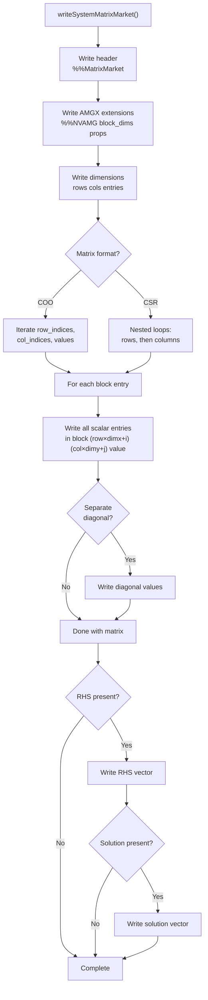

**Diagram: MatrixMarket Writing Process**

The writer outputs block matrices by expanding each block into scalar entries. For a 2×2 block matrix entry at block position (I, J), it writes 4 scalar entries at positions (I×2+i, J×2+j) for i,j ∈ {0,1}.

Sources: [src/matrix_io.cu:93-263]()

### MatrixMarket Example

Example of a 4×4 matrix with 2×2 blocks and separate diagonal:

```
%%MatrixMarket matrix coordinate real general
%%NVAMG 2 2 diagonal
2 2 4
1 1 1.0
1 2 2.0
1 3 3.0
1 4 4.0
2 1 5.0
2 2 6.0
[... additional entries ...]
4.0 5.0 6.0 7.0
8.0 9.0 10.0 11.0
```

This represents a 2×2 block matrix (4×4 scalar) with diagonal stored separately. The last two lines contain the 2×2 diagonal blocks for the two block rows.

Sources: [src/matrix_io.cu:93-263](), [src/matrix.cu:233-334]()

## Binary Format

AMGX's binary format provides faster I/O and exact floating-point preservation compared to ASCII MatrixMarket format.

### Binary Format Structure

| Section | Type | Size | Description |
|---------|------|------|-------------|
| Header | char[] | 14 bytes | `"%%NVAMGBinary\n"` |
| System flags | uint32_t[9] | 36 bytes | is_mtx, is_rhs, is_soln, format, has_diag, block_dimx, block_dimy, num_rows, num_nz |
| Row offsets | int[] | `(num_rows+1) × 4` | CSR row pointers |
| Column indices | int[] | `num_nz × 4` | Column indices |
| Values | double/float[] | Variable | Non-zero values (block_size × num_nz) + diagonal |
| RHS | double/float[] | Variable | Right-hand side vector (optional) |
| Solution | double/float[] | Variable | Initial solution vector (optional) |

### Format Flags

The `matrix_format` flag encodes the storage format:
- **0**: CSR format
- **1**: COO format  
- **+COMPLEX** flag: Indicates complex-valued matrix (real/imaginary interleaved)

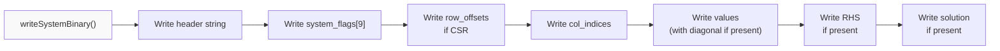

**Diagram: Binary Format Writing Sequence**

The binary format uses `UpValueType` (high-precision type) for storage, converting from the matrix's working precision during write and converting back during read to maintain numerical accuracy.

Sources: [src/matrix_io.cu:267-404]()

## Format Conversions

### Block Size Conversion

AMGX supports converting matrices between different block sizes using the `Matrix::convert()` method. This is essential when coupling scalar and block formulations or when adapting block size for algorithmic requirements.

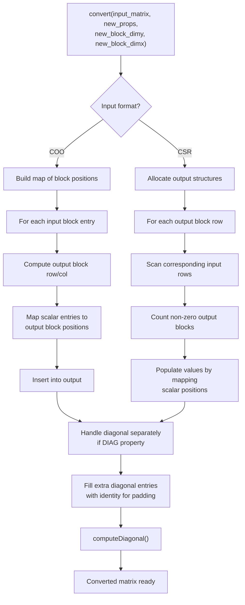

**Diagram: Block Size Conversion Flow**

### Conversion Rules

When converting from block size `(Bi, Bj)` to `(Bo, Bj)`:
- Output block (I, J) at scalar position (i, j) maps to input block (⌊i/Bo⌋, ⌊j/Bo⌋) at scalar position (i mod Bo, j mod Bo)
- Zero values are skipped to maintain sparsity
- Diagonal blocks may be padded with identity entries if the output has more rows than the input

Example: Converting 2×2 block matrix to 4×4 blocks would create output blocks that contain 2×2 sub-blocks from the input, with zeros filling the extra space.

Sources: [src/matrix.cu:462-695]()

### Complex to Real (ERF) Conversion

AMGX supports converting complex-valued matrices to real-valued equivalent formulations. This allows solving complex problems using real-valued solvers. Multiple conversion schemes (K1-K4) are available based on different real formulations.

#### Conversion Mode 1-4: Double-Size Real System

For a complex matrix `A + iB`, these modes create a 2N×2N real system:

| Mode | Formulation | Real Block Structure |
|------|-------------|---------------------|
| K1 | `[A, -B; B, A]` | Standard complex arithmetic |
| K2 | `[A, B; B, -A]` | Alternative form |
| K3 | `[B, A; A, -B]` | Rotated form |
| K4 | `[B, -A; A, B]` | Rotated alternative |

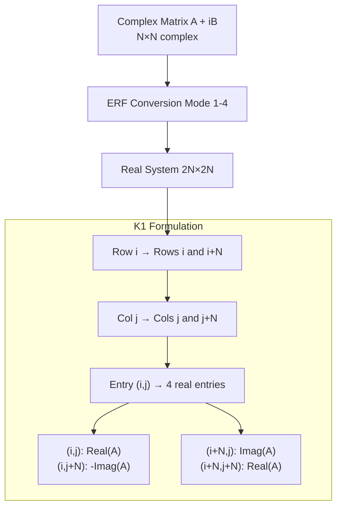

**Diagram: ERF Conversion (Modes 1-4)**

#### Conversion Mode 221-224: Block ERF

These modes preserve the matrix size but double the block size, converting each complex scalar to a 2×2 real block:

```
Complex value: a + ib → Real 2×2 block:
Mode 221: [a, -b; b, a]
Mode 222: [a, b; b, -a]  
Mode 223: [b, a; a, -b]
Mode 224: [b, -a; a, b]
```

For a N×N complex matrix with `(Bx, By)` blocks:
- Output: N×N real matrix with `(2×Bx, 2×By)` blocks
- Each complex block element becomes a 2×2 real sub-block
- RHS and solution vectors are similarly expanded

Sources: [src/readers.cu:183-639]()

### Conversion Mode Selection

The `complex_conversion` configuration parameter selects the conversion mode:
- **0**: No conversion (read as complex)
- **1-4**: Double-size real system (K1-K4 formulation)
- **221-224**: Block ERF with doubled block size (K1-K4 formulation)

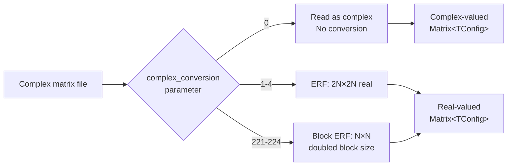

**Diagram: Complex Conversion Mode Selection**

Sources: [src/readers.cu:656-666]()

## Matrix Initialization and Setup

The matrix initialization process involves multiple stages to prepare the matrix for solver operations.

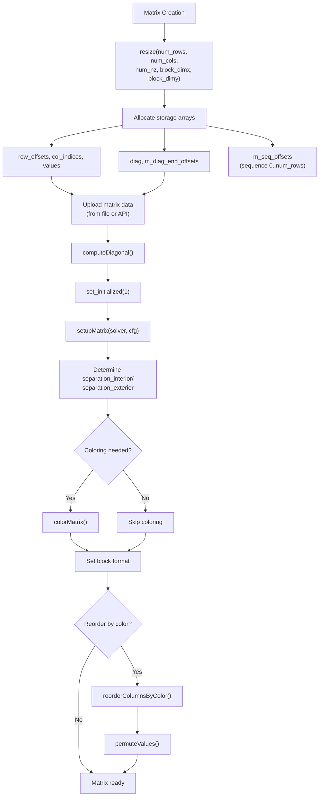

**Diagram: Matrix Initialization and Setup Process**

### Resize Method

The `resize()` method allocates storage for the matrix:

1. **Check initialization**: Matrix must not be already initialized
2. **Set dimensions**: Store `num_rows`, `num_cols`, `num_nz`
3. **Allocate values**: 
   - Without DIAG: `(num_nz + 1) × block_size`
   - With DIAG: `num_nz × block_size + num_rows × block_size`
4. **Allocate indices**: `col_indices[num_nz]`, optionally `row_indices[num_nz]` for COO
5. **Allocate offsets**: `row_offsets[num_rows + 1]` for CSR
6. **Initialize diagonal**: `diag[num_rows]`, `m_diag_end_offsets[num_rows]`
7. **Sequence vector**: `m_seq_offsets[num_rows + 1]` = {0, 1, 2, ..., num_rows}

Sources: [src/matrix.cu:701-743]()

### Setup Matrix Method

The `setupMatrix()` method prepares the matrix for solver execution:

**Separation Configuration**: Determines which rows are interior vs. boundary for latency hiding:
- `m_separation_interior`: Narrower separation for interior computation
- `m_separation_exterior`: Wider separation including boundary rows
- If latency hiding disabled: both set to same value

**Coloring**: Required by certain smoothers (Gauss-Seidel, multicolor ILU):
- Calls `colorMatrix()` if solver reports coloring needed
- Coloring scope determined by solver

**Block Format**: Sets storage layout (row-major vs column-major blocks)

**Column Reordering**: Some solvers benefit from reordering columns by color:
- Sorts columns within each row by color value
- Maintains permutation vector for value reordering
- May insert diagonal if stored separately

Sources: [src/matrix.cu:750-812]()

## Column Reordering by Color

When enabled, column reordering sorts the column indices within each row by the color of the column node. This improves cache locality for multicolor solvers.

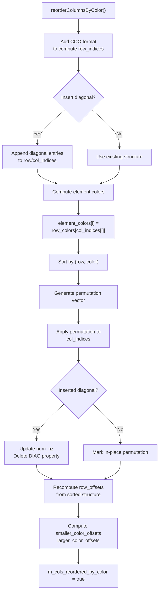

**Diagram: Column Reordering Process**

The reordering creates two auxiliary arrays:
- **smaller_color_offsets[row]**: First column in row with color ≥ current row's color
- **larger_color_offsets[row]**: First column in row with color > current row's color

These enable efficient iteration over forward/backward dependencies in multicolor smoothers.

Sources: [src/matrix.cu:843-941]()

---

## Summary

AMGX's matrix storage and I/O system provides:

1. **Flexible storage formats**: CSR and COO with efficient GPU-optimized conversions
2. **Block structure support**: Dense blocks within sparse structure for coupled systems
3. **Multiple I/O formats**: MatrixMarket (ASCII) and binary formats with reader/writer plugins
4. **Advanced conversions**: Block size conversion and complex-to-real (ERF) transformations
5. **Solver preparation**: Diagonal computation, coloring, and column reordering for optimal performance

The architecture separates storage concerns from algorithmic operations, allowing solvers to work with matrices in their preferred format while the storage layer handles format conversions transparently.

---

