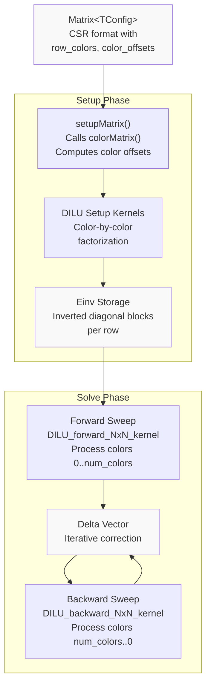
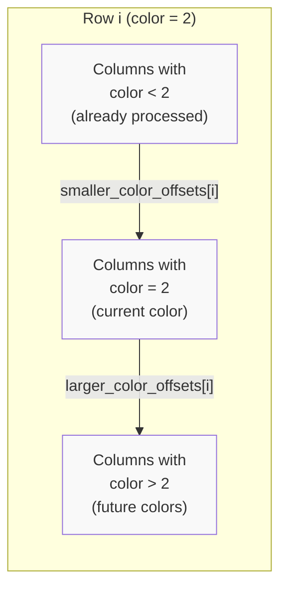
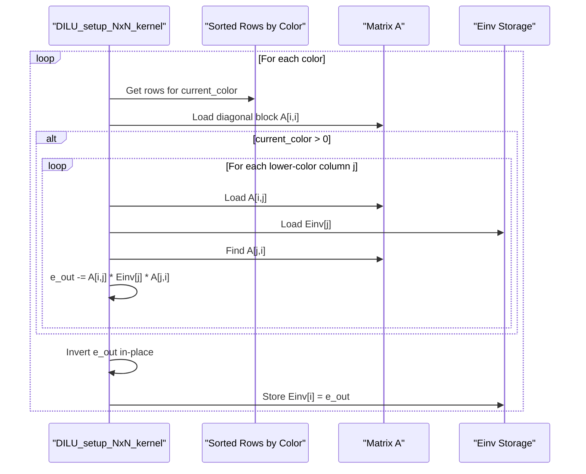
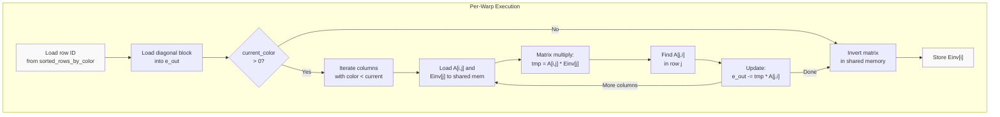
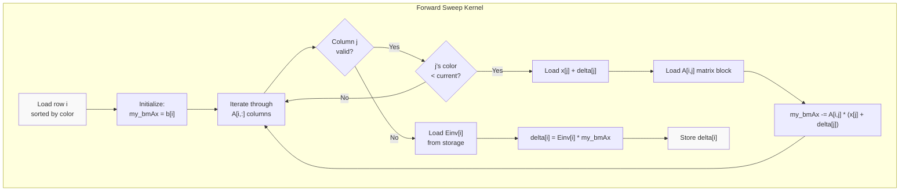
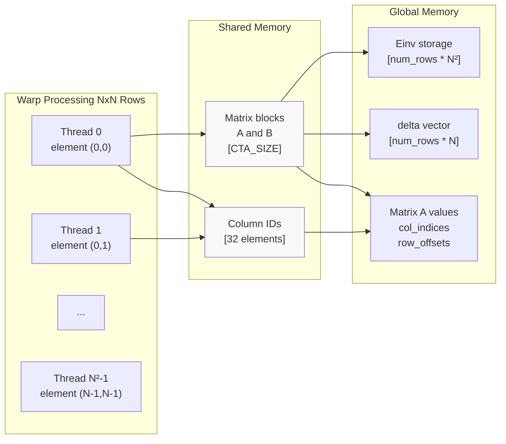
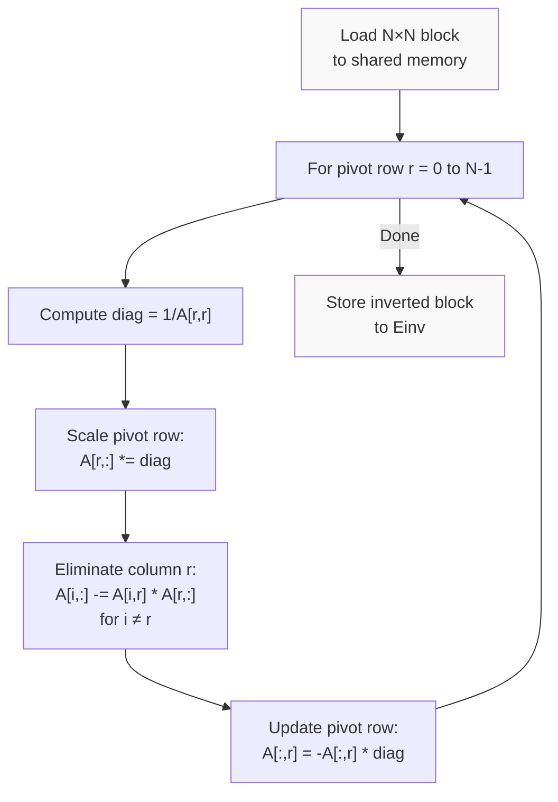
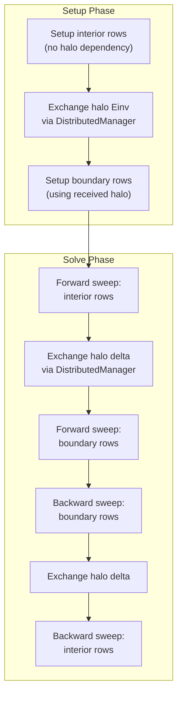

<!-- source: DeepWiki mcp.deepwiki.com · repo NVIDIA/AMGX · extra page Multicolor DILU Solver · fetched 2026-10-26 -->

# Multicolor DILU Solver

<details>
<summary>Relevant source files</summary>

The following files were used as context for generating this wiki page:

- [src/distributed/distributed_arranger.cu](src/distributed/distributed_arranger.cu)
- [src/matrix.cu](src/matrix.cu)
- [src/matrix_io.cu](src/matrix_io.cu)
- [src/readers.cu](src/readers.cu)
- [src/solvers/multicolor_dilu_solver.cu](src/solvers/multicolor_dilu_solver.cu)

</details>


The Multicolor DILU (Distributed Incomplete LU) Solver implements a parallelizable incomplete LU factorization smoother using graph coloring techniques. This solver serves as a preconditioner or smoother in the AMG hierarchy, enabling parallel triangular solves on GPU architectures that would otherwise be inherently sequential.

For general solver framework concepts, see [3.1](#3.1). For other smoother implementations, see [3.4.1](#3.4.1) (Block Jacobi) and [3.4.2](#3.4.2) (Gauss-Seidel).

## Overview

The DILU solver computes an approximate inverse of the matrix diagonal blocks using incomplete LU factorization. The key innovation is the use of **graph coloring** to identify independent sets of rows that can be processed in parallel, overcoming the sequential dependency inherent in traditional ILU methods.

The solver operates in two main phases:
1. **Setup Phase**: Computes factorization `E^-1` for each colored row set
2. **Solve Phase**: Applies forward and backward sweeps using the computed factors

Sources: [src/solvers/multicolor_dilu_solver.cu:1-50]()

## Architecture



**Diagram: Multicolor DILU Solver Architecture**

The matrix coloring creates independent sets where rows of the same color have no dependencies within that color, enabling parallel processing within each color group.

Sources: [src/solvers/multicolor_dilu_solver.cu:36-358](), [src/matrix.cu:751-812]()

## Graph Coloring Strategy

The solver requires the matrix to be colored before use. The coloring strategy partitions matrix rows into color groups such that rows of the same color do not have direct dependencies. This is achieved through the matrix's coloring infrastructure.

### Color Offset Computation

The matrix maintains two key arrays for each row:
- `smaller_color_offsets[i]`: Points to first column with color ≥ current row's color
- `larger_color_offsets[i]`: Points to first column with color > current row's color



**Diagram: Color Offset Partitioning Within a Row**

The kernel `computeColorOffsetsKernelCSR` populates these arrays, enabling efficient identification of which columns belong to already-processed color groups during the solve phase.

Sources: [src/matrix.cu:128-166](), [src/matrix.cu:936-939]()

### Column Reordering

To maximize cache efficiency, the matrix can reorder columns by color using `reorderColumnsByColor()`. This groups columns of the same color together in memory, improving memory access patterns during the factorization.

Sources: [src/matrix.cu:842-941]()

## Setup Phase

The setup phase computes the approximate inverse `Einv` for each row's diagonal block. This phase proceeds color-by-color to maintain dependencies.

### Setup Algorithm

For each color `c` (from 0 to `num_colors-1`):

1. **Initialize**: Load diagonal block `D[i]` for each row `i` with color `c`
2. **Update**: For columns `j` with color < `c`, compute: `D[i] -= A[i,j] * Einv[j] * A[j,i]`
3. **Invert**: Compute `Einv[i] = D[i]^-1` using in-place Gauss-Jordan elimination



**Diagram: Setup Phase Execution Sequence**

Sources: [src/solvers/multicolor_dilu_solver.cu:364-639]()

### Block Size Specializations

The implementation provides optimized kernels for different block sizes:

| Kernel | Block Size | Threads per Row | Use Case |
|--------|------------|-----------------|----------|
| `DILU_setup_1x1_kernel` | 1×1 | Warp (32) | Scalar matrices |
| `DILU_setup_NxN_kernel` | N×N (≤32) | NxN threads | Small block matrices |
| `DILU_setup_NxN_kernel_large` | N×N (>32) | Warp | Large block matrices |

The 1×1 kernel uses scalar operations and warp reductions for efficiency. The NxN kernels use shared memory for block matrix operations with multiple threads cooperating on each block.

Sources: [src/solvers/multicolor_dilu_solver.cu:361-639](), [src/solvers/multicolor_dilu_solver.cu:646-812]()

### Key Kernel: DILU_setup_NxN_kernel



**Diagram: DILU Setup Kernel Control Flow**

The kernel processes rows in sorted color order, using NxN threads per block where each thread handles one element of the NxN block matrix. Shared memory stores intermediate matrix products.

Sources: [src/solvers/multicolor_dilu_solver.cu:361-639]()

## Solve Phase

The solve phase applies the DILU preconditioner through forward and backward sweeps, processing colors in opposite directions.

### Forward and Backward Sweeps

**Forward Sweep** (colors 0 → num_colors-1):
```
For color c = 0 to num_colors-1:
    For each row i with color c:
        temp = b[i] - A[i,:] * (x + delta)
        delta[i] = Einv[i] * temp
```

**Backward Sweep** (colors num_colors-1 → 0):
```
For color c = num_colors-1 to 0:
    For each row i with color c:
        temp = b[i] - A[i,:] * (x + delta)
        delta[i] = Einv[i] * temp
```

The `delta` vector accumulates corrections to the solution, which are added to `x` at the end of each iteration.

Sources: [src/solvers/multicolor_dilu_solver.cu:849-1084](), [src/solvers/multicolor_dilu_solver.cu:1086-1323]()

### Coloring Strategies

The solver supports two coloring approaches controlled by the `AMGX_ILU_COLORING` macro and `boundary_coloring` parameter:

| Strategy | Description | Column Filtering |
|----------|-------------|------------------|
| `FIRST` | Process boundary nodes first | Include only cols ≥ `boundary_index` |
| `SYNC_COLORS` | Synchronize color order | Include cols with color < current |

The `FIRST` strategy is used for latency hiding in distributed settings, processing boundary nodes before interior nodes to overlap communication with computation.

Sources: [src/solvers/multicolor_dilu_solver.cu:962-982]()

### Key Kernel: DILU_forward_NxN_kernel



**Diagram: Forward Sweep Kernel Control Flow**

Each thread within a warp processes one element of the N×N block. The kernel uses shared memory to broadcast column IDs and to perform block matrix operations efficiently.

Sources: [src/solvers/multicolor_dilu_solver.cu:849-1084]()

## Matrix-Vector Product Specialization

The solve kernels perform specialized sparse matrix-vector products that respect color dependencies. For row `i` with color `c`, only columns with color < `c` contribute to the residual computation in the forward sweep (and color > `c` in the backward sweep).

### Memory Access Pattern



**Diagram: Memory Hierarchy in Solve Kernels**

The kernels use cooperative loading: threads within a warp collaborate to load matrix blocks into shared memory, then each thread processes its assigned element of the block matrix product.

Sources: [src/solvers/multicolor_dilu_solver.cu:849-1084](), [src/solvers/multicolor_dilu_solver.cu:1086-1323]()

## Block Matrix Operations

For block-structured matrices, the solver performs operations on N×N blocks rather than scalars.

### In-Place Block Inversion

The setup kernel inverts N×N blocks using Gauss-Jordan elimination with partial pivoting:



**Diagram: In-Place Block Matrix Inversion**

The inversion uses `#pragma unroll` directives for the pivot loop (N iterations), enabling compile-time optimization for small, fixed block sizes.

Sources: [src/solvers/multicolor_dilu_solver.cu:591-631]()

### Block Matrix-Vector Products

During sweeps, the kernel computes products of N×N blocks with N-vectors:

```
result[i] = sum_{j=0}^{N-1} A[row,j] * B[j,col]
```

Each thread computes one element of the result, with threads synchronized via `__syncwarp()` between operations.

Sources: [src/solvers/multicolor_dilu_solver.cu:1009-1043]()

## Distributed Computing Support

The DILU solver extends to distributed matrices through boundary coloring and halo exchange integration.

### Boundary Coloring Types

When `halo_coloring != LAST`, the solver distinguishes between:

- **Interior rows**: Rows with no off-processor dependencies
- **Boundary rows**: Rows with halo (off-processor) columns

The `boundary_index` parameter separates these regions. The coloring strategy determines which columns participate in each sweep:

```
if boundary_coloring == FIRST:
    include column j if j >= boundary_index
else:
    include column j if row_colors[j] < current_color
```

This enables processing interior rows independently while boundary rows wait for halo data exchange.

Sources: [src/solvers/multicolor_dilu_solver.cu:962-982](), [src/matrix.cu:107-122]()

### Integration with Distributed Manager

The solver integrates with the `DistributedManager` infrastructure for halo exchange:



**Diagram: Distributed DILU Execution Flow**

The separation of interior and boundary processing enables computation/communication overlap, improving parallel efficiency.

Sources: [src/solvers/multicolor_dilu_solver.cu:962-982](), [src/distributed/distributed_arranger.cu:1-200]()

## Performance Considerations

### Warp-Level Parallelism

The kernels are designed for efficient warp execution:

| Block Size | Warps per Block | Items per Warp | Occupancy Target |
|------------|------------------|----------------|------------------|
| 1×1 | 4 (CTA=128) | Multiple rows | High (16 blocks/SM) |
| 2×2, 3×3 | 4 (CTA=128) | 32/N² rows | Medium (12 blocks/SM) |
| N×N (N>5) | 4 (CTA=128) | 1 row | Medium (12 blocks/SM) |

The `__launch_bounds__` attributes guide the compiler to optimize register usage for the target occupancy.

Sources: [src/solvers/multicolor_dilu_solver.cu:38](), [src/solvers/multicolor_dilu_solver.cu:363](), [src/solvers/multicolor_dilu_solver.cu:645]()

### Shared Memory Usage

Shared memory requirements per CTA:

- Column ID broadcast: `CTA_SIZE` integers
- Matrix block storage: `CTA_SIZE * NUM_WARP_ITERS_PER_BLOCK * sizeof(value_type)`
- Index storage: `NUM_WARPS_PER_CTA * NUM_ITEMS_PER_WARP_CEIL` integers

For large block sizes, this limits occupancy, but enables efficient block matrix operations without repeated global memory accesses.

Sources: [src/solvers/multicolor_dilu_solver.cu:60-74](), [src/solvers/multicolor_dilu_solver.cu:399-413]()

### Memory Coalescing

The kernels ensure coalesced memory access by:
1. Sorting rows by color for contiguous processing
2. Storing Einv blocks contiguously per row
3. Using warp-level primitives (`__shfl`, `__ballot`) for data exchange

Sources: [src/solvers/multicolor_dilu_solver.cu:156-167](), [src/solvers/multicolor_dilu_solver.cu:484-495]()

## Configuration

The DILU solver is configured as a smoother in AMG via JSON:

```json
{
  "solver": "AMG",
  "smoother": "MULTICOLOR_DILU",
  "coloring_level": 1,
  "matrix_coloring_scheme": "MIN_MAX",
  "max_uncolored_percentage": 0.0
}
```

Key parameters:
- `coloring_level`: Must be ≥1 to enable row coloring
- `matrix_coloring_scheme`: Algorithm for graph coloring (MIN_MAX, PARALLEL_GREEDY)
- `max_uncolored_percentage`: Tolerance for uncolored rows

The solver requires `reorder_cols_by_color=true` and `insert_diagonal=false` flags internally.

Sources: [src/matrix.cu:771-808](), [src/matrix.cu:851-855]()

## Limitations and Trade-offs

### Advantages
- Enables parallel triangular solves on GPUs
- Effective preconditioner for moderately ill-conditioned systems
- Supports block-structured matrices efficiently

### Limitations
- Coloring overhead during setup
- Color count affects parallelism (many colors = less parallel work per color)
- Memory overhead for Einv storage (N² per row for N×N blocks)
- Sequential dependency between colors reduces parallelism vs. Jacobi

### Comparison with Other Smoothers

| Smoother | Parallelism | Memory | Convergence |
|----------|-------------|--------|-------------|
| Jacobi | Full (all rows) | Low (N per row) | Slowest |
| Gauss-Seidel | Sequential | Low | Fast |
| **Multicolor DILU** | **Per-color** | **High (N² per row)** | **Faster than Jacobi** |

The multicolor approach represents a middle ground between fully parallel Jacobi and sequential Gauss-Seidel.

Sources: [src/solvers/multicolor_dilu_solver.cu:1-50](), [src/matrix.cu:751-812]()

---

