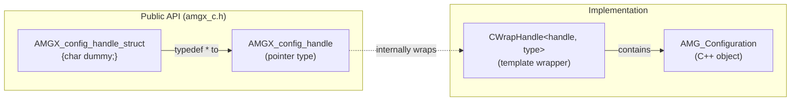
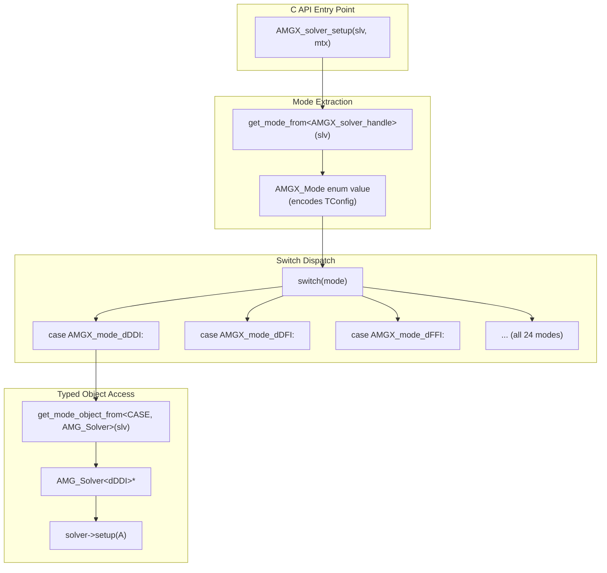
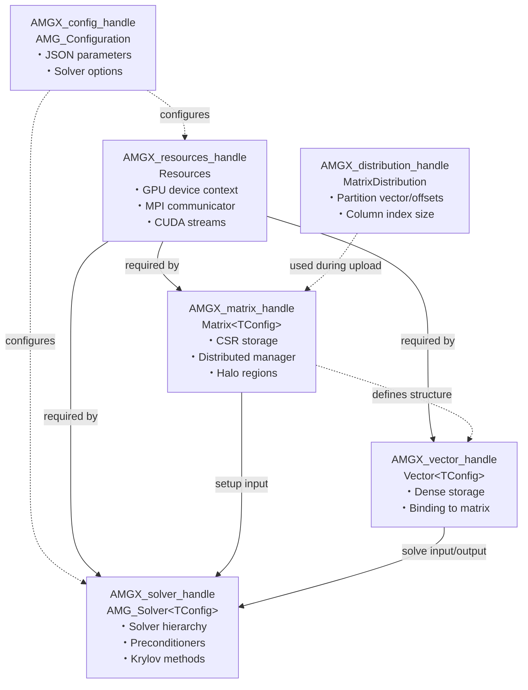
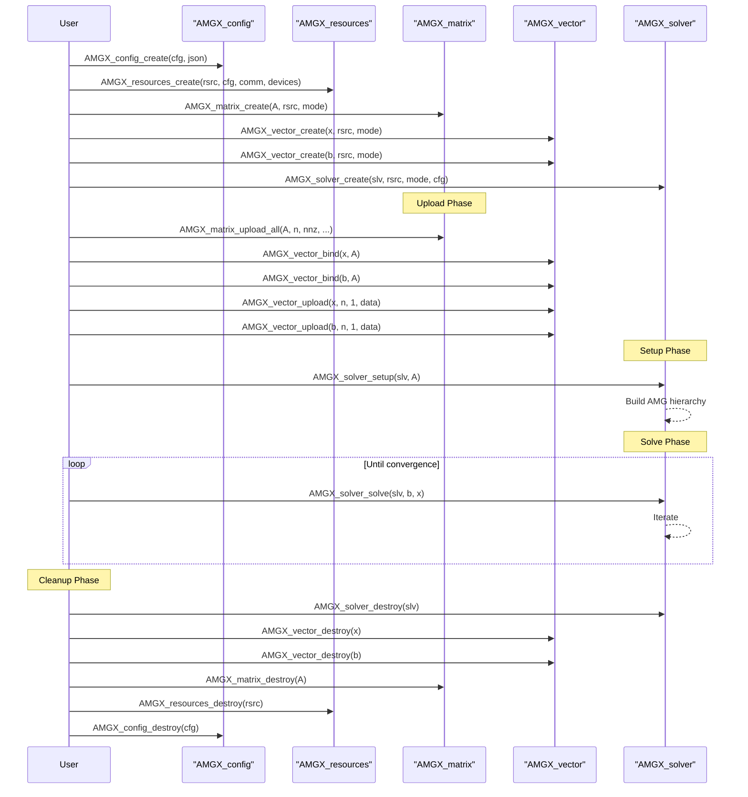
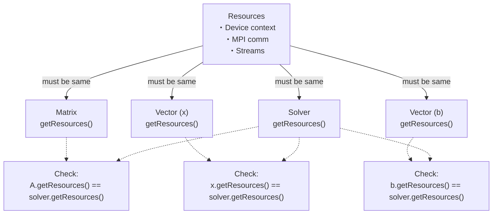
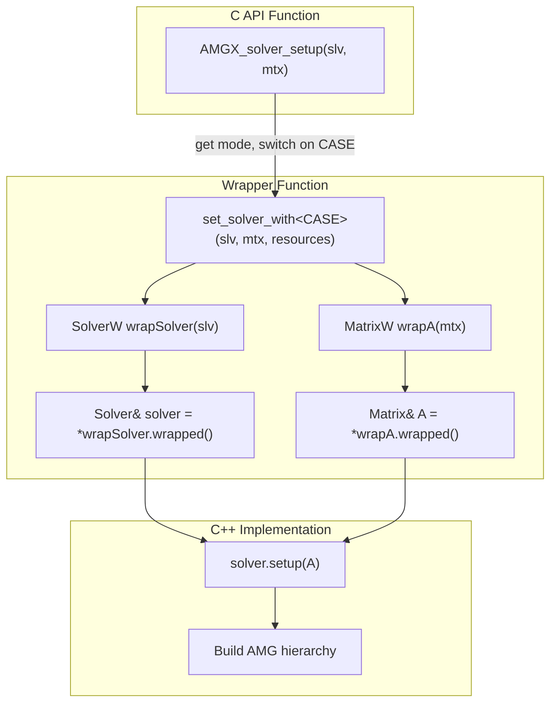

<!-- source: DeepWiki mcp.deepwiki.com · repo NVIDIA/AMGX · extra page API Design and Object Model · fetched 2026-10-26 -->

# API Design and Object Model

<details>
<summary>Relevant source files</summary>

The following files were used as context for generating this wiki page:

- [examples/amgx_capi.h](examples/amgx_capi.h)
- [examples/amgx_mpi_capi.c](examples/amgx_mpi_capi.c)
- [examples/amgx_mpi_poisson7.c](examples/amgx_mpi_poisson7.c)
- [include/amgx_c.h](include/amgx_c.h)
- [src/amgx_c.cu](src/amgx_c.cu)
- [src/matrix_analysis.cu](src/matrix_analysis.cu)

</details>


## Purpose and Scope

This document describes the design of AMGX's C API and its underlying object model. It covers the opaque handle system, object lifecycle management, and the mapping between C API handles and templated C++ implementations. For details on how the template dispatch system encodes precision and memory location, see [Mode System and Template Dispatch](#4.1.2). For error handling patterns, see [Error Handling](#4.1.3).

## Opaque Handle Design

AMGX exposes a pure C API to enable integration from any language with C foreign function interface (FFI) support. The API is built around **opaque handles** that hide all implementation details from users.

### Handle Type Definitions

Each handle type is defined as a pointer to an incomplete struct type:

**Handle Structure Pattern**


The six core handle types are:

| Handle Type | Wrapped C++ Type | Purpose |
|-------------|-----------------|---------|
| `AMGX_config_handle` | `AMG_Configuration` | Solver configuration parameters |
| `AMGX_resources_handle` | `Resources` | GPU/MPI execution context |
| `AMGX_matrix_handle` | `Matrix<TConfig>` | Sparse matrix storage |
| `AMGX_vector_handle` | `Vector<TConfig>` | Dense vector storage |
| `AMGX_solver_handle` | `AMG_Solver<TConfig>` | Solver hierarchy |
| `AMGX_distribution_handle` | `MatrixDistribution` | Distributed partition information |

Sources: [include/amgx_c.h:107-124](), [src/amgx_c.cu:639-641]()

### Opaqueness Mechanism

Each handle is defined as a pointer to a struct containing only a dummy `char` member. This creates an **incomplete type** that cannot be dereferenced by user code:

```c
typedef struct {char AMGX_config_handle_dummy;} AMGX_config_handle_struct;
typedef AMGX_config_handle_struct *AMGX_config_handle;
```

This design provides:
- **Type safety**: Handles of different types cannot be mixed
- **ABI stability**: Internal implementation can change without breaking user code
- **Language neutrality**: Pure C types work with any language's FFI
- **Memory safety**: Users cannot accidentally corrupt internal state

Sources: [include/amgx_c.h:107-124]()

## Handle-to-Object Mapping

### CWrapHandle Template

Internally, AMGX uses the `CWrapHandle<HandleType, ObjectType>` template to associate each opaque handle with its corresponding typed C++ object. This wrapper stores:
- The actual C++ object pointer
- The `AMGX_Mode` encoding template parameters (memory space, precisions, index type)
- Solve status information (for solver handles)

**Template Dispatch Pattern**


Sources: [src/amgx_c.cu:45-69](), [src/amgx_c.cu:639-641]()

### Mode Storage and Retrieval

Each handle stores its `AMGX_Mode` value, which encodes:
- Memory space (host or device)
- Vector precision (float, double, complex variants, int types)
- Matrix precision (float, double, complex variants)
- Index precision (int or int64)

The API implementation uses helper functions to extract objects:

| Function | Purpose |
|----------|---------|
| `get_mode_from<HandleType>(handle)` | Extract mode from handle |
| `get_mode_object_from<Mode, Type, HandleType>(handle)` | Get typed C++ object pointer |
| `getResourcesFromSolverHandle(handle, resources**)` | Extract Resources from Solver |
| `getResourcesFromMatrixHandle(handle, resources**)` | Extract Resources from Matrix |
| `getResourcesFromVectorHandle(handle, resources**)` | Extract Resources from Vector |

Sources: [src/amgx_c.cu:45-126]()

## Object Types and Responsibilities

### Object Hierarchy

**Object Relationships and Dependencies**


Sources: [include/amgx_c.h:218-243](), [include/amgx_c.h:262-309](), [include/amgx_c.h:336-370](), [include/amgx_c.h:373-408]()

### Configuration Objects

`AMGX_config_handle` wraps `AMG_Configuration`, which:
- Parses JSON configuration strings
- Stores solver parameters (tolerance, max iterations, preconditioner type, etc.)
- Provides parameter queries (e.g., `AMGX_config_get_default_number_of_rings`)

Configurations are created from JSON strings or files and can be modified after creation:

```c
AMGX_config_create(&cfg, "config_version=2, solver(main)=AMG, ...");
AMGX_config_add_parameters(&cfg, "tolerance=1e-8");
```

Sources: [include/amgx_c.h:193-215]()

### Resources Objects

`AMGX_resources_handle` wraps `Resources`, which manages:
- CUDA device selection and context
- MPI communicator (in distributed builds)
- CUDA stream pools for asynchronous operations
- Threading and synchronization

Two creation modes exist:
- `AMGX_resources_create`: Full control over devices and MPI
- `AMGX_resources_create_simple`: Single device, no MPI

All other objects require a valid Resources handle at creation.

Sources: [include/amgx_c.h:218-230](), [examples/amgx_mpi_poisson7.c:238-242]()

### Matrix Objects

`AMGX_matrix_handle` wraps `Matrix<TConfig>`, storing:
- CSR format sparse matrix (row_offsets, col_indices, values)
- Block structure (block_dimx, block_dimy)
- Distributed manager (for multi-GPU partitioning)
- Diagonal values (separate or embedded)

Upload patterns:
- `AMGX_matrix_upload_all`: Single-GPU or pre-partitioned distributed
- `AMGX_matrix_upload_all_global`: Global indices with partition vector
- `AMGX_matrix_upload_distributed`: With distribution handle

Sources: [include/amgx_c.h:262-323](), [src/amgx_c.cu:852-922]()

### Vector Objects

`AMGX_vector_handle` wraps `Vector<TConfig>`, storing:
- Dense array of values
- Block dimension (for block systems)
- Manager pointer (for distributed vectors)

Vectors must be **bound** to a matrix before use to establish:
- Size compatibility
- Distributed structure (if applicable)

```c
AMGX_vector_bind(x, A);  // x inherits structure from A
AMGX_vector_upload(x, n, block_dim, data);
```

Sources: [include/amgx_c.h:336-370]()

### Solver Objects

`AMGX_solver_handle` wraps `AMG_Solver<TConfig>` or other solver types, implementing:
- Setup phase: Build AMG hierarchy or preconditioner
- Solve phase: Iterative solution
- Convergence checking
- Residual tracking

The solver stores:
- Configuration reference
- Resources reference  
- Pointer to matrix operator
- Preconditioner hierarchy
- Convergence history

Sources: [include/amgx_c.h:373-415](), [examples/amgx_mpi_poisson7.c:242-323]()

### Distribution Objects

`AMGX_distribution_handle` wraps `MatrixDistribution`, providing:
- Partition information (vector or offsets)
- Column index size specification (32-bit or 64-bit)
- Metadata for optimized distributed upload

This is a utility object used only during matrix upload operations.

Sources: [include/amgx_c.h:233-259]()

## Object Lifecycle Management

### Creation-Setup-Use-Destroy Pattern

**Typical Object Lifecycle**


Sources: [examples/amgx_mpi_capi.c:92-439](), [examples/amgx_mpi_poisson7.c:92-369]()

### Lifecycle Phases

#### 1. Library Initialization
```c
AMGX_initialize();
AMGX_register_print_callback(&callback);
AMGX_install_signal_handler();
```

Must be called once per process before any other API calls.

#### 2. Configuration Creation
```c
AMGX_config_create(&cfg, "config_version=2, ...");
// or
AMGX_config_create_from_file(&cfg, "solver.json");
```

Configuration can be shared by multiple objects.

#### 3. Resources Creation
```c
// Simple: single GPU
AMGX_resources_create_simple(&rsrc, cfg);

// Advanced: MPI with device selection
int devices[] = {local_rank};
AMGX_resources_create(&rsrc, cfg, &mpi_comm, 1, devices);
```

Resources must exist before creating matrices, vectors, or solvers.

#### 4. Object Creation and Setup
```c
// Create with mode specifying template parameters
AMGX_matrix_create(&A, rsrc, AMGX_mode_dDDI);
AMGX_vector_create(&x, rsrc, AMGX_mode_dDDI);
AMGX_solver_create(&solver, rsrc, AMGX_mode_dDDI, cfg);

// Upload data
AMGX_matrix_upload_all(A, n, nnz, block_dimx, block_dimy, 
                       row_ptrs, col_indices, data, diag_data);
AMGX_vector_bind(x, A);
AMGX_vector_upload(x, n, 1, x_data);

// Setup solver hierarchy
AMGX_solver_setup(solver, A);
```

Setup phase is expensive (builds AMG hierarchy) but amortized over many solves.

#### 5. Solution Phase
```c
AMGX_solver_solve(solver, b, x);
AMGX_solver_get_status(solver, &status);
AMGX_vector_download(x, result);
```

Can be called multiple times with different right-hand sides.

#### 6. Destruction
```c
// Destroy in reverse order of creation
AMGX_solver_destroy(solver);
AMGX_vector_destroy(x);
AMGX_vector_destroy(b);
AMGX_matrix_destroy(A);
AMGX_resources_destroy(rsrc);
AMGX_config_destroy(cfg);
AMGX_finalize();
```

Order matters: destroy dependent objects before their dependencies.

Sources: [examples/amgx_mpi_capi.c:163-432]()

### Mode Consistency Requirements

All objects created with the same Resources must use compatible modes:
- Matrix and vectors used together must have matching mode
- Solver and its matrix must have matching mode
- Vectors bound to a matrix must have matching mode

Mode mismatches are detected at runtime and produce `AMGX_ERR_BAD_PARAMETERS`.

Sources: [src/amgx_c.cu:664-667](), [src/amgx_c.cu:732-740]()

## Object Relationship Constraints

### Resource Dependencies

**Resource Sharing Validation**


The API enforces that all objects participating in a solve operation share the same Resources handle. This ensures:
- Operations execute on the correct GPU device
- MPI communication uses the correct communicator
- CUDA streams are properly synchronized

Validation occurs at:
- `AMGX_solver_setup`: Checks matrix and solver share resources
- `AMGX_solver_solve`: Checks vectors and solver share resources

Sources: [src/amgx_c.cu:669-672](), [src/amgx_c.cu:742-746]()

### Matrix-Vector Binding

Vectors must be bound to a matrix before upload to establish:
- Size information (number of rows)
- Block structure (block_dimx)
- Distributed structure (halo regions, partitioning)

```c
AMGX_vector_bind(x, A);  // x now knows A's structure
AMGX_vector_upload(x, n, block_dim, data);  // size must match A
```

This binding enables:
- Automatic halo exchange for distributed vectors
- Size compatibility checking
- Proper memory allocation

Sources: [include/amgx_c.h:368-370]()

### Setup Dependencies

The solver setup phase establishes:
- AMG hierarchy (coarse grids, interpolation operators)
- Preconditioner structure
- Symbolic analysis of matrix

Once setup completes:
- Matrix structure (row_offsets, col_indices) cannot change
- Matrix coefficients can be updated via `AMGX_matrix_replace_coefficients`
- Solver must be re-setup if structure changes

Sources: [include/amgx_c.h:281-286](), [include/amgx_c.h:382-384]()

## Template Dispatch Implementation

The C API implements template dispatch using a switch-based pattern. Each API function:

1. **Extracts mode** from the handle
2. **Switches** on all possible mode combinations  
3. **Casts** handle to typed C++ object pointer
4. **Invokes** templated C++ implementation

**Complete Dispatch Flow**


### Dispatch Macros

The codebase uses macros to generate switch cases for all mode combinations:

```cpp
switch (mode) {
#define AMGX_CASE_LINE(CASE) case CASE: { \
    *resources = get_mode_object_from<CASE,AMG_Solver,AMGX_solver_handle>(slv)->getResources(); \
    } break;
    AMGX_FORALL_BUILDS(AMGX_CASE_LINE)
    AMGX_FORCOMPLEX_BUILDS(AMGX_CASE_LINE)
#undef AMGX_CASE_LINE
    default:
        AMGX_CHECK_API_ERROR(AMGX_ERR_BAD_MODE);
}
```

`AMGX_FORALL_BUILDS` expands to 24 mode combinations:
- 2 memory spaces (host/device) × 3 vector precisions × 2 matrix precisions × 2 index types

For full details on mode encoding, see [Mode System and Template Dispatch](#4.1.2).

Sources: [src/amgx_c.cu:53-61](), [src/amgx_c.cu:647-677]()

## Key Design Properties

The AMGX C API design achieves:

| Property | Mechanism |
|----------|-----------|
| **Type Safety** | Opaque handles with distinct types per object kind |
| **ABI Stability** | Implementation hidden behind opaque pointers |
| **Zero Overhead** | Direct dispatch to templated C++ code (no virtual functions) |
| **Compile-Time Optimization** | Full template instantiation for each mode combination |
| **Resource Safety** | Enforced lifecycle ordering and shared resource validation |
| **Language Neutrality** | Pure C interface compatible with any language FFI |
| **Error Reporting** | Return codes with detailed error strings (see [Error Handling](#4.1.3)) |

Sources: [include/amgx_c.h:1-611](), [src/amgx_c.cu:1-2341]()

---

