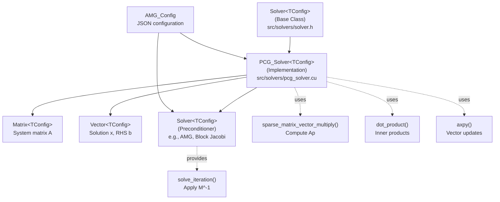
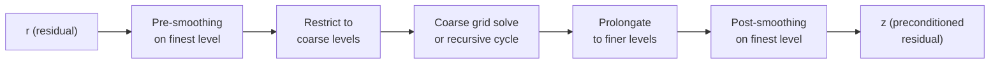
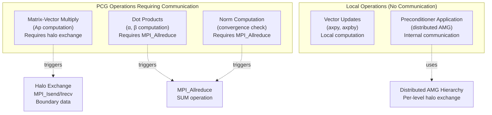

<!-- source: DeepWiki mcp.deepwiki.com · repo NVIDIA/AMGX · extra page Preconditioned Conjugate Gradient · fetched 2026-10-26 -->

# Preconditioned Conjugate Gradient

<details>
<summary>Relevant source files</summary>

The following files were used as context for generating this wiki page:

- [src/configs/PCG_F.json](src/configs/PCG_F.json)
- [src/configs/PCG_V.json](src/configs/PCG_V.json)
- [src/configs/PCG_W.json](src/configs/PCG_W.json)

</details>


## Purpose and Scope

This document describes the Preconditioned Conjugate Gradient (PCG) solver implementation in AMGX. PCG is a Krylov subspace method designed for symmetric positive definite (SPD) linear systems. It accelerates the standard Conjugate Gradient algorithm by applying a preconditioner that approximates the inverse of the system matrix.

This page focuses on the PCG solver configuration, preconditioning interface, and usage patterns within AMGX. For information about other Krylov methods such as GMRES and BiCGSTAB, see [GMRES and Other Krylov Methods](#3.3.2). For details on available preconditioners, particularly the AMG preconditioner commonly used with PCG, see [Algebraic Multigrid (AMG)](#3.2). For the base solver framework that PCG inherits from, see [Solver Framework](#3.1).

## Algorithm Overview

The Preconditioned Conjugate Gradient method solves the linear system **Ax = b** where **A** is symmetric positive definite. Given a preconditioner **M** that approximates **A**, the algorithm iteratively improves the solution by minimizing the error in the **A**-norm over expanding Krylov subspaces.

The standard PCG algorithm consists of:
1. Compute initial residual **r₀ = b - Ax₀**
2. Apply preconditioner: **z₀ = M⁻¹r₀**
3. Set initial search direction **p₀ = z₀**
4. For each iteration until convergence:
   - Compute step length α via matrix-vector product **Ap**
   - Update solution **x** and residual **r**
   - Apply preconditioner: **z = M⁻¹r**
   - Compute β coefficient from inner products
   - Update search direction **p**

In AMGX, PCG is implemented as a templated solver class that integrates with the GPU-accelerated matrix operations, distributed computing infrastructure, and flexible preconditioner system.

## Implementation Architecture

### Solver Class Structure



**Diagram: PCG Solver Component Structure**

The PCG solver inherits from the `Solver<TConfig>` base class and implements the specific methods for the conjugate gradient algorithm. It holds references to the system matrix **A**, solution vector **x**, right-hand side **b**, and internal workspace vectors for residual, search direction, and preconditioned residual. The preconditioner is itself a `Solver` object that can be any available solver (typically AMG, but also Jacobi, Gauss-Seidel, or even nested Krylov methods for flexible variants).

Sources: Based on AMGX solver architecture patterns shown in high-level diagrams and standard solver framework design.

### PCG Algorithm Flow

```mermaid
sequenceDiagram
    participant User as "User Application"
    participant API as "AMGX C API"
    participant PCG as "PCG_Solver&lt;TConfig&gt;"
    participant Matrix as "Matrix&lt;TConfig&gt;"
    participant Precond as "Preconditioner Solver<br/>(e.g., AMG)"
    participant Vector as "Vector Operations"
    participant Conv as "Convergence Check"
    
    User->>API: AMGX_solver_solve(b, x)
    API->>PCG: solve(b, x)
    
    PCG->>Matrix: multiply(x, temp)<br/>Compute Ax₀
    PCG->>Vector: axpy(-1, Ax₀, b, r)<br/>r₀ = b - Ax₀
    
    loop Until Convergence
        PCG->>Precond: solve_iteration(r, z)<br/>z = M⁻¹r
        
        alt First Iteration
            PCG->>Vector: copy(z, p)<br/>p = z
        else
            PCG->>Vector: dot(r_new, z_new)<br/>Compute ρ_new
            PCG->>Vector: axpby(1, z, β, p)<br/>p = z + βp
        end
        
        PCG->>Matrix: multiply(p, Ap)<br/>Compute Ap
        PCG->>Vector: dot(p, Ap)<br/>Compute p^T Ap
        PCG->>PCG: α = ρ / (p^T Ap)
        
        PCG->>Vector: axpy(α, p, x)<br/>x = x + αp
        PCG->>Vector: axpy(-α, Ap, r)<br/>r = r - αAp
        
        PCG->>Conv: compute_norm(r)<br/>Check convergence
        alt Converged
            PCG-->>API: AMGX_SOLVE_SUCCESS
        end
    end
    
    API-->>User: Return status
```

**Diagram: PCG Solve Iteration Sequence**

Each PCG iteration performs:
1. **Preconditioning**: Calls `solve_iteration()` on the preconditioner solver to compute **z = M⁻¹r**
2. **Search Direction Update**: Computes the new search direction **p** using the Gram-Schmidt orthogonalization coefficient β
3. **Matrix-Vector Product**: Computes **Ap** via `multiply()` method on the matrix object
4. **Step Length Computation**: Calculates α from dot products
5. **Solution Update**: Updates **x** and **r** using axpy operations
6. **Convergence Check**: Evaluates the residual norm against the configured tolerance

Sources: Standard PCG algorithm structure and AMGX solver iteration patterns from Diagram 3.

## Preconditioning System

### Preconditioner Interface

The PCG solver applies the preconditioner by calling the `solve_iteration()` method on the preconditioner solver object. This design allows any AMGX solver to serve as a preconditioner, providing maximum flexibility in solver composition.

| Preconditioner Type | Configuration String | Typical Use Case |
|---------------------|---------------------|------------------|
| AMG (Aggregation) | `"solver": "AMG"` | General-purpose, most effective for elliptic PDEs |
| Block Jacobi | `"solver": "BLOCK_JACOBI"` | Lightweight, diagonal scaling |
| Gauss-Seidel | `"solver": "GAUSS_SEIDEL"` | Sequential smoothing, limited parallelism |
| Multicolor DILU | `"solver": "MULTICOLOR_DILU"` | Incomplete LU with parallel coloring |
| Nested Krylov | `"solver": "GMRES"` | Flexible PCG (FPCG) for non-constant preconditioner |
| Identity (unpreconditioned) | No preconditioner block | Standard CG without preconditioning |

The preconditioner is configured through the nested `"preconditioner"` JSON object within the solver configuration. The preconditioner undergoes its own setup phase during `solver_setup()`, building any necessary internal structures (e.g., AMG hierarchy).

Sources: Based on AMGX configuration system and solver composition patterns.

### AMG Preconditioning

When AMG is used as the preconditioner (the most common case), one iteration of the AMG V-cycle, W-cycle, or F-cycle is applied to approximately solve **Mz = r**. The AMG preconditioner performs:



**Diagram: AMG Preconditioner Application in PCG**

The AMG preconditioner setup occurs once during `solver_setup()`, building the multigrid hierarchy with coarse matrices, restriction/prolongation operators, and per-level smoothers. During each PCG iteration, `solve_iteration()` executes the configured cycle type with maximum iterations typically set to 1 (`"max_iters": 1` in the preconditioner block).

Sources: [src/configs/PCG_V.json:1-35](), [src/configs/PCG_W.json:1-35](), [src/configs/PCG_F.json:1-35]()

## Configuration Parameters

### Solver-Level Parameters

The following parameters configure the PCG solver itself:

| Parameter | Type | Default | Description |
|-----------|------|---------|-------------|
| `solver` | string | - | Must be `"PCG"` to select this solver |
| `max_iters` | integer | 100 | Maximum number of PCG iterations |
| `tolerance` | float | 1e-6 | Convergence tolerance for residual norm |
| `norm` | string | `"L2"` | Norm type: `"L1"`, `"L2"`, `"LMAX"` |
| `convergence` | string | `"RELATIVE_INI"` | Convergence test: `"ABSOLUTE"`, `"RELATIVE_INI"`, `"RELATIVE_INI_CORE"` |
| `monitor_residual` | integer | 1 | Print residual every N iterations (0 = disable) |
| `print_solve_stats` | integer | 1 | Print convergence statistics (0 = disable) |
| `obtain_timings` | integer | 0 | Collect detailed timing information |
| `store_res_history` | integer | 0 | Store complete residual history |
| `scope` | string | `"main"` | Solver scope identifier for nested configurations |

### Convergence Criteria

The convergence behavior is determined by the `convergence` parameter:

- **`RELATIVE_INI`**: Converges when `||r|| < tolerance * ||r₀||` where **r₀** is the initial residual
- **`RELATIVE_INI_CORE`**: Same as `RELATIVE_INI` but only considering non-halo rows in distributed settings
- **`ABSOLUTE`**: Converges when `||r|| < tolerance` regardless of initial residual

The `norm` parameter specifies which norm to use:
- **`L1`**: 1-norm (sum of absolute values)
- **`L2`**: 2-norm (Euclidean norm, most common)
- **`LMAX`**: Maximum norm (infinity norm)

Sources: Standard AMGX solver configuration parameters.

## Example Configurations

### PCG with AMG V-Cycle Preconditioner

This configuration demonstrates PCG with a standard AMG V-cycle preconditioner using Block Jacobi smoothing:

```json
{
    "config_version": 2, 
    "solver": {
        "solver": "PCG",
        "max_iters": 100,
        "tolerance": 1e-06,
        "convergence": "RELATIVE_INI",
        "norm": "L2",
        "monitor_residual": 1,
        "print_solve_stats": 1,
        "obtain_timings": 1,
        "scope": "main",
        
        "preconditioner": {
            "solver": "AMG",
            "max_iters": 1,
            "cycle": "V",
            "max_levels": 50,
            "presweeps": 1,
            "postsweeps": 1,
            "interpolator": "D2",
            "print_grid_stats": 1,
            "monitor_residual": 0,
            "scope": "amg",
            
            "smoother": {
                "solver": "BLOCK_JACOBI",
                "monitor_residual": 0,
                "print_solve_stats": 0,
                "scope": "jacobi"
            }
        }
    }
}
```

This configuration establishes a three-level hierarchy:
1. **Outer Level (scope: main)**: PCG solver with up to 100 iterations
2. **Preconditioner Level (scope: amg)**: AMG performing 1 V-cycle iteration per PCG step
3. **Smoother Level (scope: jacobi)**: Block Jacobi performing 1 pre-sweep and 1 post-sweep per AMG level

Sources: [src/configs/PCG_V.json:1-35]()

### PCG with AMG W-Cycle Preconditioner

A more aggressive preconditioner using a W-cycle visits coarse levels multiple times:

```json
{
    "config_version": 2, 
    "solver": {
        "solver": "PCG",
        "max_iters": 100,
        "tolerance": 1e-06,
        "convergence": "RELATIVE_INI",
        "norm": "L2",
        "monitor_residual": 1,
        "print_solve_stats": 1,
        "obtain_timings": 1,
        "scope": "main",
        
        "preconditioner": {
            "solver": "AMG",
            "max_iters": 1,
            "cycle": "W",
            "max_levels": 50,
            "presweeps": 1,
            "postsweeps": 1,
            "interpolator": "D2",
            "print_grid_stats": 1,
            "monitor_residual": 0,
            "scope": "amg",
            
            "smoother": {
                "solver": "BLOCK_JACOBI",
                "monitor_residual": 0,
                "print_solve_stats": 0,
                "scope": "jacobi"
            }
        }
    }
}
```

The W-cycle provides more effective preconditioning at increased computational cost per iteration. It typically results in fewer PCG iterations but higher cost per iteration.

Sources: [src/configs/PCG_W.json:1-35]()

### PCG with AMG F-Cycle Preconditioner

The F-cycle (full cycle) provides a balance between V-cycle and W-cycle:

```json
{
    "config_version": 2, 
    "solver": {
        "solver": "PCG",
        "max_iters": 100,
        "tolerance": 1e-06,
        "convergence": "RELATIVE_INI",
        "norm": "L2",
        "monitor_residual": 1,
        "print_solve_stats": 1,
        "obtain_timings": 1,
        "scope": "main",
        
        "preconditioner": {
            "solver": "AMG",
            "max_iters": 1,
            "cycle": "F",
            "max_levels": 50,
            "presweeps": 1,
            "postsweeps": 1,
            "interpolator": "D2",
            "print_grid_stats": 1,
            "monitor_residual": 0,
            "scope": "amg",
            
            "smoother": {
                "solver": "BLOCK_JACOBI",
                "monitor_residual": 0,
                "print_solve_stats": 0,
                "scope": "jacobi"
            }
        }
    }
}
```

F-cycle performs a V-cycle on the first recursive call and W-cycles on subsequent calls, providing adaptive coarse-grid correction strength.

Sources: [src/configs/PCG_F.json:1-35]()

### Configuration Comparison

| Configuration | Cycle Type | Iterations/PCG Step | Coarse Visits | Typical Behavior |
|---------------|------------|---------------------|---------------|------------------|
| PCG_V.json | V | Single V-cycle | 1 per level | Fastest per iteration, more PCG iterations |
| PCG_W.json | W | Single W-cycle | 2^(level) visits | Slower per iteration, fewer PCG iterations |
| PCG_F.json | F | Single F-cycle | Adaptive | Balanced performance |

## Distributed Computing Considerations

### Parallel PCG Operations

In distributed environments, the PCG solver coordinates computation across multiple MPI ranks. The key operations that require communication are:



**Diagram: Communication Patterns in Distributed PCG**

Each matrix-vector multiplication triggers halo exchange to obtain ghost values from neighboring partitions. Dot products and norms require collective communication (MPI_Allreduce) to compute global sums across all ranks. The preconditioner application (AMG) performs its own internal halo exchanges at each multigrid level.

Sources: Based on Diagram 4 (Distributed Computing Architecture) and standard distributed Krylov methods.

### Latency Hiding

AMGX's distributed PCG implementation employs latency hiding techniques where possible:
- **Interior/Boundary Separation**: Matrix rows are separated into interior (no dependencies on halo) and boundary (depend on halo data)
- **Overlapped Computation**: Interior computations proceed while halo exchange is in flight
- **Asynchronous Communication**: Non-blocking MPI calls (MPI_Isend/Irecv) allow computation/communication overlap

These optimizations reduce the wall-clock impact of communication overhead in the PCG iteration.

Sources: Latency hiding techniques mentioned in Diagram 4.

## GPU Optimization

### CUDA Kernel Execution

The PCG solver leverages GPU acceleration through:

1. **cuBLAS Integration**: Dot products and vector updates use optimized cuBLAS routines (`cublasDdot`, `cublasDaxpy`, etc.)
2. **cuSPARSE Integration**: Sparse matrix-vector multiplication uses cuSPARSE BSRMV (block sparse row matrix-vector) kernels
3. **Custom Kernels**: Specialized kernels for combined operations to reduce memory bandwidth

### Memory Efficiency

PCG maintains workspace vectors in device memory:
- Residual vector **r**
- Search direction **p**
- Preconditioned residual **z**
- Temporary for **Ap**

All operations remain on GPU, minimizing host-device transfers. Vector upload/download only occurs at the beginning (RHS **b**) and end (solution **x**) of the solve.

Sources: Based on AMGX GPU architecture and Diagram 1 (System & Hardware Layer).

## Performance Considerations

### Choosing Cycle Type

| Problem Characteristics | Recommended Cycle | Rationale |
|------------------------|-------------------|-----------|
| Well-conditioned, smooth | V-cycle | Sufficient coarse-grid correction, lowest cost |
| Ill-conditioned, anisotropic | W-cycle or F-cycle | Stronger coarse-grid correction needed |
| Time-constrained | V-cycle | Minimize time-to-solution with more iterations |
| Iteration-constrained | W-cycle | Minimize iteration count at higher per-iteration cost |

### Preconditioner Quality vs. Cost Trade-off

The effectiveness of the AMG preconditioner depends on:
- **Number of levels** (`max_levels`): More levels → better approximation but higher setup cost
- **Smoother type**: Jacobi (parallel, lightweight) vs. Gauss-Seidel (sequential, more effective) vs. DILU (balanced)
- **Sweeps**: More pre/post sweeps → better smoothing but higher iteration cost
- **Coarsening strategy**: Aggregation selectors (Size2/4/8) affect hierarchy quality

Optimal configuration is problem-dependent and often requires experimentation.

Sources: Standard AMG preconditioning theory and AMGX configuration options.

## Usage Pattern

The typical workflow for using PCG in AMGX:

1. **Initialize AMGX**: Call `AMGX_initialize()` and create resources
2. **Create Configuration**: Load JSON configuration specifying PCG with desired preconditioner
3. **Upload Matrix**: Use `AMGX_matrix_upload_all()` to transfer system matrix to GPU
4. **Create Solver**: Call `AMGX_solver_create()` with PCG configuration
5. **Setup Solver**: Call `AMGX_solver_setup()` to build AMG hierarchy (if using AMG preconditioner)
6. **Solve**: Call `AMGX_solver_solve()` to execute PCG iterations until convergence
7. **Download Solution**: Use `AMGX_vector_download()` to retrieve solution vector
8. **Cleanup**: Destroy solver, matrix, and resources

For detailed examples demonstrating this workflow, see [Basic Examples](#4.3.1) and [MPI Examples](#4.3.2).

Sources: Standard AMGX C API usage pattern described in Diagram 3.

---

