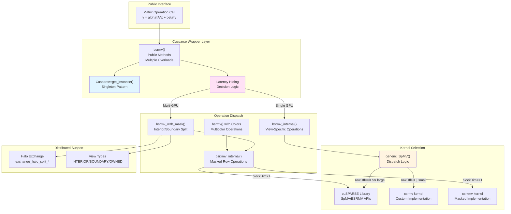
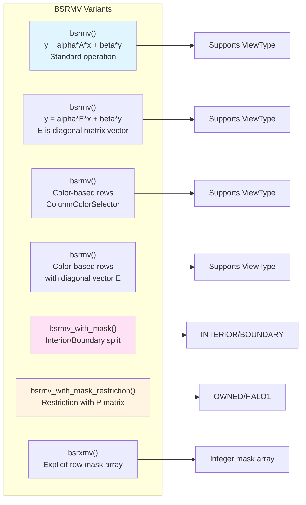
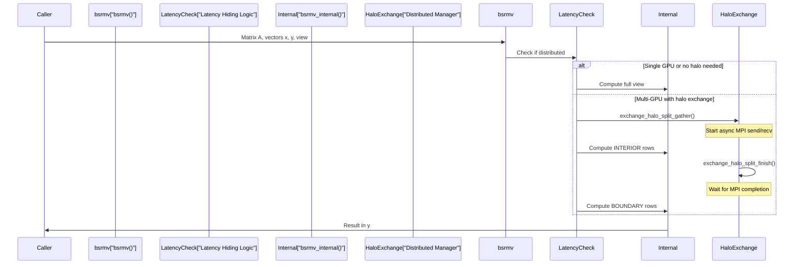
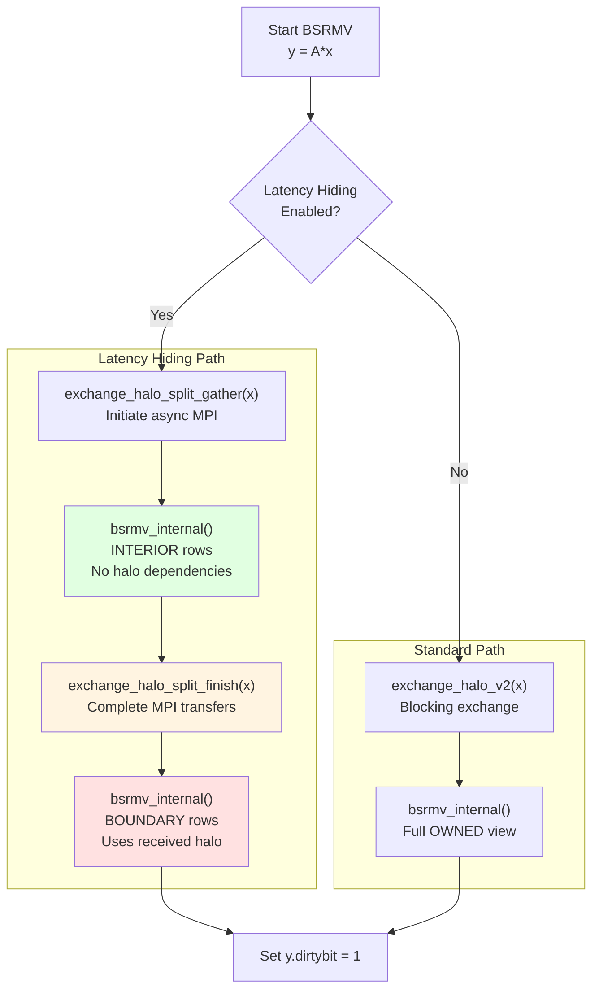
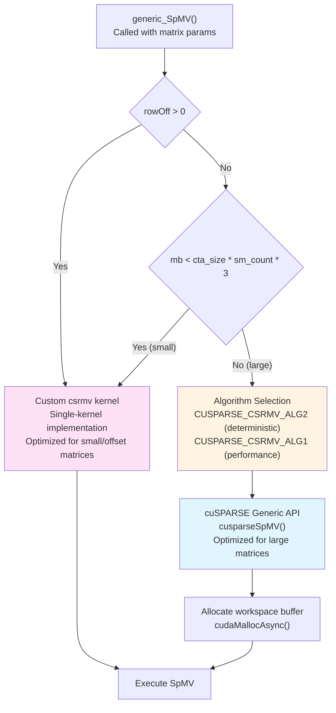
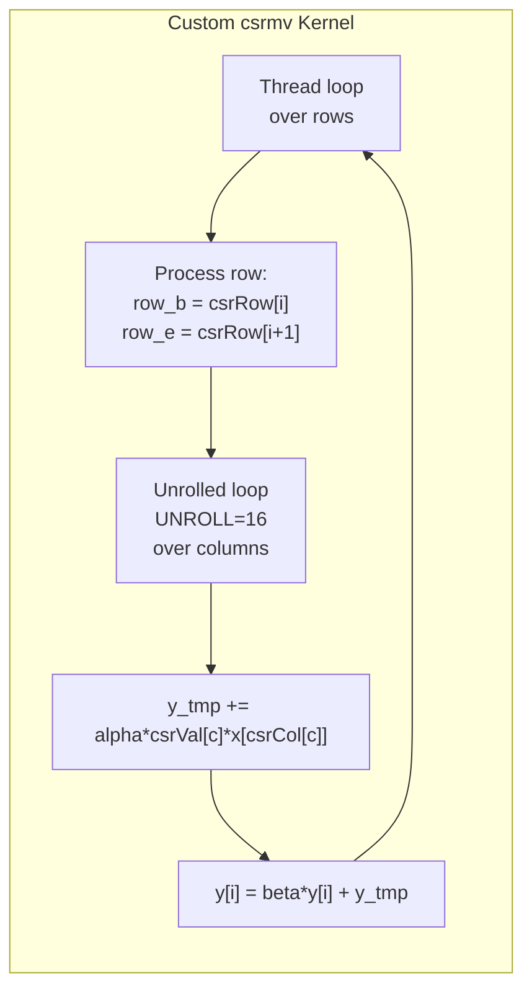
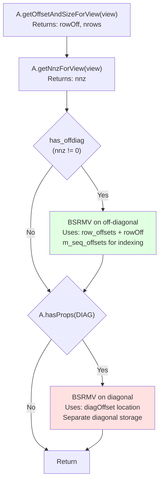
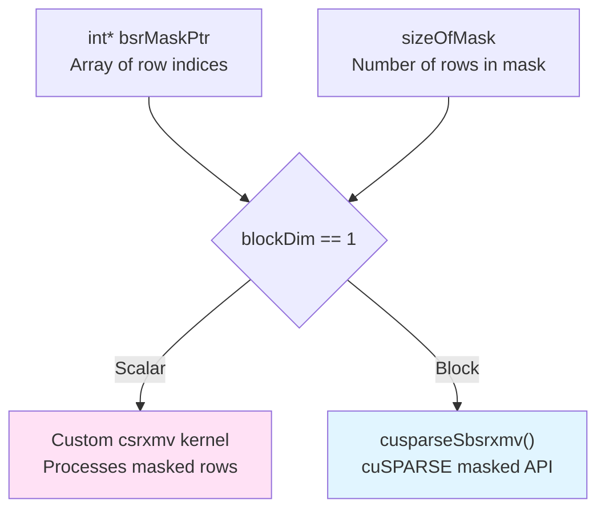
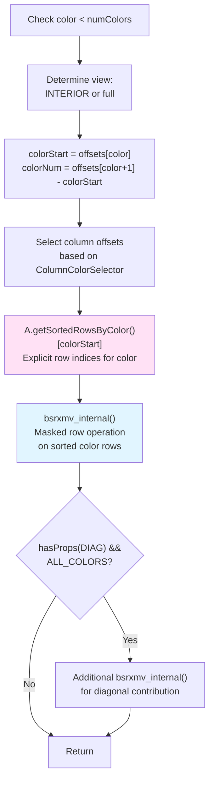
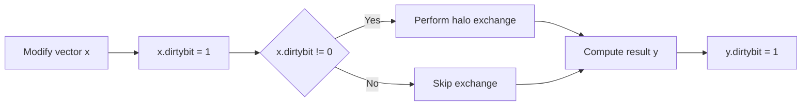

<!-- source: DeepWiki mcp.deepwiki.com · repo NVIDIA/AMGX · extra page Sparse Matrix Operations · fetched 2026-10-26 -->

# Sparse Matrix Operations

<details>
<summary>Relevant source files</summary>

The following files were used as context for generating this wiki page:

- [include/reorder_partition.h](include/reorder_partition.h)
- [src/amgx_cusparse.cu](src/amgx_cusparse.cu)
- [src/distributed/distributed_manager.cu](src/distributed/distributed_manager.cu)
- [src/solvers/gauss_seidel_solver.cu](src/solvers/gauss_seidel_solver.cu)

</details>


## Purpose and Scope

This document describes AMGX's sparse matrix operations layer, which provides efficient GPU-accelerated implementations of fundamental sparse linear algebra operations. The primary focus is on sparse matrix-vector multiplication (SpMV) and its integration with NVIDIA's cuSPARSE library. This page covers the `Cusparse` wrapper class, block-sparse matrix-vector multiplication (BSRMV), custom kernel implementations, and latency hiding techniques for distributed matrices.

For information about the underlying storage formats (CSR/COO) and matrix structure, see [Matrix Storage and I/O](#2.1.1). For sparse matrix-matrix multiplication (SpGEMM) operations, see [CSR Multiplication](#2.1.3).

**Sources:** [src/amgx_cusparse.cu:1-100]()

---

## System Overview

The sparse operations system is built around the singleton `Cusparse` class, which provides a unified interface to both cuSPARSE library functions and custom CUDA kernels for sparse matrix-vector multiplication. The system automatically selects between cuSPARSE calls and custom implementations based on matrix properties and operation requirements.



**Diagram: Sparse Matrix Operation Dispatch Flow**

**Sources:** [src/amgx_cusparse.cu:31-102](), [src/amgx_cusparse.cu:1026-1103]()

---

## Cusparse Singleton Class

The `Cusparse` class implements a singleton pattern to manage a single `cusparseHandle_t` instance and provide thread-safe access to cuSPARSE operations throughout AMGX.

### Class Structure

| Component | Type | Purpose |
|-----------|------|---------|
| `m_handle` | `cusparseHandle_t` | cuSPARSE library handle |
| `m_determinism_flag` | `bool` | Controls deterministic vs. performance algorithms |
| `get_instance()` | Static method | Singleton accessor |
| `bsrmv()` | Multiple overloads | Matrix-vector multiplication variants |
| `create_handle()`/`destroy_handle()` | Methods | Handle lifecycle management |

### Determinism Control

The `m_determinism_flag` controls which cuSPARSE algorithm is selected for SpMV operations:

- **Non-deterministic (default)**: Uses `CUSPARSE_CSRMV_ALG1` for maximum performance
- **Deterministic**: Uses `CUSPARSE_CSRMV_ALG2` for reproducible results across runs

**Sources:** [src/amgx_cusparse.cu:31-46](), [src/amgx_cusparse.cu:1072-1073]()

---

## Block Sparse Row Matrix-Vector Multiplication (BSRMV)

AMGX provides multiple `bsrmv` overloads to support different operation patterns required by iterative solvers and smoothers.

### BSRMV Variants



**Diagram: BSRMV Operation Variants**

### Standard BSRMV Operation

The most common variant computes `y = alpha * A * x + beta * y`:



**Diagram: Standard BSRMV Execution Flow with Latency Hiding**

**Sources:** [src/amgx_cusparse.cu:48-102](), [src/amgx_cusparse.cu:534-600]()

---

## Latency Hiding Strategy

Latency hiding is a critical optimization for distributed matrices that overlaps MPI communication with GPU computation to minimize idle time.

### Latency Hiding Conditions

Latency hiding is activated when all conditions are met:

| Condition | Check | Purpose |
|-----------|-------|---------|
| Different views | `A.getViewInterior() != A.getViewExterior()` | Matrix has separated interior/boundary |
| Multi-GPU | `!A.is_matrix_singleGPU()` | Distributed computation |
| Vector dirty | `x.dirtybit != 0` | Vector needs exchange |

### Split Operation Pattern



**Diagram: Latency Hiding Execution Pattern**

### View Types

| View Type | Bit Flag | Description |
|-----------|----------|-------------|
| `INTERIOR` | Interior flag | Rows that don't depend on halo data |
| `BOUNDARY` | Boundary flag | Rows that depend on halo data from neighbors |
| `OWNED` | `INTERIOR \| BOUNDARY` | All rows owned by this partition |
| `HALO` | Halo flag | Ghost rows from neighboring partitions |
| `ALL` | All flags | Complete matrix including halos |

The boundary view is computed as: `ViewType bnd_view = (ViewType)(~(A.getViewInterior()) & A.getViewExterior())`

**Sources:** [src/amgx_cusparse.cu:75-102](), [src/amgx_cusparse.cu:123-148]()

---

## Generic SpMV Implementation

The `generic_SpMV` function implements smart dispatch between cuSPARSE library calls and custom kernels based on matrix properties.

### Dispatch Logic



**Diagram: SpMV Kernel Selection Logic**

### Custom CSRMV Kernel

The custom `csrmv` kernel provides a simpler, single-kernel implementation that avoids cuSPARSE's overhead for small matrices or when row offsets are used (common in latency hiding):



**Diagram: Custom CSRMV Kernel Structure**

The unrolling factor of 16 is chosen to balance instruction-level parallelism with register pressure. This works well for moderately sparse matrices.

**Sources:** [src/amgx_cusparse.cu:1026-1103](), [src/amgx_cusparse.cu:983-1024]()

---

## Internal BSRMV Execution

The `bsrmv_internal` method handles the actual computation after latency hiding decisions have been made.

### View-Based Matrix Access



**Diagram: BSRMV Internal View Processing**

### Sequence Offsets

The `m_seq_offsets` array contains sequential indices `[0, 1, 2, ..., num_rows]` used for indexed access to rows:

- Used as dummy row pointers when diagonal is stored separately
- Enables uniform API calls to cuSPARSE for both diagonal and off-diagonal portions

**Sources:** [src/amgx_cusparse.cu:534-600]()

---

## Masked Operations

Masked operations allow selective computation on specific rows, essential for multicolor Gauss-Seidel and distributed restriction operations.

### BSRMV with Mask (Interior/Boundary)

Used primarily for distributed smoothers that need explicit interior/boundary separation:

| Parameter | Type | Purpose |
|-----------|------|---------|
| `alphaConst`, `betaConst` | `VecPrec` | Scaling factors |
| `A` | `Matrix<TConfig>` | Sparse matrix |
| `x`, `y` | `Vector<TConfig>` | Input/output vectors |
| View | `INTERIOR` or `BOUNDARY` | Which rows to process |

The method uses `A.manager->getRowsListForView(view)` to obtain the explicit list of row indices for the specified view.

### BSRXMV Internal (Explicit Mask)

For even more fine-grained control, `bsrxmv_internal` accepts an explicit integer mask array:



**Diagram: BSRXMV Dispatch for Masked Operations**

The custom `csrxmv` kernel iterates over the mask array and computes the matrix-vector product only for those rows:

```
for each thread in mask:
    row = csrMask[i]
    y[row] = alpha * (A[row] * x) + beta * y[row]
```

**Sources:** [src/amgx_cusparse.cu:602-666](), [src/amgx_cusparse.cu:1197-1276](), [src/amgx_cusparse.cu:1279-1317]()

---

## Color-Based Operations

Multicolor methods use graph coloring to enable parallel updates in iterative smoothers. AMGX provides specialized BSRMV variants that operate on rows of a specific color.

### Column Color Selector

The `ColumnColorSelector` enum determines which columns participate in the multiplication:

| Selector | Description | Offsets Used |
|----------|-------------|--------------|
| `ALL_COLORS` | All columns | `row_offsets` to `row_offsets+1` |
| `SMALLER_COLORS` | Columns with smaller color index | `row_offsets` to `m_smaller_color_offsets` |
| `LARGER_COLORS` | Columns with larger color index | `m_larger_color_offsets` to `row_offsets+1` |
| `DIAG_COL` | Only diagonal column | Disabled to avoid allocation |

### Color-Based BSRMV Execution



**Diagram: Color-Based BSRMV Flow**

**Sources:** [src/amgx_cusparse.cu:766-899](), [src/amgx_cusparse.cu:901-980]()

---

## Integration with Distributed Manager

Sparse matrix operations are tightly integrated with the distributed computing layer through the matrix's `manager` pointer.

### Key Distributed Methods

| Method | Purpose | Synchronization |
|--------|---------|-----------------|
| `exchange_halo_v2(x, tag)` | Blocking full halo exchange | Synchronous |
| `exchange_halo_split_gather(x, tag)` | Start async halo exchange | Non-blocking (initiate) |
| `exchange_halo_split_finish(x, tag)` | Complete async halo exchange | Blocking (wait) |
| `add_from_halo_v2(y, tag)` | Accumulate contributions from halos | Synchronous |
| `add_from_halo_split_gather(y, tag)` | Start async halo accumulation | Non-blocking |
| `add_from_halo_split_finish(y, tag)` | Complete halo accumulation | Blocking |

### Vector Dirtybit

The `dirtybit` flag tracks whether a vector needs halo exchange:

- **Set to 1**: After any modification to the vector
- **Checked before exchange**: If 0, exchange is skipped
- **Purpose**: Avoid unnecessary MPI communication



**Diagram: Vector Dirtybit Management**

**Sources:** [src/amgx_cusparse.cu:75-102](), [src/amgx_cusparse.cu:93-96](), [src/amgx_cusparse.cu:101]()

---

## Type Support and Overloads

AMGX provides comprehensive type support for sparse operations through function overloading.

### Precision Combinations

| Matrix Precision | Vector Precision | Block Size | Overload |
|------------------|------------------|------------|----------|
| `float` | `float` | 1 or block | [src/amgx_cusparse.cu:1105-1134]() |
| `double` | `double` | 1 or block | [src/amgx_cusparse.cu:1136-1165]() |
| `float` (mixed) | `double` | Not supported | [src/amgx_cusparse.cu:1167-1194]() |

For block size 1 (scalar CSR), the system uses the `generic_SpMV` dispatch. For larger block sizes, it calls the appropriate cuSPARSE BSRMV routine (`cusparseSbsrmv` or `cusparseDbsrmv`).

### CUDA Version Compatibility

The implementation includes compatibility macros for different CUDA versions:

```
#if CUDART_VERSION < 11000
#define CUSPARSE_SPMM_ALG_DEFAULT CUSPARSE_MM_ALG_DEFAULT
#endif

#if CUDART_VERSION >= 12000
#define CUSPARSE_CSRMV_ALG1 CUSPARSE_SPMV_CSR_ALG1
#define CUSPARSE_CSRMV_ALG2 CUSPARSE_SPMV_CSR_ALG2
#endif
```

This ensures the code compiles and runs correctly across CUDA 10.x, 11.x, and 12.x toolkits.

**Sources:** [src/amgx_cusparse.cu:19-26](), [src/amgx_cusparse.cu:1105-1194]()

---

## Stream-Based Execution

All sparse operations support execution on CUDA streams for better concurrency and integration with distributed communication.

### Stream Parameter

The `bsrmv_internal` methods accept a `cudaStream_t` parameter (default: null stream 0). The cusparse handle's stream is set before each call:

```
cusparseCheckError(cusparseSetStream(handle, stream));
// ... perform operation ...
cusparseCheckError(cusparseSetStream(handle, 0));  // Reset to default
```

This allows:
1. **Overlap of computation and communication**: Interior computation on one stream while MPI transfers on another
2. **Multiple concurrent operations**: Different matrix operations in parallel
3. **Synchronization control**: Explicit stream ordering for complex dependencies

**Sources:** [src/amgx_cusparse.cu:541](), [src/amgx_cusparse.cu:647](), [src/amgx_cusparse.cu:860]()

---

## Performance Considerations

### When Custom Kernels Are Used

The custom `csrmv` kernel is preferred when:
1. **Row offset is non-zero** (`rowOff > 0`): cuSPARSE doesn't handle offsetted row pointers efficiently
2. **Matrix is small** (`mb < 128 * sm_count * 3`): Custom kernel has lower launch overhead
3. **Latency hiding is active**: Interior/boundary split naturally produces small, offsetted matrices

### Unroll Factor Selection

The custom kernels use `UNROLL=16` for column iteration:
- **Higher unroll**: Better ILP, but more registers and potential spilling
- **Lower unroll**: Fewer registers, but less ILP
- **16 is empirically optimal**: Good balance for typical sparse matrices on NVIDIA GPUs

### Algorithm Selection

The `m_determinism_flag` controls a performance vs. reproducibility trade-off:
- **`CUSPARSE_CSRMV_ALG1`** (default): Fastest, may use non-deterministic atomic operations
- **`CUSPARSE_CSRMV_ALG2`** (deterministic): Reproducible results across runs, slightly slower

**Sources:** [src/amgx_cusparse.cu:1038-1056](), [src/amgx_cusparse.cu:1072-1073]()

---

## Code Organization Summary

### Primary File

[src/amgx_cusparse.cu]() - Complete implementation of sparse matrix operations

### Key Classes and Functions

| Entity | Lines | Purpose |
|--------|-------|---------|
| `Cusparse` class | 31-39 | Singleton wrapper for cuSPARSE handle |
| `bsrmv()` variants | 48-521 | Public matrix-vector multiplication API |
| `bsrmv_internal()` | 534-763 | Internal view-based execution |
| `bsrmv_with_mask()` | 602-666 | Interior/boundary split operations |
| `bsrxmv_internal()` | 1279-1337 | Explicit masked row operations |
| `generic_SpMV()` | 1026-1103 | Smart dispatch cuSPARSE vs. custom |
| `csrmv()` kernel | 983-1024 | Custom scalar SpMV implementation |
| `csrxmv()` kernel | 1197-1241 | Custom masked SpMV implementation |

### Integration Points

- **Matrix class**: Accesses `row_offsets`, `col_indices`, `values`, `diag`, `m_seq_offsets`
- **Vector class**: Uses `raw()` pointer access and `dirtybit` flag
- **DistributedManager**: Calls halo exchange methods through `A.manager`
- **View system**: Uses `getViewInterior()`, `getViewExterior()`, `getOffsetAndSizeForView()`

**Sources:** [src/amgx_cusparse.cu:1-100]()

---

