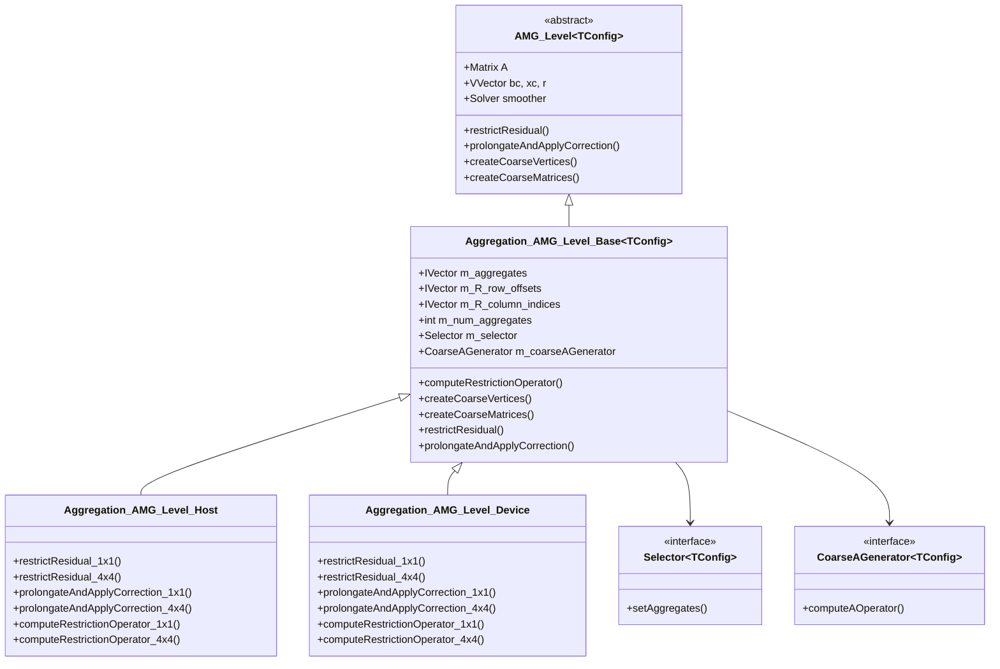
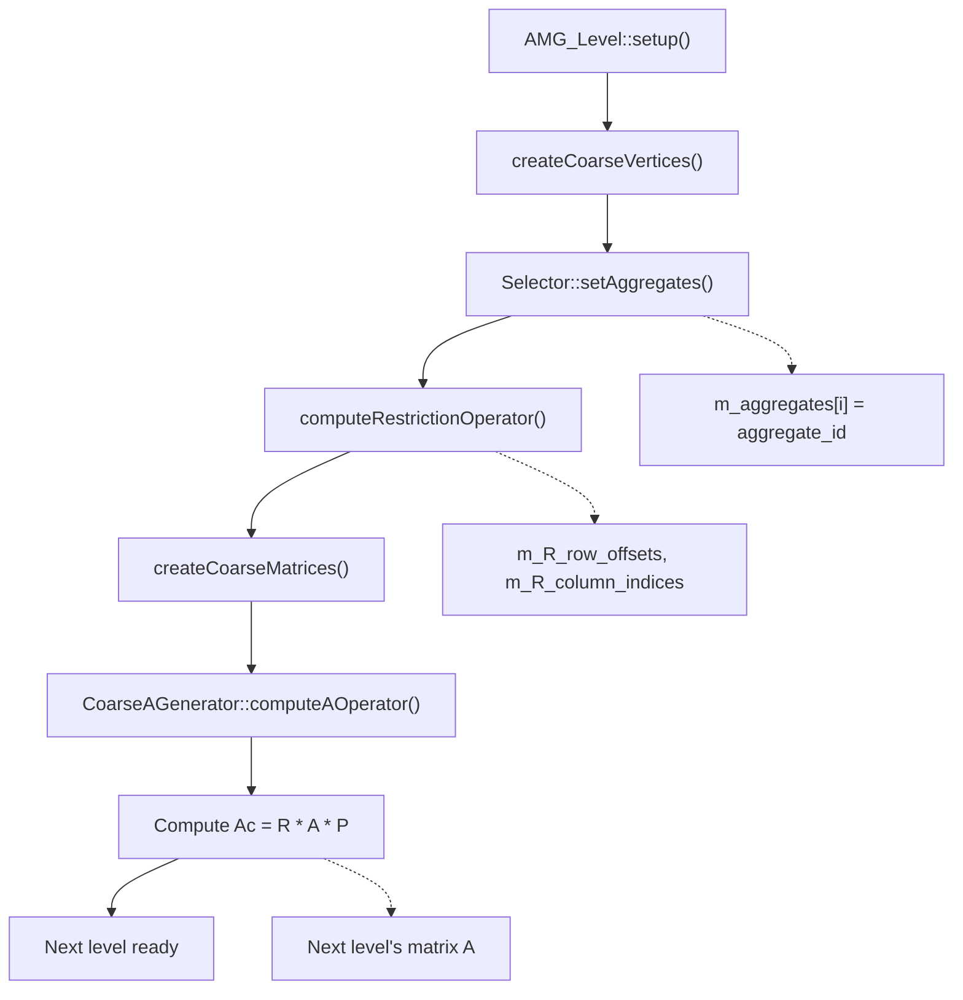
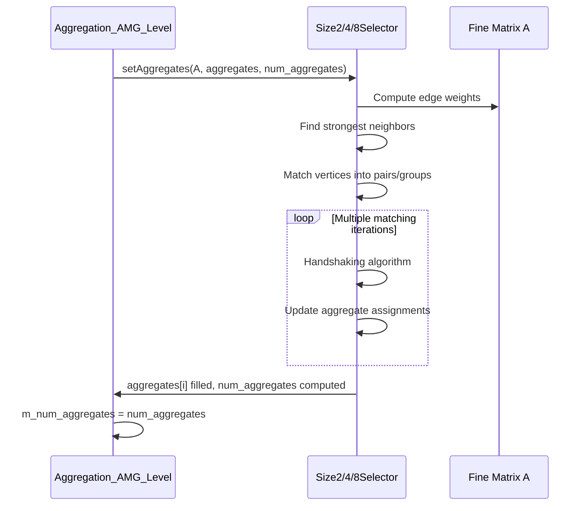
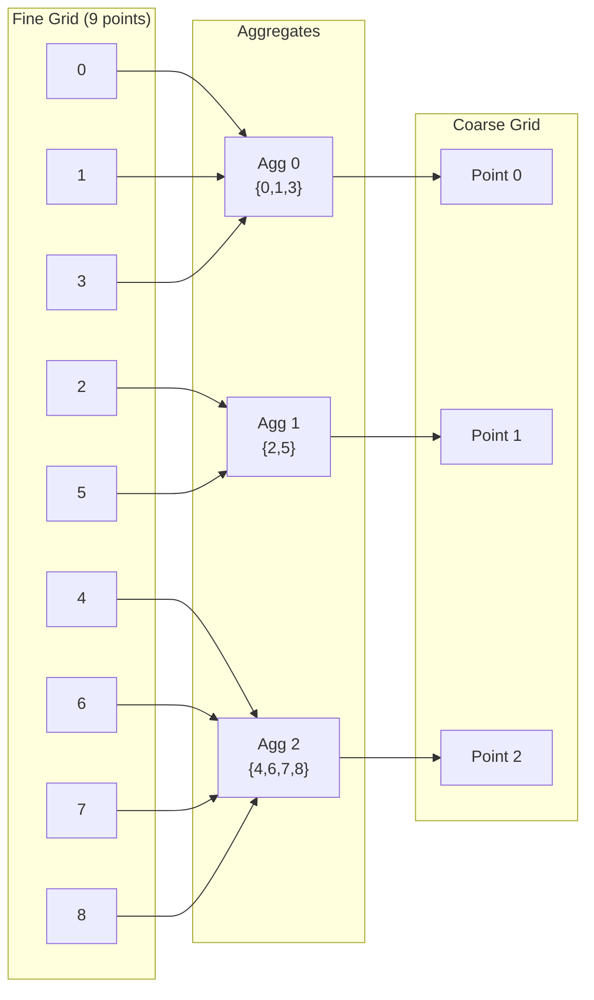
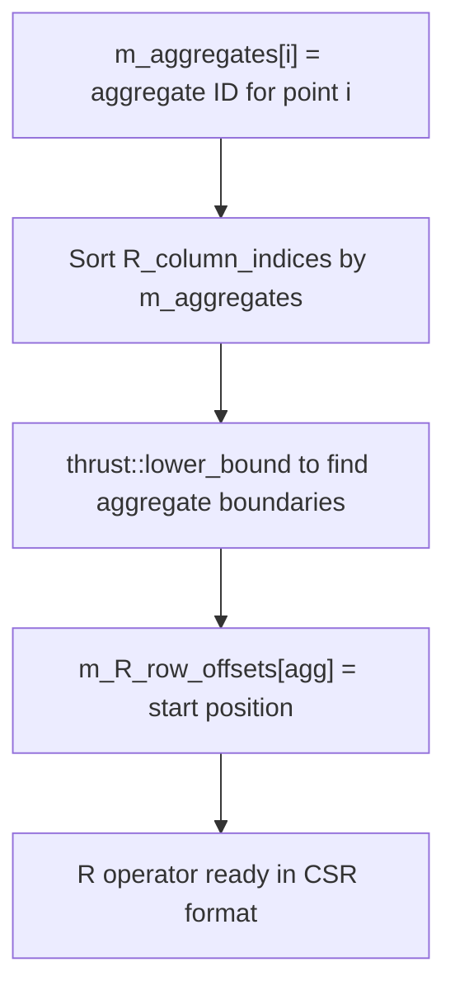
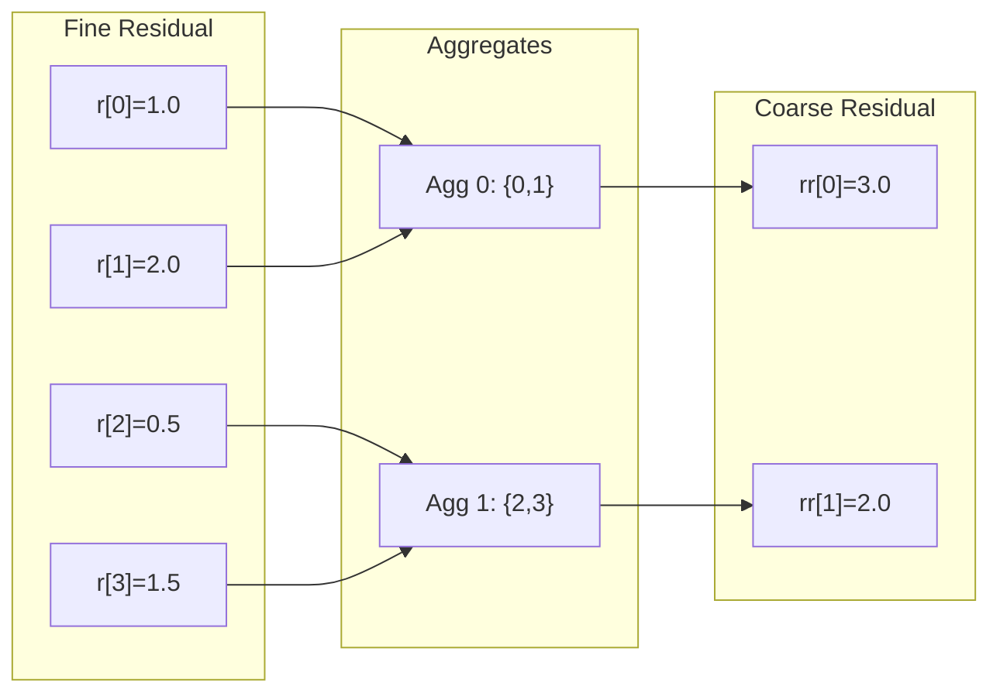
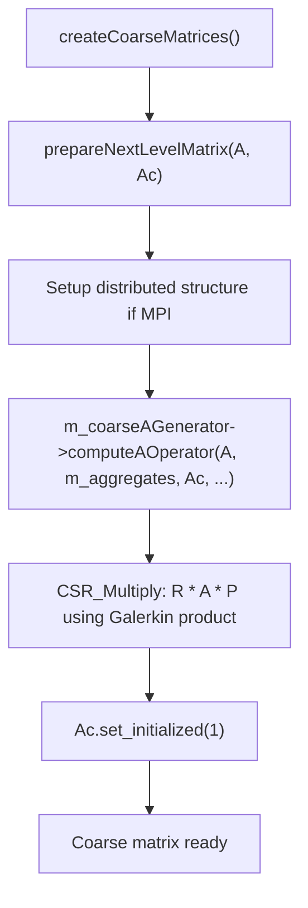
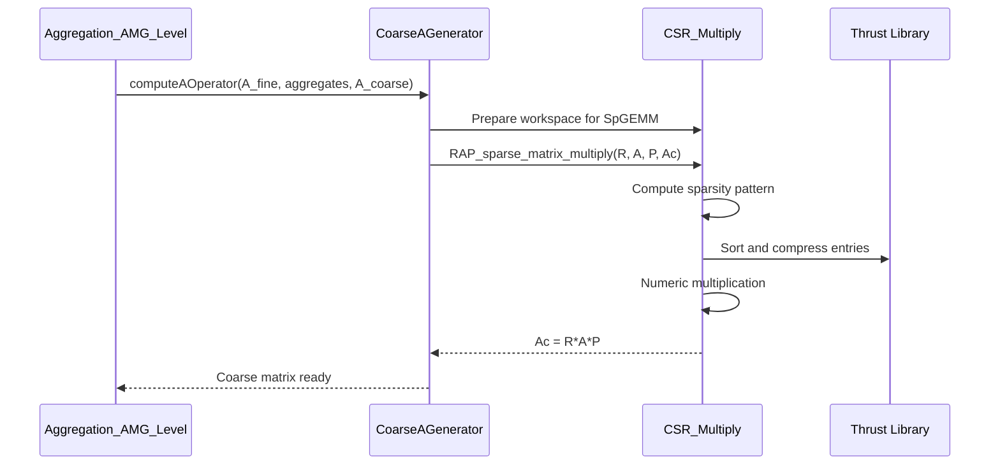
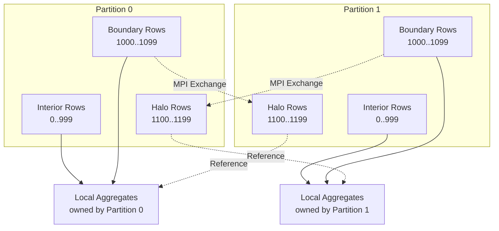
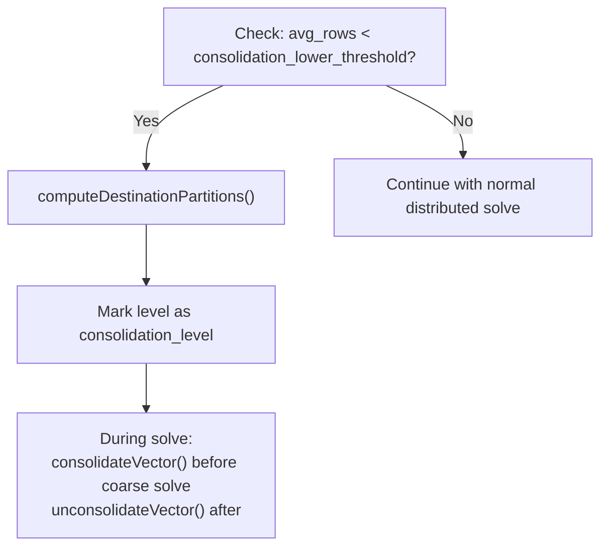

<!-- source: DeepWiki mcp.deepwiki.com · repo NVIDIA/AMGX · extra page Aggregation AMG · fetched 2026-10-26 -->

# Aggregation AMG

<details>
<summary>Relevant source files</summary>

The following files were used as context for generating this wiki page:

- [include/aggregation/aggregation_amg_level.h](include/aggregation/aggregation_amg_level.h)
- [include/amg_level.h](include/amg_level.h)
- [include/solvers/solver.h](include/solvers/solver.h)
- [src/aggregation/aggregation_amg_level.cu](src/aggregation/aggregation_amg_level.cu)
- [src/aggregation/selectors/size2_selector.cu](src/aggregation/selectors/size2_selector.cu)
- [src/aggregation/selectors/size4_selector.cu](src/aggregation/selectors/size4_selector.cu)
- [src/aggregation/selectors/size8_selector.cu](src/aggregation/selectors/size8_selector.cu)
- [src/amg.cu](src/amg.cu)
- [src/cycles/fixed_cycle.cu](src/cycles/fixed_cycle.cu)
- [src/solvers/block_jacobi_solver.cu](src/solvers/block_jacobi_solver.cu)
- [src/solvers/solver.cu](src/solvers/solver.cu)
- [src/tests/fgmres_zero_initial_residual.cu](src/tests/fgmres_zero_initial_residual.cu)

</details>


## Purpose and Scope

This document describes the aggregation-based algebraic multigrid (AMG) implementation in AMGX. Aggregation AMG creates coarse levels by grouping fine-grid points into aggregates, using a simpler and more scalable coarsening strategy compared to classical AMG. This page covers the core aggregation methodology, hierarchy construction, restriction/prolongation operators, and coarse matrix formation.

For details on the specific aggregate selection algorithms (Size2/4/8 selectors, matching algorithms, edge weight computation), see [Aggregation Selectors](#3.2.2.1). For general AMG hierarchy management and cycle execution, see [AMG Hierarchy and Cycles](#3.2.1). For information on classical AMG which uses C/F splitting instead of aggregation, see [Classical AMG](#3.2.3).

---

## Core Class Architecture

Aggregation AMG is implemented through a class hierarchy that extends the base `AMG_Level` framework with aggregation-specific operations.

### Class Hierarchy



**Sources:** [include/aggregation/aggregation_amg_level.h:29-214](), [src/aggregation/aggregation_amg_level.cu:34-229]()

### Key Data Structures

| Member | Type | Purpose |
|--------|------|---------|
| `m_aggregates` | `IVector` | Maps each fine-grid point to its aggregate ID |
| `m_R_row_offsets` | `IVector` | CSR row offsets for restriction operator |
| `m_R_column_indices` | `IVector` | CSR column indices for restriction operator |
| `m_num_aggregates` | `int` | Total number of aggregates (= coarse grid size) |
| `m_selector` | `Selector*` | Algorithm for forming aggregates |
| `m_coarseAGenerator` | `CoarseAGenerator*` | Algorithm for computing coarse matrix |

**Sources:** [include/aggregation/aggregation_amg_level.h:121-138]()

---

## Aggregation Process Overview

The aggregation AMG coarsening process consists of three main phases executed during hierarchy setup:



**Sources:** [src/amg.cu:266-276](), [src/aggregation/aggregation_amg_level.cu:234-299]()

### Phase 1: Aggregate Formation

The `createCoarseVertices()` method invokes the selector to form aggregates by grouping strongly connected fine-grid points:



Each fine-grid point `i` is assigned an aggregate ID stored in `m_aggregates[i]`. Aggregates are numbered from 0 to `m_num_aggregates-1`, which becomes the size of the coarse grid.

**Sources:** [src/aggregation/aggregation_amg_level.cu:234-299](), [src/aggregation/selectors/size2_selector.cu:228-239]()

---

## Restriction Operator Construction

The restriction operator R maps fine-grid vectors to coarse-grid vectors. In aggregation AMG, R is a simple injection operator where each coarse point receives contributions from all fine points in its aggregate.

### R Operator Structure

The restriction operator is stored in CSR format:
- **Dimensions:** `num_aggregates × num_fine_rows`
- **Non-zeros:** One entry per fine point (= `num_fine_rows`)
- **Pattern:** R[agg_id, fine_id] = 1 if `m_aggregates[fine_id] == agg_id`



### Implementation: computeRestrictionOperator()

The method `computeRestrictionOperator_common()` builds the R operator by sorting fine points by their aggregate IDs:



**Device Implementation (GPU):**
1. Create `R_column_indices` as sequence [0, 1, ..., num_rows-1]
2. Sort `R_column_indices` by `m_aggregates` values using `thrust::sort_by_key`
3. Use `thrust::lower_bound` to find where each aggregate's columns start
4. Store boundaries in `m_R_row_offsets`

**Sources:** [src/aggregation/aggregation_amg_level.cu:238-299]()

**Host Implementation (CPU):**
The host version uses a simpler sequential approach in `fillRowOffsetsAndColIndices()`:
1. Count points in each aggregate
2. Compute prefix sum for row offsets
3. Distribute column indices into appropriate positions

**Sources:** [src/aggregation/aggregation_amg_level.cu:322-359]()

---

## Residual Restriction

During the solve phase, the fine-grid residual must be restricted to the coarse grid. The operation computes:

**r_coarse[agg] = Σ r_fine[i]** for all `i` where `m_aggregates[i] == agg`

### Restriction Kernels

#### Scalar (1x1) Case



The kernel `restrictResidualKernel` implements this on GPU:

```cpp
// One thread per coarse point (aggregate)
for each aggregate in parallel:
    temp = 0
    for j in R_row_offsets[tid]..R_row_offsets[tid+1]:
        j_col = R_column_indices[j]
        temp += r[j_col]
    rr[tid] = temp
```

**Sources:** [src/aggregation/aggregation_amg_level.cu:90-111]()

#### Block (NxN) Case

For block-structured matrices, `restrictResidualBlockDiaCsrKernel` sums block entries:

```cpp
// For each aggregate
for each aggregate in parallel:
    rr_temp[0..bsize-1] = 0
    for j in R_row_offsets[tid]..R_row_offsets[tid+1]:
        jcol = R_column_indices[j]
        for m in 0..bsize-1:
            rr_temp[m] += r[jcol * bsize + m]
    for m in 0..bsize-1:
        rr[tid * bsize + m] = rr_temp[m]
```

The implementation supports block sizes 2, 3, 4, 5, 8, and 10 through template specialization.

**Sources:** [src/aggregation/aggregation_amg_level.cu:114-517]()

---

## Prolongation and Correction

Prolongation distributes the coarse-grid correction back to the fine grid. In aggregation AMG, the prolongation operator P is the transpose of R (or its scaled version).

### Prolongation Formula

The correction is applied as:
**x_fine[i] += α * x_coarse[m_aggregates[i]]**

where α is an optional scaling factor computed based on error analysis.

### Error Scaling

The `m_error_scaling` parameter controls how the prolongation scaling is computed:

| Mode | Description | Implementation |
|------|-------------|----------------|
| 0 | No scaling (α = 1) | Direct prolongation |
| 1 | Deprecated | - |
| 2-3 | Vanek scaling | Compute α based on eigenvalue estimates |
| 4+ | Vanek with reuse | Cache α across multiple cycles |

**Sources:** [src/aggregation/aggregation_amg_level.cu:599-700](), [include/aggregation/aggregation_amg_level.h:71-72]()

### Prolongation Kernels

#### Device Implementation: prolongateAndApplyCorrectionKernel

```cpp
// Scalar case
for each fine point i in parallel:
    I = aggregates[i]
    x[i] = x[i] + alpha * e[I]
```

**Sources:** [src/aggregation/aggregation_amg_level.cu:156-165]()

#### Block Case: prolongateAndApplyCorrectionBlockDiaCsrKernel

```cpp
// Block structured case
for each fine block row i in parallel:
    I = aggregates[i]
    for m in 0..bsize-1:
        x[i*bsize + m] += alpha * e[I*bsize + m]
```

**Sources:** [src/aggregation/aggregation_amg_level.cu:168-181]()

---

## Coarse Matrix Construction

The coarse matrix is computed using the Galerkin operator:
**A_coarse = R * A_fine * P**

### Construction Process



**Sources:** [src/aggregation/aggregation_amg_level.cu:1100-1400]()

### Matrix Halo Exchange Modes

For distributed matrices, the `matrix_halo_exchange` parameter controls how coarse matrix halos are constructed:

| Value | Mode | Description |
|-------|------|-------------|
| 0 | None | No halo exchange (coarse matrix has no halos) |
| 1 | Full | Complete halo exchange with all neighbors |
| 2 | Diagonal | Only diagonal blocks exchanged |

**Sources:** [include/aggregation/aggregation_amg_level.h:69]()

### Galerkin Product Implementation

The actual matrix-matrix-matrix product R*A*P is delegated to `CoarseAGenerator`:



The implementation uses specialized SpGEMM (sparse general matrix-matrix multiply) kernels optimized for the Galerkin product structure where P = R^T.

**Sources:** [src/aggregation/aggregation_amg_level.cu:1100-1400](), [src/csr_multiply.cu]() (referenced but not provided)

---

## Distributed Aggregation

In distributed (MPI) settings, aggregation AMG must handle halo regions and coordinate aggregate formation across partitions.

### Distributed Data Structure



### Aggregate Renumbering

The method `renumberAggregatesKernel` adjusts aggregate IDs to account for distributed numbering:

```cpp
// Adjust aggregate ID based on interior/boundary split
new_agg_id = renumbering[aggregates[tid]]
if (new_agg_id >= n_interior):
    new_agg_id += boundary_offset
else:
    new_agg_id += interior_offset
aggregates[tid] = new_agg_id
```

This ensures aggregate IDs are globally consistent after aggregation and before creating the coarse distributed matrix.

**Sources:** [src/aggregation/aggregation_amg_level.cu:62-88]()

### Consolidation for Aggregation

When coarse grids become too small to efficiently distribute, AMGX can consolidate multiple partitions:



**Sources:** [src/amg.cu:293-330](), [src/aggregation/aggregation_amg_level.cu:1500-2000]()

---

## Configuration Parameters

Key parameters controlling aggregation AMG behavior:

| Parameter | Type | Default | Description |
|-----------|------|---------|-------------|
| `algorithm` | string | - | Must be set to "AGGREGATION" for this AMG type |
| `selector` | string | "SIZE_2" | Aggregate selection algorithm: SIZE_2, SIZE_4, SIZE_8 |
| `max_matching_iterations` | int | 50 | Maximum iterations for handshaking algorithm |
| `max_unassigned_percentage` | double | 0.01 | Stop matching when < 1% unassigned |
| `aggregation_edge_weight_component` | int | 0 | Which block component to use for edge weights |
| `weight_formula` | int | 0 | Formula for computing edge weights |
| `matrix_halo_exchange` | int | 1 | Halo exchange mode: 0=none, 1=full, 2=diagonal |
| `error_scaling` | int | 0 | Prolongation scaling mode (0-5) |
| `determinism_flag` | int | 0 | Force deterministic aggregation (slower) |
| `coarse_solver` | string | - | Solver for coarsest level |
| `structure_reuse_levels` | int | -1 | Number of levels to reuse structure (-1=all) |

**Sources:** [src/aggregation/selectors/size2_selector.cu:72-79](), [src/aggregation/selectors/size4_selector.cu:72-79](), [src/aggregation/selectors/size8_selector.cu:972-980](), [include/aggregation/aggregation_amg_level.h:69-72]()

### Example Configuration

```json
{
  "config_version": 2,
  "solver": {
    "algorithm": "AGGREGATION",
    "selector": "SIZE_2",
    "max_iters": 1,
    "presweeps": 1,
    "postsweeps": 1,
    "coarse_solver": "DENSE_LU_SOLVER",
    "max_levels": 100,
    "cycle": "V"
  }
}
```

This configuration uses size-2 aggregation with one pre/post smoothing sweep per level, V-cycle, and dense LU solver on the coarsest level.

---

## Performance Considerations

### Memory Usage

Aggregation AMG memory overhead per level:

| Component | Size |
|-----------|------|
| Aggregates array | `num_rows * sizeof(int)` |
| R operator | `num_rows * sizeof(int) + num_aggregates * sizeof(int)` (CSR) |
| Coarse matrix | Depends on connectivity (typically ~10% of fine matrix) |

The restriction operator is very sparse (one entry per fine point), making it memory-efficient.

### Computational Complexity

- **Aggregate formation:** O(nnz) where nnz = non-zeros in fine matrix
- **R operator construction:** O(num_rows * log(num_rows)) due to sorting
- **Restriction:** O(num_rows) - simple summation
- **Prolongation:** O(num_rows) - lookup and addition
- **Galerkin product:** O(nnz_R * nnz_A * nnz_P) ≈ O(nnz_A) for aggregation

**Sources:** [src/aggregation/aggregation_amg_level.cu:238-517]()

### Comparison with Classical AMG

| Aspect | Aggregation AMG | Classical AMG |
|--------|----------------|---------------|
| Coarsening | Groups of points (aggregates) | C/F splitting |
| Interpolation | Simple injection (P = R^T) | Distance-based interpolation |
| Setup cost | Lower (simple matching) | Higher (strength analysis) |
| Operator complexity | Lower (~1.5-2.0) | Can be higher |
| Convergence | Good for M-matrices | Better for general problems |
| Parallelism | Better (local decisions) | More complex (C/F dependencies) |

**Sources:** [src/aggregation/aggregation_amg_level.cu](), [include/aggregation/aggregation_amg_level.h]()

---

