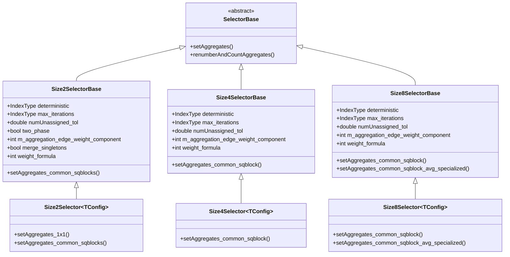
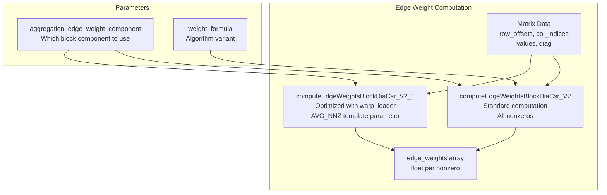
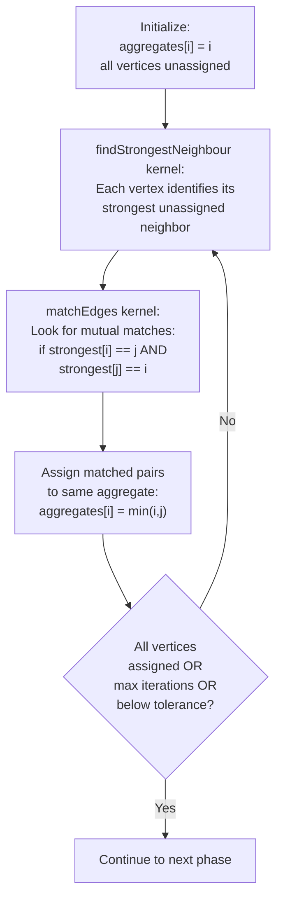
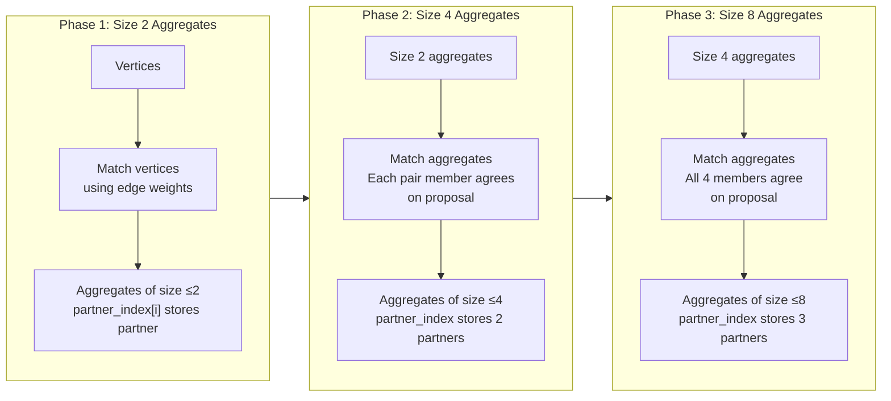
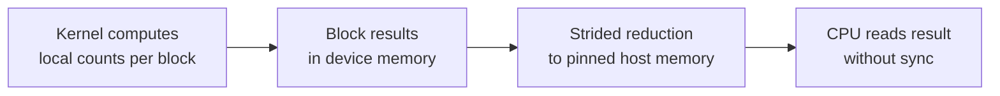
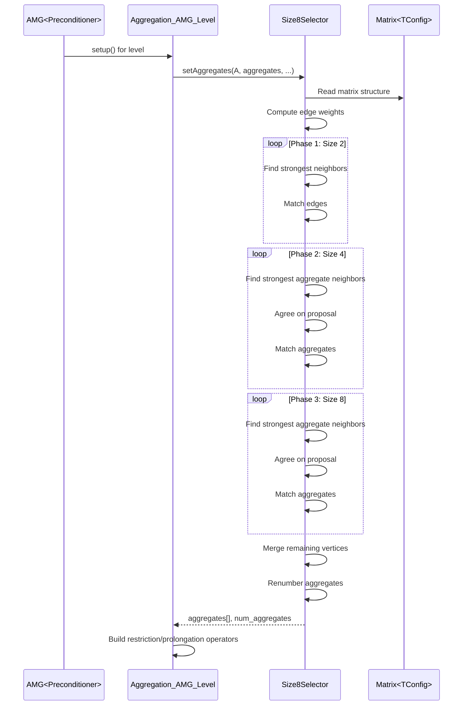

<!-- source: DeepWiki mcp.deepwiki.com · repo NVIDIA/AMGX · extra page Aggregation Selectors · fetched 2026-10-26 -->

# Aggregation Selectors

<details>
<summary>Relevant source files</summary>

The following files were used as context for generating this wiki page:

- [src/aggregation/selectors/size2_selector.cu](src/aggregation/selectors/size2_selector.cu)
- [src/aggregation/selectors/size4_selector.cu](src/aggregation/selectors/size4_selector.cu)
- [src/aggregation/selectors/size8_selector.cu](src/aggregation/selectors/size8_selector.cu)

</details>


## Purpose and Scope

Aggregation selectors implement the coarsening strategy for aggregation-based algebraic multigrid (AMG) methods in AMGX. They determine which fine-grid vertices should be grouped together into aggregates, which then form coarse-grid variables in the multigrid hierarchy. This page documents the Size2, Size4, and Size8 selector implementations, their edge weight computation, matching algorithms, and multi-phase aggregation strategies.

For information about the broader aggregation AMG framework and how selectors fit into the hierarchy construction process, see [Aggregation AMG](#3.2.2). For details on classical AMG coarsening approaches (C/F splitting), see [Classical AMG](#3.2.3).

## Overview

Aggregation selectors implement a graph matching-based coarsening strategy where the matrix graph's edges are weighted by connection strength, and vertices (matrix rows) are paired or grouped based on these weights. The core idea is to form aggregates of vertices that are strongly connected, which produces a coarse-grid operator that preserves important matrix properties.

AMGX provides three selector variants that differ in target aggregate size:
- **Size2Selector**: Forms aggregates of up to 2 vertices
- **Size4Selector**: Forms aggregates of up to 4 vertices (2 → 4 in two phases)
- **Size8Selector**: Forms aggregates of up to 8 vertices (2 → 4 → 8 in three phases)

All selectors follow a similar algorithmic pattern: compute edge weights, find strongest neighbors, perform matching to form aggregates, then handle remaining unassigned vertices.

### Selector Class Hierarchy



**Sources:** [src/aggregation/selectors/size2_selector.cu:617-627](), [src/aggregation/selectors/size4_selector.cu:72-80](), [src/aggregation/selectors/size8_selector.cu:972-980]()

## Edge Weight Computation

Edge weights quantify the strength of connection between vertices in the matrix graph. AMGX computes edge weights using a formula that considers both the matrix entry values and the diagonal dominance.

### Weight Formula

For an edge connecting vertices $i$ and $j$, the weight is computed as:

$$w_{ij} = \frac{0.5 \cdot (|a_{ij}| + |a_{ji}|)}{\max(|a_{ii}|, |a_{jj}|)}$$

where:
- $a_{ij}$ is the matrix entry from row $i$ to column $j$
- $a_{ji}$ is the transpose entry (from row $j$ to column $i$)
- $a_{ii}$, $a_{jj}$ are diagonal entries

This formula ensures that:
1. Strong connections relative to diagonal entries receive high weights
2. The edge weight is symmetric (considers both $a_{ij}$ and $a_{ji}$)
3. Diagonal dominance is respected

### Edge Weight Computation Kernels



**Sources:** [src/aggregation/selectors/size8_selector.cu:992-1072](), [src/aggregation/selectors/size2_selector.cu:769-771](), [src/aggregation/selectors/size4_selector.cu:141-143]()

The `computeEdgeWeightsBlockDiaCsr_V2` kernel iterates through nonzero blocks, computes the edge weight using the formula above, and stores results in the `edge_weights` array. The optimized variant `computeEdgeWeightsBlockDiaCsr_V2_1` uses vectorized loading (`warp_loader`) for better memory throughput on matrices with predictable sparsity patterns.

## Matching Algorithm

The matching algorithm forms aggregates by identifying "perfect matches" between vertices. A perfect match occurs when two vertices mutually identify each other as their strongest unassigned neighbor.

### Algorithm Flow



**Sources:** [src/aggregation/selectors/size2_selector.cu:226-299](), [src/aggregation/selectors/size8_selector.cu:99-191](), [src/aggregation/selectors/size8_selector.cu:566-599]()

### Strongest Neighbor Selection

For each unassigned vertex $i$, the selector identifies its strongest neighbor by examining all edges and tracking:

```
max_weight_unaggregated = 0
strongest_unaggregated = -1
max_weight_aggregated = 0
strongest_aggregated = -1

for each neighbor j:
    weight = edge_weights[edge(i,j)]
    if j is unassigned and weight > max_weight_unaggregated:
        max_weight_unaggregated = weight
        strongest_unaggregated = j
    else if j is assigned and weight > max_weight_aggregated:
        max_weight_aggregated = weight
        strongest_aggregated = j
```

This tracking allows the algorithm to:
1. Prefer matching with unassigned vertices (forming new aggregates)
2. Fall back to joining existing aggregates when no unassigned neighbors remain

**Sources:** [src/aggregation/selectors/size8_selector.cu:200-428](), [src/aggregation/selectors/size2_selector.cu:76-140]()

### Two-Phase Handshaking

Size2Selector optionally supports two-phase handshaking to improve matching quality:

| Phase | Weight Source | Matching Criterion |
|-------|--------------|-------------------|
| 1 | Edge weights from matrix | Identify strongest neighbor |
| 2 | Random weights | Among neighbors who "gave hand" in phase 1, select strongest |

This prevents premature commitment to weak matches and can improve aggregate quality.

**Sources:** [src/aggregation/selectors/size2_selector.cu:623](), [src/aggregation/selectors/size2_selector.cu:789-803]()

## Multi-Phase Aggregation Process

Size4Selector and Size8Selector perform multi-phase aggregation, progressively doubling aggregate sizes. Each phase uses the same matching algorithm but operates on the aggregate graph rather than the original vertex graph.

### Size8 Three-Phase Process



**Sources:** [src/aggregation/selectors/size8_selector.cu:1272-1514]()

### Partner Index Array Structure

The `partner_index` array tracks aggregate membership differently in each phase:

| Phase | Array Section | Stores |
|-------|--------------|--------|
| 1 (Size 2) | `partner_index[0:n]` | Partner vertex (or -1 if unassigned) |
| 2 (Size 4) | `partner_index[0:n]` | First partner from phase 1 |
| | `partner_index[n:2n]` | Second partner (from matching size-2 aggregates) |
| 3 (Size 8) | `partner_index[0:n]` | First partner |
| | `partner_index[n:2n]` | Second partner |
| | `partner_index[2n:3n]` | Third partner (from matching size-4 aggregates) |

**Sources:** [src/aggregation/selectors/size8_selector.cu:1230](), [src/aggregation/selectors/size8_selector.cu:668-701]()

### Agreement on Proposal

When matching aggregates (phases 2 and 3), all members of an aggregate must agree on which neighboring aggregate to propose matching with. The `agreeOnProposal` kernel implements this consensus:

```
For each vertex i in an unassigned size-4 aggregate:
    my_weight = weight_strongest_neighbour[i]
    partner_weights = [weight_strongest_neighbour[partner[0]], 
                      weight_strongest_neighbour[partner[1]],
                      weight_strongest_neighbour[partner[2]]]
    
    if any partner has stronger proposal:
        adopt that partner's proposal
    else:
        keep my proposal
```

This ensures that the aggregate as a whole selects the strongest connection to a neighboring aggregate.

**Sources:** [src/aggregation/selectors/size8_selector.cu:776-841](), [src/aggregation/selectors/size4_selector.cu:186-187]()

## Handling Unassigned Vertices

After the matching phases complete, some vertices may remain unassigned. These are handled through:

### 1. Merging with Existing Aggregates

The `mergeWithExistingAggregates` kernel assigns unassigned vertices to existing neighboring aggregates based on strongest connection:

```
For each unassigned vertex i:
    strongest_aggregated_neighbor = find strongest neighbor j where j is already aggregated
    if found:
        aggregates[i] = aggregates[strongest_aggregated_neighbor]
    else:
        aggregates[i] = i  // form singleton
```

**Sources:** [src/aggregation/selectors/size8_selector.cu:1469-1480](), [src/aggregation/selectors/size2_selector.cu:510-569](), [src/aggregation/selectors/size4_selector.cu:199-222]()

### 2. Singleton Handling

The `merge_singletons` configuration parameter controls whether isolated vertices form their own aggregates or are forced to join existing ones:

- **`merge_singletons=1`**: Isolated vertices join their strongest neighboring aggregate
- **`merge_singletons=0`**: Isolated vertices form singleton aggregates (size 1)

**Sources:** [src/aggregation/selectors/size2_selector.cu:625](), [src/aggregation/selectors/size2_selector.cu:853-888]()

## Deterministic vs Non-Deterministic Mode

Aggregation can operate in two modes that affect reproducibility across runs:

| Mode | Behavior | Implementation |
|------|----------|----------------|
| **Non-deterministic** | Direct writes to `aggregates` array | Race conditions possible, faster |
| **Deterministic** | Two-stage: propose to `aggregates_candidate`, then atomic join | Reproducible results, slightly slower |

In deterministic mode, the `joinExistingAggregates` kernel performs the actual assignment in a second pass:

```
if aggregates[i] == -1 and aggregates_candidate[i] != -1:
    aggregates[i] = aggregates_candidate[i]
```

This prevents race conditions where multiple vertices might simultaneously try to update aggregate assignments.

**Sources:** [src/aggregation/selectors/size8_selector.cu:975](), [src/aggregation/selectors/size2_selector.cu:620](), [src/aggregation/selectors/size2_selector.cu:424-439]()

## Configuration Parameters

Aggregation selectors are configured through the AMG configuration system. Key parameters include:

| Parameter | Type | Default | Description |
|-----------|------|---------|-------------|
| `determinism_flag` | int | variant | Enable deterministic aggregation |
| `max_matching_iterations` | int | scope-specific | Maximum iterations for matching loops |
| `max_unassigned_percentage` | double | scope-specific | Stop when percentage of unassigned vertices drops below this |
| `aggregation_edge_weight_component` | int | scope-specific | Which component of block matrix to use for weights (for block matrices) |
| `weight_formula` | int | scope-specific | Edge weight computation formula variant |
| `handshaking_phases` | int | 1 | Number of handshaking phases for Size2 (1 or 2) |
| `merge_singletons` | int | 1 | Whether to merge singleton vertices into existing aggregates |

**Sources:** [src/aggregation/selectors/size8_selector.cu:975-979](), [src/aggregation/selectors/size2_selector.cu:620-626](), [src/aggregation/selectors/size4_selector.cu:75-79]()

### Iteration Control

The matching loops terminate when any of these conditions is met:
1. All vertices are assigned (`numUnassigned == 0`)
2. Maximum iterations exceeded (`icount > max_iterations`)
3. Percentage unassigned drops below tolerance (`numUnassigned / num_rows < numUnassigned_tol`)
4. No progress in last iteration (`numUnassigned_previous == numUnassigned`)

**Sources:** [src/aggregation/selectors/size8_selector.cu:1322](), [src/aggregation/selectors/size2_selector.cu:847](), [src/aggregation/selectors/size4_selector.cu:164]()

## Kernel Implementations

### Key CUDA Kernels

The following table summarizes the main CUDA kernels used by aggregation selectors:

| Kernel | Purpose | Thread Mapping |
|--------|---------|----------------|
| `computeEdgeWeightsBlockDiaCsr_V2` | Compute edge weights for all nonzeros | One thread per nonzero |
| `findStrongestNeighbourBlockDiaCsr_NoMerge` | Find strongest neighbor for each vertex | One thread per vertex |
| `matchEdges` | Identify and create perfect matches | One thread per vertex |
| `my_MatchEdges` | Match with compaction (optimized) | One thread per vertex |
| `matchAggregates` | Match aggregates in phase 2/3 | One thread per vertex |
| `agreeOnProposal` | Consensus within aggregate | One thread per vertex |
| `mergeWithExistingAggregatesBlockDiaCsr` | Merge unassigned to existing | One thread per vertex |
| `assignUnassignedVertices` | Initialize remaining vertices | One thread per vertex |
| `my_blockCompact` | Compact unassigned vertex list | Block-wise compaction |

**Sources:** [src/aggregation/selectors/size8_selector.cu:99-665]()

### Memory Access Patterns

The kernels use several memory access optimization techniques:

1. **Cached Loads**: Use `__ldg()`, `__ldca()`, `__ldcs()`, `__ldlu()` for read-only data
2. **Warp Loaders**: Vectorized loading with `warp_loader<T, NUM_COLS>` for sequential access
3. **Cache Configuration**: Set L1 cache preference with `cudaFuncSetCacheConfig(..., cudaFuncCachePreferL1)`
4. **Aligned Access**: Align loop iterations to warp boundaries for coalesced memory access

**Sources:** [src/aggregation/selectors/size8_selector.cu:127-154](), [src/aggregation/selectors/size8_selector.cu:1256-1266]()

### Algorithm Variants

Size8Selector provides multiple algorithm variants controlled by compile-time template parameters:

```cpp
#define ALGORITHM_NOMERGE 0           // Simple matching without merge
#define ALGORITHM_STOREWEIGHTS 1      // Store weights for size-4 matching  
#define ALGORITHM_STOREWEIGHTS_2 2    // Store weights for size-8 matching
```

And runtime parameters:

- `NUM_COLS`: Template parameter for warp loading width (1, 2, or 4)
- `ASSUME_ALL_UNASSIGNED`: Optimization when all vertices start unassigned
- `LOAD_ONLY_UNASSIGNED`: Load only unassigned vertices (with compaction)

**Sources:** [src/aggregation/selectors/size8_selector.cu:195-198](), [src/aggregation/selectors/size8_selector.cu:433-475]()

## Performance Optimizations

### Strided Reduction for Counting

Instead of using Thrust's `count()` which requires full synchronization, Size8Selector optionally uses strided reduction with pinned memory for faster counting of unassigned vertices:



This allows overlapping computation with counting, reducing synchronization overhead.

**Sources:** [src/aggregation/selectors/size8_selector.cu:30-86](), [src/aggregation/selectors/size8_selector.cu:1311-1318]()

### AVG_NNZ Template Specialization

Size8Selector specializes the aggregation routine based on average nonzeros per row:

```cpp
if (nnz_per_row > 2)
    setAggregates_common_sqblock_avg_specialized<4>(...)
else if (nnz_per_row > 1)
    setAggregates_common_sqblock_avg_specialized<4>(...)
else
    setAggregates_common_sqblock_avg_specialized<2>(...)
```

This adjusts the vectorized loading width (`NUM_COLS` template parameter) to match the matrix sparsity pattern.

**Sources:** [src/aggregation/selectors/size8_selector.cu:1162-1178]()

### Block Compaction

The `my_blockCompact` kernel compacts the list of unassigned vertices for more efficient processing in later iterations:

```
Input:  [0, 1, 2, 3, 4, 5, ...]  (all vertex indices)
        partner_index[i] indicates assigned (-1 = unassigned)
        
Output: [1, 3, 5, ...]            (only unassigned vertex indices)
        n_unassigned_per_block[]  (count per block for prefix sum)
```

This reduces memory traffic when only a small fraction of vertices remain unassigned.

**Sources:** [src/aggregation/selectors/size8_selector.cu:477-518]()

## Usage Example

Here's how aggregation selectors fit into the AMG setup process:



**Sources:** [src/aggregation/selectors/size8_selector.cu:1128-1514]()

The aggregates array produced by the selector is then used by the AMG level to construct restriction and prolongation operators for the coarse grid.

---

