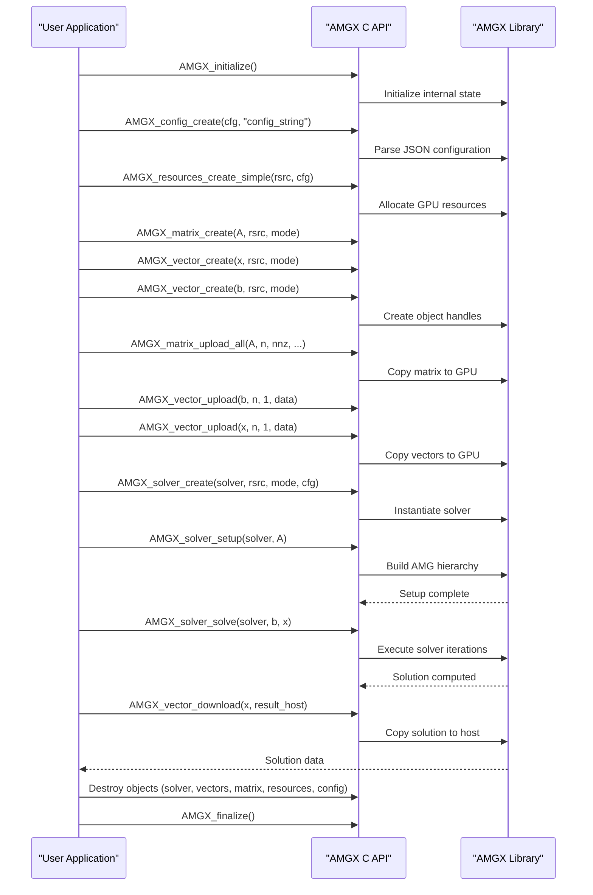
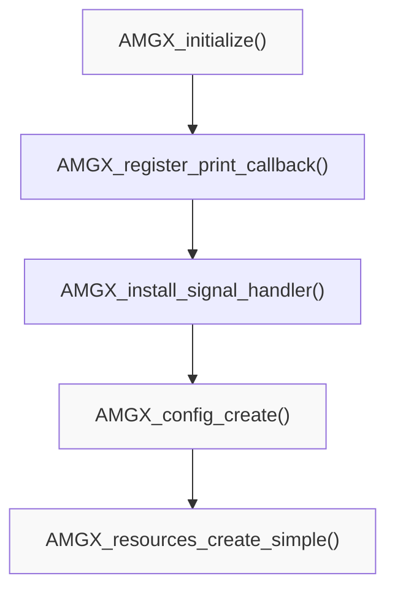
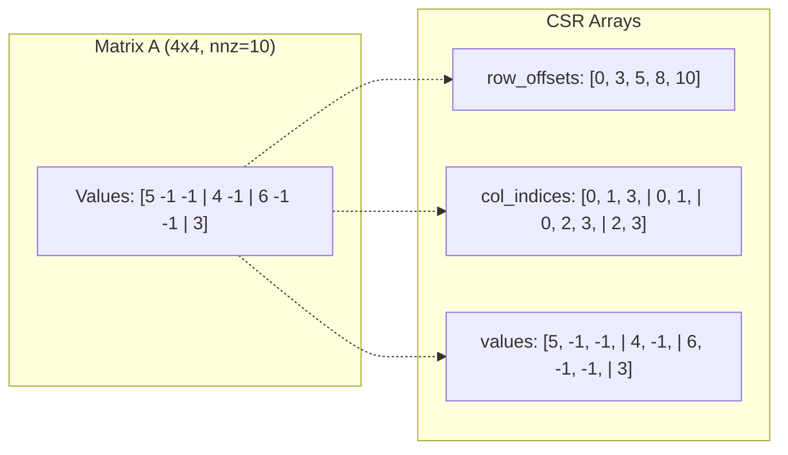
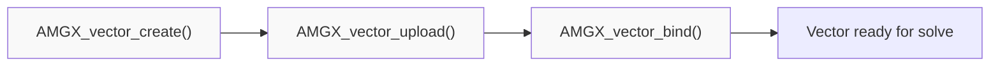
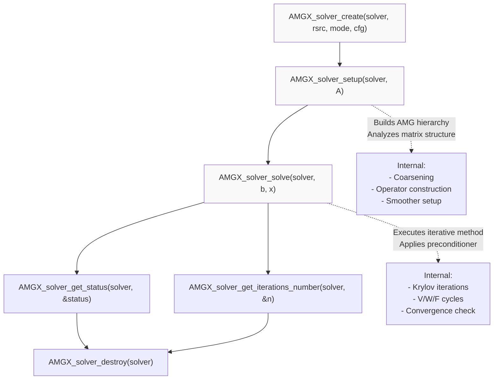
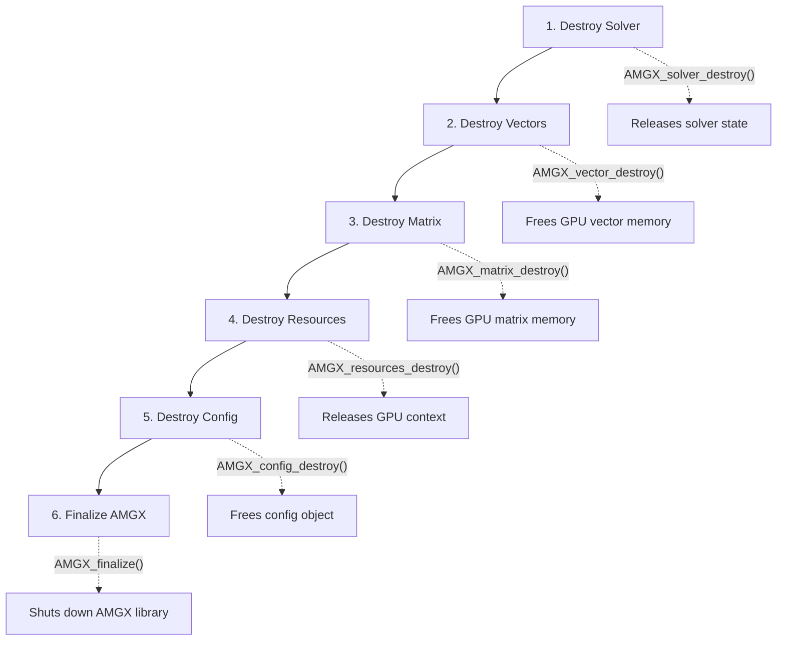

<!-- source: DeepWiki mcp.deepwiki.com · repo NVIDIA/AMGX · extra page Basic Examples · fetched 2026-10-26 -->

# Basic Examples

<details>
<summary>Relevant source files</summary>

The following files were used as context for generating this wiki page:

- [examples/amgx_capi.h](examples/amgx_capi.h)
- [examples/amgx_mpi_capi.c](examples/amgx_mpi_capi.c)
- [examples/amgx_mpi_poisson7.c](examples/amgx_mpi_poisson7.c)
- [include/amgx_c.h](include/amgx_c.h)
- [src/amgx_c.cu](src/amgx_c.cu)
- [src/matrix_analysis.cu](src/matrix_analysis.cu)

</details>


This page demonstrates the fundamental patterns for using AMGX through its C API in single-GPU scenarios. It covers the essential workflow: initializing the library, uploading matrices and vectors, configuring and running solvers, and retrieving solutions. These examples focus on non-distributed (single-GPU) usage.

For distributed multi-GPU examples with MPI, see [MPI Examples](#4.3.2). For details on the C API design and object model, see [API Design and Object Model](#4.1.1). For configuration options, see [Configuration System](#4.2).

---

## Basic API Workflow

The standard AMGX workflow follows a consistent sequence of operations. Understanding this pattern is essential before examining specific examples.



**Sources:** [include/amgx_c.h:164-169](), [include/amgx_c.h:373-389](), [examples/amgx_mpi_poisson7.c:158-275]()

---

## Minimal Working Example

A complete single-GPU AMGX program requires the following components. This example solves a simple linear system Ax=b.

### Initialization and Configuration



The initialization phase establishes the library state and creates configuration and resource objects:

| API Function | Purpose | Key Parameters |
|--------------|---------|----------------|
| `AMGX_initialize` | Initialize library, must be called first | None |
| `AMGX_register_print_callback` | Set custom output handler | Function pointer |
| `AMGX_install_signal_handler` | Handle interrupts gracefully | None |
| `AMGX_config_create` | Parse solver configuration | JSON string |
| `AMGX_resources_create_simple` | Allocate GPU resources (single GPU) | Config handle |

**Configuration String Example:**
```c
const char *cfg_string = "config_version=2, "
                         "solver(main)=AMG, "
                         "main:algorithm=AGGREGATION, "
                         "main:max_iters=100, "
                         "main:tolerance=1e-6";
AMGX_config_handle cfg;
AMGX_SAFE_CALL(AMGX_config_create(&cfg, cfg_string));
```

Alternatively, load from file:
```c
AMGX_SAFE_CALL(AMGX_config_create_from_file(&cfg, "solver_config.json"));
```

**Sources:** [include/amgx_c.h:165-167](), [include/amgx_c.h:193-228](), [examples/amgx_mpi_poisson7.c:158-242]()

### Mode Selection

AMGX uses a mode system to specify precision and memory location at runtime. The mode is encoded in the `AMGX_Mode` enum:

```c
// Common modes for single-GPU usage:
AMGX_Mode mode = AMGX_mode_dDDI;  // device, double matrix, double vector, int indices
// AMGX_mode_dDFI;  // device, double matrix, float vector, int indices
// AMGX_mode_dFFI;  // device, float matrix, float vector, int indices
```

Mode encoding: `[memory][matrix_prec][vector_prec][index_prec]`
- Memory: `d` (device/GPU), `h` (host/CPU)
- Precision: `D` (double), `F` (float)
- Index: `I` (int), `L` (int64)

All objects (matrix, vectors, solver) must use the same mode.

**Sources:** [include/amgx_c.h:1-29](), [examples/amgx_mpi_capi.c:186-209]()

---

## Matrix Upload

Matrix data is uploaded using `AMGX_matrix_upload_all`, which expects CSR (Compressed Sparse Row) format.

### CSR Format Structure



### Upload Function Signature

```c
AMGX_RC AMGX_matrix_upload_all(
    AMGX_matrix_handle mtx,
    int n,                    // Number of rows
    int nnz,                  // Number of non-zeros
    int block_dimx,           // Block size X (1 for scalar)
    int block_dimy,           // Block size Y (1 for scalar)
    const int *row_ptrs,      // Row offsets [n+1]
    const int *col_indices,   // Column indices [nnz]
    const void *data,         // Matrix values [nnz*block_dimx*block_dimy]
    const void *diag_data     // Diagonal values (optional, can be NULL)
);
```

### Example: Scalar Matrix Upload

```c
// Example: 4x4 matrix with 10 non-zeros
int n = 4;
int nnz = 10;
int block_dimx = 1, block_dimy = 1;  // Scalar matrix

int row_offsets[5] = {0, 3, 5, 8, 10};
int col_indices[10] = {0, 1, 3, 0, 1, 0, 2, 3, 2, 3};
double values[10] = {5.0, -1.0, -1.0, 4.0, -1.0, 6.0, -1.0, -1.0, 3.0, 3.0};

AMGX_matrix_handle A;
AMGX_SAFE_CALL(AMGX_matrix_create(&A, rsrc, mode));
AMGX_SAFE_CALL(AMGX_matrix_upload_all(
    A, n, nnz, block_dimx, block_dimy,
    row_offsets, col_indices, values, NULL
));
```

### Block Matrix Upload

For block matrices (e.g., 2x2 blocks), values are stored in row-major order within each block:

```c
int block_dimx = 2, block_dimy = 2;
int nnz_blocks = 5;  // Number of blocks
// Each block has 4 values (2x2), so total values = nnz_blocks * 4
double values[20] = { /* 5 blocks × 4 values each */ };

AMGX_SAFE_CALL(AMGX_matrix_upload_all(
    A, n, nnz_blocks, block_dimx, block_dimy,
    row_offsets, col_indices, values, NULL
));
```

**Sources:** [include/amgx_c.h:270-279](), [src/amgx_c.cu:852-922](), [examples/amgx_mpi_poisson7.c:266-274]()

---

## Vector Operations

Vectors represent right-hand side (RHS) and solution data. They must be bound to a matrix to establish size compatibility.

### Vector Creation and Upload



### Example Code

```c
// Create vectors
AMGX_vector_handle b, x;
AMGX_SAFE_CALL(AMGX_vector_create(&b, rsrc, mode));
AMGX_SAFE_CALL(AMGX_vector_create(&x, rsrc, mode));

// Prepare host data
double *rhs_h = malloc(n * sizeof(double));
double *sol_h = malloc(n * sizeof(double));

// Initialize RHS to ones, solution to zeros
for (int i = 0; i < n; i++) {
    rhs_h[i] = 1.0;
    sol_h[i] = 0.0;
}

// Upload to GPU
AMGX_SAFE_CALL(AMGX_vector_upload(b, n, 1, rhs_h));
AMGX_SAFE_CALL(AMGX_vector_upload(x, n, 1, sol_h));

// Bind vectors to matrix (establishes size compatibility)
AMGX_SAFE_CALL(AMGX_vector_bind(b, A));
AMGX_SAFE_CALL(AMGX_vector_bind(x, A));
```

### Vector API Reference

| Function | Purpose | Parameters |
|----------|---------|------------|
| `AMGX_vector_create` | Allocate vector handle | resources, mode |
| `AMGX_vector_upload` | Copy data to GPU | size, block_dim, host_data |
| `AMGX_vector_bind` | Associate with matrix | matrix handle |
| `AMGX_vector_download` | Copy data from GPU | host_data (output) |
| `AMGX_vector_set_zero` | Initialize to zero | size, block_dim |
| `AMGX_vector_get_size` | Query dimensions | n (output), block_dim (output) |

**Sources:** [include/amgx_c.h:336-370](), [examples/amgx_mpi_poisson7.c:277-308]()

---

## Solver Setup and Execution

Once the matrix and vectors are uploaded, the solver is created and configured, then the system is solved.

### Solver Lifecycle



### Example: Complete Solve

```c
// Create solver
AMGX_solver_handle solver;
AMGX_SAFE_CALL(AMGX_solver_create(&solver, rsrc, mode, cfg));

// Setup phase: builds AMG hierarchy
AMGX_SAFE_CALL(AMGX_solver_setup(solver, A));

// Solve phase: iterates until convergence
AMGX_SAFE_CALL(AMGX_solver_solve(solver, b, x));

// Check convergence status
AMGX_SOLVE_STATUS status;
AMGX_SAFE_CALL(AMGX_solver_get_status(solver, &status));

switch(status) {
    case AMGX_SOLVE_SUCCESS:
        printf("Solver converged successfully\n");
        break;
    case AMGX_SOLVE_DIVERGED:
        printf("Solver diverged\n");
        break;
    case AMGX_SOLVE_NOT_CONVERGED:
        printf("Solver did not converge within max iterations\n");
        break;
    case AMGX_SOLVE_FAILED:
        printf("Solver failed\n");
        break;
}

// Query iteration count
int num_iters;
AMGX_SAFE_CALL(AMGX_solver_get_iterations_number(solver, &num_iters));
printf("Iterations: %d\n", num_iters);
```

### Alternative: Zero Initial Guess

If the initial guess for `x` is zero, use the optimized variant:

```c
AMGX_SAFE_CALL(AMGX_solver_solve_with_0_initial_guess(solver, b, x));
```

This avoids unnecessary operations on the initial solution vector.

**Sources:** [include/amgx_c.h:373-409](), [examples/amgx_mpi_poisson7.c:316-344](), [examples/amgx_mpi_capi.c:391-416]()

---

## Solution Retrieval

After solving, download the solution from GPU to host memory using `AMGX_vector_download`.

### Download Process

```c
// Allocate host buffer for solution
int n_local;
int block_dim;
AMGX_SAFE_CALL(AMGX_vector_get_size(x, &n_local, &block_dim));

// For double precision mode
double *solution_h = malloc(n_local * block_dim * sizeof(double));

// Download from GPU
AMGX_SAFE_CALL(AMGX_vector_download(x, solution_h));

// Use solution data
for (int i = 0; i < n_local; i++) {
    printf("x[%d] = %f\n", i, solution_h[i]);
}

free(solution_h);
```

### Handling Different Precisions

The downloaded data type depends on the mode:

```c
// For AMGX_mode_dDDI or AMGX_mode_dDFI:
if (AMGX_GET_MODE_VAL(AMGX_VecPrecision, mode) == AMGX_vecDouble) {
    double *result = malloc(n * sizeof(double));
    AMGX_vector_download(x, result);
} else {
    float *result = malloc(n * sizeof(float));
    AMGX_vector_download(x, result);
}
```

**Sources:** [include/amgx_c.h:359-361](), [examples/amgx_mpi_capi.c:347-352](), [examples/amgx_mpi_poisson7.c:347-352]()

---

## Configuration Examples

AMGX uses JSON-based configuration for solver parameters. Here are common configurations for single-GPU scenarios.

### Basic AMG with PCG

```json
{
  "config_version": 2,
  "solver": {
    "solver": "PCG",
    "preconditioner": {
      "solver": "AMG",
      "algorithm": "AGGREGATION",
      "max_iters": 1,
      "cycle": "V"
    },
    "max_iters": 100,
    "tolerance": 1e-6,
    "norm": "L2",
    "print_solve_stats": 1,
    "monitor_residual": 1
  }
}
```

### GMRES with Classical AMG

```json
{
  "config_version": 2,
  "solver": {
    "solver": "FGMRES",
    "preconditioner": {
      "solver": "AMG",
      "algorithm": "CLASSICAL",
      "selector": "PMIS",
      "coarseAgenerator": "LOW_DEG",
      "max_iters": 1
    },
    "gmres_n_restart": 30,
    "max_iters": 200,
    "tolerance": 1e-8
  }
}
```

### BiCGSTAB with Block Jacobi

```json
{
  "config_version": 2,
  "solver": {
    "solver": "BICGSTAB",
    "preconditioner": {
      "solver": "BLOCK_JACOBI",
      "relaxation_factor": 0.9
    },
    "max_iters": 500,
    "tolerance": 1e-6
  }
}
```

### Configuration via String

```c
const char *config_string = 
    "config_version=2, "
    "solver(s)=BICGSTAB, "
    "s:preconditioner(amg)=AMG, "
    "s:max_iters=100, "
    "s:tolerance=1e-6, "
    "amg:algorithm=AGGREGATION, "
    "amg:selector=SIZE_8, "
    "amg:max_iters=1, "
    "amg:cycle=V";

AMGX_config_handle cfg;
AMGX_SAFE_CALL(AMGX_config_create(&cfg, config_string));
```

**Sources:** [examples/amgx_mpi_capi.c:212-232](), [include/amgx_c.h:193-209]()

---

## Error Handling

AMGX provides comprehensive error handling through return codes and the `AMGX_SAFE_CALL` macro.

### Error Code Enumeration

| Return Code | Meaning |
|-------------|---------|
| `AMGX_RC_OK` | Success |
| `AMGX_RC_BAD_PARAMETERS` | Invalid parameters passed |
| `AMGX_RC_BAD_MODE` | Incompatible mode between objects |
| `AMGX_RC_CUDA_FAILURE` | CUDA runtime error |
| `AMGX_RC_NO_MEMORY` | Insufficient memory |
| `AMGX_RC_IO_ERROR` | File I/O error |
| `AMGX_RC_BAD_CONFIGURATION` | Invalid configuration string |
| `AMGX_RC_INTERNAL` | Internal library error |

### Error Handling Patterns

```c
// Pattern 1: AMGX_SAFE_CALL macro (recommended for simple cases)
AMGX_SAFE_CALL(AMGX_matrix_upload_all(A, n, nnz, 1, 1, 
                                        row_offsets, col_indices, 
                                        values, NULL));

// Pattern 2: Manual error checking (for custom handling)
AMGX_RC rc = AMGX_solver_solve(solver, b, x);
if (rc != AMGX_RC_OK) {
    char error_msg[4096];
    AMGX_get_error_string(rc, error_msg, 4096);
    fprintf(stderr, "Solver failed: %s\n", error_msg);
    // Custom error handling...
    return -1;
}

// Pattern 3: Exception handling mode (enabled via config)
AMGX_SAFE_CALL(AMGX_config_add_parameters(&cfg, "exception_handling=1"));
// After this, API calls throw exceptions instead of returning error codes
```

### AMGX_SAFE_CALL Implementation

The macro automatically checks return codes and prints diagnostic information:

```c
#define AMGX_SAFE_CALL(rc) \
{ \
  AMGX_RC err; \
  char msg[4096]; \
  switch(err = (rc)) { \
  case AMGX_RC_OK: \
    break; \
  default: \
    fprintf(stderr, "AMGX ERROR: file %s line %6d\n", __FILE__, __LINE__); \
    AMGX_get_error_string(err, msg, 4096); \
    fprintf(stderr, "AMGX ERROR: %s\n", msg); \
    AMGX_abort(NULL,1); \
    break; \
  } \
}
```

**Sources:** [include/amgx_c.h:51-69](), [include/amgx_c.h:130-144](), [examples/amgx_mpi_capi.c:234-240]()

---

## Complete Example: Putting It All Together

Here is a complete single-GPU example that solves a 3D Poisson problem:

```c
#include <stdio.h>
#include <stdlib.h>
#include "amgx_c.h"

void print_callback(const char *msg, int length) {
    printf("%s", msg);
}

int main() {
    // Problem size
    int n = 1000;
    int nnz = 6802;  // Approximate for 10x10x10 3D Poisson
    
    // Initialize AMGX
    AMGX_SAFE_CALL(AMGX_initialize());
    AMGX_SAFE_CALL(AMGX_register_print_callback(&print_callback));
    AMGX_SAFE_CALL(AMGX_install_signal_handler());
    
    // Create configuration
    const char *cfg_str = 
        "config_version=2, "
        "solver(main)=PCGF, "
        "main:preconditioner(amg)=AMG, "
        "main:max_iters=100, "
        "main:tolerance=1e-6, "
        "amg:algorithm=AGGREGATION, "
        "amg:selector=SIZE_8, "
        "amg:max_iters=1";
    
    AMGX_config_handle cfg;
    AMGX_SAFE_CALL(AMGX_config_create(&cfg, cfg_str));
    
    // Create resources (single GPU, device 0)
    AMGX_resources_handle rsrc;
    AMGX_SAFE_CALL(AMGX_resources_create_simple(&rsrc, cfg));
    
    // Select mode
    AMGX_Mode mode = AMGX_mode_dDDI;
    
    // Create matrix and vectors
    AMGX_matrix_handle A;
    AMGX_vector_handle b, x;
    AMGX_SAFE_CALL(AMGX_matrix_create(&A, rsrc, mode));
    AMGX_SAFE_CALL(AMGX_vector_create(&b, rsrc, mode));
    AMGX_SAFE_CALL(AMGX_vector_create(&x, rsrc, mode));
    
    // Allocate and populate matrix data (CSR format)
    int *row_offsets = malloc((n + 1) * sizeof(int));
    int *col_indices = malloc(nnz * sizeof(int));
    double *values = malloc(nnz * sizeof(double));
    
    // ... (fill in 3D Poisson stencil) ...
    
    // Upload matrix
    AMGX_SAFE_CALL(AMGX_matrix_upload_all(A, n, nnz, 1, 1,
                                           row_offsets, col_indices,
                                           values, NULL));
    
    // Setup RHS and initial guess
    double *rhs = malloc(n * sizeof(double));
    double *sol = malloc(n * sizeof(double));
    for (int i = 0; i < n; i++) {
        rhs[i] = 1.0;
        sol[i] = 0.0;
    }
    
    // Upload vectors and bind
    AMGX_SAFE_CALL(AMGX_vector_upload(b, n, 1, rhs));
    AMGX_SAFE_CALL(AMGX_vector_upload(x, n, 1, sol));
    AMGX_SAFE_CALL(AMGX_vector_bind(b, A));
    AMGX_SAFE_CALL(AMGX_vector_bind(x, A));
    
    // Create solver and setup
    AMGX_solver_handle solver;
    AMGX_SAFE_CALL(AMGX_solver_create(&solver, rsrc, mode, cfg));
    AMGX_SAFE_CALL(AMGX_solver_setup(solver, A));
    
    // Solve
    AMGX_SAFE_CALL(AMGX_solver_solve(solver, b, x));
    
    // Check status
    AMGX_SOLVE_STATUS status;
    AMGX_SAFE_CALL(AMGX_solver_get_status(solver, &status));
    printf("Solve status: %d\n", status);
    
    // Download solution
    AMGX_SAFE_CALL(AMGX_vector_download(x, sol));
    
    // Print first few values
    for (int i = 0; i < 5; i++) {
        printf("x[%d] = %f\n", i, sol[i]);
    }
    
    // Cleanup
    free(row_offsets);
    free(col_indices);
    free(values);
    free(rhs);
    free(sol);
    
    AMGX_solver_destroy(solver);
    AMGX_vector_destroy(x);
    AMGX_vector_destroy(b);
    AMGX_matrix_destroy(A);
    AMGX_resources_destroy(rsrc);
    AMGX_SAFE_CALL(AMGX_config_destroy(cfg));
    AMGX_SAFE_CALL(AMGX_finalize());
    
    return 0;
}
```

**Sources:** [examples/amgx_mpi_poisson7.c:92-369](), [examples/amgx_mpi_capi.c:97-439]()

---

## Resource Management Best Practices

Proper resource cleanup prevents memory leaks and ensures graceful shutdown.

### Cleanup Order

Objects must be destroyed in the reverse order of their dependencies:



### Proper Cleanup Pattern

```c
// After solve is complete...

// 1. Destroy solver (releases hierarchy)
AMGX_solver_destroy(solver);

// 2. Destroy vectors
AMGX_vector_destroy(x);
AMGX_vector_destroy(b);

// 3. Destroy matrix
AMGX_matrix_destroy(A);

// 4. Destroy resources (releases GPU memory pools)
AMGX_resources_destroy(rsrc);

// 5. Destroy configuration
AMGX_SAFE_CALL(AMGX_config_destroy(cfg));

// 6. Finalize library (must be last)
AMGX_SAFE_CALL(AMGX_finalize());

// 7. Free host memory
free(row_offsets);
free(col_indices);
free(values);
```

### Error During Setup

If an error occurs during setup, clean up only the objects that were successfully created:

```c
AMGX_matrix_handle A = NULL;
AMGX_solver_handle solver = NULL;

AMGX_matrix_create(&A, rsrc, mode);
if (AMGX_matrix_upload_all(...) != AMGX_RC_OK) {
    // Upload failed, only matrix was created
    AMGX_matrix_destroy(A);
    AMGX_resources_destroy(rsrc);
    AMGX_config_destroy(cfg);
    AMGX_finalize();
    return -1;
}

AMGX_solver_create(&solver, rsrc, mode, cfg);
// ... continue or cleanup appropriately
```

**Sources:** [examples/amgx_mpi_capi.c:423-437](), [examples/amgx_mpi_poisson7.c:354-367]()

---

## Common Patterns and Tips

### Reusing Solver Setup

If solving multiple systems with the same matrix structure but different coefficients:

```c
// Initial setup
AMGX_solver_setup(solver, A);
AMGX_solver_solve(solver, b, x);

// For subsequent solves with updated coefficients:
AMGX_matrix_replace_coefficients(A, n, nnz, new_values, NULL);
// No need to call setup again if only values changed
AMGX_solver_solve(solver, b_new, x_new);
```

If matrix structure changes, call `AMGX_solver_setup` again:

```c
// Matrix structure changed
AMGX_matrix_upload_all(A, n_new, nnz_new, 1, 1, 
                        new_row_offsets, new_col_indices, 
                        new_values, NULL);
AMGX_solver_setup(solver, A);  // Rebuild hierarchy
AMGX_solver_solve(solver, b, x);
```

### Multiple Solves with Different RHS

```c
for (int i = 0; i < num_rhs; i++) {
    // Upload new RHS
    AMGX_vector_upload(b, n, 1, rhs_array[i]);
    
    // Reset solution to zero
    AMGX_vector_set_zero(x, n, 1);
    
    // Solve (reuses existing setup)
    AMGX_solver_solve_with_0_initial_guess(solver, b, x);
    
    // Download solution
    AMGX_vector_download(x, solution_array[i]);
}
```

### Reading Matrix from File

AMGX provides utilities for reading MatrixMarket files:

```c
AMGX_read_system(A, b, x, "matrix.mtx");
// Matrix and vectors are now populated
```

**Sources:** [include/amgx_c.h:281-286](), [include/amgx_c.h:435-439](), [examples/amgx_mpi_capi.c:299-309]()

---

