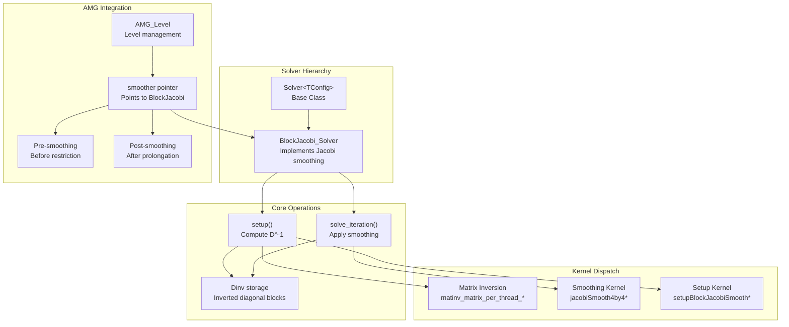
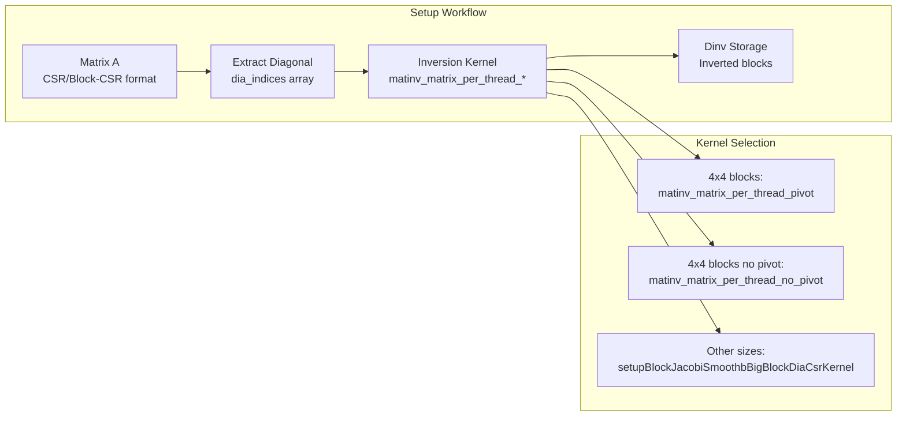
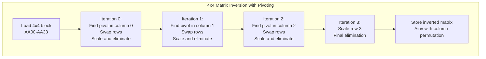
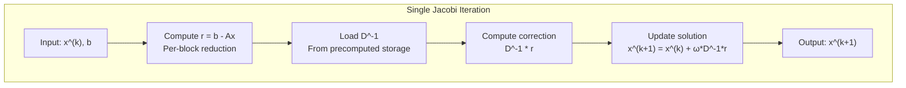
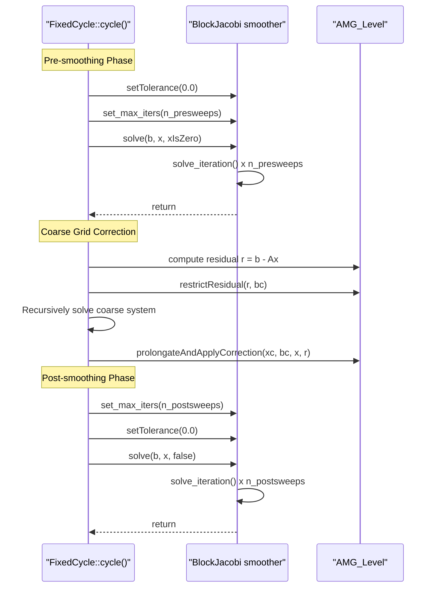
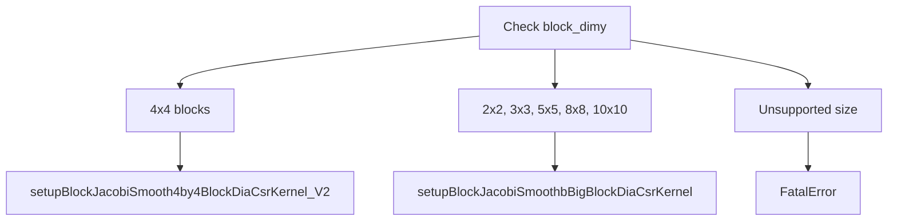

<!-- source: DeepWiki mcp.deepwiki.com · repo NVIDIA/AMGX · extra page Block Jacobi Solver · fetched 2026-10-26 -->

# Block Jacobi Solver

<details>
<summary>Relevant source files</summary>

The following files were used as context for generating this wiki page:

- [include/aggregation/aggregation_amg_level.h](include/aggregation/aggregation_amg_level.h)
- [include/amg_level.h](include/amg_level.h)
- [include/solvers/solver.h](include/solvers/solver.h)
- [src/aggregation/aggregation_amg_level.cu](src/aggregation/aggregation_amg_level.cu)
- [src/amg.cu](src/amg.cu)
- [src/cycles/fixed_cycle.cu](src/cycles/fixed_cycle.cu)
- [src/solvers/block_jacobi_solver.cu](src/solvers/block_jacobi_solver.cu)
- [src/solvers/solver.cu](src/solvers/solver.cu)
- [src/tests/fgmres_zero_initial_residual.cu](src/tests/fgmres_zero_initial_residual.cu)

</details>


## Purpose and Scope

The Block Jacobi Solver is a smoothing operator used primarily within the Algebraic Multigrid (AMG) hierarchy in AMGX. It performs relaxation by solving local block-diagonal systems independently. This document describes the implementation of the Block Jacobi smoother, including its diagonal inversion strategy, smoothing iteration kernels, and integration with the AMG cycle.

For information about the base solver framework, see [Solver Framework](#3.1). For other smoothers, see [Gauss-Seidel Solver](#3.4.2) and [Multicolor DILU Solver](#3.4.3). For the AMG cycle that orchestrates smoothing, see [AMG Hierarchy and Cycles](#3.2.1).

## Mathematical Formulation

The Block Jacobi method solves the linear system $Ax = b$ by splitting the matrix into its block-diagonal part $D$ and off-diagonal part $R$:

$$A = D + R$$

The iterative update is:
$$x^{(k+1)} = x^{(k)} + \omega D^{-1}(b - Ax^{(k)})$$

where $\omega$ is a relaxation parameter (weight). The key computational challenge is efficiently computing and storing $D^{-1}$, the inverse of the block-diagonal entries.

**Sources:** [src/solvers/block_jacobi_solver.cu:1-800]()

## Implementation Architecture



**Sources:** [include/solvers/solver.h:21-268](), [src/solvers/solver.cu:26-109](), [src/solvers/block_jacobi_solver.cu:1-800]()

## Setup Phase: Diagonal Inversion

During setup, the Block Jacobi solver extracts diagonal blocks from the matrix and computes their inverses. This is the most computationally intensive part of the setup process.

### Diagonal Block Extraction and Inversion Workflow



**Sources:** [src/solvers/block_jacobi_solver.cu:560-662]()

### Matrix Inversion Kernels

The implementation provides specialized kernels for different block sizes and inversion strategies:

| Block Size | Kernel | Pivoting | Lines |
|------------|--------|----------|-------|
| 4x4 | `matinv_matrix_per_thread_pivot` | Yes | [src/solvers/block_jacobi_solver.cu:84-414]() |
| 4x4 | `matinv_matrix_per_thread_no_pivot` | No | [src/solvers/block_jacobi_solver.cu:417-558]() |
| 2x2, 3x3, 5x5, 8x8, 10x10 | `setupBlockJacobiSmoothbBigBlockDiaCsrKernel` | Yes | [src/solvers/block_jacobi_solver.cu:560-601]() |
| Batch mode (multiple blocks per warp) | `setupBlockJacobiSmoothBbyBBlockDiaCsrKernel` | Yes | [src/solvers/block_jacobi_solver.cu:603-635]() |

The 4x4 pivot kernel performs Gaussian elimination with partial pivoting to ensure numerical stability:



**Sources:** [src/solvers/block_jacobi_solver.cu:84-414]()

#### 4x4 Inversion Implementation Details

The kernel `matinv_matrix_per_thread_pivot` performs explicit Gaussian elimination with partial pivoting for 4x4 blocks. Key operations include:

1. **Pivot Search**: At each iteration, find the row with the largest absolute value in the current column using `absOp()` [src/solvers/block_jacobi_solver.cu:123-147]()
2. **Row Swapping**: Swap the pivot row with the current row and update the permutation vector [src/solvers/block_jacobi_solver.cu:150-208]()
3. **Row Scaling**: Scale the current row by the reciprocal of the pivot using `rcpOp()` [src/solvers/block_jacobi_solver.cu:211-216]()
4. **Elimination**: Eliminate entries above and below the pivot using `fmnaOp()` (fused multiply-negate-add) [src/solvers/block_jacobi_solver.cu:218-232]()
5. **Column Reordering**: Store the result with proper column permutation [src/solvers/block_jacobi_solver.cu:397-412]()

**Sources:** [src/solvers/block_jacobi_solver.cu:84-414]()

### Setup Kernels for Different Block Sizes

For block sizes other than 4x4, the implementation uses `setupBlockJacobiSmoothbBigBlockDiaCsrKernel`, which works with larger blocks using shared memory:

- **Halfwarp Processing**: Each halfwarp (16 threads) processes one block row [src/solvers/block_jacobi_solver.cu:565]()
- **Tiled Loading**: Large blocks are loaded in 4x4 tiles [src/solvers/block_jacobi_solver.cu:574-587]()
- **Shared Memory**: Blocks are stored in shared memory for efficient access [src/solvers/block_jacobi_solver.cu:571]()
- **Generic Inversion**: Calls `compute_block_inverse2()` for the actual inversion [src/solvers/block_jacobi_solver.cu:597-598]()

**Sources:** [src/solvers/block_jacobi_solver.cu:560-601]()

## Smoothing Iteration

During the solve phase, the Block Jacobi solver applies smoothing iterations by computing the residual and applying the diagonal correction.

### Smoothing Workflow



**Sources:** [src/solvers/block_jacobi_solver.cu:665-739]()

### Smoothing Kernels

The implementation provides two main smoothing kernels for 4x4 blocks:

#### Non-Zero Initial Guess Kernel

`jacobiSmooth4by4BlockDiaCsrKernel_NAIVE_tex_readDinv2` handles the general case with a non-zero initial guess [src/solvers/block_jacobi_solver.cu:665-739]():

1. **Residual Computation**: For each block row $i$:
   - Initialize residual with RHS: `bmAx = b[offset]` [src/solvers/block_jacobi_solver.cu:684]()
   - Subtract diagonal contribution: Load diagonal block and multiply by `x` [src/solvers/block_jacobi_solver.cu:689-696]()
   - Subtract off-diagonal contributions: Iterate over non-zero blocks [src/solvers/block_jacobi_solver.cu:698-720]()

2. **Diagonal Correction**: 
   - Load precomputed `Dinv` block [src/solvers/block_jacobi_solver.cu:726-727]()
   - Multiply residual by `Dinv` [src/solvers/block_jacobi_solver.cu:729-734]()
   - Apply weighted update: `xout = xin + weight * correction` [src/solvers/block_jacobi_solver.cu:736]()

#### Zero Initial Guess Kernel

`jacobiSmooth4by4ZeroBlockDiaCsrKernel_NAIVE_tex_readDinv2` is optimized for the case when $x^{(0)} = 0$ [src/solvers/block_jacobi_solver.cu:742-800]():

- Skips matrix-vector multiply since $Ax = 0$
- Directly computes `x = ω * D^-1 * b`
- Uses shared memory for efficient block-wide operations

**Sources:** [src/solvers/block_jacobi_solver.cu:665-800]()

### Functors for Thrust-based Operations

The implementation includes thrust functors for specific Jacobi operations:

| Functor | Purpose | Formula | Lines |
|---------|---------|---------|-------|
| `jacobi_presmooth_functor` | Pre-smooth initialization | $x = \omega b / d$ | [src/solvers/block_jacobi_solver.cu:24-30]() |
| `jacobi_postsmooth_functor` | Post-smooth update | $x' = x + \omega(b - y) / d$ | [src/solvers/block_jacobi_solver.cu:32-50]() |
| `add_functor` | Vector addition | $z = x + y$ | [src/solvers/block_jacobi_solver.cu:52-56]() |

**Sources:** [src/solvers/block_jacobi_solver.cu:24-56]()

## Integration with AMG Cycles

The Block Jacobi solver is used as a smoother in AMG cycles. The AMG framework calls the smoother during pre-smoothing and post-smoothing phases.



**Sources:** [src/cycles/fixed_cycle.cu:63-109](), [src/cycles/fixed_cycle.cu:192-224]()

### Smoothing Direction Parameter

The AMG cycle sets a `smoothing_direction` parameter to indicate whether the smoother is being used for pre-smoothing or post-smoothing:

- `smoothing_direction = 0`: Pre-smoothing [src/cycles/fixed_cycle.cu:70]()
- `smoothing_direction = 1`: Post-smoothing [src/cycles/fixed_cycle.cu:192]()

This parameter is stored in the matrix and can be used by specialized smoothers to adjust their behavior.

**Sources:** [src/cycles/fixed_cycle.cu:40-50](), [src/cycles/fixed_cycle.cu:70](), [src/cycles/fixed_cycle.cu:192]()

## Block Size Support

The Block Jacobi implementation supports various block sizes with specialized optimizations:

### Supported Block Sizes

| Block Size | Kernel Path | Optimization |
|------------|-------------|--------------|
| 1x1 (scalar) | Specialized path | Simple reciprocal |
| 2x2 | Big block kernel | Generic inversion |
| 3x3 | Big block kernel | Generic inversion |
| 4x4 | Dedicated kernel | Optimized explicit inversion |
| 5x5 | Big block kernel | Generic inversion |
| 8x8 | Big block kernel | Generic inversion |
| 10x10 | Big block kernel | Generic inversion |

The 4x4 case receives special attention due to its common use in many applications (e.g., elasticity problems with 3D vector unknowns plus pressure).

**Sources:** [src/solvers/block_jacobi_solver.cu:480-514]()

### Block Size Dispatch in Setup

The setup phase selects the appropriate kernel based on block size:



**Sources:** [src/solvers/block_jacobi_solver.cu:480-514]()

## Configuration

The Block Jacobi solver is configured through the AMGX configuration system. Typical usage as a smoother in AMG:

### Configuration Parameters

While the Block Jacobi implementation doesn't expose many configuration parameters directly, it respects the following settings from the base `Solver` class:

- **max_iters**: Number of smoothing iterations (set by AMG cycle) [include/solvers/solver.h:223]()
- **tolerance**: Convergence tolerance (typically 0.0 for smoothing) [include/solvers/solver.h:237]()
- **weight**: Relaxation parameter $\omega$ (typically 1.0)

### Example Configuration

```json
{
  "config_version": 2,
  "solver": {
    "solver": "AMG",
    "smoother": "BLOCK_JACOBI",
    "presweeps": 1,
    "postsweeps": 1,
    "max_iters": 100
  }
}
```

**Sources:** [include/solvers/solver.h:49-268](), [src/solvers/solver.cu:26-109]()

## Performance Considerations

### Memory Layout

The Block Jacobi solver stores the inverted diagonal blocks in a contiguous array `Dinv` with size `num_block_rows × block_size²`. This layout enables:

- Coalesced memory access patterns
- Efficient loading in smoothing kernels
- Minimal memory footprint

**Sources:** [src/solvers/block_jacobi_solver.cu:655]()

### Computational Complexity

- **Setup Phase**: $O(n \cdot b^3)$ where $n$ is the number of block rows and $b$ is the block size
- **Smoothing Iteration**: $O(\text{nnz} \cdot b^2 + n \cdot b^2)$ where nnz is the number of non-zero blocks

The setup cost is amortized over multiple smoothing iterations during the AMG solve.

### Optimization Strategies

1. **Explicit Inversion for Small Blocks**: The 4x4 case uses explicit formulas to avoid general-purpose linear algebra routines
2. **Shared Memory Usage**: Blocks are loaded into shared memory to reduce global memory traffic
3. **Warp-Level Parallelism**: Each warp or halfwarp processes complete blocks
4. **Texture Caching**: The code uses texture caching hints for improved memory bandwidth (e.g., `__cachingLoad()`)

**Sources:** [src/solvers/block_jacobi_solver.cu:665-739]()

## Numerical Stability

### Pivoting Strategy

For 4x4 blocks, the implementation supports both pivoted and non-pivoted inversion:

- **With Pivoting** (`matinv_matrix_per_thread_pivot`): More numerically stable, handles ill-conditioned blocks [src/solvers/block_jacobi_solver.cu:84-414]()
- **Without Pivoting** (`matinv_matrix_per_thread_no_pivot`): Faster but less stable [src/solvers/block_jacobi_solver.cu:417-558]()

The pivoting version is generally preferred for production use.

### Handling Near-Zero Diagonals

The code includes checks for near-zero diagonal entries using the `isNotCloseToZero()` utility and replaces them with `epsilon()` to avoid division by zero:

```cpp
d = isNotCloseToZero(d) ? d : epsilon(d);
```

This ensures numerical stability even for singular or near-singular diagonal blocks.

**Sources:** [src/solvers/block_jacobi_solver.cu:29](), [src/solvers/block_jacobi_solver.cu:44](), [src/solvers/block_jacobi_solver.cu:71]()

---

