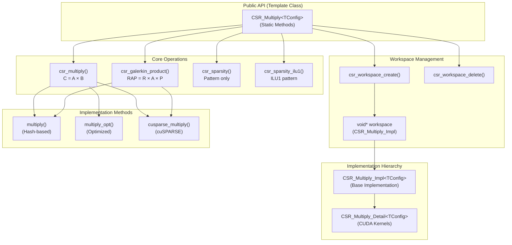
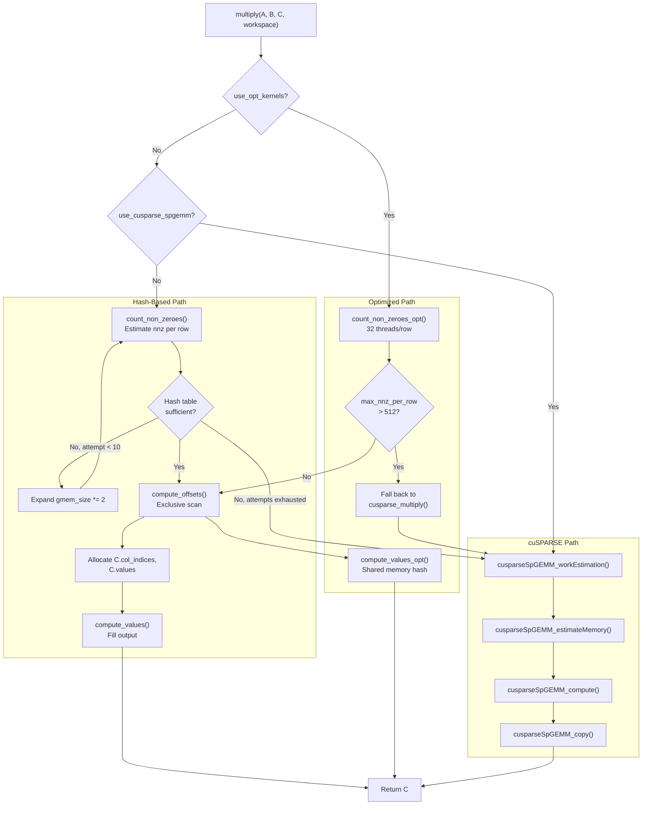
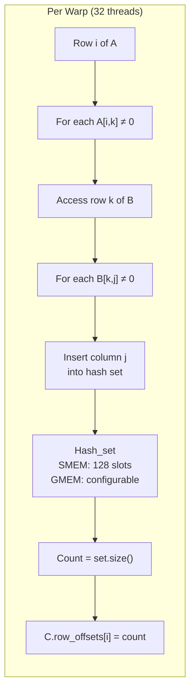
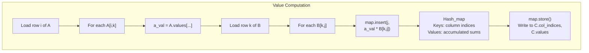
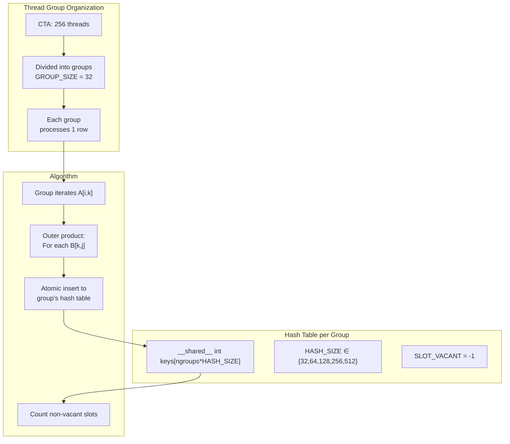
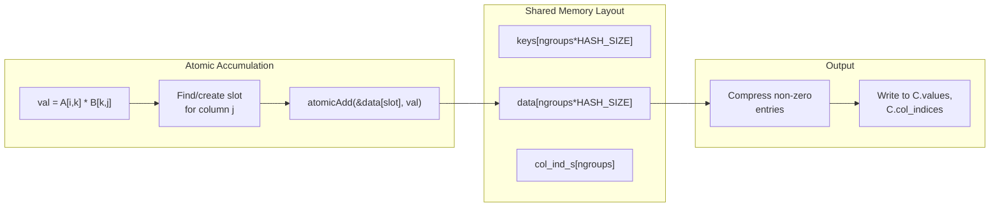
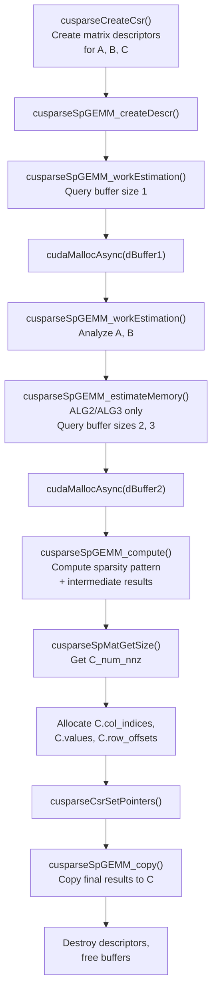
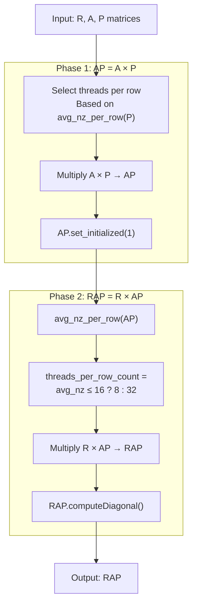
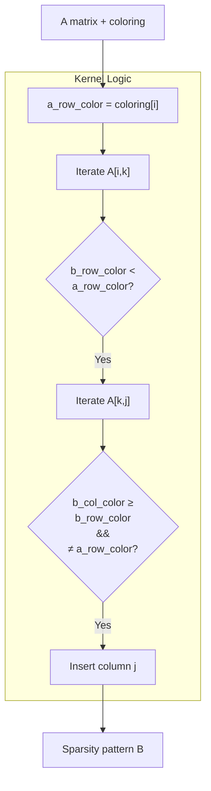
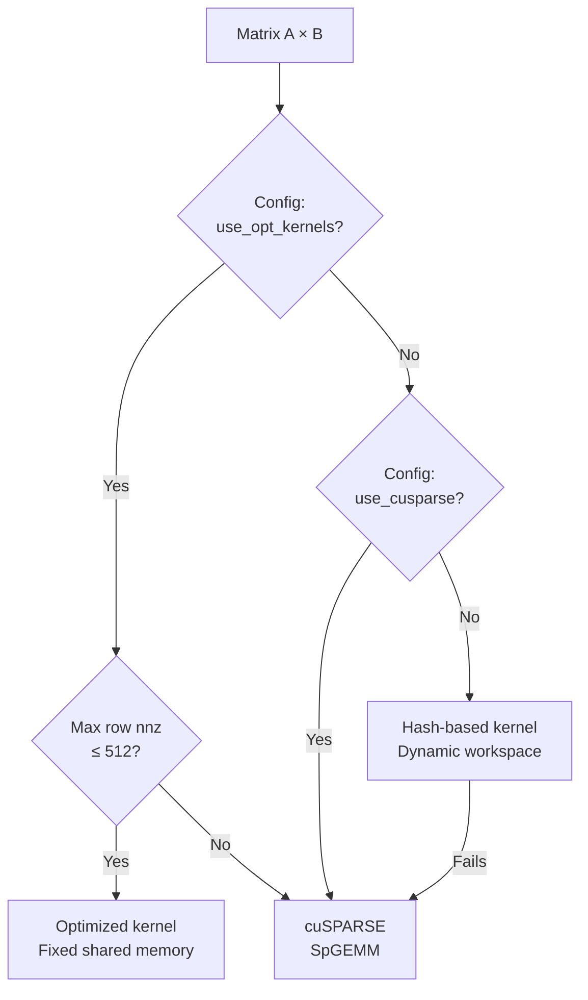

<!-- source: DeepWiki mcp.deepwiki.com · repo NVIDIA/AMGX · extra page CSR Multiplication · fetched 2026-10-26 -->

# CSR Multiplication

<details>
<summary>Relevant source files</summary>

The following files were used as context for generating this wiki page:

- [src/classical/interpolators/multipass.cu](src/classical/interpolators/multipass.cu)
- [src/csr_multiply.cu](src/csr_multiply.cu)
- [src/csr_multiply_detail.cu](src/csr_multiply_detail.cu)

</details>


## Purpose and Scope

This page documents the CSR (Compressed Sparse Row) sparse matrix-matrix multiplication subsystem in AMGX. CSR multiplication is a fundamental operation used throughout the library, particularly for computing Galerkin products during AMG hierarchy construction. This page covers:

- Sparse matrix-matrix multiplication algorithms (C = A * B)
- Galerkin product computation (RAP = R * A * P)
- Sparsity pattern calculation
- Hash-based and cuSPARSE-based implementations
- Optimized CUDA kernels for various sparsity patterns

For information about matrix storage formats and I/O operations, see [Matrix Storage and I/O](#2.1.1). For details on matrix-vector multiplication (SpMV), see [Sparse Matrix Operations](#2.1.2).

## Overview

CSR multiplication computes the product of two sparse matrices stored in CSR format. The key challenge is determining the sparsity pattern of the output matrix C = A × B, where each element C[i,j] is the dot product of row i of A with column j of B. Since only nonzero elements are stored, this requires efficiently identifying which output positions will be nonzero and computing their values.

AMGX provides multiple implementation strategies:
- **Hash-based approach**: Custom CUDA kernels using hash tables to accumulate partial products
- **cuSPARSE integration**: Leverages NVIDIA's optimized cuSPARSE library
- **Optimized kernels**: Specialized implementations for matrices with moderate sparsity

The subsystem is primarily used for:
- **Galerkin products** (RAP) during AMG level construction
- **Sparsity pattern generation** for ILU preconditioners
- **Matrix-matrix operations** in classical AMG interpolation

**Sources:** [src/csr_multiply.cu:1-848]()

## API and Class Structure



**Sources:** [src/csr_multiply.cu:19-244]()

### Entry Points

The `CSR_Multiply<TConfig>` class provides static methods that serve as the main API:

| Method | Purpose | Key Parameters |
|--------|---------|----------------|
| `csr_workspace_create()` | Allocates reusable workspace | Config, cfg_scope |
| `csr_workspace_delete()` | Frees workspace | workspace pointer |
| `csr_multiply()` | Full matrix multiplication | A, B, C matrices, workspace |
| `csr_galerkin_product()` | Triple product RAP | R, A, P matrices, workspace |
| `csr_sparsity()` | Sparsity pattern only | A, B, C matrices |
| `csr_sparsity_ilu1()` | ILU1 fill pattern | A, B matrices |

All methods are templated on `TConfig` which encodes memory space (host/device), precision (float/double), and index type (int/int64).

**Sources:** [src/csr_multiply.cu:20-244]()

## Multiplication Workflow



**Sources:** [src/csr_multiply.cu:433-573](), [src/csr_multiply_detail.cu:1614-1728]()

## Hash-Based Multiplication

The hash-based approach uses GPU hash tables to accumulate partial products. For each output row C[i], threads iterate over A[i,:] and for each nonzero A[i,k], they iterate over B[k,:], inserting column indices into a hash table.

### Two-Phase Algorithm

**Phase 1: Count Non-Zeros**

The `count_non_zeroes_kernel` determines the number of nonzeros in each output row:



The kernel template is parameterized by threads per row:
- `NUM_THREADS_PER_ROW = 2, 4, 8, 16, 32` (full warp)
- Adaptive selection based on average nonzeros per row

**Phase 2: Compute Values**

The `compute_values_kernel` uses `Hash_map` to accumulate values:



**Sources:** [src/csr_multiply_detail.cu:50-211](), [src/csr_multiply_detail.cu:944-1095]()

### Hash Table Structure

The hash table uses 4-way set-associative hashing:

| Component | Description |
|-----------|-------------|
| **SMEM keys** | 128 slots per warp in shared memory |
| **GMEM keys** | Configurable spillover to global memory |
| **Hash function** | Simple modulo: `hash = key % SMEM_SIZE` |
| **Collision handling** | Linear probing with 4 hash functions |
| **Status tracking** | Signals when GMEM exhausted |

The workspace size starts at a default and doubles on failure up to `spmm_max_attempts` (default 10).

**Sources:** [src/csr_multiply_detail.cu:70-79](), [src/csr_multiply.cu:285-289]()

## Optimized Kernels

For matrices with moderate sparsity (max row nonzeros ≤ 512), specialized kernels avoid dynamic memory allocation:

### Count Non-Zeros Optimized

`count_non_zeroes_kernel_opt` uses compile-time sized hash tables:



**Sources:** [src/csr_multiply_detail.cu:1098-1206]()

### Compute Values Optimized

`compute_values_kernel_opt` accumulates values directly in shared memory:



Dynamic shared memory size = `(sizeof(KeyType) + sizeof(ValueType)) * ngroups * HASH_SIZE`

**Sources:** [src/csr_multiply_detail.cu:1208-1334]()

### Selection Logic

The implementation calculates the maximum nonzeros per row before deciding:

```cpp
int max_nnz = thrust::reduce(C.row_offsets, max_func);
if (!success || max_nnz > 512) {
    cusparse_multiply(A, B, C);  // Fallback
}
```

**Sources:** [src/csr_multiply.cu:447-459]()

## cuSPARSE Integration

AMGX integrates NVIDIA's cuSPARSE library for robust SpGEMM (Sparse General Matrix-Matrix multiplication):

### cuSPARSE Workflow



**Sources:** [src/csr_multiply.cu:291-431]()

### Algorithm Selection

cuSPARSE provides multiple algorithms:

| Algorithm | Description | Configuration |
|-----------|-------------|---------------|
| `CUSPARSE_SPGEMM_DEFAULT` | Library selects best | Default |
| `CUSPARSE_SPGEMM_ALG1` | Standard approach | `cusparse_spgemm_alg = "CUSPARSE_SPGEMM_ALG1"` |
| `CUSPARSE_SPGEMM_ALG2` | Memory-efficient | Used by default (line 12) |
| `CUSPARSE_SPGEMM_ALG3` | High performance | `cusparse_spgemm_alg = "CUSPARSE_SPGEMM_ALG3"` |

AMGX defaults to `CUSPARSE_SPGEMM_ALG2` which balances memory and performance.

**Sources:** [src/csr_multiply.cu:12](), [src/csr_multiply.cu:28-54]()

### Memory Management

cuSPARSE operations use asynchronous memory allocation:

```cpp
amgx::memory::cudaMallocAsync(&dBuffer1, bufferSize1);
// ... computation ...
amgx::memory::cudaFreeAsync(dBuffer1);
```

For ALG2/ALG3, a chunk fraction (default 0.5) controls memory staging.

**Sources:** [src/csr_multiply.cu:341-386]()

## Galerkin Product

The Galerkin product RAP = R × A × P is critical for AMG coarse grid construction. This requires two sequential multiplications:



**Sources:** [src/csr_multiply.cu:647-707]()

### Adaptive Thread Configuration

The implementation adapts thread count based on matrix sparsity:

```cpp
int avg_nz_per_row = P.get_num_nz() / P.get_num_rows();
if (avg_nz_per_row < 2) {
    set_num_threads_per_row_count(2);
    set_num_threads_per_row_compute(2);
} else {
    set_num_threads_per_row_count(4);
    set_num_threads_per_row_compute(4);
}
```

After computing AP:

```cpp
avg_nz_per_row = AP.get_num_nz() / AP.get_num_rows();
set_num_threads_per_row_count(avg_nz_per_row <= 16.0 ? 8 : 32);
set_num_threads_per_row_compute(32);
```

This ensures efficient warp utilization for different sparsity patterns.

**Sources:** [src/csr_multiply.cu:654-686]()

### Distributed Galerkin Products

In distributed settings, intermediate matrices AP may have halo rows. The implementation uses mapping vectors (Aq1, Aq2, Pq1, Pq2) to handle index translations during multiplication.

**Sources:** [src/csr_multiply.cu:206-244]()

## Sparsity Pattern Computation

### Standard Sparsity

`csr_sparsity()` computes only the nonzero structure without values:

1. Calls `count_non_zeroes()` with `COUNT_ONLY = false`
2. Allocates `C.col_indices` and `C.values`
3. Calls `compute_sparsity()` which stores column indices without accumulating values

**Sources:** [src/csr_multiply.cu:730-775]()

### ILU1 Sparsity

`csr_sparsity_ilu1()` computes the fill pattern for incomplete LU factorization with level-1 fill:



This implements the parallel ILU(1) fill pattern respecting matrix coloring for parallelism.

**Sources:** [src/csr_multiply.cu:788-833](), [src/csr_multiply_detail.cu:575-749]()

## Workspace Management

### Workspace Creation

```cpp
void *workspace = CSR_Multiply<TConfig>::csr_workspace_create(cfg, cfg_scope);
```

This creates a `CSR_Multiply_Detail` or `CSR_Multiply_Impl` object with configuration:

- `spmm_max_attempts`: Maximum retry attempts (default 10)
- `use_opt_kernels`: Enable optimized kernels (default from config)
- `use_cusparse_spgemm`: Prefer cuSPARSE (default from config)

**Sources:** [src/csr_multiply.cu:28-54]()

### Memory Expansion

The hash-based approach uses exponential backoff:

```cpp
for (int attempt = 0; !done && attempt < max_attempts; ++attempt) {
    if (attempt > 0) {
        m_gmem_size *= 2;  // Double global memory
        allocate_workspace();
    }
    // ... attempt multiplication ...
}
```

On failure, the system falls back to cuSPARSE:

```cpp
if (!done) {
    cusparse_multiply(A, B, C, ...);
}
```

**Sources:** [src/csr_multiply.cu:496-532]()

### Work Queue

A global work queue enables dynamic load balancing:

```cuda
__device__ int get_work(int *queue, int warp_id) {
    int offset = -1;
    if (lane_id() == 0) {
        offset = atomicAdd(queue, 1);
    }
    return shfl(offset, 0);
}
```

This allows warps to claim rows on-demand rather than static assignment.

**Sources:** [src/csr_multiply_detail.cu:35-45]()

## Configuration Parameters

| Parameter | Type | Default | Description |
|-----------|------|---------|-------------|
| `spmm_max_attempts` | int | 10 | Max hash table expansion attempts |
| `use_opt_kernels` | int | 0 | Enable optimized fixed-size kernels |
| `use_cusparse_spgemm` | int | 0 | Prefer cuSPARSE over custom kernels |
| `cusparse_spgemm_alg` | string | "CUSPARSE_SPGEMM_ALG2" | cuSPARSE algorithm choice |
| `cusparse_spgemm_fraction` | double | 0.5 | Memory chunk fraction (ALG3 only) |

### Usage Example

```json
{
  "config_version": 2,
  "solver": {
    "spmm_max_attempts": 15,
    "use_opt_kernels": 1,
    "use_cusparse_spgemm": 0,
    "cusparse_spgemm_alg": "CUSPARSE_SPGEMM_ALG3"
  }
}
```

**Sources:** [src/csr_multiply.cu:30-54]()

## Performance Considerations

### Algorithm Selection Strategy



### Performance Trade-offs

| Approach | Best For | Memory | Robustness |
|----------|----------|--------|------------|
| **Optimized** | Dense rows (≤512 nnz) | Predictable (shared mem) | Limited to moderate sparsity |
| **Hash-based** | Varying sparsity | Adaptive (SMEM + GMEM) | Falls back on failure |
| **cuSPARSE** | Very sparse or very dense | Managed by library | Always succeeds |

The multi-level fallback ensures robustness while attempting to use the fastest method for each case.

**Sources:** [src/csr_multiply.cu:434-479](), [src/csr_multiply_detail.cu:2141-2166]()

---

