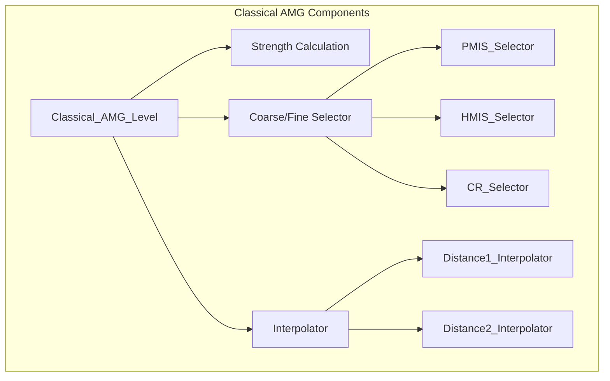
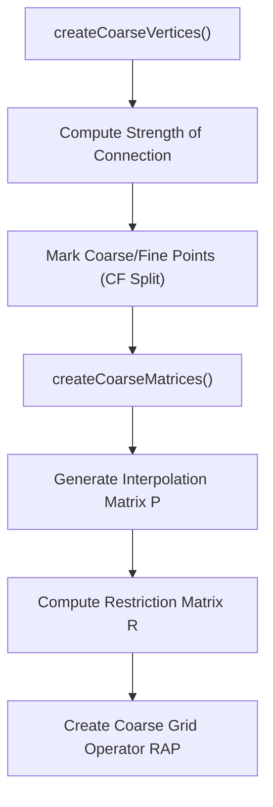
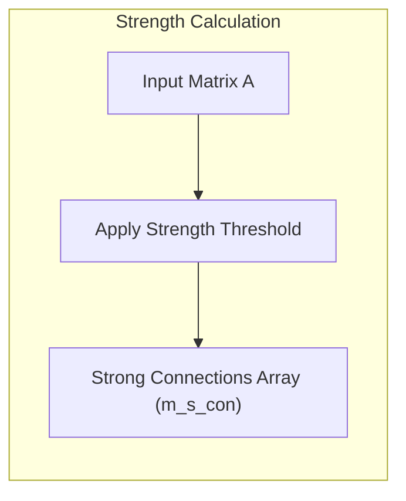
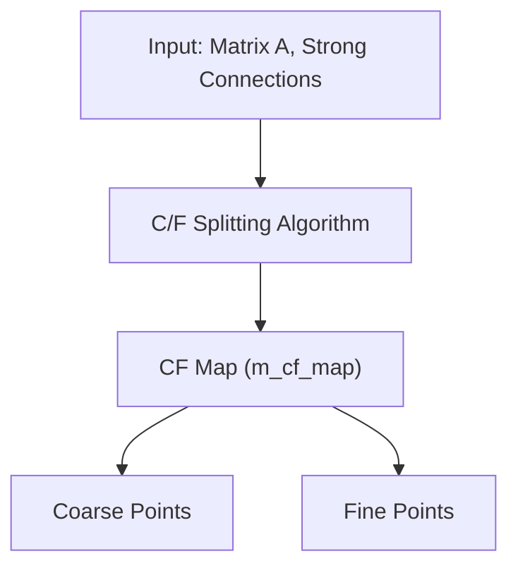
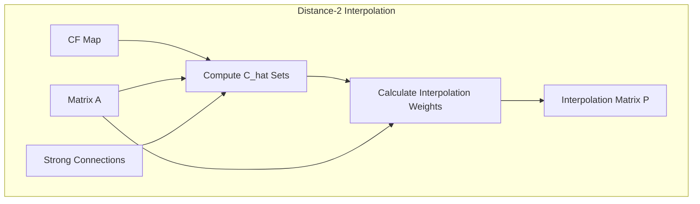
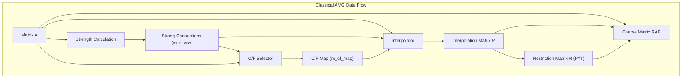
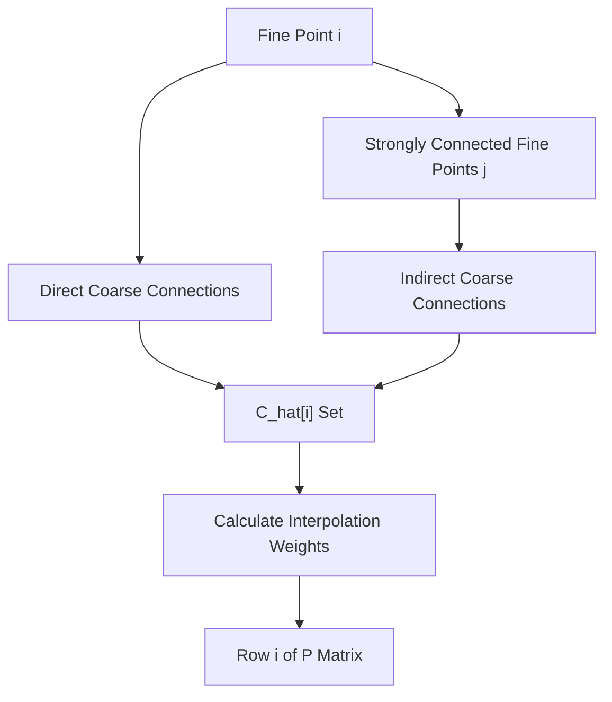
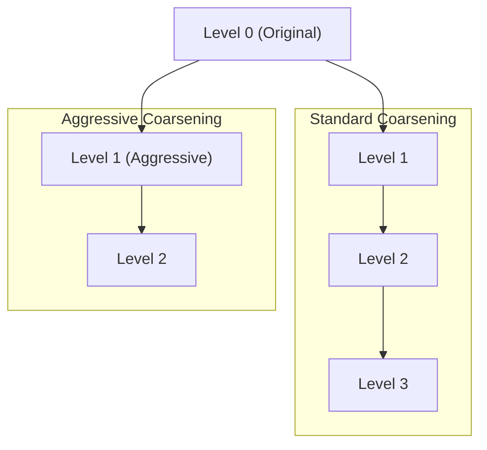

<!-- source: DeepWiki mcp.deepwiki.com · repo NVIDIA/AMGX · extra page Classical AMG · fetched 2026-10-26 -->

# Classical AMG

<details>
<summary>Relevant source files</summary>

The following files were used as context for generating this wiki page:

- [src/classical/interpolators/multipass.cu](src/classical/interpolators/multipass.cu)
- [src/csr_multiply.cu](src/csr_multiply.cu)
- [src/csr_multiply_detail.cu](src/csr_multiply_detail.cu)

</details>


Classical AMG is an algebraic multigrid method within the AMGX library used to solve large sparse linear systems. Unlike Aggregation AMG (see [Aggregation AMG](#3.1.1)), which groups fine points into aggregates, Classical AMG selectively identifies a subset of fine grid points to serve as coarse grid points, then constructs interpolation operators to transfer information between grids. This approach focuses on preserving "strong connections" between variables to maintain numerical accuracy across grid levels.

## Architecture and Components

The Classical AMG implementation in AMGX centers around the coarsening process and uses specialized components for strength detection, coarse point selection, and interpolation.



Sources: [src/classical/classical_amg_level.cu:173-187](src/classical/classical_amg_level.cu:173-187), [src/classical/interpolators/distance2.cu:5-26](src/classical/interpolators/distance2.cu:5-26)

## Workflow

The Classical AMG method follows this workflow during setup:



Sources: [src/classical/classical_amg_level.cu:212-264](src/classical/classical_amg_level.cu:212-264)

## Strength of Connection Calculation

The strength calculation determines which connections between variables are considered "strong" and should influence the coarsening process. A connection from point i to point j is deemed "strong" if:

```
|A(i,j)| >= alpha * max_{k!=i} |A(i,k)|
```

where alpha is a user-defined threshold (0 < alpha < 1).

The result is stored in a boolean array `m_s_con` marking which connections are strong. This information guides both coarse point selection and interpolation operator construction.



Sources: [src/classical/strength/strength_base.cu:61-138](src/classical/strength/strength_base.cu:61-138), [src/classical/strength/strength_base.cu:497-533](src/classical/strength/strength_base.cu:497-533)

## Coarse/Fine Point Selection (CF Splitting)

The C/F selection process partitions grid points into coarse (C) and fine (F) points. AMGX implements several selection strategies:

- **PMIS** (Parallel Modified Independent Set): Creates a maximal independent set of coarse points
- **HMIS** (Hybrid Modified Independent Set): Combines classical and parallel approaches
- **CR** (Compatible Relaxation): Selects coarse points based on relaxation error

Each point is marked in the `m_cf_map` array as COARSE, FINE, or STRONG_FINE. The selector aims to ensure each fine point is strongly connected to at least one coarse point while minimizing the number of coarse points.



Sources: [src/classical/selectors/cr.cu:124-135](src/classical/selectors/cr.cu:124-135), [src/classical/selectors/selector.cu:140-250](src/classical/selectors/selector.cu:140-250)

## Interpolation Operators

The interpolation operator P defines how values at coarse points are interpolated to fine points. AMGX uses two main interpolation approaches:

1. **Distance-1 Interpolation**: Uses only direct (one-hop) connections to compute interpolation weights
2. **Distance-2 Interpolation**: Considers both direct and indirect (two-hop) connections for more accurate interpolation

The Distance-2 interpolator is particularly sophisticated, accounting for strong connections through intermediate fine points. For a fine point i, the algorithm:

1. Identifies the set of coarse points C_hat[i] that influence i
2. Computes weights for each coarse point based on matrix entries and connection strengths
3. Assembles these weights into the interpolation matrix P



Sources: [src/classical/interpolators/distance2.cu:126-183](src/classical/interpolators/distance2.cu:126-183), [src/classical/interpolators/distance2.cu:319-570](src/classical/interpolators/distance2.cu:319-570)

## Matrix Structure and Data Flow

Classical AMG operates on the following key data structures:

| Component | Purpose | Storage |
|-----------|---------|---------|
| Matrix A | Original system matrix | CSR format |
| m_s_con | Strong connection indicator | Boolean array |
| m_cf_map | Coarse/Fine point designation | Integer array (COARSE, FINE, STRONG_FINE) |
| P | Interpolation matrix | CSR format |
| R | Restriction matrix | CSR format (typically transpose of P) |
| RAP | Coarse grid operator | CSR format |



Sources: [src/classical/classical_amg_level.cu:242-264](src/classical/classical_amg_level.cu:242-264)

## Distance-2 Interpolation Details

The Distance-2 interpolation is a key component of Classical AMG, accounting for both direct and indirect influences. For each fine point i, it:

1. Identifies all coarse points that strongly influence i (direct connections)
2. Finds fine points j that are strongly connected to i
3. Identifies coarse points that strongly influence these fine points j (indirect connections)
4. Combines both sets to form C_hat[i]
5. Calculates interpolation weights based on matrix entries and connection strengths



Sources: [src/classical/interpolators/distance2.cu:850-1001](src/classical/interpolators/distance2.cu:850-1001)

## Performance Optimizations

Classical AMG implementations include several optimizations:

1. **GPU Kernels**: Specialized CUDA kernels for strength calculation, C/F selection, and interpolation construction
2. **Memory Management**: Efficient data structures to minimize memory usage
3. **Interpolation Truncation**: Limiting interpolation entries with parameters:
   - `trunc_factor`: Controls truncation threshold for small weights
   - `max_elmts`: Limits maximum number of interpolation entries per row

4. **Aggressive Coarsening**: Option to perform multiple levels of coarsening in one step

Sources: [src/classical/classical_amg_level.cu:184-186](src/classical/classical_amg_level.cu:184-186), [src/classical/interpolators/distance2.cu:573-731](src/classical/interpolators/distance2.cu:573-731)

## Aggressive Coarsening

For problems requiring many grid levels, AMGX supports aggressive coarsening, which skips intermediate levels to create a more rapidly coarsening hierarchy:



The number of aggressive levels is controlled by the `aggressive_levels` parameter. When using aggressive coarsening, specialized selectors (like AGGRESSIVE_PMIS or AGGRESSIVE_HMIS) and interpolators are employed.

Sources: [src/classical/classical_amg_level.cu:124-162](src/classical/classical_amg_level.cu:124-162), [src/classical/classical_amg_level.cu:187](src/classical/classical_amg_level.cu:187)

---

