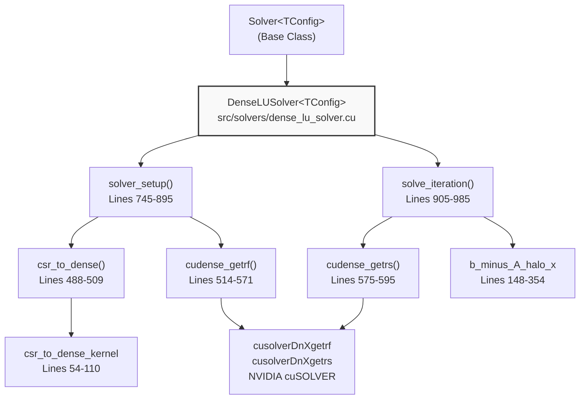
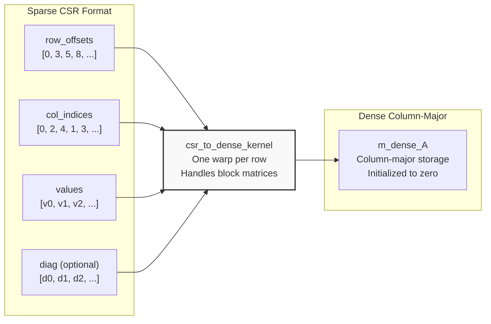
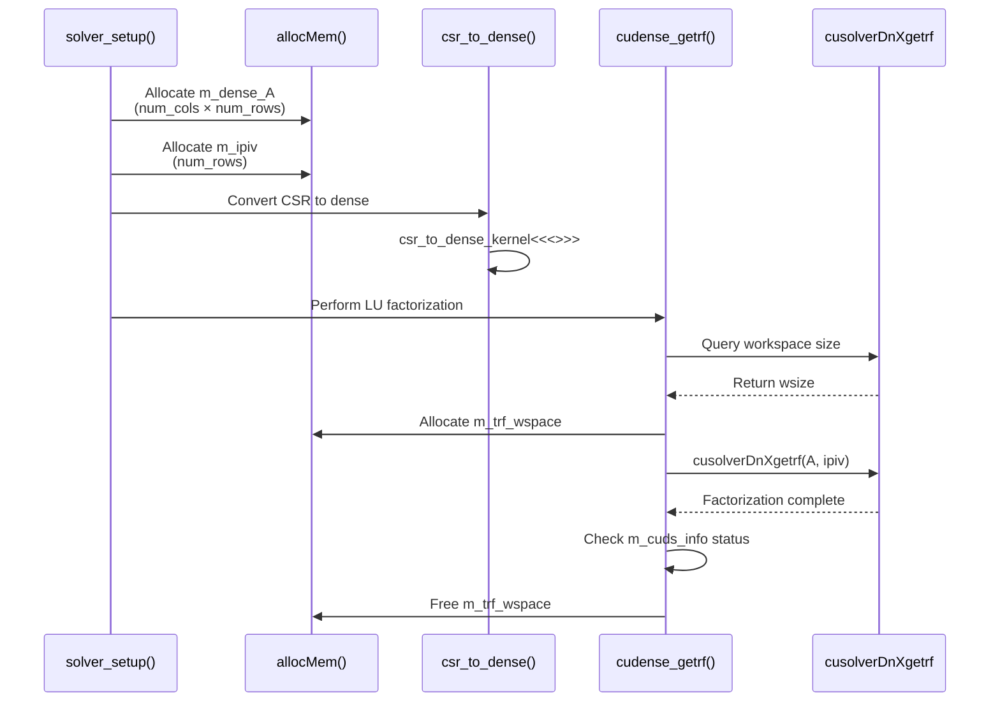
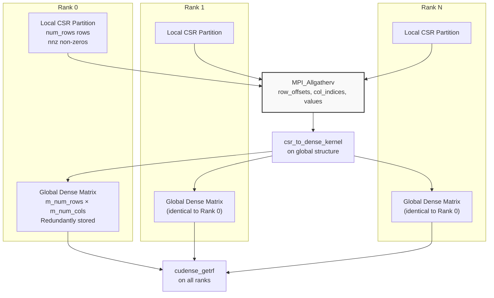
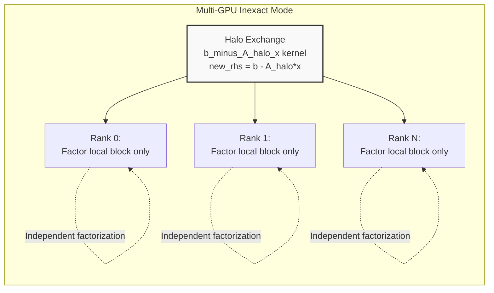
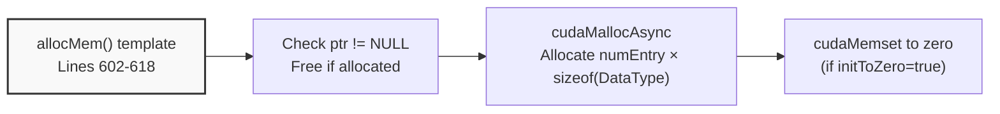
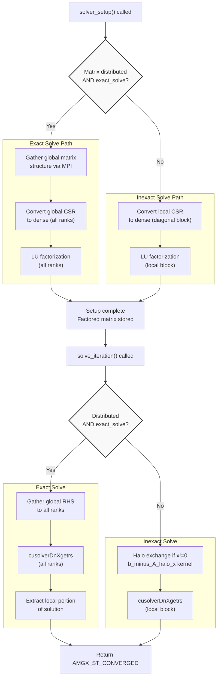

<!-- source: DeepWiki mcp.deepwiki.com · repo NVIDIA/AMGX · extra page Dense LU Solver · fetched 2026-10-26 -->

# Dense LU Solver

<details>
<summary>Relevant source files</summary>

The following files were used as context for generating this wiki page:

- [include/cutil.h](include/cutil.h)
- [include/energymin/interpolators/common.h](include/energymin/interpolators/common.h)
- [src/amgx_lapack.cu](src/amgx_lapack.cu)
- [src/hash_workspace.cu](src/hash_workspace.cu)
- [src/scalers/diagonal_symmetric.cu](src/scalers/diagonal_symmetric.cu)
- [src/solvers/dense_lu_solver.cu](src/solvers/dense_lu_solver.cu)

</details>


## Purpose and Scope

The Dense LU Solver performs direct solution of linear systems by converting sparse CSR matrices to dense format and applying LU factorization via cuSOLVER. It is primarily used as a coarse-level direct solver in AMG hierarchies. For information about the base solver framework and convergence checking, see [Solver Framework](#3.1). For details on cuSOLVER and LAPACK integration, see [LAPACK and MAGMA Integration](#3.5.2).

**Sources:** [src/solvers/dense_lu_solver.cu:1-996]()

## Overview

The `DenseLUSolver` class template provides a direct solution method that converts sparse matrices in Compressed Sparse Row (CSR) format to dense column-major format and applies LU decomposition. This solver is typically employed at the coarsest level of an AMG hierarchy where the matrix is small enough that dense factorization is efficient.

The solver operates in two distinct modes:
- **Exact Solve Mode**: Available only for Classical AMG with distributed matrices, gathers the entire coarse matrix to all ranks and performs a global LU factorization
- **Inexact Solve Mode**: For non-exact solves or single-GPU cases, factors only the local diagonal block (effectively block Jacobi in multi-GPU settings)



**Sources:** [src/solvers/dense_lu_solver.cu:624-670](), [src/solvers/dense_lu_solver.cu:745-895]()

## Class Structure and Members

The `DenseLUSolver` class maintains state for the LU factorization and cuSOLVER operations:

| Member Variable | Type | Purpose |
|----------------|------|---------|
| `m_cuds_handle` | `cusolverDnHandle_t` | cuSOLVER handle for dense operations |
| `m_cublas_handle` | `cublasHandle_t` | cuBLAS handle (for future extensions) |
| `m_num_rows` | `int` | Number of rows in dense matrix |
| `m_num_cols` | `int` | Number of columns in dense matrix |
| `m_lda` | `int` | Leading dimension of dense matrix (column-major) |
| `m_dense_A` | `Matrix_data*` | Device pointer to dense matrix storage |
| `m_ipiv` | `int*` | Pivot sequence from LU factorization |
| `m_cuds_info` | `int*` | Device memory for cuSOLVER status |
| `m_trf_wspace` | `Matrix_data*` | Workspace for factorization |
| `m_enable_exact_solve` | `bool` | Whether exact distributed solve is enabled |

**Sources:** [src/solvers/dense_lu_solver.cu:624-670]()

## CSR to Dense Conversion

The solver converts sparse CSR matrices to dense column-major format suitable for cuSOLVER operations. The conversion kernel `csr_to_dense_kernel` uses a warp-per-row strategy to efficiently copy matrix entries.



The kernel handles block-structured matrices by using multiple threads per block entry. For an `N×N` block matrix:
- Each warp processes one row of blocks
- Within the warp, `N×N` threads handle one block's entries
- The kernel skips halo entries (column indices ≥ `num_rows`) for distributed matrices

**Key Implementation Details:**
- **Warp-based parallelism**: One warp (32 threads) per matrix row for scalar matrices
- **Block structure support**: For `N×N` blocks, `N²` threads per warp process block entries
- **Column-major storage**: Dense matrix stored with `lda = num_rows` for cuSOLVER compatibility
- **Diagonal handling**: Separate diagonal array pointer used when `DIAG` property is set

**Sources:** [src/solvers/dense_lu_solver.cu:54-110](), [src/solvers/dense_lu_solver.cu:488-509]()

## LU Factorization with cuSOLVER

The factorization phase uses cuSOLVER's `cusolverDnXgetrf` function, which is a precision-generic wrapper around cuSOLVER's dense LU decomposition routines.



The factorization process performs the decomposition `A = PLU` where:
- `P` is a permutation matrix (stored in `m_ipiv`)
- `L` is lower triangular with unit diagonal
- `U` is upper triangular

The factorized matrix is stored in-place in `m_dense_A` with `L` and `U` combined (unit diagonal of `L` is implicit).

**Error Handling:**
- `info < 0`: Invalid parameter at position `-info`
- `info > 0`: Matrix is singular, factorization failed at column `info`
- The implementation terminates with `FatalError` on any failure condition

**Sources:** [src/solvers/dense_lu_solver.cu:514-571]()

## Triangular Solves

The `cudense_getrs` method applies the factorized matrix to solve the system `Ax = b`:

1. Apply permutation `P` to right-hand side
2. Solve `Ly = Pb` (forward substitution)
3. Solve `Ux = y` (backward substitution)

All three operations are performed by the single `cusolverDnXgetrs` call with operation type `CUBLAS_OP_N` (no transpose).

**Sources:** [src/solvers/dense_lu_solver.cu:575-595]()

## Distributed Solve Modes

### Exact Solve Mode (Classical AMG Only)

When exact coarse solve is enabled (`exact_coarse_solve=1` in configuration and `algorithm=CLASSICAL`), the solver performs a globally exact solve by gathering the entire coarse matrix to all ranks.



**Setup Phase (solver_setup):**
1. Compute global matrix dimensions using `manager->num_rows_global`
2. Transform local column indices to global index space using `local_to_global_map`
3. Offset local row offsets by accumulated NNZ displacements
4. Gather transformed structure to all ranks via `MPI_Allgatherv`
5. Each rank converts the full global CSR to dense format
6. Each rank performs identical LU factorization

**Solve Phase (solve_iteration):**
1. Gather local RHS portions to global RHS on all ranks
2. Each rank performs identical triangular solves
3. Each rank extracts its local portion of the solution

This approach provides exact coarse-level solves at the cost of redundant storage and computation. It is only efficient when the coarse matrix is small.

**Sources:** [src/solvers/dense_lu_solver.cu:758-876](), [src/solvers/dense_lu_solver.cu:913-953]()

### Inexact Solve Mode (Block Jacobi)

For single-GPU cases or when exact solve is disabled, the solver factors only the local diagonal block:



**Matrix Setup:**
- Only the diagonal block owned by each rank is converted to dense
- Rectangular matrices are handled: `num_cols = get_num_rows()` (not `get_num_cols()`)
- Halo columns are skipped during conversion (line 96 in kernel)

**Solve Process:**
1. Exchange halo values of current solution `x` if not starting from zero
2. Compute modified RHS: `new_rhs = b - A_halo*x` using `b_minus_A_halo_x` kernel
3. Solve local system with factorized diagonal block
4. Mark solution as dirty for next iteration's halo exchange

The `b_minus_A_halo_x` kernel efficiently computes the contribution of halo (off-processor) columns to modify the RHS, allowing the local solver to operate independently.

**Sources:** [src/solvers/dense_lu_solver.cu:878-891](), [src/solvers/dense_lu_solver.cu:956-979](), [src/solvers/dense_lu_solver.cu:148-354]()

## Distributed RHS Modification Kernel

The `b_minus_A_halo_x` kernel computes `new_rhs = b - A_halo*x` where `A_halo` refers to matrix columns with indices ≥ `num_owned_rows`. This kernel is critical for the block Jacobi approach in multi-GPU inexact mode.

**Kernel Characteristics:**
- Template parameters for block size `N` (1-5 supported)
- Warp-based parallelism: `NxN` threads per warp handle one block row
- Support for both row-major and column-major block formats
- Handles external diagonal storage via `HAS_EXTERNAL_DIAG` flag

**Parallelization Strategy:**

| Parameter | Value | Purpose |
|-----------|-------|---------|
| `CTA_SIZE` | 128 | Threads per block |
| `WARP_SIZE` | 32 | Threads per warp |
| `NUM_ITEMS_PER_WARP` | `32 / (N×N)` | Block rows per warp |
| Active threads | First `N×N` per warp | Process one block row |

**Sources:** [src/solvers/dense_lu_solver.cu:148-354](), [src/solvers/dense_lu_solver.cu:362-449](), [src/solvers/dense_lu_solver.cu:454-483]()

## Memory Management

The solver uses custom memory allocation via `allocMem` helper function:



**Allocated Resources:**
- `m_dense_A`: Dense matrix storage (`num_rows × num_cols`, initialized to zero)
- `m_ipiv`: Pivot indices (`num_rows` integers)
- `m_trf_wspace`: Temporary workspace for factorization (freed after setup)
- `m_cuds_info`: Device-side status flag (1 integer)

All allocations use AMGX's async memory allocation system for better performance with CUDA streams.

**Sources:** [src/solvers/dense_lu_solver.cu:602-618]()

## Configuration and Usage

The Dense LU solver is configured via the `solver` parameter in AMGX configuration files. It is most commonly used as a coarse-level solver in AMG hierarchies.

**Configuration Parameters:**

| Parameter | Values | Effect |
|-----------|--------|--------|
| `solver` | `DENSE_LU_SOLVER` | Selects this solver |
| `exact_coarse_solve` | `0` or `1` | Enables exact distributed solve (Classical AMG only) |
| `algorithm` | `CLASSICAL` | Required for exact solve mode |

**Example JSON Configuration:**

```json
{
  "config_version": 2,
  "solver": {
    "algorithm": "AGGREGATION",
    "solver": "AMG",
    "presweeps": 1,
    "postsweeps": 1,
    "coarse_solver": "DENSE_LU_SOLVER"
  }
}
```

**For Classical AMG with Exact Solve:**

```json
{
  "config_version": 2,
  "solver": {
    "algorithm": "CLASSICAL",
    "solver": "AMG",
    "exact_coarse_solve": 1,
    "coarse_solver": "DENSE_LU_SOLVER"
  }
}
```

**Constraints:**
- Maximum iteration count is hardcoded to 1 (line 663)
- Always returns `AMGX_ST_CONVERGED` as direct solvers converge in one iteration
- Requires CUDA Toolkit 12.0+ for cuSOLVER support

**Sources:** [src/solvers/dense_lu_solver.cu:667-670](), [src/solvers/dense_lu_solver.cu:984]()

## Workflow Summary

The complete workflow of the Dense LU solver from setup to solve:



**Sources:** [src/solvers/dense_lu_solver.cu:745-895](), [src/solvers/dense_lu_solver.cu:905-985]()

---

