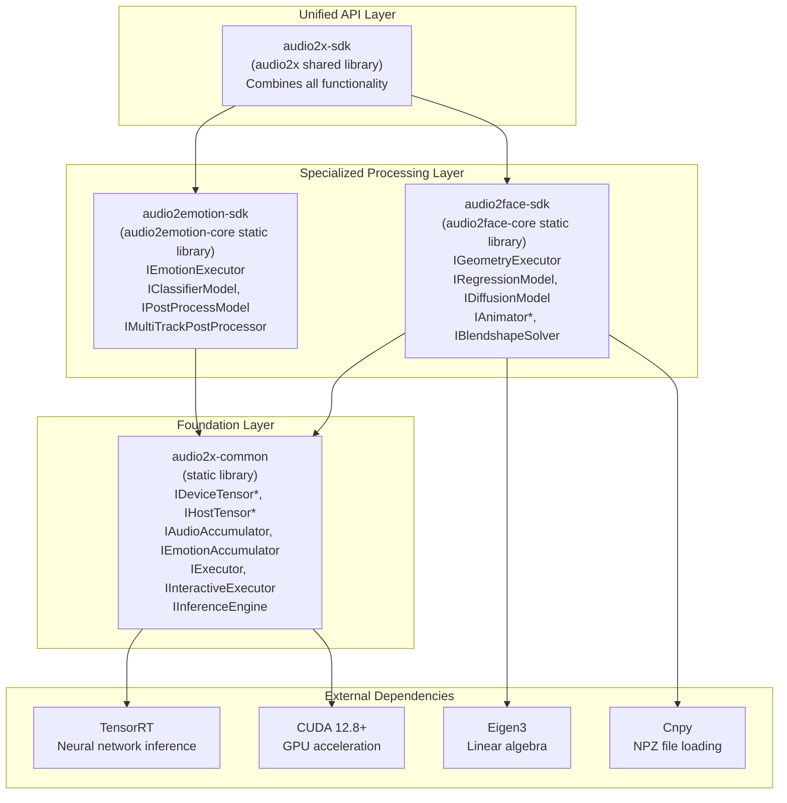
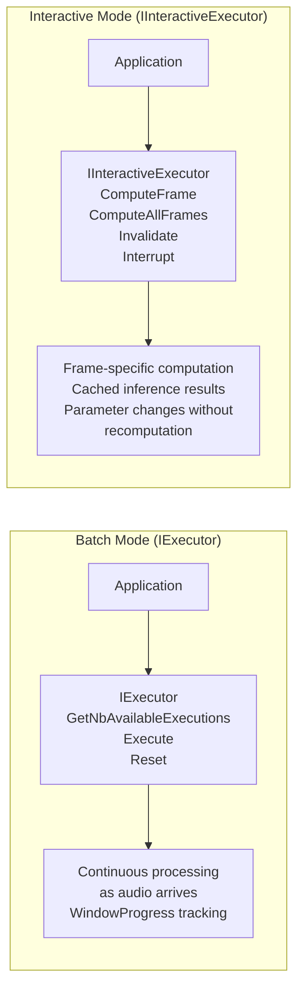
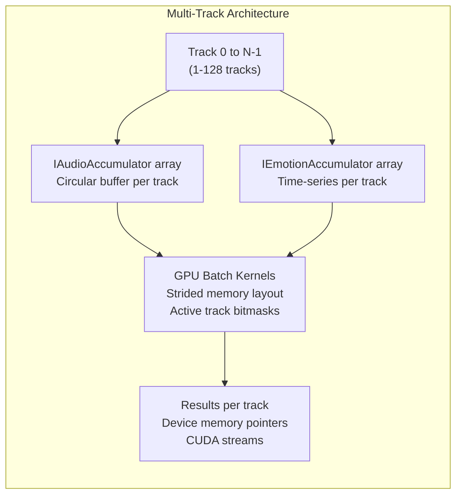
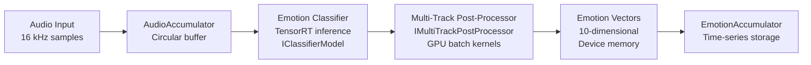
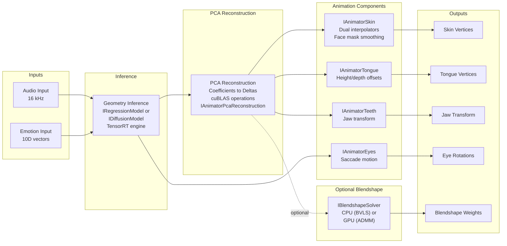
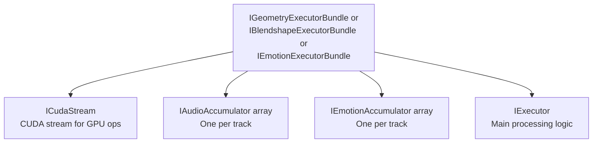
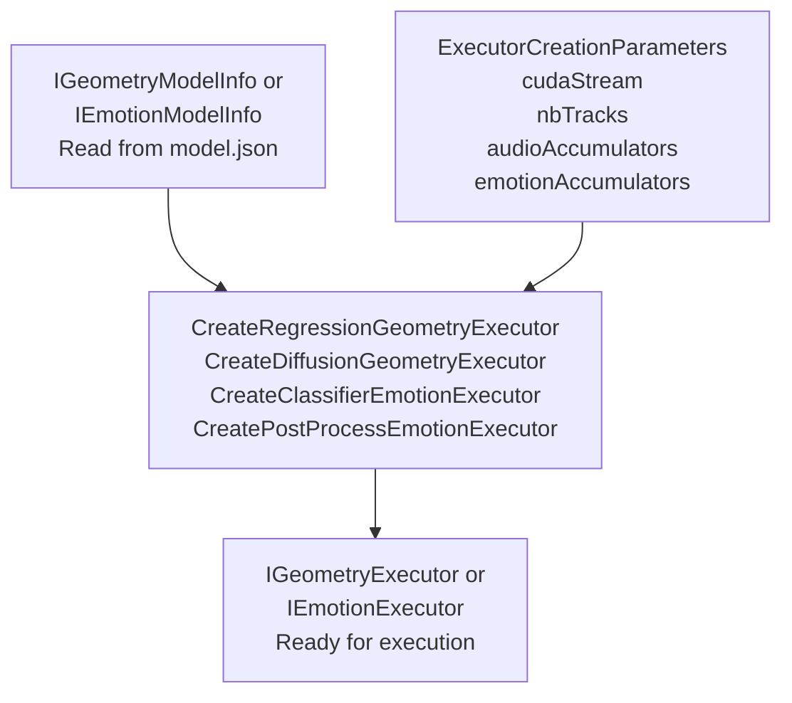
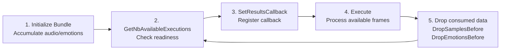
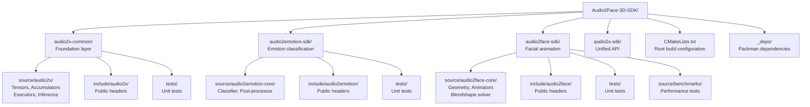
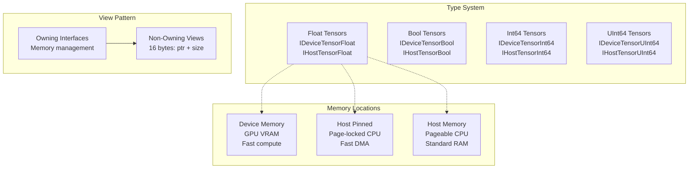

<!-- source: DeepWiki mcp.deepwiki.com · repo NVIDIA/Audio2Face-3D-SDK · page 1 Overview · fetched 2026-10-26 -->

# Overview

<details>
<summary>Relevant source files</summary>

The following files were used as context for generating this wiki page:

- [CMakeLists.txt](CMakeLists.txt)
- [audio2emotion-sdk/include/audio2emotion/audio2emotion.h](audio2emotion-sdk/include/audio2emotion/audio2emotion.h)
- [audio2emotion-sdk/include/audio2emotion/internal/executor.h](audio2emotion-sdk/include/audio2emotion/internal/executor.h)
- [audio2emotion-sdk/include/audio2emotion/internal/parse_helper.h](audio2emotion-sdk/include/audio2emotion/internal/parse_helper.h)
- [audio2emotion-sdk/include/audio2emotion/parse_helper.h](audio2emotion-sdk/include/audio2emotion/parse_helper.h)
- [audio2emotion-sdk/source/audio2emotion-core/CMakeLists.txt](audio2emotion-sdk/source/audio2emotion-core/CMakeLists.txt)
- [audio2emotion-sdk/source/audio2emotion/audio2emotion.cpp](audio2emotion-sdk/source/audio2emotion/audio2emotion.cpp)
- [audio2emotion-sdk/tests/CMakeLists.txt](audio2emotion-sdk/tests/CMakeLists.txt)
- [audio2face-sdk/source/audio2face-core/CMakeLists.txt](audio2face-sdk/source/audio2face-core/CMakeLists.txt)
- [audio2face-sdk/source/audio2face-core/executor.cpp](audio2face-sdk/source/audio2face-core/executor.cpp)
- [audio2face-sdk/source/audio2face/audio2face.cpp](audio2face-sdk/source/audio2face/audio2face.cpp)
- [audio2face-sdk/source/benchmarks/CMakeLists.txt](audio2face-sdk/source/benchmarks/CMakeLists.txt)
- [audio2face-sdk/source/benchmarks/utils.h](audio2face-sdk/source/benchmarks/utils.h)
- [audio2face-sdk/tests/CMakeLists.txt](audio2face-sdk/tests/CMakeLists.txt)
- [audio2face-sdk/tests/test_core_executor.cpp](audio2face-sdk/tests/test_core_executor.cpp)
- [audio2x-common/source/audio2x/CMakeLists.txt](audio2x-common/source/audio2x/CMakeLists.txt)
- [audio2x-common/tests/CMakeLists.txt](audio2x-common/tests/CMakeLists.txt)
- [audio2x-sdk/CMakeLists.txt](audio2x-sdk/CMakeLists.txt)

</details>


## Purpose and Scope

The **Audio2Face-3D-SDK** is a GPU-accelerated C++ library that generates facial animation from audio input. The SDK provides two primary capabilities:

1. **Audio2Emotion**: Classifies emotional content from audio streams, outputting 10-dimensional emotion vectors
2. **Audio2Face**: Generates facial geometry (skin vertices, tongue, jaw transforms, eye rotations) and optional blendshape weights from audio and emotion inputs

This page provides a high-level overview of the SDK's architecture, core concepts, and organization. For detailed information about specific subsystems:
- Build system and dependencies: See [Build System and Dependencies](#2)
- Foundation infrastructure: See [Core Infrastructure (audio2x-common)](#3)
- Facial animation generation: See [Audio2Face SDK](#4)
- Emotion classification: See [Audio2Emotion SDK](#5)
- Interactive execution mode: See [Interactive Execution](#6)
- Parallel processing: See [Multi-Track Batch Processing](#7)

**Sources:** [audio2face-sdk/source/audio2face/audio2face.cpp:1-893](), [audio2emotion-sdk/source/audio2emotion/audio2emotion.cpp:1-334](), [CMakeLists.txt:1-151]()

---

## Three-Tier Architecture

The SDK is organized into three distinct layers, with a unified API layer on top:



**Layer Responsibilities:**

| Layer | Purpose | Key Interfaces |
|-------|---------|----------------|
| **audio2x-common** | Foundation utilities used by both specializations | `IDeviceTensorFloat`, `IAudioAccumulator`, `IEmotionAccumulator`, `IExecutor`, `IInferenceEngine` |
| **audio2emotion-core** | Emotion classification and post-processing | `IEmotionExecutor`, `IClassifierModel`, `IPostProcessModel`, `IMultiTrackPostProcessor` |
| **audio2face-core** | Geometry generation and animation | `IGeometryExecutor`, `IRegressionModel`, `IDiffusionModel`, `IAnimatorSkin`, `IBlendshapeSolver` |
| **audio2x** | Unified public API combining both | All public headers from the three core libraries |

**Sources:** [audio2x-sdk/CMakeLists.txt:1-104](), [audio2x-common/source/audio2x/CMakeLists.txt:1-38](), [audio2emotion-sdk/source/audio2emotion-core/CMakeLists.txt:1-40](), [audio2face-sdk/source/audio2face-core/CMakeLists.txt:1-40]()

---

## Core Processing Concepts

### Execution Modes: Batch vs Interactive

The SDK supports two distinct processing paradigms through separate executor interfaces:



**Batch Mode** (`IExecutor`):
- Processes audio streams continuously as data arrives
- Uses `WindowProgress` to track readiness across multiple tracks
- Suitable for real-time streaming or offline batch processing
- Defined in executor interfaces across all three core libraries

**Interactive Mode** (`IInteractiveExecutor`):
- Enables frame-specific computation with sophisticated caching
- Inference computed once, then rapid parameter changes in post-processing
- Supports timeline scrubbing and dynamic parameter adjustment
- Layer-based invalidation system for efficient recomputation

**Sources:** [audio2face-sdk/source/audio2face-core/executor.cpp:29-330](), [audio2emotion-sdk/include/audio2emotion/internal/executor.h:1-138]()

### Multi-Track Batch Processing

The SDK supports parallel processing of 1-128 independent audio tracks with GPU batch operations:



Each executor maintains:
- Separate `IAudioAccumulator` and `IEmotionAccumulator` per track
- Independent `WindowProgress` tracking for frame timestamps
- Strided GPU memory layouts for efficient batch processing
- Active track bitmasks (`bit_vector<uint64_t>`) to coordinate execution

**Sources:** [audio2face-sdk/tests/test_core_executor.cpp:53-229](), [audio2emotion-sdk/include/audio2emotion/internal/executor.h:106-111]()

---

## End-to-End Data Flow

### Audio2Emotion Pipeline



Post-processing operations include:
- **Emotion mapping**: Correspondence between emotion spaces
- **Contrast enhancement**: Max-based selection
- **Temporal smoothing**: Previous frame blending
- **Preferred blending**: User-selected emotion targets
- **Live transition**: Time-based interpolation

**Sources:** [audio2emotion-sdk/include/audio2emotion/audio2emotion.h:1-203]()

### Audio2Face Pipeline



**Model Types:**
- **Regression models**: Frame-by-frame mapping at 60 FPS
- **Diffusion models**: GRU-based iterative refinement with state

**Sources:** [audio2face-sdk/source/audio2face/audio2face.cpp:26-274]()

---

## Key Code Entry Points

### Bundle Pattern for Initialization

The SDK provides a **Bundle pattern** that encapsulates all resources needed for execution in a single object:



**Factory Functions:**

| Function | Purpose | File Reference |
|----------|---------|----------------|
| `ReadRegressionGeometryExecutorBundle()` | Load regression model bundle | [audio2face-sdk/source/audio2face/audio2face.cpp:822-833]() |
| `ReadDiffusionGeometryExecutorBundle()` | Load diffusion model bundle | [audio2face-sdk/source/audio2face/audio2face.cpp:835-846]() |
| `ReadClassifierEmotionExecutorBundle()` | Load emotion classifier bundle | [audio2emotion-sdk/source/audio2emotion/audio2emotion.cpp:303-317]() |
| `ReadPostProcessEmotionExecutorBundle()` | Load post-process only bundle | [audio2emotion-sdk/source/audio2emotion/audio2emotion.cpp:319-331]() |

### Executor Creation and Execution

**Creating Executors:**



**Execution Flow:**



**Sources:** [audio2face-sdk/tests/test_core_executor.cpp:234-325](), [audio2emotion-sdk/include/audio2emotion/audio2emotion.h:73-91]()

---

## Repository Structure



**Build Outputs:**
- `audio2x-common`: Static library with foundation utilities
- `audio2emotion-core`: Static library with emotion processing
- `audio2face-core`: Static library with facial animation
- `audio2x`: Shared library combining all three (DLL/SO)

**Sources:** [CMakeLists.txt:1-151](), [audio2x-sdk/CMakeLists.txt:1-104]()

---

## External Dependencies

### Core Dependencies

| Dependency | Version | Purpose | Acquired Via |
|------------|---------|---------|--------------|
| **CUDA Toolkit** | 12.8+ | GPU acceleration, memory management | System/packman |
| **TensorRT** | 10.x | Neural network inference engine | packman |
| **cuBLAS** | (with CUDA) | GPU matrix operations (PCA reconstruction) | CUDA |
| **Eigen3** | Latest | CPU linear algebra (blendshape solver) | packman |
| **Cnpy** | Latest | NPZ file loading (emotion database) | packman |
| **nlohmann_json** | Latest | JSON parsing (model configs) | packman |
| **ZLIB** | 1.3.1+ | Compression support | packman |

### Testing Dependencies

| Dependency | Purpose |
|------------|---------|
| **Google Test** | Unit testing framework |
| **Google Benchmark** | Performance benchmarking |
| **AudioFile** | WAV file loading for tests |

**CUDA Architecture Support:** The SDK targets 8 GPU architectures: `75;80;86;87;89;90;100;120` (Turing through Blackwell).

**Dependency Management:** The `packman` tool automatically fetches pre-built binaries based on platform (Windows/Linux) and build type (Debug/Release). Dependencies are placed in `_deps/target-deps/`.

**Sources:** [CMakeLists.txt:58-98](), [audio2x-common/source/audio2x/CMakeLists.txt:29-37](), [audio2face-sdk/source/audio2face-core/CMakeLists.txt:28-39]()

---

## Tensor System Overview

The foundation of the SDK is a GPU-accelerated tensor system that provides the data structures for all processing:



**Key Features:**
- **Dual representation**: Owning interfaces for memory management, lightweight views (16 bytes) for passing data
- **Type safety**: Four parallel type hierarchies (float, bool, int64, uint64)
- **Accessor pattern**: Private constructors prevent unsafe view creation
- **Copy operations**: Support both synchronous and async (stream-based) transfers

For detailed tensor documentation, see [Tensor System](#3.1).

**Sources:** [audio2x-common/source/audio2x/CMakeLists.txt:1-38]()

---

## Getting Started

### Basic Usage Pattern

1. **Load Model Bundle:**
   ```
   auto bundle = ReadRegressionGeometryExecutorBundle(
       nbTracks, modelPath, executionOption, 
       frameRateNum, frameRateDenom, nullptr);
   ```

2. **Accumulate Input Data:**
   ```
   for each track:
       audioAccumulator.Accumulate(audioSamples, cudaStream)
       emotionAccumulator.Accumulate(timestamp, emotions, cudaStream)
   ```

3. **Set Result Callback:**
   ```
   executor.SetResultsCallback(callback, userdata)
   ```

4. **Execute Processing:**
   ```
   while (GetNbReadyTracks(executor) > 0):
       executor.Execute(&nbExecutedTracks)
       Drop consumed audio/emotion data
   ```

5. **Retrieve Results:**
   Results are delivered via callback with device memory pointers (GPU) or host memory (CPU blendshape solver)

### Example Test Reference

The test suite provides comprehensive usage examples:
- Geometry executor usage: [audio2face-sdk/tests/test_core_executor.cpp:234-467]()
- Emotion executor usage: See test files in [audio2emotion-sdk/tests/]()
- Interactive executor patterns: See benchmark files in [audio2face-sdk/source/benchmarks/]()

**Sources:** [audio2face-sdk/tests/test_core_executor.cpp:1-891]()

---

