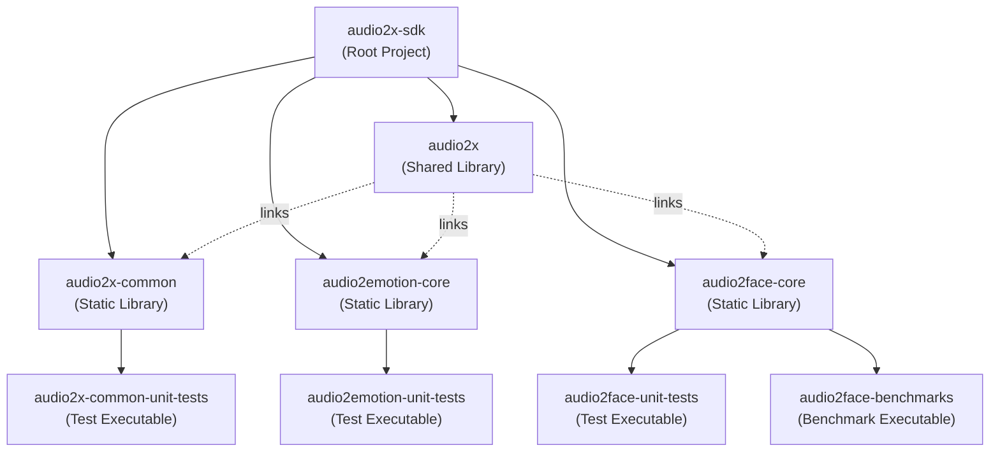
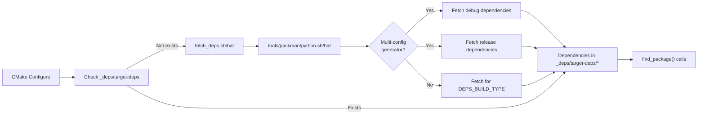
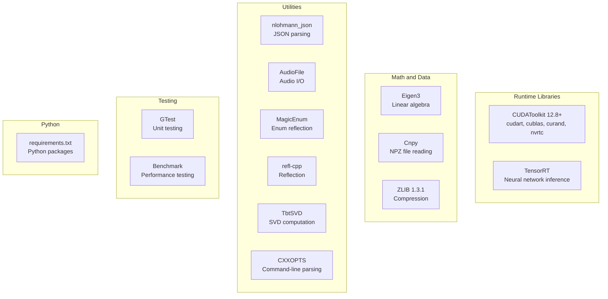
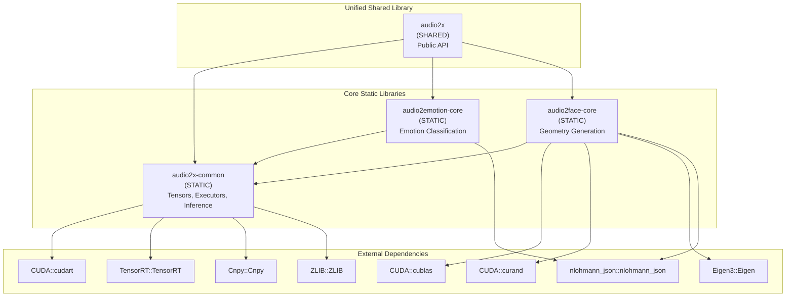
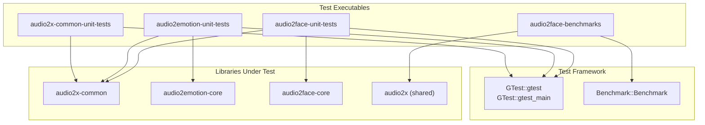
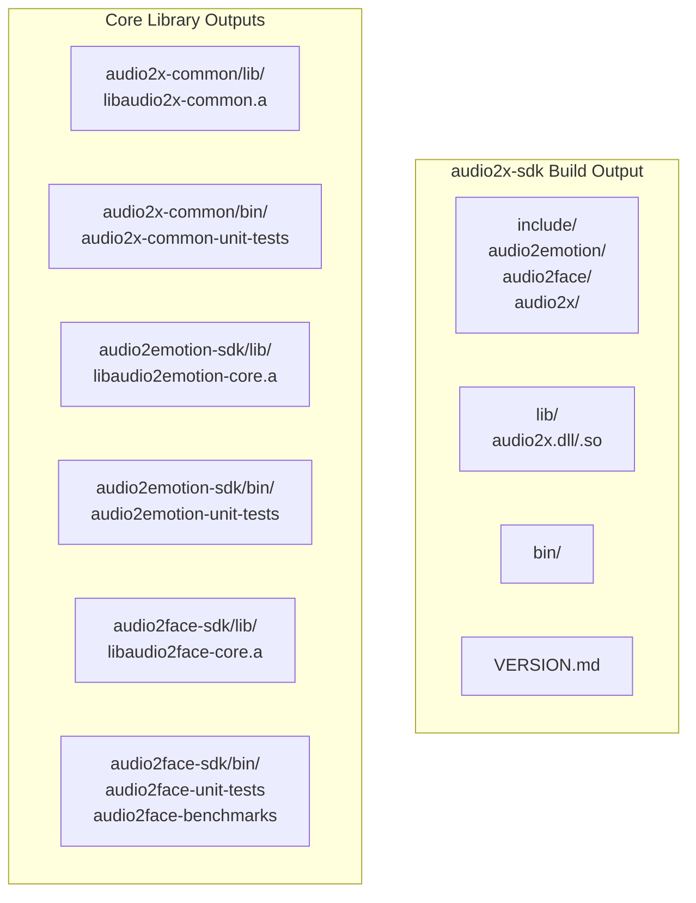
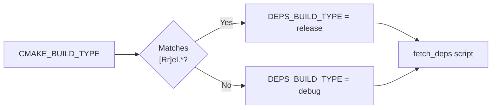

<!-- source: DeepWiki mcp.deepwiki.com · repo NVIDIA/Audio2Face-3D-SDK · page 2 Build System and Dependencies · fetched 2026-10-26 -->

# Build System and Dependencies

<details>
<summary>Relevant source files</summary>

The following files were used as context for generating this wiki page:

- [CMakeLists.txt](CMakeLists.txt)
- [audio2emotion-sdk/source/audio2emotion-core/CMakeLists.txt](audio2emotion-sdk/source/audio2emotion-core/CMakeLists.txt)
- [audio2emotion-sdk/tests/CMakeLists.txt](audio2emotion-sdk/tests/CMakeLists.txt)
- [audio2face-sdk/source/audio2face-core/CMakeLists.txt](audio2face-sdk/source/audio2face-core/CMakeLists.txt)
- [audio2face-sdk/source/benchmarks/CMakeLists.txt](audio2face-sdk/source/benchmarks/CMakeLists.txt)
- [audio2face-sdk/tests/CMakeLists.txt](audio2face-sdk/tests/CMakeLists.txt)
- [audio2x-common/source/audio2x/CMakeLists.txt](audio2x-common/source/audio2x/CMakeLists.txt)
- [audio2x-common/tests/CMakeLists.txt](audio2x-common/tests/CMakeLists.txt)
- [audio2x-sdk/CMakeLists.txt](audio2x-sdk/CMakeLists.txt)

</details>


## Purpose and Scope

This document describes the CMake-based build system for the Audio2Face-3D-SDK, including project structure, external dependency management via packman, compilation configuration, and platform-specific build settings. The build system produces a unified shared library (`audio2x`) that combines functionality from three core static libraries.

For information about the logical organization of executors and runtime components, see [Execution Framework](#3.3). For details on GPU-specific compilation and optimization, see [GPU Optimization Strategies](#8).

---

## Project Structure

The repository uses a hierarchical CMake structure with a root configuration that orchestrates four independent subprojects. Each subproject produces distinct build artifacts organized by function.

### CMake Project Hierarchy



**Project Structure**
- `audio2x-sdk/`: Root CMake project at [CMakeLists.txt:3]()
- `audio2x-common/`: Foundation layer providing tensors, accumulators, and inference engine
- `audio2emotion-sdk/`: Emotion classification and post-processing
- `audio2face-sdk/`: Facial geometry generation and animation
- `audio2x-sdk/`: Unified shared library combining all three modules

**Sources:** [CMakeLists.txt:1-151](), [audio2x-sdk/CMakeLists.txt:1-104]()

---

## Dependency Management with Packman

The build system uses **packman**, a dependency management tool that fetches pre-built binaries and headers based on platform and build type. Dependencies are fetched automatically during CMake configuration if not already present.

### Packman Invocation Flow



**Key Configuration Details:**

| Aspect | Implementation |
|--------|---------------|
| **Packman Python** | `tools/packman/python.sh` or `.bat` wrapper [CMakeLists.txt:33]() |
| **Fetch Script** | `fetch_deps.sh` or `.bat` in repository root [CMakeLists.txt:36]() |
| **Dependency Directory** | `_deps/target-deps/` [CMakeLists.txt:35]() |
| **Build Type Normalization** | `Release` and `RelWithDebInfo` → `"release"`, others → `"debug"` [CMakeLists.txt:20-24]() |
| **Multi-Config Handling** | Both debug and release fetched for Visual Studio generators [CMakeLists.txt:38-52]() |

**Sources:** [CMakeLists.txt:26-55]()

---

## External Dependencies

The project depends on several external libraries managed through CMake's `find_package()` mechanism. All dependencies are located in `_deps/target-deps/` after packman execution.

### Dependency Catalog



**Dependency Details:**

| Package | Version | Usage | Find Module |
|---------|---------|-------|-------------|
| **CUDAToolkit** | ≥12.8 | GPU computation, memory management | [CMakeLists.txt:72]() |
| **TensorRT** | — | Neural network inference engine | [CMakeLists.txt:96]() |
| **Eigen3** | — | CPU linear algebra, blendshape solver | [CMakeLists.txt:90]() |
| **Cnpy** | — | NPZ file loading for emotion database | [CMakeLists.txt:88]() |
| **ZLIB** | 1.3.1 | NPZ decompression | [CMakeLists.txt:97]() |
| **nlohmann_json** | — | Model configuration parsing | [CMakeLists.txt:93]() |
| **AudioFile** | — | WAV/audio file I/O | [CMakeLists.txt:86]() |
| **MagicEnum** | — | Enum-to-string conversion | [CMakeLists.txt:92]() |
| **refl-cpp** | — | Compile-time reflection | [CMakeLists.txt:94]() |
| **TbtSVD** | — | Singular value decomposition | [CMakeLists.txt:95]() |
| **CXXOPTS** | — | Command-line argument parsing | [CMakeLists.txt:89]() |
| **GTest** | — | Unit test framework | [CMakeLists.txt:91]() |
| **Benchmark** | — | Google Benchmark library | [CMakeLists.txt:87]() |

**CMake Prefix Path Extension:**

The build system extends `CMAKE_PREFIX_PATH` to include all dependency directories [CMakeLists.txt:59-67]():

```cmake
list(APPEND CMAKE_PREFIX_PATH
    ${PROJECT_SOURCE_DIR}/_deps/target-deps/audiofile
    ${PROJECT_SOURCE_DIR}/_deps/target-deps/cxxopts
    ${PROJECT_SOURCE_DIR}/_deps/target-deps/eigen
    ${PROJECT_SOURCE_DIR}/_deps/target-deps/magic_enum
    ${PROJECT_SOURCE_DIR}/_deps/target-deps/nlohmann_json
    ${PROJECT_SOURCE_DIR}/_deps/target-deps/refl-cpp
    ${PROJECT_SOURCE_DIR}/_deps/target-deps/tbtsvd
)
```

**Python Dependencies:**

Python packages are managed separately via pip. An `install-pip-deps` target installs packages from `deps/requirements.txt` into `_deps/target-deps/pip_prebundle` [CMakeLists.txt:100-107]():

```cmake
add_custom_target(install-pip-deps
    COMMAND ${PACKMAN_PYTHON} -m pip install -r ${PROJECT_SOURCE_DIR}/deps/requirements.txt 
            --target ${PROJECT_SOURCE_DIR}/_deps/target-deps/pip_prebundle
    ...
)
```

**Sources:** [CMakeLists.txt:59-107]()

---

## CUDA Configuration

CUDA is enabled as a first-class language in CMake, with specific architecture targets and runtime configuration.

### CUDA Compiler Setup

The build system locates CUDA via `find_package(CUDAToolkit 12.8 REQUIRED)` [CMakeLists.txt:72](). If `CUDAToolkit_BIN_DIR` is defined, the NVCC compiler path is set explicitly [CMakeLists.txt:73-79]():

```cmake
if(DEFINED CUDAToolkit_BIN_DIR)
    if(WIN32)
        set(CMAKE_CUDA_COMPILER ${CUDAToolkit_BIN_DIR}/nvcc.exe)
    else()
        set(CMAKE_CUDA_COMPILER ${CUDAToolkit_BIN_DIR}/nvcc)
    endif()
endif()
```

### Architecture Targeting

**Supported GPU Architectures:**

| Architecture | Compute Capability | GPU Generation |
|--------------|-------------------|----------------|
| `75` | 7.5 | Turing (RTX 20 series, T4) |
| `80` | 8.0 | Ampere (A100) |
| `86` | 8.6 | Ampere (RTX 30 series) |
| `87` | 8.7 | Ampere (Jetson AGX Orin) |
| `89` | 8.9 | Ada Lovelace (RTX 40 series) |
| `90` | 9.0 | Hopper (H100) |
| `100` | 10.0 | Blackwell (B100/B200) |
| `120` | 12.0 | Future architecture |

The architectures are specified via `CMAKE_CUDA_ARCHITECTURES` [CMakeLists.txt:81]():

```cmake
set(CMAKE_CUDA_ARCHITECTURES "75;80;86;87;89;90;100;120" CACHE STRING "CUDA architectures")
```

### CUDA Runtime Configuration

| Setting | Value | Purpose |
|---------|-------|---------|
| **Runtime Library** | `Shared` | Use shared `cudart` library [CMakeLists.txt:82]() |
| **Language Enabled** | `CUDA` | Enable CUDA compilation [CMakeLists.txt:83]() |
| **Position Independent Code** | `ON` | Required for shared libraries [CMakeLists.txt:5]() |

**Sources:** [CMakeLists.txt:5](), [CMakeLists.txt:69-83]()

---

## Module Build Structure

The build system produces three static core libraries and one unified shared library. Each module has specific linking relationships and export configurations.

### Module Dependency Graph



### Library Configurations

**audio2x-common** [audio2x-common/source/audio2x/CMakeLists.txt:1-38]()

| Aspect | Configuration |
|--------|---------------|
| **Type** | Static library (`STATIC`) |
| **Sources** | All `.cpp` and `.cu` files in `source/audio2x/` (recursive) |
| **Public Dependencies** | `Cnpy::Cnpy`, `CUDA::cudart`, `TensorRT::TensorRT`, `ZLIB::ZLIB` |
| **Private Dependencies** | `AudioFile::AudioFile` |
| **Exports** | `AUDIO2X_SDK_EXPORTS` preprocessor definition |
| **Output Directory** | `${A2X_COMMON_BINARY_DIR}/{lib,bin}` |

**audio2emotion-core** [audio2emotion-sdk/source/audio2emotion-core/CMakeLists.txt:1-40]()

| Aspect | Configuration |
|--------|---------------|
| **Type** | Static library (`STATIC`) |
| **Sources** | All `.cpp` and `.cu` files in `source/audio2emotion-core/` (recursive) |
| **Public Dependencies** | `audio2x-common` |
| **Private Dependencies** | `nlohmann_json::nlohmann_json` |
| **Exports** | `AUDIO2X_SDK_EXPORTS`, `AUDIO2EMOTION_SDK_DLL_EXPORTS` (Windows only) |
| **Output Directory** | `${A2E_BINARY_DIR}/{lib,bin}` |

**audio2face-core** [audio2face-sdk/source/audio2face-core/CMakeLists.txt:1-40]()

| Aspect | Configuration |
|--------|---------------|
| **Type** | Static library (`STATIC`) |
| **Sources** | All `.cpp` and `.cu` files in `source/audio2face-core/` (recursive) |
| **Public Dependencies** | `CUDA::cublas`, `CUDA::curand`, `audio2x-common` |
| **Private Dependencies** | `Eigen3::Eigen`, `magic_enum::magic_enum`, `nlohmann_json::nlohmann_json`, `refl-cpp::refl-cpp`, `tbtSVD::tbtSVD` |
| **Exports** | `AUDIO2X_SDK_EXPORTS`, `AUDIO2FACE_SDK_DLL_EXPORTS` (Windows only) |
| **Output Directory** | `${A2F_BINARY_DIR}/{lib,bin}` |

**audio2x (Unified SDK)** [audio2x-sdk/CMakeLists.txt:1-104]()

| Aspect | Configuration |
|--------|---------------|
| **Type** | Shared library (`SHARED`) |
| **Sources** | Entry point files from each module: `audio2emotion.cpp`, `audio2face.cpp`, `audio2x.cpp` |
| **Private Link** | `audio2emotion-core`, `audio2face-core`, `audio2x-common` |
| **Interface Includes** | Propagates all include directories from core libraries |
| **Exports** | `AUDIO2X_SDK_EXPORTS`, `AUDIO2FACE_SDK_DLL_EXPORTS`, `AUDIO2EMOTION_SDK_DLL_EXPORTS` (Windows) |
| **Output Name** | `audio2x.dll` (Windows) or `libaudio2x.so` (Linux) |
| **Symbol Visibility** | Linux: `-Bsymbolic` and `--exclude-libs,ALL` to prevent symbol clashes |

The unified library includes a post-build step that consolidates headers from all modules into a single `include/` directory [audio2x-sdk/CMakeLists.txt:66-100]():

```cmake
add_custom_command(TARGET audio2x POST_BUILD
    COMMAND ${CMAKE_COMMAND} -E make_directory "${CMAKE_CURRENT_BINARY_DIR}/include/audio2emotion"
    COMMAND ${CMAKE_COMMAND} -E make_directory "${CMAKE_CURRENT_BINARY_DIR}/include/audio2face"
    COMMAND ${CMAKE_COMMAND} -E make_directory "${CMAKE_CURRENT_BINARY_DIR}/include/audio2x"
    # Copy headers from each module...
)
```

**Sources:** [audio2x-common/source/audio2x/CMakeLists.txt:1-38](), [audio2emotion-sdk/source/audio2emotion-core/CMakeLists.txt:1-40](), [audio2face-sdk/source/audio2face-core/CMakeLists.txt:1-40](), [audio2x-sdk/CMakeLists.txt:1-104]()

---

## Platform-Specific Configuration

The build system applies different compiler flags and linker options based on the target platform.

### Compiler Flags

**MSVC (Windows)** [CMakeLists.txt:120-126]()

| Flag | Purpose |
|------|---------|
| `/wd4267` | Disable warning C4267 (size_t conversion) |
| `/EHsc` | Enable C++ exception handling |
| `/nologo` | Suppress Microsoft logo display |
| `/MD` (Release) | Link against multi-threaded DLL runtime |
| `/MDd` (Debug) | Link against debug multi-threaded DLL runtime |
| `/NODEFAULTLIB:LIBCMT` | Exclude static runtime library to avoid conflicts |

**GCC/Clang (Linux)** [CMakeLists.txt:127-130]()

| Flag | Purpose |
|------|---------|
| `-fPIC` | Position-independent code (required for shared libraries) |
| `-Wno-undef` | Suppress undefined macro warnings |
| `-Wno-deprecated-declarations` | Suppress deprecation warnings |
| `-ggdb3` (Debug) | Generate GDB debugging information with macros |

### Preprocessor Definitions

**Global Definitions** [CMakeLists.txt:111-118]()

| Definition | Value | Purpose |
|------------|-------|---------|
| `AUDIO2X_LOG_LEVEL` | `1` | Logging verbosity for audio2x-common |
| `AUDIO2FACE_LOG_LEVEL` | `1` | Logging verbosity for audio2face |
| `AUDIO2EMOTION_LOG_LEVEL` | `1` | Logging verbosity for audio2emotion |
| `_GLIBCXX_USE_CXX11_ABI` | `0` | Use legacy C++11 ABI for compatibility with TensorRT |
| `EIGEN_MPL2_ONLY` | (defined) | Restrict Eigen to MPL2-licensed components |
| `USE_NVTX` | (defined) | Enable NVIDIA Tools Extension (NVTX) profiling markers |

**Export Definitions:**

Each module defines export macros for symbol visibility:
- `AUDIO2X_SDK_EXPORTS`: All modules [audio2x-common/source/audio2x/CMakeLists.txt:27]()
- `AUDIO2EMOTION_SDK_DLL_EXPORTS`: Windows only [audio2emotion-sdk/source/audio2emotion-core/CMakeLists.txt:30]()
- `AUDIO2FACE_SDK_DLL_EXPORTS`: Windows only [audio2face-sdk/source/audio2face-core/CMakeLists.txt:24]()

### Linux-Specific Linker Flags

The unified `audio2x` library uses special linker flags on Linux to prevent symbol conflicts [audio2x-sdk/CMakeLists.txt:53-59]():

```cmake
if(UNIX)
    target_link_options(audio2x PRIVATE
        "LINKER:-Bsymbolic"
        "LINKER:--exclude-libs,ALL"
    )
endif()
```

| Flag | Effect |
|------|--------|
| `-Bsymbolic` | Bind global references to definitions within the shared library |
| `--exclude-libs,ALL` | Hide symbols from static libraries linked into the shared library |

**Sources:** [CMakeLists.txt:111-130](), [audio2x-sdk/CMakeLists.txt:53-59]()

---

## C++ Standard and Build Requirements

| Setting | Value | Location |
|---------|-------|----------|
| **C++ Standard** | C++17 | [CMakeLists.txt:12]() |
| **Standard Required** | Yes | [CMakeLists.txt:13]() |
| **CMake Minimum** | 3.24 | [CMakeLists.txt:1]() |
| **Position Independent Code** | Enabled globally | [CMakeLists.txt:5]() |

**Sources:** [CMakeLists.txt:1-13]()

---

## Testing Infrastructure

Each core library has a corresponding test executable built with Google Test. Additionally, `audio2face-benchmarks` provides performance testing.

### Test Executable Configuration



**Test Configuration Details:**

| Test Executable | Sources | Links Against | Test Discovery |
|----------------|---------|---------------|----------------|
| **audio2x-common-unit-tests** | All `.cpp` in `audio2x-common/tests/` | `audio2x-common`, `GTest::gtest`, `GTest::gtest_main` | [audio2x-common/tests/CMakeLists.txt:38]() |
| **audio2emotion-unit-tests** | All `.cpp` and `.cu` in `audio2emotion-sdk/tests/` | `audio2emotion-core`, `audio2x-common`, `GTest::gtest`, `GTest::gtest_main`, CUDA libraries, TensorRT | [audio2emotion-sdk/tests/CMakeLists.txt:55]() |
| **audio2face-unit-tests** | All `.cpp` and `.cu` in `audio2face-sdk/tests/` | `audio2face-core`, `audio2x-common`, `Eigen3::Eigen`, `GTest::gtest`, `GTest::gtest_main` | [audio2face-sdk/tests/CMakeLists.txt:51]() |
| **audio2face-benchmarks** | `main.cpp`, `blendshape_solver.cpp`, `executor_*.cpp`, `interactive_executor.cpp`, `utils.cpp` | `audio2x` (shared), `AudioFile::AudioFile`, `Benchmark::Benchmark` | N/A (benchmark, not test) |

**Test Data Directory:**

All test executables define `TEST_DATA_DIR` preprocessor macro pointing to test assets:
- [audio2x-common/tests/CMakeLists.txt:22]()
- [audio2emotion-sdk/tests/CMakeLists.txt:32]()
- [audio2face-sdk/tests/CMakeLists.txt:31]()
- [audio2face-sdk/source/benchmarks/CMakeLists.txt:22]()

```cmake
target_compile_definitions(<test-target> PRIVATE TEST_DATA_DIR="${TEST_DATA_DIR}")
```

The `TEST_DATA_DIR` variable is set at the root level [CMakeLists.txt:133-139]() and can be overridden by the user.

**Test Discovery:**

Tests use CTest with `gtest_discover_tests()` in `PRE_TEST` mode, which scans test executables before running to discover individual test cases [audio2x-common/tests/CMakeLists.txt:38](), [audio2emotion-sdk/tests/CMakeLists.txt:55](), [audio2face-sdk/tests/CMakeLists.txt:51]().

**Visual Studio Debugger Configuration:**

Test executables on Windows configure the debugger environment to include TensorRT and CUDA paths:

```cmake
set_target_properties(<test-target> PROPERTIES
    VS_DEBUGGER_ENVIRONMENT "PATH=%PATH%;${TENSORRT_ROOT_DIR}/lib;${CUDA_PATH}/bin"
    VS_DEBUGGER_WORKING_DIRECTORY ${AUDIO2X_SDK_ROOT}
)
```

**Sources:** [audio2x-common/tests/CMakeLists.txt:1-39](), [audio2emotion-sdk/tests/CMakeLists.txt:1-56](), [audio2face-sdk/tests/CMakeLists.txt:1-52](), [audio2face-sdk/source/benchmarks/CMakeLists.txt:1-32]()

---

## Build Output Structure

The build system produces organized output directories for headers, libraries, and executables.

### Output Directory Layout



**Unified SDK Output** [audio2x-sdk/CMakeLists.txt:10-13]()

| Output Type | Directory | Contents |
|------------|-----------|----------|
| **Headers** | `include/audio2emotion/`, `include/audio2face/`, `include/audio2x/` | All public headers from each module |
| **Shared Library** | `lib/` | `audio2x.dll` (Windows) or `libaudio2x.so` (Linux) |
| **Import Library** | `lib/` | `audio2x.lib` (Windows only) |
| **Documentation** | Root | `VERSION.md` copied from source |

**Core Library Outputs:**

Each core library configures its own output directories:
- **audio2x-common**: [audio2x-common/source/audio2x/CMakeLists.txt:4-8]()
- **audio2emotion-core**: [audio2emotion-sdk/source/audio2emotion-core/CMakeLists.txt:4-8]()
- **audio2face-core**: No explicit output directory configuration (uses defaults)

Static libraries (`.a` on Linux, `.lib` on Windows) are placed in `lib/`, while test executables go into `bin/`.

**Multi-Configuration Generators:**

For Visual Studio and other multi-config generators, output directories are automatically subdivided by configuration (e.g., `lib/Debug/`, `lib/Release/`).

**Sources:** [audio2x-sdk/CMakeLists.txt:10-100](), [audio2x-common/source/audio2x/CMakeLists.txt:4-8](), [audio2emotion-sdk/source/audio2emotion-core/CMakeLists.txt:4-8]()

---

## Build Type Configuration

The build system normalizes build types to `"debug"` or `"release"` for dependency resolution, while preserving standard CMake configurations.

### Build Type Normalization Logic



**Build Type Handling** [CMakeLists.txt:15-24]()

| CMake Build Type | Normalized `DEPS_BUILD_TYPE` | Use Case |
|------------------|------------------------------|----------|
| `Release` | `"release"` | Optimized production builds |
| `RelWithDebInfo` | `"release"` | Optimized with debug symbols |
| `MinSizeRel` | `"release"` | Size-optimized release |
| `Debug` | `"debug"` | Unoptimized, full debug info |
| (empty/other) | `"debug"` | Default to debug dependencies |

**Multi-Config Generator Behavior:**

For generators like Visual Studio or Ninja Multi-Config that support multiple configurations in a single build tree, the fetch script is invoked twice to pull both debug and release dependencies [CMakeLists.txt:38-52]():

```cmake
if(CMAKE_CONFIGURATION_TYPES)
    execute_process(
        COMMAND ${CMAKE_COMMAND} -E env "PYTHON=${PACKMAN_PYTHON}" ${FETCH_DEPS_CMD} "debug"
        COMMAND ${CMAKE_COMMAND} -E env "PYTHON=${PACKMAN_PYTHON}" ${FETCH_DEPS_CMD} "release"
        ...
    )
endif()
```

**Important Note:** Because CMake caches `find_package()` results, changing `CMAKE_BUILD_TYPE` after initial configuration will not re-find dependencies. A clean build directory is required to switch between debug and release [CMakeLists.txt:17-19]().

**Sources:** [CMakeLists.txt:15-52]()

---

## CMake Module Path

The build system extends the module search path to include custom `Find*.cmake` modules [CMakeLists.txt:7-10]():

```cmake
set(CMAKE_MODULE_PATH
    ${CMAKE_CURRENT_SOURCE_DIR}/cmake/Modules
    ${CMAKE_MODULE_PATH}
)
```

This directory contains custom find modules for dependencies not provided by CMake or the dependencies themselves, such as:
- `FindTensorRT.cmake`
- `FindCnpy.cmake`
- `FindBenchmark.cmake`

**Sources:** [CMakeLists.txt:7-10]()

---

## Compilation Process Summary

The complete build process follows this sequence:

1. **Configure Phase:**
   - Normalize `CMAKE_BUILD_TYPE` to `DEPS_BUILD_TYPE` (`"debug"` or `"release"`)
   - Check if `_deps/target-deps/` exists
   - If not, invoke `fetch_deps` script with packman
   - For multi-config generators, fetch both debug and release
   - Extend `CMAKE_PREFIX_PATH` with dependency directories
   - Find and configure all external dependencies via `find_package()`
   - Set CUDA compiler and architecture targets
   - Apply platform-specific compiler flags

2. **Build Phase:**
   - Compile `audio2x-common` static library (CPU and CUDA sources)
   - Compile `audio2emotion-core` static library (links against `audio2x-common`)
   - Compile `audio2face-core` static library (links against `audio2x-common`)
   - Compile `audio2x` shared library (links against all three static libraries)
   - Post-build: Copy all public headers to unified `include/` directory
   - Post-build: Copy `VERSION.md` to output directory
   - Compile test executables (optional, if testing enabled)

3. **Test Phase (Optional):**
   - Run CTest with discovered tests from each test executable

**Sources:** All CMakeLists.txt files referenced throughout this document.

---

