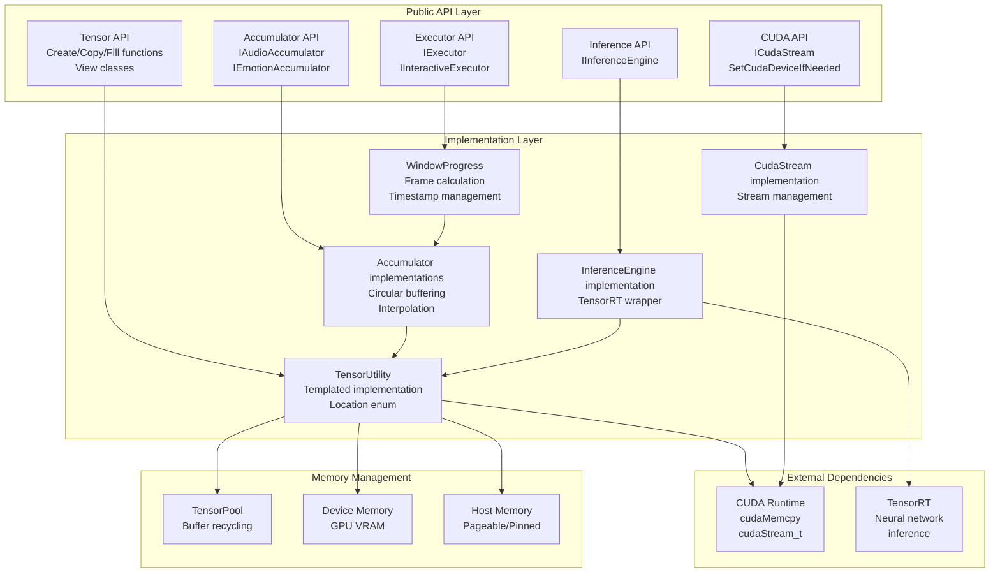
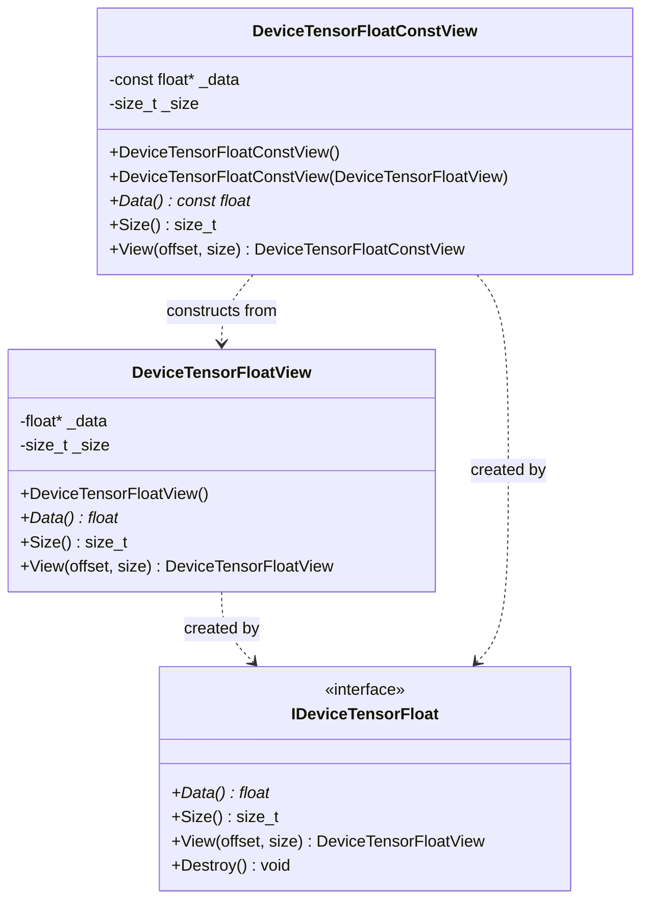
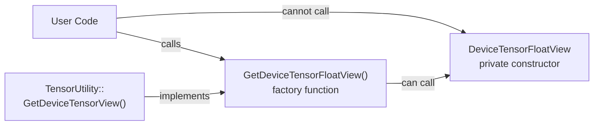
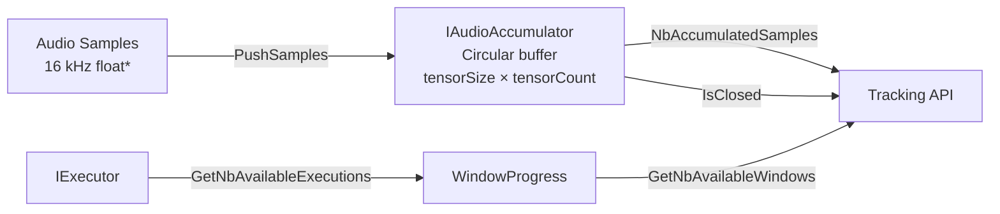
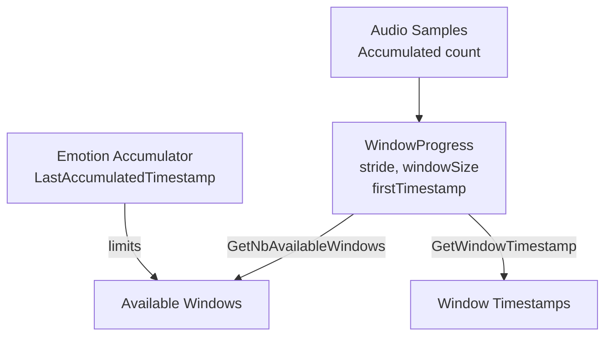
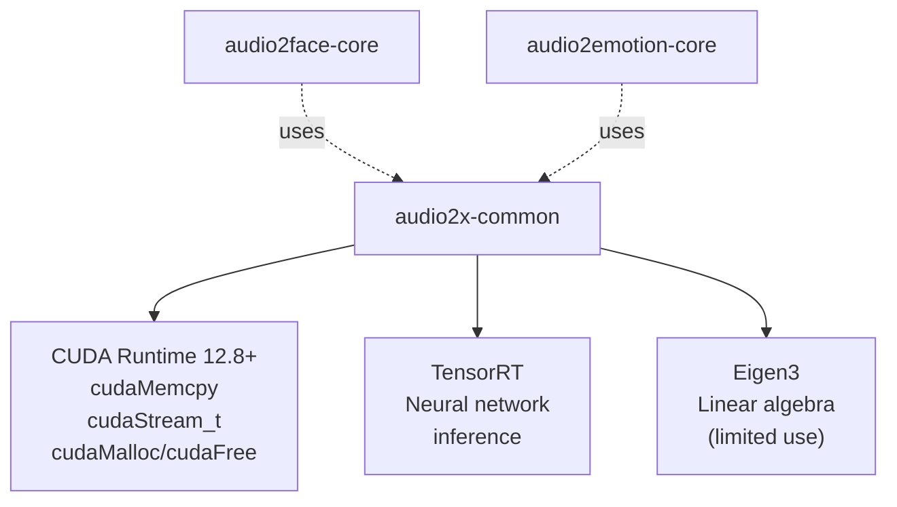

<!-- source: DeepWiki mcp.deepwiki.com · repo NVIDIA/Audio2Face-3D-SDK · page 3 Core Infrastructure (audio2x-common) · fetched 2026-10-26 -->

# Core Infrastructure (audio2x-common)

<details>
<summary>Relevant source files</summary>

The following files were used as context for generating this wiki page:

- [audio2x-common/include/audio2x/executor.h](audio2x-common/include/audio2x/executor.h)
- [audio2x-common/include/audio2x/interactive_executor.h](audio2x-common/include/audio2x/interactive_executor.h)
- [audio2x-common/include/audio2x/internal/audio2x.h](audio2x-common/include/audio2x/internal/audio2x.h)
- [audio2x-common/include/audio2x/internal/executor.h](audio2x-common/include/audio2x/internal/executor.h)
- [audio2x-common/include/audio2x/tensor_bool.h](audio2x-common/include/audio2x/tensor_bool.h)
- [audio2x-common/include/audio2x/tensor_int64.h](audio2x-common/include/audio2x/tensor_int64.h)
- [audio2x-common/include/audio2x/tensor_uint64.h](audio2x-common/include/audio2x/tensor_uint64.h)
- [audio2x-common/source/audio2x/audio2x.cpp](audio2x-common/source/audio2x/audio2x.cpp)
- [audio2x-common/source/audio2x/executor.cpp](audio2x-common/source/audio2x/executor.cpp)
- [audio2x-common/source/audio2x/tensor_bool.cpp](audio2x-common/source/audio2x/tensor_bool.cpp)
- [audio2x-common/source/audio2x/tensor_float.cpp](audio2x-common/source/audio2x/tensor_float.cpp)
- [audio2x-common/source/audio2x/tensor_int64.cpp](audio2x-common/source/audio2x/tensor_int64.cpp)
- [audio2x-common/source/audio2x/tensor_uint64.cpp](audio2x-common/source/audio2x/tensor_uint64.cpp)

</details>


## Purpose and Scope

The `audio2x-common` module provides the foundational infrastructure layer used by both the audio2face and audio2emotion SDKs. It implements GPU-accelerated tensor operations, data accumulation systems, and execution frameworks that enable efficient processing of audio and animation data.

This page provides an overview of the core components. For detailed documentation on specific subsystems:
- Tensor system architecture and implementation: [Tensor System](#3.1)
- Audio and emotion data accumulation: [Data Accumulators](#3.2)  
- Executor interfaces and execution patterns: [Execution Framework](#3.3)

---

## Module Architecture

The `audio2x-common` module is organized into several key subsystems that work together to provide a complete infrastructure for audio-driven processing:



**Sources:** [audio2x-common/include/audio2x/internal/audio2x.h:23-166](), [audio2x-common/source/audio2x/audio2x.cpp:1-1005]()

---

## Tensor System Overview

The tensor system provides GPU-accelerated data structures for storing and manipulating numeric arrays. It implements a dual-representation pattern with lightweight **view classes** and memory-owning **interface classes**.

### Data Types and View Classes

Four data types are supported, each with identical API patterns:

| Type | Device View | Device Const View | Host View | Host Const View | Owning Interface (Device) | Owning Interface (Host) |
|------|------------|-------------------|-----------|----------------|---------------------------|-------------------------|
| `float` | `DeviceTensorFloatView` | `DeviceTensorFloatConstView` | `HostTensorFloatView` | `HostTensorFloatConstView` | `IDeviceTensorFloat` | `IHostTensorFloat` |
| `bool` | `DeviceTensorBoolView` | `DeviceTensorBoolConstView` | `HostTensorBoolView` | `HostTensorBoolConstView` | `IDeviceTensorBool` | `IHostTensorBool` |
| `int64_t` | `DeviceTensorInt64View` | `DeviceTensorInt64ConstView` | `HostTensorInt64View` | `HostTensorInt64ConstView` | `IDeviceTensorInt64` | `IHostTensorInt64` |
| `uint64_t` | `DeviceTensorUInt64View` | `DeviceTensorUInt64ConstView` | `HostTensorUInt64View` | `HostTensorUInt64ConstView` | `IDeviceTensorUInt64` | `IHostTensorUInt64` |

**Sources:** [audio2x-common/include/audio2x/tensor_float.h](), [audio2x-common/include/audio2x/tensor_bool.h:1-206](), [audio2x-common/include/audio2x/tensor_int64.h:1-206](), [audio2x-common/include/audio2x/tensor_uint64.h:1-206]()

### View Classes Design

View classes are lightweight non-owning references to tensor data. Each view is exactly 16 bytes (pointer + size):



All view classes enforce size constraints at 16 bytes with 8-byte alignment:
- [audio2x-common/include/audio2x/tensor_float.h:60-61]()
- [audio2x-common/include/audio2x/tensor_bool.h:57-58]()
- [audio2x-common/include/audio2x/tensor_int64.h:57-58]()
- [audio2x-common/include/audio2x/tensor_uint64.h:57-58]()

**Sources:** [audio2x-common/source/audio2x/audio2x.cpp:97-221](), [audio2x-common/include/audio2x/tensor_float.h:36-83]()

### Memory Locations

Three memory locations are supported:

1. **Device Memory** (`Location::Device`): GPU VRAM for fast computation
2. **Host Pinned Memory** (`Location::HostPinned`): Page-locked CPU memory for fast DMA transfers
3. **Host Memory** (`Location::Host`): Standard pageable CPU memory

Creation functions for each location:

```cpp
// Device tensors
IDeviceTensorFloat* CreateDeviceTensorFloat(std::size_t size);
IDeviceTensorFloat* CreateDeviceTensorFloat(HostTensorFloatConstView source, cudaStream_t stream);

// Host tensors
IHostTensorFloat* CreateHostTensorFloat(std::size_t size);  // Pageable
IHostTensorFloat* CreateHostPinnedTensorFloat(std::size_t size);  // Pinned
```

**Sources:** [audio2x-common/include/audio2x/internal/audio2x.h:93-110](), [audio2x-common/source/audio2x/tensor_float.cpp:31-42]()

### Tensor Operations

The tensor system provides synchronous and asynchronous operations:

**Copy Operations** (all combinations of Device↔Device, Device↔Host):
```cpp
// Asynchronous (stream-based)
std::error_code CopyDeviceToDevice(DeviceTensorFloatView dst, DeviceTensorFloatConstView src, cudaStream_t stream);
std::error_code CopyHostToDevice(DeviceTensorFloatView dst, HostTensorFloatConstView src, cudaStream_t stream);
std::error_code CopyDeviceToHost(HostTensorFloatView dst, DeviceTensorFloatConstView src, cudaStream_t stream);

// Synchronous (default stream)
std::error_code CopyDeviceToDevice(DeviceTensorFloatView dst, DeviceTensorFloatConstView src);
```

**Fill Operations**:
```cpp
std::error_code FillOnDevice(DeviceTensorFloatView destination, float value, cudaStream_t stream);
std::error_code FillOnHost(HostTensorFloatView destination, float value);
```

**Sources:** [audio2x-common/source/audio2x/audio2x.cpp:255-317](), [audio2x-common/source/audio2x/tensor_float.cpp:57-102]()

### Accessor Pattern for Safe View Creation

The `Accessor` pattern prevents unsafe view creation from arbitrary pointers. View constructors are private; only internal factory functions can create views:



The `Accessor` nested class provides controlled access:
- [audio2x-common/include/audio2x/internal/audio2x.h:47-56]()
- [audio2x-common/include/audio2x/tensor_float.h:51]() (Accessor class declaration)

**Sources:** [audio2x-common/include/audio2x/internal/audio2x.h:47-56](), [audio2x-common/source/audio2x/tensor_float.cpp:47-52]()

### Implementation via TensorUtility Template

All tensor implementations use the templated `TensorUtility<T>` class, which provides:
- Type-safe memory allocation for device/host/pinned locations
- Copy operations with proper CUDA error handling
- Fill operations optimized for each memory location
- Buffer pooling via `TensorPool` for memory reuse

**Sources:** [audio2x-common/source/audio2x/tensor_float.cpp:31-102](), [audio2x-common/source/audio2x/tensor_bool.cpp:31-102](), [audio2x-common/source/audio2x/tensor_int64.cpp:31-102](), [audio2x-common/source/audio2x/tensor_uint64.cpp:31-102]()

---

## Data Accumulator Systems

Two accumulator systems manage time-series data flow:

### Audio Accumulator

`IAudioAccumulator` implements circular buffering for audio samples:



Key methods:
```cpp
class IAudioAccumulator {
    virtual std::error_code PushSamples(HostTensorFloatConstView samples) = 0;
    virtual std::size_t NbAccumulatedSamples() const = 0;
    virtual bool IsClosed() const = 0;
    virtual std::error_code Close() = 0;
    virtual void Destroy() = 0;
};
```

Factory function:
```cpp
IAudioAccumulator* CreateAudioAccumulator(std::size_t tensorSize, std::size_t tensorCount);
```

**Sources:** [audio2x-common/source/audio2x/audio2x.cpp:28-30](), [audio2x-common/include/audio2x/internal/audio2x.h:66]()

### Emotion Accumulator

`IEmotionAccumulator` manages time-series emotion vectors with interpolation support:

```cpp
class IEmotionAccumulator {
    virtual std::error_code PushEmotions(
        timestamp_t timestamp, 
        HostTensorFloatConstView emotions
    ) = 0;
    virtual timestamp_t LastAccumulatedTimestamp() const = 0;
    virtual bool IsEmpty() const = 0;
    virtual bool IsClosed() const = 0;
    virtual std::error_code Close() = 0;
    virtual void Destroy() = 0;
};
```

Factory function:
```cpp
IEmotionAccumulator* CreateEmotionAccumulator(
    std::size_t emotionSize,           // Vector dimension (e.g., 10)
    std::size_t emotionCountPerBuffer, // Buffer capacity
    std::size_t preallocatedBufferCount // Pre-allocated buffers
);
```

**Sources:** [audio2x-common/source/audio2x/audio2x.cpp:56-60](), [audio2x-common/include/audio2x/internal/audio2x.h:76-78]()

### WindowProgress System

`WindowProgress` calculates sliding window positions for inference:



The `WindowProgress` tracks:
- Window stride (hop size between frames)
- Window size (samples per inference)
- First timestamp offset
- Current position in accumulated data

It integrates with executors to determine when sufficient data is available for inference.

**Sources:** [audio2x-common/source/audio2x/executor.cpp:29-65](), [audio2x-common/include/audio2x/internal/executor.h:28-34]()

---

## Execution Framework

The execution framework provides two paradigms for running inference and processing:

### Batch Execution Interface

`IExecutor` supports continuous batch processing as data arrives:

```cpp
class IExecutor {
    // Track management
    virtual std::size_t GetNbTracks() const = 0;
    virtual std::error_code Reset(std::size_t trackIndex) = 0;
    
    // Execution readiness
    virtual bool HasExecutionStarted(std::size_t trackIndex) const = 0;
    virtual std::size_t GetNbAvailableExecutions(std::size_t trackIndex) const = 0;
    virtual std::size_t GetTotalNbFrames(std::size_t trackIndex) const = 0;
    
    // Timing information
    virtual std::size_t GetSamplingRate() const = 0;
    virtual void GetFrameRate(std::size_t& numerator, std::size_t& denominator) const = 0;
    virtual timestamp_t GetFrameTimestamp(std::size_t frameIndex) const = 0;
    
    // Execution
    virtual std::error_code Execute(std::size_t* pNbExecutedTracks) = 0;
    
    virtual void Destroy() = 0;
};
```

**Sources:** [audio2x-common/include/audio2x/executor.h:33-79]()

### Interactive Execution Interface

`IInteractiveExecutor` enables frame-specific computation with layer-based invalidation:

```cpp
class IInteractiveExecutor {
    using invalidation_layer_t = std::size_t;
    static constexpr invalidation_layer_t kLayerNone = 0;
    static constexpr invalidation_layer_t kLayerAll = 1;
    
    // Layer invalidation for caching
    virtual std::error_code Invalidate(invalidation_layer_t layer) = 0;
    virtual bool IsValid(invalidation_layer_t layer) const = 0;
    
    // Frame-specific execution
    virtual std::error_code ComputeFrame(std::size_t frameIndex) = 0;
    virtual std::error_code ComputeAllFrames() = 0;
    virtual std::error_code Interrupt() = 0;
    
    // Timing information
    virtual std::size_t GetTotalNbFrames() const = 0;
    virtual std::size_t GetSamplingRate() const = 0;
    virtual void GetFrameRate(std::size_t& numerator, std::size_t& denominator) const = 0;
    virtual timestamp_t GetFrameTimestamp(std::size_t frameIndex) const = 0;
    
    virtual void Destroy() = 0;
};
```

The layer system allows caching inference results while invalidating only post-processing layers when parameters change.

**Sources:** [audio2x-common/include/audio2x/interactive_executor.h:33-72]()

### Executor Utility Functions

Helper functions for multi-track execution:

```cpp
// Check if any track has started execution
bool HasExecutionStarted(const IExecutor& executor);

// Count tracks ready for execution
std::size_t GetNbReadyTracks(const IExecutor& executor);
```

Implementation iterates over all tracks:
- [audio2x-common/source/audio2x/executor.cpp:70-89]()

**Sources:** [audio2x-common/include/audio2x/executor.h:83-89](), [audio2x-common/source/audio2x/executor.cpp:70-89]()

---

## CUDA Utilities

### CUDA Stream Management

`ICudaStream` wraps CUDA stream lifecycle:

```cpp
class ICudaStream {
    virtual cudaStream_t Get() const = 0;
    virtual void Destroy() = 0;
};

// Factory functions
ICudaStream* CreateCudaStream();          // New non-default stream
ICudaStream* CreateDefaultCudaStream();   // Wraps default stream
```

**Sources:** [audio2x-common/source/audio2x/audio2x.cpp:40-46]()

### Device Management

```cpp
std::error_code SetCudaDeviceIfNeeded(int device);
```

Sets the CUDA device context if not already active.

**Sources:** [audio2x-common/source/audio2x/audio2x.cpp:50-52]()

---

## Inference Engine

`IInferenceEngine` provides a unified interface to TensorRT for neural network inference:

```cpp
IInferenceEngine* CreateInferenceEngine();
```

The inference engine abstracts:
- TensorRT engine loading and initialization
- Input/output tensor binding
- Execution context management
- Multi-stream execution support

**Sources:** [audio2x-common/source/audio2x/audio2x.cpp:74-76]()

---

## Additional Utilities

### Data Bytes Container

`IDataBytes` provides binary data storage:

```cpp
IDataBytes* CreateDataBytes();
```

Used for loading model files and configuration data.

**Sources:** [audio2x-common/source/audio2x/audio2x.cpp:80-82]()

### Tensor Dictionary

`IHostTensorDict` provides key-value storage for tensors:

```cpp
IHostTensorDict* CreateHostTensorDict();
```

Used for organizing named tensor collections (e.g., model parameters).

**Sources:** [audio2x-common/source/audio2x/audio2x.cpp:86-88]()

---

## Module Dependencies

The `audio2x-common` module depends on:



**Sources:** Based on build system configuration and header includes across the module

---

