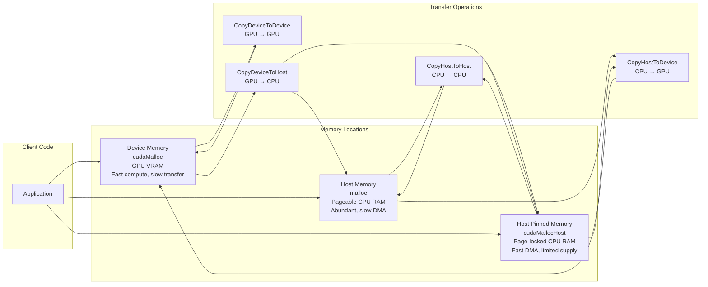
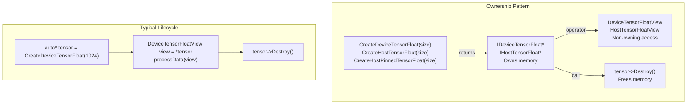
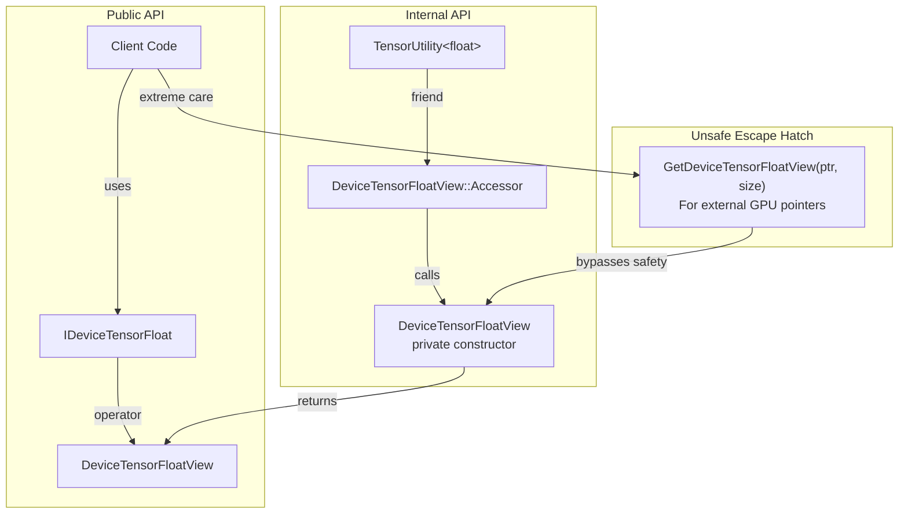
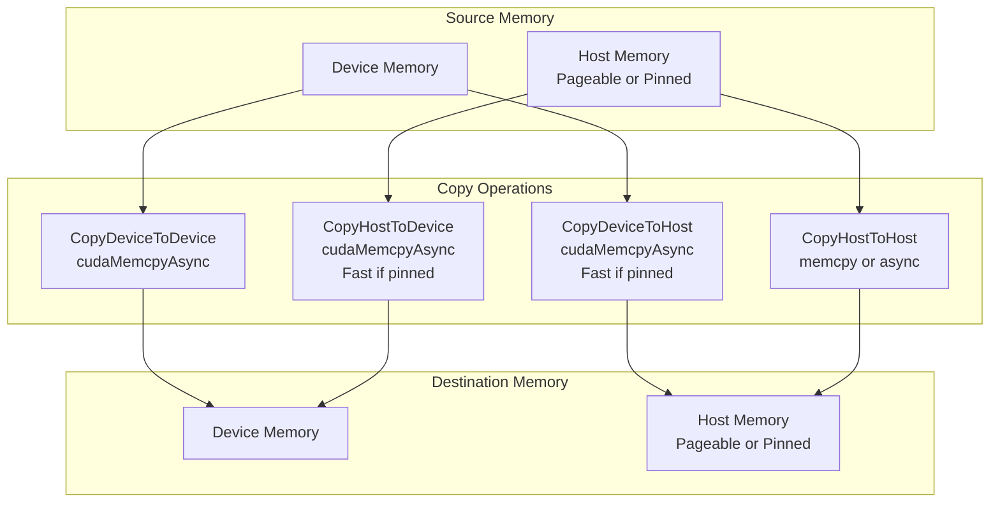
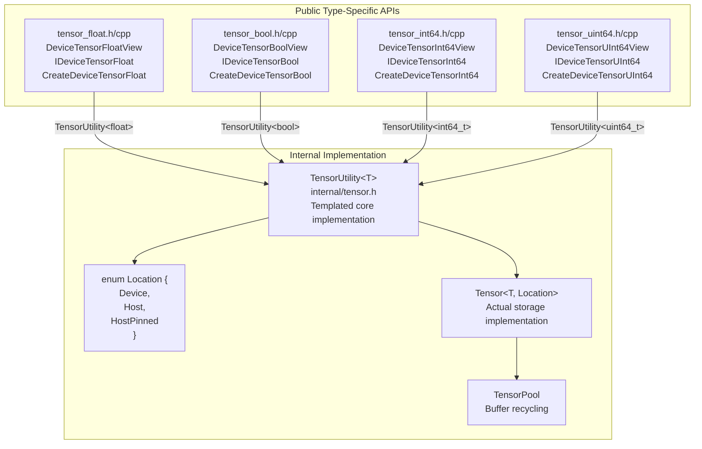
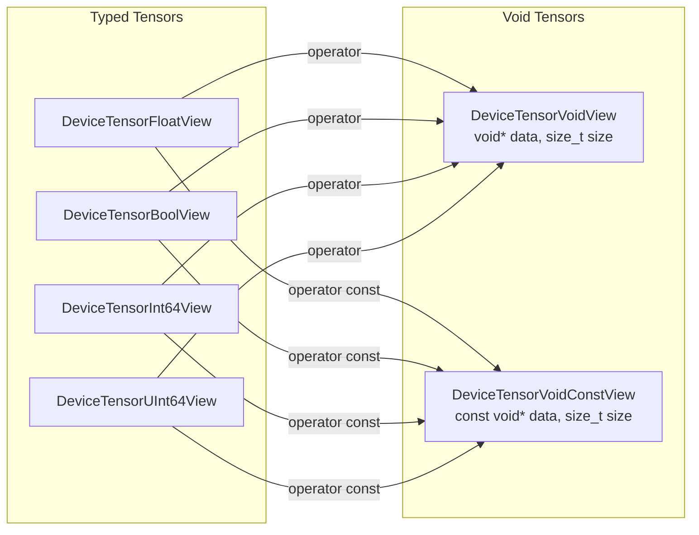

<!-- source: DeepWiki mcp.deepwiki.com · repo NVIDIA/Audio2Face-3D-SDK · page 3.1 Tensor System · fetched 2026-10-26 -->

# Tensor System

<details>
<summary>Relevant source files</summary>

The following files were used as context for generating this wiki page:

- [audio2x-common/include/audio2x/internal/audio2x.h](audio2x-common/include/audio2x/internal/audio2x.h)
- [audio2x-common/include/audio2x/tensor_bool.h](audio2x-common/include/audio2x/tensor_bool.h)
- [audio2x-common/include/audio2x/tensor_int64.h](audio2x-common/include/audio2x/tensor_int64.h)
- [audio2x-common/include/audio2x/tensor_uint64.h](audio2x-common/include/audio2x/tensor_uint64.h)
- [audio2x-common/source/audio2x/tensor_bool.cpp](audio2x-common/source/audio2x/tensor_bool.cpp)
- [audio2x-common/source/audio2x/tensor_float.cpp](audio2x-common/source/audio2x/tensor_float.cpp)
- [audio2x-common/source/audio2x/tensor_int64.cpp](audio2x-common/source/audio2x/tensor_int64.cpp)
- [audio2x-common/source/audio2x/tensor_uint64.cpp](audio2x-common/source/audio2x/tensor_uint64.cpp)

</details>


## Purpose and Scope

The Tensor System provides the foundational GPU-accelerated data structures used throughout the Audio2Face-3D-SDK. It implements a type-safe abstraction over CUDA memory management with support for four primitive types (float, bool, int64, uint64) across three memory locations (device GPU, host pageable, host pinned). The system uses a dual-representation pattern with lightweight non-owning **views** for efficient data access and memory-owning **interfaces** for lifetime management.

For information about higher-level data structures built on tensors, see [Data Accumulators](#3.2). For details on asynchronous execution using CUDA streams, see [GPU Optimization Strategies](#8).

---

## Architecture Overview

The tensor system implements a parallel type hierarchy across four data types, with each type following an identical API pattern implemented via the internal `TensorUtility<T>` template class.

### Type Hierarchy

```mermaid
graph TB
    subgraph FloatTypes["Float Tensors"]
        DeviceFloatView["DeviceTensorFloatView<br/>16 bytes: pointer + size"]
        DeviceFloatConstView["DeviceTensorFloatConstView<br/>16 bytes: const pointer + size"]
        HostFloatView["HostTensorFloatView<br/>16 bytes: pointer + size"]
        HostFloatConstView["HostTensorFloatConstView<br/>16 bytes: const pointer + size"]
        IDeviceFloat["IDeviceTensorFloat<br/>Owns device memory"]
        IHostFloat["IHostTensorFloat<br/>Owns host memory"]
        
        IDeviceFloat -->|"operator"| DeviceFloatView
        IDeviceFloat -->|"operator const"| DeviceFloatConstView
        IHostFloat -->|"operator"| HostFloatView
        IHostFloat -->|"operator const"| HostFloatConstView
        DeviceFloatView -->|"implicit"| DeviceFloatConstView
        HostFloatView -->|"implicit"| HostFloatConstView
    end
    
    subgraph BoolTypes["Bool Tensors"]
        DeviceBoolView["DeviceTensorBoolView"]
        DeviceBoolConstView["DeviceTensorBoolConstView"]
        HostBoolView["HostTensorBoolView"]
        HostBoolConstView["HostTensorBoolConstView"]
        IDeviceBool["IDeviceTensorBool"]
        IHostBool["IHostTensorBool"]
        
        IDeviceBool -->|"operator"| DeviceBoolView
        IDeviceBool -->|"operator const"| DeviceBoolConstView
        IHostBool -->|"operator"| HostBoolView
        IHostBool -->|"operator const"| HostBoolConstView
    end
    
    subgraph Int64Types["Int64 Tensors"]
        DeviceInt64View["DeviceTensorInt64View"]
        DeviceInt64ConstView["DeviceTensorInt64ConstView"]
        HostInt64View["HostTensorInt64View"]
        HostInt64ConstView["HostTensorInt64ConstView"]
        IDeviceInt64["IDeviceTensorInt64"]
        IHostInt64["IHostTensorInt64"]
        
        IDeviceInt64 -->|"operator"| DeviceInt64View
        IDeviceInt64 -->|"operator const"| DeviceInt64ConstView
        IHostInt64 -->|"operator"| HostInt64View
        IHostInt64 -->|"operator const"| HostInt64ConstView
    end
    
    subgraph UInt64Types["UInt64 Tensors"]
        DeviceUInt64View["DeviceTensorUInt64View"]
        DeviceUInt64ConstView["DeviceTensorUInt64ConstView"]
        HostUInt64View["HostTensorUInt64View"]
        HostUInt64ConstView["HostTensorUInt64ConstView"]
        IDeviceUInt64["IDeviceTensorUInt64"]
        IHostUInt64["IHostTensorUInt64"]
        
        IDeviceUInt64 -->|"operator"| DeviceUInt64View
        IDeviceUInt64 -->|"operator const"| DeviceUInt64ConstView
        IHostUInt64 -->|"operator"| HostUInt64View
        IHostUInt64 -->|"operator const"| HostUInt64ConstView
    end
```



**Sources**: [audio2x-common/include/audio2x/tensor_float.h](), [audio2x-common/include/audio2x/tensor_bool.h:36-160](), [audio2x-common/include/audio2x/tensor_int64.h:36-160](), [audio2x-common/include/audio2x/tensor_uint64.h:36-160]()

---

## Data Types and Memory Locations

### Supported Data Types

The tensor system provides identical APIs for four primitive types:

| Type | C++ Type | Use Cases |
|------|----------|-----------|
| **Float** | `float` | Neural network activations, vertex positions, blendshape weights |
| **Bool** | `bool` | Active track masks, feature flags |
| **Int64** | `int64_t` | Frame indices, timestamps, counters |
| **UInt64** | `uint64_t` | Unsigned frame indices, buffer sizes |

### Memory Locations



**Sources**: [audio2x-common/include/audio2x/tensor_float.h]()

| Memory Type | Allocation | Properties | Use Cases |
|-------------|------------|------------|-----------|
| **Device** | `CreateDeviceTensor*()` | GPU VRAM, fastest compute | Inference inputs/outputs, animator state |
| **Host Pinned** | `CreateHostPinnedTensor*()` | Page-locked CPU RAM, fast DMA | Streaming audio buffers, frequent transfers |
| **Host** | `CreateHostTensor*()` | Pageable CPU RAM, abundant | File I/O, infrequent transfers, large allocations |

**Sources**: [audio2x-common/include/audio2x/tensor_float.h](), [audio2x-common/source/audio2x/tensor_float.cpp:31-42]()

---

## View Classes vs Owning Interfaces

### View Classes (Non-Owning)

View classes are lightweight 16-byte structures that provide non-owning access to tensor data. They consist only of a pointer and size, making them trivially copyable and suitable for passing by value.

**Structure (all types)**:
```
Size: 16 bytes
Alignment: 8 bytes
Members: T* _data, std::size_t _size
```

**API Pattern** (example for float, identical for bool/int64/uint64):
- `DeviceTensorFloatView` - Mutable view to device memory
- `DeviceTensorFloatConstView` - Const view to device memory  
- `HostTensorFloatView` - Mutable view to host memory
- `HostTensorFloatConstView` - Const view to host memory

**Key Methods**:
- `Data()` - Returns pointer to underlying memory
- `Size()` - Returns element count
- `View(offset, size)` - Creates sub-view without copying

**Sources**: [audio2x-common/include/audio2x/tensor_float.h](), [audio2x-common/include/audio2x/tensor_bool.h:36-127](), [audio2x-common/include/audio2x/tensor_int64.h:36-127](), [audio2x-common/include/audio2x/tensor_uint64.h:36-127]()

### Owning Interface Classes

Interface classes manage memory lifetime through virtual methods and provide automatic cleanup via the `Destroy()` method.



**Sources**: [audio2x-common/include/audio2x/tensor_float.h](), [audio2x-common/source/audio2x/tensor_float.cpp:31-42]()

**Interface Methods** (example for `IDeviceTensorFloat`):
- `operator DeviceTensorFloatView()` - Converts to mutable view
- `operator DeviceTensorFloatConstView() const` - Converts to const view
- `View(offset, size)` - Creates sub-view
- `Data()` / `Data() const` - Direct pointer access
- `Size()` - Element count
- `Destroy()` - Frees memory (must be called by user)

**Sources**: [audio2x-common/include/audio2x/tensor_float.h](), [audio2x-common/include/audio2x/tensor_bool.h:129-160](), [audio2x-common/include/audio2x/tensor_int64.h:129-160](), [audio2x-common/include/audio2x/tensor_uint64.h:129-160]()

---

## Accessor Pattern for Safe View Creation

View classes use private constructors to prevent unsafe instantiation from arbitrary pointers. The `Accessor` nested class provides controlled view creation through the internal API.



**Sources**: [audio2x-common/include/audio2x/internal/audio2x.h:47-56](), [audio2x-common/include/audio2x/tensor_float.h]()

**Accessor Implementation** (for all types):

The `Accessor` class is declared as a nested class within each view type but implemented in the internal header:

```
// In public header (e.g., tensor_float.h)
class DeviceTensorFloatView {
  class Accessor;  // Forward declaration
private:
  DeviceTensorFloatView(float* data, std::size_t size);  // Private constructor
};

// In internal/audio2x.h
class DeviceTensorFloatView::Accessor {
public:
  static inline DeviceTensorFloatView Build(float* data, std::size_t size) {
    return {data, size};
  }
};
```

**Sources**: [audio2x-common/include/audio2x/internal/audio2x.h:47-56](), [audio2x-common/include/audio2x/tensor_float.h](), [audio2x-common/include/audio2x/tensor_bool.h:49](), [audio2x-common/include/audio2x/tensor_int64.h:49](), [audio2x-common/include/audio2x/tensor_uint64.h:49]()

### Unsafe View Creation Functions

For integration with external CUDA code, the system provides escape hatch functions that bypass the accessor pattern. These must be used with extreme care:

- `GetDeviceTensorFloatView(float* data, size)` 
- `GetDeviceTensorFloatConstView(const float* data, size)`
- (Similar for bool, int64, uint64)

**Warning**: These functions assume the pointer is valid GPU device memory. Using them with invalid pointers causes undefined behavior.

**Sources**: [audio2x-common/include/audio2x/tensor_float.h](), [audio2x-common/source/audio2x/tensor_float.cpp:44-52]()

---

## Factory Functions

### Tensor Creation

All factory functions return raw pointers. The caller is responsible for calling `Destroy()` to free memory.

| Function | Purpose | Memory Type |
|----------|---------|-------------|
| `CreateDeviceTensor*(size)` | Allocate empty tensor on GPU | Device |
| `CreateDeviceTensor*(hostView, stream)` | Allocate and copy from host | Device |
| `CreateHostTensor*(size)` | Allocate pageable CPU memory | Host |
| `CreateHostPinnedTensor*(size)` | Allocate pinned CPU memory | Host Pinned |

**Function Signatures** (float example, identical for bool/int64/uint64):

```cpp
// Empty device tensor
IDeviceTensorFloat* CreateDeviceTensorFloat(std::size_t size);

// Device tensor initialized from host data
IDeviceTensorFloat* CreateDeviceTensorFloat(
  HostTensorFloatConstView source, 
  cudaStream_t cudaStream
);

// Host tensors
IHostTensorFloat* CreateHostTensorFloat(std::size_t size);
IHostTensorFloat* CreateHostPinnedTensorFloat(std::size_t size);
```

**Sources**: [audio2x-common/include/audio2x/tensor_float.h](), [audio2x-common/source/audio2x/tensor_float.cpp:31-42](), [audio2x-common/include/audio2x/tensor_bool.h:163-166](), [audio2x-common/include/audio2x/tensor_int64.h:163-166](), [audio2x-common/include/audio2x/tensor_uint64.h:163-166]()

---

## Copy and Fill Operations

### Copy Operations Matrix

All copy operations support both synchronous (blocking) and asynchronous (stream-based) execution. Asynchronous variants take a `cudaStream_t` parameter.



**Sources**: [audio2x-common/include/audio2x/tensor_float.h](), [audio2x-common/source/audio2x/tensor_float.cpp:57-92]()

### Copy Function Signatures

All copy functions return `std::error_code` to indicate success or failure. Sizes must match between source and destination.

**Asynchronous Copies** (with stream):
```cpp
std::error_code CopyDeviceToDevice(
  DeviceTensorFloatView destination,
  DeviceTensorFloatConstView source,
  cudaStream_t cudaStream
);

std::error_code CopyHostToDevice(
  DeviceTensorFloatView destination,
  HostTensorFloatConstView source,
  cudaStream_t cudaStream
);

std::error_code CopyDeviceToHost(
  HostTensorFloatView destination,
  DeviceTensorFloatConstView source,
  cudaStream_t cudaStream
);

std::error_code CopyHostToHost(
  HostTensorFloatView destination,
  HostTensorFloatConstView source,
  cudaStream_t cudaStream
);
```

**Synchronous Copies** (blocking):
```cpp
std::error_code CopyDeviceToDevice(
  DeviceTensorFloatView destination,
  DeviceTensorFloatConstView source
);

std::error_code CopyHostToDevice(
  DeviceTensorFloatView destination,
  HostTensorFloatConstView source
);

std::error_code CopyDeviceToHost(
  HostTensorFloatView destination,
  DeviceTensorFloatConstView source
);

std::error_code CopyHostToHost(
  HostTensorFloatView destination,
  HostTensorFloatConstView source
);
```

**Sources**: [audio2x-common/include/audio2x/tensor_float.h](), [audio2x-common/source/audio2x/tensor_float.cpp:57-92](), [audio2x-common/include/audio2x/tensor_bool.h:172-196](), [audio2x-common/include/audio2x/tensor_int64.h:172-196](), [audio2x-common/include/audio2x/tensor_uint64.h:172-196]()

### Fill Operations

Fill operations set all elements of a tensor to a specific value.

**Function Signatures**:
```cpp
// Device fill (asynchronous)
std::error_code FillOnDevice(
  DeviceTensorFloatView destination,
  float value,
  cudaStream_t cudaStream
);

// Host fill (synchronous)
std::error_code FillOnHost(
  HostTensorFloatView destination,
  float value
);
```

**Sources**: [audio2x-common/include/audio2x/tensor_float.h](), [audio2x-common/source/audio2x/tensor_float.cpp:97-102](), [audio2x-common/include/audio2x/tensor_bool.h:198-203](), [audio2x-common/include/audio2x/tensor_int64.h:198-203](), [audio2x-common/include/audio2x/tensor_uint64.h:198-203]()

---

## Implementation Architecture

### TensorUtility Template

The entire tensor system is implemented via a single templated utility class that provides type-agnostic memory management and operations.



**Sources**: [audio2x-common/source/audio2x/tensor_float.cpp:26-104](), [audio2x-common/source/audio2x/tensor_bool.cpp:26-104](), [audio2x-common/source/audio2x/tensor_int64.cpp:26-104](), [audio2x-common/source/audio2x/tensor_uint64.cpp:26-104]()

### Internal Functions

The internal namespace `nva2x::internal` contains the actual implementations that the public API wraps:

**Float Example**:
```cpp
namespace nva2x::internal {
  IDeviceTensorFloat* CreateDeviceTensorFloat(std::size_t size) {
    return TensorUtility<float>::CreateTensor<Location::Device>(size);
  }
  
  DeviceTensorFloatView GetDeviceTensorFloatView(float* data, std::size_t size) {
    return TensorUtility<float>::GetDeviceTensorView(data, size);
  }
  
  std::error_code CopyDeviceToDevice(
    DeviceTensorFloatView dst, DeviceTensorFloatConstView src, cudaStream_t stream
  ) {
    return TensorUtility<float>::CopyDeviceToDevice(dst, src, stream);
  }
  
  // Similar for all other operations
}
```

**Sources**: [audio2x-common/source/audio2x/tensor_float.cpp:26-104](), [audio2x-common/include/audio2x/internal/audio2x.h:93-163]()

---

## Type-Specific Header Files

Each data type has two files following identical patterns:

### Float Tensors
- **Header**: [audio2x-common/include/audio2x/tensor_float.h]()
- **Implementation**: [audio2x-common/source/audio2x/tensor_float.cpp]()
- **Classes**: `DeviceTensorFloatView`, `DeviceTensorFloatConstView`, `HostTensorFloatView`, `HostTensorFloatConstView`, `IDeviceTensorFloat`, `IHostTensorFloat`

### Bool Tensors
- **Header**: [audio2x-common/include/audio2x/tensor_bool.h]()
- **Implementation**: [audio2x-common/source/audio2x/tensor_bool.cpp]()
- **Classes**: `DeviceTensorBoolView`, `DeviceTensorBoolConstView`, `HostTensorBoolView`, `HostTensorBoolConstView`, `IDeviceTensorBool`, `IHostTensorBool`
- **Note**: Header refers to tensor_float.h for full documentation

### Int64 Tensors
- **Header**: [audio2x-common/include/audio2x/tensor_int64.h]()
- **Implementation**: [audio2x-common/source/audio2x/tensor_int64.cpp]()
- **Classes**: `DeviceTensorInt64View`, `DeviceTensorInt64ConstView`, `HostTensorInt64View`, `HostTensorInt64ConstView`, `IDeviceTensorInt64`, `IHostTensorInt64`
- **Note**: Header refers to tensor_float.h for full documentation

### UInt64 Tensors
- **Header**: [audio2x-common/include/audio2x/tensor_uint64.h]()
- **Implementation**: [audio2x-common/source/audio2x/tensor_uint64.cpp]()
- **Classes**: `DeviceTensorUInt64View`, `DeviceTensorUInt64ConstView`, `HostTensorUInt64View`, `HostTensorUInt64ConstView`, `IDeviceTensorUInt64`, `IHostTensorUInt64`
- **Note**: Header refers to tensor_float.h for full documentation

**Sources**: [audio2x-common/include/audio2x/tensor_float.h](), [audio2x-common/include/audio2x/tensor_bool.h:31-33](), [audio2x-common/include/audio2x/tensor_int64.h:31-33](), [audio2x-common/include/audio2x/tensor_uint64.h:31-33]()

---

## Integration with Void Tensors

All tensor types can convert to untyped void tensors for generic memory manipulation:



**Conversion Operators** (defined in each view class):
```cpp
operator DeviceTensorVoidView();
operator DeviceTensorVoidConstView() const;
```

**Sources**: [audio2x-common/include/audio2x/tensor_float.h](), [audio2x-common/include/audio2x/tensor_bool.h:46-47](), [audio2x-common/include/audio2x/tensor_int64.h:46-47](), [audio2x-common/include/audio2x/tensor_uint64.h:46-47]()

---

## Static Assertions

All view classes enforce size and alignment requirements through static assertions:

```cpp
static_assert(sizeof(DeviceTensorFloatView) == 16);
static_assert(alignof(DeviceTensorFloatView) == 8);

static_assert(sizeof(HostTensorFloatView) == 16);
static_assert(alignof(HostTensorFloatView) == 8);

// Similar for all other view types
```

This ensures the view classes remain lightweight and suitable for passing by value without performance overhead.

**Sources**: [audio2x-common/include/audio2x/tensor_float.h](), [audio2x-common/include/audio2x/tensor_bool.h:57-58, 81-82, 100-101, 122-123](), [audio2x-common/include/audio2x/tensor_int64.h:57-58, 81-82, 100-101, 122-123](), [audio2x-common/include/audio2x/tensor_uint64.h:57-58, 81-82, 100-101, 122-123]()

---

## Host Tensor Iteration

Host tensor views provide range-based for loop support through `begin()` and `end()` free functions:

```cpp
// Mutable iteration
inline float* begin(HostTensorFloatView view) { return view.Data(); }
inline float* end(HostTensorFloatView view) { return view.Data() + view.Size(); }

// Const iteration
inline const float* begin(HostTensorFloatConstView view) { return view.Data(); }
inline const float* end(HostTensorFloatConstView view) { 
  return view.Data() + view.Size(); 
}
```

This enables standard C++ iteration patterns:
```cpp
auto* tensor = CreateHostTensorFloat(100);
HostTensorFloatView view = *tensor;

for (float& value : view) {
  value *= 2.0f;  // Process each element
}

tensor->Destroy();
```

**Sources**: [audio2x-common/include/audio2x/tensor_float.h](), [audio2x-common/include/audio2x/tensor_bool.h:103-104, 125-126](), [audio2x-common/include/audio2x/tensor_int64.h:103-104, 125-126](), [audio2x-common/include/audio2x/tensor_uint64.h:103-104, 125-126]()

---

