<!-- source: DeepWiki mcp.deepwiki.com · repo NVIDIA/Audio2Face-3D-SDK · page 3.2 Data Accumulators · fetched 2026-10-26 -->

# Data Accumulators

<details>
<summary>Relevant source files</summary>

The following files were used as context for generating this wiki page:

- [audio2emotion-sdk/include/audio2emotion/executor_classifier.h](audio2emotion-sdk/include/audio2emotion/executor_classifier.h)
- [audio2emotion-sdk/include/audio2emotion/executor_postprocess.h](audio2emotion-sdk/include/audio2emotion/executor_postprocess.h)
- [audio2emotion-sdk/source/audio2emotion-core/executor_classifier_core.cpp](audio2emotion-sdk/source/audio2emotion-core/executor_classifier_core.cpp)
- [audio2face-sdk/include/audio2face/emotion.h](audio2face-sdk/include/audio2face/emotion.h)
- [audio2face-sdk/include/audio2face/internal/emotion.h](audio2face-sdk/include/audio2face/internal/emotion.h)
- [audio2face-sdk/source/audio2face-core/emotion.cpp](audio2face-sdk/source/audio2face-core/emotion.cpp)
- [audio2x-common/include/audio2x/emotion_accumulator.h](audio2x-common/include/audio2x/emotion_accumulator.h)
- [audio2x-common/include/audio2x/internal/emotion_accumulator.h](audio2x-common/include/audio2x/internal/emotion_accumulator.h)
- [audio2x-common/source/audio2x/audio_accumulator.cpp](audio2x-common/source/audio2x/audio_accumulator.cpp)
- [audio2x-common/source/audio2x/emotion_accumulator.cpp](audio2x-common/source/audio2x/emotion_accumulator.cpp)
- [audio2x-common/tests/test_audio_accumulator.cpp](audio2x-common/tests/test_audio_accumulator.cpp)
- [audio2x-common/tests/test_emotion_accumulator.cpp](audio2x-common/tests/test_emotion_accumulator.cpp)
- [audio2x-common/tests/test_float_accumulator.cpp](audio2x-common/tests/test_float_accumulator.cpp)

</details>


## Purpose and Scope

This page documents the data accumulator systems in the `audio2x-common` module that provide thread-safe, GPU-accelerated buffering and time-series storage for audio samples and emotion vectors. These accumulators serve as the bridge between data sources (audio input, emotion inference) and executors that process sliding windows of data.

For information about how executors use accumulators to determine processing readiness, see [Execution Framework](#3.3). For multi-track batch processing patterns that leverage accumulators, see [Multi-Track Batch Processing](#7).

---

## System Overview

The SDK provides two accumulator types that form the data pipeline foundation:

| Accumulator | Data Type | Indexing | Primary Use Case |
|-------------|-----------|----------|------------------|
| `IAudioAccumulator` | Audio samples (float) | Absolute sample index | Buffering 16 kHz audio for inference windows |
| `IEmotionAccumulator` | Emotion vectors (float array) | Timestamp (int64) | Storing emotion time-series with interpolation |

Both accumulators share common patterns: allocation/deallocation lifecycle, thread-safe operations, close semantics for stream completion, and drop operations for memory reclamation.

**Sources:** [audio2x-common/include/audio2x/audio_accumulator.h:29-90](), [audio2x-common/include/audio2x/emotion_accumulator.h:27-89]()

---

## Class Hierarchy and Relationships

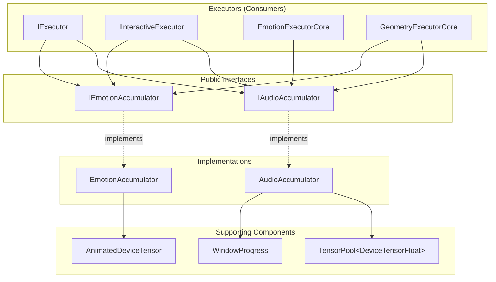

**Sources:** [audio2x-common/include/audio2x/internal/audio_accumulator.h:33-118](), [audio2x-common/include/audio2x/internal/emotion_accumulator.h:32-69](), [audio2emotion-sdk/source/audio2emotion-core/executor_classifier_core.cpp:34-44]()

---

## AudioAccumulator: Circular Buffer Architecture

### Core Mechanism

`AudioAccumulator` implements a circular buffer using a `std::deque` of `DeviceTensorFloat` buffers obtained from a `TensorPool`. Audio samples are accumulated sequentially, and the accumulator transparently handles buffer boundaries when reading windows.

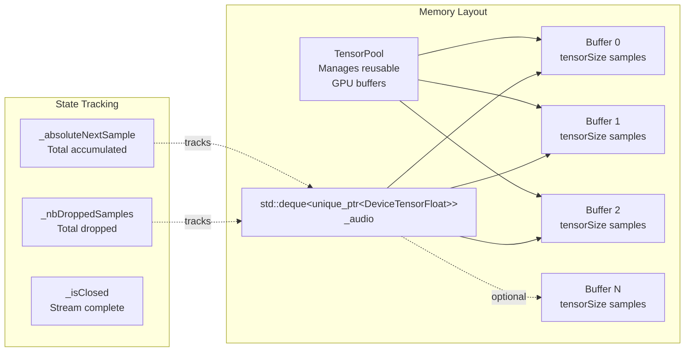

**Sources:** [audio2x-common/include/audio2x/internal/audio_accumulator.h:67-95](), [audio2x-common/source/audio2x/audio_accumulator.cpp:36-52]()

### Key Operations

#### Accumulate

Adds audio samples to the buffer, allocating new tensors from the pool as needed. The operation is GPU-asynchronous.

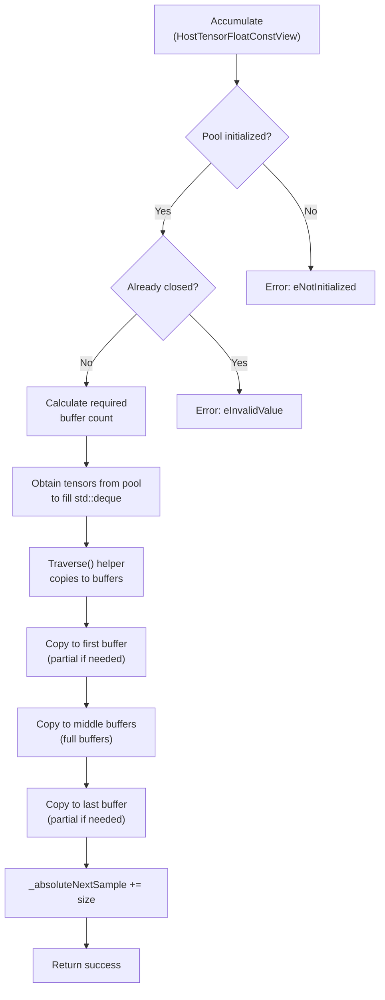

**Sources:** [audio2x-common/source/audio2x/audio_accumulator.cpp:118-165](), [audio2x-common/source/audio2x/audio_accumulator.cpp:73-116]()

#### Read with Padding

Reading from the accumulator supports negative start indices (pre-pending zeros) and reading beyond accumulated samples (post-pending zeros). This is critical for window-based processing where the window may extend before or after actual data.

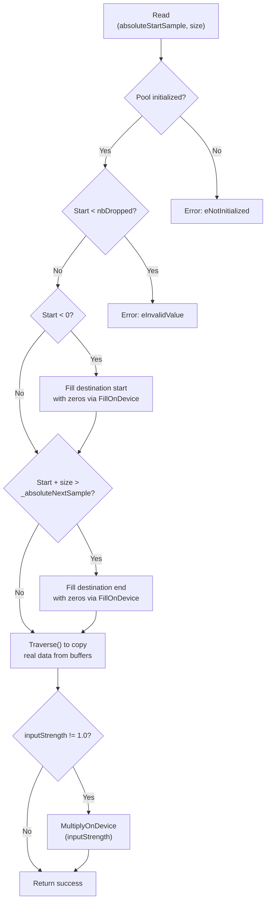

**Sources:** [audio2x-common/source/audio2x/audio_accumulator.cpp:180-270]()

#### DropSamplesBefore

Frees buffers that are no longer needed, returning tensors to the pool for reuse. Buffers are dropped in complete tensor units.

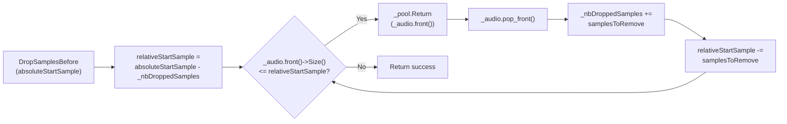

**Sources:** [audio2x-common/source/audio2x/audio_accumulator.cpp:55-71]()

### Thread Safety

All public methods acquire `_mutex` before accessing internal state, ensuring thread-safe concurrent access from producer and consumer threads.

**Sources:** [audio2x-common/include/audio2x/internal/audio_accumulator.h:108-109](), [audio2x-common/source/audio2x/audio_accumulator.cpp:37-42]()

---

## WindowProgress: Sliding Window Calculation

`WindowProgress` determines which audio windows are ready for processing based on accumulated sample count and stride configuration. It is a stateless calculator that executors use to coordinate reading from accumulators.

### Configuration Parameters

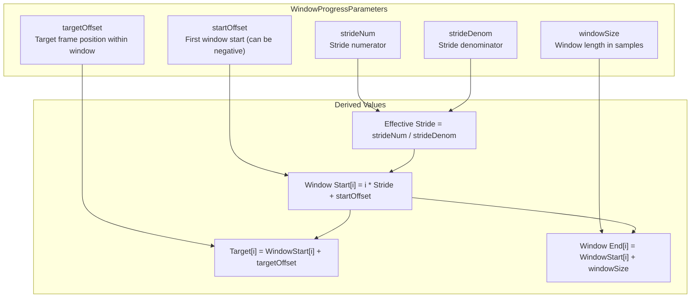

**Sources:** [audio2x-common/include/audio2x/internal/audio_accumulator.h:38-48](), [audio2x-common/source/audio2x/audio_accumulator.cpp:313-321]()

### Window Availability Logic

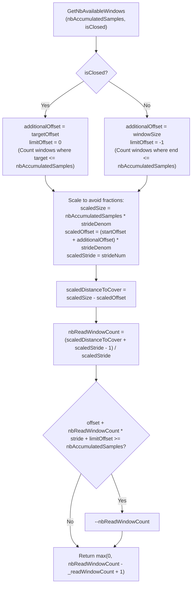

The key distinction:
- **Open stream** (`isClosed = false`): Windows are available when the **entire window** (including padding) fits within accumulated samples
- **Closed stream** (`isClosed = true`): Windows are available when the **target position** is at or before the last sample

**Sources:** [audio2x-common/source/audio2x/audio_accumulator.cpp:349-397](), [audio2x-common/source/audio2x/audio_accumulator.cpp:323-347]()

### Example: Regression Model at 30 FPS

For a regression model with 16 kHz audio and 30 FPS output:
- `windowSize = 8320` samples (~520 ms)
- `startOffset = -4160` (window starts before target)
- `targetOffset = 4160` (target at window center)
- `strideNum = 16000, strideDenom = 30` (stride ≈ 533 samples, or 1/30 second)

**Sources:** [audio2x-common/tests/test_audio_accumulator.cpp:524-533]()

---

## EmotionAccumulator: Interpolated Time-Series Storage

### Architecture

`EmotionAccumulator` wraps `AnimatedDeviceTensor` to provide timestamp-indexed storage with linear interpolation. Unlike `AudioAccumulator`'s sample-based indexing, emotions use arbitrary `int64_t` timestamps for flexible time mapping.

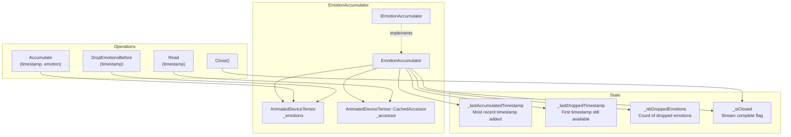

**Sources:** [audio2x-common/include/audio2x/internal/emotion_accumulator.h:32-69](), [audio2x-common/source/audio2x/emotion_accumulator.cpp:34-78]()

### Key Operations

#### Accumulate

Adds an emotion vector at a specific timestamp. Timestamps must be strictly increasing.

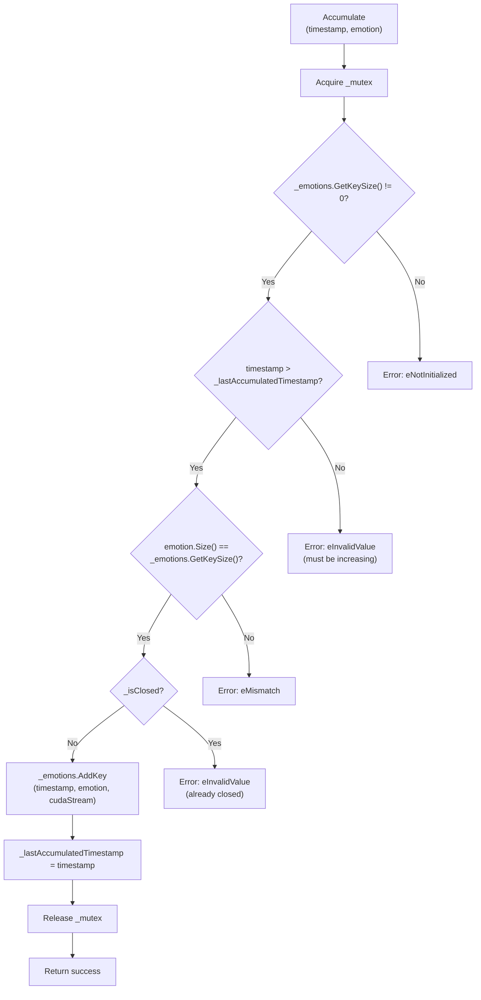

**Sources:** [audio2x-common/source/audio2x/emotion_accumulator.cpp:55-65](), [audio2x-common/source/audio2x/emotion_accumulator.cpp:168-195]()

#### Read with Interpolation

Reading at an arbitrary timestamp performs linear interpolation between the two nearest emotion vectors.

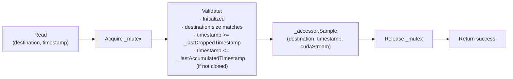

The `Sample` operation in `AnimatedDeviceTensor` handles:
- Exact matches: Copy the emotion vector directly
- Between keys: Linear interpolation `emotion = (1-t) * emotion[i] + t * emotion[i+1]`
- Before first key: Copy the first emotion
- After last key: Copy the last emotion

**Sources:** [audio2x-common/source/audio2x/emotion_accumulator.cpp:80-102]()

#### DropEmotionsBefore

Removes emotions before a timestamp, freeing buffers for reuse.

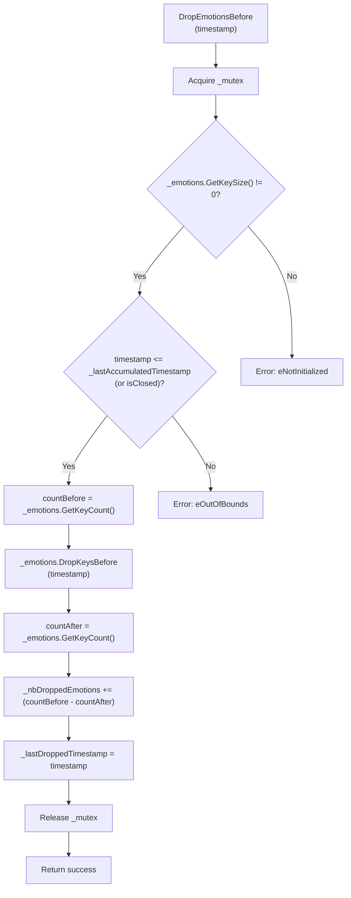

**Sources:** [audio2x-common/source/audio2x/emotion_accumulator.cpp:104-119]()

### Thread Safety

Like `AudioAccumulator`, all operations acquire `_mutex` before accessing internal state.

**Sources:** [audio2x-common/include/audio2x/internal/emotion_accumulator.h:56-59]()

---

## Lifecycle and State Management

### Allocation and Initialization

Both accumulators follow a two-phase initialization:

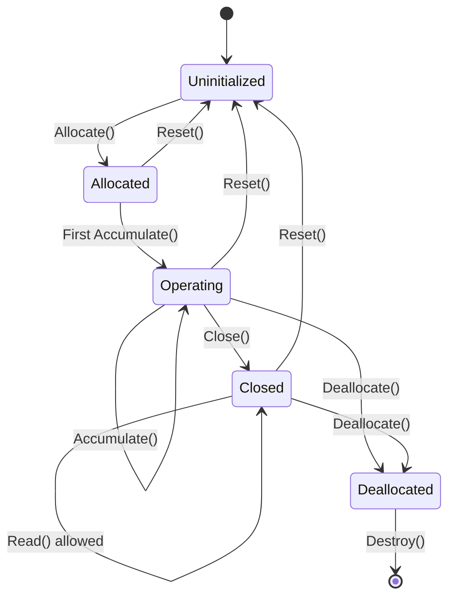

**AudioAccumulator Allocation:**
```cpp
std::error_code Allocate(std::size_t tensorSize, std::size_t tensorCount);
```
- `tensorSize`: Samples per GPU buffer (e.g., 16000 for 1 second at 16 kHz)
- `tensorCount`: Pre-allocated buffer count (0 for on-demand allocation)

**EmotionAccumulator Allocation:**
```cpp
std::error_code Allocate(
    std::size_t emotionSize, 
    std::size_t emotionCountPerBuffer, 
    std::size_t preallocatedBufferCount
);
```
- `emotionSize`: Float count per emotion vector (e.g., 10 for standard emotion space)
- `emotionCountPerBuffer`: Emotions per GPU buffer
- `preallocatedBufferCount`: Pre-allocated buffers

**Sources:** [audio2x-common/source/audio2x/audio_accumulator.cpp:36-42](), [audio2x-common/source/audio2x/emotion_accumulator.cpp:34-47]()

### Close Semantics

The `Close()` operation signals that no more data will be added, enabling executors to process all remaining windows:

| State | AudioAccumulator | EmotionAccumulator |
|-------|------------------|-------------------|
| Before Close | `Read()` fails if window extends beyond accumulated samples | `Read()` fails if timestamp > `_lastAccumulatedTimestamp` |
| After Close | `Read()` allows zero-padding beyond last sample | `Read()` allows timestamps beyond last accumulated |
| Effects | `GetNbAvailableWindows()` counts windows up to target position | Executors can compute final frames |

**Sources:** [audio2x-common/source/audio2x/audio_accumulator.cpp:172-178](), [audio2x-common/source/audio2x/emotion_accumulator.cpp:67-78]()

---

## Integration with Executors

### Executor Usage Pattern

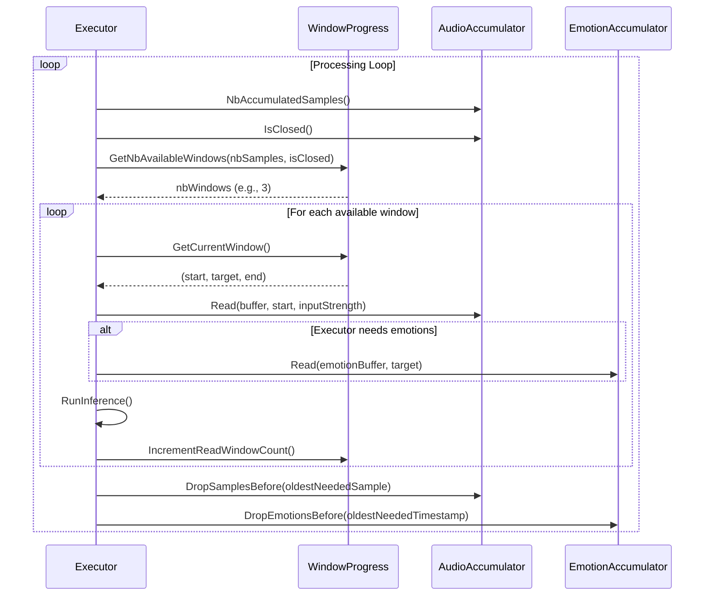

**Sources:** [audio2emotion-sdk/source/audio2emotion-core/executor_classifier_core.cpp:34-44](), [audio2x-common/tests/test_audio_accumulator.cpp:647-731]()

### Multi-Track Accumulators

Executors managing multiple tracks maintain arrays of accumulators:

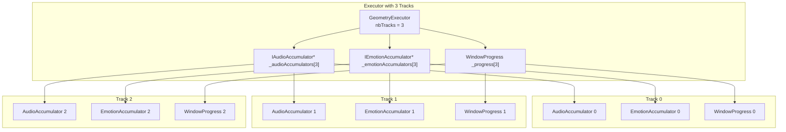

Each track has independent accumulators that can be filled asynchronously. The executor's `GetNbAvailableExecutions()` returns the minimum window count across all tracks.

**Sources:** [audio2x-common/include/audio2x/executor.h:71-109]()

---

## Factory Functions and Destruction

Both accumulators use factory functions for creation and virtual `Destroy()` for cleanup:

```cpp
// Audio accumulator creation
IAudioAccumulator* CreateAudioAccumulator(
    std::size_t tensorSize, 
    std::size_t tensorCount
);

// Emotion accumulator creation  
IEmotionAccumulator* CreateEmotionAccumulator(
    std::size_t emotionSize, 
    std::size_t emotionCountPerBuffer, 
    std::size_t preallocatedBufferCount
);

// Destruction (both types)
accumulator->Destroy();  // Internally: delete this
```

This pattern ensures proper resource cleanup through the interface without exposing implementation details.

**Sources:** [audio2x-common/source/audio2x/audio_accumulator.cpp:432-440](), [audio2x-common/source/audio2x/emotion_accumulator.cpp:213-223]()

---

## Performance Considerations

### Memory Preallocation

Pre-allocating buffers reduces runtime allocations during streaming:

```cpp
// For 10 seconds of audio at 16 kHz with 1-second buffers
auto audioAcc = CreateAudioAccumulator(
    16000,  // tensorSize: 1 second of audio
    10      // tensorCount: preallocate 10 buffers
);

// For 100 emotion frames with 10 emotions per vector
auto emotionAcc = CreateEmotionAccumulator(
    10,    // emotionSize: 10 dimensions
    100,   // emotionCountPerBuffer: 100 frames per buffer
    2      // preallocatedBufferCount: 2 buffers
);
```

**Sources:** [audio2x-common/include/audio2x/audio_accumulator.h:80-86](), [audio2x-common/include/audio2x/emotion_accumulator.h:83-88]()

### Buffer Recycling

The `TensorPool` in `AudioAccumulator` recycles returned buffers, avoiding repeated GPU allocations. Regularly calling `DropSamplesBefore()` / `DropEmotionsBefore()` is essential for long-running streams.

**Sources:** [audio2x-common/source/audio2x/audio_accumulator.cpp:55-71]()

### GPU Asynchronicity

All read and accumulate operations are GPU-asynchronous (work is queued on `cudaStream`), allowing overlap with CPU work. The accumulator does not synchronize internally—the caller controls synchronization points.

**Sources:** [audio2x-common/source/audio2x/audio_accumulator.cpp:180-270](), [audio2x-common/source/audio2x/emotion_accumulator.cpp:80-102]()

---

## Testing and Validation

The SDK includes comprehensive unit tests for both accumulators:

| Test Suite | Coverage |
|------------|----------|
| [audio2x-common/tests/test_audio_accumulator.cpp]() | Buffering, cross-buffer reads, padding, window progress, multi-threading |
| [audio2x-common/tests/test_emotion_accumulator.cpp]() | Timestamp ordering, interpolation, dropping, multi-threading |
| [audio2x-common/tests/test_float_accumulator.cpp]() | Similar coverage for `FloatAccumulator` variant |

The multi-threading tests validate concurrent producer-consumer patterns matching real executor usage.

**Sources:** [audio2x-common/tests/test_audio_accumulator.cpp:1-732](), [audio2x-common/tests/test_emotion_accumulator.cpp:1-209]()

---

