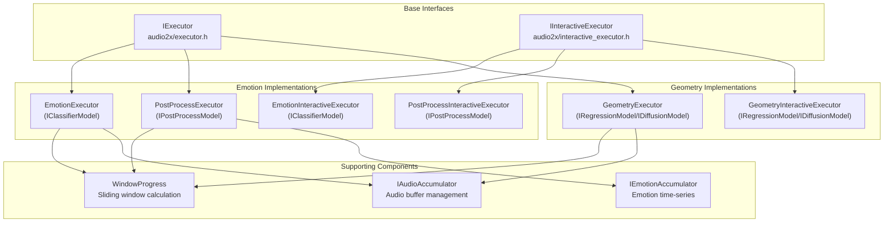
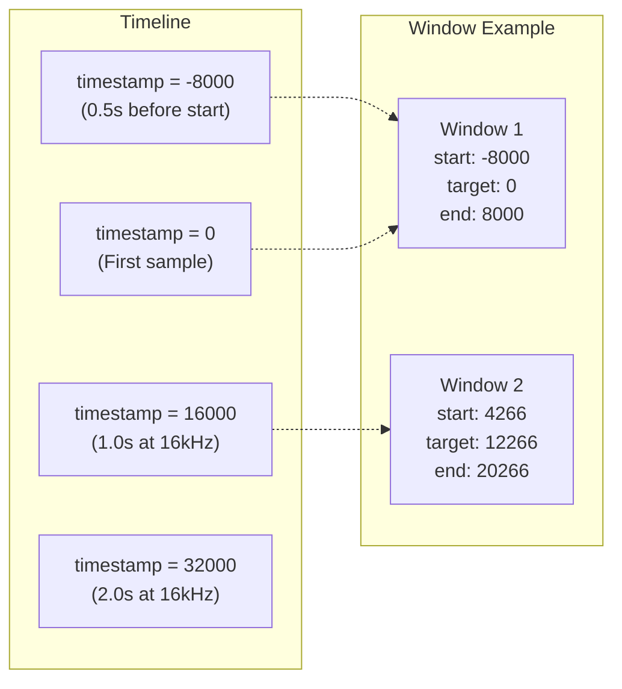
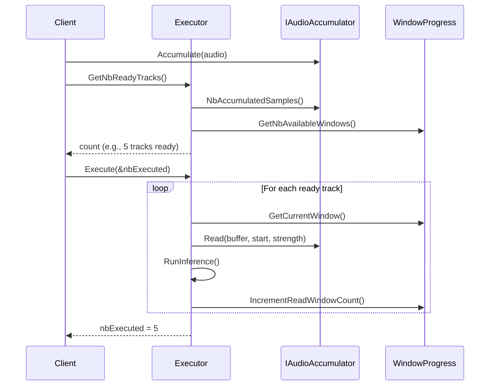
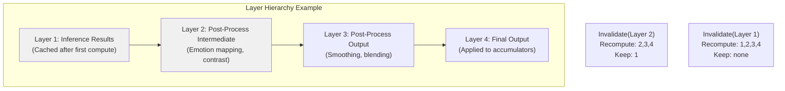
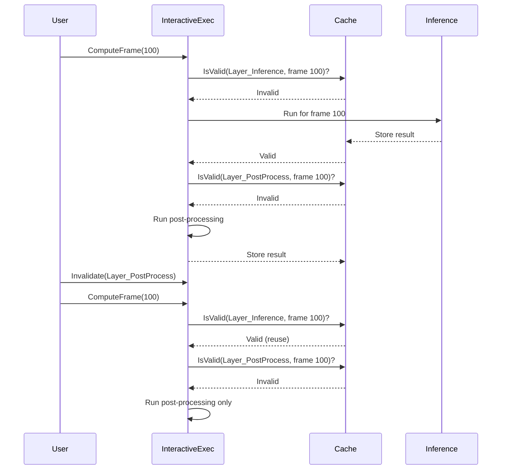
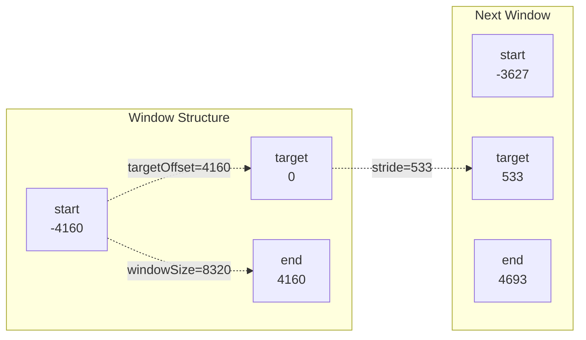
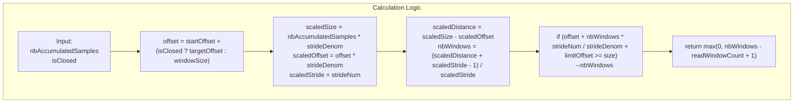
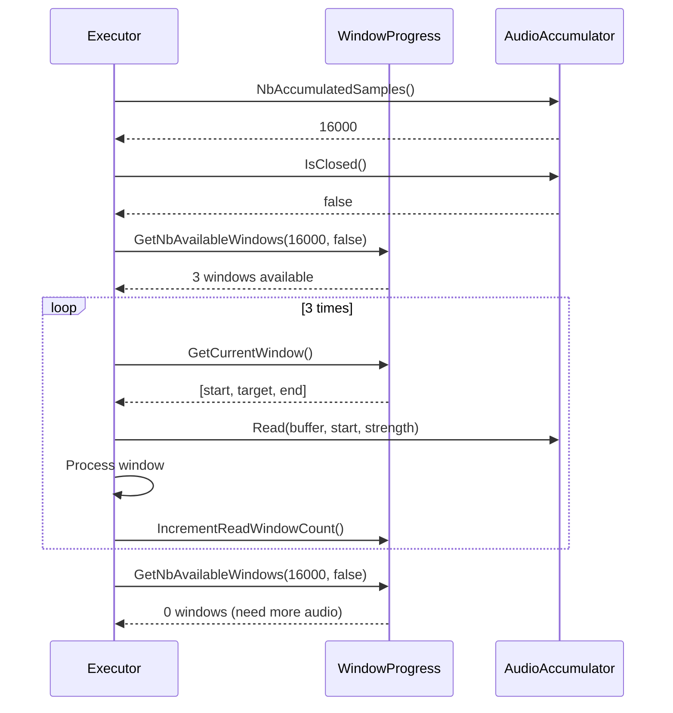
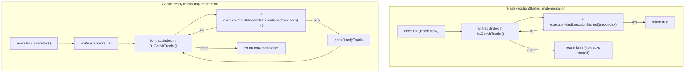
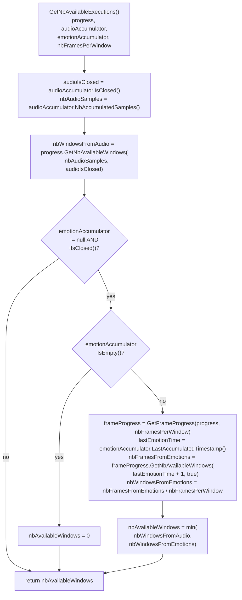

<!-- source: DeepWiki mcp.deepwiki.com · repo NVIDIA/Audio2Face-3D-SDK · page 3.3 Execution Framework · fetched 2026-10-26 -->

# Execution Framework

<details>
<summary>Relevant source files</summary>

The following files were used as context for generating this wiki page:

- [audio2emotion-sdk/include/audio2emotion/executor_classifier.h](audio2emotion-sdk/include/audio2emotion/executor_classifier.h)
- [audio2emotion-sdk/include/audio2emotion/executor_postprocess.h](audio2emotion-sdk/include/audio2emotion/executor_postprocess.h)
- [audio2emotion-sdk/source/audio2emotion-core/executor_classifier_core.cpp](audio2emotion-sdk/source/audio2emotion-core/executor_classifier_core.cpp)
- [audio2x-common/include/audio2x/executor.h](audio2x-common/include/audio2x/executor.h)
- [audio2x-common/include/audio2x/interactive_executor.h](audio2x-common/include/audio2x/interactive_executor.h)
- [audio2x-common/include/audio2x/internal/executor.h](audio2x-common/include/audio2x/internal/executor.h)
- [audio2x-common/source/audio2x/audio2x.cpp](audio2x-common/source/audio2x/audio2x.cpp)
- [audio2x-common/source/audio2x/audio_accumulator.cpp](audio2x-common/source/audio2x/audio_accumulator.cpp)
- [audio2x-common/source/audio2x/executor.cpp](audio2x-common/source/audio2x/executor.cpp)
- [audio2x-common/tests/test_audio_accumulator.cpp](audio2x-common/tests/test_audio_accumulator.cpp)
- [audio2x-common/tests/test_float_accumulator.cpp](audio2x-common/tests/test_float_accumulator.cpp)

</details>


## Purpose and Scope

The Execution Framework provides the foundational interfaces and mechanisms for executing audio-driven inference and post-processing operations in the Audio2Face-3D-SDK. This module defines two primary execution paradigms: **batch processing** via `IExecutor` for continuous stream processing, and **interactive processing** via `IInteractiveExecutor` for timeline scrubbing and parameter tweaking. The framework also includes the `WindowProgress` system for managing sliding window calculations across time-series data, and utilities for multi-track parallel execution.

For details on the data accumulation layer that feeds executors, see [Data Accumulators](#3.2). For specific executor implementations in audio2emotion and audio2face, see [Emotion Models and Executors](#5.1) and [Geometry Models and Executors](#4.1).

---

## Executor Interfaces Overview

The execution framework provides two distinct interfaces serving different use cases:

| Interface | Use Case | Key Features |
|-----------|----------|--------------|
| `IExecutor` | Batch/streaming processing | Continuous execution as data arrives, multi-track support, producer-consumer pattern |
| `IInteractiveExecutor` | Interactive workflows | Frame-specific computation, layer-based invalidation, inference caching, interrupt support |

Both interfaces share common concepts such as frame timestamps, sampling rates, and frame rate specifications, but differ fundamentally in their execution models and state management.



**Diagram: Executor Interface Hierarchy and Implementations**

Sources: [audio2x-common/include/audio2x/executor.h:1-92](), [audio2x-common/include/audio2x/interactive_executor.h:1-75]()

---

## IExecutor - Batch Processing Interface

The `IExecutor` interface provides batch processing capabilities for continuous stream workflows. It follows a producer-consumer pattern where audio data is pushed into accumulators (producer side) while execution proceeds independently (consumer side). Both operations are thread-safe and can occur concurrently.

### Core Methods

| Method | Purpose | Return Type |
|--------|---------|-------------|
| `GetNbTracks()` | Number of parallel tracks supported | `std::size_t` |
| `HasExecutionStarted(trackIndex)` | Check if track has begun processing | `bool` |
| `GetNbAvailableExecutions(trackIndex)` | Count ready-to-execute windows | `std::size_t` |
| `GetTotalNbFrames(trackIndex)` | Total frames when closed | `std::size_t` |
| `Execute(pNbExecutedTracks)` | Run inference/processing | `std::error_code` |
| `Reset(trackIndex)` | Reset track state | `std::error_code` |
| `GetSamplingRate()` | Expected audio sampling rate | `std::size_t` |
| `GetFrameRate(num, denom)` | Generation frame rate fraction | `void` |
| `GetFrameTimestamp(frameIndex)` | Sample index for frame | `timestamp_t` |

### Timestamp System

Executors use a `timestamp_t` (defined as `std::int64_t`) to represent sample indices. Negative timestamps are allowed, enabling windows that start before the first audio sample (useful for symmetric window placement). Timestamps convert to time in seconds by dividing by the sampling rate.



**Diagram: Timestamp-based Window System**

Sources: [audio2x-common/include/audio2x/executor.h:68-72](), [audio2x-common/tests/test_audio_accumulator.cpp:515-533]()

### Multi-Track Execution

The `Execute()` method processes all tracks that have available executions in a single call. The output parameter `pNbExecutedTracks` reports how many tracks were actually executed. This batch approach enables GPU optimizations when processing multiple tracks simultaneously.



**Diagram: Multi-Track Batch Execution Flow**

Sources: [audio2x-common/include/audio2x/executor.h:30-79](), [audio2x-common/source/audio2x/executor.cpp:70-89]()

---

## IInteractiveExecutor - Interactive Processing Interface

The `IInteractiveExecutor` interface enables interactive workflows where users can scrub through a timeline, compute specific frames on demand, or modify post-processing parameters without re-running expensive inference operations.

### Core Methods

| Method | Purpose | Return Type |
|--------|---------|-------------|
| `ComputeFrame(frameIndex)` | Compute minimum work for one frame | `std::error_code` |
| `ComputeAllFrames()` | Execute all frames sequentially | `std::error_code` |
| `Interrupt()` | Interrupt ComputeAllFrames() | `std::error_code` |
| `Invalidate(layer)` | Invalidate cached state | `std::error_code` |
| `IsValid(layer)` | Check layer validity | `bool` |
| `GetTotalNbFrames()` | Total frames available | `std::size_t` |

### Layer-Based Invalidation System

Interactive executors use a layered invalidation model to minimize recomputation when parameters change. Each layer represents a processing stage, and invalidating a layer marks it and all dependent downstream layers as stale.

**Predefined Layers:**
- `kLayerNone` (0): No invalidation
- `kLayerAll` (1): Invalidate everything

Implementations define additional layers representing specific processing stages (e.g., inference results, post-processing intermediates, final output).



**Diagram: Layer-Based Invalidation Cascade**

When `Invalidate(layer)` is called, that layer and all higher-numbered layers become invalid. Calling `ComputeFrame(frameIndex)` will recompute only the invalid layers, reusing cached results for valid layers.

Sources: [audio2x-common/include/audio2x/interactive_executor.h:35-42]()

### Frame-Specific Computation

The `ComputeFrame(frameIndex)` method computes the exact work needed to produce a single frame, leveraging cached results where possible. This enables efficient timeline scrubbing where users can jump to arbitrary frames without waiting for full sequential processing.



**Diagram: Cached Frame Computation with Selective Recomputation**

Sources: [audio2x-common/include/audio2x/interactive_executor.h:62-69]()

---

## WindowProgress System

The `WindowProgress` class manages sliding window calculations across audio time-series data. It determines which audio windows are ready for processing based on accumulated samples and tracks the current read position through the audio stream.

### WindowProgressParameters

```cpp
struct WindowProgressParameters {
    std::size_t windowSize;        // Total samples in window
    timestamp_t startOffset;       // Offset of first window start
    timestamp_t targetOffset;      // Target sample within window
    std::size_t strideNum;         // Stride numerator (allows fractional strides)
    std::size_t strideDenom;       // Stride denominator
};
```

The stride defines how much the window advances between executions as a fraction: `strideNum / strideDenom` samples. This allows precise control over window overlap and frame rates. For example, at 30 FPS with 16kHz audio: `strideNum=16000, strideDenom=30` = 533.33 samples/frame.

### Window Components

Each window has three key positions:
- **start**: First sample index in the window (can be negative)
- **target**: The sample this window's output represents
- **end**: Last sample index + 1 in the window



**Diagram: Window Structure and Stride Progression**

Sources: [audio2x-common/source/audio2x/audio_accumulator.cpp:313-347](), [audio2x-common/tests/test_audio_accumulator.cpp:524-533]()

### Available Window Calculation

The `GetNbAvailableWindows()` method determines how many windows can be executed given the current accumulated samples and whether the audio stream is closed.

**When Audio Stream is Open (`isClosed = false`):**
Count windows where the **end** of the window is ≤ accumulated samples.

**When Audio Stream is Closed (`isClosed = true`):**
Count windows where the **target** of the window is ≤ accumulated samples.

This distinction ensures that:
1. During streaming, we don't execute windows extending beyond available data
2. After closure, we process all windows where the target falls within the audio



**Diagram: GetNbAvailableWindows Calculation Flow**

Sources: [audio2x-common/source/audio2x/audio_accumulator.cpp:357-397]()

### WindowProgress Usage Pattern



**Diagram: Typical WindowProgress Usage in Executor**

Sources: [audio2x-common/source/audio2x/audio_accumulator.cpp:313-413](), [audio2x-common/tests/test_audio_accumulator.cpp:443-488]()

---

## Multi-Track Execution

The execution framework supports processing 1-128 parallel tracks simultaneously, enabling batch GPU operations for improved performance. Each track maintains independent state including its own `WindowProgress`, accumulators, and execution history.

### Track State Management

| State Component | Per-Track | Shared |
|----------------|-----------|--------|
| `WindowProgress` | ✓ | - |
| Audio/Emotion Accumulators | ✓ | - |
| Inference Results | ✓ | - |
| TensorRT Engine | - | ✓ |
| CUDA Stream | - | ✓ (or per-track) |
| Post-Processing Kernels | - | ✓ (batch optimized) |

### Helper Functions for Multi-Track Operations

```cpp
// Check if any track has started execution
bool HasExecutionStarted(const IExecutor& executor);

// Count tracks with available executions
std::size_t GetNbReadyTracks(const IExecutor& executor);
```

These helper functions iterate over all tracks in the executor to provide aggregate information:



**Diagram: Multi-Track Helper Function Logic**

Sources: [audio2x-common/source/audio2x/executor.cpp:70-89](), [audio2x-common/include/audio2x/executor.h:83-89]()

---

## Integration with Accumulators

Executors depend on accumulators for input data and, in some cases, for storing output. The execution framework provides a helper function `GetNbAvailableExecutions()` that coordinates between `WindowProgress`, `IAudioAccumulator`, and `IEmotionAccumulator` to determine execution readiness.

### Execution Availability Calculation

The number of available executions is determined by the minimum of:
1. Windows available based on accumulated audio
2. Windows available based on accumulated emotions (if emotion input required and not closed)



**Diagram: GetNbAvailableExecutions Logic with Accumulator Coordination**

This function ensures executors don't attempt to process windows when required emotion inputs aren't yet available, while still allowing audio-only executors to proceed independently.

Sources: [audio2x-common/source/audio2x/executor.cpp:29-65](), [audio2x-common/include/audio2x/internal/executor.h:28-33]()

---

## Implementation Patterns

### EmotionExecutorCore Example

The `EmotionExecutorCore` class demonstrates typical executor implementation patterns using the execution framework:

**Progress Parameter Calculation:**
```cpp
std::error_code GetProgressParameters(
    nva2x::WindowProgressParameters& outProgressParams,
    const NetworkInfo& networkInfo,
    std::size_t inferencesToSkip,
    std::size_t frameRateNumerator,
    std::size_t frameRateDenominator
);
```

Calculates window parameters from network configuration:
- `windowSize = networkInfo.bufferLength`
- `targetOffset = bufferLength / 2` (center of window)
- `startOffset = -targetOffset` (symmetric around target)
- `strideNum = bufferSamplerate * frameRateDenominator * (inferencesToSkip + 1)`
- `strideDenom = frameRateNumerator`

**Batch Size Management:**
The executor initializes with a batch size for GPU efficiency:
```cpp
const auto maxBatchSize = _inferenceEngine.GetMaxBatchSize(bindingsDescription);
if (batchSize == 0) {
    batchSize = static_cast<std::size_t>(maxBatchSize);  // Use max if not specified
}
_batchSize = batchSize;
```

Audio buffers are allocated as strided memory: `_inferenceAudioBuffer.Allocate(_networkInfo.bufferLength * batchSize)`

**Reading from Accumulator:**
```cpp
std::error_code ReadAudioBuffer(
    const nva2x::IAudioAccumulator& audioAccumulator,
    std::size_t batchIndex,
    std::size_t start
) {
    const auto audioBuffer = GetInferenceAudioBuffer(batchIndex, 1);
    return audioAccumulator.Read(audioBuffer, start, _inputStrength, _cudaStream);
}
```

Sources: [audio2emotion-sdk/source/audio2emotion-core/executor_classifier_core.cpp:34-207]()

### Thread-Safety Considerations

The execution framework is designed for concurrent producer-consumer operation:

**Safe Concurrent Operations:**
- Pushing audio to `IAudioAccumulator` while calling `Execute()`
- Multiple threads checking `GetNbAvailableExecutions()`
- Reading from closed accumulators from multiple threads

**Not Thread-Safe:**
- Calling `Execute()` from multiple threads simultaneously on the same executor
- Modifying `WindowProgress` state from multiple threads
- Calling `ComputeFrame()` and `Invalidate()` concurrently on interactive executors

Sources: [audio2x-common/include/audio2x/executor.h:44-58](), [audio2x-common/tests/test_audio_accumulator.cpp:647-695]()

---

## Summary Table

| Component | Location | Purpose |
|-----------|----------|---------|
| `IExecutor` | [audio2x-common/include/audio2x/executor.h]() | Batch processing interface |
| `IInteractiveExecutor` | [audio2x-common/include/audio2x/interactive_executor.h]() | Interactive frame computation |
| `WindowProgress` | [audio2x-common/source/audio2x/audio_accumulator.cpp:313-413]() | Sliding window management |
| `WindowProgressParameters` | [audio2x-common/include/audio2x/internal/audio_accumulator.h]() | Window configuration |
| `HasExecutionStarted()` | [audio2x-common/source/audio2x/executor.cpp:70-78]() | Check any track started |
| `GetNbReadyTracks()` | [audio2x-common/source/audio2x/executor.cpp:80-89]() | Count ready tracks |
| `GetNbAvailableExecutions()` | [audio2x-common/source/audio2x/executor.cpp:29-65]() | Calculate available windows |
| `EmotionExecutorCore` | [audio2emotion-sdk/source/audio2emotion-core/executor_classifier_core.cpp]() | Example implementation |

---

