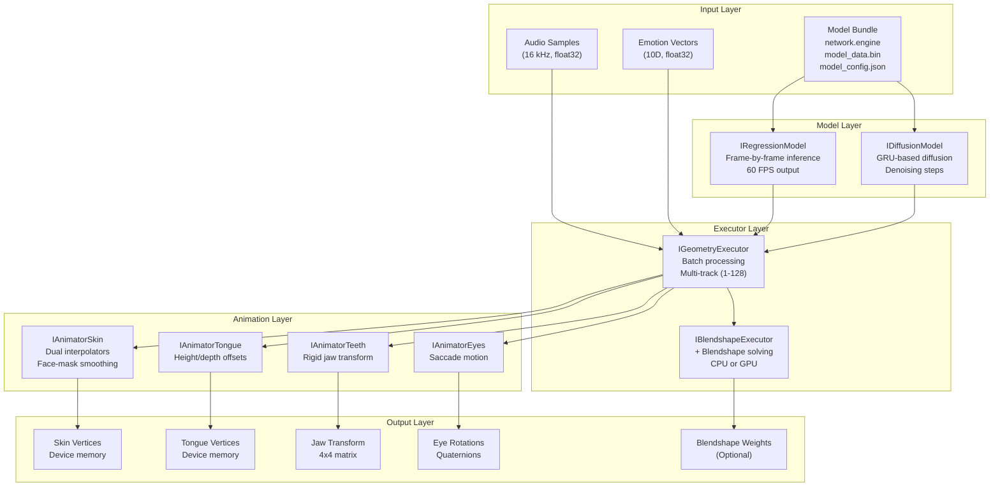
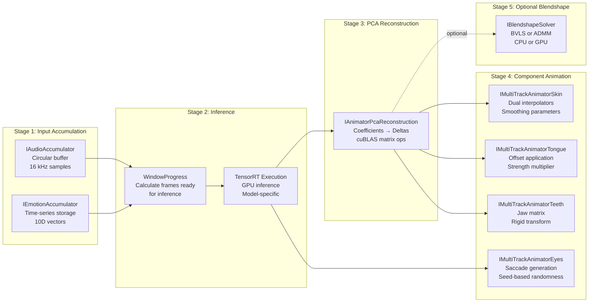
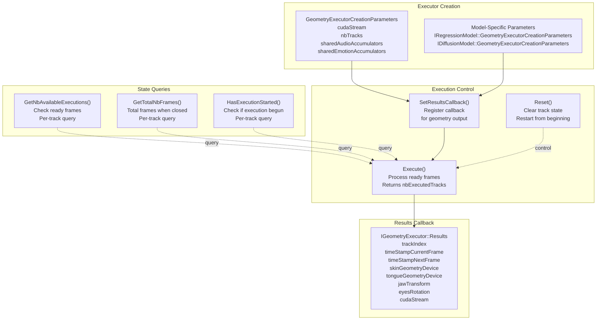
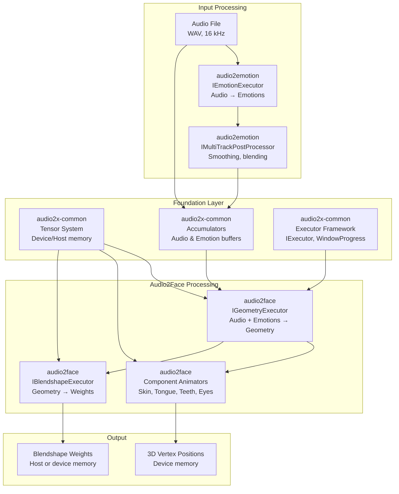

<!-- source: DeepWiki mcp.deepwiki.com · repo NVIDIA/Audio2Face-3D-SDK · page 4 Audio2Face SDK · fetched 2026-10-26 -->

# Audio2Face SDK

<details>
<summary>Relevant source files</summary>

The following files were used as context for generating this wiki page:

- [audio2face-sdk/source/audio2face-core/executor.cpp](audio2face-sdk/source/audio2face-core/executor.cpp)
- [audio2face-sdk/source/audio2face/audio2face.cpp](audio2face-sdk/source/audio2face/audio2face.cpp)
- [audio2face-sdk/source/benchmarks/utils.h](audio2face-sdk/source/benchmarks/utils.h)
- [audio2face-sdk/tests/test_core_executor.cpp](audio2face-sdk/tests/test_core_executor.cpp)

</details>


## Purpose and Scope

The Audio2Face SDK (`audio2face-sdk`) generates facial animation geometry from audio and emotion inputs using neural network inference. This module processes audio streams (16 kHz) and emotion vectors (10-dimensional) through TensorRT models to produce animated facial components including skin vertices, tongue vertices, jaw transforms, and eye rotations.

The SDK supports two distinct model architectures:
- **Regression Models**: Direct frame-by-frame mapping at 60 FPS
- **Diffusion Models**: GRU-based iterative refinement with denoising steps

For information about emotion classification from audio, see [Audio2Emotion SDK](#5). For details about the foundational tensor and executor systems, see [Core Infrastructure](#3). For interactive execution modes with layer-based caching, see [Interactive Execution](#6).

---

## Architecture Overview

The Audio2Face SDK consists of five primary subsystems that transform audio and emotion inputs into facial animation data:



**Sources**: [audio2face-sdk/source/audio2face/audio2face.cpp:23-892](), [audio2face-sdk/tests/test_core_executor.cpp:234-325]()

---

## Model Types

The SDK supports two fundamentally different approaches to geometry generation, each with distinct characteristics and use cases.

### Regression Models

Regression models (`IRegressionModel`) perform direct frame-by-frame mapping from audio and emotion inputs to geometry deltas. Each inference produces results for a single output frame at 60 FPS.

**Key Characteristics**:
- Fixed 60 FPS output rate with configurable frame rate numerator/denominator
- Utilizes emotion database for implicit emotion conditioning via source shot/frame selection
- Network output includes PCA coefficients for skin and tongue, plus direct jaw and eye parameters
- Stateless inference suitable for random access processing

**Network Architecture**:
| Component | Input | Output | Purpose |
|-----------|-------|--------|---------|
| Audio Input | 16 kHz buffer | Feature extraction | Temporal audio context |
| Emotion Input | 10D explicit + implicit emotions | Emotion conditioning | User-specified + database emotions |
| Inference | TensorRT engine | PCA coefficients + direct outputs | Compact geometry representation |
| PCA Reconstruction | Coefficients → Full deltas | 3D vertex positions | Expansion to full geometry |

**Sources**: [audio2face-sdk/source/audio2face/audio2face.cpp:38-46](), [audio2face-sdk/source/audio2face/audio2face.cpp:72-82](), [audio2face-sdk/tests/test_core_executor.cpp:91-102]()

### Diffusion Models

Diffusion models (`IDiffusionModel`) use GRU-based iterative refinement with denoising steps to generate temporally coherent animation. These models maintain internal state across frames for smooth transitions.

**Key Characteristics**:
- GRU layers maintain temporal context across multiple frames
- Multiple diffusion steps per output frame for iterative refinement
- Identity-based conditioning supporting multiple character identities
- Frame padding with left/right truncation and center window
- Optional constant noise generation for deterministic output

**Network Architecture**:
| Component | Purpose | Configuration |
|-----------|---------|---------------|
| GRU Layers | Temporal state tracking | `numGruLayers`, `gruLatentDim` |
| Diffusion Steps | Iterative refinement | `numDiffusionSteps` |
| Frame Windows | Temporal context | `numFramesLeftTruncate`, `numFramesRightTruncate`, `numFramesCenter` |
| Identity Embedding | Character selection | `identityLength`, `identityIndex` |
| Noise Generator | Stochastic variation | `INoiseGenerator`, `constantNoise` flag |

**Sources**: [audio2face-sdk/source/audio2face/audio2face.cpp:48-59](), [audio2face-sdk/source/audio2face/audio2face.cpp:84-94](), [audio2face-sdk/tests/test_core_executor.cpp:104-115]()

---

## Processing Pipeline

The complete Audio2Face processing pipeline transforms raw audio and emotion data into animated facial geometry through multiple stages:



**Sources**: [audio2face-sdk/source/audio2face-core/executor.cpp:35-167](), [audio2face-sdk/tests/test_core_executor.cpp:960-1140]()

### Stage 1: Input Accumulation

Audio and emotion data accumulate in GPU memory buffers managed by accumulators from the `audio2x-common` module. The `WindowProgress` mechanism determines when sufficient data exists for inference.

**Key Classes**:
- `IAudioAccumulator`: Manages audio sample buffering with 16 kHz sampling rate
- `IEmotionAccumulator`: Stores time-series emotion vectors with interpolation
- `WindowProgress`: Calculates frame timestamps and readiness

**Sources**: [audio2face-sdk/source/audio2face-core/executor.cpp:269-308]()

### Stage 2: Neural Network Inference

The inference engine executes TensorRT networks on GPU, producing either PCA coefficients (regression) or intermediate representations (diffusion). The `IInferenceEngine` wrapper from `audio2x-common` manages TensorRT context and execution.

**Inference Flow**:
1. Check `GetNbAvailableExecutions()` for ready frames
2. Prepare input buffers with audio and emotion data
3. Execute TensorRT engine on CUDA stream
4. Retrieve output buffers with geometry deltas

**Sources**: [audio2face-sdk/tests/test_core_executor.cpp:303-315]()

### Stage 3: PCA Reconstruction

For models using PCA-compressed representations, the `IAnimatorPcaReconstruction` component expands compact coefficients into full 3D vertex deltas using cuBLAS matrix multiplication.

**Reconstruction Formula**:
```
VertexDeltas = PCABasis × Coefficients + MeanShape
```

Where:
- `PCABasis`: Learned matrix of principal components
- `Coefficients`: Network output (compact representation)
- `MeanShape`: Neutral pose offset

**Sources**: [audio2face-sdk/source/audio2face/audio2face.cpp:315-317]()

### Stage 4: Component Animation

Four specialized animators process different facial regions in parallel, each with unique parameters and processing characteristics:

| Animator | Component | Key Parameters | Processing Method |
|----------|-----------|----------------|-------------------|
| `IAnimatorSkin` | Face skin | `upperSmoothingCoef`, `lowerSmoothingCoef`, `faceMaskThreshold` | Dual interpolator smoothing with face mask |
| `IAnimatorTongue` | Tongue | `heightOffsetX`, `depthOffsetY`, `strength` | Offset transformation with strength scaling |
| `IAnimatorTeeth` | Jaw | `faceMaskThreshold` | Rigid body 4×4 transform matrix |
| `IAnimatorEyes` | Eye rotation | `seed`, `saccadeParams` | Quaternion rotation with procedural saccade |

**Multi-Track Optimization**: All animators support batch processing across multiple tracks (1-128) using GPU kernels with strided memory layouts.

**Sources**: [audio2face-sdk/source/audio2face/audio2face.cpp:319-349](), [audio2face-sdk/tests/test_core_executor.cpp:196-204]()

### Stage 5: Optional Blendshape Solving

The optional `IBlendshapeSolver` converts raw geometry vertices into blendshape rig weights using constrained optimization. Two implementation variants exist:

**CPU Solver**: Uses BVLS (Bounded Variable Least Squares) algorithm with async thread pool for parallel track processing.

**GPU Solver**: Uses ADMM (Alternating Direction Method of Multipliers) algorithm for batch processing all tracks simultaneously on device.

**Sources**: [audio2face-sdk/source/audio2face/audio2face.cpp:422-426]()

---

## Executor System

The executor system provides the primary interface for running Audio2Face models. Executors manage the complete pipeline from input accumulation through animation output.

### IGeometryExecutor

The `IGeometryExecutor` interface handles batch processing of geometry generation:



**Key Methods**:

| Method | Purpose | Return Type |
|--------|---------|-------------|
| `SetResultsCallback(callback, userdata)` | Register callback for geometry output | `std::error_code` |
| `Execute(nbExecutedTracks*)` | Process all ready tracks | `std::error_code` |
| `Reset(trackIndex)` | Reset track state for re-execution | `std::error_code` |
| `GetNbAvailableExecutions(trackIndex)` | Query number of frames ready | `std::size_t` |
| `GetTotalNbFrames(trackIndex)` | Query total frames after close | `std::size_t` |
| `HasExecutionStarted(trackIndex)` | Check if any frames processed | `bool` |

**ExecutionOption Flags**: Control which components to process using bitwise flags:

```cpp
enum class ExecutionOption : uint32_t {
    None = 0,
    Skin = 1 << 0,    // Process skin geometry
    Tongue = 1 << 1,  // Process tongue geometry  
    Jaw = 1 << 2,     // Process jaw transform
    Eyes = 1 << 3,    // Process eye rotation
    All = Skin | Tongue | Jaw | Eyes
};
```

**Sources**: [audio2face-sdk/source/audio2face-core/executor.cpp:35-190](), [audio2face-sdk/tests/test_core_executor.cpp:234-325]()

### IBlendshapeExecutor

The `IBlendshapeExecutor` extends `IGeometryExecutor` with blendshape solving capabilities:

**Creation Functions**:
- `CreateHostBlendshapeSolveExecutor()`: CPU-based solver with async thread pool
- `CreateDeviceBlendshapeSolveExecutor()`: GPU-based solver with batch processing

**Callback Variants**:
- `host_results_callback_t`: Receives blendshape weights in host memory
- `device_results_callback_t`: Receives blendshape weights in device memory

**Additional Methods**:
- `Wait(trackIndex)`: Block until all async work completes for track

**Sources**: [audio2face-sdk/source/audio2face/audio2face.cpp:638-650](), [audio2face-sdk/tests/test_core_executor.cpp:327-467]()

### Creating Executors

Direct executor creation requires assembling multiple components:

```cpp
// Step 1: Load model information
auto modelInfo = ReadRegressionModelInfo(modelPath);

// Step 2: Create CUDA stream
auto cudaStream = CreateCudaStream();

// Step 3: Create accumulators for each track
std::vector<UniquePtr<IAudioAccumulator>> audioAccumulators(nbTracks);
std::vector<UniquePtr<IEmotionAccumulator>> emotionAccumulators(nbTracks);
for (size_t i = 0; i < nbTracks; ++i) {
    audioAccumulators[i] = CreateAudioAccumulator(16000, 0);
    emotionAccumulators[i] = CreateEmotionAccumulator(10, 300, 0);
}

// Step 4: Build executor creation parameters
GeometryExecutorCreationParameters params;
params.cudaStream = cudaStream->Data();
params.nbTracks = nbTracks;
params.sharedAudioAccumulators = /* array of audio accumulators */;
params.sharedEmotionAccumulators = /* array of emotion accumulators */;

auto regressionParams = modelInfo->GetExecutorCreationParameters(
    IGeometryExecutor::ExecutionOption::All, 60, 1
);

// Step 5: Create executor
auto executor = CreateRegressionGeometryExecutor(params, regressionParams);
```

**Sources**: [audio2face-sdk/tests/test_core_executor.cpp:56-89](), [audio2face-sdk/tests/test_core_executor.cpp:530-606]()

---

## Bundle Pattern

The bundle pattern simplifies initialization by encapsulating all required resources in a single object. Bundles automatically create and manage the executor, CUDA stream, and accumulators.

### IGeometryExecutorBundle

The `IGeometryExecutorBundle` interface provides:

| Method | Return Type | Purpose |
|--------|-------------|---------|
| `GetExecutor()` | `IGeometryExecutor&` | Access geometry executor |
| `GetCudaStream()` | `nva2x::ICudaStream&` | Access CUDA stream |
| `GetAudioAccumulator(trackIndex)` | `nva2x::IAudioAccumulator&` | Access audio accumulator |
| `GetEmotionAccumulator(trackIndex)` | `nva2x::IEmotionAccumulator&` | Access emotion accumulator |

**Bundle Creation Functions**:
```cpp
// Regression model bundle
IGeometryExecutorBundle* ReadRegressionGeometryExecutorBundle(
    size_t nbTracks,
    const char* modelJsonPath,
    IGeometryExecutor::ExecutionOption executionOption,
    size_t frameRateNumerator,
    size_t frameRateDenominator,
    IRegressionModel::IGeometryModelInfo** outModelInfo
);

// Diffusion model bundle
IGeometryExecutorBundle* ReadDiffusionGeometryExecutorBundle(
    size_t nbTracks,
    const char* modelJsonPath,
    IGeometryExecutor::ExecutionOption executionOption,
    size_t identityIndex,
    bool constantNoise,
    IDiffusionModel::IGeometryModelInfo** outModelInfo
);
```

**Usage Example**:
```cpp
// Create bundle from model.json file
auto bundle = ReadRegressionGeometryExecutorBundle(
    8,  // nbTracks
    "path/to/model.json",
    IGeometryExecutor::ExecutionOption::All,
    60, 1,  // 60 FPS
    nullptr
);

// Populate accumulators with data
for (size_t i = 0; i < bundle->GetExecutor().GetNbTracks(); ++i) {
    bundle->GetAudioAccumulator(i).Accumulate(audioData, bundle->GetCudaStream().Data());
    bundle->GetEmotionAccumulator(i).Accumulate(timestamp, emotionData, bundle->GetCudaStream().Data());
    bundle->GetAudioAccumulator(i).Close();
    bundle->GetEmotionAccumulator(i).Close();
}

// Execute
bundle->GetExecutor().SetResultsCallback(myCallback, myUserdata);
while (GetNbReadyTracks(bundle->GetExecutor()) > 0) {
    bundle->GetExecutor().Execute(nullptr);
}
```

**Sources**: [audio2face-sdk/source/audio2face/audio2face.cpp:275-290](), [audio2face-sdk/tests/test_core_executor.cpp:137-157]()

### IBlendshapeExecutorBundle

Similar to `IGeometryExecutorBundle` but returns `IBlendshapeExecutor` instead:

```cpp
// Regression model with blendshape solving
IBlendshapeExecutorBundle* ReadRegressionBlendshapeSolveExecutorBundle(
    size_t nbTracks,
    const char* modelJsonPath,
    IGeometryExecutor::ExecutionOption executionOption,
    bool useGpuSolver,
    size_t frameRateNumerator,
    size_t frameRateDenominator,
    IRegressionModel::IGeometryModelInfo** outModelInfo,
    IRegressionModel::IBlendshapeSolveModelInfo** outBlendshapeSolveModelInfo
);

// Diffusion model with blendshape solving
IBlendshapeExecutorBundle* ReadDiffusionBlendshapeSolveExecutorBundle(
    size_t nbTracks,
    const char* modelJsonPath,
    IGeometryExecutor::ExecutionOption executionOption,
    bool useGpuSolver,
    size_t identityIndex,
    bool constantNoise,
    IDiffusionModel::IGeometryModelInfo** outModelInfo,
    IDiffusionModel::IBlendshapeSolveModelInfo** outBlendshapeSolveModelInfo
);
```

**Sources**: [audio2face-sdk/source/audio2face/audio2face.cpp:292-311](), [audio2face-sdk/tests/test_core_executor.cpp:182-229]()

---

## Model File Structure

Audio2Face models are distributed as bundles containing multiple files referenced by a root JSON file:

### Model Bundle Files

| File | Purpose | Format |
|------|---------|--------|
| `model.json` | Root configuration | JSON |
| `network.engine` | TensorRT serialized engine | Binary (TensorRT) |
| `model_data.bin` | Animator data (PCA basis, neutral poses) | Binary (NPZ-like) |
| `model_config.json` | Animator parameters | JSON |
| `emotion_database.npz` (regression only) | Static emotion data | NPZ |
| `blendshape_skin_config.json` (optional) | Skin blendshape solver config | JSON |
| `blendshape_skin_data.npz` (optional) | Skin blendshape solver data | NPZ |
| `blendshape_tongue_config.json` (optional) | Tongue blendshape solver config | JSON |
| `blendshape_tongue_data.npz` (optional) | Tongue blendshape solver data | NPZ |

### Loading Model Information

The SDK provides helper functions to load model information:

```cpp
// Load all files from root JSON
IRegressionModel::IGeometryModelInfo* ReadRegressionModelInfo(const char* modelJsonPath);
IDiffusionModel::IGeometryModelInfo* ReadDiffusionModelInfo(const char* modelJsonPath);

// Load individual components
IRegressionModel::INetworkInfo* ReadRegressionNetworkInfo(const char* path);
IRegressionModel::IAnimatorData* ReadRegressionAnimatorData(const char* path);

// Load blendshape solver info
IRegressionModel::IBlendshapeSolveModelInfo* ReadRegressionBlendshapeSolveModelInfo(const char* path);
IDiffusionModel::IBlendshapeSolveModelInfo* ReadDiffusionBlendshapeSolveModelInfo(const char* path);
```

**Sources**: [audio2face-sdk/source/audio2face/audio2face.cpp:429-518]()

---

## Integration with Other SDK Components

The Audio2Face SDK integrates with other modules to form complete audio-driven facial animation pipelines:



**Key Integration Points**:

1. **audio2x-common**: Provides foundational tensor operations, data accumulation, and executor framework. See [Core Infrastructure](#3) for details.

2. **audio2emotion-sdk**: Generates emotion vectors from audio that serve as input to Audio2Face models. The emotion executor output can be directly accumulated into `IEmotionAccumulator` instances. See [Audio2Emotion SDK](#5) for details.

3. **Tensor System**: All geometry data flows through the tensor system with efficient GPU memory management and copy operations. See [Tensor System](#3.1) for details.

4. **Multi-Track Processing**: Both audio2emotion and audio2face executors support batch processing of multiple tracks (1-128) using shared GPU resources. See [Multi-Track Batch Processing](#7) for details.

**Sources**: [audio2face-sdk/tests/test_core_executor.cpp:1142-1234](), [audio2face-sdk/source/benchmarks/utils.h:109-113]()

---

## Error Handling

The Audio2Face SDK uses `std::error_code` for error reporting. Common error conditions include:

| Error Code | Condition | Common Cause |
|------------|-----------|--------------|
| `eSuccess` | No error | Operation completed successfully |
| `eNullPointer` | Null pointer argument | Missing required parameter |
| `eOutOfBounds` | Invalid track index | Track index ≥ nbTracks |
| `eExecutionAlreadyStarted` | Modification after execution begun | Attempt to change parameters after first Execute() |
| `eNotInitialized` | Component not initialized | Accessing animator before creation |
| `eMismatch` | Incompatible configuration | Emotion accumulator size mismatch |
| `eUnsupported` | Unsupported operation | Invalid ExecutionOption combination |

**Validation Examples**:

```cpp
// Track index validation
std::error_code GetNbAvailableExecutions(size_t trackIndex) const {
    if (trackIndex >= _trackData.size()) {
        return ErrorCode::eOutOfBounds;
    }
    // ...
}

// Parameter modification validation
std::error_code SetInputStrength(float inputStrength) {
    if (HasExecutionStarted(*this)) {
        return ErrorCode::eExecutionAlreadyStarted;
    }
    // ...
}
```

**Sources**: [audio2face-sdk/source/audio2face-core/executor.cpp:43-51](), [audio2face-sdk/source/audio2face-core/executor.cpp:102-115](), [audio2face-sdk/tests/test_core_executor.cpp:469-528]()

---

## Performance Considerations

The Audio2Face SDK is designed for high-performance GPU execution with several optimization strategies:

### Multi-Track Batch Processing

Processing multiple tracks simultaneously leverages GPU parallelism:
- **1-8 tracks**: Good GPU utilization for real-time applications
- **16-64 tracks**: Optimal batch size for offline processing
- **64-128 tracks**: Maximum supported, best throughput per frame

### Memory Management

- **Device Memory**: Geometry stays on GPU throughout pipeline, avoiding costly transfers
- **Host-Pinned Memory**: Blendshape weights use pinned memory for fast CPU access when needed
- **CUDA Streams**: Asynchronous execution allows overlapping compute and memory operations

### Model Selection

| Model Type | Inference Time | Quality | Best Use Case |
|------------|----------------|---------|---------------|
| Regression | ~2-5ms per frame | High | Real-time applications, random access |
| Diffusion | ~20-50ms per frame | Very High | Offline rendering, highest quality needed |

**Sources**: [audio2face-sdk/source/benchmarks/utils.h:52-65](), [audio2face-sdk/tests/test_core_executor.cpp:234-325]()

---

