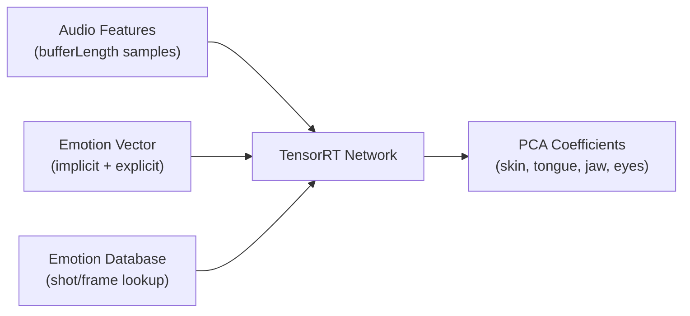
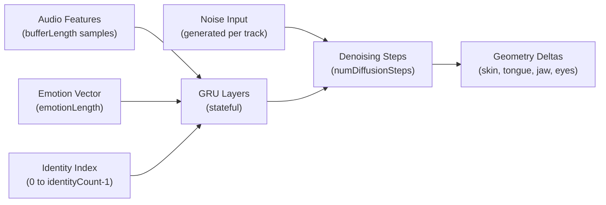
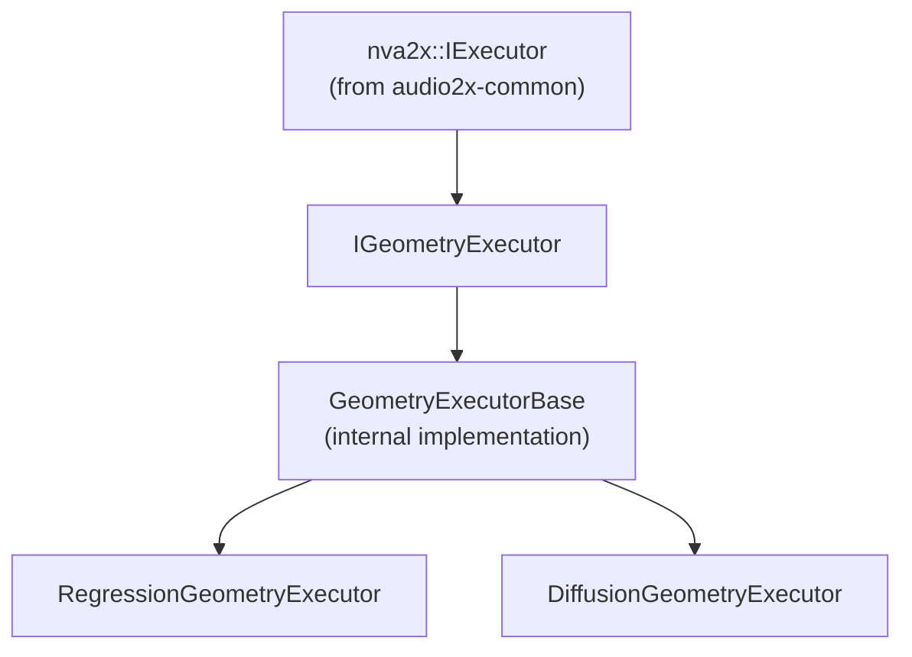
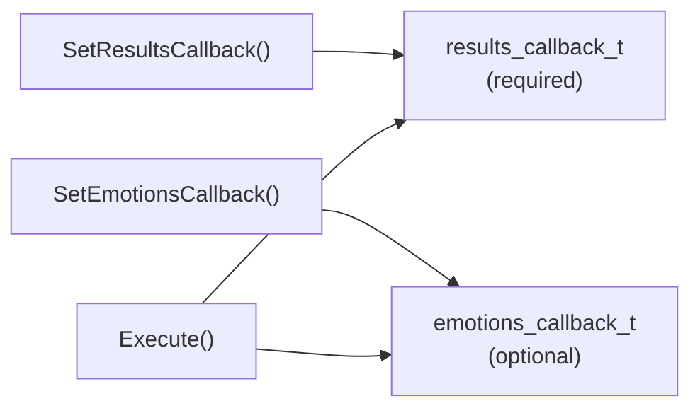
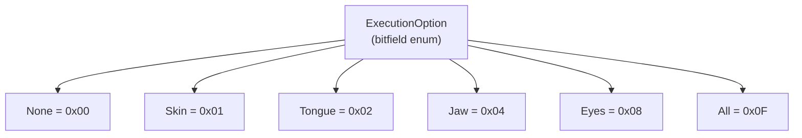
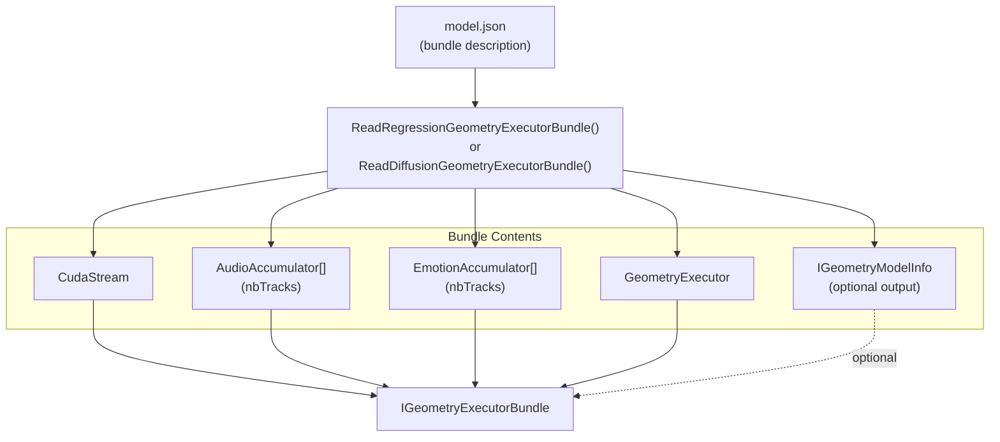
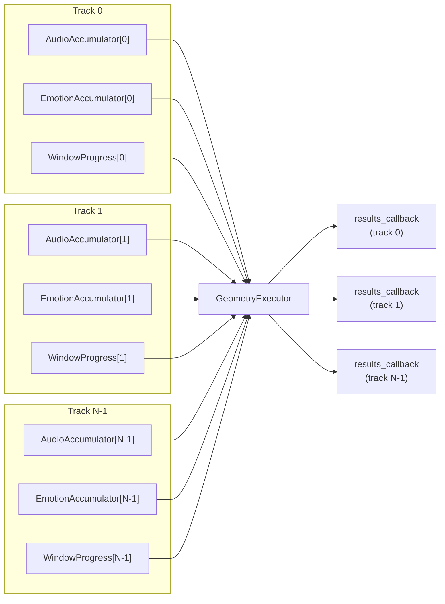

<!-- source: DeepWiki mcp.deepwiki.com · repo NVIDIA/Audio2Face-3D-SDK · page 4.1 Geometry Models and Executors · fetched 2026-10-26 -->

# Geometry Models and Executors

<details>
<summary>Relevant source files</summary>

The following files were used as context for generating this wiki page:

- [audio2face-sdk/source/audio2face-core/executor.cpp](audio2face-sdk/source/audio2face-core/executor.cpp)
- [audio2face-sdk/source/audio2face/audio2face.cpp](audio2face-sdk/source/audio2face/audio2face.cpp)
- [audio2face-sdk/source/benchmarks/utils.h](audio2face-sdk/source/benchmarks/utils.h)
- [audio2face-sdk/tests/test_core_executor.cpp](audio2face-sdk/tests/test_core_executor.cpp)

</details>


This page documents the geometry model interfaces (`IRegressionModel` and `IDiffusionModel`) and the `IGeometryExecutor` system used to generate facial geometry from audio and emotion inputs. This covers model initialization, executor creation patterns, multi-track batch processing, and selective component execution via `ExecutionOption` flags.

For information about the animator post-processing system that operates on geometry outputs, see [4.2](#4.2). For blendshape weight solving, see [4.3](#4.3). For emotion database loading, see [4.4](#4.4). For interactive execution mode with caching, see [6](#6).

---

## Model Types: Regression vs Diffusion

The Audio2Face SDK supports two fundamentally different neural network architectures for generating facial geometry:

| Model Type | Interface | Characteristics | Frame Rate | Statefulness |
|------------|-----------|----------------|------------|--------------|
| **Regression** | `IRegressionModel` | Frame-by-frame direct mapping | Fixed (e.g., 60 FPS) | Stateless |
| **Diffusion** | `IDiffusionModel` | GRU-based iterative refinement | Adaptive | Stateful (GRU hidden states) |

### Regression Models

Regression models perform direct frame-by-frame inference, mapping audio features and emotion inputs to geometry coefficients. Each frame is processed independently without temporal state.

**Key characteristics:**
- **Stateless inference**: Each frame computed independently
- **Fixed frame rate**: Specified via `frameRateNumerator` / `frameRateDenominator`
- **Emotion database integration**: Uses static emotion data from NPZ files via shot/frame selection
- **PCA-based output**: Produces compact coefficients that are reconstructed via PCA

**Network structure:**


**Sources:** [audio2face-sdk/source/audio2face/audio2face.cpp:38-46](), [audio2face-sdk/tests/test_core_executor.cpp:91-102]()

### Diffusion Models

Diffusion models use a GRU-based architecture with iterative denoising steps. They maintain temporal state across frames and can generate multiple identities.

**Key characteristics:**
- **Stateful inference**: GRU hidden states maintained across frames
- **Multi-identity support**: Single network can generate different character identities
- **Denoising process**: Multiple diffusion steps per frame
- **Frame padding**: Generates frames before and after audio (left/right truncate, center frames)
- **Noise generation**: Optional constant vs random noise per track

**Network structure:**


**Sources:** [audio2face-sdk/source/audio2face/audio2face.cpp:48-59](), [audio2face-sdk/tests/test_core_executor.cpp:104-115]()

---

## Network Information Structures

Both model types define `NetworkInfo` structures that describe the network architecture and data requirements.

### IRegressionModel::NetworkInfo

```
struct NetworkInfo {
    std::size_t implicitEmotionLength;  // Emotion features from audio
    std::size_t explicitEmotionLength;  // Explicit emotion input
    std::size_t numShapesSkin;          // Number of PCA components (skin)
    std::size_t numShapesTongue;        // Number of PCA components (tongue)
    std::size_t resultSkinSize;         // Output size for skin coefficients
    std::size_t resultTongueSize;       // Output size for tongue coefficients
    std::size_t resultJawSize;          // Output size for jaw coefficients
    std::size_t resultEyesSize;         // Output size for eyes coefficients
    std::size_t bufferLength;           // Audio buffer size (samples)
};
```

**Sources:** [audio2face-sdk/tests/test_core_executor.cpp:632-670]()

### IDiffusionModel::NetworkInfo

```
struct NetworkInfo {
    std::size_t emotionLength;          // Emotion input vector size
    std::size_t identityLength;         // Number of supported identities
    std::size_t skinDim;                // Skin geometry dimension
    std::size_t tongueDim;              // Tongue geometry dimension
    std::size_t jawDim;                 // Jaw geometry dimension
    std::size_t eyesDim;                // Eyes geometry dimension
    std::size_t numDiffusionSteps;      // Denoising iterations per frame
    std::size_t numGruLayers;           // Number of GRU layers
    std::size_t gruLatentDim;           // GRU hidden state dimension
    std::size_t numFramesLeftTruncate;  // Frames before audio starts
    std::size_t numFramesRightTruncate; // Frames after audio ends
    std::size_t numFramesCenter;        // Center window frames
    std::size_t bufferLength;           // Audio buffer size (samples)
};
```

**Sources:** [audio2face-sdk/tests/test_core_executor.cpp:816-868]()

---

## IGeometryExecutor Interface

The `IGeometryExecutor` interface inherits from `nva2x::IExecutor` ([3.3](#3.3)) and provides methods for executing geometry inference across multiple tracks, querying frame information, and setting output callbacks.



### Core Executor Methods

| Method | Purpose | Notes |
|--------|---------|-------|
| `GetNbTracks()` | Returns number of parallel tracks | Set at creation time |
| `GetNbAvailableExecutions(trackIndex)` | Returns number of ready frames for track | Based on audio/emotion data availability |
| `GetTotalNbFrames(trackIndex)` | Returns total frames once audio is closed | Only valid after `Close()` on accumulator |
| `Execute(nbExecutedTracks*)` | Executes inference for ready tracks | Calls results callback for each frame |
| `Reset(trackIndex)` | Resets execution state for track | Does not reset accumulators |

**Sources:** [audio2face-sdk/source/audio2face-core/executor.cpp:35-82]()

### Geometry-Specific Methods

| Method | Purpose |
|--------|---------|
| `GetSamplingRate()` | Returns audio sampling rate (always 16000 Hz) |
| `GetFrameRate(numerator, denominator)` | Returns output frame rate (e.g., 60/1) |
| `GetFrameTimestamp(frameIndex)` | Computes timestamp for frame index |
| `GetSkinGeometrySize()` | Returns size of skin geometry output |
| `GetTongueGeometrySize()` | Returns size of tongue geometry output |
| `GetJawTransformSize()` | Returns size of jaw transform (always 16 for 4×4 matrix) |
| `GetEyesRotationSize()` | Returns size of eyes rotation (always 6 for 2×3 quaternions) |

**Sources:** [audio2face-sdk/source/audio2face-core/executor.cpp:121-139]()

### Callback Registration



The executor invokes two types of callbacks during execution:

1. **Emotions callback** (optional): Receives the interpolated emotion vector for each frame
2. **Results callback** (required): Receives geometry outputs for each frame

**Callback structures:**
```cpp
// Emotions callback - invoked first
struct Emotions {
    std::size_t trackIndex;
    timestamp_t timeStampCurrentFrame;
    nva2x::DeviceTensorFloatView emotions;  // Interpolated emotion vector
    cudaStream_t cudaStream;
};

// Results callback - invoked second
struct Results {
    std::size_t trackIndex;
    timestamp_t timeStampCurrentFrame;
    timestamp_t timeStampNextFrame;
    nva2x::DeviceTensorFloatView skin;       // Skin geometry/coefficients
    nva2x::DeviceTensorFloatView tongue;     // Tongue geometry/coefficients
    nva2x::DeviceTensorFloatView jaw;        // Jaw transform (4×4 matrix)
    nva2x::DeviceTensorFloatView eyes;       // Eye rotations (left/right)
    cudaStream_t cudaStream;
};
```

**Sources:** [audio2face-sdk/source/audio2face-core/executor.cpp:141-179](), [audio2face-sdk/tests/test_core_executor.cpp:277-296]()

---

## ExecutionOption Flags

The `ExecutionOption` enum allows selective execution of facial components, enabling optimization when only certain outputs are needed (e.g., when solving blendshapes for skin only).



### Usage Patterns

```cpp
// Bitwise operations supported
ExecutionOption option = ExecutionOption::Skin | ExecutionOption::Tongue;
option |= ExecutionOption::Jaw;
if (IsAnySet(option, ExecutionOption::Skin)) { /* ... */ }
```

**Common configurations:**
- `ExecutionOption::All` - Generate all components (default)
- `ExecutionOption::Skin` - Only skin geometry (for blendshape solving)
- `ExecutionOption::Skin | ExecutionOption::Tongue` - Skin and tongue (for dual blendshape solving)
- `ExecutionOption::Jaw | ExecutionOption::Eyes` - Only jaw and eyes (rigid transforms)

**Setting execution option:**
- Must be set before `Execute()` is called
- Can be set via `SetExecutionOption()` or during bundle creation
- Affects network inference and post-processing

**Sources:** [audio2face-sdk/source/audio2face-core/executor.cpp:464-490](), [audio2face-sdk/tests/test_core_executor.cpp:1236-1289]()

---

## Executor Creation

Executors are created via factory functions that take model-specific parameters and shared resources.

```mermaid
graph TB
    subgraph "Common Parameters"
        CommonParams["GeometryExecutorCreationParameters"]
        CudaStream["cudaStream"]
        NbTracks["nbTracks"]
        AudioAcc["sharedAudioAccumulators[]"]
        EmotionAcc["sharedEmotionAccumulators[]"]
    end
    
    subgraph "Regression-Specific"
        RegressionParams["IRegressionModel::GeometryExecutorCreationParameters"]
        NetworkInfo1["networkInfo"]
        NetworkData1["networkData / networkDataSize"]
        EmotionDB["emotionDatabase"]
        FrameRate["frameRateNumerator / frameRateDenominator"]
        AnimatorData1["initializationSkinParams<br/>initializationTongueParams<br/>initializationTeethParams<br/>initializationEyesParams"]
    end
    
    subgraph "Diffusion-Specific"
        DiffusionParams["IDiffusionModel::GeometryExecutorCreationParameters"]
        NetworkInfo2["networkInfo"]
        NetworkData2["networkData / networkDataSize"]
        IdentityIndex["identityIndex"]
        ConstantNoise["constantNoise"]
        AnimatorData2["initializationSkinParams<br/>initializationTongueParams<br/>initializationTeethParams<br/>initializationEyesParams"]
    end
    
    Factory1["CreateRegressionGeometryExecutor()"]
    Factory2["CreateDiffusionGeometryExecutor()"]
    
    Executor1["RegressionGeometryExecutor"]
    Executor2["DiffusionGeometryExecutor"]
    
    CommonParams --> Factory1
    CommonParams --> Factory2
    RegressionParams --> Factory1
    DiffusionParams --> Factory2
    
    Factory1 --> Executor1
    Factory2 --> Executor2
```



### GeometryExecutorCreationParameters

Common parameters shared by both executor types:

| Field | Type | Description |
|-------|------|-------------|
| `cudaStream` | `cudaStream_t` | CUDA stream for GPU operations (can be `nullptr` for default) |
| `nbTracks` | `std::size_t` | Number of parallel tracks (1-128) |
| `sharedAudioAccumulators` | `const IAudioAccumulator**` | Array of audio accumulators (one per track) |
| `sharedEmotionAccumulators` | `const IEmotionAccumulator**` | Array of emotion accumulators (one per track) |

**Validation:**
- `nbTracks` must be in range [1, 128]
- All accumulators must be non-null
- Emotion accumulators must match the expected emotion size

**Sources:** [audio2face-sdk/tests/test_core_executor.cpp:56-89](), [audio2face-sdk/tests/test_core_executor.cpp:552-606]()

### IRegressionModel::GeometryExecutorCreationParameters

| Field | Type | Description |
|-------|------|-------------|
| `networkInfo` | `NetworkInfo` | Network architecture information |
| `networkData` | `const void*` | Serialized TensorRT engine data |
| `networkDataSize` | `std::size_t` | Size of network data in bytes |
| `emotionDatabase` | `const IEmotionDatabase*` | Emotion database for shot/frame lookup |
| `sourceShot` | `const char*` | Shot name to use from database |
| `sourceFrame` | `std::size_t` | Frame index within shot |
| `executionOption` | `ExecutionOption` | Components to execute |
| `frameRateNumerator` | `std::size_t` | Output frame rate numerator |
| `frameRateDenominator` | `std::size_t` | Output frame rate denominator |
| `initializationSkinParams` | `const AnimatorSkinInitializationParams*` | Skin animator data (optional) |
| `initializationTongueParams` | `const AnimatorTongueInitializationParams*` | Tongue animator data (optional) |
| `initializationTeethParams` | `const AnimatorTeethInitializationParams*` | Teeth animator data (optional) |
| `initializationEyesParams` | `const AnimatorEyesInitializationParams*` | Eyes animator data (optional) |

**Sources:** [audio2face-sdk/tests/test_core_executor.cpp:91-102](), [audio2face-sdk/tests/test_core_executor.cpp:626-789]()

### IDiffusionModel::GeometryExecutorCreationParameters

| Field | Type | Description |
|-------|------|-------------|
| `networkInfo` | `NetworkInfo` | Network architecture information |
| `networkData` | `const void*` | Serialized TensorRT engine data |
| `networkDataSize` | `std::size_t` | Size of network data in bytes |
| `identityIndex` | `std::size_t` | Identity to generate (0 to identityLength-1) |
| `constantNoise` | `bool` | Use constant vs random noise |
| `executionOption` | `ExecutionOption` | Components to execute |
| `initializationSkinParams` | `const AnimatorSkinInitializationParams*` | Skin animator data (optional) |
| `initializationTongueParams` | `const AnimatorTongueInitializationParams*` | Tongue animator data (optional) |
| `initializationTeethParams` | `const AnimatorTeethInitializationParams*` | Teeth animator data (optional) |
| `initializationEyesParams` | `const AnimatorEyesInitializationParams*` | Eyes animator data (optional) |

**Sources:** [audio2face-sdk/tests/test_core_executor.cpp:104-115](), [audio2face-sdk/tests/test_core_executor.cpp:810-958]()

---

## Bundle Loading Pattern

The bundle pattern simplifies executor initialization by encapsulating all required resources (CUDA stream, accumulators, executor) into a single object with unified lifetime management.



### IGeometryExecutorBundle Interface

```cpp
class IGeometryExecutorBundle {
    virtual void Destroy() = 0;
    
    // Access managed resources
    virtual IGeometryExecutor& GetExecutor() = 0;
    virtual const nva2x::ICudaStream& GetCudaStream() const = 0;
    virtual nva2x::IAudioAccumulator& GetAudioAccumulator(std::size_t trackIndex) = 0;
    virtual nva2x::IEmotionAccumulator& GetEmotionAccumulator(std::size_t trackIndex) = 0;
};
```

### Bundle Loading Functions

**Regression models:**
```cpp
IGeometryExecutorBundle* ReadRegressionGeometryExecutorBundle(
    std::size_t nbTracks,                           // Number of parallel tracks
    const char* path,                               // Path to model.json
    IGeometryExecutor::ExecutionOption executionOption,  // Components to execute
    std::size_t frameRateNumerator,                 // Output frame rate numerator
    std::size_t frameRateDenominator,               // Output frame rate denominator
    IRegressionModel::IGeometryModelInfo** outModelInfo  // Optional model info output
);
```

**Diffusion models:**
```cpp
IGeometryExecutorBundle* ReadDiffusionGeometryExecutorBundle(
    std::size_t nbTracks,                           // Number of parallel tracks
    const char* path,                               // Path to model.json
    IGeometryExecutor::ExecutionOption executionOption,  // Components to execute
    std::size_t identityIndex,                      // Identity to generate
    bool constantNoise,                             // Use constant noise
    IDiffusionModel::IGeometryModelInfo** outModelInfo  // Optional model info output
);
```

**Sources:** [audio2face-sdk/source/audio2face/audio2face.cpp:275-290](), [audio2face-sdk/source/audio2face/audio2face.cpp:822-846](), [audio2face-sdk/tests/test_core_executor.cpp:137-180]()

### Model Bundle Structure

A model bundle directory contains:
- `model.json` - Bundle descriptor
- `network.engine` - Serialized TensorRT engine
- `model_data.bin` - PCA matrices and animator data
- `model_config.json` - Animator configuration parameters
- `emotions.npz` - Static emotion database (regression only)

**Sources:** [audio2face-sdk/source/audio2face/audio2face.cpp:72-82]()

---

## Multi-Track Execution

Executors support processing 1-128 parallel tracks simultaneously, enabling efficient batch processing of multiple audio streams.



### Track Management

Each track maintains independent state:
- **Audio accumulator**: Circular buffer of audio samples
- **Emotion accumulator**: Time-series emotion data with interpolation
- **Window progress**: Tracks which frames have been computed

**Independent operations per track:**
- `GetNbAvailableExecutions(trackIndex)` - Check readiness for specific track
- `HasExecutionStarted(trackIndex)` - Check if track has begun processing
- `GetTotalNbFrames(trackIndex)` - Get total frames (once audio is closed)
- `Reset(trackIndex)` - Reset specific track without affecting others

**Sources:** [audio2face-sdk/source/audio2face-core/executor.cpp:35-82](), [audio2face-sdk/tests/test_core_executor.cpp:234-325]()

### Batch Execution

The `Execute()` method processes all ready tracks in a single call:

```cpp
std::size_t nbExecutedTracks = 0;
std::error_code error = executor.Execute(&nbExecutedTracks);

// nbExecutedTracks contains the number of tracks that had frames ready
// Callback is invoked once per frame per track that executed
```

**Execution behavior:**
- Returns immediately if no tracks are ready
- Returns error if callback is not set
- Processes one frame per ready track
- Invokes callback for each generated frame
- Updates `WindowProgress` to track completion

**Sources:** [audio2face-sdk/tests/test_core_executor.cpp:303-315]()

### Track Readiness

The `nva2x::GetNbReadyTracks()` utility function counts how many tracks have available frames:

```cpp
std::size_t readyTracks = nva2x::GetNbReadyTracks(executor);
while (readyTracks > 0) {
    std::size_t nbExecutedTracks = 0;
    executor.Execute(&nbExecutedTracks);
    readyTracks = nva2x::GetNbReadyTracks(executor);
}
```

**Sources:** [audio2face-sdk/tests/test_core_executor.cpp:303-315]()

---

## Frame Timing and Synchronization

Executors compute frame timestamps based on the configured frame rate and audio sampling rate.

### Frame Timestamp Calculation

```cpp
timestamp_t GetFrameTimestamp(std::size_t frameIndex) const;
```

For a frame at index `i` with frame rate `N/D` (numerator/denominator):
```
timestamp = (i + nbFramesBeforeAudio) * samplingRate * denominator / numerator
```

Where:
- `samplingRate` = 16000 Hz (fixed)
- `nbFramesBeforeAudio` = padding frames (0 for regression, >0 for diffusion)

**Example:** 60 FPS (60/1), frame 10
```
timestamp = 10 * 16000 * 1 / 60 = 2666 samples
```

**Sources:** [audio2face-sdk/source/audio2face-core/executor.cpp:88-100](), [audio2face-sdk/tests/test_core_executor.cpp:1004-1008]()

### Window Progress Integration

Each track's `WindowProgress` tracks:
- Current read position in audio/emotion data
- Number of windows (frames) processed
- Next window to compute

The executor queries accumulators to determine frame availability:
```cpp
GetNbAvailableExecutions(trackIndex) {
    return nva2x::GetNbAvailableExecutions(
        progress,
        audioAccumulator,
        emotionAccumulator,
        nbFramesPerInference
    );
}
```

**Sources:** [audio2face-sdk/source/audio2face-core/executor.cpp:49-62]()

---

## Input Strength Parameter

Both executor types support an `inputStrength` parameter that scales the output geometry, providing global amplitude control.

```cpp
// Get current input strength
float inputStrength;
executor.GetInputStrength(inputStrength);

// Set input strength (must be before execution starts)
executor.SetInputStrength(1.5f);  // 150% amplitude
```

**Constraints:**
- Can only be set before `Execute()` is called
- Applied uniformly to all tracks
- Affects all output components (skin, tongue, jaw, eyes)

**Sources:** [audio2face-sdk/source/audio2face-core/executor.cpp:181-190]()

---

## Model Loading Utilities

The SDK provides helper functions for loading model components from disk.

### Reading Network Info

```cpp
// Regression model
IRegressionModel::INetworkInfo* ReadRegressionNetworkInfo(const char* path);

// Diffusion model
IDiffusionModel::INetworkInfo* ReadDiffusionNetworkInfo(const char* path);
```

**Sources:** [audio2face-sdk/source/audio2face/audio2face.cpp:433-458]()

### Reading Complete Model Info

**Regression model:**
```cpp
// From bundle JSON
IRegressionModel::IGeometryModelInfo* ReadRegressionModelInfo(const char* path);

// From individual files
IRegressionModel::IGeometryModelInfo* ReadRegressionModelInfo(
    const char* networkInfoPath,
    const char* networkPath,
    const char* emotionDatabasePath,
    const char* modelConfigPath,
    const char* modelDataPath
);
```

**Diffusion model:**
```cpp
// From bundle JSON
IDiffusionModel::IGeometryModelInfo* ReadDiffusionModelInfo(const char* path);

// From individual files (multi-identity)
IDiffusionModel::IGeometryModelInfo* ReadDiffusionModelInfo(
    const char* networkInfoPath,
    const char* networkPath,
    std::size_t identityCount,
    const char* const* modelConfigPaths,  // Array of config files
    const char* const* modelDataPaths     // Array of data files
);
```

**Sources:** [audio2face-sdk/source/audio2face/audio2face.cpp:441-479]()

### IGeometryModelInfo Interface

The `IGeometryModelInfo` interface provides access to all loaded model data:

```cpp
class IGeometryModelInfo {
    virtual void Destroy() = 0;
    
    virtual const NetworkInfo& GetNetworkInfo() const = 0;
    virtual const void* GetNetworkData() const = 0;
    virtual std::size_t GetNetworkDataSize() const = 0;
    
    // Get executor creation parameters with specified settings
    virtual GeometryExecutorCreationParameters GetExecutorCreationParameters(
        ExecutionOption executionOption,
        /* model-specific parameters */
    ) const = 0;
};
```

**Sources:** [audio2face-sdk/tests/test_core_executor.cpp:93-102](), [audio2face-sdk/tests/test_core_executor.cpp:106-112]()

---

## Usage Example: Batch Processing

```cpp
// Load model bundle
auto bundle = nva2x::ToUniquePtr(
    nva2f::ReadRegressionGeometryExecutorBundle(
        8,                                          // 8 parallel tracks
        "path/to/model.json",
        nva2f::IGeometryExecutor::ExecutionOption::All,
        60, 1,                                      // 60 FPS
        nullptr                                     // Don't need model info
    )
);

// Set up callback
struct CallbackData {
    std::vector<std::size_t> frameCount;
};
CallbackData callbackData;
callbackData.frameCount.resize(8);

auto callback = [](void* userdata, const nva2f::IGeometryExecutor::Results& results) {
    auto* data = static_cast<CallbackData*>(userdata);
    ++data->frameCount[results.trackIndex];
    
    // Process geometry outputs...
    // results.skin, results.tongue, results.jaw, results.eyes
    
    return true;  // Continue processing
};

bundle->GetExecutor().SetResultsCallback(callback, &callbackData);

// Feed audio and emotions to accumulators (for each track)
for (std::size_t i = 0; i < 8; ++i) {
    bundle->GetAudioAccumulator(i).Accumulate(audioSamples, stream);
    bundle->GetEmotionAccumulator(i).Accumulate(timestamp, emotions, stream);
    bundle->GetAudioAccumulator(i).Close();
    bundle->GetEmotionAccumulator(i).Close();
}

// Process all frames
while (nva2x::GetNbReadyTracks(bundle->GetExecutor()) > 0) {
    std::size_t nbExecutedTracks = 0;
    bundle->GetExecutor().Execute(&nbExecutedTracks);
}

// Clean up
bundle->Destroy();
```

**Sources:** [audio2face-sdk/tests/test_core_executor.cpp:234-325]()

---

## Error Handling

Common error conditions and their handling:

| Error Condition | Error Code | Prevention |
|----------------|------------|------------|
| Track index out of bounds | `eOutOfBounds` | Validate `trackIndex < GetNbTracks()` |
| No callback set | Returned by `Execute()` | Call `SetResultsCallback()` before execution |
| Parameter modification after execution started | `eExecutionAlreadyStarted` | Set parameters before first `Execute()` |
| Null accumulator | `eNullPointer` | Ensure all accumulators are provided |
| Emotion size mismatch | `eMismatch` | Match emotion accumulator size to network |
| Invalid network data | `eInvalidArgument` | Use valid TensorRT engine file |

**Sources:** [audio2face-sdk/source/audio2face-core/executor.cpp:102-179](), [audio2face-sdk/tests/test_core_executor.cpp:469-528]()

---

