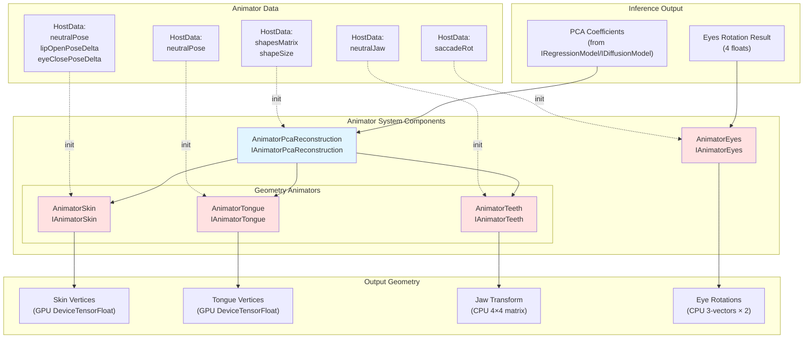
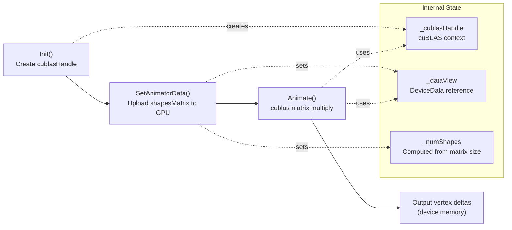
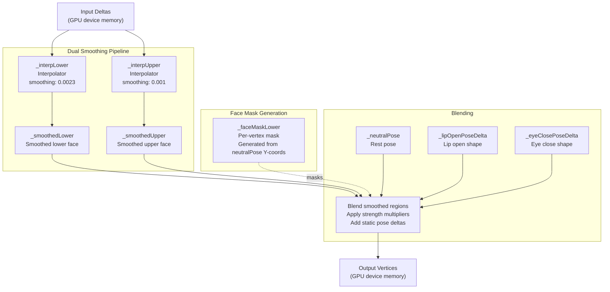
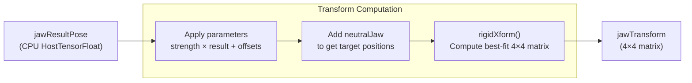
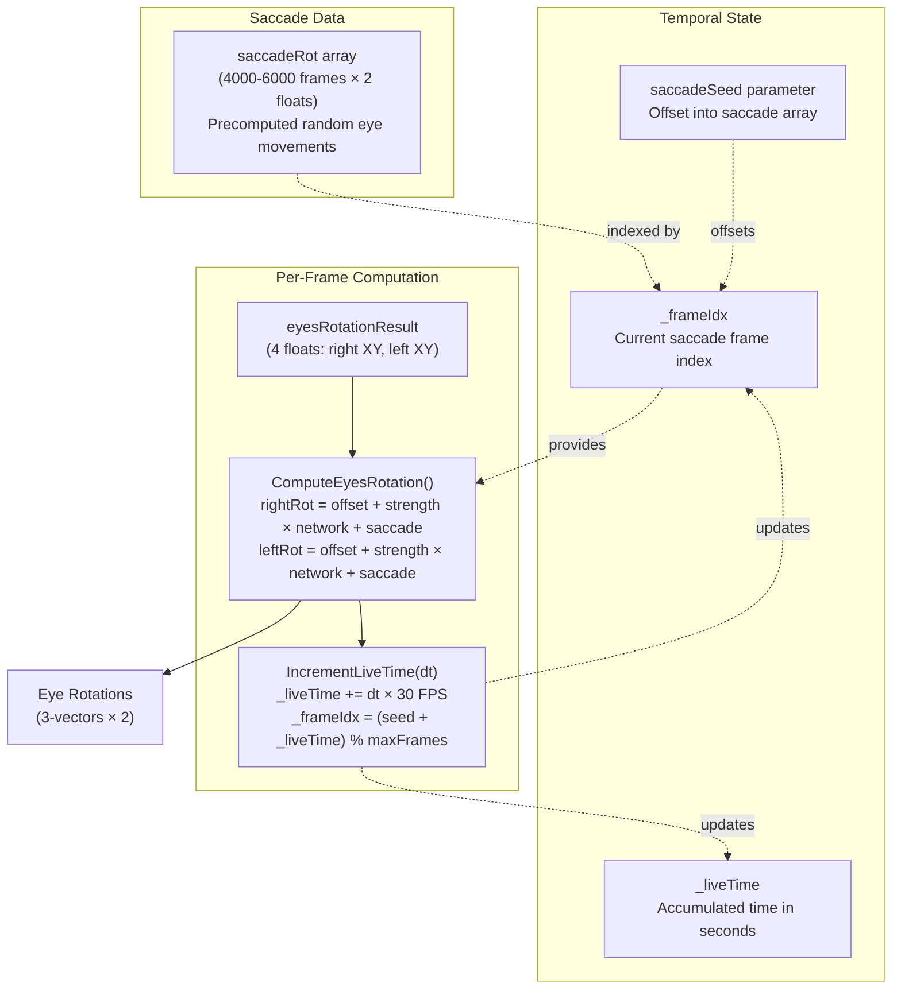
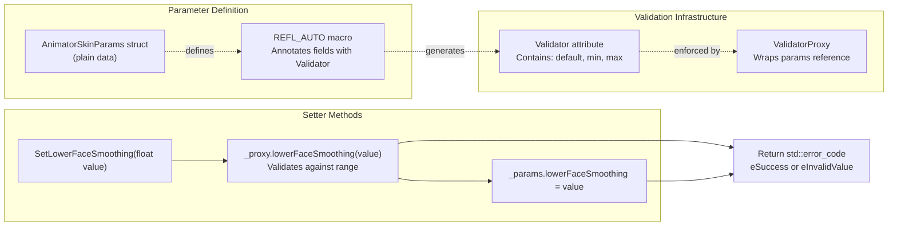
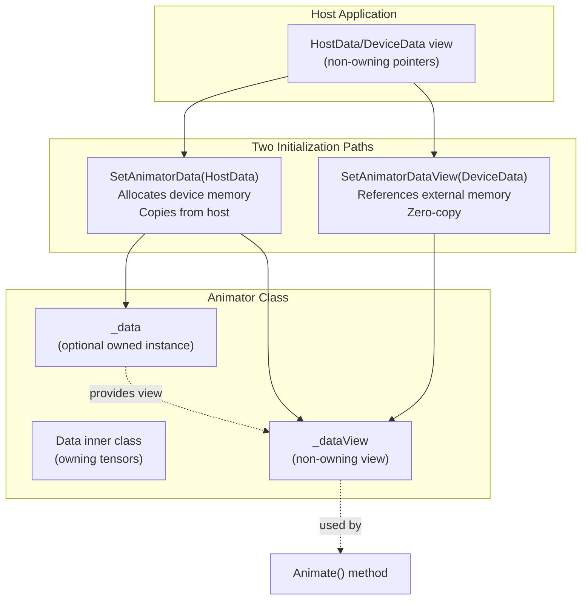

<!-- source: DeepWiki mcp.deepwiki.com · repo NVIDIA/Audio2Face-3D-SDK · page 4.2 Animator System · fetched 2026-10-26 -->

# Animator System

<details>
<summary>Relevant source files</summary>

The following files were used as context for generating this wiki page:

- [audio2face-sdk/include/audio2face/animator.h](audio2face-sdk/include/audio2face/animator.h)
- [audio2face-sdk/include/audio2face/internal/animator.h](audio2face-sdk/include/audio2face/internal/animator.h)
- [audio2face-sdk/source/audio2face-core/animator.cpp](audio2face-sdk/source/audio2face-core/animator.cpp)
- [audio2face-sdk/tests/test_core_animator_eyes.cpp](audio2face-sdk/tests/test_core_animator_eyes.cpp)
- [audio2face-sdk/tests/test_core_batch_eyes_animator.cpp](audio2face-sdk/tests/test_core_batch_eyes_animator.cpp)
- [audio2face-sdk/tests/test_core_batch_tongue_animator.cpp](audio2face-sdk/tests/test_core_batch_tongue_animator.cpp)

</details>


## Purpose and Scope

The Animator System processes geometry deltas generated by inference models and applies component-specific transformations to produce final facial animation data. It consists of five specialized animators that handle different facial regions: PCA reconstruction (coefficient-to-delta conversion), skin (facial mesh deformation with smoothing), tongue (position offsets), teeth (rigid jaw transformation), and eyes (rotation with saccade motion).

This page documents the single-track animator implementations. For batch multi-track processing optimizations, see [Multi-Track Batch Processing](#7). For the geometry models that produce input to these animators, see [Geometry Models and Executors](#4.1).

---

## System Architecture

The animator system provides five independent components that can be composed to form a complete facial animation pipeline. Each animator operates on specific facial geometry and applies distinct transformations based on configurable parameters.



**Sources:** [audio2face-sdk/include/audio2face/animator.h:95-387](), [audio2face-sdk/include/audio2face/internal/animator.h:95-374]()

---

## PCA Reconstruction Animator

The `AnimatorPcaReconstruction` class (implementing `IAnimatorPcaReconstruction`) converts compact PCA coefficients from inference models into full vertex delta arrays using GPU-accelerated matrix multiplication via cuBLAS.

### Data Structures

| Structure | Location | Contents |
|-----------|----------|----------|
| `HostData` | [audio2face-sdk/include/audio2face/animator.h:98-102]() | `shapesMatrix` (basis vectors), `shapeSize` (vertices per shape) |
| `DeviceData` | [audio2face-sdk/include/audio2face/animator.h:104-107]() | Device views of shape matrix and size |

### Key Operations

The `Animate()` method performs matrix multiplication on the GPU:

```
outputDeltas = shapesMatrix × inputPcaCoefs
```

Where:
- `inputPcaCoefs`: Device tensor of PCA coefficients (compact representation)
- `shapesMatrix`: Device tensor containing basis vectors, size `(numShapes × shapeSize)`
- `outputDeltas`: Device tensor of vertex deltas, size `shapeSize`

### Implementation Details

The implementation uses cuBLAS for efficient GPU matrix operations:



**Sources:** [audio2face-sdk/include/audio2face/internal/animator.h:95-135](), [audio2face-sdk/source/audio2face-core/animator.cpp:95-191]()

---

## Skin Animator

The `AnimatorSkin` class (implementing `IAnimatorSkin`) applies facial deformation with dual-region smoothing, face masking, and blending of static poses (lip open, eye close). This is the most complex animator with 11 configurable parameters.

### Parameters

| Parameter | Default | Range | Description |
|-----------|---------|-------|-------------|
| `lowerFaceSmoothing` | 0.0023 | [0, 0.1] | Temporal smoothing for lower face |
| `upperFaceSmoothing` | 0.001 | [0, 0.1] | Temporal smoothing for upper face |
| `lowerFaceStrength` | 1.3 | [0, 2] | Strength multiplier for lower face |
| `upperFaceStrength` | 1.0 | [0, 2] | Strength multiplier for upper face |
| `faceMaskLevel` | 0.6 | [0, 1] | Y-threshold separating upper/lower face |
| `faceMaskSoftness` | 0.0085 | [0.001, 0.5] | Transition softness at mask boundary |
| `skinStrength` | 1.0 | [0, 2] | Overall skin deformation strength |
| `blinkStrength` | 1.0 | [0, 2] | Eye closure strength |
| `eyelidOpenOffset` | 0.06 | [-1, 1] | Eyelid position offset |
| `lipOpenOffset` | -0.03 | [-0.2, 0.2] | Lip position offset |
| `blinkOffset` | 0.0 | [0, 1] | Blink animation offset |

**Sources:** [audio2face-sdk/include/audio2face/internal/animator.h:29-42]()

### Dual Interpolator System

The skin animator uses two `Interpolator` instances for separate smoothing of upper and lower face regions:



The `Interpolator` class implements temporal smoothing using a circular buffer approach with degree-2 polynomial interpolation. Each frame, the raw input is blended with historical data based on the smoothing factor and time delta.

**Sources:** [audio2face-sdk/include/audio2face/internal/animator.h:71-93](), [audio2face-sdk/include/audio2face/internal/animator.h:137-199](), [audio2face-sdk/source/audio2face-core/animator.cpp:64-94](), [audio2face-sdk/source/audio2face-core/animator.cpp:196-389]()

### Face Mask Computation

The face mask distinguishes upper and lower face regions based on vertex Y-coordinates. When `faceMaskLevel` or `faceMaskSoftness` changes, the mask is regenerated on the GPU via `CalculateFaceMaskLower()`:

```
faceMaskLower[i] = sigmoid((neutralPose[i].y - faceMaskLevel) / faceMaskSoftness)
```

**Sources:** [audio2face-sdk/source/audio2face-core/animator.cpp:286-294](), [audio2face-sdk/source/audio2face-core/animator.cpp:297-305]()

---

## Tongue Animator

The `AnimatorTongue` class (implementing `IAnimatorTongue`) applies simple offset transformations to tongue geometry based on three parameters: strength, height offset, and depth offset.

### Parameters

| Parameter | Default | Range | Description |
|-----------|---------|-------|-------------|
| `tongueStrength` | 1.5 | [0, 3] | Overall tongue deformation strength |
| `tongueHeightOffset` | 0.2 | [-3, 3] | Vertical position offset |
| `tongueDepthOffset` | 0.13 | [-3, 3] | Forward/backward offset |

**Sources:** [audio2face-sdk/include/audio2face/internal/animator.h:44-49]()

### Operation

The `Animate()` method applies per-vertex transformations on the GPU:

```
outputVertex[3*i + 0] = inputDelta[3*i + 0] * tongueStrength
outputVertex[3*i + 1] = inputDelta[3*i + 1] * tongueStrength + tongueHeightOffset  
outputVertex[3*i + 2] = inputDelta[3*i + 2] * tongueStrength + tongueDepthOffset
outputVertex = outputVertex + neutralPose
```

Unlike skin animation, tongue animation does not use temporal smoothing and processes each frame independently.

**Sources:** [audio2face-sdk/include/audio2face/internal/animator.h:201-247](), [audio2face-sdk/source/audio2face-core/animator.cpp:397-500]()

---

## Teeth Animator

The `AnimatorTeeth` class (implementing `IAnimatorTeeth`) computes a rigid 4×4 transformation matrix representing jaw motion. Unlike other animators, teeth processing runs on the CPU and produces a transformation matrix rather than vertex positions.

### Parameters

| Parameter | Default | Range | Description |
|-----------|---------|-------|-------------|
| `lowerTeethStrength` | 1.0 | [0, 2] | Jaw motion strength |
| `lowerTeethHeightOffset` | 0.0 | [-3, 3] | Vertical jaw offset |
| `lowerTeethDepthOffset` | 0.0 | [-3, 3] | Forward/backward jaw offset |

**Sources:** [audio2face-sdk/include/audio2face/internal/animator.h:51-56]()

### Rigid Transform Computation

The `ComputeJawTransform()` method computes the best-fit rigid transformation from neutral jaw position to the animated position:



The rigid transform is computed using the `rigidXform()` utility function which finds the optimal rotation and translation that maps the neutral jaw points to the target jaw points.

**Sources:** [audio2face-sdk/include/audio2face/internal/animator.h:249-294](), [audio2face-sdk/source/audio2face-core/animator.cpp:502-638](), [audio2face-sdk/source/audio2face-core/animator.cpp:579-609]()

---

## Eyes Animator

The `AnimatorEyes` class (implementing `IAnimatorEyes`) combines network-predicted eye rotations with procedurally-generated saccade motion. Unlike other animators, eyes processing runs entirely on the CPU and maintains temporal state for animation continuity.

### Parameters

| Parameter | Default | Range | Description |
|-----------|---------|-------|-------------|
| `eyeballsStrength` | 1.0 | [0, 2] | Network prediction strength |
| `saccadeStrength` | 1.0 | [0, 2] | Saccade motion strength |
| `rightEyeballRotationOffsetX` | 0.0 | [-10, 10] | Right eye X-axis offset |
| `rightEyeballRotationOffsetY` | 0.0 | [-10, 10] | Right eye Y-axis offset |
| `leftEyeballRotationOffsetX` | 0.0 | [-10, 10] | Left eye X-axis offset |
| `leftEyeballRotationOffsetY` | 0.0 | [-10, 10] | Left eye Y-axis offset |
| `saccadeSeed` | 0.0 | [0, 4999] | Random seed for saccade pattern |

**Sources:** [audio2face-sdk/include/audio2face/internal/animator.h:58-67]()

### Saccade System

Saccade (rapid eye movement) data is precomputed and stored in the `saccadeRot` array, which contains XY rotation pairs for thousands of frames. The animator maintains a frame index that progresses with time:



The saccade data is assumed to be designed for 30 FPS playback, so `IncrementLiveTime()` scales the delta time accordingly: `_liveTime += deltatime × 30.0f`.

**Sources:** [audio2face-sdk/include/audio2face/internal/animator.h:296-349](), [audio2face-sdk/source/audio2face-core/animator.cpp:640-858](), [audio2face-sdk/source/audio2face-core/animator.cpp:766-794](), [audio2face-sdk/source/audio2face-core/animator.cpp:797-830]()

---

## Parameter Validation System

All animator parameters use the `ValidatorProxy` pattern for runtime validation. Parameters are annotated with `Validator<T>` attributes that specify default, minimum, and maximum values using the `refl-cpp` reflection library.

### Validation Pattern



### Example Validation Annotations

From [audio2face-sdk/include/audio2face/internal/animator.h:29-42]():

```cpp
REFL_AUTO(
  type(nva2f::AnimatorSkinParams),
  field(lowerFaceSmoothing, nva2f::Validator<float>(0.0023f, 0, 0.1f)),
  field(upperFaceSmoothing, nva2f::Validator<float>(0.001f, 0, 0.1f)),
  // ... 9 more fields
)
```

The `ValidatorProxy` checks that values are within the specified range and returns `nva2x::ErrorCode::eInvalidValue` if validation fails.

**Sources:** [audio2face-sdk/include/audio2face/internal/animator.h:29-67](), [audio2face-sdk/include/audio2face/internal/validator.h](), [audio2face-sdk/source/audio2face-core/animator.cpp:34-60]()

---

## Data Management Patterns

Each animator uses a dual-data pattern for flexible memory management:



### Two Initialization Patterns

1. **Owned Data Path** (`SetAnimatorData`):
   - Allocates device tensors via `Data::Init()`
   - Copies data from host to device asynchronously
   - Useful for single-track standalone usage
   - Example: [audio2face-sdk/source/audio2face-core/animator.cpp:224-231]()

2. **View Data Path** (`SetAnimatorDataView`):
   - References external device memory without copying
   - Zero allocation overhead
   - Useful for multi-track scenarios where animators share data
   - Example: [audio2face-sdk/source/audio2face-core/animator.cpp:234-257]()

**Sources:** [audio2face-sdk/include/audio2face/internal/animator.h:116-125](), [audio2face-sdk/include/audio2face/internal/animator.h:174-184]()

---

## Factory Functions and Lifecycle

Each animator has a factory function and follows the destroy pattern:

| Factory Function | Interface | Implementation |
|------------------|-----------|----------------|
| `CreateAnimatorPcaReconstruction_INTERNAL()` | `IAnimatorPcaReconstruction*` | `AnimatorPcaReconstruction` |
| `CreateAnimatorSkin_INTERNAL()` | `IAnimatorSkin*` | `AnimatorSkin` |
| `CreateAnimatorTongue_INTERNAL()` | `IAnimatorTongue*` | `AnimatorTongue` |
| `CreateAnimatorTeeth_INTERNAL()` | `IAnimatorTeeth*` | `AnimatorTeeth` |
| `CreateAnimatorEyes_INTERNAL()` | `IAnimatorEyes*` | `AnimatorEyes` |

All animators provide a `Destroy()` method which handles cleanup and deletes the instance:

```cpp
void AnimatorSkin::Destroy() {
  delete this;
}
```

This pattern ensures consistent resource management across all animator types.

**Sources:** [audio2face-sdk/include/audio2face/internal/animator.h:363-367](), [audio2face-sdk/source/audio2face-core/animator.cpp:874-897]()

---

## Relationship to Multi-Track Processing

The single-track animators documented here serve as the reference implementation and are used for per-track operations. However, for production use with 1-128 parallel tracks, the system provides multi-track batch implementations that offer significant performance improvements through GPU kernel fusion and reduced memory transfers.

Key differences in multi-track variants:
- Batch GPU kernels process all tracks simultaneously
- Parameters stored in packed device arrays for coalesced access
- Strided memory layouts for efficient batch operations
- Active track bitmasks for selective processing

For details on multi-track implementations, see [Multi-Track Batch Processing](#7).

**Sources:** [audio2face-sdk/tests/test_core_batch_tongue_animator.cpp:1-667](), [audio2face-sdk/tests/test_core_batch_eyes_animator.cpp:1-722]()

---

