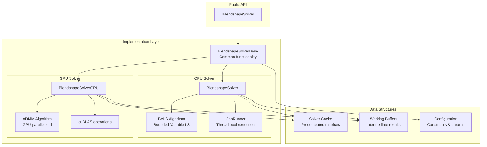
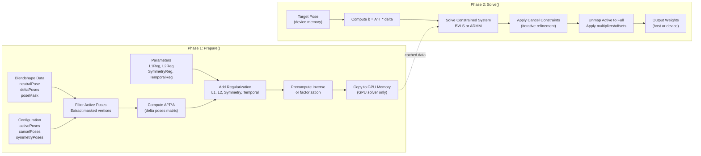
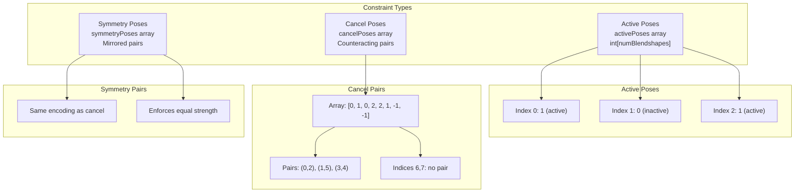
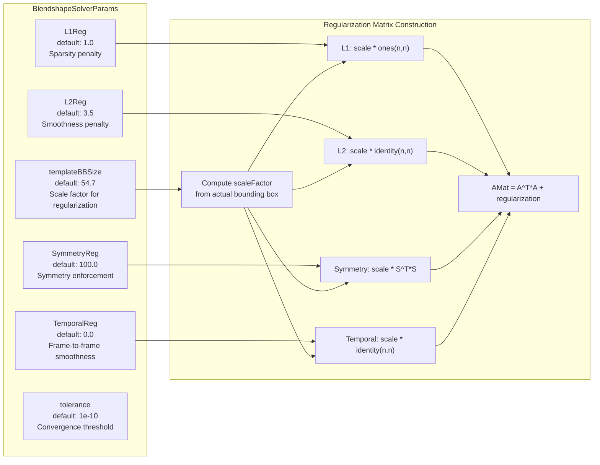
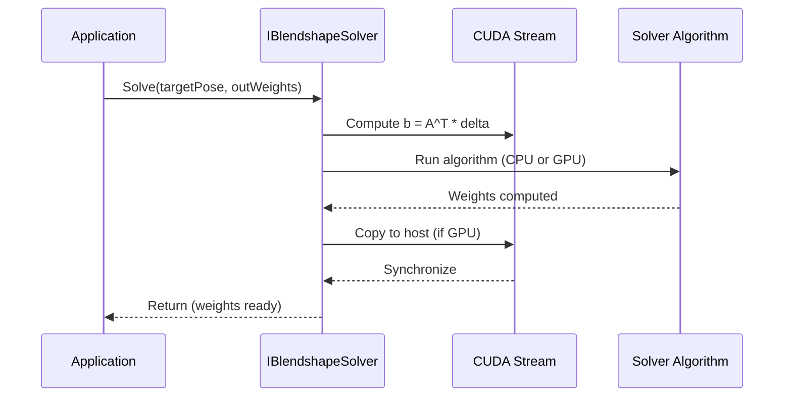
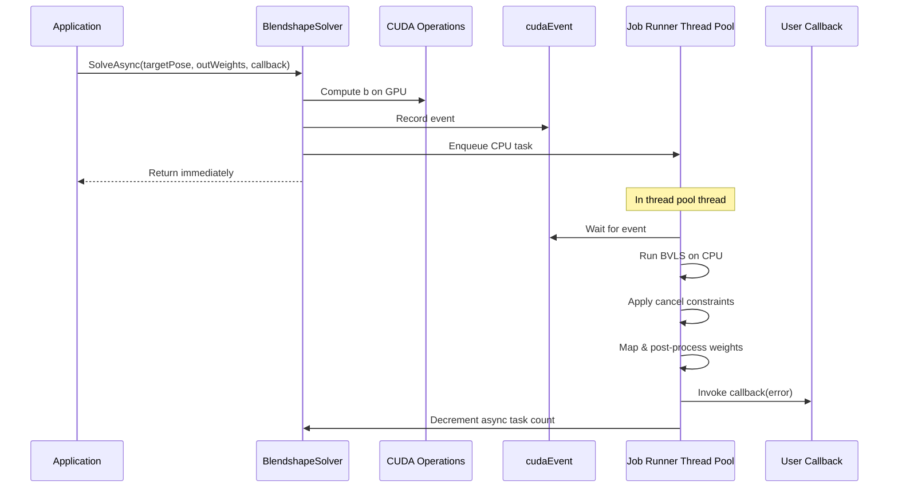
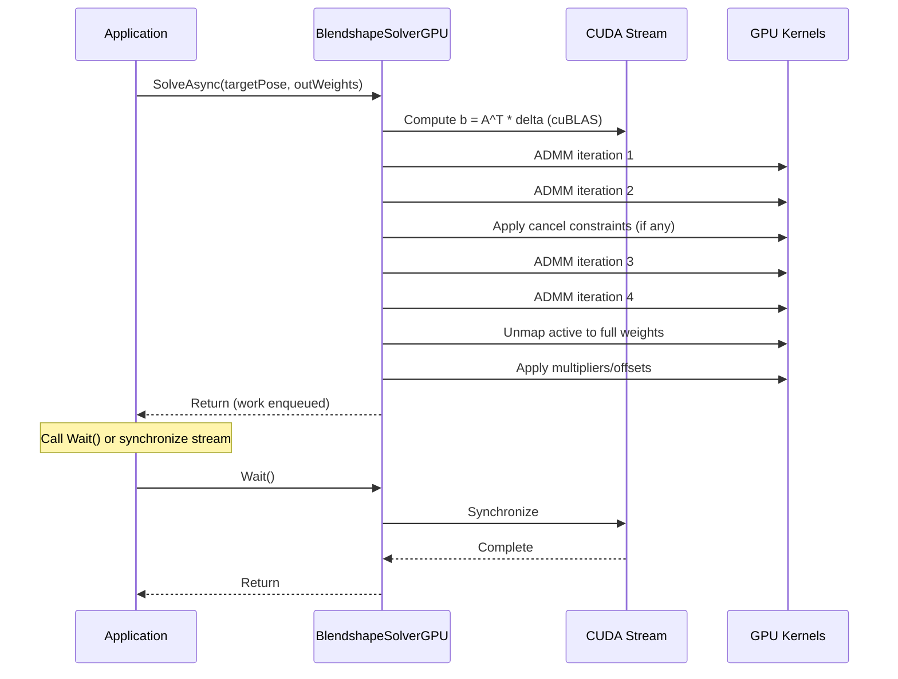
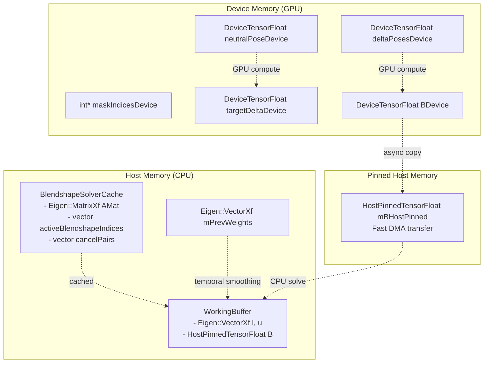
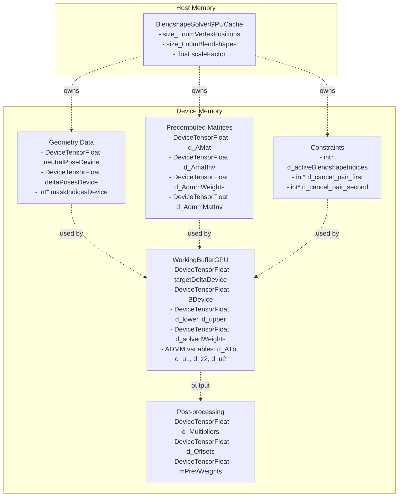
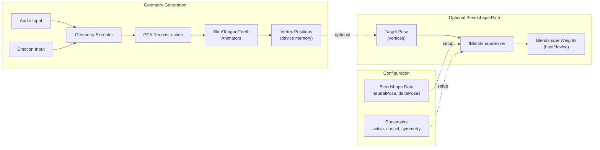

<!-- source: DeepWiki mcp.deepwiki.com · repo NVIDIA/Audio2Face-3D-SDK · page 4.3 Blendshape Solver · fetched 2026-10-26 -->

# Blendshape Solver

<details>
<summary>Relevant source files</summary>

The following files were used as context for generating this wiki page:

- [audio2face-sdk/include/audio2face/blendshape_solver.h](audio2face-sdk/include/audio2face/blendshape_solver.h)
- [audio2face-sdk/include/audio2face/internal/blendshape_solver.h](audio2face-sdk/include/audio2face/internal/blendshape_solver.h)
- [audio2face-sdk/include/audio2face/internal/blendshape_solver_base.h](audio2face-sdk/include/audio2face/internal/blendshape_solver_base.h)
- [audio2face-sdk/include/audio2face/internal/blendshape_solver_gpu.h](audio2face-sdk/include/audio2face/internal/blendshape_solver_gpu.h)
- [audio2face-sdk/source/audio2face-core/blendshape_solver.cpp](audio2face-sdk/source/audio2face-core/blendshape_solver.cpp)
- [audio2face-sdk/source/audio2face-core/blendshape_solver_base.cpp](audio2face-sdk/source/audio2face-core/blendshape_solver_base.cpp)
- [audio2face-sdk/source/audio2face-core/blendshape_solver_gpu.cpp](audio2face-sdk/source/audio2face-core/blendshape_solver_gpu.cpp)
- [audio2face-sdk/source/benchmarks/blendshape_solver.cpp](audio2face-sdk/source/benchmarks/blendshape_solver.cpp)
- [audio2face-sdk/tests/test_core_blendshape_solver.cpp](audio2face-sdk/tests/test_core_blendshape_solver.cpp)

</details>


The Blendshape Solver converts target facial geometry (vertex positions) into optimal blendshape weights for animation rigs. It solves a constrained least-squares optimization problem to find the combination of blendshape activations that best matches the target pose while respecting user-defined constraints like symmetry, cancellation pairs, and sparsity requirements.

For information about the geometry generation that produces the input to this solver, see [4.1](#4.1). For information about how the solver integrates with the animator system, see [4.2](#4.2).

**Sources:** [audio2face-sdk/include/audio2face/blendshape_solver.h:1-234]()

## System Architecture

The blendshape solver provides two implementations with different compute strategies:



**Implementation Decision Matrix**

| Aspect | CPU Solver (`BlendshapeSolver`) | GPU Solver (`BlendshapeSolverGPU`) |
|--------|--------------------------------|-----------------------------------|
| **Algorithm** | BVLS (Bounded Variable Least Squares) | ADMM (Alternating Direction Method of Multipliers) |
| **Execution** | Asynchronous via `IJobRunner` thread pool | Asynchronous via CUDA stream |
| **Output** | Host memory (callback-based) | Device memory (stream-synchronized) |
| **Parallelism** | Multi-threaded CPU | Massively parallel GPU |
| **Use Case** | Multiple simultaneous solves with different configurations | High-throughput batch processing on single configuration |

**Sources:** [audio2face-sdk/include/audio2face/internal/blendshape_solver_base.h:44-137](), [audio2face-sdk/include/audio2face/internal/blendshape_solver.h:37-70](), [audio2face-sdk/include/audio2face/internal/blendshape_solver_gpu.h:32-62]()

## Two-Phase Architecture

The solver operates in two distinct phases: **Prepare** and **Solve**.



### Prepare Phase

The `Prepare()` method must be called after configuration changes and before any solve operations. It performs expensive precomputation that is reused across multiple `Solve()` calls.

**Key operations in Prepare:**
1. **Filtering** - Extracts only active blendshapes and masked vertices from the full dataset
2. **Matrix Construction** - Computes `A^T*A` where `A` is the delta poses matrix
3. **Regularization** - Adds penalty terms for L1/L2 norms, symmetry, and temporal smoothness
4. **Caching** - Stores precomputed matrices in GPU memory (for GPU solver) or CPU memory (for CPU solver)

**Sources:** [audio2face-sdk/source/audio2face-core/blendshape_solver_base.cpp:511-659]()

### Solve Phase

The `Solve()` or `SolveAsync()` methods compute optimal weights for a given target pose. This phase is fast because it reuses precomputed data from `Prepare()`.

**Key operations in Solve:**
1. **Compute RHS** - Calculate `b = A^T * (targetPose - neutralPose)` using cuBLAS
2. **Solve System** - Apply BVLS or ADMM to find weights in [0, 1] range
3. **Cancel Constraints** - Iteratively refine solution to respect cancel pairs
4. **Post-process** - Map active weights to full weight array, apply multipliers/offsets

**Sources:** [audio2face-sdk/source/audio2face-core/blendshape_solver.cpp:120-308](), [audio2face-sdk/source/audio2face-core/blendshape_solver_gpu.cpp:218-332]()

## Solver Algorithms

### CPU Solver: BVLS Algorithm

The CPU implementation uses **Bounded Variable Least Squares (BVLS)**, which solves:

```
minimize: ||Ax - b||^2
subject to: l_i ≤ x_i ≤ u_i for all i
```

Where:
- `A` is the regularized delta poses matrix
- `b` is the target vector adjusted for temporal smoothing
- `l` is the lower bound vector (typically 0)
- `u` is the upper bound vector (typically 1, modified by cancel constraints)

The algorithm alternates between:
1. Solving unconstrained least squares for a subset of variables
2. Adjusting the active set based on constraint violations

**Cancel Pair Handling:** After the initial solve, if cancel pairs are configured, the solver sets the upper bound of the weaker blendshape to near-zero and resolves.

**Sources:** [audio2face-sdk/source/audio2face-core/blendshape_solver.cpp:200-268](), [audio2face-sdk/source/audio2face-core/bvls.h:1-50]()

### GPU Solver: ADMM Algorithm

The GPU implementation uses **Alternating Direction Method of Multipliers (ADMM)**, which decomposes the problem into simpler subproblems that can be solved in parallel:

```
minimize: ||Ax - b||^2 + regularization terms
subject to: l ≤ x ≤ u
```

ADMM reformulates this as:
```
minimize: ||Ax - b||^2 + regularization
subject to: x = z, l ≤ z ≤ u
```

And alternates between:
1. **x-update** - Unconstrained quadratic solve using precomputed inverse
2. **z-update** - Projection onto box constraints [l, u]
3. **u-update** - Dual variable update

The GPU solver runs 2 iterations of ADMM by default (hard-coded at [audio2face-sdk/source/audio2face-core/blendshape_solver_gpu.cpp:296-304]()), then applies cancel constraints if needed and runs another 2 iterations.

**Sources:** [audio2face-sdk/source/audio2face-core/blendshape_solver_gpu.cpp:280-318](), [audio2face-sdk/source/audio2face-core/admm.cu:1-200]()

## Configuration System

### Blendshape Constraints

The solver supports three types of pose relationships:



**Pair Encoding:** Both `cancelPoses` and `symmetryPoses` use the same encoding scheme where array values represent pair IDs. Indices with the same non-negative value form a pair, while -1 indicates no pairing.

**Sources:** [audio2face-sdk/include/audio2face/blendshape_solver.h:138-174](), [audio2face-sdk/source/audio2face-core/blendshape_solver_base.cpp:40-64]()

### Solver Parameters



The regularization terms are scaled based on the ratio of the actual mesh bounding box size to the template size:

```
scaleFactor = (actualBBSize / templateBBSize)^2
```

This ensures the solver produces consistent results across different character scales.

**Sources:** [audio2face-sdk/include/audio2face/blendshape_solver.h:29-53](), [audio2face-sdk/source/audio2face-core/blendshape_solver_base.cpp:620-651]()

### Multipliers and Offsets

Post-processing transforms can be applied to the solved weights without requiring `Prepare()` to be called again:

```
finalWeight[i] = solvedWeight[i] * multipliers[i] + offsets[i]
```

These are applied after the optimization solve, allowing runtime adjustments to blendshape strength without recomputing expensive matrix operations.

**Sources:** [audio2face-sdk/source/audio2face-core/blendshape_solver.cpp:258-267](), [audio2face-sdk/source/audio2face-core/blendshape_solver_gpu.cpp:327-329]()

## Execution Modes

### Synchronous Solve

The `Solve()` method blocks until weights are computed and copied to host memory:



**Sources:** [audio2face-sdk/source/audio2face-core/blendshape_solver.cpp:120-128](), [audio2face-sdk/source/audio2face-core/blendshape_solver_gpu.cpp:218-224]()

### Asynchronous CPU Solve

The CPU solver uses `SolveAsync()` with a callback mechanism and thread pool execution:



**Callback Ordering:** The solver guarantees callbacks are invoked in the order that `SolveAsync()` was called, even though the underlying solves may complete out of order. This is enforced by `mCallbackOrderMtx` at [audio2face-sdk/source/audio2face-core/blendshape_solver.cpp:283-288]().

**Sources:** [audio2face-sdk/source/audio2face-core/blendshape_solver.cpp:137-308]()

### Asynchronous GPU Solve

The GPU solver's `SolveAsync()` schedules all work on a CUDA stream and returns immediately:



The GPU solver does not support host-output async mode (callback-based), as indicated by the unsupported return at [audio2face-sdk/source/audio2face-core/blendshape_solver_gpu.cpp:226-231]().

**Sources:** [audio2face-sdk/source/audio2face-core/blendshape_solver_gpu.cpp:233-332]()

## Memory Architecture

### CPU Solver Memory Layout



**Pinned Memory Synchronization:** The CPU solver uses a pinned memory buffer `mBHostPinned` with mutex protection to transfer the right-hand-side vector `b` from GPU to CPU. The mutex and condition variable at [audio2face-sdk/include/audio2face/internal/blendshape_solver.h:62-65]() ensure thread-safe reuse of this buffer across multiple async calls.

**Sources:** [audio2face-sdk/source/audio2face-core/blendshape_solver.cpp:44-93](), [audio2face-sdk/source/audio2face-core/blendshape_solver.cpp:190-198]()

### GPU Solver Memory Layout



All GPU solver operations execute entirely on the device, avoiding host-device transfers during `SolveAsync()`.

**Sources:** [audio2face-sdk/source/audio2face-core/blendshape_solver_gpu.cpp:48-107]()

## Integration with Audio2Face Pipeline

The blendshape solver is an optional component in the Audio2Face pipeline, used when animation rigs require blendshape weights rather than direct vertex positions:



The blendshape solver converts the computed facial geometry into rig-compatible weights. This is useful when the target animation system uses a blendshape-based facial rig rather than direct vertex manipulation.

**Sources:** [audio2face-sdk/include/audio2face/blendshape_solver.h:90-231]()

## Key Classes and Files

| Class | File | Role |
|-------|------|------|
| `IBlendshapeSolver` | [audio2face-sdk/include/audio2face/blendshape_solver.h]() | Public interface defining solver API |
| `BlendshapeSolverBase` | [audio2face-sdk/source/audio2face-core/blendshape_solver_base.cpp]() | Base implementation with common functionality |
| `BlendshapeSolver` | [audio2face-sdk/source/audio2face-core/blendshape_solver.cpp]() | CPU implementation using BVLS algorithm |
| `BlendshapeSolverGPU` | [audio2face-sdk/source/audio2face-core/blendshape_solver_gpu.cpp]() | GPU implementation using ADMM algorithm |
| `BlendshapeSolverParams` | [audio2face-sdk/include/audio2face/blendshape_solver.h:38-53]() | Regularization parameters structure |
| `BlendshapeSolverConfig` | [audio2face-sdk/include/audio2face/blendshape_solver.h:72-85]() | Constraint configuration structure |
| `BlendshapeSolverDataView` | [audio2face-sdk/include/audio2face/blendshape_solver.h:56-69]() | Input data structure for neutral pose and deltas |

**Factory Function:**
- `CreateBlendshapeSolver_INTERNAL(bool gpuSolver)` at [audio2face-sdk/source/audio2face-core/blendshape_solver_base.cpp:662-669]() creates either CPU or GPU solver instance

**Sources:** [audio2face-sdk/include/audio2face/blendshape_solver.h:1-234](), [audio2face-sdk/source/audio2face-core/blendshape_solver_base.cpp:1-679]()

---

