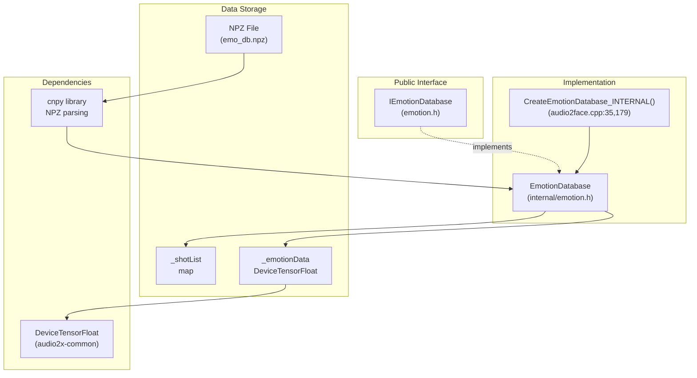
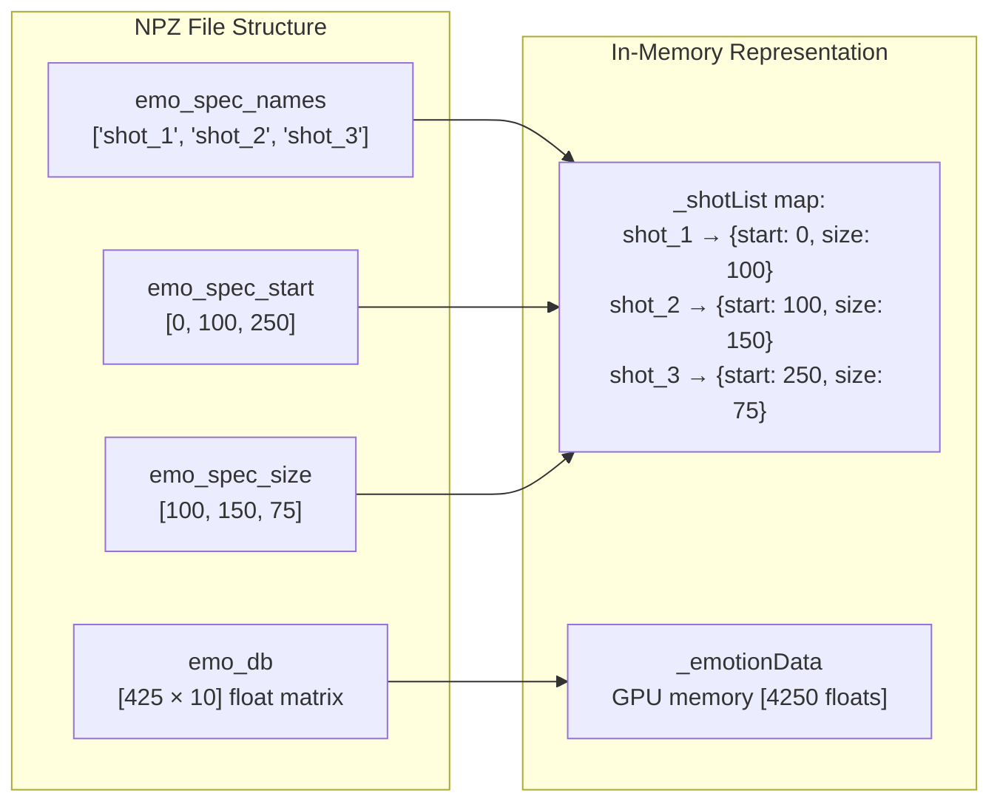
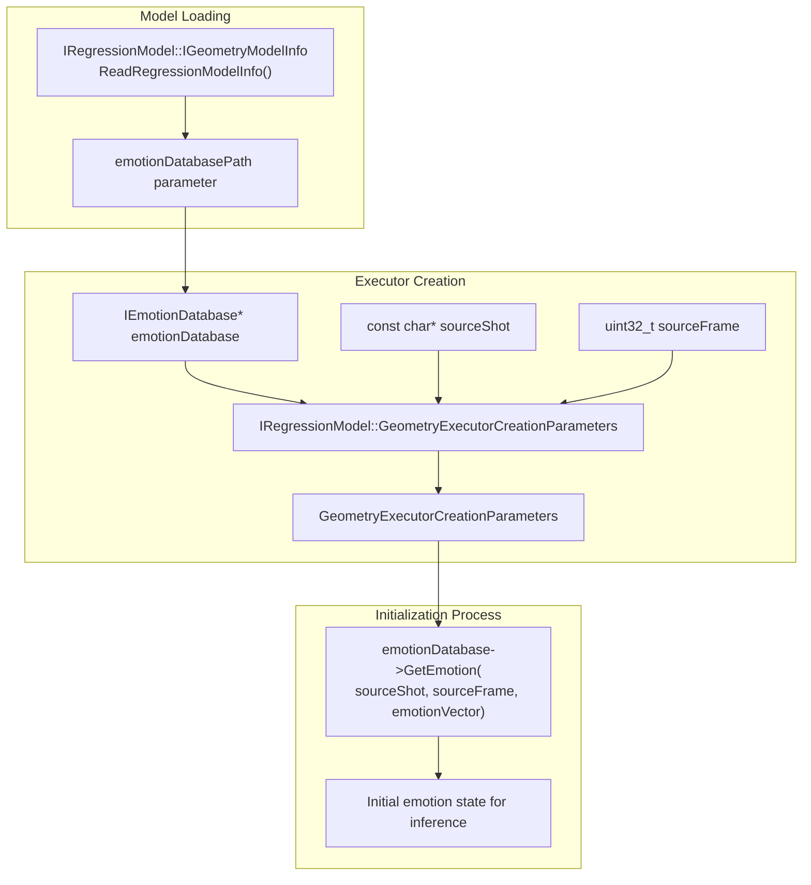
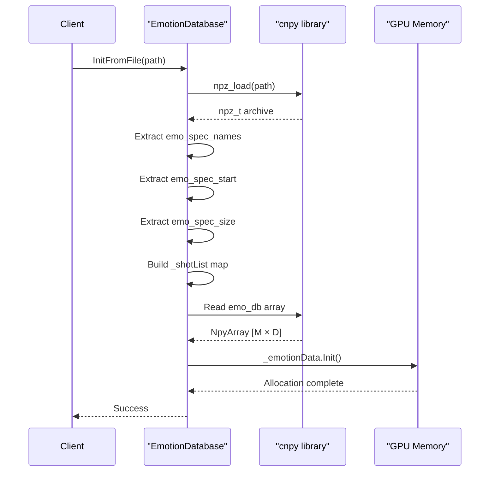

<!-- source: DeepWiki mcp.deepwiki.com · repo NVIDIA/Audio2Face-3D-SDK · page 4.4 Emotion Database · fetched 2026-10-26 -->

# Emotion Database

<details>
<summary>Relevant source files</summary>

The following files were used as context for generating this wiki page:

- [audio2face-sdk/include/audio2face/emotion.h](audio2face-sdk/include/audio2face/emotion.h)
- [audio2face-sdk/include/audio2face/internal/emotion.h](audio2face-sdk/include/audio2face/internal/emotion.h)
- [audio2face-sdk/source/audio2face-core/emotion.cpp](audio2face-sdk/source/audio2face-core/emotion.cpp)
- [audio2face-sdk/source/audio2face-core/executor.cpp](audio2face-sdk/source/audio2face-core/executor.cpp)
- [audio2face-sdk/source/audio2face/audio2face.cpp](audio2face-sdk/source/audio2face/audio2face.cpp)
- [audio2face-sdk/source/benchmarks/utils.h](audio2face-sdk/source/benchmarks/utils.h)
- [audio2face-sdk/tests/test_core_executor.cpp](audio2face-sdk/tests/test_core_executor.cpp)
- [audio2x-common/include/audio2x/emotion_accumulator.h](audio2x-common/include/audio2x/emotion_accumulator.h)
- [audio2x-common/include/audio2x/internal/emotion_accumulator.h](audio2x-common/include/audio2x/internal/emotion_accumulator.h)
- [audio2x-common/source/audio2x/emotion_accumulator.cpp](audio2x-common/source/audio2x/emotion_accumulator.cpp)
- [audio2x-common/tests/test_emotion_accumulator.cpp](audio2x-common/tests/test_emotion_accumulator.cpp)

</details>


## Overview

The Emotion Database provides GPU-accelerated access to static emotion data stored in NPZ (NumPy archive) files. It organizes emotion vectors by "shots" (named sequences) and frames within those shots, enabling geometry executors to retrieve specific emotion states for facial animation initialization.

This system is distinct from the [Emotion Accumulator](#3.2), which manages time-series emotion data during runtime. The Emotion Database contains pre-computed, static emotion data loaded from disk at initialization.

**Sources:** [audio2face-sdk/include/audio2face/emotion.h:1-60](), [audio2face-sdk/source/audio2face-core/emotion.cpp:1-184]()

## Architecture and Components



**Sources:** [audio2face-sdk/include/audio2face/emotion.h:27-58](), [audio2face-sdk/include/audio2face/internal/emotion.h:31-62](), [audio2face-sdk/source/audio2face/audio2face.cpp:35-36,179-182]()

## Data Format and Organization

The Emotion Database loads data from NPZ files with the following structure:

| Array Name | Shape | Data Type | Description |
|------------|-------|-----------|-------------|
| `emo_spec_names` | `[N]` | string | Names of emotion shots |
| `emo_spec_start` | `[N]` | int32 | Starting frame index for each shot |
| `emo_spec_size` | `[N]` | int32 | Number of frames in each shot |
| `emo_db` | `[M, D]` | float32 | Emotion data matrix (M frames × D dimensions) |

**Shot-Based Organization:**



**Sources:** [audio2face-sdk/source/audio2face-core/emotion.cpp:66-105]()

## Public Interface

The `IEmotionDatabase` interface provides the following operations:

### Initialization

```cpp
// Factory function
IEmotionDatabase* CreateEmotionDatabase();

// Set CUDA stream for GPU operations (optional, defaults to stream 0)
std::error_code SetCudaStream(cudaStream_t cudaStream);

// Load emotion data from NPZ file
std::error_code InitFromFile(const char* emotionDBPath);
```

### Data Access

```cpp
// Retrieve emotion vector for specific shot and frame (GPU async operation)
std::error_code GetEmotion(
    const char* emotionShot,
    unsigned int emotionFrame,
    nva2x::DeviceTensorFloatView emotion
) const;

// Get emotion vector dimension
std::size_t GetEmotionLength() const;
```

### Shot Metadata Queries

```cpp
// Get number of shots in database
std::size_t GetNbEmotionShots() const;

// Get shot name by index
const char* GetEmotionShotName(std::size_t index) const;

// Get number of frames in a specific shot
uint32_t GetEmotionShotSize(const char* emotionShotName) const;
```

**Sources:** [audio2face-sdk/include/audio2face/emotion.h:28-57]()

## Integration with Geometry Executors

The Emotion Database is used by geometry executors to obtain initial emotion states during model initialization:



### Usage in Regression Models

Regression models use the emotion database during executor creation:

- **Network Path:** TensorRT engine file
- **Emotion Database Path:** NPZ file containing emotion shots
- **Source Shot + Source Frame:** Identifies the initial emotion state

Example from test code:
```cpp
// model.json contains paths to network.engine and emotion_database.npz
auto modelInfo = ReadRegressionModelInfo(modelJsonPath);

// Executor creation parameters include sourceShot and sourceFrame
auto params = modelInfo->GetExecutorCreationParameters(
    ExecutionOption::All,
    frameRateNum,
    frameRateDenom
);
// params.sourceShot and params.sourceFrame specify the initial emotion
```

### Usage in Diffusion Models

Diffusion models support multiple identities, each with its own emotion database configuration, but use the emotion database in a similar way during initialization.

**Sources:** [audio2face-sdk/source/audio2face/audio2face.cpp:72-82,445-455](), [audio2face-sdk/tests/test_core_executor.cpp:92-102]()

## Implementation Details

### Data Loading Process

The `InitFromNpz` method performs the following steps:

1. **Load NPZ Archive:** Uses `cnpy::npz_load()` to read the file
2. **Extract Metadata Arrays:** Reads `emo_spec_names`, `emo_spec_start`, `emo_spec_size`
3. **Build Shot Map:** Constructs `_shotList` mapping shot names to `{start, size}` pairs
4. **Load Emotion Matrix:** Reads `emo_db` array and copies to GPU via `DeviceTensorFloat`
5. **Validate Dimensions:** Ensures `emo_db` is 2D with shape `[totalFrames, emotionLength]`



**Sources:** [audio2face-sdk/source/audio2face-core/emotion.cpp:54-105]()

### Emotion Retrieval Process

The `GetEmotion` method retrieves a specific emotion vector:

1. **Lookup Shot:** Finds shot info in `_shotList` by name
2. **Validate Frame:** Checks that `emotionFrame < shotSize`
3. **Calculate Global Index:** Computes `globalFrame = shotStart + emotionFrame`
4. **Copy Data:** Uses `CopyDeviceToDevice` to extract the emotion vector slice

```cpp
// Simplified pseudocode from emotion.cpp:111-135
std::error_code GetEmotion(
    const char* emotionShot,
    unsigned int emotionFrame,
    DeviceTensorFloatView emotion
) const {
    auto shotInfo = _shotList.at(emotionShot);
    size_t globalFrame = shotInfo.start + emotionFrame;
    
    // Extract slice [globalFrame * _emotionLength : (globalFrame + 1) * _emotionLength]
    auto sourceView = _emotionData.View(
        globalFrame * _emotionLength, 
        _emotionLength
    );
    
    // GPU async copy
    return CopyDeviceToDevice(emotion, sourceView, _cudaStream);
}
```

**Sources:** [audio2face-sdk/source/audio2face-core/emotion.cpp:111-135]()

### Memory Layout

The emotion data is stored as a contiguous 1D array in GPU memory:

```
_emotionData layout:
[shot_1_frame_0] [shot_1_frame_1] ... [shot_1_frame_99]
[shot_2_frame_0] [shot_2_frame_1] ... [shot_2_frame_149]
[shot_3_frame_0] [shot_3_frame_1] ... [shot_3_frame_74]

Each frame: [e0, e1, e2, ..., e9] (10 float values)
```

This layout enables efficient slice extraction using `DeviceTensorFloat::View()` without data copying.

**Sources:** [audio2face-sdk/source/audio2face-core/emotion.cpp:92-100](), [audio2face-sdk/include/audio2face/internal/emotion.h:31-62]()

## Thread Safety and Lifecycle

- **Thread Safety:** The `EmotionDatabase` class does **not** provide internal synchronization. Concurrent access must be managed externally.
- **Lifecycle:** Created via `CreateEmotionDatabase()` and destroyed via `Destroy()` method
- **Initialization:** Must call `InitFromFile()` before accessing emotion data
- **CUDA Stream:** Operations are GPU-async with respect to the configured CUDA stream

**Sources:** [audio2face-sdk/source/audio2face-core/emotion.cpp:39-52,174-177]()

## Error Handling

The implementation performs validation at multiple points:

| Error Condition | Method | Error Code |
|----------------|--------|------------|
| Shot name not found | `GetEmotion`, `GetEmotionShotSize` | `ErrorCode::eOutOfRange` |
| Frame index out of bounds | `GetEmotion` | `ErrorCode::eOutOfBounds` |
| Not initialized | `GetEmotion`, metadata queries | `ErrorCode::eNotInitialized` |
| Mismatched emotion size | `GetEmotion` | `ErrorCode::eMismatch` |
| File open/read failed | `InitFromFile` | `ErrorCode::eOpenFileFailed`, `ErrorCode::eReadFileFailed` |
| Invalid NPZ structure | `InitFromNpz` | `ErrorCode::eNotInitialized` |

**Sources:** [audio2face-sdk/source/audio2face-core/emotion.cpp:54-173]()

## Typical Usage Pattern

```cpp
// 1. Create emotion database
auto emotionDB = nva2f::ToUniquePtr(nva2f::CreateEmotionDatabase());

// 2. Configure CUDA stream (optional)
emotionDB->SetCudaStream(cudaStream);

// 3. Load data from NPZ file
auto err = emotionDB->InitFromFile("path/to/emotion_database.npz");
if (err) { /* handle error */ }

// 4. Query available shots
size_t nbShots = emotionDB->GetNbEmotionShots();
for (size_t i = 0; i < nbShots; ++i) {
    const char* shotName = emotionDB->GetEmotionShotName(i);
    uint32_t shotSize = emotionDB->GetEmotionShotSize(shotName);
}

// 5. Retrieve specific emotion
nva2x::DeviceTensorFloat emotionVector;
emotionVector.Allocate(emotionDB->GetEmotionLength());
err = emotionDB->GetEmotion("shot_name", 42, emotionVector);
```

**Sources:** [audio2face-sdk/source/audio2face-core/emotion.cpp:1-184](), [audio2face-sdk/tests/test_core_executor.cpp:92-115]()

---

