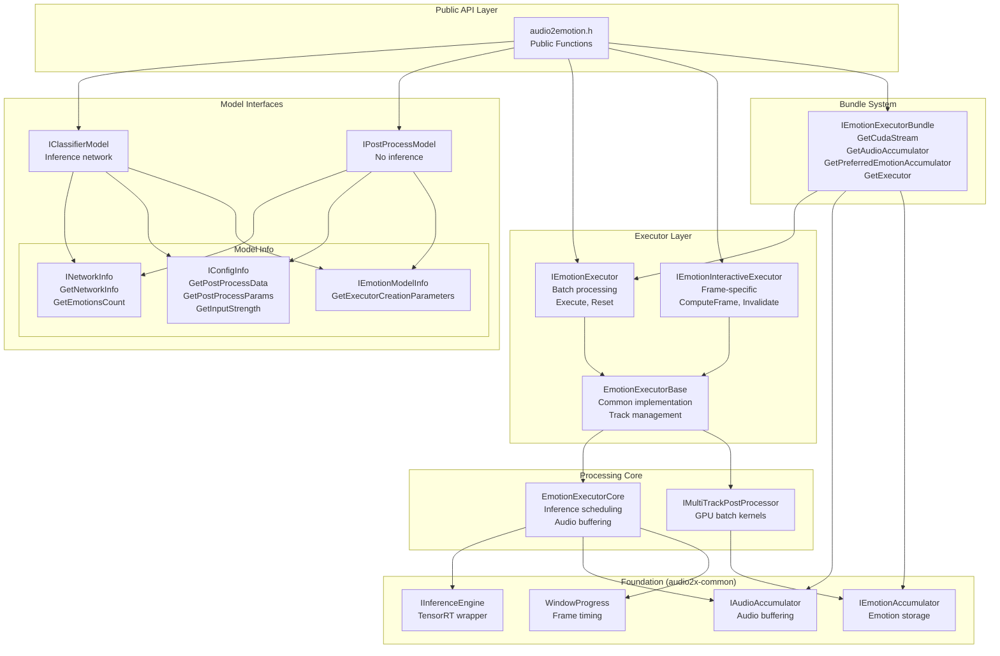
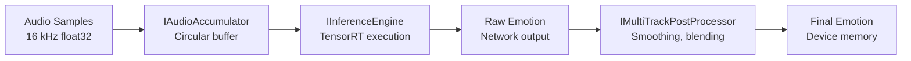
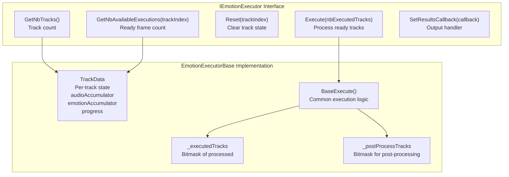
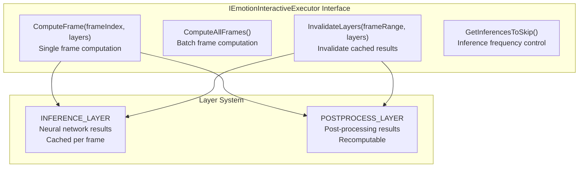
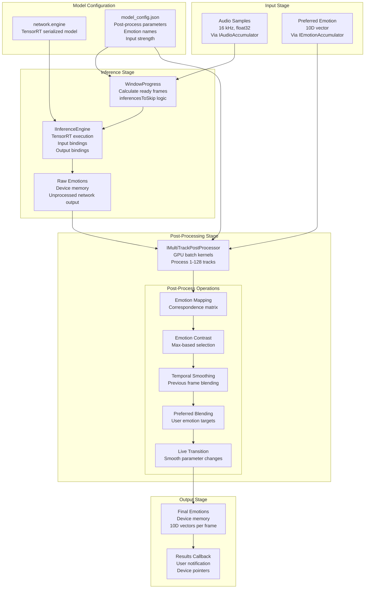
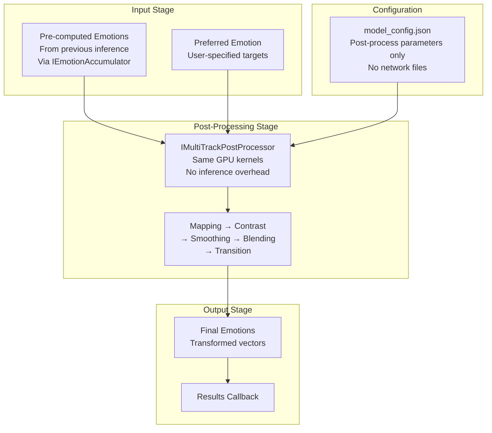
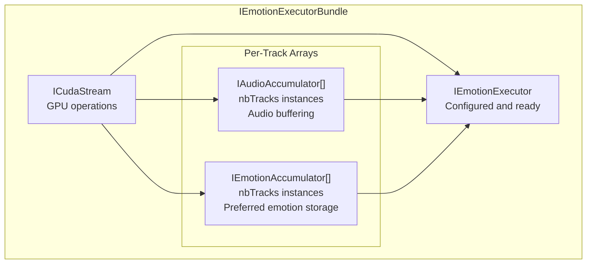
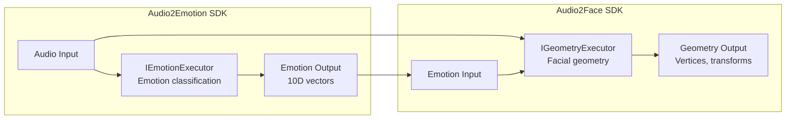

<!-- source: DeepWiki mcp.deepwiki.com · repo NVIDIA/Audio2Face-3D-SDK · page 5 Audio2Emotion SDK · fetched 2026-10-26 -->

# Audio2Emotion SDK

<details>
<summary>Relevant source files</summary>

The following files were used as context for generating this wiki page:

- [audio2emotion-sdk/include/audio2emotion/audio2emotion.h](audio2emotion-sdk/include/audio2emotion/audio2emotion.h)
- [audio2emotion-sdk/include/audio2emotion/internal/executor.h](audio2emotion-sdk/include/audio2emotion/internal/executor.h)
- [audio2emotion-sdk/include/audio2emotion/internal/parse_helper.h](audio2emotion-sdk/include/audio2emotion/internal/parse_helper.h)
- [audio2emotion-sdk/include/audio2emotion/parse_helper.h](audio2emotion-sdk/include/audio2emotion/parse_helper.h)
- [audio2emotion-sdk/source/audio2emotion/audio2emotion.cpp](audio2emotion-sdk/source/audio2emotion/audio2emotion.cpp)

</details>


## Purpose and Scope

The Audio2Emotion SDK provides GPU-accelerated emotion classification from audio streams. It analyzes audio input at 16 kHz and produces emotion vectors that classify the emotional content of speech. The SDK supports two processing modes:

1. **Classifier mode**: Performs neural network inference on audio to generate raw emotion classifications, followed by post-processing
2. **Post-process only mode**: Transforms pre-computed emotion data without inference, useful for parameter refinement and offline workflows

This document covers the high-level architecture, model types, executor system, and data flow pipeline. For detailed information about specific components:
- Emotion models and executor implementations: see [Emotion Models and Executors](#5.1)
- GPU-optimized post-processing system: see [Multi-Track Post-Processing](#5.2)
- Interactive execution with caching: see [Interactive Execution](#6)
- Core infrastructure (tensors, accumulators): see [Core Infrastructure](#3)

Sources: [audio2emotion-sdk/include/audio2emotion/audio2emotion.h:1-202]()

---

## Architecture Overview

The Audio2Emotion SDK is built on the audio2x-common foundation and implements a modular pipeline architecture.

### High-Level Component Structure



Sources: [audio2emotion-sdk/include/audio2emotion/audio2emotion.h:1-202](), [audio2emotion-sdk/include/audio2emotion/internal/executor.h:1-138](), [audio2emotion-sdk/include/audio2emotion/parse_helper.h:1-150]()

---

## Model Types and Processing Paths

The SDK supports two distinct model types with different processing characteristics:

| Aspect | IClassifierModel | IPostProcessModel |
|--------|------------------|-------------------|
| **Inference** | Runs TensorRT neural network | No inference performed |
| **Audio Input** | Requires audio samples via `IAudioAccumulator` | No audio input needed |
| **Network Files** | Requires `network.engine` TensorRT file | No network files |
| **Input Data** | Audio samples (16 kHz) | Pre-computed emotion vectors |
| **Processing** | Inference → Post-processing | Post-processing only |
| **Use Cases** | Real-time emotion detection from audio | Parameter tuning, offline refinement |
| **Buffer Length** | Runtime parameter, affects network input shape | Not applicable |
| **Performance** | Depends on inference + post-processing | Post-processing only (faster) |

### IClassifierModel: Inference Path

The classifier model performs complete emotion detection from raw audio:



**Key Functions:**
- `CreateClassifierEmotionExecutor()`: Creates batch executor with inference [audio2emotion-sdk/include/audio2emotion/audio2emotion.h:73-76]()
- `CreateClassifierEmotionInteractiveExecutor()`: Creates interactive executor with inference [audio2emotion-sdk/include/audio2emotion/audio2emotion.h:131-135]()
- `ReadClassifierNetworkInfo()`: Loads network metadata [audio2emotion-sdk/include/audio2emotion/audio2emotion.h:154]()
- `ReadClassifierConfigInfo()`: Loads post-processing configuration [audio2emotion-sdk/include/audio2emotion/audio2emotion.h:157-159]()
- `ReadClassifierModelInfo()`: Loads complete model bundle [audio2emotion-sdk/include/audio2emotion/audio2emotion.h:162-167]()

Sources: [audio2emotion-sdk/include/audio2emotion/audio2emotion.h:73-167](), [audio2emotion-sdk/include/audio2emotion/parse_helper.h:30-87]()

### IPostProcessModel: Post-Process Only Path

The post-process model transforms existing emotion data without inference:


**Key Functions:**
- `CreatePostProcessEmotionExecutor()`: Creates batch executor without inference [audio2emotion-sdk/include/audio2emotion/audio2emotion.h:80-91]()
- `CreatePostProcessEmotionInteractiveExecutor()`: Creates interactive executor without inference [audio2emotion-sdk/include/audio2emotion/audio2emotion.h:139-151]()
- `ReadPostProcessNetworkInfo()`: Loads network metadata (emotion count/names) [audio2emotion-sdk/include/audio2emotion/audio2emotion.h:170]()
- `ReadPostProcessConfigInfo()`: Loads post-processing configuration [audio2emotion-sdk/include/audio2emotion/audio2emotion.h:173-175]()
- `ReadPostProcessModelInfo()`: Loads complete model bundle [audio2emotion-sdk/include/audio2emotion/audio2emotion.h:178-183]()

Sources: [audio2emotion-sdk/include/audio2emotion/audio2emotion.h:80-183](), [audio2emotion-sdk/include/audio2emotion/parse_helper.h:89-116]()

---

## Executor System

The SDK provides two execution modes through distinct interfaces:

### Batch Executor: IEmotionExecutor

Processes audio streams continuously as data arrives, suitable for real-time or sequential processing:



Sources: [audio2emotion-sdk/include/audio2emotion/executor.h:1-89](), [audio2emotion-sdk/include/audio2emotion/internal/executor.h:56-111]()

### Interactive Executor: IEmotionInteractiveExecutor

Enables frame-specific computation with layer-based invalidation for interactive workflows:



Sources: [audio2emotion-sdk/include/audio2emotion/interactive_executor.h:1-111]()

### Parameter Control

Both executor types support runtime parameter adjustment:

| Parameter | Scope | Function | Purpose |
|-----------|-------|----------|---------|
| **Input Strength** | All tracks | `Get/SetExecutorInputStrength()` | Controls emotion intensity from audio |
| **Post-Process Params** | Per track | `Get/SetExecutorPostProcessParameters()` | Smoothing, blending, transitions |
| **Inferences to Skip** | Interactive only | `Get/SetInteractiveExecutorInferencesToSkip()` | Trade speed for accuracy |

Sources: [audio2emotion-sdk/include/audio2emotion/audio2emotion.h:50-128]()

---

## Complete Data Flow Pipeline

### Classifier Path (with Inference)



Sources: [audio2emotion-sdk/include/audio2emotion/executor_classifier.h:1-74](), [audio2emotion-sdk/include/audio2emotion/postprocess.h:1-117]()

### Post-Process Only Path



Sources: [audio2emotion-sdk/include/audio2emotion/executor_postprocess.h:1-74]()

---

## Bundle System for Simplified Initialization

The `IEmotionExecutorBundle` interface encapsulates all resources needed for emotion processing:

### Bundle Contents



### Bundle Loading Functions

| Function | Purpose | Model Type |
|----------|---------|------------|
| `ReadClassifierEmotionExecutorBundle()` | Complete classifier setup from single model.json | IClassifierModel |
| `ReadPostProcessEmotionExecutorBundle()` | Complete post-process setup from single model.json | IPostProcessModel |

**Bundle Loading Example:**
```cpp
// Load complete classifier bundle with all resources
IClassifierModel::IEmotionModelInfo* modelInfo = nullptr;
IEmotionExecutorBundle* bundle = ReadClassifierEmotionExecutorBundle(
    /*nbTracks=*/4,
    /*path=*/"path/to/model.json",
    /*bufferLength=*/16000,
    /*frameRateNumerator=*/60, /*frameRateDenominator=*/1,
    /*inferencesToSkip=*/0,
    /*outModelInfo=*/&modelInfo
);

// Access components
ICudaStream& stream = bundle->GetCudaStream();
IAudioAccumulator& audio = bundle->GetAudioAccumulator(0);
IEmotionAccumulator& emotion = bundle->GetPreferredEmotionAccumulator(0);
IEmotionExecutor& executor = bundle->GetExecutor();

// Use executor...

// Cleanup
bundle->Destroy();
if (modelInfo) modelInfo->Destroy();
```

Sources: [audio2emotion-sdk/include/audio2emotion/audio2emotion.h:186-200](), [audio2emotion-sdk/include/audio2emotion/parse_helper.h:118-148]()

---

## Integration with Audio2Face

The Audio2Emotion SDK is designed to work seamlessly with the Audio2Face SDK:



**Integration Mechanism:**
- `IEmotionBinder`: Connects emotion executor output to `IEmotionAccumulator` instances
- Audio2Face geometry executors read from the same accumulators
- Both SDKs share audio input via `IAudioAccumulator`
- Synchronized via `ICudaStream` for GPU operations

**Key Function:**
- `CreateEmotionBinder()`: Automatically forwards executor results to accumulators [audio2emotion-sdk/include/audio2emotion/audio2emotion.h:94-98]()

Sources: [audio2emotion-sdk/include/audio2emotion/audio2emotion.h:94-98](), [audio2emotion-sdk/include/audio2emotion/internal/executor.h:114-135]()

---

## Model File Structure

Both classifier and post-process models follow a consistent file organization:

### Classifier Model Files

```
model_directory/
├── model.json                 # Combined metadata (recommended)
├── network_info.json          # Network structure and emotion names
├── network.engine             # TensorRT serialized model
└── model_config.json          # Post-processing configuration
```

### Post-Process Model Files

```
model_directory/
├── model.json                 # Combined metadata (recommended)
├── network_info.json          # Emotion names only (no network)
└── model_config.json          # Post-processing configuration
```

**Loading Options:**
1. **Single file**: `ReadClassifierModelInfo("model.json")` - Loads all metadata from combined file
2. **Individual files**: `ReadClassifierModelInfo("network_info.json", "network.engine", "model_config.json")` - Loads from separate files

Sources: [audio2emotion-sdk/include/audio2emotion/audio2emotion.h:154-183](), [audio2emotion-sdk/include/audio2emotion/parse_helper.h:30-116]()

---

## Multi-Track Processing

The SDK efficiently processes multiple audio tracks in parallel using GPU batch operations:

| Configuration | Value |
|---------------|-------|
| **Minimum Tracks** | 1 |
| **Maximum Tracks** | 128 |
| **Memory Layout** | Strided, track-indexed |
| **GPU Execution** | Single kernel launch for all tracks |
| **CPU Overhead** | Minimal per-track cost |

**Track Management:**
- Each track has independent `IAudioAccumulator` and `IEmotionAccumulator`
- Tracks are processed together in GPU batch kernels
- Bitmasks track execution state: `_executedTracks`, `_postProcessTracks`, `_doneTracks`
- Per-track post-processing parameters allow individual customization

For detailed multi-track optimization techniques, see [Multi-Track Batch Processing](#7).

Sources: [audio2emotion-sdk/include/audio2emotion/internal/executor.h:101-111]()

---

## Post-Processing Parameters

The `PostProcessParams` structure controls emotion refinement behavior per track:

```cpp
struct PostProcessParams {
    float emotionContrast;              // Contrast enhancement [0, 1]
    float emotionLiveTimeS;             // Live transition time (seconds)
    float smoothing;                    // Temporal smoothing [0, 1]
    float liveBlendCoef;                // Live blending coefficient [0, 1]
    float preferredEmotionStrength;     // Preferred emotion influence [0, 1]
};
```

**Parameter Effects:**
- **emotionContrast**: Increases peak emotion values via max-selection
- **emotionLiveTimeS**: Controls transition smoothness when parameters change
- **smoothing**: Blends current frame with previous frame history
- **liveBlendCoef**: Interpolation between old and new parameter sets
- **preferredEmotionStrength**: Influence of user-specified target emotions

For detailed post-processing implementation, see [Multi-Track Post-Processing](#5.2).

Sources: [audio2emotion-sdk/include/audio2emotion/postprocess.h:23-71]()

---

