<!-- source: DeepWiki mcp.deepwiki.com · repo NVIDIA/Audio2Face-3D-SDK · page 5.1 Emotion Models and Executors · fetched 2026-10-26 -->

# Emotion Models and Executors

<details>
<summary>Relevant source files</summary>

The following files were used as context for generating this wiki page:

- [audio2emotion-sdk/include/audio2emotion/audio2emotion.h](audio2emotion-sdk/include/audio2emotion/audio2emotion.h)
- [audio2emotion-sdk/include/audio2emotion/internal/executor.h](audio2emotion-sdk/include/audio2emotion/internal/executor.h)
- [audio2emotion-sdk/include/audio2emotion/internal/parse_helper.h](audio2emotion-sdk/include/audio2emotion/internal/parse_helper.h)
- [audio2emotion-sdk/include/audio2emotion/parse_helper.h](audio2emotion-sdk/include/audio2emotion/parse_helper.h)
- [audio2emotion-sdk/source/audio2emotion-core/executor.cpp](audio2emotion-sdk/source/audio2emotion-core/executor.cpp)
- [audio2emotion-sdk/source/audio2emotion-core/executor_classifier.cpp](audio2emotion-sdk/source/audio2emotion-core/executor_classifier.cpp)
- [audio2emotion-sdk/source/audio2emotion-core/executor_postprocess.cpp](audio2emotion-sdk/source/audio2emotion-core/executor_postprocess.cpp)
- [audio2emotion-sdk/source/audio2emotion-core/interactive_executor_postprocess.cpp](audio2emotion-sdk/source/audio2emotion-core/interactive_executor_postprocess.cpp)
- [audio2emotion-sdk/source/audio2emotion/audio2emotion.cpp](audio2emotion-sdk/source/audio2emotion/audio2emotion.cpp)

</details>


## Purpose and Scope

This document describes the model interfaces and executor implementations in the audio2emotion-sdk module. It covers the two distinct execution paths—**classifier-based execution** (which performs neural network inference on audio) and **post-process-only execution** (which transforms pre-computed emotion data without inference)—and the shared executor base architecture that both paths build upon.

For information about the multi-track post-processing GPU kernels and optimization strategies, see [Multi-Track Post-Processing](#5.2). For interactive execution capabilities with layer-based invalidation and caching, see [Interactive Execution](#6).

---

## Model Type Architecture

The audio2emotion-sdk defines two distinct model types that determine whether neural network inference is performed:

| Model Type | Interface | Purpose | Inference Required | Network Engine Required |
|------------|-----------|---------|-------------------|------------------------|
| **Classifier Model** | `IClassifierModel` | Audio → Emotion classification | Yes | Yes (TensorRT) |
| **Post-Process Model** | `IPostProcessModel` | Transform existing emotions | No | No |

Both model types share common components for post-processing but differ fundamentally in whether they run inference on audio data.

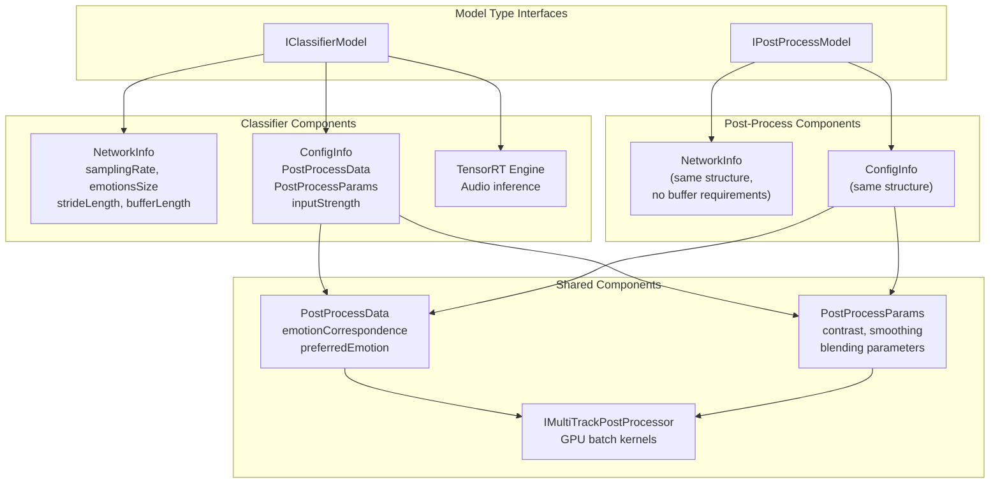

**Sources:** [audio2emotion-sdk/include/audio2emotion/model.h](), [audio2emotion-sdk/include/audio2emotion/parse_helper.h:30-117]()

### Creation Parameter Structures

Each model type defines specialized creation parameters that configure its executor:

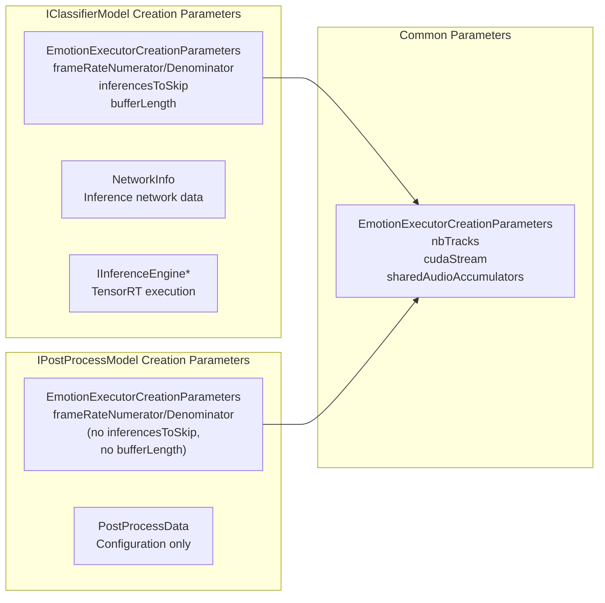

**Sources:** [audio2emotion-sdk/include/audio2emotion/executor_classifier.h](), [audio2emotion-sdk/include/audio2emotion/executor_postprocess.h]()

---

## Executor Base Architecture

All emotion executors inherit from `EmotionExecutorBase`, which implements the `IEmotionExecutor` interface and provides shared functionality for multi-track execution, progress tracking, and result callbacks.

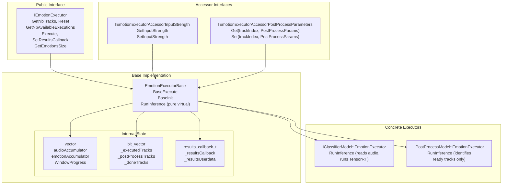

**Sources:** [audio2emotion-sdk/include/audio2emotion/internal/executor.h:56-111](), [audio2emotion-sdk/source/audio2emotion-core/executor.cpp:35-305]()

### Track State Management

The base executor maintains per-track state using the `TrackData` structure:

| Field | Type | Purpose |
|-------|------|---------|
| `audioAccumulator` | `const IAudioAccumulator*` | Source of audio samples for inference |
| `emotionAccumulator` | `const IEmotionAccumulator*` | Source of preferred emotions for blending |
| `progress` | `unique_ptr<WindowProgress>` | Tracks execution progress and window positions |

Three bit vectors track execution state across all tracks during a single `Execute()` call:

- `_executedTracks`: Tracks that ran inference this execution
- `_postProcessTracks`: Tracks that need post-processing for current frame
- `_doneTracks`: Tracks that have completed (reached end of audio or callback returned false)

**Sources:** [audio2emotion-sdk/include/audio2emotion/internal/executor.h:101-110](), [audio2emotion-sdk/source/audio2emotion-core/executor.cpp:148-261]()

### BaseExecute Execution Flow

The `BaseExecute()` method implements the shared execution logic for all emotion executors:

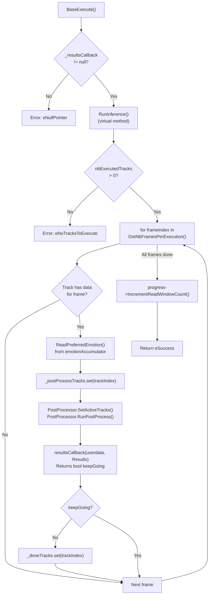

**Sources:** [audio2emotion-sdk/source/audio2emotion-core/executor.cpp:148-261]()

---

## Classifier-Based Executors

The `IClassifierModel::EmotionExecutor` performs full audio-to-emotion classification by running neural network inference on audio windows.

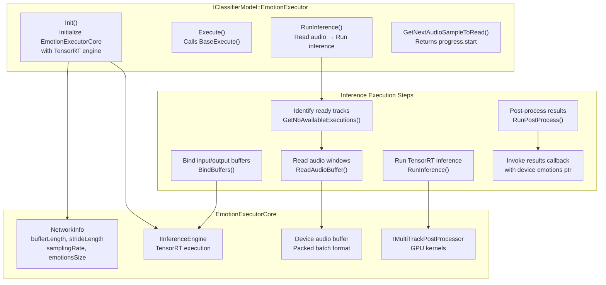

**Sources:** [audio2emotion-sdk/source/audio2emotion-core/executor_classifier.cpp:32-152](), [audio2emotion-sdk/include/audio2emotion/internal/executor_classifier.h]()

### Audio Window Reading

The classifier executor reads overlapping audio windows based on network configuration:

| Parameter | Source | Purpose |
|-----------|--------|---------|
| `bufferLength` | `NetworkInfo` | Total samples in inference window |
| `strideLength` | `NetworkInfo` | Sample offset between consecutive windows |
| `start` | `WindowProgress` | First sample of current window |
| `target` | `WindowProgress` | Central sample timestamp |
| `end` | `WindowProgress` | Last sample of window (start + bufferLength) |

The `ReadAudioBuffer()` method in `EmotionExecutorCore` copies audio data from each track's accumulator into a packed batch buffer for inference:

**Sources:** [audio2emotion-sdk/source/audio2emotion-core/executor_classifier.cpp:85-129](), [audio2emotion-sdk/source/audio2emotion-core/executor_classifier_core.cpp]()

---

## Post-Process-Only Executors

The `IPostProcessModel::EmotionExecutor` transforms existing emotion data without running inference. This is useful for offline refinement of emotion classifications or when emotions are provided from external sources.

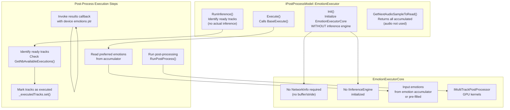

**Sources:** [audio2emotion-sdk/source/audio2emotion-core/executor_postprocess.cpp:32-145](), [audio2emotion-sdk/include/audio2emotion/internal/executor_postprocess.h]()

### Key Differences from Classifier Executors

| Aspect | Classifier Executor | Post-Process Executor |
|--------|--------------------|-----------------------|
| Inference | Runs TensorRT on audio | None |
| Audio usage | Reads windows for inference | Not used (returns all accumulated) |
| `NetworkInfo` | Requires bufferLength, strideLength | Only requires emotionsSize |
| `inferencesToSkip` | Controls inference frequency | Not applicable |
| Creation parameter | `IClassifierModel::EmotionExecutorCreationParameters` | `IPostProcessModel::EmotionExecutorCreationParameters` |
| Input data source | Audio samples | Pre-computed emotions or zeros |

**Sources:** [audio2emotion-sdk/source/audio2emotion-core/executor_postprocess.cpp:34-108]()

---

## Executor Creation and Initialization

Executors are created through factory functions that handle initialization and return raw pointers to heap-allocated instances:

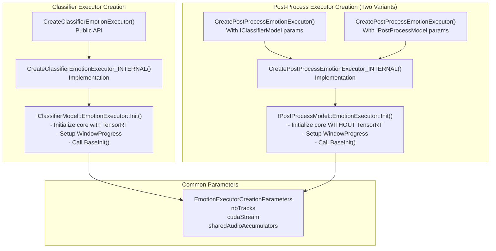

**Sources:** [audio2emotion-sdk/source/audio2emotion/audio2emotion.cpp:46-194](), [audio2emotion-sdk/source/audio2emotion-core/executor_classifier.cpp:141-152](), [audio2emotion-sdk/source/audio2emotion-core/executor_postprocess.cpp:120-144]()

### EmotionExecutorCreationParameters

The base creation parameters structure is defined in [audio2emotion-sdk/include/audio2emotion/executor.h]():

| Field | Type | Required | Purpose |
|-------|------|----------|---------|
| `nbTracks` | `std::size_t` | Yes | Number of parallel tracks to process (1-128) |
| `cudaStream` | `cudaStream_t` | Yes | CUDA stream for GPU operations |
| `sharedAudioAccumulators` | `IAudioAccumulator**` | Yes | Array of audio accumulators (one per track) |

### IClassifierModel-Specific Parameters

Additional fields in [audio2emotion-sdk/include/audio2emotion/executor_classifier.h]():

| Field | Type | Purpose |
|-------|------|---------|
| `networkInfo` | `NetworkInfo` | Defines buffer/stride lengths, sampling rate |
| `network` | `IInferenceEngine*` | TensorRT inference engine |
| `postProcessData` | `PostProcessData` | Emotion correspondence, preferred emotions |
| `postProcessParams` | `PostProcessParams*` | Per-track post-processing parameters |
| `inputStrength` | `float` | Global input multiplier (default 1.0) |
| `inferencesToSkip` | `std::size_t` | Generate N+1 frames per inference (0-10) |
| `frameRateNumerator` | `std::size_t` | Output frame rate numerator |
| `frameRateDenominator` | `std::size_t` | Output frame rate denominator |
| `bufferLength` | `std::size_t` | Audio window size in samples |
| `sharedPreferredEmotionAccumulators` | `IEmotionAccumulator**` | Optional preferred emotions per track |

### IPostProcessModel-Specific Parameters

Defined in [audio2emotion-sdk/include/audio2emotion/executor_postprocess.h]():

| Field | Type | Purpose |
|-------|------|---------|
| `samplingRate` | `std::size_t` | Audio sample rate (16000 Hz typical) |
| `postProcessData` | `PostProcessData` | Emotion correspondence, preferred emotions |
| `postProcessParams` | `PostProcessParams*` | Per-track post-processing parameters |
| `inputStrength` | `float` | Global input multiplier |
| `frameRateNumerator` | `std::size_t` | Output frame rate numerator |
| `frameRateDenominator` | `std::size_t` | Output frame rate denominator |
| `sharedPreferredEmotionAccumulators` | `IEmotionAccumulator**` | Optional preferred emotions per track |

Note the absence of `networkInfo`, `network`, `inferencesToSkip`, and `bufferLength` since no inference is performed.

**Sources:** [audio2emotion-sdk/include/audio2emotion/executor_classifier.h](), [audio2emotion-sdk/include/audio2emotion/executor_postprocess.h]()

---

## Parameter Management

Executors expose runtime parameters through accessor interfaces using a dynamic cast pattern to check capability support.

### Input Strength Parameter

The `inputStrength` parameter is a global multiplier applied to all tracks (common across tracks):

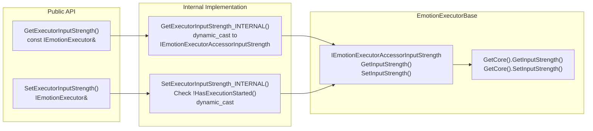

**Sources:** [audio2emotion-sdk/source/audio2emotion/audio2emotion.cpp:147-157](), [audio2emotion-sdk/source/audio2emotion-core/executor.cpp:126-135](), [audio2emotion-sdk/source/audio2emotion-core/executor.cpp:335-354]()

### Post-Process Parameters

The `PostProcessParams` structure is managed per-track and contains detailed post-processing configuration (see [Multi-Track Post-Processing](#5.2) for details):

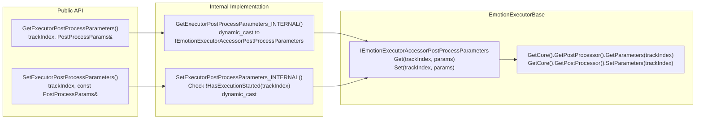

**Sources:** [audio2emotion-sdk/source/audio2emotion/audio2emotion.cpp:159-169](), [audio2emotion-sdk/source/audio2emotion-core/executor.cpp:137-146](), [audio2emotion-sdk/source/audio2emotion-core/executor.cpp:356-366]()

### Parameter Modification Restrictions

Both parameter types can only be modified before execution starts for their respective tracks:

```cpp
// Check in SetInputStrength_INTERNAL
A2E_CHECK_ERROR_WITH_MSG(
    !nva2x::HasExecutionStarted(executor),
    "Input strength can only be set before execution is started",
    nva2x::ErrorCode::eExecutionAlreadyStarted
);

// Check in SetExecutorParameters (template for PostProcessParams)
A2E_CHECK_ERROR_WITH_MSG(
    !executor.HasExecutionStarted(trackIndex),
    "Parameters can only be set before execution is started",
    nva2x::ErrorCode::eExecutionAlreadyStarted
);
```

**Sources:** [audio2emotion-sdk/source/audio2emotion-core/executor.cpp:343-354](), [audio2emotion-sdk/source/audio2emotion-core/executor.cpp:322-331]()

---

## Bundle Loading Pattern

The SDK provides a bundle pattern that encapsulates all resources needed to run an emotion executor, simplifying initialization for common use cases.

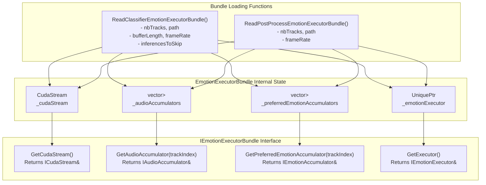

**Sources:** [audio2emotion-sdk/include/audio2emotion/parse_helper.h:118-149](), [audio2emotion-sdk/include/audio2emotion/internal/parse_helper.h:129-164](), [audio2emotion-sdk/source/audio2emotion/audio2emotion.cpp:303-331]()

### Bundle Creation Process

Both bundle loading functions follow the same initialization pattern:

1. **Parse model.json file** using `IEmotionModelInfo` readers
2. **Create CUDA stream** for GPU operations
3. **Create audio accumulators** (one per track)
4. **Create preferred emotion accumulators** (one per track)
5. **Create executor** using parsed model information
6. **Initialize executor** with created resources

The bundle takes ownership of all resources and manages their lifecycle. When `Destroy()` is called on the bundle, all contained resources are properly released.

**Sources:** [audio2emotion-sdk/source/audio2emotion-core/parse_helper.cpp]()

### Model Information Loading

The SDK provides helper functions to load model information from various file formats:

| Function | Input Files | Returns |
|----------|-------------|---------|
| `ReadClassifierNetworkInfo()` | network_info.json | `IClassifierModel::INetworkInfo*` |
| `ReadClassifierConfigInfo()` | model_config.json + emotion names | `IClassifierModel::IConfigInfo*` |
| `ReadClassifierModelInfo()` | model.json (combined) | `IClassifierModel::IEmotionModelInfo*` |
| `ReadClassifierModelInfo()` | network_info.json + network.engine + model_config.json | `IClassifierModel::IEmotionModelInfo*` |
| `ReadPostProcessNetworkInfo()` | network_info.json | `IPostProcessModel::INetworkInfo*` |
| `ReadPostProcessConfigInfo()` | model_config.json + emotion names | `IPostProcessModel::IConfigInfo*` |
| `ReadPostProcessModelInfo()` | model.json (combined) | `IPostProcessModel::IEmotionModelInfo*` |
| `ReadPostProcessModelInfo()` | network_info.json + model_config.json | `IPostProcessModel::IEmotionModelInfo*` |

All returned pointers must be destroyed by calling `Destroy()` when no longer needed.

**Sources:** [audio2emotion-sdk/include/audio2emotion/audio2emotion.h:153-201](), [audio2emotion-sdk/source/audio2emotion/audio2emotion.cpp:263-301]()

---

## Emotion Binder Utility

The `IEmotionBinder` utility class provides automatic connection of executor outputs to emotion accumulators, simplifying integration when executor results need to be accumulated for downstream processing:

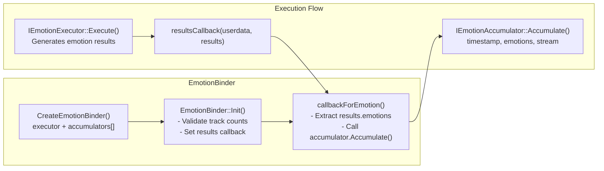

Usage example:
```cpp
// Create executor and accumulators
IEmotionExecutor* executor = CreateClassifierEmotionExecutor(params, classifierParams);
std::vector<IEmotionAccumulator*> accumulators = { /* ... */ };

// Bind executor outputs to accumulators
IEmotionBinder* binder = CreateEmotionBinder(*executor, accumulators.data(), accumulators.size());

// Execute - results automatically accumulated
executor->Execute();
```

**Sources:** [audio2emotion-sdk/include/audio2emotion/executor.h:62-72](), [audio2emotion-sdk/source/audio2emotion-core/executor.cpp:371-433](), [audio2emotion-sdk/include/audio2emotion/internal/executor.h:114-135]()

---

