<!-- source: DeepWiki mcp.deepwiki.com · repo NVIDIA/Audio2Face-3D-SDK · page 5.2 Multi-Track Post-Processing · fetched 2026-10-26 -->

# Multi-Track Post-Processing

Relevant source files

The following files were used as context for generating this wiki page:

- [audio2emotion-sdk/include/audio2emotion/internal/multitrack_postprocess.h](audio2emotion-sdk/include/audio2emotion/internal/multitrack_postprocess.h)
- [audio2emotion-sdk/include/audio2emotion/internal/multitrack_postprocess_cuda.h](audio2emotion-sdk/include/audio2emotion/internal/multitrack_postprocess_cuda.h)
- [audio2emotion-sdk/include/audio2emotion/internal/postprocess.h](audio2emotion-sdk/include/audio2emotion/internal/postprocess.h)
- [audio2emotion-sdk/include/audio2emotion/multitrack_postprocess.h](audio2emotion-sdk/include/audio2emotion/multitrack_postprocess.h)
- [audio2emotion-sdk/source/audio2emotion-core/multitrack_postprocess.cpp](audio2emotion-sdk/source/audio2emotion-core/multitrack_postprocess.cpp)
- [audio2emotion-sdk/tests/test_core_batch_post_processor.cpp](audio2emotion-sdk/tests/test_core_batch_post_processor.cpp)
- [audio2emotion-sdk/tests/test_core_batch_post_processor_cuda.h](audio2emotion-sdk/tests/test_core_batch_post_processor_cuda.h)

## Purpose and Scope

The Multi-Track Post-Processing system provides GPU-accelerated batch processing of emotion data across multiple audio tracks simultaneously. It transforms raw emotion classifications from neural network inference into refined, temporally smoothed emotion vectors suitable for downstream animation systems. The system supports processing 1-128 parallel tracks with optimized CUDA kernels.

For information about single-track CPU-based post-processing, see [Emotion Models and Executors](#5.1). For the overall emotion classification pipeline, see [Audio2Emotion SDK](#5).

**Sources:** [audio2emotion-sdk/include/audio2emotion/multitrack_postprocess.h:1-86](), [audio2emotion-sdk/include/audio2emotion/internal/multitrack_postprocess.h:1-88]()

## Architecture Overview

The multi-track post-processor is designed as a replacement for the single-track `IPostProcessor` that runs entirely on the GPU, eliminating CPU-GPU synchronization overhead during processing. The system uses strided tensor layouts to process multiple tracks in parallel with a single CUDA kernel launch.

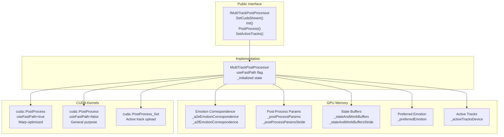

**Sources:** [audio2emotion-sdk/include/audio2emotion/multitrack_postprocess.h:28-82](), [audio2emotion-sdk/include/audio2emotion/internal/multitrack_postprocess.h:30-82](), [audio2emotion-sdk/source/audio2emotion-core/multitrack_postprocess.cpp:36-171]()

## Post-Processing Pipeline

The post-processing pipeline applies a sequence of operations to transform raw inference emotions into refined output emotions. Each operation is performed on the GPU for all active tracks simultaneously.

### Operation Sequence

```mermaid
graph LR
    Input["Input Emotions<br/>Inference Space<br/>inferenceEmotionLength"]
    
    Map["Emotion Mapping<br/>a2eEmotionCorrespondence<br/>a2fEmotionCorrespondence"]
    
    Contrast["Emotion Contrast<br/>maxEmotions parameter<br/>Max-based selection"]
    
    Smooth["Temporal Smoothing<br/>liveBlendCoef<br/>Blend with prevEmotion"]
    
    Blend["Preferred Blending<br/>preferredEmotionStrength<br/>User-defined targets"]
    
    Transition["Live Transition<br/>liveTransitionTime<br/>Smooth activation"]
    
    Output["Output Emotions<br/>Output Space<br/>outputEmotionLength"]
    
    Input --> Map
    Map --> Contrast
    Contrast --> Smooth
    Smooth --> Blend
    Blend --> Transition
    Transition --> Output
```

**Sources:** [audio2emotion-sdk/tests/test_core_batch_post_processor.cpp:281-393](), Diagram 6 from high-level architecture

### Post-Processing Parameters

The `PostProcessParams` structure controls the behavior of each operation. Parameters are packed into GPU memory with a stride of `8 + outputEmotionLength` floats per track.

| Parameter | Type | Purpose | GPU Offset |
|-----------|------|---------|------------|
| `maxEmotions` | uint32 (as float) | Number of emotions to retain during contrast | 0 |
| `emotionContrast` | float | Strength of contrast enhancement | 1 |
| `liveBlendCoef` | float | Temporal smoothing coefficient | 2 |
| `enablePreferredEmotion` | float (0/1) | Enable preferred emotion blending | 3 |
| `preferredEmotionStrength` | float | Strength of preferred emotion influence | 4 |
| `liveTransitionTime` | float | Duration of live transition effect | 5 |
| `fixedDt` | float | Fixed time delta for processing | 6 |
| `emotionStrength` | float | Overall emotion intensity multiplier | 7 |
| `beginningEmotion` | float[] | Initial emotion state | 8 to 8+outputEmotionLength |

**Sources:** [audio2emotion-sdk/source/audio2emotion-core/multitrack_postprocess.cpp:314-381](), [audio2emotion-sdk/tests/test_core_batch_post_processor.cpp:317-343]()

### Emotion Correspondence Mapping

The system maintains bidirectional correspondence between inference emotion space (a2e) and output emotion space (a2f):

- **a2eEmotionCorrespondence**: Maps from inference emotions (e.g., 12 dimensions) to output emotions (e.g., 10 dimensions). Index by inference emotion, value is output emotion index or -1 for unmapped.
- **a2fEmotionCorrespondence**: Reverse mapping from output emotions to inference emotions. Used by GPU local memory optimization.

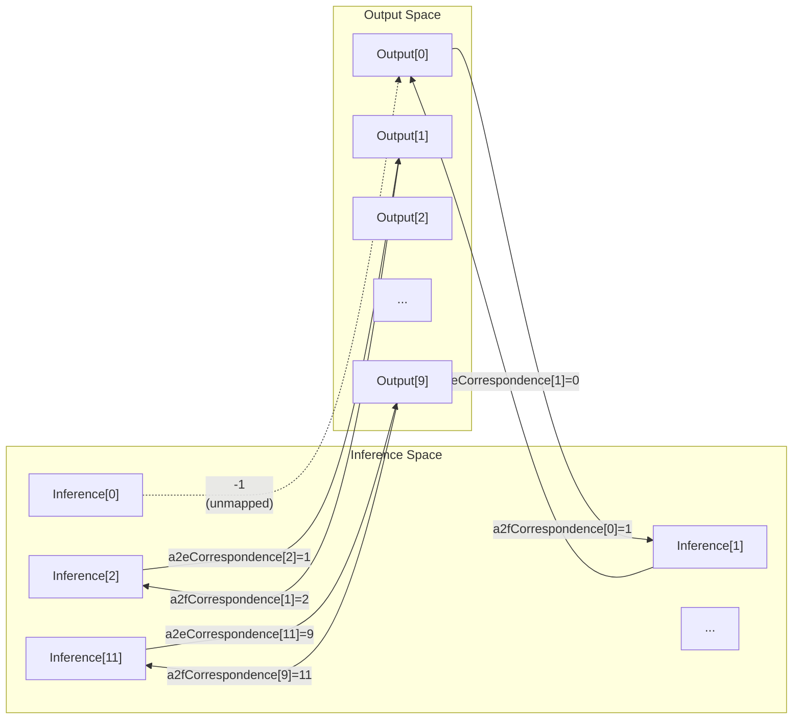

**Sources:** [audio2emotion-sdk/source/audio2emotion-core/multitrack_postprocess.cpp:129-148](), [audio2emotion-sdk/tests/test_core_batch_post_processor.cpp:474-495]()

## GPU Optimization Strategies

The system implements multiple GPU kernel variants optimized for different hardware characteristics and workload sizes. The implementation automatically selects the "fast path" when warp size is 32.

### Fast Path vs. Slow Path

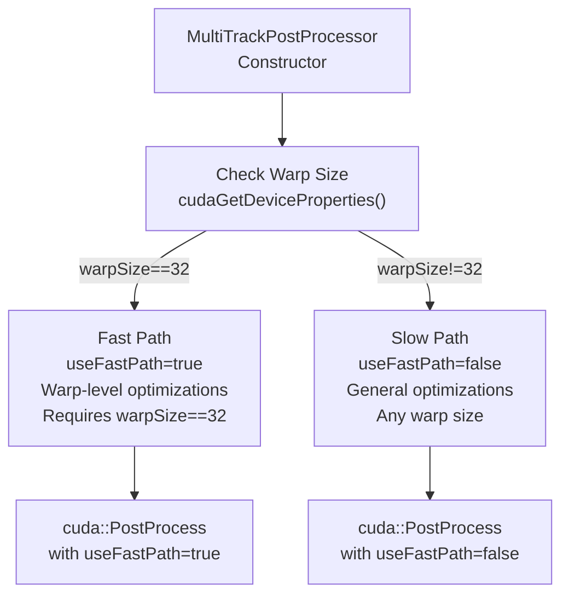

**Sources:** [audio2emotion-sdk/source/audio2emotion-core/multitrack_postprocess.cpp:45-58](), [audio2emotion-sdk/include/audio2emotion/internal/multitrack_postprocess_cuda.h:30-48]()

### GPU Kernel Variants

The test suite implements three experimental GPU kernel variants to evaluate different memory access patterns:

| Variant | Memory Strategy | Shared Memory Usage | Local Memory Usage | Performance Characteristics |
|---------|----------------|---------------------|-------------------|---------------------------|
| **GPU** | Global memory only | None | None | Baseline implementation |
| **GPU Shared** | Shared memory cache | a2eEmotionCorrespondence | None | Reduces global memory reads for correspondence |
| **GPU Local** | Register-heavy | a2eEmotionCorrespondence | Output buffers | Maximizes register usage, minimal global access |

The final production implementation (`MultiTrackPostProcessor`) uses the "local memory" strategy combined with fast/slow path selection based on warp size.

**Sources:** [audio2emotion-sdk/tests/test_core_batch_post_processor.cpp:284-524](), [audio2emotion-sdk/tests/test_core_batch_post_processor_cuda.h:30-61]()

### Memory Access Patterns

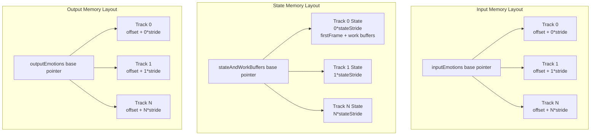

**Sources:** [audio2emotion-sdk/source/audio2emotion-core/multitrack_postprocess.cpp:217-286](), [audio2emotion-sdk/include/audio2emotion/multitrack_postprocess.h:60-63]()

## State Management

Each track maintains independent state across frames to support temporal smoothing and live transitions. State is stored in GPU device memory with strided layout.

### Per-Track State Buffers

The `_stateAndWorkBuffers` tensor contains the following data per track with stride `1 + inferenceEmotionLength + outputEmotionLength * 3`:

| Component | Size | Purpose |
|-----------|------|---------|
| `firstFrame` | 1 float | Flag indicating if this is the first frame (1.0) or not (0.0) |
| `a2e work buffer` | inferenceEmotionLength | Temporary storage for inference emotion mapping |
| `a2f work buffer` | outputEmotionLength | Temporary storage during output emotion processing |
| `prevEmotion` | outputEmotionLength | Post-processed emotion from previous frame |
| `prevBlendedEmotion` | outputEmotionLength | Emotion after preferred blending from previous frame |

**Sources:** [audio2emotion-sdk/source/audio2emotion-core/multitrack_postprocess.cpp:150-164](), [audio2emotion-sdk/include/audio2emotion/internal/postprocess.h:62-68]()

### Active Track Masking

The system supports selectively processing only active tracks using a bitmask. This avoids updating state for tracks that are not currently in use.

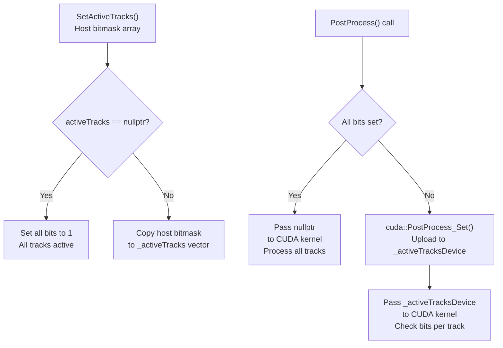

**Sources:** [audio2emotion-sdk/source/audio2emotion-core/multitrack_postprocess.cpp:203-267](), [audio2emotion-sdk/include/audio2emotion/internal/multitrack_postprocess.h:65-70]()

## API Usage Patterns

### Initialization

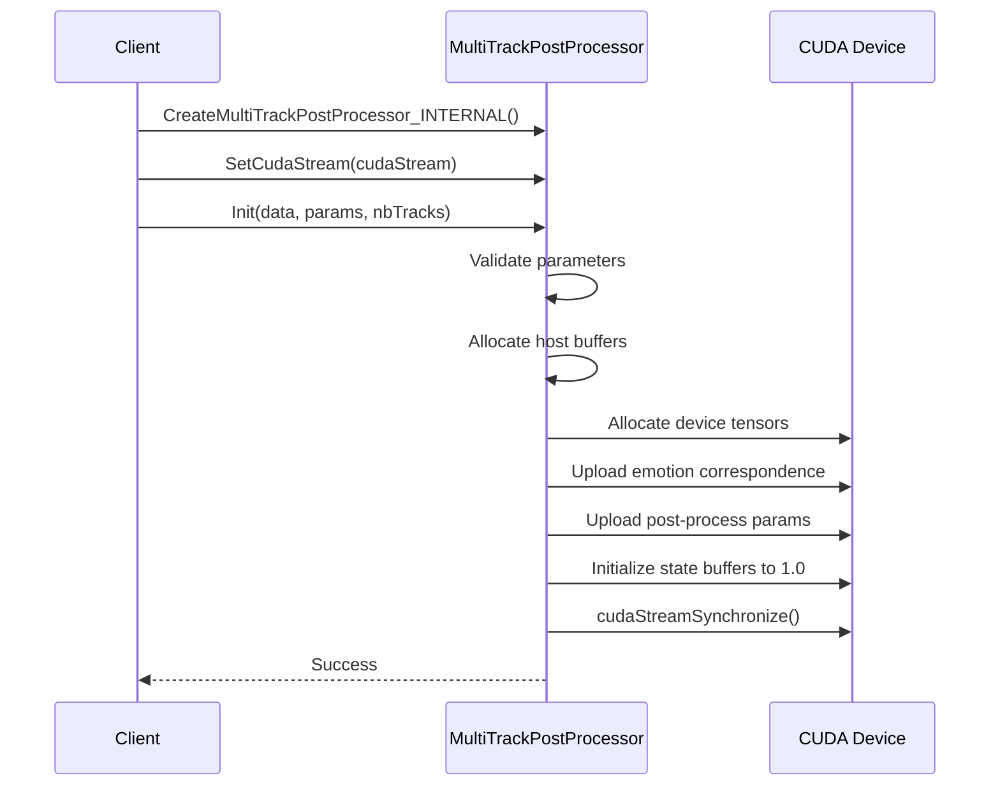

**Sources:** [audio2emotion-sdk/source/audio2emotion-core/multitrack_postprocess.cpp:45-171]()

### Per-Frame Processing

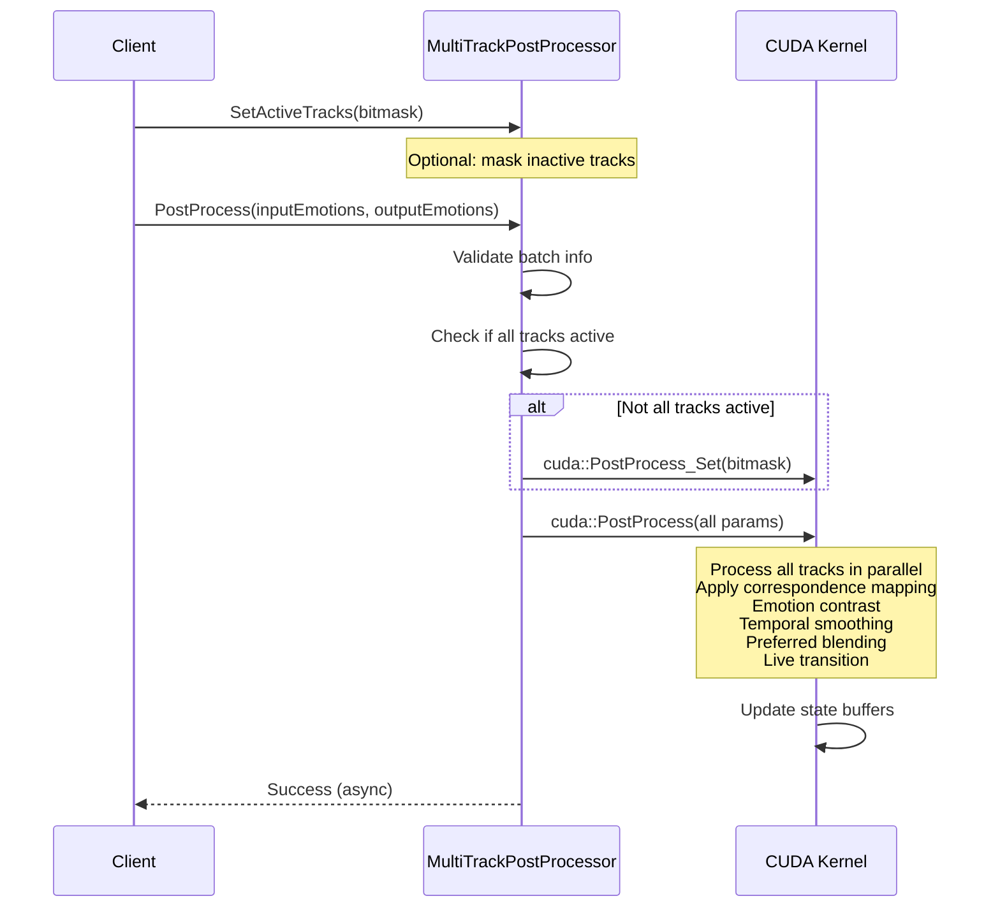

**Sources:** [audio2emotion-sdk/source/audio2emotion-core/multitrack_postprocess.cpp:217-286]()

### Per-Track Parameter Updates

Individual track parameters can be updated without recreating the entire post-processor:

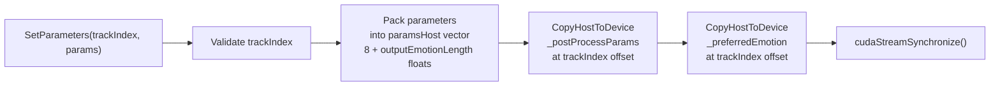

**Sources:** [audio2emotion-sdk/source/audio2emotion-core/multitrack_postprocess.cpp:173-382]()

## Integration with Emotion Executors

The multi-track post-processor is used by both batch and interactive emotion executors to transform classifier output into final emotion vectors.

### Executor Integration

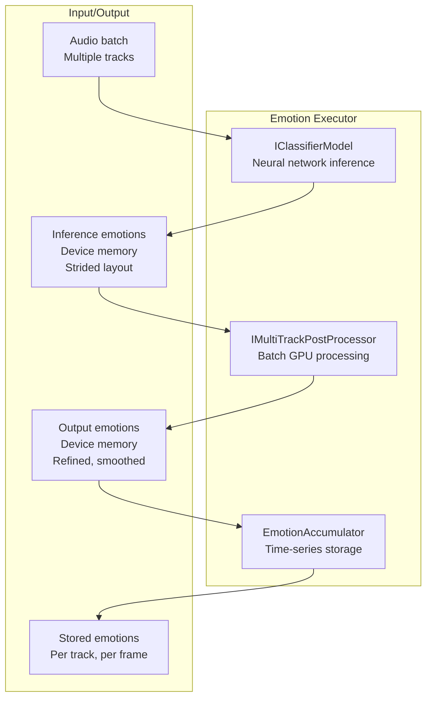

**Sources:** [audio2emotion-sdk/tests/test_core_batch_post_processor.cpp:45-129](), Diagram 6 from high-level architecture

## Performance Characteristics

### Batch Size Scaling

The system is designed to efficiently process multiple tracks in parallel. Performance characteristics from the test benchmarks:

| Number of Tracks | Batch Parallelism | Memory Coalescing | Typical Use Case |
|------------------|-------------------|-------------------|------------------|
| 1 | Minimal | Poor | Single character animation |
| 8 | Good | Moderate | Small crowd scenes |
| 16 | Optimal | Good | Medium crowd scenes |
| 128 | Maximum | Excellent | Large-scale batch processing |

The GPU kernels achieve best performance with 16+ tracks due to improved GPU occupancy and memory coalescing across the wider batch.

**Sources:** [audio2emotion-sdk/tests/test_core_batch_post_processor.cpp:706-814]()

### Memory Bandwidth Optimization

The strided tensor layout enables coalesced memory access patterns:

- **Input emotions**: Read once per track, coalesced across batch
- **Emotion correspondence**: Read from shared memory or cached in registers
- **State buffers**: Read-modify-write pattern, coalesced per track
- **Output emotions**: Write once per track, coalesced across batch

**Sources:** [audio2emotion-sdk/include/audio2emotion/internal/multitrack_postprocess_cuda.h:37-48](), [audio2emotion-sdk/tests/test_core_batch_post_processor_cuda.h:30-61]()

## Reference Implementation Comparison

The test suite includes a reference implementation using the single-track `PostProcessor` to validate correctness:

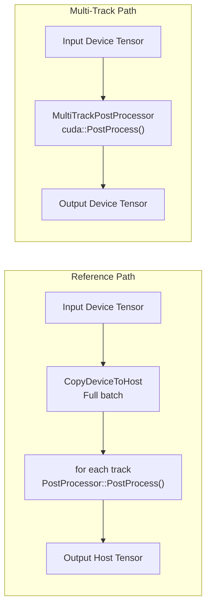

The test validates that GPU results match CPU reference within floating-point precision (using `ASSERT_FLOAT_EQ` for element-wise comparison).

**Sources:** [audio2emotion-sdk/tests/test_core_batch_post_processor.cpp:67-124](), [audio2emotion-sdk/tests/test_core_batch_post_processor.cpp:634-704]()

---

