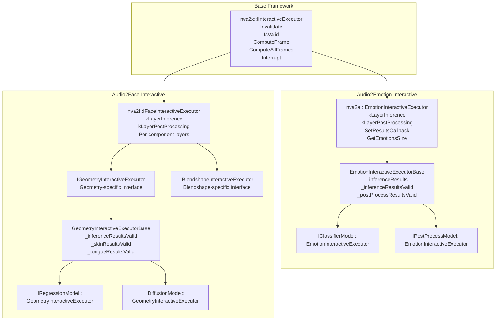
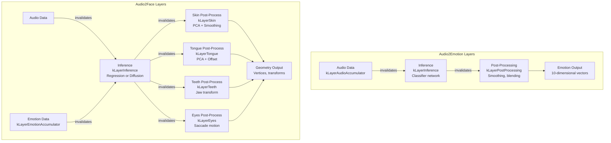
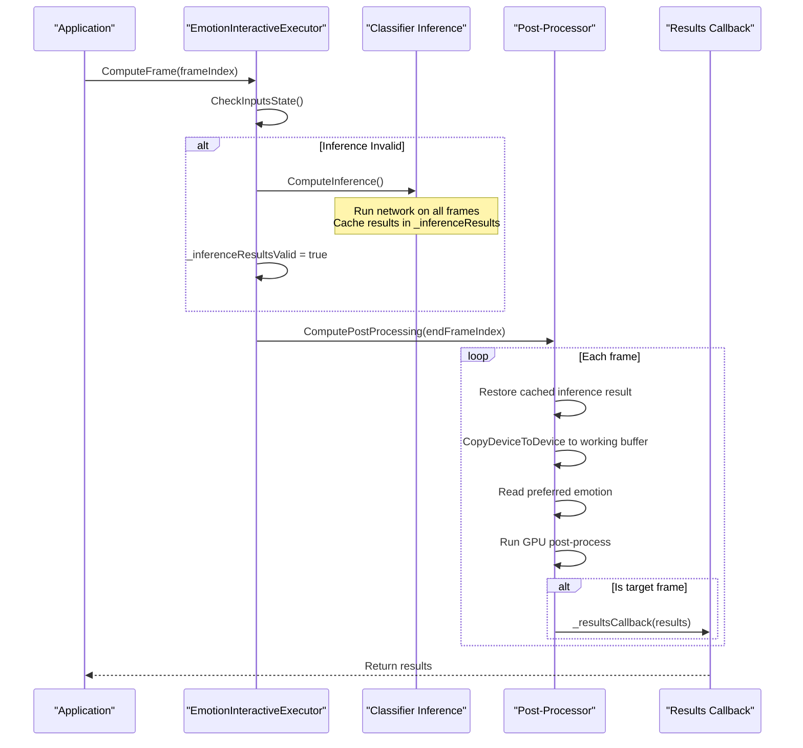

<!-- source: DeepWiki mcp.deepwiki.com · repo NVIDIA/Audio2Face-3D-SDK · page 6 Interactive Execution · fetched 2026-10-26 -->

# Interactive Execution

<details>
<summary>Relevant source files</summary>

The following files were used as context for generating this wiki page:

- [audio2emotion-sdk/include/audio2emotion/executor.h](audio2emotion-sdk/include/audio2emotion/executor.h)
- [audio2emotion-sdk/include/audio2emotion/interactive_executor.h](audio2emotion-sdk/include/audio2emotion/interactive_executor.h)
- [audio2emotion-sdk/include/audio2emotion/internal/interactive_executor.h](audio2emotion-sdk/include/audio2emotion/internal/interactive_executor.h)
- [audio2emotion-sdk/include/audio2emotion/internal/interactive_executor_classifier.h](audio2emotion-sdk/include/audio2emotion/internal/interactive_executor_classifier.h)
- [audio2emotion-sdk/source/audio2emotion-core/interactive_executor.cpp](audio2emotion-sdk/source/audio2emotion-core/interactive_executor.cpp)
- [audio2face-sdk/source/audio2face-core/executor.cpp](audio2face-sdk/source/audio2face-core/executor.cpp)
- [audio2face-sdk/source/audio2face-core/interactive_executor_diffusion.cpp](audio2face-sdk/source/audio2face-core/interactive_executor_diffusion.cpp)
- [audio2face-sdk/source/audio2face/audio2face.cpp](audio2face-sdk/source/audio2face/audio2face.cpp)
- [audio2face-sdk/source/benchmarks/utils.h](audio2face-sdk/source/benchmarks/utils.h)
- [audio2face-sdk/tests/test_core_executor.cpp](audio2face-sdk/tests/test_core_executor.cpp)

</details>


## Purpose and Scope

Interactive Execution provides frame-specific computation capabilities for both audio-driven emotion classification and facial animation generation. Unlike batch execution mode (covered in [page 3](#3.3)), interactive executors allow applications to compute individual frames on demand, modify processing parameters between computations, and efficiently recompute results when parameters change. This system is essential for real-time preview, timeline scrubbing, and parameter tuning workflows in content creation tools.

For batch/streaming execution patterns, see [Execution Framework](#3.3). For multi-track batch processing optimizations, see [Multi-Track Batch Processing](#7).

---

## Architecture Overview

The interactive execution system extends the base executor framework with invalidation tracking and result caching. Both Audio2Emotion and Audio2Face provide interactive executor variants that share a common invalidation pattern.

### Interactive Executor Class Hierarchy



**Sources:** [audio2emotion-sdk/include/audio2emotion/interactive_executor.h:1-55](), [audio2emotion-sdk/include/audio2emotion/internal/interactive_executor.h:60-125](), [audio2face-sdk/include/audio2face/interactive_executor.h:1-150]()

---

## Interactive Executor Interfaces

### Core Interface Methods

All interactive executors implement the `nva2x::IInteractiveExecutor` interface, which defines the fundamental operations:

| Method | Purpose | Return Value |
|--------|---------|--------------|
| `Invalidate(invalidation_layer_t)` | Mark specific computation layers as needing recomputation | `std::error_code` |
| `IsValid(invalidation_layer_t)` | Check if specific layers have valid cached results | `bool` |
| `ComputeFrame(std::size_t frameIndex)` | Compute a single frame by index | `std::error_code` |
| `ComputeAllFrames()` | Compute all frames sequentially | `std::error_code` |
| `Interrupt()` | Stop ongoing computation | `std::error_code` |
| `GetTotalNbFrames()` | Query total frame count for closed accumulators | `std::size_t` |
| `GetFrameTimestamp(std::size_t)` | Get audio timestamp for a frame index | `timestamp_t` |

**Sources:** [audio2x-common/include/audio2x/interactive_executor.h:1-70]()

### Emotion-Specific Extensions

The `IEmotionInteractiveExecutor` adds emotion classification capabilities:

```cpp
// audio2emotion-sdk/include/audio2emotion/interactive_executor.h
class IEmotionInteractiveExecutor : public nva2x::IInteractiveExecutor {
public:
    static constexpr const invalidation_layer_t kLayerInference = 2;
    static constexpr const invalidation_layer_t kLayerPostProcessing = 3;
    
    using Results = IEmotionExecutor::Results;
    using results_callback_t = IEmotionExecutor::results_callback_t;
    
    virtual std::error_code SetResultsCallback(results_callback_t callback, void* userdata) = 0;
    virtual std::size_t GetEmotionsSize() const = 0;
};
```

**Sources:** [audio2emotion-sdk/include/audio2emotion/interactive_executor.h:29-54]()

### Geometry-Specific Extensions

The `IFaceInteractiveExecutor` provides facial animation capabilities with per-component layer tracking:

| Layer Constant | Value | Affects |
|----------------|-------|---------|
| `kLayerInference` | 2 | Neural network inference |
| `kLayerPostProcessing` | 3 | All post-processing |
| `kLayerSkin` | 4 | Skin animation only |
| `kLayerTongue` | 5 | Tongue animation only |
| `kLayerTeeth` | 6 | Teeth/jaw animation only |
| `kLayerEyes` | 7 | Eye animation only |

**Sources:** [audio2face-sdk/include/audio2face/interactive_executor.h:29-65]()

---

## Layer-Based Invalidation System

The invalidation system tracks which computation stages contain valid cached results. When parameters change, only affected layers are marked invalid, avoiding unnecessary recomputation.

### Invalidation Layer Relationships



**Sources:** [audio2emotion-sdk/include/audio2emotion/interactive_executor.h:32-38](), [audio2face-sdk/include/audio2face/interactive_executor.h:32-56]()

### Invalidation Behavior

The `Invalidate()` method implements a cascading invalidation pattern:

```cpp
// audio2emotion-sdk/source/audio2emotion-core/interactive_executor.cpp:33-50
std::error_code EmotionInteractiveExecutorBase::Invalidate(invalidation_layer_t layer) {
    switch (layer) {
        case kLayerNone:
            break;
        case kLayerAll:
            [[fallthrough]];
        case kLayerInference:
            _inferenceResultsValid = false;
            _postProcessResultsValid = false;  // Inference invalidates post-processing
            break;
        case kLayerPostProcessing:
            _postProcessResultsValid = false;
            break;
        default:
            return nva2x::ErrorCode::eInvalidValue;
    }
    return nva2x::ErrorCode::eSuccess;
}
```

When inference is invalidated, all downstream post-processing is automatically invalidated. However, post-processing can be invalidated independently without affecting inference.

**Sources:** [audio2emotion-sdk/source/audio2emotion-core/interactive_executor.cpp:33-50]()

---

## Audio2Emotion Interactive Execution

### Inference Result Caching

The emotion interactive executor caches inference results in device memory, storing one emotion vector per frame:

```cpp
// audio2emotion-sdk/include/audio2emotion/internal/interactive_executor.h:117-119
nva2x::DeviceTensorFloat _inferenceResults;
bool _inferenceResultsValid{false};
bool _postProcessResultsValid{false};
```

**Sources:** [audio2emotion-sdk/include/audio2emotion/internal/interactive_executor.h:117-119]()

### ComputeFrame Workflow



**Sources:** [audio2emotion-sdk/source/audio2emotion-core/interactive_executor.cpp:98-138]()

### Parameter Modification Pattern

When modifying post-processing parameters, the system automatically invalidates only the affected layer:

```cpp
// audio2emotion-sdk/source/audio2emotion-core/interactive_executor.cpp:177-184
std::error_code EmotionInteractiveExecutorBase::Set(const PostProcessParams& params) {
    const auto* postProcessParams = GetCore().GetPostProcessor().GetParameters(0);
    A2E_CHECK_ERROR_WITH_MSG(postProcessParams, "...", nva2x::ErrorCode::eNullPointer);
    if (!AreEqual_INTERNAL(*postProcessParams, params)) {
        A2E_CHECK_RESULT_WITH_MSG(Invalidate(kLayerPostProcessing), "...");
    }
    return GetCore().GetPostProcessor().SetParameters(0, params);
}
```

This allows rapid parameter tuning without recomputing the neural network inference.

**Sources:** [audio2emotion-sdk/source/audio2emotion-core/interactive_executor.cpp:177-184](), [audio2emotion-sdk/source/audio2emotion-core/interactive_executor.cpp:162-168]()

---

## Audio2Face Interactive Execution

### Component-Level Invalidation

Audio2Face interactive executors track validity per facial component, enabling fine-grained recomputation:

```cpp
// audio2face-sdk/include/audio2face/internal/interactive_executor.h
bool _inferenceResultsValid{false};
bool _skinResultsValid{false};
bool _tongueResultsValid{false};
bool _teethResultsValid{false};
bool _eyesResultsValid{false};
```

**Sources:** [audio2face-sdk/include/audio2face/internal/interactive_executor.h:100-110]()

### Regression vs Diffusion Differences

| Aspect | Regression Model | Diffusion Model |
|--------|------------------|-----------------|
| **Inference Caching** | Caches PCA coefficients per frame | Caches GRU hidden state per inference window |
| **Frame Computation** | Direct frame-to-frame mapping | Must rerun inference from checkpoint |
| **Preview Mode** | Not applicable | Configurable `nbInferencesForPreview` |
| **State Management** | Stateless | Stateful (GRU state restoration) |

**Sources:** [audio2face-sdk/source/audio2face-core/interactive_executor_regression.cpp:1-400](), [audio2face-sdk/source/audio2face-core/interactive_executor_diffusion.cpp:1-550]()

### Diffusion Model Interactive Execution

The diffusion model requires special handling because it is stateful (uses GRU networks). When computing a single frame:

```cpp
// audio2face-sdk/source/audio2face-core/interactive_executor_diffusion.cpp:47-193
std::error_code GeometryInteractiveExecutor::ComputeFrame(std::size_t frameIndex) {
    const std::size_t targetInference = (frameIndex + _nbFramesBeforeAudio) / _nbFramesPerInference;
    const std::size_t targetFrameIndex = (frameIndex + _nbFramesBeforeAudio) % _nbFramesPerInference;
    
    std::size_t startInference;
    if (_inferenceResultsValid) {
        if (progress.GetReadWindowCount() == targetInference + 1) {
            startInference = endInference;  // Already have correct state
        } else {
            startInference = targetInference;  // Run one inference
            // Restore GRU state from cache
            const auto destination = _core.GetInferenceStateBuffers().GetInputGRUStateTensor();
            const auto source = _inferenceResults.View(startInference * destination.Size(), ...);
            CopyDeviceToDevice(destination, source, _core.GetCudaStream());
        }
    } else {
        if (_nbInferencesForPreview == 0) {
            startInference = 0;  // Full accuracy: start from beginning
        } else {
            // Preview mode: go back limited number of inferences
            startInference = endInference - std::min(endInference, _nbInferencesForPreview);
        }
        _core.GetInferenceStateBuffers().Reset(0);
    }
    
    // Run inferences from startInference to endInference
    // ...
}
```

The `nbInferencesForPreview` parameter controls the quality vs speed tradeoff:
- **0**: Always compute from the beginning (exact results, slower)
- **N > 0**: Recompute only the last N inferences (approximate results, faster)

**Sources:** [audio2face-sdk/source/audio2face-core/interactive_executor_diffusion.cpp:47-193]()

### ComputeAllFrames Optimization

When computing all frames, the diffusion executor caches GRU states for each inference window:

```cpp
// audio2face-sdk/source/audio2face-core/interactive_executor_diffusion.cpp:195-304
std::error_code GeometryInteractiveExecutor::ComputeAllFrames() {
    const auto gruSize = _core.GetInferenceStateBuffers().GetInputGRUStateTensor().Size();
    _inferenceResults.Allocate(nbTotalInferences * gruSize);
    
    for (std::size_t inferenceIndex = 0; inferenceIndex < nbTotalInferences; ++inferenceIndex) {
        // Run inference
        RunInference();
        
        // Copy GRU state to cache
        const auto source = _core.GetInferenceStateBuffers().GetInputGRUStateTensor();
        const auto destination = _inferenceResults.View(inferenceIndex * source.Size(), ...);
        CopyDeviceToDevice(destination, source, _core.GetCudaStream());
        
        // Swap state buffers for next iteration
        _core.GetInferenceStateBuffers().Swap();
    }
    
    _inferenceResultsValid = true;
}
```

After this operation, subsequent `ComputeFrame()` calls can restore the GRU state from the cache without rerunning earlier inferences.

**Sources:** [audio2face-sdk/source/audio2face-core/interactive_executor_diffusion.cpp:195-304]()

---

## Caching and Performance Optimization

### Memory Layout

Interactive executors allocate contiguous device memory for cached results:

| Executor Type | Cache Content | Size Formula |
|---------------|---------------|--------------|
| **Emotion Classifier** | Emotion vectors (per frame) | `nbFrames × emotionSize × sizeof(float)` |
| **Regression Geometry** | PCA coefficients (per frame) | `nbFrames × (skinCoeffs + tongueCoeffs + ...) × sizeof(float)` |
| **Diffusion Geometry** | GRU hidden states (per inference) | `nbInferences × gruStateSize × sizeof(float)` |

**Sources:** [audio2emotion-sdk/source/audio2emotion-core/interactive_executor_classifier.cpp:50-80](), [audio2face-sdk/source/audio2face-core/interactive_executor_diffusion.cpp:219-223]()

### Stateless Scope Pattern

Audio2Face uses a `StatelessScope` RAII class to temporarily disable animation state (e.g., skin smoothing) when computing individual frames:

```cpp
// Usage in interactive executor
StatelessScope statelessScope(_core);
const bool canReusePreviousCompute = _currentFrameIndex == frameIndex;
ComputePostProcessing(targetFrameIndex, targetFrameIndex + 1, canReusePreviousCompute);
```

This ensures frame-to-frame computation is deterministic and doesn't depend on previously computed frames' side effects.

**Sources:** [audio2face-sdk/source/audio2face-core/interactive_executor_diffusion.cpp:186-188](), [audio2face-sdk/source/audio2face-core/interactive_executor_regression.cpp:140-145]()

### Reuse Detection

Interactive executors detect when the same frame is computed multiple times and skip unnecessary work:

```cpp
// audio2face-sdk/source/audio2face-core/interactive_executor_diffusion.cpp:187-188
const bool canReusePreviousCompute = _currentFrameIndex == frameIndex;
ComputePostProcessing(targetFrameIndex, targetFrameIndex + 1, canReusePreviousCompute);
```

When `canReusePreviousCompute` is true, the post-processing stage can skip recomputing components whose validity flags are still set.

**Sources:** [audio2face-sdk/source/audio2face-core/interactive_executor_diffusion.cpp:186-188](), [audio2face-sdk/source/audio2face-core/interactive_executor_diffusion.cpp:380-401]()

---

## Usage Patterns

### Pattern 1: Timeline Scrubbing

```cpp
// Initialize interactive executor
auto executor = CreateRegressionGeometryInteractiveExecutor(...);
executor->SetResultsCallback(myCallback, userdata);

// Compute all frames once to populate cache
executor->ComputeAllFrames();  // _inferenceResultsValid = true

// Scrub to different frame indices - only post-processing runs
executor->ComputeFrame(100);   // Fast: inference cached
executor->ComputeFrame(50);    // Fast: inference cached
executor->ComputeFrame(200);   // Fast: inference cached
```

### Pattern 2: Parameter Tuning

```cpp
// After ComputeAllFrames(), modify post-processing parameters
AnimatorSkinParams skinParams;
executor->Get(skinParams);
skinParams.smoothingCoeffUpper = 0.002f;
executor->Set(skinParams);  // Invalidates kLayerSkin only

// Recompute frame - only skin post-processing runs
executor->ComputeFrame(currentFrameIndex);  // Inference still cached
```

### Pattern 3: Progressive Preview (Diffusion)

```cpp
// Create with preview mode enabled
auto executor = CreateDiffusionGeometryInteractiveExecutor(
    params, diffusionParams, 
    5  // nbInferencesForPreview: go back 5 inferences for preview
);

// First frame: computes from beginning
executor->ComputeFrame(0);

// Jump to frame 100: only recomputes last 5 inferences (approximate)
executor->ComputeFrame(100);  // Faster than full recompute

// Get exact result by computing all frames
executor->ComputeAllFrames();  // Populates full cache
executor->ComputeFrame(100);   // Now exact result
```

### Pattern 4: Interruption Handling

```cpp
// Start long-running computation
std::thread computeThread([executor]() {
    executor->ComputeAllFrames();
});

// User requests cancellation
executor->Interrupt();

// Wait for clean shutdown
computeThread.join();
```

**Sources:** [audio2face-sdk/tests/test_core_executor.cpp:234-607]()

---

## Accessor Pattern for Parameter Access

Both audio2emotion and audio2face use an accessor pattern to safely expose parameter getters/setters across DLL boundaries:

```cpp
// audio2face-sdk/source/audio2face-core/executor.cpp:337-354
template <typename AccessorType, typename... Args>
std::error_code GetExecutorParameters(const nva2f::IFaceExecutor& executor, 
                                       std::size_t trackIndex, Args&&... params) {
    const auto accessor = dynamic_cast<const AccessorType*>(&executor);
    if (!accessor) { return nva2x::ErrorCode::eUnsupported; }
    return accessor->Get(trackIndex, std::forward<Args>(params)...);
}

template <typename AccessorType, typename... Args>
std::error_code SetExecutorParameters(nva2f::IFaceExecutor& executor, 
                                       std::size_t trackIndex, Args&&... params) {
    A2F_CHECK_ERROR_WITH_MSG(
        !executor.HasExecutionStarted(trackIndex),
        "Parameters can only be set before execution is started",
        nva2x::ErrorCode::eExecutionAlreadyStarted
    );
    const auto accessor = dynamic_cast<AccessorType*>(&executor);
    if (!accessor) { return nva2x::ErrorCode::eUnsupported; }
    return accessor->Set(trackIndex, std::forward<Args>(params)...);
}
```

This allows the public API to safely query and modify executor-specific parameters through dedicated accessor interfaces.

**Sources:** [audio2face-sdk/source/audio2face-core/executor.cpp:331-462](), [audio2emotion-sdk/source/audio2emotion-core/interactive_executor.cpp:322-386]()

---

## Creation Functions

### Audio2Emotion Interactive Executors

| Function | Model Type | Purpose |
|----------|------------|---------|
| `CreateClassifierEmotionInteractiveExecutor` | Classifier | Inference + post-processing |
| `CreatePostProcessEmotionInteractiveExecutor` | Post-process only | No inference, only parameter tuning |

**Sources:** [audio2emotion-sdk/include/audio2emotion/internal/interactive_executor_classifier.h:59-63]()

### Audio2Face Interactive Executors

| Function | Model Type | Parameters |
|----------|------------|------------|
| `CreateRegressionGeometryInteractiveExecutor` | Regression | `batchSize` - frames per inference batch |
| `CreateDiffusionGeometryInteractiveExecutor` | Diffusion | `nbInferencesForPreview` - preview quality control |
| `CreateHostBlendshapeSolveInteractiveExecutor` | CPU solver | Host parameters |
| `CreateDeviceBlendshapeSolveInteractiveExecutor` | GPU solver | Device parameters |

**Sources:** [audio2face-sdk/include/audio2face/internal/interactive_executor.h:1-200](), [audio2face-sdk/source/audio2face/audio2face.cpp:792-820]()

---

