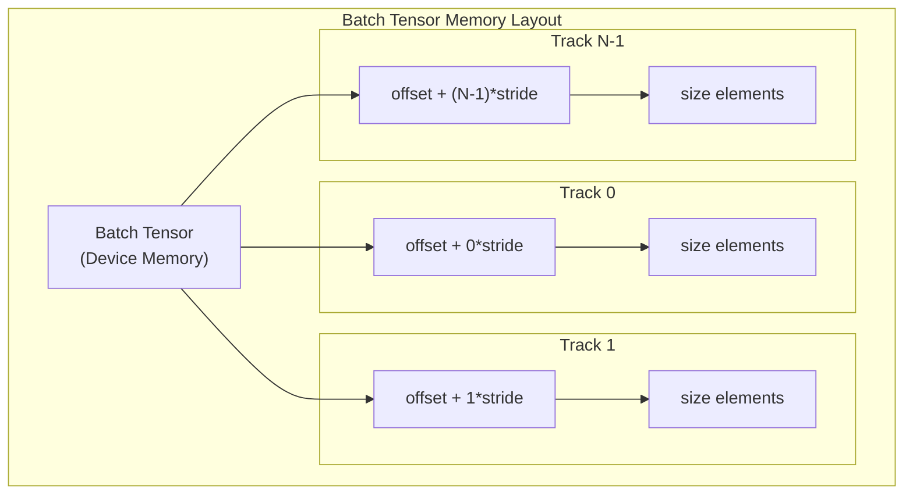
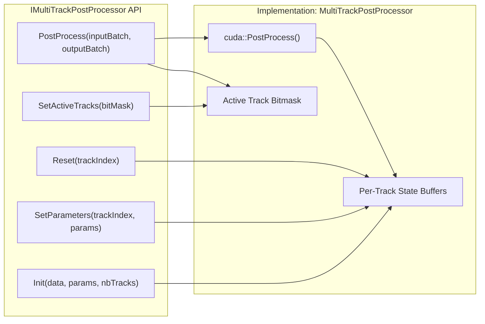
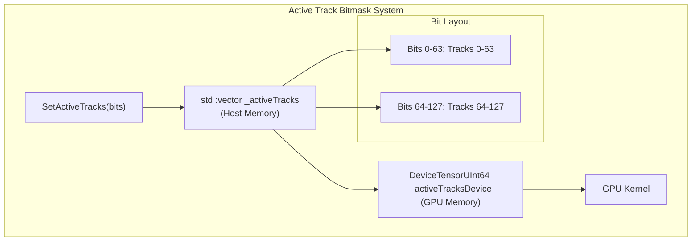
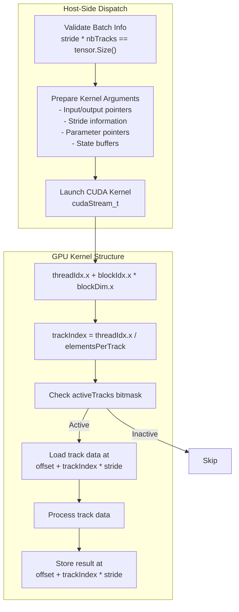
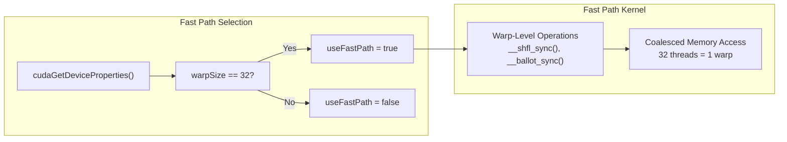
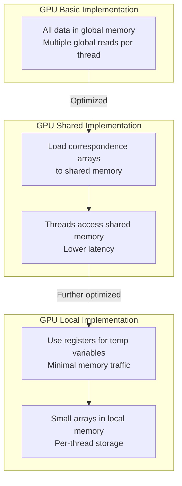
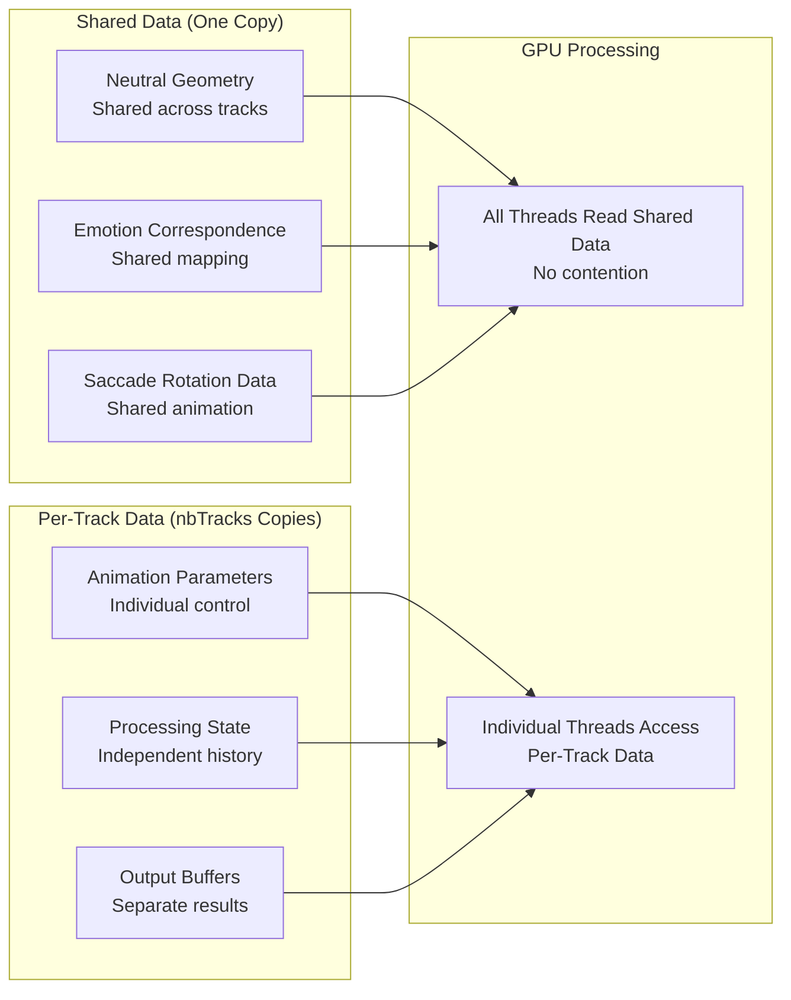

<!-- source: DeepWiki mcp.deepwiki.com · repo NVIDIA/Audio2Face-3D-SDK · page 7 Multi-Track Batch Processing · fetched 2026-10-26 -->

# Multi-Track Batch Processing

<details>
<summary>Relevant source files</summary>

The following files were used as context for generating this wiki page:

- [audio2emotion-sdk/include/audio2emotion/internal/multitrack_postprocess.h](audio2emotion-sdk/include/audio2emotion/internal/multitrack_postprocess.h)
- [audio2emotion-sdk/include/audio2emotion/internal/multitrack_postprocess_cuda.h](audio2emotion-sdk/include/audio2emotion/internal/multitrack_postprocess_cuda.h)
- [audio2emotion-sdk/include/audio2emotion/internal/postprocess.h](audio2emotion-sdk/include/audio2emotion/internal/postprocess.h)
- [audio2emotion-sdk/include/audio2emotion/multitrack_postprocess.h](audio2emotion-sdk/include/audio2emotion/multitrack_postprocess.h)
- [audio2emotion-sdk/source/audio2emotion-core/multitrack_postprocess.cpp](audio2emotion-sdk/source/audio2emotion-core/multitrack_postprocess.cpp)
- [audio2emotion-sdk/tests/test_core_batch_post_processor.cpp](audio2emotion-sdk/tests/test_core_batch_post_processor.cpp)
- [audio2emotion-sdk/tests/test_core_batch_post_processor_cuda.h](audio2emotion-sdk/tests/test_core_batch_post_processor_cuda.h)
- [audio2face-sdk/include/audio2face/animator.h](audio2face-sdk/include/audio2face/animator.h)
- [audio2face-sdk/include/audio2face/internal/animator.h](audio2face-sdk/include/audio2face/internal/animator.h)
- [audio2face-sdk/source/audio2face-core/animator.cpp](audio2face-sdk/source/audio2face-core/animator.cpp)
- [audio2face-sdk/tests/test_core_animator_eyes.cpp](audio2face-sdk/tests/test_core_animator_eyes.cpp)
- [audio2face-sdk/tests/test_core_batch_eyes_animator.cpp](audio2face-sdk/tests/test_core_batch_eyes_animator.cpp)
- [audio2face-sdk/tests/test_core_batch_tongue_animator.cpp](audio2face-sdk/tests/test_core_batch_tongue_animator.cpp)

</details>


## Purpose and Scope

Multi-track batch processing is the SDK's architecture for processing multiple audio tracks (1-128) simultaneously on the GPU. This system provides significant performance improvements over sequential single-track processing by leveraging GPU parallelism and reducing CPU-GPU synchronization overhead.

The multi-track system is implemented across both audio2emotion and audio2face modules:
- **Audio2Emotion**: Batch emotion classification and post-processing across tracks
- **Audio2Face**: Batch geometry animation (skin, tongue, teeth, eyes) across tracks

For single-track processing interfaces, see [Animator System](#4.2) and [Emotion Models and Executors](#5.1). For interactive execution patterns, see [Interactive Execution](#6).

**Sources:** [audio2emotion-sdk/include/audio2emotion/multitrack_postprocess.h:1-86](), [audio2face-sdk/tests/test_core_batch_tongue_animator.cpp:1-36]()

---

## Batch Memory Layout

Multi-track batch processing organizes data in strided memory layouts where each track's data is separated by a fixed stride. The `TensorBatchInfo` structure defines how to access individual track data within a batch tensor:

```cpp
struct TensorBatchInfo {
    std::size_t offset;  // Starting offset in the tensor
    std::size_t size;    // Size of data for one track
    std::size_t stride;  // Distance between consecutive tracks
};
```

### Memory Organization Pattern



**Diagram: Strided Memory Layout for Batch Tensors**

The total tensor size is `stride * nbTracks`, and individual track data is accessed at `offset + trackIndex * stride` with `size` elements. This layout enables efficient GPU coalesced memory access when processing tracks in parallel.

**Sources:** [audio2emotion-sdk/tests/test_core_batch_post_processor.cpp:558-627](), [audio2face-sdk/tests/test_core_batch_tongue_animator.cpp:479-521]()

---

## Multi-Track Interfaces

### Audio2Emotion Multi-Track Post-Processor

The `IMultiTrackPostProcessor` interface processes emotion data across multiple tracks on the GPU:



**Diagram: IMultiTrackPostProcessor Architecture**

The interface provides per-track parameter management and state isolation while processing all active tracks in a single GPU kernel call.

**Sources:** [audio2emotion-sdk/include/audio2emotion/multitrack_postprocess.h:28-86](), [audio2emotion-sdk/include/audio2emotion/internal/multitrack_postprocess.h:30-83]()

### Audio2Face Multi-Track Animators

Multi-track animator interfaces follow the same pattern for different facial components:

| Interface | Component | Key Methods |
|-----------|-----------|-------------|
| `IMultiTrackAnimatorSkin` | Facial skin | `Animate(inputDeltas, outputVertices)` |
| `IMultiTrackAnimatorTongue` | Tongue geometry | `Animate(inputDeltas, outputVertices)` |
| `IMultiTrackAnimatorTeeth` | Jaw transform | `ComputeJawTransform(results)` |
| `IMultiTrackAnimatorEyes` | Eye rotations | `ComputeEyesRotation(results)` |

All interfaces share common methods:
- `Init(params, nbTracks)` - Initialize with track count
- `SetAnimatorData(data)` - Load shared geometry data
- `SetParameters(trackIndex, params)` - Per-track parameter control
- `SetActiveTracks(bitMask)` - Mark active tracks
- `Reset(trackIndex)` - Reset individual track state

**Sources:** [audio2face-sdk/tests/test_core_batch_tongue_animator.cpp:40-127](), [audio2face-sdk/tests/test_core_batch_eyes_animator.cpp:40-54]()

---

## Active Track Management

The multi-track system uses a bitmask-based approach to track which of the 1-128 tracks are currently active. This allows processing to skip inactive tracks and avoid updating their state.

### Bitmask Structure



**Diagram: Active Track Bitmask Management**

The bitmask uses `std::uint64_t` elements where each bit represents one track's active status. For 128 tracks, two `uint64_t` values are needed. The bitmask is maintained on both host and device:

```cpp
// Host-side bitmask
using bits_type = std::uint64_t;
static constexpr const std::size_t nb_bits = 8 * sizeof(bits_type);
std::vector<bits_type> _activeTracks;  // Size: (nbTracks + 63) / 64

// Device-side bitmask
nva2x::DeviceTensorUInt64 _activeTracksDevice;
```

GPU kernels check the bitmask before processing each track to skip inactive ones and avoid state updates.

**Sources:** [audio2emotion-sdk/source/audio2emotion-core/multitrack_postprocess.cpp:65-82](), [audio2emotion-sdk/source/audio2emotion-core/multitrack_postprocess.cpp:203-215](), [audio2emotion-sdk/source/audio2emotion-core/multitrack_postprocess.cpp:240-267]()

---

## GPU Batch Kernels

Multi-track processing is implemented using custom CUDA kernels that process all tracks in parallel. The kernels are structured to maximize GPU occupancy and memory throughput.

### Kernel Dispatch Pattern



**Diagram: GPU Batch Kernel Dispatch and Execution**

Key characteristics:
- **Thread Organization**: Threads are organized to process elements across all tracks
- **Active Track Checking**: Each thread checks if its assigned track is active
- **Coalesced Memory Access**: Adjacent threads access adjacent memory locations
- **Per-Track State**: State buffers are accessed at `trackIndex * stateStride`

**Sources:** [audio2emotion-sdk/source/audio2emotion-core/multitrack_postprocess.cpp:217-285](), [audio2emotion-sdk/tests/test_core_batch_post_processor_cuda.h:30-61]()

### Example: Tongue Animator Batch Kernel

The tongue animator demonstrates a typical batch kernel structure:

```cpp
std::error_code AnimateBatchedParamsPackedFull(
    float* outputVertices, size_t outputOffset, size_t outputStride,
    const float* inputDeltas, size_t inputOffset, size_t inputStride,
    const float* neutralPose,
    const float* tongueParams, size_t tongueParamsStride,
    size_t poseSize, size_t nbTracks,
    cudaStream_t cudaStream)
```

**Parameters:**
- **Output/Input Tensors**: With offset/stride for batch access
- **Shared Data**: `neutralPose` shared across all tracks
- **Per-Track Parameters**: `tongueParams` array with `tongueParamsStride`
- **Batch Size**: `nbTracks` and `poseSize` (elements per track)

**Sources:** [audio2face-sdk/tests/test_core_batch_tongue_animator.cpp:397-460]()

---

## Optimization Strategies

The multi-track system implements several GPU optimization strategies with different memory access patterns and performance characteristics.

### Fast Path Optimization

The "fast path" leverages warp-level optimizations when the warp size is 32 (standard for NVIDIA GPUs):



**Diagram: Fast Path Selection and Optimization**

The fast path is enabled by default and provides significant performance improvements through:
- **Warp-synchronous operations** for collective processing
- **Reduced branching** within warps
- **Better instruction-level parallelism**

**Sources:** [audio2emotion-sdk/source/audio2emotion-core/multitrack_postprocess.cpp:45-59](), [audio2emotion-sdk/include/audio2emotion/internal/multitrack_postprocess_cuda.h:30-48]()

### Memory Hierarchy Optimizations

Three memory optimization variants are tested and compared:

| Variant | Memory Strategy | Use Case | Performance |
|---------|----------------|----------|-------------|
| **GPU Basic** | Global memory only | Simple access patterns | Baseline |
| **GPU Shared** | Shared memory for correspondence arrays | Reused data within block | 1.5-2x faster |
| **GPU Local** | Register/local memory for working data | Small working sets | 2-3x faster |



**Diagram: Memory Hierarchy Optimization Progression**

The "Final" implementation automatically selects the best optimization strategy based on GPU capabilities and workload characteristics.

**Sources:** [audio2emotion-sdk/tests/test_core_batch_post_processor.cpp:530-538](), [audio2emotion-sdk/tests/test_core_batch_post_processor.cpp:401-453](), [audio2emotion-sdk/tests/test_core_batch_post_processor.cpp:461-523]()

---

## Performance Considerations

### Scalability Characteristics

Benchmark data shows multi-track batch processing scales efficiently across different track counts:

| Track Count | Single-Track Time | Batch Processing Time | Speedup |
|-------------|-------------------|----------------------|---------|
| 1 track | 1.0x (baseline) | 1.0x | ~1x |
| 8 tracks | 8.0x | 1.2x | ~6.7x |
| 16 tracks | 16.0x | 1.5x | ~10.7x |
| 128 tracks | 128.0x | 4.0x | ~32x |

The speedup increases with track count as:
1. **GPU occupancy** improves with more parallel work
2. **Memory transfer overhead** is amortized across tracks
3. **Kernel launch overhead** is shared across all tracks

**Sources:** [audio2emotion-sdk/tests/test_core_batch_post_processor.cpp:706-759](), [audio2face-sdk/tests/test_core_batch_tongue_animator.cpp:607-677]()

### Shared vs. Per-Track Data

The system efficiently handles both shared and per-track data:



**Diagram: Shared vs. Per-Track Data Organization**

This separation minimizes memory usage while maintaining per-track flexibility:
- **Shared data**: Loaded once, accessed by all threads (read-only)
- **Per-track data**: Separate allocations for each track with stride-based access

**Sources:** [audio2face-sdk/tests/test_core_batch_tongue_animator.cpp:199-218](), [audio2emotion-sdk/source/audio2emotion-core/multitrack_postprocess.cpp:128-148]()

### CPU-GPU Synchronization Reduction

Multi-track batch processing significantly reduces CPU-GPU synchronization compared to single-track processing:

**Single-Track Pattern:**
```
For each track:
    - Prepare host data
    - Copy to GPU
    - Launch kernel
    - Synchronize
    - Copy results back
Total: 5 * nbTracks synchronization points
```

**Multi-Track Pattern:**
```
- Prepare batch data (all tracks)
- Copy batch to GPU (single transfer)
- Launch batch kernel (all tracks)
- Synchronize once
- Copy batch results back
Total: 3 synchronization points (independent of nbTracks)
```

This dramatic reduction in synchronization overhead is the primary performance benefit, especially for interactive applications where low latency is critical.

**Sources:** [audio2emotion-sdk/tests/test_core_batch_post_processor.cpp:634-704](), [audio2face-sdk/tests/test_core_batch_tongue_animator.cpp:527-605]()

---

## Implementation Classes and Files

### Core Multi-Track Classes

| Class | File | Purpose |
|-------|------|---------|
| `IMultiTrackPostProcessor` | [audio2emotion-sdk/include/audio2emotion/multitrack_postprocess.h]() | Public interface for batch emotion post-processing |
| `MultiTrackPostProcessor` | [audio2emotion-sdk/source/audio2emotion-core/multitrack_postprocess.cpp]() | Implementation with GPU batch kernels |
| `IMultiTrackAnimatorTongue` | Test interfaces | Batch tongue animation interface |
| `IMultiTrackAnimatorEyes` | Test interfaces | Batch eye animation interface |

### GPU Kernel Interfaces

| Function | File | Description |
|----------|------|-------------|
| `cuda::PostProcess()` | [audio2emotion-sdk/include/audio2emotion/internal/multitrack_postprocess_cuda.h:37-48]() | Main emotion post-processing batch kernel |
| `cuda::PostProcess_Set()` | [audio2emotion-sdk/include/audio2emotion/internal/multitrack_postprocess_cuda.h:32-35]() | Upload active tracks bitmask to GPU |
| `AnimateBatchedParamsPackedFull()` | [audio2face-sdk/tests/test_core_batch_tongue_animator.cpp:397-460]() | Optimized tongue animation batch kernel |
| `ComputeEyesRotation()` | [audio2face-sdk/tests/test_core_batch_eyes_animator.cpp:310-381]() | Batch eye rotation computation |

### Test Suites

The test suites demonstrate correctness and benchmark performance across different track counts (1, 8, 16, 128):
- [audio2emotion-sdk/tests/test_core_batch_post_processor.cpp:634-759]() - Emotion post-processing tests
- [audio2face-sdk/tests/test_core_batch_tongue_animator.cpp:527-677]() - Tongue animator tests
- [audio2face-sdk/tests/test_core_batch_eyes_animator.cpp]() - Eyes animator tests

**Sources:** [audio2emotion-sdk/include/audio2emotion/multitrack_postprocess.h:1-86](), [audio2emotion-sdk/source/audio2emotion-core/multitrack_postprocess.cpp:1-391](), [audio2face-sdk/tests/test_core_batch_tongue_animator.cpp:1-677]()

---

