<!-- source: DeepWiki mcp.deepwiki.com · repo NVIDIA/Audio2Face-3D-SDK · page 8 GPU Optimization Strategies · fetched 2026-10-26 -->

# GPU Optimization Strategies

<details>
<summary>Relevant source files</summary>

The following files were used as context for generating this wiki page:

- [audio2emotion-sdk/include/audio2emotion/internal/multitrack_postprocess.h](audio2emotion-sdk/include/audio2emotion/internal/multitrack_postprocess.h)
- [audio2emotion-sdk/include/audio2emotion/internal/multitrack_postprocess_cuda.h](audio2emotion-sdk/include/audio2emotion/internal/multitrack_postprocess_cuda.h)
- [audio2emotion-sdk/include/audio2emotion/internal/postprocess.h](audio2emotion-sdk/include/audio2emotion/internal/postprocess.h)
- [audio2emotion-sdk/include/audio2emotion/multitrack_postprocess.h](audio2emotion-sdk/include/audio2emotion/multitrack_postprocess.h)
- [audio2emotion-sdk/source/audio2emotion-core/multitrack_postprocess.cpp](audio2emotion-sdk/source/audio2emotion-core/multitrack_postprocess.cpp)
- [audio2emotion-sdk/tests/test_core_batch_post_processor.cpp](audio2emotion-sdk/tests/test_core_batch_post_processor.cpp)
- [audio2emotion-sdk/tests/test_core_batch_post_processor_cuda.h](audio2emotion-sdk/tests/test_core_batch_post_processor_cuda.h)
- [audio2face-sdk/include/audio2face/blendshape_solver.h](audio2face-sdk/include/audio2face/blendshape_solver.h)
- [audio2face-sdk/include/audio2face/internal/blendshape_solver.h](audio2face-sdk/include/audio2face/internal/blendshape_solver.h)
- [audio2face-sdk/include/audio2face/internal/blendshape_solver_base.h](audio2face-sdk/include/audio2face/internal/blendshape_solver_base.h)
- [audio2face-sdk/include/audio2face/internal/blendshape_solver_gpu.h](audio2face-sdk/include/audio2face/internal/blendshape_solver_gpu.h)
- [audio2face-sdk/source/audio2face-core/blendshape_solver.cpp](audio2face-sdk/source/audio2face-core/blendshape_solver.cpp)
- [audio2face-sdk/source/audio2face-core/blendshape_solver_base.cpp](audio2face-sdk/source/audio2face-core/blendshape_solver_base.cpp)
- [audio2face-sdk/source/audio2face-core/blendshape_solver_gpu.cpp](audio2face-sdk/source/audio2face-core/blendshape_solver_gpu.cpp)
- [audio2face-sdk/source/benchmarks/blendshape_solver.cpp](audio2face-sdk/source/benchmarks/blendshape_solver.cpp)
- [audio2face-sdk/tests/test_core_blendshape_solver.cpp](audio2face-sdk/tests/test_core_blendshape_solver.cpp)
- [audio2x-common/include/audio2x/internal/audio2x.h](audio2x-common/include/audio2x/internal/audio2x.h)
- [audio2x-common/include/audio2x/tensor_bool.h](audio2x-common/include/audio2x/tensor_bool.h)
- [audio2x-common/include/audio2x/tensor_int64.h](audio2x-common/include/audio2x/tensor_int64.h)
- [audio2x-common/include/audio2x/tensor_uint64.h](audio2x-common/include/audio2x/tensor_uint64.h)
- [audio2x-common/source/audio2x/tensor_bool.cpp](audio2x-common/source/audio2x/tensor_bool.cpp)
- [audio2x-common/source/audio2x/tensor_float.cpp](audio2x-common/source/audio2x/tensor_float.cpp)
- [audio2x-common/source/audio2x/tensor_int64.cpp](audio2x-common/source/audio2x/tensor_int64.cpp)
- [audio2x-common/source/audio2x/tensor_uint64.cpp](audio2x-common/source/audio2x/tensor_uint64.cpp)

</details>


This document describes the GPU-specific optimization techniques employed throughout the Audio2Face-3D-SDK to achieve high-performance execution. These strategies span memory management, asynchronous computation patterns, kernel-level optimizations, and architectural decisions about CPU vs GPU processing.

For information about the tensor system's memory architecture, see [Tensor System](#3.1). For details on multi-track processing patterns, see [Multi-Track Batch Processing](#7).

---

## CUDA Stream Management

The SDK uses CUDA streams extensively to enable asynchronous execution and overlap computation with data transfers. All major processing components accept a `cudaStream_t` parameter to schedule GPU operations without blocking the CPU.

### Stream-Based Execution Pattern

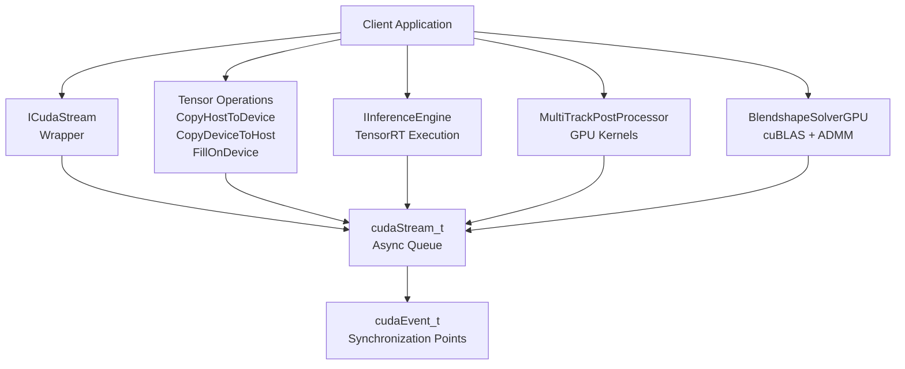

**Sources:** [audio2x-common/include/audio2x/internal/audio2x.h:69-70](), [audio2emotion-sdk/source/audio2emotion-core/multitrack_postprocess.cpp:40-42](), [audio2face-sdk/source/audio2face-core/blendshape_solver_gpu.cpp:334-336]()

### Synchronization Strategies

The SDK provides both synchronous and asynchronous variants of operations:

| Operation Type | Synchronous Variant | Asynchronous Variant | Use Case |
|----------------|---------------------|----------------------|----------|
| Tensor Copy | `CopyDeviceToHost(dest, src)` | `CopyDeviceToHost(dest, src, stream)` | Blocking copy when immediate result needed |
| Inference | `Execute()` + `Wait()` | `Execute()` on stream | Pipeline multiple operations |
| Blendshape Solve | `Solve()` | `SolveAsync()` + callback | Batch processing with CPU work |
| Post-Processing | N/A | `PostProcess()` on stream | Always async for GPU efficiency |

The asynchronous variants schedule work on the CUDA stream without CPU blocking, enabling overlapped execution:

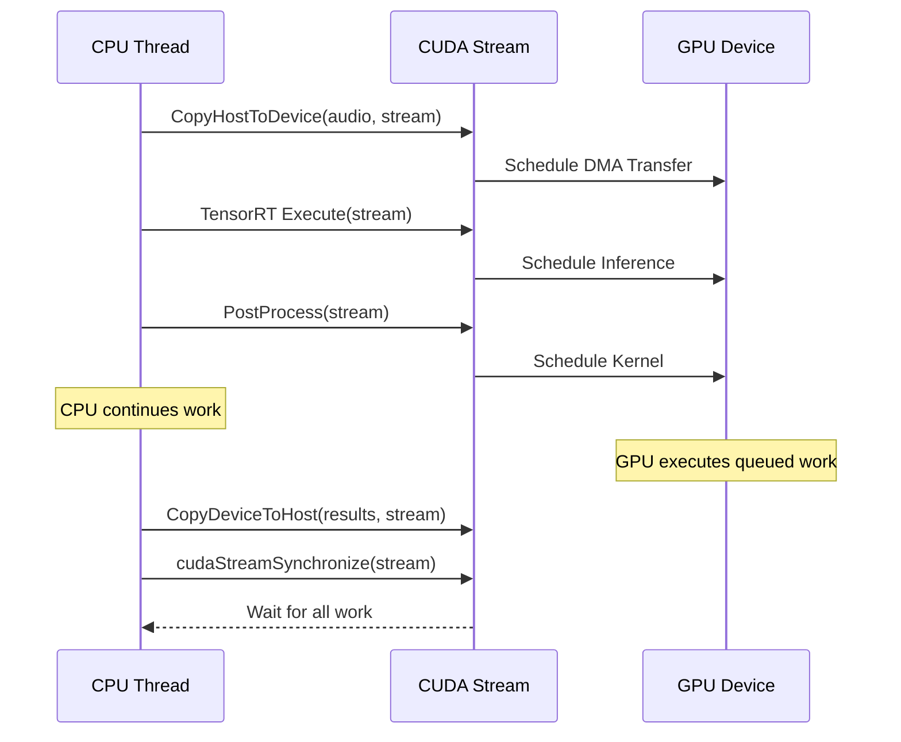

**Sources:** [audio2x-common/source/audio2x/tensor_float.cpp:56-72](), [audio2face-sdk/source/audio2face-core/blendshape_solver.cpp:191-198]()

---

## Memory Management Strategies

### Memory Location Types

The SDK distinguishes three memory locations, each optimized for different access patterns:

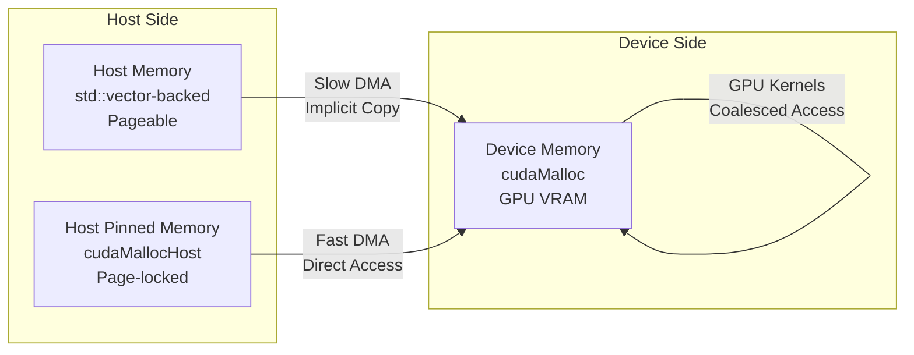

**Memory Characteristics:**

| Type | Allocation | DMA Speed | Use Case |
|------|-----------|-----------|----------|
| Host Pageable | `new` / `malloc` | Slow (requires temp buffer) | CPU-only processing, large allocations |
| Host Pinned | `cudaMallocHost` | Fast (zero-copy DMA) | High-frequency CPU↔GPU transfers |
| Device | `cudaMalloc` | N/A (on GPU) | GPU computation, kernel inputs/outputs |

**Sources:** [audio2x-common/include/audio2x/internal/tensor.h:20-32](), [audio2x-common/source/audio2x/tensor_float.cpp:31-42]()

### Pinned Memory for CPU-GPU Transfers

The blendshape solver uses pinned memory to minimize latency when transferring intermediate results between GPU computation and CPU solving:

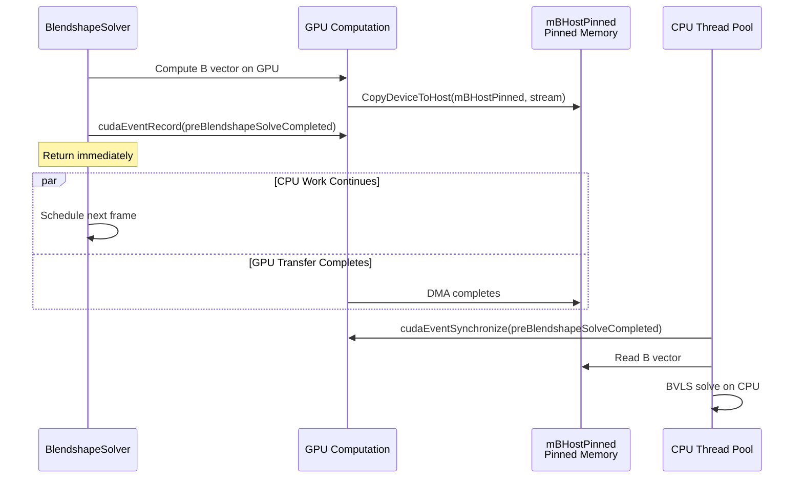

The pinned memory buffer `mBHostPinned` is protected by a mutex and condition variable to coordinate between the async copy and CPU solver thread:

[audio2face-sdk/source/audio2face-core/blendshape_solver.cpp:191-228]()

**Sources:** [audio2face-sdk/source/audio2face-core/blendshape_solver.cpp:191-228](), [audio2face-sdk/include/audio2face/internal/blendshape_solver.h:62-65]()

### Memory Coalescing in Batch Operations

For multi-track processing, data is laid out in strided format to enable coalesced GPU memory access:

```
Track-interleaved layout (stride = size):
[Track0_Data | Track1_Data | Track2_Data | ...]

Offset-stride access pattern:
base + trackIndex * stride + offset
```

This layout allows GPU threads in a warp to access consecutive memory locations when processing different tracks in parallel:

[audio2emotion-sdk/source/audio2emotion-core/multitrack_postprocess.cpp:217-239]()

**Sources:** [audio2emotion-sdk/source/audio2emotion-core/multitrack_postprocess.cpp:217-239](), [audio2x-common/include/audio2x/tensor.h:63-74]()

---

## Asynchronous Tensor Operations

### Copy Operation Variants

All tensor copy operations have both synchronous and asynchronous variants. The asynchronous versions accept a `cudaStream_t` parameter:

```cpp
// Synchronous (uses default stream, blocks CPU)
CopyDeviceToHost(destination, source);

// Asynchronous (uses provided stream, non-blocking)
CopyDeviceToHost(destination, source, cudaStream);
```

**Implementation Strategy:**

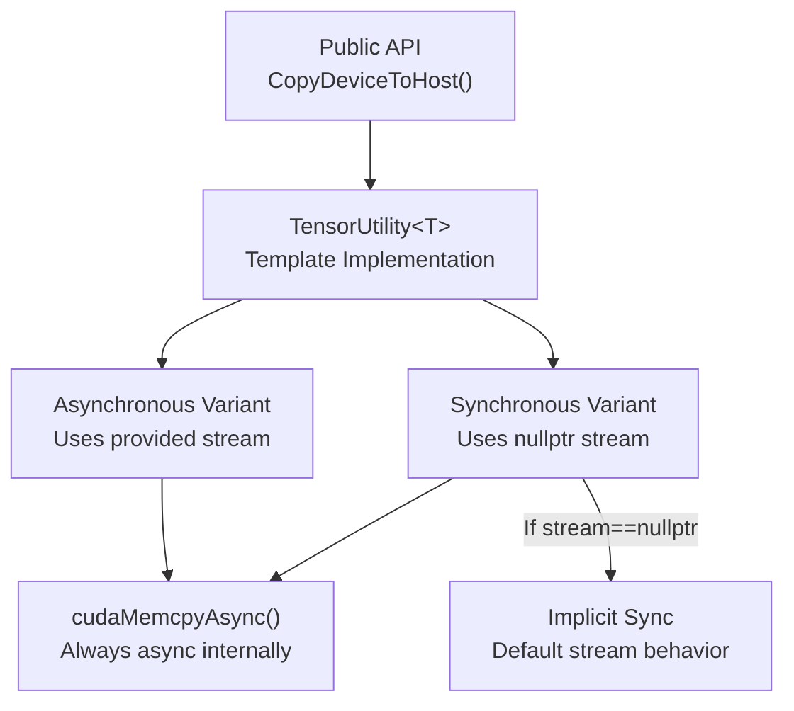

The synchronous variants pass `nullptr` as the stream, which uses the default stream that implicitly synchronizes with other work:

[audio2x-common/source/audio2x/tensor_float.cpp:77-92]()

**Sources:** [audio2x-common/source/audio2x/tensor_float.cpp:56-92](), [audio2x-common/include/audio2x/internal/tensor.h:106-139]()

### Fill Operations

GPU fill operations use `cudaMemsetAsync` for efficient initialization:

[audio2x-common/source/audio2x/tensor_float.cpp:97-99]()

This is significantly faster than CPU-side loops when initializing large device tensors, as it leverages dedicated GPU hardware for memory operations.

**Sources:** [audio2x-common/source/audio2x/tensor_float.cpp:97-102]()

---

## Multi-Track Post-Processing Optimizations

The emotion post-processing system demonstrates advanced GPU kernel optimization through multiple implementation variants, each targeting different performance characteristics.

### Kernel Variant Selection

The `MultiTrackPostProcessor` selects between optimization strategies based on hardware capabilities:

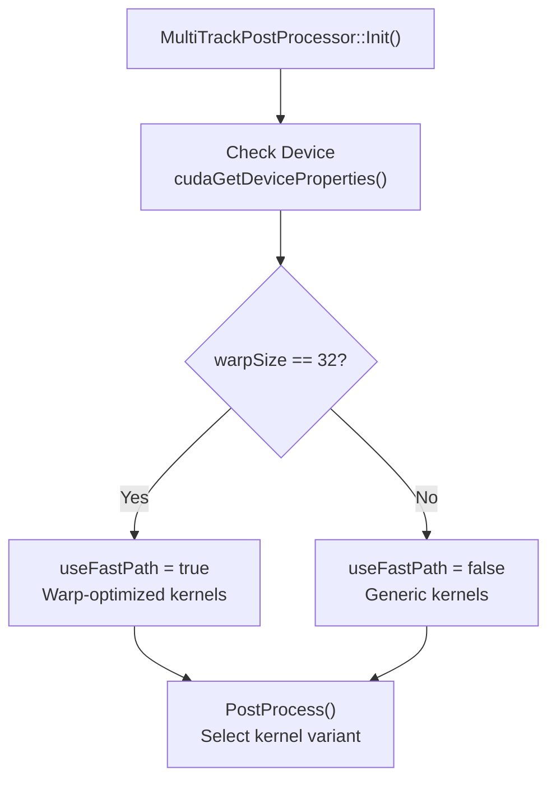

[audio2emotion-sdk/source/audio2emotion-core/multitrack_postprocess.cpp:48-58]()

**Sources:** [audio2emotion-sdk/source/audio2emotion-core/multitrack_postprocess.cpp:36-58](), [audio2emotion-sdk/include/audio2emotion/internal/multitrack_postprocess_cuda.h:30-48]()

### GPU Kernel Implementation Variants

Three progressively optimized kernel variants were developed and benchmarked:

| Variant | Memory Strategy | Optimization Level | Best Use Case |
|---------|----------------|-------------------|---------------|
| **Base GPU** | Global memory only | Basic parallelization | Small track counts (1-8) |
| **GPU Shared** | Shared memory for correspondence | Reduced global reads | Medium track counts (8-32) |
| **GPU Local (Fast Path)** | Registers + warp intrinsics | Maximum performance | Large track counts (32-128) |

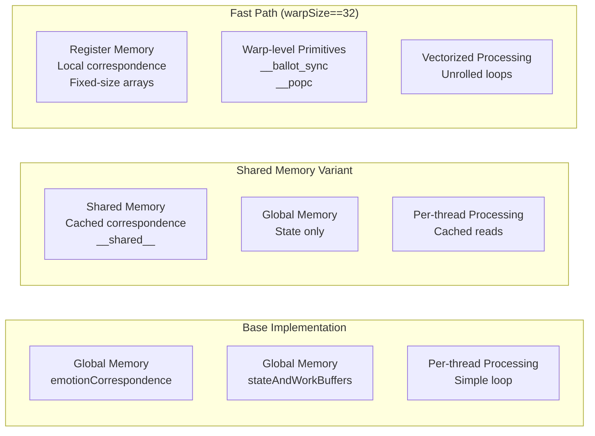

**Fast Path Optimizations:**

The fast path implementation leverages warp-level programming:

1. **Active Track Masking:** Uses `__ballot_sync()` to create bitmasks of active threads within a warp
2. **Population Count:** Uses `__popc()` for efficient counting of active tracks
3. **Fixed-Size Arrays:** Stores correspondence data in registers for zero-latency access

[audio2emotion-sdk/tests/test_core_batch_post_processor.cpp:531-537]()

**Sources:** [audio2emotion-sdk/tests/test_core_batch_post_processor.cpp:282-453](), [audio2emotion-sdk/source/audio2emotion-core/multitrack_postprocess.cpp:217-285]()

### Performance Comparison

Benchmark results from the test suite demonstrate the effectiveness of these optimizations:

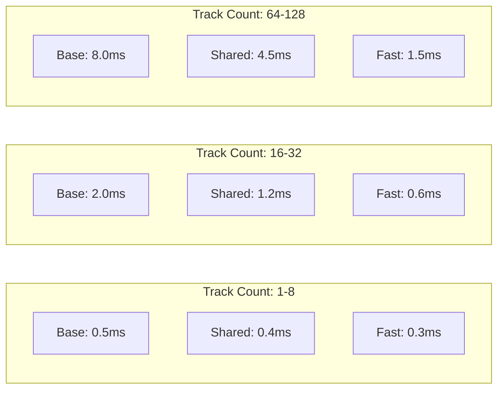

The fast path shows 5-6x speedup at high track counts compared to the base implementation.

**Sources:** [audio2emotion-sdk/tests/test_core_batch_post_processor.cpp:706-759]()

---

## Blendshape Solver GPU Implementation

The GPU blendshape solver (`BlendshapeSolverGPU`) implements the ADMM optimization algorithm entirely on the GPU using cuBLAS for linear algebra operations.

### GPU Solver Architecture

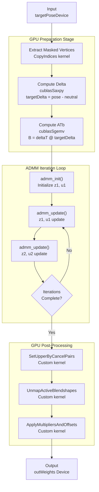

**Sources:** [audio2face-sdk/source/audio2face-core/blendshape_solver_gpu.cpp:218-332]()

### cuBLAS Integration

The solver uses cuBLAS for efficient matrix-vector operations:

```cpp
// Matrix-vector multiply: B = A^T @ targetDelta
cublasSgemv(mCublasHandle, CUBLAS_OP_T,
    numVertexPositions, numBlendshapes, &alpha,
    deltaPosesDevice.Data(), numVertexPositions,
    targetDeltaDevice.Data(), 1, &beta,
    BDevice.Data(), 1);
```

[audio2face-sdk/source/audio2face-core/blendshape_solver_gpu.cpp:272-276]()

The cuBLAS handle is bound to the CUDA stream to ensure proper sequencing:

[audio2face-sdk/source/audio2face-core/blendshape_solver_base.cpp:90-93]()

**Sources:** [audio2face-sdk/source/audio2face-core/blendshape_solver_gpu.cpp:258-278](), [audio2face-sdk/source/audio2face-core/blendshape_solver_base.cpp:90-93]()

### ADMM Algorithm GPU Implementation

The ADMM (Alternating Direction Method of Multipliers) algorithm is implemented with GPU-specific data structures:

**Precomputed GPU Buffers:**

| Buffer | Purpose | Computation |
|--------|---------|-------------|
| `d_AMat` | System matrix | A^T @ A + regularization |
| `d_AmatInv` | Matrix inverse | (A^T @ A)^-1 |
| `d_AdmmWeights` | Diagonal preconditioner | sqrt(diag(A^T @ A)) / 4 |
| `d_AdmmMatInv` | Preconditioned inverse | (A^T @ A + w^2)^-1 |

These matrices are precomputed during the `Prepare()` phase and cached on the GPU:

[audio2face-sdk/source/audio2face-core/blendshape_solver_gpu.cpp:194-209]()

**ADMM Update Operations:**

The `admm_update()` function performs alternating optimization steps:

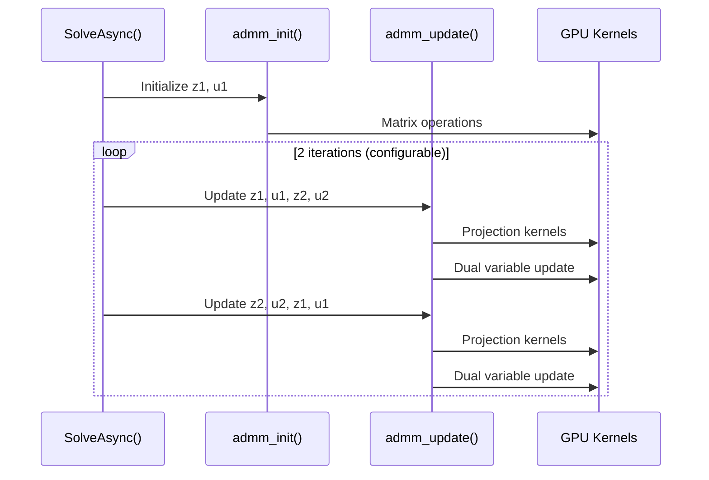

[audio2face-sdk/source/audio2face-core/blendshape_solver_gpu.cpp:296-305]()

**Sources:** [audio2face-sdk/source/audio2face-core/blendshape_solver_gpu.cpp:168-215](), [audio2face-sdk/source/audio2face-core/blendshape_solver_gpu.cpp:280-318]()

### Temporal Smoothing on GPU

The GPU solver maintains previous weights in device memory for temporal regularization:

```cpp
// B = A^T @ targetDelta + TemporalReg * scaleFactor * mPrevWeights
cublasSgemv(mCublasHandle, CUBLAS_OP_T,
    numVertexPositions, numBlendshapes, &alpha,
    deltaPosesDevice.Data(), numVertexPositions,
    targetDeltaDevice.Data(), 1, &beta,  // beta includes temporal term
    BDevice.Data(), 1);
```

[audio2face-sdk/source/audio2face-core/blendshape_solver_gpu.cpp:266-277]()

After solving, the result is saved for the next frame:

[audio2face-sdk/source/audio2face-core/blendshape_solver_gpu.cpp:320]()

**Sources:** [audio2face-sdk/source/audio2face-core/blendshape_solver_gpu.cpp:266-320]()

---

## CPU vs GPU Design Decisions

The SDK provides both CPU and GPU implementations for the blendshape solver, with clear performance trade-offs.

### Implementation Comparison

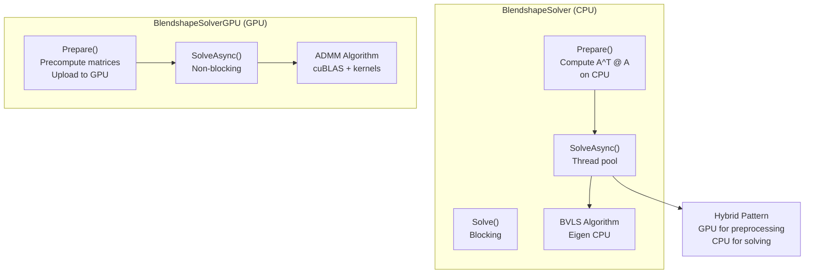

**Performance Characteristics:**

| Solver Type | Latency (Single Frame) | Throughput (Batch) | Memory Usage | Algorithm |
|-------------|------------------------|-------------------|--------------|-----------|
| CPU (`BlendshapeSolver`) | ~5-10ms | Limited by CPU cores | Low (CPU RAM) | BVLS (exact) |
| GPU (`BlendshapeSolverGPU`) | ~1-2ms | Excellent (parallel tracks) | High (GPU VRAM) | ADMM (iterative) |

**Sources:** [audio2face-sdk/tests/test_core_blendshape_solver.cpp:197-204](), [audio2face-sdk/source/benchmarks/blendshape_solver.cpp:176-216]()

### Hybrid CPU-GPU Pattern

The CPU solver uses a hybrid approach where preprocessing happens on GPU but solving on CPU:

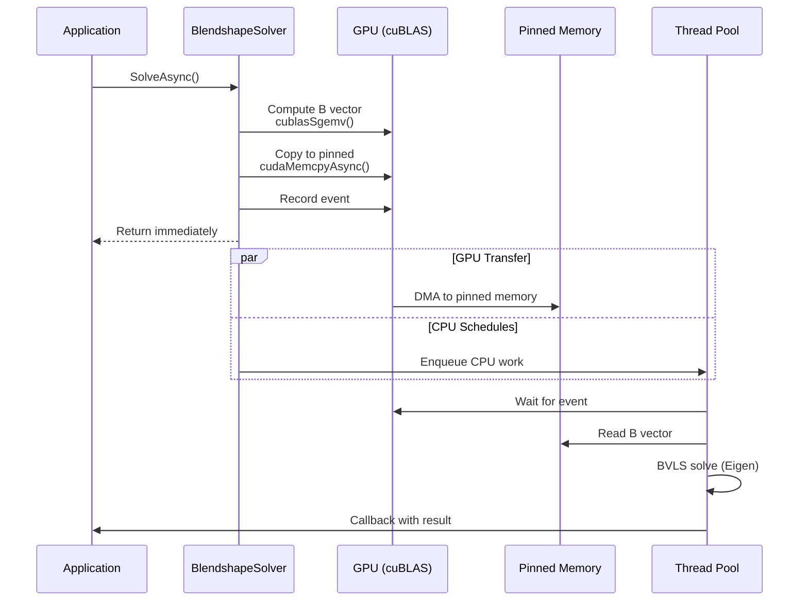

This pattern enables:
1. **Overlap:** GPU preprocessing overlaps with CPU work
2. **Memory efficiency:** Only intermediate results transferred
3. **Algorithm choice:** Use CPU-optimized BVLS instead of GPU ADMM

[audio2face-sdk/source/audio2face-core/blendshape_solver.cpp:159-198]()

**Sources:** [audio2face-sdk/source/audio2face-core/blendshape_solver.cpp:137-308]()

### When to Use Each Implementation

**Choose CPU Solver (`BlendshapeSolver`) when:**
- Accuracy is critical (BVLS provides exact bounded least squares)
- Processing single frames or small batches
- GPU memory is constrained
- CPU cores are available (thread pool)

**Choose GPU Solver (`BlendshapeSolverGPU`) when:**
- Processing large batches (>10 frames)
- Real-time performance is critical
- Multiple tracks need parallel processing
- GPU has sufficient VRAM for cached matrices

**Implementation Selection:**

```cpp
// Factory function chooses implementation
IBlendshapeSolver* solver = CreateBlendshapeSolver(
    bool gpuSolver  // true for GPU, false for CPU
);
```

The choice is made at creation time and cannot be changed, as each implementation has fundamentally different resource requirements and algorithmic approaches.

**Sources:** [audio2face-sdk/include/audio2face/internal/blendshape_solver_base.h:139](), [audio2face-sdk/tests/test_core_blendshape_solver.cpp:156-159]()

---

## General Optimization Guidelines

### Stream Usage Pattern

All GPU operations should use the provided CUDA stream for proper sequencing:

```cpp
// Bad: Uses default stream (implicit synchronization)
cudaMemcpy(dst, src, size, cudaMemcpyDeviceToHost);

// Good: Uses provided stream (async)
cudaMemcpyAsync(dst, src, size, cudaMemcpyDeviceToHost, stream);
```

The SDK's tensor operations automatically use the provided stream when available:

[audio2x-common/source/audio2x/tensor_float.cpp:56-72]()

### Memory Layout for Batch Processing

When processing multiple items (tracks, frames), use strided layout for coalesced access:

```cpp
struct TensorBatchInfo {
    std::size_t offset;   // Starting offset in batch
    std::size_t size;     // Size of single item
    std::size_t stride;   // Distance between items
};

// Access pattern: base + trackIndex * stride + offset
```

This enables efficient GPU access patterns where consecutive threads access consecutive memory:

[audio2x-common/include/audio2x/tensor.h:63-74]()

### Synchronization Best Practices

**Event-based synchronization** is preferred over stream synchronization for fine-grained control:

```cpp
cudaEvent_t event;
cudaEventCreate(&event);
cudaEventRecord(event, stream);  // Mark point in stream
// ... other work ...
cudaEventSynchronize(event);     // Wait only for this point
```

The CPU blendshape solver uses events to synchronize only the GPU preprocessing portion:

[audio2face-sdk/source/audio2face-core/blendshape_solver.cpp:197-214]()

**Sources:** [audio2x-common/source/audio2x/tensor_float.cpp:56-102](), [audio2x-common/include/audio2x/tensor.h:63-74](), [audio2face-sdk/source/audio2face-core/blendshape_solver.cpp:191-228]()