# Page: Overview

# Overview

<details>
<summary>Relevant source files</summary>

The following files were used as context for generating this wiki page:

- [CMakeLists.txt](CMakeLists.txt)
- [audio2emotion-sdk/include/audio2emotion/audio2emotion.h](audio2emotion-sdk/include/audio2emotion/audio2emotion.h)
- [audio2emotion-sdk/include/audio2emotion/internal/executor.h](audio2emotion-sdk/include/audio2emotion/internal/executor.h)
- [audio2emotion-sdk/include/audio2emotion/internal/parse_helper.h](audio2emotion-sdk/include/audio2emotion/internal/parse_helper.h)
- [audio2emotion-sdk/include/audio2emotion/parse_helper.h](audio2emotion-sdk/include/audio2emotion/parse_helper.h)
- [audio2emotion-sdk/source/audio2emotion-core/CMakeLists.txt](audio2emotion-sdk/source/audio2emotion-core/CMakeLists.txt)
- [audio2emotion-sdk/source/audio2emotion/audio2emotion.cpp](audio2emotion-sdk/source/audio2emotion/audio2emotion.cpp)
- [audio2emotion-sdk/tests/CMakeLists.txt](audio2emotion-sdk/tests/CMakeLists.txt)
- [audio2face-sdk/source/audio2face-core/CMakeLists.txt](audio2face-sdk/source/audio2face-core/CMakeLists.txt)
- [audio2face-sdk/source/audio2face-core/executor.cpp](audio2face-sdk/source/audio2face-core/executor.cpp)
- [audio2face-sdk/source/audio2face/audio2face.cpp](audio2face-sdk/source/audio2face/audio2face.cpp)
- [audio2face-sdk/source/benchmarks/CMakeLists.txt](audio2face-sdk/source/benchmarks/CMakeLists.txt)
- [audio2face-sdk/source/benchmarks/utils.h](audio2face-sdk/source/benchmarks/utils.h)
- [audio2face-sdk/tests/CMakeLists.txt](audio2face-sdk/tests/CMakeLists.txt)
- [audio2face-sdk/tests/test_core_executor.cpp](audio2face-sdk/tests/test_core_executor.cpp)
- [audio2x-common/source/audio2x/CMakeLists.txt](audio2x-common/source/audio2x/CMakeLists.txt)
- [audio2x-common/tests/CMakeLists.txt](audio2x-common/tests/CMakeLists.txt)
- [audio2x-sdk/CMakeLists.txt](audio2x-sdk/CMakeLists.txt)

</details>


## Purpose and Scope

The **Audio2Face-3D-SDK** is a GPU-accelerated C++ library that generates facial animation from audio input. The SDK provides two primary capabilities:

1. **Audio2Emotion**: Classifies emotional content from audio streams, outputting 10-dimensional emotion vectors
2. **Audio2Face**: Generates facial geometry (skin vertices, tongue, jaw transforms, eye rotations) and optional blendshape weights from audio and emotion inputs

This page provides a high-level overview of the SDK's architecture, core concepts, and organization. For detailed information about specific subsystems:
- Build system and dependencies: See [Build System and Dependencies](#2)
- Foundation infrastructure: See [Core Infrastructure (audio2x-common)](#3)
- Facial animation generation: See [Audio2Face SDK](#4)
- Emotion classification: See [Audio2Emotion SDK](#5)
- Interactive execution mode: See [Interactive Execution](#6)
- Parallel processing: See [Multi-Track Batch Processing](#7)

**Sources:** [audio2face-sdk/source/audio2face/audio2face.cpp:1-893](), [audio2emotion-sdk/source/audio2emotion/audio2emotion.cpp:1-334](), [CMakeLists.txt:1-151]()

---

## Three-Tier Architecture

The SDK is organized into three distinct layers, with a unified API layer on top:

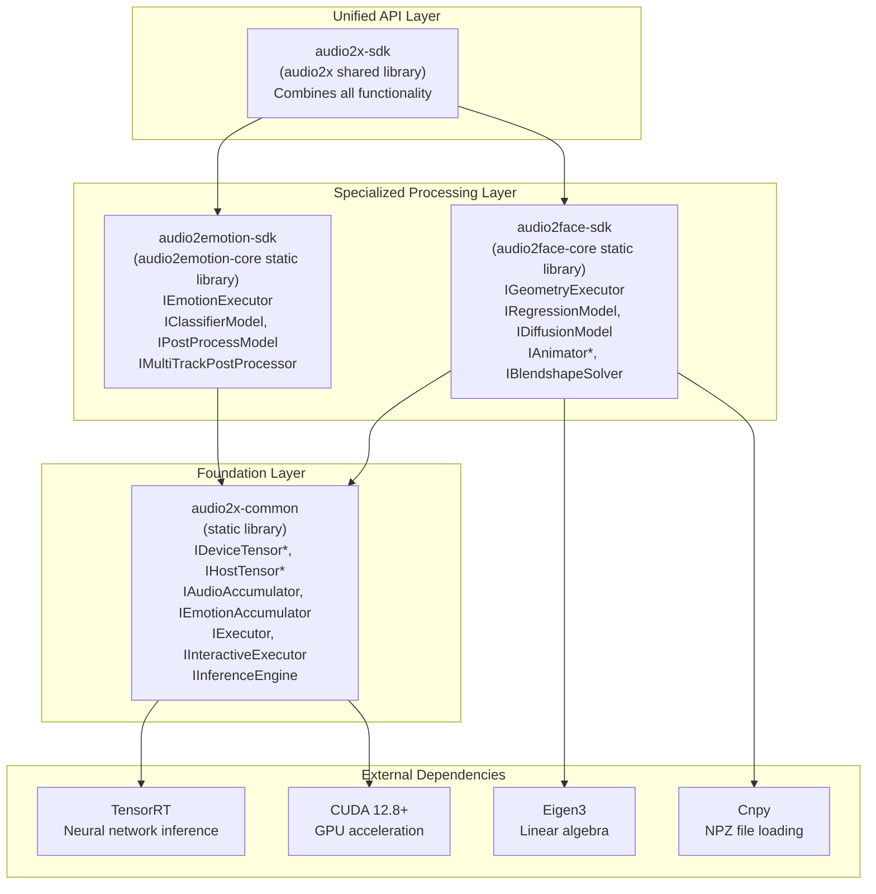

**Layer Responsibilities:**

| Layer | Purpose | Key Interfaces |
|-------|---------|----------------|
| **audio2x-common** | Foundation utilities used by both specializations | `IDeviceTensorFloat`, `IAudioAccumulator`, `IEmotionAccumulator`, `IExecutor`, `IInferenceEngine` |
| **audio2emotion-core** | Emotion classification and post-processing | `IEmotionExecutor`, `IClassifierModel`, `IPostProcessModel`, `IMultiTrackPostProcessor` |
| **audio2face-core** | Geometry generation and animation | `IGeometryExecutor`, `IRegressionModel`, `IDiffusionModel`, `IAnimatorSkin`, `IBlendshapeSolver` |
| **audio2x** | Unified public API combining both | All public headers from the three core libraries |

**Sources:** [audio2x-sdk/CMakeLists.txt:1-104](), [audio2x-common/source/audio2x/CMakeLists.txt:1-38](), [audio2emotion-sdk/source/audio2emotion-core/CMakeLists.txt:1-40](), [audio2face-sdk/source/audio2face-core/CMakeLists.txt:1-40]()

---

## Core Processing Concepts

### Execution Modes: Batch vs Interactive

The SDK supports two distinct processing paradigms through separate executor interfaces:

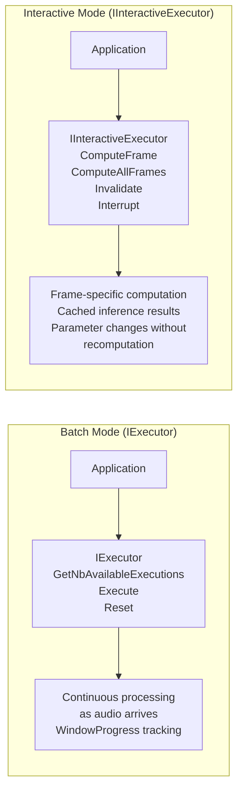

**Batch Mode** (`IExecutor`):
- Processes audio streams continuously as data arrives
- Uses `WindowProgress` to track readiness across multiple tracks
- Suitable for real-time streaming or offline batch processing
- Defined in executor interfaces across all three core libraries

**Interactive Mode** (`IInteractiveExecutor`):
- Enables frame-specific computation with sophisticated caching
- Inference computed once, then rapid parameter changes in post-processing
- Supports timeline scrubbing and dynamic parameter adjustment
- Layer-based invalidation system for efficient recomputation

**Sources:** [audio2face-sdk/source/audio2face-core/executor.cpp:29-330](), [audio2emotion-sdk/include/audio2emotion/internal/executor.h:1-138]()

### Multi-Track Batch Processing

The SDK supports parallel processing of 1-128 independent audio tracks with GPU batch operations:

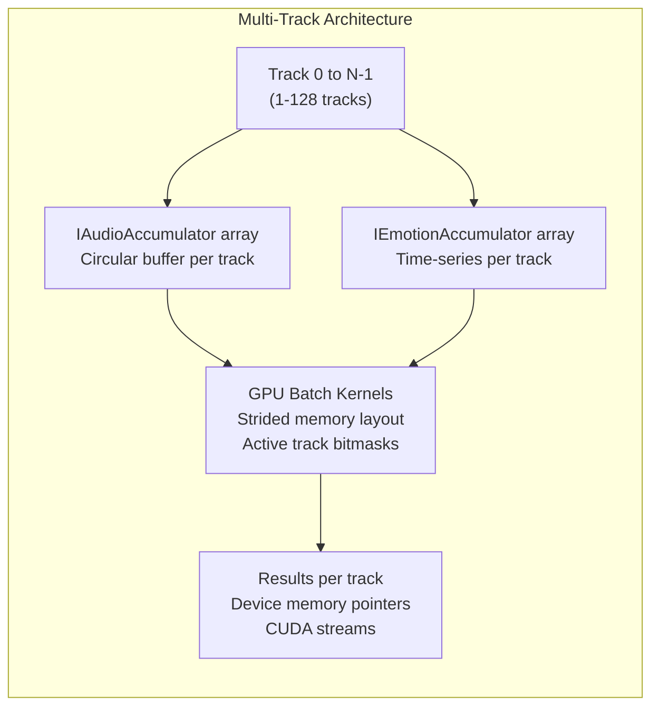

Each executor maintains:
- Separate `IAudioAccumulator` and `IEmotionAccumulator` per track
- Independent `WindowProgress` tracking for frame timestamps
- Strided GPU memory layouts for efficient batch processing
- Active track bitmasks (`bit_vector<uint64_t>`) to coordinate execution

**Sources:** [audio2face-sdk/tests/test_core_executor.cpp:53-229](), [audio2emotion-sdk/include/audio2emotion/internal/executor.h:106-111]()

---

## End-to-End Data Flow

### Audio2Emotion Pipeline

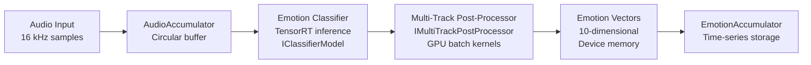

Post-processing operations include:
- **Emotion mapping**: Correspondence between emotion spaces
- **Contrast enhancement**: Max-based selection
- **Temporal smoothing**: Previous frame blending
- **Preferred blending**: User-selected emotion targets
- **Live transition**: Time-based interpolation

**Sources:** [audio2emotion-sdk/include/audio2emotion/audio2emotion.h:1-203]()

### Audio2Face Pipeline

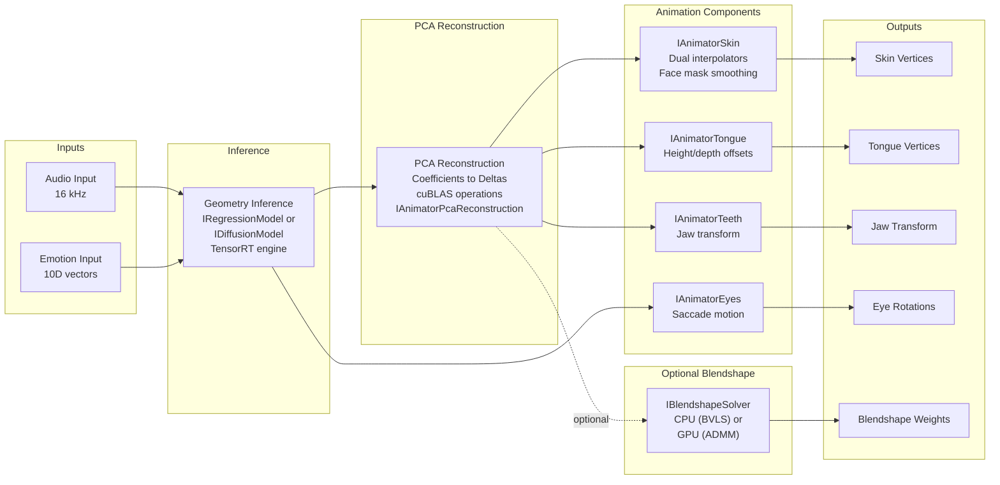

**Model Types:**
- **Regression models**: Frame-by-frame mapping at 60 FPS
- **Diffusion models**: GRU-based iterative refinement with state

**Sources:** [audio2face-sdk/source/audio2face/audio2face.cpp:26-274]()

---

## Key Code Entry Points

### Bundle Pattern for Initialization

The SDK provides a **Bundle pattern** that encapsulates all resources needed for execution in a single object:

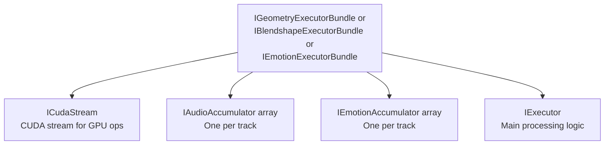

**Factory Functions:**

| Function | Purpose | File Reference |
|----------|---------|----------------|
| `ReadRegressionGeometryExecutorBundle()` | Load regression model bundle | [audio2face-sdk/source/audio2face/audio2face.cpp:822-833]() |
| `ReadDiffusionGeometryExecutorBundle()` | Load diffusion model bundle | [audio2face-sdk/source/audio2face/audio2face.cpp:835-846]() |
| `ReadClassifierEmotionExecutorBundle()` | Load emotion classifier bundle | [audio2emotion-sdk/source/audio2emotion/audio2emotion.cpp:303-317]() |
| `ReadPostProcessEmotionExecutorBundle()` | Load post-process only bundle | [audio2emotion-sdk/source/audio2emotion/audio2emotion.cpp:319-331]() |

### Executor Creation and Execution

**Creating Executors:**

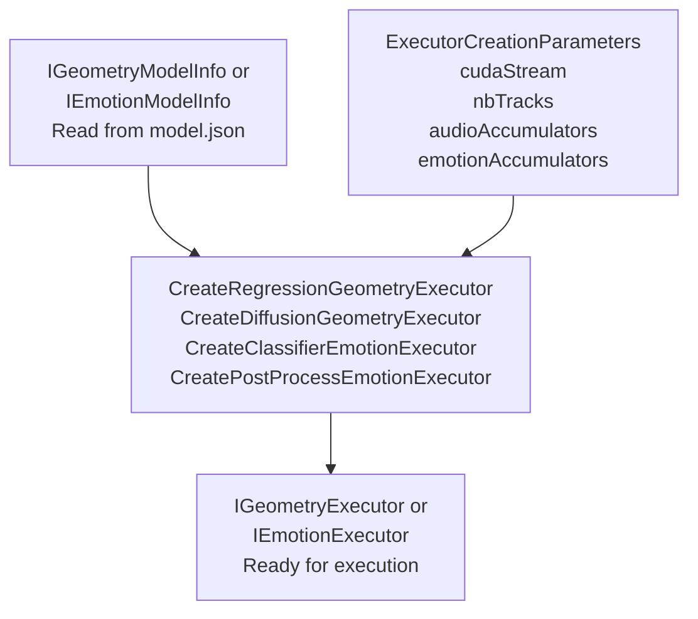

**Execution Flow:**

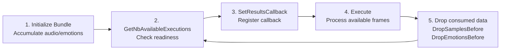

**Sources:** [audio2face-sdk/tests/test_core_executor.cpp:234-325](), [audio2emotion-sdk/include/audio2emotion/audio2emotion.h:73-91]()

---

## Repository Structure

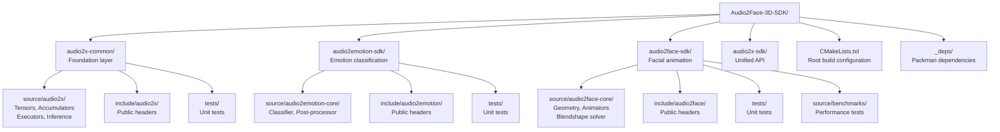

**Build Outputs:**
- `audio2x-common`: Static library with foundation utilities
- `audio2emotion-core`: Static library with emotion processing
- `audio2face-core`: Static library with facial animation
- `audio2x`: Shared library combining all three (DLL/SO)

**Sources:** [CMakeLists.txt:1-151](), [audio2x-sdk/CMakeLists.txt:1-104]()

---

## External Dependencies

### Core Dependencies

| Dependency | Version | Purpose | Acquired Via |
|------------|---------|---------|--------------|
| **CUDA Toolkit** | 12.8+ | GPU acceleration, memory management | System/packman |
| **TensorRT** | 10.x | Neural network inference engine | packman |
| **cuBLAS** | (with CUDA) | GPU matrix operations (PCA reconstruction) | CUDA |
| **Eigen3** | Latest | CPU linear algebra (blendshape solver) | packman |
| **Cnpy** | Latest | NPZ file loading (emotion database) | packman |
| **nlohmann_json** | Latest | JSON parsing (model configs) | packman |
| **ZLIB** | 1.3.1+ | Compression support | packman |

### Testing Dependencies

| Dependency | Purpose |
|------------|---------|
| **Google Test** | Unit testing framework |
| **Google Benchmark** | Performance benchmarking |
| **AudioFile** | WAV file loading for tests |

**CUDA Architecture Support:** The SDK targets 8 GPU architectures: `75;80;86;87;89;90;100;120` (Turing through Blackwell).

**Dependency Management:** The `packman` tool automatically fetches pre-built binaries based on platform (Windows/Linux) and build type (Debug/Release). Dependencies are placed in `_deps/target-deps/`.

**Sources:** [CMakeLists.txt:58-98](), [audio2x-common/source/audio2x/CMakeLists.txt:29-37](), [audio2face-sdk/source/audio2face-core/CMakeLists.txt:28-39]()

---

## Tensor System Overview

The foundation of the SDK is a GPU-accelerated tensor system that provides the data structures for all processing:

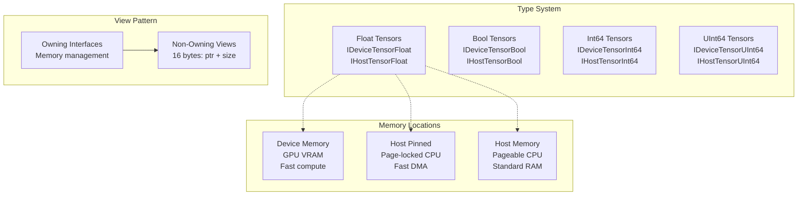

**Key Features:**
- **Dual representation**: Owning interfaces for memory management, lightweight views (16 bytes) for passing data
- **Type safety**: Four parallel type hierarchies (float, bool, int64, uint64)
- **Accessor pattern**: Private constructors prevent unsafe view creation
- **Copy operations**: Support both synchronous and async (stream-based) transfers

For detailed tensor documentation, see [Tensor System](#3.1).

**Sources:** [audio2x-common/source/audio2x/CMakeLists.txt:1-38]()

---

## Getting Started

### Basic Usage Pattern

1. **Load Model Bundle:**
   ```
   auto bundle = ReadRegressionGeometryExecutorBundle(
       nbTracks, modelPath, executionOption, 
       frameRateNum, frameRateDenom, nullptr);
   ```

2. **Accumulate Input Data:**
   ```
   for each track:
       audioAccumulator.Accumulate(audioSamples, cudaStream)
       emotionAccumulator.Accumulate(timestamp, emotions, cudaStream)
   ```

3. **Set Result Callback:**
   ```
   executor.SetResultsCallback(callback, userdata)
   ```

4. **Execute Processing:**
   ```
   while (GetNbReadyTracks(executor) > 0):
       executor.Execute(&nbExecutedTracks)
       Drop consumed audio/emotion data
   ```

5. **Retrieve Results:**
   Results are delivered via callback with device memory pointers (GPU) or host memory (CPU blendshape solver)

### Example Test Reference

The test suite provides comprehensive usage examples:
- Geometry executor usage: [audio2face-sdk/tests/test_core_executor.cpp:234-467]()
- Emotion executor usage: See test files in [audio2emotion-sdk/tests/]()
- Interactive executor patterns: See benchmark files in [audio2face-sdk/source/benchmarks/]()

**Sources:** [audio2face-sdk/tests/test_core_executor.cpp:1-891]()

---

# Page: Build System and Dependencies

# Build System and Dependencies

<details>
<summary>Relevant source files</summary>

The following files were used as context for generating this wiki page:

- [CMakeLists.txt](CMakeLists.txt)
- [audio2emotion-sdk/source/audio2emotion-core/CMakeLists.txt](audio2emotion-sdk/source/audio2emotion-core/CMakeLists.txt)
- [audio2emotion-sdk/tests/CMakeLists.txt](audio2emotion-sdk/tests/CMakeLists.txt)
- [audio2face-sdk/source/audio2face-core/CMakeLists.txt](audio2face-sdk/source/audio2face-core/CMakeLists.txt)
- [audio2face-sdk/source/benchmarks/CMakeLists.txt](audio2face-sdk/source/benchmarks/CMakeLists.txt)
- [audio2face-sdk/tests/CMakeLists.txt](audio2face-sdk/tests/CMakeLists.txt)
- [audio2x-common/source/audio2x/CMakeLists.txt](audio2x-common/source/audio2x/CMakeLists.txt)
- [audio2x-common/tests/CMakeLists.txt](audio2x-common/tests/CMakeLists.txt)
- [audio2x-sdk/CMakeLists.txt](audio2x-sdk/CMakeLists.txt)

</details>


## Purpose and Scope

This document describes the CMake-based build system for the Audio2Face-3D-SDK, including project structure, external dependency management via packman, compilation configuration, and platform-specific build settings. The build system produces a unified shared library (`audio2x`) that combines functionality from three core static libraries.

For information about the logical organization of executors and runtime components, see [Execution Framework](#3.3). For details on GPU-specific compilation and optimization, see [GPU Optimization Strategies](#8).

---

## Project Structure

The repository uses a hierarchical CMake structure with a root configuration that orchestrates four independent subprojects. Each subproject produces distinct build artifacts organized by function.

### CMake Project Hierarchy

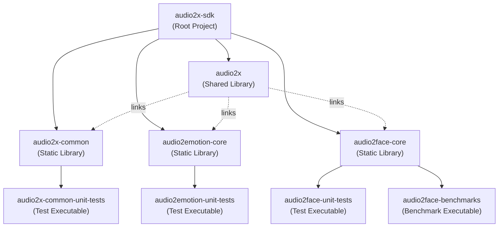

**Project Structure**
- `audio2x-sdk/`: Root CMake project at [CMakeLists.txt:3]()
- `audio2x-common/`: Foundation layer providing tensors, accumulators, and inference engine
- `audio2emotion-sdk/`: Emotion classification and post-processing
- `audio2face-sdk/`: Facial geometry generation and animation
- `audio2x-sdk/`: Unified shared library combining all three modules

**Sources:** [CMakeLists.txt:1-151](), [audio2x-sdk/CMakeLists.txt:1-104]()

---

## Dependency Management with Packman

The build system uses **packman**, a dependency management tool that fetches pre-built binaries and headers based on platform and build type. Dependencies are fetched automatically during CMake configuration if not already present.

### Packman Invocation Flow

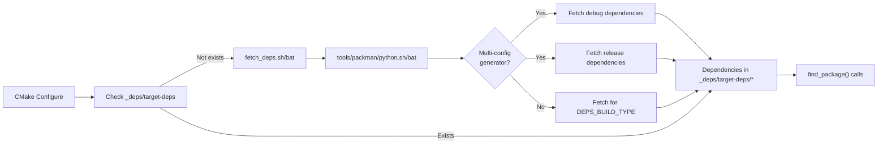

**Key Configuration Details:**

| Aspect | Implementation |
|--------|---------------|
| **Packman Python** | `tools/packman/python.sh` or `.bat` wrapper [CMakeLists.txt:33]() |
| **Fetch Script** | `fetch_deps.sh` or `.bat` in repository root [CMakeLists.txt:36]() |
| **Dependency Directory** | `_deps/target-deps/` [CMakeLists.txt:35]() |
| **Build Type Normalization** | `Release` and `RelWithDebInfo` → `"release"`, others → `"debug"` [CMakeLists.txt:20-24]() |
| **Multi-Config Handling** | Both debug and release fetched for Visual Studio generators [CMakeLists.txt:38-52]() |

**Sources:** [CMakeLists.txt:26-55]()

---

## External Dependencies

The project depends on several external libraries managed through CMake's `find_package()` mechanism. All dependencies are located in `_deps/target-deps/` after packman execution.

### Dependency Catalog

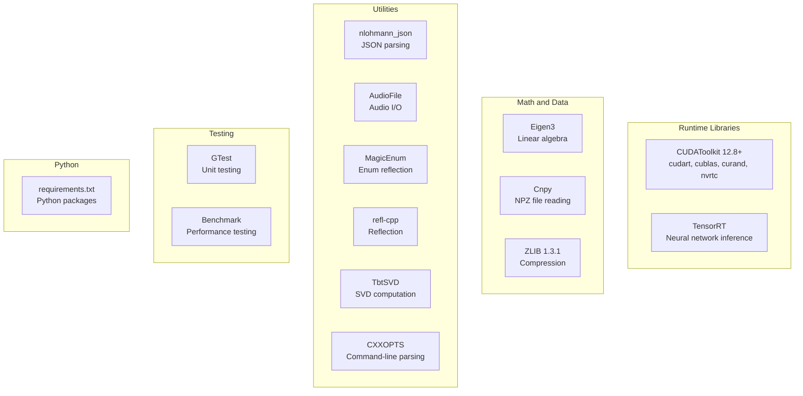

**Dependency Details:**

| Package | Version | Usage | Find Module |
|---------|---------|-------|-------------|
| **CUDAToolkit** | ≥12.8 | GPU computation, memory management | [CMakeLists.txt:72]() |
| **TensorRT** | — | Neural network inference engine | [CMakeLists.txt:96]() |
| **Eigen3** | — | CPU linear algebra, blendshape solver | [CMakeLists.txt:90]() |
| **Cnpy** | — | NPZ file loading for emotion database | [CMakeLists.txt:88]() |
| **ZLIB** | 1.3.1 | NPZ decompression | [CMakeLists.txt:97]() |
| **nlohmann_json** | — | Model configuration parsing | [CMakeLists.txt:93]() |
| **AudioFile** | — | WAV/audio file I/O | [CMakeLists.txt:86]() |
| **MagicEnum** | — | Enum-to-string conversion | [CMakeLists.txt:92]() |
| **refl-cpp** | — | Compile-time reflection | [CMakeLists.txt:94]() |
| **TbtSVD** | — | Singular value decomposition | [CMakeLists.txt:95]() |
| **CXXOPTS** | — | Command-line argument parsing | [CMakeLists.txt:89]() |
| **GTest** | — | Unit test framework | [CMakeLists.txt:91]() |
| **Benchmark** | — | Google Benchmark library | [CMakeLists.txt:87]() |

**CMake Prefix Path Extension:**

The build system extends `CMAKE_PREFIX_PATH` to include all dependency directories [CMakeLists.txt:59-67]():

```cmake
list(APPEND CMAKE_PREFIX_PATH
    ${PROJECT_SOURCE_DIR}/_deps/target-deps/audiofile
    ${PROJECT_SOURCE_DIR}/_deps/target-deps/cxxopts
    ${PROJECT_SOURCE_DIR}/_deps/target-deps/eigen
    ${PROJECT_SOURCE_DIR}/_deps/target-deps/magic_enum
    ${PROJECT_SOURCE_DIR}/_deps/target-deps/nlohmann_json
    ${PROJECT_SOURCE_DIR}/_deps/target-deps/refl-cpp
    ${PROJECT_SOURCE_DIR}/_deps/target-deps/tbtsvd
)
```

**Python Dependencies:**

Python packages are managed separately via pip. An `install-pip-deps` target installs packages from `deps/requirements.txt` into `_deps/target-deps/pip_prebundle` [CMakeLists.txt:100-107]():

```cmake
add_custom_target(install-pip-deps
    COMMAND ${PACKMAN_PYTHON} -m pip install -r ${PROJECT_SOURCE_DIR}/deps/requirements.txt 
            --target ${PROJECT_SOURCE_DIR}/_deps/target-deps/pip_prebundle
    ...
)
```

**Sources:** [CMakeLists.txt:59-107]()

---

## CUDA Configuration

CUDA is enabled as a first-class language in CMake, with specific architecture targets and runtime configuration.

### CUDA Compiler Setup

The build system locates CUDA via `find_package(CUDAToolkit 12.8 REQUIRED)` [CMakeLists.txt:72](). If `CUDAToolkit_BIN_DIR` is defined, the NVCC compiler path is set explicitly [CMakeLists.txt:73-79]():

```cmake
if(DEFINED CUDAToolkit_BIN_DIR)
    if(WIN32)
        set(CMAKE_CUDA_COMPILER ${CUDAToolkit_BIN_DIR}/nvcc.exe)
    else()
        set(CMAKE_CUDA_COMPILER ${CUDAToolkit_BIN_DIR}/nvcc)
    endif()
endif()
```

### Architecture Targeting

**Supported GPU Architectures:**

| Architecture | Compute Capability | GPU Generation |
|--------------|-------------------|----------------|
| `75` | 7.5 | Turing (RTX 20 series, T4) |
| `80` | 8.0 | Ampere (A100) |
| `86` | 8.6 | Ampere (RTX 30 series) |
| `87` | 8.7 | Ampere (Jetson AGX Orin) |
| `89` | 8.9 | Ada Lovelace (RTX 40 series) |
| `90` | 9.0 | Hopper (H100) |
| `100` | 10.0 | Blackwell (B100/B200) |
| `120` | 12.0 | Future architecture |

The architectures are specified via `CMAKE_CUDA_ARCHITECTURES` [CMakeLists.txt:81]():

```cmake
set(CMAKE_CUDA_ARCHITECTURES "75;80;86;87;89;90;100;120" CACHE STRING "CUDA architectures")
```

### CUDA Runtime Configuration

| Setting | Value | Purpose |
|---------|-------|---------|
| **Runtime Library** | `Shared` | Use shared `cudart` library [CMakeLists.txt:82]() |
| **Language Enabled** | `CUDA` | Enable CUDA compilation [CMakeLists.txt:83]() |
| **Position Independent Code** | `ON` | Required for shared libraries [CMakeLists.txt:5]() |

**Sources:** [CMakeLists.txt:5](), [CMakeLists.txt:69-83]()

---

## Module Build Structure

The build system produces three static core libraries and one unified shared library. Each module has specific linking relationships and export configurations.

### Module Dependency Graph

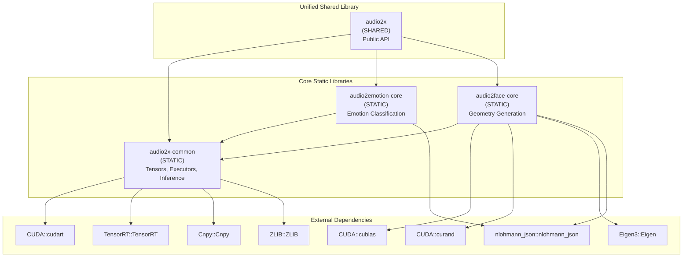

### Library Configurations

**audio2x-common** [audio2x-common/source/audio2x/CMakeLists.txt:1-38]()

| Aspect | Configuration |
|--------|---------------|
| **Type** | Static library (`STATIC`) |
| **Sources** | All `.cpp` and `.cu` files in `source/audio2x/` (recursive) |
| **Public Dependencies** | `Cnpy::Cnpy`, `CUDA::cudart`, `TensorRT::TensorRT`, `ZLIB::ZLIB` |
| **Private Dependencies** | `AudioFile::AudioFile` |
| **Exports** | `AUDIO2X_SDK_EXPORTS` preprocessor definition |
| **Output Directory** | `${A2X_COMMON_BINARY_DIR}/{lib,bin}` |

**audio2emotion-core** [audio2emotion-sdk/source/audio2emotion-core/CMakeLists.txt:1-40]()

| Aspect | Configuration |
|--------|---------------|
| **Type** | Static library (`STATIC`) |
| **Sources** | All `.cpp` and `.cu` files in `source/audio2emotion-core/` (recursive) |
| **Public Dependencies** | `audio2x-common` |
| **Private Dependencies** | `nlohmann_json::nlohmann_json` |
| **Exports** | `AUDIO2X_SDK_EXPORTS`, `AUDIO2EMOTION_SDK_DLL_EXPORTS` (Windows only) |
| **Output Directory** | `${A2E_BINARY_DIR}/{lib,bin}` |

**audio2face-core** [audio2face-sdk/source/audio2face-core/CMakeLists.txt:1-40]()

| Aspect | Configuration |
|--------|---------------|
| **Type** | Static library (`STATIC`) |
| **Sources** | All `.cpp` and `.cu` files in `source/audio2face-core/` (recursive) |
| **Public Dependencies** | `CUDA::cublas`, `CUDA::curand`, `audio2x-common` |
| **Private Dependencies** | `Eigen3::Eigen`, `magic_enum::magic_enum`, `nlohmann_json::nlohmann_json`, `refl-cpp::refl-cpp`, `tbtSVD::tbtSVD` |
| **Exports** | `AUDIO2X_SDK_EXPORTS`, `AUDIO2FACE_SDK_DLL_EXPORTS` (Windows only) |
| **Output Directory** | `${A2F_BINARY_DIR}/{lib,bin}` |

**audio2x (Unified SDK)** [audio2x-sdk/CMakeLists.txt:1-104]()

| Aspect | Configuration |
|--------|---------------|
| **Type** | Shared library (`SHARED`) |
| **Sources** | Entry point files from each module: `audio2emotion.cpp`, `audio2face.cpp`, `audio2x.cpp` |
| **Private Link** | `audio2emotion-core`, `audio2face-core`, `audio2x-common` |
| **Interface Includes** | Propagates all include directories from core libraries |
| **Exports** | `AUDIO2X_SDK_EXPORTS`, `AUDIO2FACE_SDK_DLL_EXPORTS`, `AUDIO2EMOTION_SDK_DLL_EXPORTS` (Windows) |
| **Output Name** | `audio2x.dll` (Windows) or `libaudio2x.so` (Linux) |
| **Symbol Visibility** | Linux: `-Bsymbolic` and `--exclude-libs,ALL` to prevent symbol clashes |

The unified library includes a post-build step that consolidates headers from all modules into a single `include/` directory [audio2x-sdk/CMakeLists.txt:66-100]():

```cmake
add_custom_command(TARGET audio2x POST_BUILD
    COMMAND ${CMAKE_COMMAND} -E make_directory "${CMAKE_CURRENT_BINARY_DIR}/include/audio2emotion"
    COMMAND ${CMAKE_COMMAND} -E make_directory "${CMAKE_CURRENT_BINARY_DIR}/include/audio2face"
    COMMAND ${CMAKE_COMMAND} -E make_directory "${CMAKE_CURRENT_BINARY_DIR}/include/audio2x"
    # Copy headers from each module...
)
```

**Sources:** [audio2x-common/source/audio2x/CMakeLists.txt:1-38](), [audio2emotion-sdk/source/audio2emotion-core/CMakeLists.txt:1-40](), [audio2face-sdk/source/audio2face-core/CMakeLists.txt:1-40](), [audio2x-sdk/CMakeLists.txt:1-104]()

---

## Platform-Specific Configuration

The build system applies different compiler flags and linker options based on the target platform.

### Compiler Flags

**MSVC (Windows)** [CMakeLists.txt:120-126]()

| Flag | Purpose |
|------|---------|
| `/wd4267` | Disable warning C4267 (size_t conversion) |
| `/EHsc` | Enable C++ exception handling |
| `/nologo` | Suppress Microsoft logo display |
| `/MD` (Release) | Link against multi-threaded DLL runtime |
| `/MDd` (Debug) | Link against debug multi-threaded DLL runtime |
| `/NODEFAULTLIB:LIBCMT` | Exclude static runtime library to avoid conflicts |

**GCC/Clang (Linux)** [CMakeLists.txt:127-130]()

| Flag | Purpose |
|------|---------|
| `-fPIC` | Position-independent code (required for shared libraries) |
| `-Wno-undef` | Suppress undefined macro warnings |
| `-Wno-deprecated-declarations` | Suppress deprecation warnings |
| `-ggdb3` (Debug) | Generate GDB debugging information with macros |

### Preprocessor Definitions

**Global Definitions** [CMakeLists.txt:111-118]()

| Definition | Value | Purpose |
|------------|-------|---------|
| `AUDIO2X_LOG_LEVEL` | `1` | Logging verbosity for audio2x-common |
| `AUDIO2FACE_LOG_LEVEL` | `1` | Logging verbosity for audio2face |
| `AUDIO2EMOTION_LOG_LEVEL` | `1` | Logging verbosity for audio2emotion |
| `_GLIBCXX_USE_CXX11_ABI` | `0` | Use legacy C++11 ABI for compatibility with TensorRT |
| `EIGEN_MPL2_ONLY` | (defined) | Restrict Eigen to MPL2-licensed components |
| `USE_NVTX` | (defined) | Enable NVIDIA Tools Extension (NVTX) profiling markers |

**Export Definitions:**

Each module defines export macros for symbol visibility:
- `AUDIO2X_SDK_EXPORTS`: All modules [audio2x-common/source/audio2x/CMakeLists.txt:27]()
- `AUDIO2EMOTION_SDK_DLL_EXPORTS`: Windows only [audio2emotion-sdk/source/audio2emotion-core/CMakeLists.txt:30]()
- `AUDIO2FACE_SDK_DLL_EXPORTS`: Windows only [audio2face-sdk/source/audio2face-core/CMakeLists.txt:24]()

### Linux-Specific Linker Flags

The unified `audio2x` library uses special linker flags on Linux to prevent symbol conflicts [audio2x-sdk/CMakeLists.txt:53-59]():

```cmake
if(UNIX)
    target_link_options(audio2x PRIVATE
        "LINKER:-Bsymbolic"
        "LINKER:--exclude-libs,ALL"
    )
endif()
```

| Flag | Effect |
|------|--------|
| `-Bsymbolic` | Bind global references to definitions within the shared library |
| `--exclude-libs,ALL` | Hide symbols from static libraries linked into the shared library |

**Sources:** [CMakeLists.txt:111-130](), [audio2x-sdk/CMakeLists.txt:53-59]()

---

## C++ Standard and Build Requirements

| Setting | Value | Location |
|---------|-------|----------|
| **C++ Standard** | C++17 | [CMakeLists.txt:12]() |
| **Standard Required** | Yes | [CMakeLists.txt:13]() |
| **CMake Minimum** | 3.24 | [CMakeLists.txt:1]() |
| **Position Independent Code** | Enabled globally | [CMakeLists.txt:5]() |

**Sources:** [CMakeLists.txt:1-13]()

---

## Testing Infrastructure

Each core library has a corresponding test executable built with Google Test. Additionally, `audio2face-benchmarks` provides performance testing.

### Test Executable Configuration

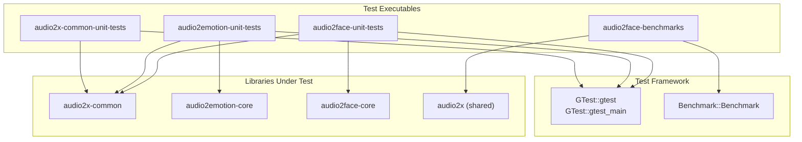

**Test Configuration Details:**

| Test Executable | Sources | Links Against | Test Discovery |
|----------------|---------|---------------|----------------|
| **audio2x-common-unit-tests** | All `.cpp` in `audio2x-common/tests/` | `audio2x-common`, `GTest::gtest`, `GTest::gtest_main` | [audio2x-common/tests/CMakeLists.txt:38]() |
| **audio2emotion-unit-tests** | All `.cpp` and `.cu` in `audio2emotion-sdk/tests/` | `audio2emotion-core`, `audio2x-common`, `GTest::gtest`, `GTest::gtest_main`, CUDA libraries, TensorRT | [audio2emotion-sdk/tests/CMakeLists.txt:55]() |
| **audio2face-unit-tests** | All `.cpp` and `.cu` in `audio2face-sdk/tests/` | `audio2face-core`, `audio2x-common`, `Eigen3::Eigen`, `GTest::gtest`, `GTest::gtest_main` | [audio2face-sdk/tests/CMakeLists.txt:51]() |
| **audio2face-benchmarks** | `main.cpp`, `blendshape_solver.cpp`, `executor_*.cpp`, `interactive_executor.cpp`, `utils.cpp` | `audio2x` (shared), `AudioFile::AudioFile`, `Benchmark::Benchmark` | N/A (benchmark, not test) |

**Test Data Directory:**

All test executables define `TEST_DATA_DIR` preprocessor macro pointing to test assets:
- [audio2x-common/tests/CMakeLists.txt:22]()
- [audio2emotion-sdk/tests/CMakeLists.txt:32]()
- [audio2face-sdk/tests/CMakeLists.txt:31]()
- [audio2face-sdk/source/benchmarks/CMakeLists.txt:22]()

```cmake
target_compile_definitions(<test-target> PRIVATE TEST_DATA_DIR="${TEST_DATA_DIR}")
```

The `TEST_DATA_DIR` variable is set at the root level [CMakeLists.txt:133-139]() and can be overridden by the user.

**Test Discovery:**

Tests use CTest with `gtest_discover_tests()` in `PRE_TEST` mode, which scans test executables before running to discover individual test cases [audio2x-common/tests/CMakeLists.txt:38](), [audio2emotion-sdk/tests/CMakeLists.txt:55](), [audio2face-sdk/tests/CMakeLists.txt:51]().

**Visual Studio Debugger Configuration:**

Test executables on Windows configure the debugger environment to include TensorRT and CUDA paths:

```cmake
set_target_properties(<test-target> PROPERTIES
    VS_DEBUGGER_ENVIRONMENT "PATH=%PATH%;${TENSORRT_ROOT_DIR}/lib;${CUDA_PATH}/bin"
    VS_DEBUGGER_WORKING_DIRECTORY ${AUDIO2X_SDK_ROOT}
)
```

**Sources:** [audio2x-common/tests/CMakeLists.txt:1-39](), [audio2emotion-sdk/tests/CMakeLists.txt:1-56](), [audio2face-sdk/tests/CMakeLists.txt:1-52](), [audio2face-sdk/source/benchmarks/CMakeLists.txt:1-32]()

---

## Build Output Structure

The build system produces organized output directories for headers, libraries, and executables.

### Output Directory Layout

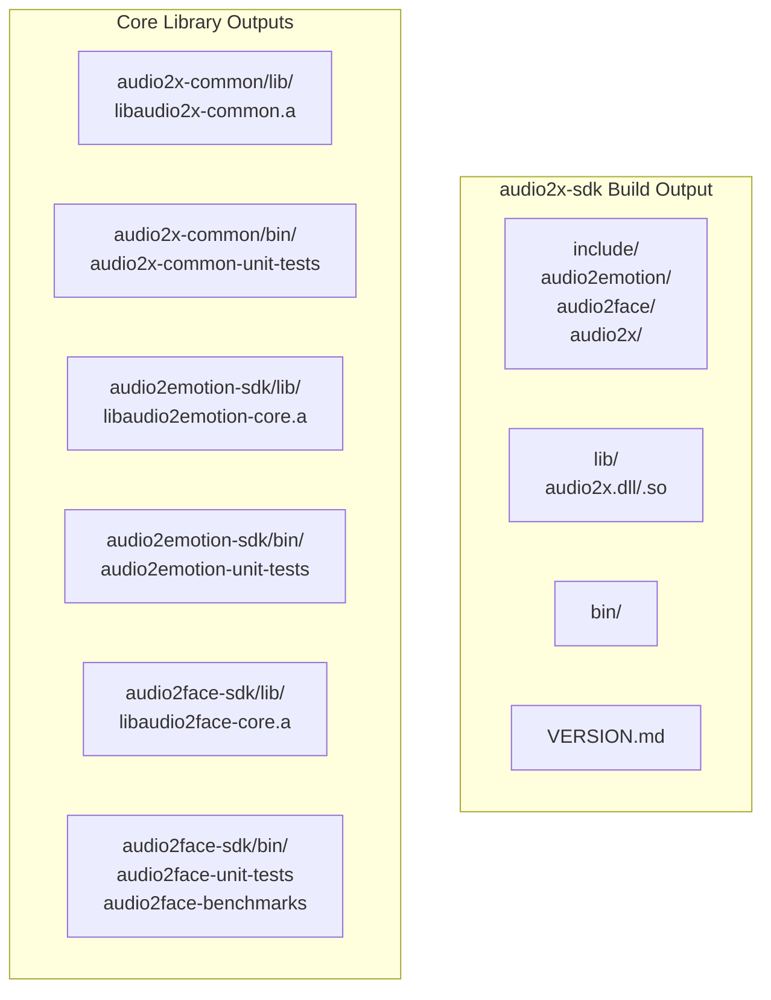

**Unified SDK Output** [audio2x-sdk/CMakeLists.txt:10-13]()

| Output Type | Directory | Contents |
|------------|-----------|----------|
| **Headers** | `include/audio2emotion/`, `include/audio2face/`, `include/audio2x/` | All public headers from each module |
| **Shared Library** | `lib/` | `audio2x.dll` (Windows) or `libaudio2x.so` (Linux) |
| **Import Library** | `lib/` | `audio2x.lib` (Windows only) |
| **Documentation** | Root | `VERSION.md` copied from source |

**Core Library Outputs:**

Each core library configures its own output directories:
- **audio2x-common**: [audio2x-common/source/audio2x/CMakeLists.txt:4-8]()
- **audio2emotion-core**: [audio2emotion-sdk/source/audio2emotion-core/CMakeLists.txt:4-8]()
- **audio2face-core**: No explicit output directory configuration (uses defaults)

Static libraries (`.a` on Linux, `.lib` on Windows) are placed in `lib/`, while test executables go into `bin/`.

**Multi-Configuration Generators:**

For Visual Studio and other multi-config generators, output directories are automatically subdivided by configuration (e.g., `lib/Debug/`, `lib/Release/`).

**Sources:** [audio2x-sdk/CMakeLists.txt:10-100](), [audio2x-common/source/audio2x/CMakeLists.txt:4-8](), [audio2emotion-sdk/source/audio2emotion-core/CMakeLists.txt:4-8]()

---

## Build Type Configuration

The build system normalizes build types to `"debug"` or `"release"` for dependency resolution, while preserving standard CMake configurations.

### Build Type Normalization Logic

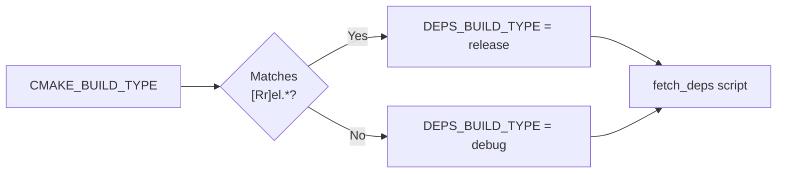

**Build Type Handling** [CMakeLists.txt:15-24]()

| CMake Build Type | Normalized `DEPS_BUILD_TYPE` | Use Case |
|------------------|------------------------------|----------|
| `Release` | `"release"` | Optimized production builds |
| `RelWithDebInfo` | `"release"` | Optimized with debug symbols |
| `MinSizeRel` | `"release"` | Size-optimized release |
| `Debug` | `"debug"` | Unoptimized, full debug info |
| (empty/other) | `"debug"` | Default to debug dependencies |

**Multi-Config Generator Behavior:**

For generators like Visual Studio or Ninja Multi-Config that support multiple configurations in a single build tree, the fetch script is invoked twice to pull both debug and release dependencies [CMakeLists.txt:38-52]():

```cmake
if(CMAKE_CONFIGURATION_TYPES)
    execute_process(
        COMMAND ${CMAKE_COMMAND} -E env "PYTHON=${PACKMAN_PYTHON}" ${FETCH_DEPS_CMD} "debug"
        COMMAND ${CMAKE_COMMAND} -E env "PYTHON=${PACKMAN_PYTHON}" ${FETCH_DEPS_CMD} "release"
        ...
    )
endif()
```

**Important Note:** Because CMake caches `find_package()` results, changing `CMAKE_BUILD_TYPE` after initial configuration will not re-find dependencies. A clean build directory is required to switch between debug and release [CMakeLists.txt:17-19]().

**Sources:** [CMakeLists.txt:15-52]()

---

## CMake Module Path

The build system extends the module search path to include custom `Find*.cmake` modules [CMakeLists.txt:7-10]():

```cmake
set(CMAKE_MODULE_PATH
    ${CMAKE_CURRENT_SOURCE_DIR}/cmake/Modules
    ${CMAKE_MODULE_PATH}
)
```

This directory contains custom find modules for dependencies not provided by CMake or the dependencies themselves, such as:
- `FindTensorRT.cmake`
- `FindCnpy.cmake`
- `FindBenchmark.cmake`

**Sources:** [CMakeLists.txt:7-10]()

---

## Compilation Process Summary

The complete build process follows this sequence:

1. **Configure Phase:**
   - Normalize `CMAKE_BUILD_TYPE` to `DEPS_BUILD_TYPE` (`"debug"` or `"release"`)
   - Check if `_deps/target-deps/` exists
   - If not, invoke `fetch_deps` script with packman
   - For multi-config generators, fetch both debug and release
   - Extend `CMAKE_PREFIX_PATH` with dependency directories
   - Find and configure all external dependencies via `find_package()`
   - Set CUDA compiler and architecture targets
   - Apply platform-specific compiler flags

2. **Build Phase:**
   - Compile `audio2x-common` static library (CPU and CUDA sources)
   - Compile `audio2emotion-core` static library (links against `audio2x-common`)
   - Compile `audio2face-core` static library (links against `audio2x-common`)
   - Compile `audio2x` shared library (links against all three static libraries)
   - Post-build: Copy all public headers to unified `include/` directory
   - Post-build: Copy `VERSION.md` to output directory
   - Compile test executables (optional, if testing enabled)

3. **Test Phase (Optional):**
   - Run CTest with discovered tests from each test executable

**Sources:** All CMakeLists.txt files referenced throughout this document.

---

# Page: Core Infrastructure (audio2x-common)

# Core Infrastructure (audio2x-common)

<details>
<summary>Relevant source files</summary>

The following files were used as context for generating this wiki page:

- [audio2x-common/include/audio2x/executor.h](audio2x-common/include/audio2x/executor.h)
- [audio2x-common/include/audio2x/interactive_executor.h](audio2x-common/include/audio2x/interactive_executor.h)
- [audio2x-common/include/audio2x/internal/audio2x.h](audio2x-common/include/audio2x/internal/audio2x.h)
- [audio2x-common/include/audio2x/internal/executor.h](audio2x-common/include/audio2x/internal/executor.h)
- [audio2x-common/include/audio2x/tensor_bool.h](audio2x-common/include/audio2x/tensor_bool.h)
- [audio2x-common/include/audio2x/tensor_int64.h](audio2x-common/include/audio2x/tensor_int64.h)
- [audio2x-common/include/audio2x/tensor_uint64.h](audio2x-common/include/audio2x/tensor_uint64.h)
- [audio2x-common/source/audio2x/audio2x.cpp](audio2x-common/source/audio2x/audio2x.cpp)
- [audio2x-common/source/audio2x/executor.cpp](audio2x-common/source/audio2x/executor.cpp)
- [audio2x-common/source/audio2x/tensor_bool.cpp](audio2x-common/source/audio2x/tensor_bool.cpp)
- [audio2x-common/source/audio2x/tensor_float.cpp](audio2x-common/source/audio2x/tensor_float.cpp)
- [audio2x-common/source/audio2x/tensor_int64.cpp](audio2x-common/source/audio2x/tensor_int64.cpp)
- [audio2x-common/source/audio2x/tensor_uint64.cpp](audio2x-common/source/audio2x/tensor_uint64.cpp)

</details>


## Purpose and Scope

The `audio2x-common` module provides the foundational infrastructure layer used by both the audio2face and audio2emotion SDKs. It implements GPU-accelerated tensor operations, data accumulation systems, and execution frameworks that enable efficient processing of audio and animation data.

This page provides an overview of the core components. For detailed documentation on specific subsystems:
- Tensor system architecture and implementation: [Tensor System](#3.1)
- Audio and emotion data accumulation: [Data Accumulators](#3.2)  
- Executor interfaces and execution patterns: [Execution Framework](#3.3)

---

## Module Architecture

The `audio2x-common` module is organized into several key subsystems that work together to provide a complete infrastructure for audio-driven processing:

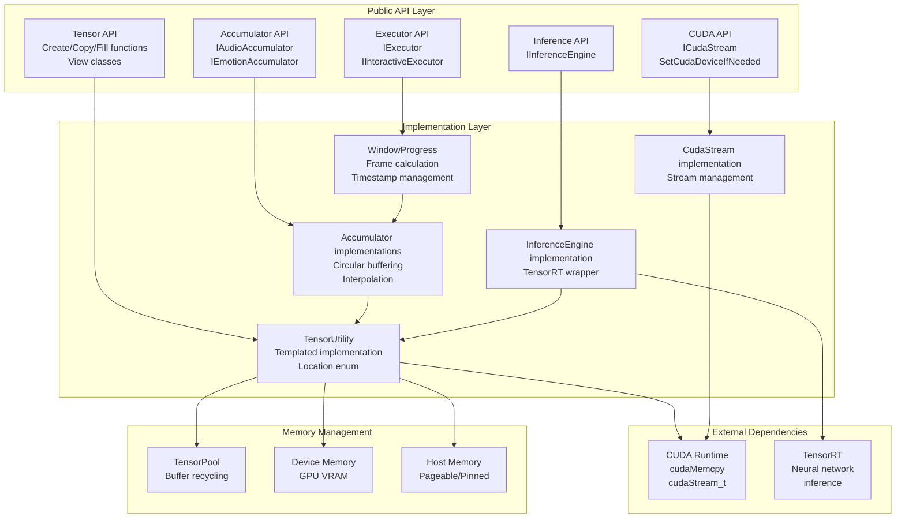

**Sources:** [audio2x-common/include/audio2x/internal/audio2x.h:23-166](), [audio2x-common/source/audio2x/audio2x.cpp:1-1005]()

---

## Tensor System Overview

The tensor system provides GPU-accelerated data structures for storing and manipulating numeric arrays. It implements a dual-representation pattern with lightweight **view classes** and memory-owning **interface classes**.

### Data Types and View Classes

Four data types are supported, each with identical API patterns:

| Type | Device View | Device Const View | Host View | Host Const View | Owning Interface (Device) | Owning Interface (Host) |
|------|------------|-------------------|-----------|----------------|---------------------------|-------------------------|
| `float` | `DeviceTensorFloatView` | `DeviceTensorFloatConstView` | `HostTensorFloatView` | `HostTensorFloatConstView` | `IDeviceTensorFloat` | `IHostTensorFloat` |
| `bool` | `DeviceTensorBoolView` | `DeviceTensorBoolConstView` | `HostTensorBoolView` | `HostTensorBoolConstView` | `IDeviceTensorBool` | `IHostTensorBool` |
| `int64_t` | `DeviceTensorInt64View` | `DeviceTensorInt64ConstView` | `HostTensorInt64View` | `HostTensorInt64ConstView` | `IDeviceTensorInt64` | `IHostTensorInt64` |
| `uint64_t` | `DeviceTensorUInt64View` | `DeviceTensorUInt64ConstView` | `HostTensorUInt64View` | `HostTensorUInt64ConstView` | `IDeviceTensorUInt64` | `IHostTensorUInt64` |

**Sources:** [audio2x-common/include/audio2x/tensor_float.h](), [audio2x-common/include/audio2x/tensor_bool.h:1-206](), [audio2x-common/include/audio2x/tensor_int64.h:1-206](), [audio2x-common/include/audio2x/tensor_uint64.h:1-206]()

### View Classes Design

View classes are lightweight non-owning references to tensor data. Each view is exactly 16 bytes (pointer + size):

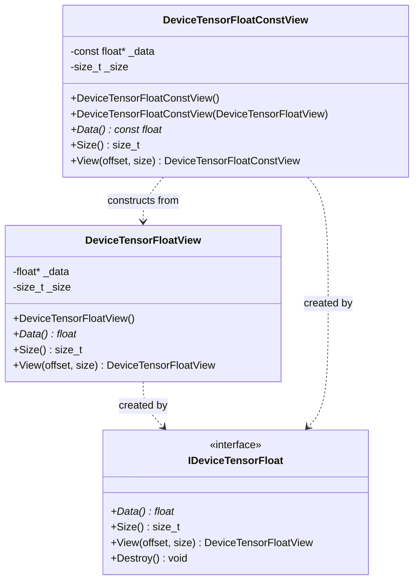

All view classes enforce size constraints at 16 bytes with 8-byte alignment:
- [audio2x-common/include/audio2x/tensor_float.h:60-61]()
- [audio2x-common/include/audio2x/tensor_bool.h:57-58]()
- [audio2x-common/include/audio2x/tensor_int64.h:57-58]()
- [audio2x-common/include/audio2x/tensor_uint64.h:57-58]()

**Sources:** [audio2x-common/source/audio2x/audio2x.cpp:97-221](), [audio2x-common/include/audio2x/tensor_float.h:36-83]()

### Memory Locations

Three memory locations are supported:

1. **Device Memory** (`Location::Device`): GPU VRAM for fast computation
2. **Host Pinned Memory** (`Location::HostPinned`): Page-locked CPU memory for fast DMA transfers
3. **Host Memory** (`Location::Host`): Standard pageable CPU memory

Creation functions for each location:

```cpp
// Device tensors
IDeviceTensorFloat* CreateDeviceTensorFloat(std::size_t size);
IDeviceTensorFloat* CreateDeviceTensorFloat(HostTensorFloatConstView source, cudaStream_t stream);

// Host tensors
IHostTensorFloat* CreateHostTensorFloat(std::size_t size);  // Pageable
IHostTensorFloat* CreateHostPinnedTensorFloat(std::size_t size);  // Pinned
```

**Sources:** [audio2x-common/include/audio2x/internal/audio2x.h:93-110](), [audio2x-common/source/audio2x/tensor_float.cpp:31-42]()

### Tensor Operations

The tensor system provides synchronous and asynchronous operations:

**Copy Operations** (all combinations of Device↔Device, Device↔Host):
```cpp
// Asynchronous (stream-based)
std::error_code CopyDeviceToDevice(DeviceTensorFloatView dst, DeviceTensorFloatConstView src, cudaStream_t stream);
std::error_code CopyHostToDevice(DeviceTensorFloatView dst, HostTensorFloatConstView src, cudaStream_t stream);
std::error_code CopyDeviceToHost(HostTensorFloatView dst, DeviceTensorFloatConstView src, cudaStream_t stream);

// Synchronous (default stream)
std::error_code CopyDeviceToDevice(DeviceTensorFloatView dst, DeviceTensorFloatConstView src);
```

**Fill Operations**:
```cpp
std::error_code FillOnDevice(DeviceTensorFloatView destination, float value, cudaStream_t stream);
std::error_code FillOnHost(HostTensorFloatView destination, float value);
```

**Sources:** [audio2x-common/source/audio2x/audio2x.cpp:255-317](), [audio2x-common/source/audio2x/tensor_float.cpp:57-102]()

### Accessor Pattern for Safe View Creation

The `Accessor` pattern prevents unsafe view creation from arbitrary pointers. View constructors are private; only internal factory functions can create views:

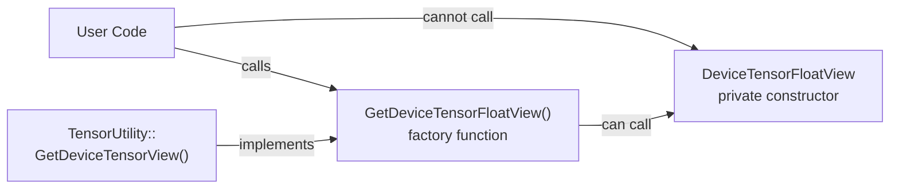

The `Accessor` nested class provides controlled access:
- [audio2x-common/include/audio2x/internal/audio2x.h:47-56]()
- [audio2x-common/include/audio2x/tensor_float.h:51]() (Accessor class declaration)

**Sources:** [audio2x-common/include/audio2x/internal/audio2x.h:47-56](), [audio2x-common/source/audio2x/tensor_float.cpp:47-52]()

### Implementation via TensorUtility Template

All tensor implementations use the templated `TensorUtility<T>` class, which provides:
- Type-safe memory allocation for device/host/pinned locations
- Copy operations with proper CUDA error handling
- Fill operations optimized for each memory location
- Buffer pooling via `TensorPool` for memory reuse

**Sources:** [audio2x-common/source/audio2x/tensor_float.cpp:31-102](), [audio2x-common/source/audio2x/tensor_bool.cpp:31-102](), [audio2x-common/source/audio2x/tensor_int64.cpp:31-102](), [audio2x-common/source/audio2x/tensor_uint64.cpp:31-102]()

---

## Data Accumulator Systems

Two accumulator systems manage time-series data flow:

### Audio Accumulator

`IAudioAccumulator` implements circular buffering for audio samples:

```mermaid
graph LR
    AudioInput["Audio Samples<br/>16 kHz float*"] -->|PushSamples| Accumulator["IAudioAccumulator<br/>Circular buffer<br/>tensorSize × tensorCount"]
    
    Accumulator -->|NbAccumulatedSamples| TrackingAPI["Tracking API"]
    Accumulator -->|IsClosed| TrackingAPI
    
    WindowProg["WindowProgress"] -->|GetNbAvailableWindows| TrackingAPI
    
    Executor["IExecutor"] -->|GetNbAvailableExecutions| WindowProg
```

Key methods:
```cpp
class IAudioAccumulator {
    virtual std::error_code PushSamples(HostTensorFloatConstView samples) = 0;
    virtual std::size_t NbAccumulatedSamples() const = 0;
    virtual bool IsClosed() const = 0;
    virtual std::error_code Close() = 0;
    virtual void Destroy() = 0;
};
```

Factory function:
```cpp
IAudioAccumulator* CreateAudioAccumulator(std::size_t tensorSize, std::size_t tensorCount);
```

**Sources:** [audio2x-common/source/audio2x/audio2x.cpp:28-30](), [audio2x-common/include/audio2x/internal/audio2x.h:66]()

### Emotion Accumulator

`IEmotionAccumulator` manages time-series emotion vectors with interpolation support:

```cpp
class IEmotionAccumulator {
    virtual std::error_code PushEmotions(
        timestamp_t timestamp, 
        HostTensorFloatConstView emotions
    ) = 0;
    virtual timestamp_t LastAccumulatedTimestamp() const = 0;
    virtual bool IsEmpty() const = 0;
    virtual bool IsClosed() const = 0;
    virtual std::error_code Close() = 0;
    virtual void Destroy() = 0;
};
```

Factory function:
```cpp
IEmotionAccumulator* CreateEmotionAccumulator(
    std::size_t emotionSize,           // Vector dimension (e.g., 10)
    std::size_t emotionCountPerBuffer, // Buffer capacity
    std::size_t preallocatedBufferCount // Pre-allocated buffers
);
```

**Sources:** [audio2x-common/source/audio2x/audio2x.cpp:56-60](), [audio2x-common/include/audio2x/internal/audio2x.h:76-78]()

### WindowProgress System

`WindowProgress` calculates sliding window positions for inference:

```mermaid
graph TB
    AudioSamples["Audio Samples<br/>Accumulated count"] --> Progress["WindowProgress<br/>stride, windowSize<br/>firstTimestamp"]
    
    Progress -->|GetNbAvailableWindows| WindowCount["Available Windows"]
    Progress -->|GetWindowTimestamp| Timestamps["Window Timestamps"]
    
    EmotionLimit["Emotion Accumulator<br/>LastAccumulatedTimestamp"] -->|limits| WindowCount
```

The `WindowProgress` tracks:
- Window stride (hop size between frames)
- Window size (samples per inference)
- First timestamp offset
- Current position in accumulated data

It integrates with executors to determine when sufficient data is available for inference.

**Sources:** [audio2x-common/source/audio2x/executor.cpp:29-65](), [audio2x-common/include/audio2x/internal/executor.h:28-34]()

---

## Execution Framework

The execution framework provides two paradigms for running inference and processing:

### Batch Execution Interface

`IExecutor` supports continuous batch processing as data arrives:

```cpp
class IExecutor {
    // Track management
    virtual std::size_t GetNbTracks() const = 0;
    virtual std::error_code Reset(std::size_t trackIndex) = 0;
    
    // Execution readiness
    virtual bool HasExecutionStarted(std::size_t trackIndex) const = 0;
    virtual std::size_t GetNbAvailableExecutions(std::size_t trackIndex) const = 0;
    virtual std::size_t GetTotalNbFrames(std::size_t trackIndex) const = 0;
    
    // Timing information
    virtual std::size_t GetSamplingRate() const = 0;
    virtual void GetFrameRate(std::size_t& numerator, std::size_t& denominator) const = 0;
    virtual timestamp_t GetFrameTimestamp(std::size_t frameIndex) const = 0;
    
    // Execution
    virtual std::error_code Execute(std::size_t* pNbExecutedTracks) = 0;
    
    virtual void Destroy() = 0;
};
```

**Sources:** [audio2x-common/include/audio2x/executor.h:33-79]()

### Interactive Execution Interface

`IInteractiveExecutor` enables frame-specific computation with layer-based invalidation:

```cpp
class IInteractiveExecutor {
    using invalidation_layer_t = std::size_t;
    static constexpr invalidation_layer_t kLayerNone = 0;
    static constexpr invalidation_layer_t kLayerAll = 1;
    
    // Layer invalidation for caching
    virtual std::error_code Invalidate(invalidation_layer_t layer) = 0;
    virtual bool IsValid(invalidation_layer_t layer) const = 0;
    
    // Frame-specific execution
    virtual std::error_code ComputeFrame(std::size_t frameIndex) = 0;
    virtual std::error_code ComputeAllFrames() = 0;
    virtual std::error_code Interrupt() = 0;
    
    // Timing information
    virtual std::size_t GetTotalNbFrames() const = 0;
    virtual std::size_t GetSamplingRate() const = 0;
    virtual void GetFrameRate(std::size_t& numerator, std::size_t& denominator) const = 0;
    virtual timestamp_t GetFrameTimestamp(std::size_t frameIndex) const = 0;
    
    virtual void Destroy() = 0;
};
```

The layer system allows caching inference results while invalidating only post-processing layers when parameters change.

**Sources:** [audio2x-common/include/audio2x/interactive_executor.h:33-72]()

### Executor Utility Functions

Helper functions for multi-track execution:

```cpp
// Check if any track has started execution
bool HasExecutionStarted(const IExecutor& executor);

// Count tracks ready for execution
std::size_t GetNbReadyTracks(const IExecutor& executor);
```

Implementation iterates over all tracks:
- [audio2x-common/source/audio2x/executor.cpp:70-89]()

**Sources:** [audio2x-common/include/audio2x/executor.h:83-89](), [audio2x-common/source/audio2x/executor.cpp:70-89]()

---

## CUDA Utilities

### CUDA Stream Management

`ICudaStream` wraps CUDA stream lifecycle:

```cpp
class ICudaStream {
    virtual cudaStream_t Get() const = 0;
    virtual void Destroy() = 0;
};

// Factory functions
ICudaStream* CreateCudaStream();          // New non-default stream
ICudaStream* CreateDefaultCudaStream();   // Wraps default stream
```

**Sources:** [audio2x-common/source/audio2x/audio2x.cpp:40-46]()

### Device Management

```cpp
std::error_code SetCudaDeviceIfNeeded(int device);
```

Sets the CUDA device context if not already active.

**Sources:** [audio2x-common/source/audio2x/audio2x.cpp:50-52]()

---

## Inference Engine

`IInferenceEngine` provides a unified interface to TensorRT for neural network inference:

```cpp
IInferenceEngine* CreateInferenceEngine();
```

The inference engine abstracts:
- TensorRT engine loading and initialization
- Input/output tensor binding
- Execution context management
- Multi-stream execution support

**Sources:** [audio2x-common/source/audio2x/audio2x.cpp:74-76]()

---

## Additional Utilities

### Data Bytes Container

`IDataBytes` provides binary data storage:

```cpp
IDataBytes* CreateDataBytes();
```

Used for loading model files and configuration data.

**Sources:** [audio2x-common/source/audio2x/audio2x.cpp:80-82]()

### Tensor Dictionary

`IHostTensorDict` provides key-value storage for tensors:

```cpp
IHostTensorDict* CreateHostTensorDict();
```

Used for organizing named tensor collections (e.g., model parameters).

**Sources:** [audio2x-common/source/audio2x/audio2x.cpp:86-88]()

---

## Module Dependencies

The `audio2x-common` module depends on:

```mermaid
graph TB
    Common["audio2x-common"]
    
    CUDA["CUDA Runtime 12.8+<br/>cudaMemcpy<br/>cudaStream_t<br/>cudaMalloc/cudaFree"]
    TensorRT["TensorRT<br/>Neural network<br/>inference"]
    Eigen["Eigen3<br/>Linear algebra<br/>(limited use)"]
    
    Common --> CUDA
    Common --> TensorRT
    Common --> Eigen
    
    Face["audio2face-core"] -.uses.-> Common
    Emotion["audio2emotion-core"] -.uses.-> Common
```

**Sources:** Based on build system configuration and header includes across the module

---

# Page: Tensor System

# Tensor System

<details>
<summary>Relevant source files</summary>

The following files were used as context for generating this wiki page:

- [audio2x-common/include/audio2x/internal/audio2x.h](audio2x-common/include/audio2x/internal/audio2x.h)
- [audio2x-common/include/audio2x/tensor_bool.h](audio2x-common/include/audio2x/tensor_bool.h)
- [audio2x-common/include/audio2x/tensor_int64.h](audio2x-common/include/audio2x/tensor_int64.h)
- [audio2x-common/include/audio2x/tensor_uint64.h](audio2x-common/include/audio2x/tensor_uint64.h)
- [audio2x-common/source/audio2x/tensor_bool.cpp](audio2x-common/source/audio2x/tensor_bool.cpp)
- [audio2x-common/source/audio2x/tensor_float.cpp](audio2x-common/source/audio2x/tensor_float.cpp)
- [audio2x-common/source/audio2x/tensor_int64.cpp](audio2x-common/source/audio2x/tensor_int64.cpp)
- [audio2x-common/source/audio2x/tensor_uint64.cpp](audio2x-common/source/audio2x/tensor_uint64.cpp)

</details>


## Purpose and Scope

The Tensor System provides the foundational GPU-accelerated data structures used throughout the Audio2Face-3D-SDK. It implements a type-safe abstraction over CUDA memory management with support for four primitive types (float, bool, int64, uint64) across three memory locations (device GPU, host pageable, host pinned). The system uses a dual-representation pattern with lightweight non-owning **views** for efficient data access and memory-owning **interfaces** for lifetime management.

For information about higher-level data structures built on tensors, see [Data Accumulators](#3.2). For details on asynchronous execution using CUDA streams, see [GPU Optimization Strategies](#8).

---

## Architecture Overview

The tensor system implements a parallel type hierarchy across four data types, with each type following an identical API pattern implemented via the internal `TensorUtility<T>` template class.

### Type Hierarchy

```mermaid
graph TB
    subgraph FloatTypes["Float Tensors"]
        DeviceFloatView["DeviceTensorFloatView<br/>16 bytes: pointer + size"]
        DeviceFloatConstView["DeviceTensorFloatConstView<br/>16 bytes: const pointer + size"]
        HostFloatView["HostTensorFloatView<br/>16 bytes: pointer + size"]
        HostFloatConstView["HostTensorFloatConstView<br/>16 bytes: const pointer + size"]
        IDeviceFloat["IDeviceTensorFloat<br/>Owns device memory"]
        IHostFloat["IHostTensorFloat<br/>Owns host memory"]
        
        IDeviceFloat -->|"operator"| DeviceFloatView
        IDeviceFloat -->|"operator const"| DeviceFloatConstView
        IHostFloat -->|"operator"| HostFloatView
        IHostFloat -->|"operator const"| HostFloatConstView
        DeviceFloatView -->|"implicit"| DeviceFloatConstView
        HostFloatView -->|"implicit"| HostFloatConstView
    end
    
    subgraph BoolTypes["Bool Tensors"]
        DeviceBoolView["DeviceTensorBoolView"]
        DeviceBoolConstView["DeviceTensorBoolConstView"]
        HostBoolView["HostTensorBoolView"]
        HostBoolConstView["HostTensorBoolConstView"]
        IDeviceBool["IDeviceTensorBool"]
        IHostBool["IHostTensorBool"]
        
        IDeviceBool -->|"operator"| DeviceBoolView
        IDeviceBool -->|"operator const"| DeviceBoolConstView
        IHostBool -->|"operator"| HostBoolView
        IHostBool -->|"operator const"| HostBoolConstView
    end
    
    subgraph Int64Types["Int64 Tensors"]
        DeviceInt64View["DeviceTensorInt64View"]
        DeviceInt64ConstView["DeviceTensorInt64ConstView"]
        HostInt64View["HostTensorInt64View"]
        HostInt64ConstView["HostTensorInt64ConstView"]
        IDeviceInt64["IDeviceTensorInt64"]
        IHostInt64["IHostTensorInt64"]
        
        IDeviceInt64 -->|"operator"| DeviceInt64View
        IDeviceInt64 -->|"operator const"| DeviceInt64ConstView
        IHostInt64 -->|"operator"| HostInt64View
        IHostInt64 -->|"operator const"| HostInt64ConstView
    end
    
    subgraph UInt64Types["UInt64 Tensors"]
        DeviceUInt64View["DeviceTensorUInt64View"]
        DeviceUInt64ConstView["DeviceTensorUInt64ConstView"]
        HostUInt64View["HostTensorUInt64View"]
        HostUInt64ConstView["HostTensorUInt64ConstView"]
        IDeviceUInt64["IDeviceTensorUInt64"]
        IHostUInt64["IHostTensorUInt64"]
        
        IDeviceUInt64 -->|"operator"| DeviceUInt64View
        IDeviceUInt64 -->|"operator const"| DeviceUInt64ConstView
        IHostUInt64 -->|"operator"| HostUInt64View
        IHostUInt64 -->|"operator const"| HostUInt64ConstView
    end
```

**Sources**: [audio2x-common/include/audio2x/tensor_float.h](), [audio2x-common/include/audio2x/tensor_bool.h:36-160](), [audio2x-common/include/audio2x/tensor_int64.h:36-160](), [audio2x-common/include/audio2x/tensor_uint64.h:36-160]()

---

## Data Types and Memory Locations

### Supported Data Types

The tensor system provides identical APIs for four primitive types:

| Type | C++ Type | Use Cases |
|------|----------|-----------|
| **Float** | `float` | Neural network activations, vertex positions, blendshape weights |
| **Bool** | `bool` | Active track masks, feature flags |
| **Int64** | `int64_t` | Frame indices, timestamps, counters |
| **UInt64** | `uint64_t` | Unsigned frame indices, buffer sizes |

### Memory Locations

```mermaid
graph LR
    subgraph Client["Client Code"]
        UserCode["Application"]
    end
    
    subgraph MemoryTypes["Memory Locations"]
        Device["Device Memory<br/>cudaMalloc<br/>GPU VRAM<br/>Fast compute, slow transfer"]
        HostPinned["Host Pinned Memory<br/>cudaMallocHost<br/>Page-locked CPU RAM<br/>Fast DMA, limited supply"]
        Host["Host Memory<br/>malloc<br/>Pageable CPU RAM<br/>Abundant, slow DMA"]
    end
    
    subgraph Operations["Transfer Operations"]
        CopyD2D["CopyDeviceToDevice<br/>GPU → GPU"]
        CopyH2D["CopyHostToDevice<br/>CPU → GPU"]
        CopyD2H["CopyDeviceToHost<br/>GPU → CPU"]
        CopyH2H["CopyHostToHost<br/>CPU → CPU"]
    end
    
    UserCode --> Device
    UserCode --> HostPinned
    UserCode --> Host
    
    Device --> CopyD2D
    Device --> CopyD2H
    Host --> CopyH2D
    Host --> CopyH2H
    HostPinned --> CopyH2D
    HostPinned --> CopyH2H
    
    CopyD2D --> Device
    CopyH2D --> Device
    CopyD2H --> Host
    CopyD2H --> HostPinned
    CopyH2H --> Host
    CopyH2H --> HostPinned
```

**Sources**: [audio2x-common/include/audio2x/tensor_float.h]()

| Memory Type | Allocation | Properties | Use Cases |
|-------------|------------|------------|-----------|
| **Device** | `CreateDeviceTensor*()` | GPU VRAM, fastest compute | Inference inputs/outputs, animator state |
| **Host Pinned** | `CreateHostPinnedTensor*()` | Page-locked CPU RAM, fast DMA | Streaming audio buffers, frequent transfers |
| **Host** | `CreateHostTensor*()` | Pageable CPU RAM, abundant | File I/O, infrequent transfers, large allocations |

**Sources**: [audio2x-common/include/audio2x/tensor_float.h](), [audio2x-common/source/audio2x/tensor_float.cpp:31-42]()

---

## View Classes vs Owning Interfaces

### View Classes (Non-Owning)

View classes are lightweight 16-byte structures that provide non-owning access to tensor data. They consist only of a pointer and size, making them trivially copyable and suitable for passing by value.

**Structure (all types)**:
```
Size: 16 bytes
Alignment: 8 bytes
Members: T* _data, std::size_t _size
```

**API Pattern** (example for float, identical for bool/int64/uint64):
- `DeviceTensorFloatView` - Mutable view to device memory
- `DeviceTensorFloatConstView` - Const view to device memory  
- `HostTensorFloatView` - Mutable view to host memory
- `HostTensorFloatConstView` - Const view to host memory

**Key Methods**:
- `Data()` - Returns pointer to underlying memory
- `Size()` - Returns element count
- `View(offset, size)` - Creates sub-view without copying

**Sources**: [audio2x-common/include/audio2x/tensor_float.h](), [audio2x-common/include/audio2x/tensor_bool.h:36-127](), [audio2x-common/include/audio2x/tensor_int64.h:36-127](), [audio2x-common/include/audio2x/tensor_uint64.h:36-127]()

### Owning Interface Classes

Interface classes manage memory lifetime through virtual methods and provide automatic cleanup via the `Destroy()` method.

```mermaid
graph TB
    subgraph Ownership["Ownership Pattern"]
        Create["CreateDeviceTensorFloat(size)<br/>CreateHostTensorFloat(size)<br/>CreateHostPinnedTensorFloat(size)"]
        Interface["IDeviceTensorFloat*<br/>IHostTensorFloat*<br/>Owns memory"]
        View["DeviceTensorFloatView<br/>HostTensorFloatView<br/>Non-owning access"]
        Destroy["tensor->Destroy()<br/>Frees memory"]
        
        Create -->|"returns"| Interface
        Interface -->|"operator"| View
        Interface -->|"call"| Destroy
    end
    
    subgraph Lifecycle["Typical Lifecycle"]
        Alloc["auto* tensor = CreateDeviceTensorFloat(1024)"]
        Use["DeviceTensorFloatView view = *tensor<br/>processData(view)"]
        Free["tensor->Destroy()"]
        
        Alloc --> Use
        Use --> Free
    end
```

**Sources**: [audio2x-common/include/audio2x/tensor_float.h](), [audio2x-common/source/audio2x/tensor_float.cpp:31-42]()

**Interface Methods** (example for `IDeviceTensorFloat`):
- `operator DeviceTensorFloatView()` - Converts to mutable view
- `operator DeviceTensorFloatConstView() const` - Converts to const view
- `View(offset, size)` - Creates sub-view
- `Data()` / `Data() const` - Direct pointer access
- `Size()` - Element count
- `Destroy()` - Frees memory (must be called by user)

**Sources**: [audio2x-common/include/audio2x/tensor_float.h](), [audio2x-common/include/audio2x/tensor_bool.h:129-160](), [audio2x-common/include/audio2x/tensor_int64.h:129-160](), [audio2x-common/include/audio2x/tensor_uint64.h:129-160]()

---

## Accessor Pattern for Safe View Creation

View classes use private constructors to prevent unsafe instantiation from arbitrary pointers. The `Accessor` nested class provides controlled view creation through the internal API.

```mermaid
graph TB
    subgraph Public["Public API"]
        UserCode["Client Code"]
        Interface["IDeviceTensorFloat"]
        PublicView["DeviceTensorFloatView"]
    end
    
    subgraph Internal["Internal API"]
        TensorUtil["TensorUtility&lt;float&gt;"]
        Accessor["DeviceTensorFloatView::Accessor"]
        PrivateCtor["DeviceTensorFloatView<br/>private constructor"]
    end
    
    subgraph Unsafe["Unsafe Escape Hatch"]
        GetView["GetDeviceTensorFloatView(ptr, size)<br/>For external GPU pointers"]
    end
    
    UserCode -->|"uses"| Interface
    Interface -->|"operator"| PublicView
    TensorUtil -->|"friend"| Accessor
    Accessor -->|"calls"| PrivateCtor
    PrivateCtor -->|"returns"| PublicView
    
    UserCode -->|"extreme care"| GetView
    GetView -->|"bypasses safety"| PrivateCtor
```

**Sources**: [audio2x-common/include/audio2x/internal/audio2x.h:47-56](), [audio2x-common/include/audio2x/tensor_float.h]()

**Accessor Implementation** (for all types):

The `Accessor` class is declared as a nested class within each view type but implemented in the internal header:

```
// In public header (e.g., tensor_float.h)
class DeviceTensorFloatView {
  class Accessor;  // Forward declaration
private:
  DeviceTensorFloatView(float* data, std::size_t size);  // Private constructor
};

// In internal/audio2x.h
class DeviceTensorFloatView::Accessor {
public:
  static inline DeviceTensorFloatView Build(float* data, std::size_t size) {
    return {data, size};
  }
};
```

**Sources**: [audio2x-common/include/audio2x/internal/audio2x.h:47-56](), [audio2x-common/include/audio2x/tensor_float.h](), [audio2x-common/include/audio2x/tensor_bool.h:49](), [audio2x-common/include/audio2x/tensor_int64.h:49](), [audio2x-common/include/audio2x/tensor_uint64.h:49]()

### Unsafe View Creation Functions

For integration with external CUDA code, the system provides escape hatch functions that bypass the accessor pattern. These must be used with extreme care:

- `GetDeviceTensorFloatView(float* data, size)` 
- `GetDeviceTensorFloatConstView(const float* data, size)`
- (Similar for bool, int64, uint64)

**Warning**: These functions assume the pointer is valid GPU device memory. Using them with invalid pointers causes undefined behavior.

**Sources**: [audio2x-common/include/audio2x/tensor_float.h](), [audio2x-common/source/audio2x/tensor_float.cpp:44-52]()

---

## Factory Functions

### Tensor Creation

All factory functions return raw pointers. The caller is responsible for calling `Destroy()` to free memory.

| Function | Purpose | Memory Type |
|----------|---------|-------------|
| `CreateDeviceTensor*(size)` | Allocate empty tensor on GPU | Device |
| `CreateDeviceTensor*(hostView, stream)` | Allocate and copy from host | Device |
| `CreateHostTensor*(size)` | Allocate pageable CPU memory | Host |
| `CreateHostPinnedTensor*(size)` | Allocate pinned CPU memory | Host Pinned |

**Function Signatures** (float example, identical for bool/int64/uint64):

```cpp
// Empty device tensor
IDeviceTensorFloat* CreateDeviceTensorFloat(std::size_t size);

// Device tensor initialized from host data
IDeviceTensorFloat* CreateDeviceTensorFloat(
  HostTensorFloatConstView source, 
  cudaStream_t cudaStream
);

// Host tensors
IHostTensorFloat* CreateHostTensorFloat(std::size_t size);
IHostTensorFloat* CreateHostPinnedTensorFloat(std::size_t size);
```

**Sources**: [audio2x-common/include/audio2x/tensor_float.h](), [audio2x-common/source/audio2x/tensor_float.cpp:31-42](), [audio2x-common/include/audio2x/tensor_bool.h:163-166](), [audio2x-common/include/audio2x/tensor_int64.h:163-166](), [audio2x-common/include/audio2x/tensor_uint64.h:163-166]()

---

## Copy and Fill Operations

### Copy Operations Matrix

All copy operations support both synchronous (blocking) and asynchronous (stream-based) execution. Asynchronous variants take a `cudaStream_t` parameter.

```mermaid
graph TB
    subgraph Sources["Source Memory"]
        DeviceSrc["Device Memory"]
        HostSrc["Host Memory<br/>Pageable or Pinned"]
    end
    
    subgraph Destinations["Destination Memory"]
        DeviceDst["Device Memory"]
        HostDst["Host Memory<br/>Pageable or Pinned"]
    end
    
    subgraph Operations["Copy Operations"]
        D2D["CopyDeviceToDevice<br/>cudaMemcpyAsync"]
        H2D["CopyHostToDevice<br/>cudaMemcpyAsync<br/>Fast if pinned"]
        D2H["CopyDeviceToHost<br/>cudaMemcpyAsync<br/>Fast if pinned"]
        H2H["CopyHostToHost<br/>memcpy or async"]
    end
    
    DeviceSrc --> D2D
    DeviceSrc --> D2H
    HostSrc --> H2D
    HostSrc --> H2H
    
    D2D --> DeviceDst
    H2D --> DeviceDst
    D2H --> HostDst
    H2H --> HostDst
```

**Sources**: [audio2x-common/include/audio2x/tensor_float.h](), [audio2x-common/source/audio2x/tensor_float.cpp:57-92]()

### Copy Function Signatures

All copy functions return `std::error_code` to indicate success or failure. Sizes must match between source and destination.

**Asynchronous Copies** (with stream):
```cpp
std::error_code CopyDeviceToDevice(
  DeviceTensorFloatView destination,
  DeviceTensorFloatConstView source,
  cudaStream_t cudaStream
);

std::error_code CopyHostToDevice(
  DeviceTensorFloatView destination,
  HostTensorFloatConstView source,
  cudaStream_t cudaStream
);

std::error_code CopyDeviceToHost(
  HostTensorFloatView destination,
  DeviceTensorFloatConstView source,
  cudaStream_t cudaStream
);

std::error_code CopyHostToHost(
  HostTensorFloatView destination,
  HostTensorFloatConstView source,
  cudaStream_t cudaStream
);
```

**Synchronous Copies** (blocking):
```cpp
std::error_code CopyDeviceToDevice(
  DeviceTensorFloatView destination,
  DeviceTensorFloatConstView source
);

std::error_code CopyHostToDevice(
  DeviceTensorFloatView destination,
  HostTensorFloatConstView source
);

std::error_code CopyDeviceToHost(
  HostTensorFloatView destination,
  DeviceTensorFloatConstView source
);

std::error_code CopyHostToHost(
  HostTensorFloatView destination,
  HostTensorFloatConstView source
);
```

**Sources**: [audio2x-common/include/audio2x/tensor_float.h](), [audio2x-common/source/audio2x/tensor_float.cpp:57-92](), [audio2x-common/include/audio2x/tensor_bool.h:172-196](), [audio2x-common/include/audio2x/tensor_int64.h:172-196](), [audio2x-common/include/audio2x/tensor_uint64.h:172-196]()

### Fill Operations

Fill operations set all elements of a tensor to a specific value.

**Function Signatures**:
```cpp
// Device fill (asynchronous)
std::error_code FillOnDevice(
  DeviceTensorFloatView destination,
  float value,
  cudaStream_t cudaStream
);

// Host fill (synchronous)
std::error_code FillOnHost(
  HostTensorFloatView destination,
  float value
);
```

**Sources**: [audio2x-common/include/audio2x/tensor_float.h](), [audio2x-common/source/audio2x/tensor_float.cpp:97-102](), [audio2x-common/include/audio2x/tensor_bool.h:198-203](), [audio2x-common/include/audio2x/tensor_int64.h:198-203](), [audio2x-common/include/audio2x/tensor_uint64.h:198-203]()

---

## Implementation Architecture

### TensorUtility Template

The entire tensor system is implemented via a single templated utility class that provides type-agnostic memory management and operations.

```mermaid
graph TB
    subgraph PublicTypes["Public Type-Specific APIs"]
        FloatAPI["tensor_float.h/cpp<br/>DeviceTensorFloatView<br/>IDeviceTensorFloat<br/>CreateDeviceTensorFloat"]
        BoolAPI["tensor_bool.h/cpp<br/>DeviceTensorBoolView<br/>IDeviceTensorBool<br/>CreateDeviceTensorBool"]
        Int64API["tensor_int64.h/cpp<br/>DeviceTensorInt64View<br/>IDeviceTensorInt64<br/>CreateDeviceTensorInt64"]
        UInt64API["tensor_uint64.h/cpp<br/>DeviceTensorUInt64View<br/>IDeviceTensorUInt64<br/>CreateDeviceTensorUInt64"]
    end
    
    subgraph Implementation["Internal Implementation"]
        TensorUtil["TensorUtility&lt;T&gt;<br/>internal/tensor.h<br/>Templated core implementation"]
        Location["enum Location {<br/>  Device,<br/>  Host,<br/>  HostPinned<br/>}"]
        TensorImpl["Tensor&lt;T, Location&gt;<br/>Actual storage implementation"]
        TensorPool["TensorPool<br/>Buffer recycling"]
    end
    
    FloatAPI -->|"TensorUtility&lt;float&gt;"| TensorUtil
    BoolAPI -->|"TensorUtility&lt;bool&gt;"| TensorUtil
    Int64API -->|"TensorUtility&lt;int64_t&gt;"| TensorUtil
    UInt64API -->|"TensorUtility&lt;uint64_t&gt;"| TensorUtil
    
    TensorUtil --> Location
    TensorUtil --> TensorImpl
    TensorImpl --> TensorPool
```

**Sources**: [audio2x-common/source/audio2x/tensor_float.cpp:26-104](), [audio2x-common/source/audio2x/tensor_bool.cpp:26-104](), [audio2x-common/source/audio2x/tensor_int64.cpp:26-104](), [audio2x-common/source/audio2x/tensor_uint64.cpp:26-104]()

### Internal Functions

The internal namespace `nva2x::internal` contains the actual implementations that the public API wraps:

**Float Example**:
```cpp
namespace nva2x::internal {
  IDeviceTensorFloat* CreateDeviceTensorFloat(std::size_t size) {
    return TensorUtility<float>::CreateTensor<Location::Device>(size);
  }
  
  DeviceTensorFloatView GetDeviceTensorFloatView(float* data, std::size_t size) {
    return TensorUtility<float>::GetDeviceTensorView(data, size);
  }
  
  std::error_code CopyDeviceToDevice(
    DeviceTensorFloatView dst, DeviceTensorFloatConstView src, cudaStream_t stream
  ) {
    return TensorUtility<float>::CopyDeviceToDevice(dst, src, stream);
  }
  
  // Similar for all other operations
}
```

**Sources**: [audio2x-common/source/audio2x/tensor_float.cpp:26-104](), [audio2x-common/include/audio2x/internal/audio2x.h:93-163]()

---

## Type-Specific Header Files

Each data type has two files following identical patterns:

### Float Tensors
- **Header**: [audio2x-common/include/audio2x/tensor_float.h]()
- **Implementation**: [audio2x-common/source/audio2x/tensor_float.cpp]()
- **Classes**: `DeviceTensorFloatView`, `DeviceTensorFloatConstView`, `HostTensorFloatView`, `HostTensorFloatConstView`, `IDeviceTensorFloat`, `IHostTensorFloat`

### Bool Tensors
- **Header**: [audio2x-common/include/audio2x/tensor_bool.h]()
- **Implementation**: [audio2x-common/source/audio2x/tensor_bool.cpp]()
- **Classes**: `DeviceTensorBoolView`, `DeviceTensorBoolConstView`, `HostTensorBoolView`, `HostTensorBoolConstView`, `IDeviceTensorBool`, `IHostTensorBool`
- **Note**: Header refers to tensor_float.h for full documentation

### Int64 Tensors
- **Header**: [audio2x-common/include/audio2x/tensor_int64.h]()
- **Implementation**: [audio2x-common/source/audio2x/tensor_int64.cpp]()
- **Classes**: `DeviceTensorInt64View`, `DeviceTensorInt64ConstView`, `HostTensorInt64View`, `HostTensorInt64ConstView`, `IDeviceTensorInt64`, `IHostTensorInt64`
- **Note**: Header refers to tensor_float.h for full documentation

### UInt64 Tensors
- **Header**: [audio2x-common/include/audio2x/tensor_uint64.h]()
- **Implementation**: [audio2x-common/source/audio2x/tensor_uint64.cpp]()
- **Classes**: `DeviceTensorUInt64View`, `DeviceTensorUInt64ConstView`, `HostTensorUInt64View`, `HostTensorUInt64ConstView`, `IDeviceTensorUInt64`, `IHostTensorUInt64`
- **Note**: Header refers to tensor_float.h for full documentation

**Sources**: [audio2x-common/include/audio2x/tensor_float.h](), [audio2x-common/include/audio2x/tensor_bool.h:31-33](), [audio2x-common/include/audio2x/tensor_int64.h:31-33](), [audio2x-common/include/audio2x/tensor_uint64.h:31-33]()

---

## Integration with Void Tensors

All tensor types can convert to untyped void tensors for generic memory manipulation:

```mermaid
graph LR
    subgraph TypedTensors["Typed Tensors"]
        FloatView["DeviceTensorFloatView"]
        BoolView["DeviceTensorBoolView"]
        Int64View["DeviceTensorInt64View"]
        UInt64View["DeviceTensorUInt64View"]
    end
    
    subgraph VoidTensors["Void Tensors"]
        VoidView["DeviceTensorVoidView<br/>void* data, size_t size"]
        VoidConstView["DeviceTensorVoidConstView<br/>const void* data, size_t size"]
    end
    
    FloatView -->|"operator"| VoidView
    FloatView -->|"operator const"| VoidConstView
    BoolView -->|"operator"| VoidView
    BoolView -->|"operator const"| VoidConstView
    Int64View -->|"operator"| VoidView
    Int64View -->|"operator const"| VoidConstView
    UInt64View -->|"operator"| VoidView
    UInt64View -->|"operator const"| VoidConstView
```

**Conversion Operators** (defined in each view class):
```cpp
operator DeviceTensorVoidView();
operator DeviceTensorVoidConstView() const;
```

**Sources**: [audio2x-common/include/audio2x/tensor_float.h](), [audio2x-common/include/audio2x/tensor_bool.h:46-47](), [audio2x-common/include/audio2x/tensor_int64.h:46-47](), [audio2x-common/include/audio2x/tensor_uint64.h:46-47]()

---

## Static Assertions

All view classes enforce size and alignment requirements through static assertions:

```cpp
static_assert(sizeof(DeviceTensorFloatView) == 16);
static_assert(alignof(DeviceTensorFloatView) == 8);

static_assert(sizeof(HostTensorFloatView) == 16);
static_assert(alignof(HostTensorFloatView) == 8);

// Similar for all other view types
```

This ensures the view classes remain lightweight and suitable for passing by value without performance overhead.

**Sources**: [audio2x-common/include/audio2x/tensor_float.h](), [audio2x-common/include/audio2x/tensor_bool.h:57-58, 81-82, 100-101, 122-123](), [audio2x-common/include/audio2x/tensor_int64.h:57-58, 81-82, 100-101, 122-123](), [audio2x-common/include/audio2x/tensor_uint64.h:57-58, 81-82, 100-101, 122-123]()

---

## Host Tensor Iteration

Host tensor views provide range-based for loop support through `begin()` and `end()` free functions:

```cpp
// Mutable iteration
inline float* begin(HostTensorFloatView view) { return view.Data(); }
inline float* end(HostTensorFloatView view) { return view.Data() + view.Size(); }

// Const iteration
inline const float* begin(HostTensorFloatConstView view) { return view.Data(); }
inline const float* end(HostTensorFloatConstView view) { 
  return view.Data() + view.Size(); 
}
```

This enables standard C++ iteration patterns:
```cpp
auto* tensor = CreateHostTensorFloat(100);
HostTensorFloatView view = *tensor;

for (float& value : view) {
  value *= 2.0f;  // Process each element
}

tensor->Destroy();
```

**Sources**: [audio2x-common/include/audio2x/tensor_float.h](), [audio2x-common/include/audio2x/tensor_bool.h:103-104, 125-126](), [audio2x-common/include/audio2x/tensor_int64.h:103-104, 125-126](), [audio2x-common/include/audio2x/tensor_uint64.h:103-104, 125-126]()

---

# Page: Data Accumulators

# Data Accumulators

<details>
<summary>Relevant source files</summary>

The following files were used as context for generating this wiki page:

- [audio2emotion-sdk/include/audio2emotion/executor_classifier.h](audio2emotion-sdk/include/audio2emotion/executor_classifier.h)
- [audio2emotion-sdk/include/audio2emotion/executor_postprocess.h](audio2emotion-sdk/include/audio2emotion/executor_postprocess.h)
- [audio2emotion-sdk/source/audio2emotion-core/executor_classifier_core.cpp](audio2emotion-sdk/source/audio2emotion-core/executor_classifier_core.cpp)
- [audio2face-sdk/include/audio2face/emotion.h](audio2face-sdk/include/audio2face/emotion.h)
- [audio2face-sdk/include/audio2face/internal/emotion.h](audio2face-sdk/include/audio2face/internal/emotion.h)
- [audio2face-sdk/source/audio2face-core/emotion.cpp](audio2face-sdk/source/audio2face-core/emotion.cpp)
- [audio2x-common/include/audio2x/emotion_accumulator.h](audio2x-common/include/audio2x/emotion_accumulator.h)
- [audio2x-common/include/audio2x/internal/emotion_accumulator.h](audio2x-common/include/audio2x/internal/emotion_accumulator.h)
- [audio2x-common/source/audio2x/audio_accumulator.cpp](audio2x-common/source/audio2x/audio_accumulator.cpp)
- [audio2x-common/source/audio2x/emotion_accumulator.cpp](audio2x-common/source/audio2x/emotion_accumulator.cpp)
- [audio2x-common/tests/test_audio_accumulator.cpp](audio2x-common/tests/test_audio_accumulator.cpp)
- [audio2x-common/tests/test_emotion_accumulator.cpp](audio2x-common/tests/test_emotion_accumulator.cpp)
- [audio2x-common/tests/test_float_accumulator.cpp](audio2x-common/tests/test_float_accumulator.cpp)

</details>


## Purpose and Scope

This page documents the data accumulator systems in the `audio2x-common` module that provide thread-safe, GPU-accelerated buffering and time-series storage for audio samples and emotion vectors. These accumulators serve as the bridge between data sources (audio input, emotion inference) and executors that process sliding windows of data.

For information about how executors use accumulators to determine processing readiness, see [Execution Framework](#3.3). For multi-track batch processing patterns that leverage accumulators, see [Multi-Track Batch Processing](#7).

---

## System Overview

The SDK provides two accumulator types that form the data pipeline foundation:

| Accumulator | Data Type | Indexing | Primary Use Case |
|-------------|-----------|----------|------------------|
| `IAudioAccumulator` | Audio samples (float) | Absolute sample index | Buffering 16 kHz audio for inference windows |
| `IEmotionAccumulator` | Emotion vectors (float array) | Timestamp (int64) | Storing emotion time-series with interpolation |

Both accumulators share common patterns: allocation/deallocation lifecycle, thread-safe operations, close semantics for stream completion, and drop operations for memory reclamation.

**Sources:** [audio2x-common/include/audio2x/audio_accumulator.h:29-90](), [audio2x-common/include/audio2x/emotion_accumulator.h:27-89]()

---

## Class Hierarchy and Relationships

```mermaid
graph TB
    subgraph "Public Interfaces"
        IAudioAcc["IAudioAccumulator"]
        IEmotionAcc["IEmotionAccumulator"]
    end
    
    subgraph "Implementations"
        AudioAcc["AudioAccumulator"]
        EmotionAcc["EmotionAccumulator"]
    end
    
    subgraph "Supporting Components"
        TensorPool["TensorPool&lt;DeviceTensorFloat&gt;"]
        AnimatedTensor["AnimatedDeviceTensor"]
        WindowProg["WindowProgress"]
    end
    
    subgraph "Executors (Consumers)"
        IExecutor["IExecutor"]
        IInteractiveExecutor["IInteractiveExecutor"]
        EmotionExecutorCore["EmotionExecutorCore"]
        GeometryExecutorCore["GeometryExecutorCore"]
    end
    
    IAudioAcc -.implements.-> AudioAcc
    IEmotionAcc -.implements.-> EmotionAcc
    
    AudioAcc --> TensorPool
    AudioAcc --> WindowProg
    EmotionAcc --> AnimatedTensor
    
    IExecutor --> IAudioAcc
    IExecutor --> IEmotionAcc
    IInteractiveExecutor --> IAudioAcc
    IInteractiveExecutor --> IEmotionAcc
    
    EmotionExecutorCore --> IAudioAcc
    GeometryExecutorCore --> IAudioAcc
    GeometryExecutorCore --> IEmotionAcc
```

**Sources:** [audio2x-common/include/audio2x/internal/audio_accumulator.h:33-118](), [audio2x-common/include/audio2x/internal/emotion_accumulator.h:32-69](), [audio2emotion-sdk/source/audio2emotion-core/executor_classifier_core.cpp:34-44]()

---

## AudioAccumulator: Circular Buffer Architecture

### Core Mechanism

`AudioAccumulator` implements a circular buffer using a `std::deque` of `DeviceTensorFloat` buffers obtained from a `TensorPool`. Audio samples are accumulated sequentially, and the accumulator transparently handles buffer boundaries when reading windows.

```mermaid
graph LR
    subgraph "Memory Layout"
        Pool["TensorPool<br/>Manages reusable<br/>GPU buffers"]
        Deque["std::deque&lt;unique_ptr&lt;DeviceTensorFloat&gt;&gt;<br/>_audio"]
        Buffer1["Buffer 0<br/>tensorSize samples"]
        Buffer2["Buffer 1<br/>tensorSize samples"]
        Buffer3["Buffer 2<br/>tensorSize samples"]
        BufferN["Buffer N<br/>tensorSize samples"]
    end
    
    subgraph "State Tracking"
        AbsNext["_absoluteNextSample<br/>Total accumulated"]
        NbDropped["_nbDroppedSamples<br/>Total dropped"]
        IsClosed["_isClosed<br/>Stream complete"]
    end
    
    Pool --> Buffer1
    Pool --> Buffer2
    Pool --> Buffer3
    Deque --> Buffer1
    Deque --> Buffer2
    Deque --> Buffer3
    Deque -.optional.-> BufferN
    
    AbsNext -.tracks.-> Deque
    NbDropped -.tracks.-> Deque
```

**Sources:** [audio2x-common/include/audio2x/internal/audio_accumulator.h:67-95](), [audio2x-common/source/audio2x/audio_accumulator.cpp:36-52]()

### Key Operations

#### Accumulate

Adds audio samples to the buffer, allocating new tensors from the pool as needed. The operation is GPU-asynchronous.

```mermaid
graph TD
    Start["Accumulate<br/>(HostTensorFloatConstView)"]
    CheckInit{"Pool initialized?"}
    CheckClosed{"Already closed?"}
    CalcBuffers["Calculate required<br/>buffer count"]
    EnsureBuffers["Obtain tensors from pool<br/>to fill std::deque"]
    Traverse["Traverse() helper<br/>copies to buffers"]
    CopyFirst["Copy to first buffer<br/>(partial if needed)"]
    CopyMiddle["Copy to middle buffers<br/>(full buffers)"]
    CopyLast["Copy to last buffer<br/>(partial if needed)"]
    UpdateNext["_absoluteNextSample += size"]
    End["Return success"]
    
    Start --> CheckInit
    CheckInit -->|No| Error1["Error: eNotInitialized"]
    CheckInit -->|Yes| CheckClosed
    CheckClosed -->|Yes| Error2["Error: eInvalidValue"]
    CheckClosed -->|No| CalcBuffers
    CalcBuffers --> EnsureBuffers
    EnsureBuffers --> Traverse
    Traverse --> CopyFirst
    CopyFirst --> CopyMiddle
    CopyMiddle --> CopyLast
    CopyLast --> UpdateNext
    UpdateNext --> End
```

**Sources:** [audio2x-common/source/audio2x/audio_accumulator.cpp:118-165](), [audio2x-common/source/audio2x/audio_accumulator.cpp:73-116]()

#### Read with Padding

Reading from the accumulator supports negative start indices (pre-pending zeros) and reading beyond accumulated samples (post-pending zeros). This is critical for window-based processing where the window may extend before or after actual data.

```mermaid
graph TD
    Start["Read<br/>(absoluteStartSample, size)"]
    CheckInit{"Pool initialized?"}
    CheckRange{"Start < nbDropped?"}
    PrependCheck{"Start < 0?"}
    PostpendCheck{"Start + size ><br/>_absoluteNextSample?"}
    HandlePrepend["Fill destination start<br/>with zeros via FillOnDevice"]
    HandlePostpend["Fill destination end<br/>with zeros via FillOnDevice"]
    TraverseReal["Traverse() to copy<br/>real data from buffers"]
    ApplyStrength{"inputStrength != 1.0?"}
    Multiply["MultiplyOnDevice<br/>(inputStrength)"]
    End["Return success"]
    
    Start --> CheckInit
    CheckInit -->|No| Error1["Error: eNotInitialized"]
    CheckInit -->|Yes| CheckRange
    CheckRange -->|Yes| Error2["Error: eInvalidValue"]
    CheckRange -->|No| PrependCheck
    PrependCheck -->|Yes| HandlePrepend
    PrependCheck -->|No| PostpendCheck
    HandlePrepend --> PostpendCheck
    PostpendCheck -->|Yes| HandlePostpend
    PostpendCheck -->|No| TraverseReal
    HandlePostpend --> TraverseReal
    TraverseReal --> ApplyStrength
    ApplyStrength -->|Yes| Multiply
    ApplyStrength -->|No| End
    Multiply --> End
```

**Sources:** [audio2x-common/source/audio2x/audio_accumulator.cpp:180-270]()

#### DropSamplesBefore

Frees buffers that are no longer needed, returning tensors to the pool for reuse. Buffers are dropped in complete tensor units.

```mermaid
graph LR
    Start["DropSamplesBefore<br/>(absoluteStartSample)"]
    CalcRelative["relativeStartSample =<br/>absoluteStartSample - _nbDroppedSamples"]
    WhileLoop{"_audio.front()->Size()<br/><= relativeStartSample?"}
    Return["_pool.Return<br/>(_audio.front())"]
    PopFront["_audio.pop_front()"]
    UpdateDropped["_nbDroppedSamples +=<br/>samplesToRemove"]
    UpdateRelative["relativeStartSample -=<br/>samplesToRemove"]
    End["Return success"]
    
    Start --> CalcRelative
    CalcRelative --> WhileLoop
    WhileLoop -->|Yes| Return
    Return --> PopFront
    PopFront --> UpdateDropped
    UpdateDropped --> UpdateRelative
    UpdateRelative --> WhileLoop
    WhileLoop -->|No| End
```

**Sources:** [audio2x-common/source/audio2x/audio_accumulator.cpp:55-71]()

### Thread Safety

All public methods acquire `_mutex` before accessing internal state, ensuring thread-safe concurrent access from producer and consumer threads.

**Sources:** [audio2x-common/include/audio2x/internal/audio_accumulator.h:108-109](), [audio2x-common/source/audio2x/audio_accumulator.cpp:37-42]()

---

## WindowProgress: Sliding Window Calculation

`WindowProgress` determines which audio windows are ready for processing based on accumulated sample count and stride configuration. It is a stateless calculator that executors use to coordinate reading from accumulators.

### Configuration Parameters

```mermaid
graph TB
    subgraph "WindowProgressParameters"
        WinSize["windowSize<br/>Window length in samples"]
        StartOff["startOffset<br/>First window start (can be negative)"]
        TargetOff["targetOffset<br/>Target frame position within window"]
        StrideNum["strideNum<br/>Stride numerator"]
        StrideDenom["strideDenom<br/>Stride denominator"]
    end
    
    subgraph "Derived Values"
        Stride["Effective Stride = strideNum / strideDenom"]
        WindowStart["Window Start[i] = i * Stride + startOffset"]
        TargetPos["Target[i] = WindowStart[i] + targetOffset"]
        WindowEnd["Window End[i] = WindowStart[i] + windowSize"]
    end
    
    WinSize --> WindowEnd
    StartOff --> WindowStart
    TargetOff --> TargetPos
    StrideNum --> Stride
    StrideDenom --> Stride
    Stride --> WindowStart
    WindowStart --> TargetPos
    WindowStart --> WindowEnd
```

**Sources:** [audio2x-common/include/audio2x/internal/audio_accumulator.h:38-48](), [audio2x-common/source/audio2x/audio_accumulator.cpp:313-321]()

### Window Availability Logic

```mermaid
graph TD
    Start["GetNbAvailableWindows<br/>(nbAccumulatedSamples, isClosed)"]
    CheckClosed{"isClosed?"}
    ClosedCalc["additionalOffset = targetOffset<br/>limitOffset = 0<br/>(Count windows where target <= nbAccumulatedSamples)"]
    OpenCalc["additionalOffset = windowSize<br/>limitOffset = -1<br/>(Count windows where end <= nbAccumulatedSamples)"]
    ScaleCalc["Scale to avoid fractions:<br/>scaledSize = nbAccumulatedSamples * strideDenom<br/>scaledOffset = (startOffset + additionalOffset) * strideDenom<br/>scaledStride = strideNum"]
    Distance["scaledDistanceToCover =<br/>scaledSize - scaledOffset"]
    Count["nbReadWindowCount =<br/>(scaledDistanceToCover + scaledStride - 1) / scaledStride"]
    AdjustLimit{"offset + nbReadWindowCount * stride + limitOffset >= nbAccumulatedSamples?"}
    Decrement["--nbReadWindowCount"]
    Final["Return max(0, nbReadWindowCount - _readWindowCount + 1)"]
    
    Start --> CheckClosed
    CheckClosed -->|Yes| ClosedCalc
    CheckClosed -->|No| OpenCalc
    ClosedCalc --> ScaleCalc
    OpenCalc --> ScaleCalc
    ScaleCalc --> Distance
    Distance --> Count
    Count --> AdjustLimit
    AdjustLimit -->|Yes| Decrement
    AdjustLimit -->|No| Final
    Decrement --> Final
```

The key distinction:
- **Open stream** (`isClosed = false`): Windows are available when the **entire window** (including padding) fits within accumulated samples
- **Closed stream** (`isClosed = true`): Windows are available when the **target position** is at or before the last sample

**Sources:** [audio2x-common/source/audio2x/audio_accumulator.cpp:349-397](), [audio2x-common/source/audio2x/audio_accumulator.cpp:323-347]()

### Example: Regression Model at 30 FPS

For a regression model with 16 kHz audio and 30 FPS output:
- `windowSize = 8320` samples (~520 ms)
- `startOffset = -4160` (window starts before target)
- `targetOffset = 4160` (target at window center)
- `strideNum = 16000, strideDenom = 30` (stride ≈ 533 samples, or 1/30 second)

**Sources:** [audio2x-common/tests/test_audio_accumulator.cpp:524-533]()

---

## EmotionAccumulator: Interpolated Time-Series Storage

### Architecture

`EmotionAccumulator` wraps `AnimatedDeviceTensor` to provide timestamp-indexed storage with linear interpolation. Unlike `AudioAccumulator`'s sample-based indexing, emotions use arbitrary `int64_t` timestamps for flexible time mapping.

```mermaid
graph TB
    subgraph "EmotionAccumulator"
        Interface["IEmotionAccumulator"]
        Impl["EmotionAccumulator"]
        AnimTensor["AnimatedDeviceTensor<br/>_emotions"]
        Accessor["AnimatedDeviceTensor::CachedAccessor<br/>_accessor"]
    end
    
    subgraph "State"
        LastAccum["_lastAccumulatedTimestamp<br/>Most recent timestamp added"]
        LastDropped["_lastDroppedTimestamp<br/>First timestamp still available"]
        NbDropped["_nbDroppedEmotions<br/>Count of dropped emotions"]
        Closed["_isClosed<br/>Stream complete flag"]
    end
    
    subgraph "Operations"
        Accumulate["Accumulate<br/>(timestamp, emotion)"]
        Read["Read<br/>(timestamp)"]
        Drop["DropEmotionsBefore<br/>(timestamp)"]
        Close["Close()"]
    end
    
    Interface -.implements.-> Impl
    Impl --> AnimTensor
    Impl --> Accessor
    Impl --> LastAccum
    Impl --> LastDropped
    Impl --> NbDropped
    Impl --> Closed
    
    Accumulate --> AnimTensor
    Read --> Accessor
    Drop --> AnimTensor
    Close --> Closed
```

**Sources:** [audio2x-common/include/audio2x/internal/emotion_accumulator.h:32-69](), [audio2x-common/source/audio2x/emotion_accumulator.cpp:34-78]()

### Key Operations

#### Accumulate

Adds an emotion vector at a specific timestamp. Timestamps must be strictly increasing.

```mermaid
graph TD
    Start["Accumulate<br/>(timestamp, emotion)"]
    Lock["Acquire _mutex"]
    CheckInit{"_emotions.GetKeySize() != 0?"}
    CheckOrder{"timestamp ><br/>_lastAccumulatedTimestamp?"}
    CheckSize{"emotion.Size() ==<br/>_emotions.GetKeySize()?"}
    CheckClosed{"_isClosed?"}
    AddKey["_emotions.AddKey<br/>(timestamp, emotion, cudaStream)"]
    UpdateLast["_lastAccumulatedTimestamp = timestamp"]
    Release["Release _mutex"]
    End["Return success"]
    
    Start --> Lock
    Lock --> CheckInit
    CheckInit -->|No| Error1["Error: eNotInitialized"]
    CheckInit -->|Yes| CheckOrder
    CheckOrder -->|No| Error2["Error: eInvalidValue<br/>(must be increasing)"]
    CheckOrder -->|Yes| CheckSize
    CheckSize -->|No| Error3["Error: eMismatch"]
    CheckSize -->|Yes| CheckClosed
    CheckClosed -->|Yes| Error4["Error: eInvalidValue<br/>(already closed)"]
    CheckClosed -->|No| AddKey
    AddKey --> UpdateLast
    UpdateLast --> Release
    Release --> End
```

**Sources:** [audio2x-common/source/audio2x/emotion_accumulator.cpp:55-65](), [audio2x-common/source/audio2x/emotion_accumulator.cpp:168-195]()

#### Read with Interpolation

Reading at an arbitrary timestamp performs linear interpolation between the two nearest emotion vectors.

```mermaid
graph LR
    Start["Read<br/>(destination, timestamp)"]
    Lock["Acquire _mutex"]
    Validate["Validate:<br/>- Initialized<br/>- destination size matches<br/>- timestamp >= _lastDroppedTimestamp<br/>- timestamp <= _lastAccumulatedTimestamp (if not closed)"]
    Sample["_accessor.Sample<br/>(destination, timestamp, cudaStream)"]
    Release["Release _mutex"]
    End["Return success"]
    
    Start --> Lock
    Lock --> Validate
    Validate --> Sample
    Sample --> Release
    Release --> End
```

The `Sample` operation in `AnimatedDeviceTensor` handles:
- Exact matches: Copy the emotion vector directly
- Between keys: Linear interpolation `emotion = (1-t) * emotion[i] + t * emotion[i+1]`
- Before first key: Copy the first emotion
- After last key: Copy the last emotion

**Sources:** [audio2x-common/source/audio2x/emotion_accumulator.cpp:80-102]()

#### DropEmotionsBefore

Removes emotions before a timestamp, freeing buffers for reuse.

```mermaid
graph TD
    Start["DropEmotionsBefore<br/>(timestamp)"]
    Lock["Acquire _mutex"]
    CheckInit{"_emotions.GetKeySize() != 0?"}
    CheckRange{"timestamp <= _lastAccumulatedTimestamp<br/>(or isClosed)?"}
    GetCountBefore["countBefore = _emotions.GetKeyCount()"]
    DropKeys["_emotions.DropKeysBefore<br/>(timestamp)"]
    GetCountAfter["countAfter = _emotions.GetKeyCount()"]
    UpdateDropped["_nbDroppedEmotions += (countBefore - countAfter)"]
    UpdateTimestamp["_lastDroppedTimestamp = timestamp"]
    Release["Release _mutex"]
    End["Return success"]
    
    Start --> Lock
    Lock --> CheckInit
    CheckInit -->|No| Error1["Error: eNotInitialized"]
    CheckInit -->|Yes| CheckRange
    CheckRange -->|No| Error2["Error: eOutOfBounds"]
    CheckRange -->|Yes| GetCountBefore
    GetCountBefore --> DropKeys
    DropKeys --> GetCountAfter
    GetCountAfter --> UpdateDropped
    UpdateDropped --> UpdateTimestamp
    UpdateTimestamp --> Release
    Release --> End
```

**Sources:** [audio2x-common/source/audio2x/emotion_accumulator.cpp:104-119]()

### Thread Safety

Like `AudioAccumulator`, all operations acquire `_mutex` before accessing internal state.

**Sources:** [audio2x-common/include/audio2x/internal/emotion_accumulator.h:56-59]()

---

## Lifecycle and State Management

### Allocation and Initialization

Both accumulators follow a two-phase initialization:

```mermaid
stateDiagram-v2
    [*] --> Uninitialized
    Uninitialized --> Allocated : Allocate()
    Allocated --> Operating : First Accumulate()
    Operating --> Operating : Accumulate()
    Operating --> Closed : Close()
    Closed --> Closed : Read() allowed
    Operating --> Deallocated : Deallocate()
    Closed --> Deallocated : Deallocate()
    Allocated --> Uninitialized : Reset()
    Operating --> Uninitialized : Reset()
    Closed --> Uninitialized : Reset()
    Deallocated --> [*] : Destroy()
```

**AudioAccumulator Allocation:**
```cpp
std::error_code Allocate(std::size_t tensorSize, std::size_t tensorCount);
```
- `tensorSize`: Samples per GPU buffer (e.g., 16000 for 1 second at 16 kHz)
- `tensorCount`: Pre-allocated buffer count (0 for on-demand allocation)

**EmotionAccumulator Allocation:**
```cpp
std::error_code Allocate(
    std::size_t emotionSize, 
    std::size_t emotionCountPerBuffer, 
    std::size_t preallocatedBufferCount
);
```
- `emotionSize`: Float count per emotion vector (e.g., 10 for standard emotion space)
- `emotionCountPerBuffer`: Emotions per GPU buffer
- `preallocatedBufferCount`: Pre-allocated buffers

**Sources:** [audio2x-common/source/audio2x/audio_accumulator.cpp:36-42](), [audio2x-common/source/audio2x/emotion_accumulator.cpp:34-47]()

### Close Semantics

The `Close()` operation signals that no more data will be added, enabling executors to process all remaining windows:

| State | AudioAccumulator | EmotionAccumulator |
|-------|------------------|-------------------|
| Before Close | `Read()` fails if window extends beyond accumulated samples | `Read()` fails if timestamp > `_lastAccumulatedTimestamp` |
| After Close | `Read()` allows zero-padding beyond last sample | `Read()` allows timestamps beyond last accumulated |
| Effects | `GetNbAvailableWindows()` counts windows up to target position | Executors can compute final frames |

**Sources:** [audio2x-common/source/audio2x/audio_accumulator.cpp:172-178](), [audio2x-common/source/audio2x/emotion_accumulator.cpp:67-78]()

---

## Integration with Executors

### Executor Usage Pattern

```mermaid
sequenceDiagram
    participant Executor
    participant WindowProgress
    participant AudioAccumulator
    participant EmotionAccumulator
    
    loop Processing Loop
        Executor->>AudioAccumulator: NbAccumulatedSamples()
        Executor->>AudioAccumulator: IsClosed()
        Executor->>WindowProgress: GetNbAvailableWindows(nbSamples, isClosed)
        WindowProgress-->>Executor: nbWindows (e.g., 3)
        
        loop For each available window
            Executor->>WindowProgress: GetCurrentWindow()
            WindowProgress-->>Executor: (start, target, end)
            Executor->>AudioAccumulator: Read(buffer, start, inputStrength)
            
            alt Executor needs emotions
                Executor->>EmotionAccumulator: Read(emotionBuffer, target)
            end
            
            Executor->>Executor: RunInference()
            Executor->>WindowProgress: IncrementReadWindowCount()
        end
        
        Executor->>AudioAccumulator: DropSamplesBefore(oldestNeededSample)
        Executor->>EmotionAccumulator: DropEmotionsBefore(oldestNeededTimestamp)
    end
```

**Sources:** [audio2emotion-sdk/source/audio2emotion-core/executor_classifier_core.cpp:34-44](), [audio2x-common/tests/test_audio_accumulator.cpp:647-731]()

### Multi-Track Accumulators

Executors managing multiple tracks maintain arrays of accumulators:

```mermaid
graph TB
    subgraph "Executor with 3 Tracks"
        Executor["GeometryExecutor<br/>nbTracks = 3"]
        AudioArray["IAudioAccumulator* _audioAccumulators[3]"]
        EmotionArray["IEmotionAccumulator* _emotionAccumulators[3]"]
        ProgressArray["WindowProgress _progress[3]"]
    end
    
    subgraph "Track 0"
        Audio0["AudioAccumulator 0"]
        Emotion0["EmotionAccumulator 0"]
        Progress0["WindowProgress 0"]
    end
    
    subgraph "Track 1"
        Audio1["AudioAccumulator 1"]
        Emotion1["EmotionAccumulator 1"]
        Progress1["WindowProgress 1"]
    end
    
    subgraph "Track 2"
        Audio2["AudioAccumulator 2"]
        Emotion2["EmotionAccumulator 2"]
        Progress2["WindowProgress 2"]
    end
    
    Executor --> AudioArray
    Executor --> EmotionArray
    Executor --> ProgressArray
    
    AudioArray --> Audio0
    AudioArray --> Audio1
    AudioArray --> Audio2
    
    EmotionArray --> Emotion0
    EmotionArray --> Emotion1
    EmotionArray --> Emotion2
    
    ProgressArray --> Progress0
    ProgressArray --> Progress1
    ProgressArray --> Progress2
```

Each track has independent accumulators that can be filled asynchronously. The executor's `GetNbAvailableExecutions()` returns the minimum window count across all tracks.

**Sources:** [audio2x-common/include/audio2x/executor.h:71-109]()

---

## Factory Functions and Destruction

Both accumulators use factory functions for creation and virtual `Destroy()` for cleanup:

```cpp
// Audio accumulator creation
IAudioAccumulator* CreateAudioAccumulator(
    std::size_t tensorSize, 
    std::size_t tensorCount
);

// Emotion accumulator creation  
IEmotionAccumulator* CreateEmotionAccumulator(
    std::size_t emotionSize, 
    std::size_t emotionCountPerBuffer, 
    std::size_t preallocatedBufferCount
);

// Destruction (both types)
accumulator->Destroy();  // Internally: delete this
```

This pattern ensures proper resource cleanup through the interface without exposing implementation details.

**Sources:** [audio2x-common/source/audio2x/audio_accumulator.cpp:432-440](), [audio2x-common/source/audio2x/emotion_accumulator.cpp:213-223]()

---

## Performance Considerations

### Memory Preallocation

Pre-allocating buffers reduces runtime allocations during streaming:

```cpp
// For 10 seconds of audio at 16 kHz with 1-second buffers
auto audioAcc = CreateAudioAccumulator(
    16000,  // tensorSize: 1 second of audio
    10      // tensorCount: preallocate 10 buffers
);

// For 100 emotion frames with 10 emotions per vector
auto emotionAcc = CreateEmotionAccumulator(
    10,    // emotionSize: 10 dimensions
    100,   // emotionCountPerBuffer: 100 frames per buffer
    2      // preallocatedBufferCount: 2 buffers
);
```

**Sources:** [audio2x-common/include/audio2x/audio_accumulator.h:80-86](), [audio2x-common/include/audio2x/emotion_accumulator.h:83-88]()

### Buffer Recycling

The `TensorPool` in `AudioAccumulator` recycles returned buffers, avoiding repeated GPU allocations. Regularly calling `DropSamplesBefore()` / `DropEmotionsBefore()` is essential for long-running streams.

**Sources:** [audio2x-common/source/audio2x/audio_accumulator.cpp:55-71]()

### GPU Asynchronicity

All read and accumulate operations are GPU-asynchronous (work is queued on `cudaStream`), allowing overlap with CPU work. The accumulator does not synchronize internally—the caller controls synchronization points.

**Sources:** [audio2x-common/source/audio2x/audio_accumulator.cpp:180-270](), [audio2x-common/source/audio2x/emotion_accumulator.cpp:80-102]()

---

## Testing and Validation

The SDK includes comprehensive unit tests for both accumulators:

| Test Suite | Coverage |
|------------|----------|
| [audio2x-common/tests/test_audio_accumulator.cpp]() | Buffering, cross-buffer reads, padding, window progress, multi-threading |
| [audio2x-common/tests/test_emotion_accumulator.cpp]() | Timestamp ordering, interpolation, dropping, multi-threading |
| [audio2x-common/tests/test_float_accumulator.cpp]() | Similar coverage for `FloatAccumulator` variant |

The multi-threading tests validate concurrent producer-consumer patterns matching real executor usage.

**Sources:** [audio2x-common/tests/test_audio_accumulator.cpp:1-732](), [audio2x-common/tests/test_emotion_accumulator.cpp:1-209]()

---

# Page: Execution Framework

# Execution Framework

<details>
<summary>Relevant source files</summary>

The following files were used as context for generating this wiki page:

- [audio2emotion-sdk/include/audio2emotion/executor_classifier.h](audio2emotion-sdk/include/audio2emotion/executor_classifier.h)
- [audio2emotion-sdk/include/audio2emotion/executor_postprocess.h](audio2emotion-sdk/include/audio2emotion/executor_postprocess.h)
- [audio2emotion-sdk/source/audio2emotion-core/executor_classifier_core.cpp](audio2emotion-sdk/source/audio2emotion-core/executor_classifier_core.cpp)
- [audio2x-common/include/audio2x/executor.h](audio2x-common/include/audio2x/executor.h)
- [audio2x-common/include/audio2x/interactive_executor.h](audio2x-common/include/audio2x/interactive_executor.h)
- [audio2x-common/include/audio2x/internal/executor.h](audio2x-common/include/audio2x/internal/executor.h)
- [audio2x-common/source/audio2x/audio2x.cpp](audio2x-common/source/audio2x/audio2x.cpp)
- [audio2x-common/source/audio2x/audio_accumulator.cpp](audio2x-common/source/audio2x/audio_accumulator.cpp)
- [audio2x-common/source/audio2x/executor.cpp](audio2x-common/source/audio2x/executor.cpp)
- [audio2x-common/tests/test_audio_accumulator.cpp](audio2x-common/tests/test_audio_accumulator.cpp)
- [audio2x-common/tests/test_float_accumulator.cpp](audio2x-common/tests/test_float_accumulator.cpp)

</details>


## Purpose and Scope

The Execution Framework provides the foundational interfaces and mechanisms for executing audio-driven inference and post-processing operations in the Audio2Face-3D-SDK. This module defines two primary execution paradigms: **batch processing** via `IExecutor` for continuous stream processing, and **interactive processing** via `IInteractiveExecutor` for timeline scrubbing and parameter tweaking. The framework also includes the `WindowProgress` system for managing sliding window calculations across time-series data, and utilities for multi-track parallel execution.

For details on the data accumulation layer that feeds executors, see [Data Accumulators](#3.2). For specific executor implementations in audio2emotion and audio2face, see [Emotion Models and Executors](#5.1) and [Geometry Models and Executors](#4.1).

---

## Executor Interfaces Overview

The execution framework provides two distinct interfaces serving different use cases:

| Interface | Use Case | Key Features |
|-----------|----------|--------------|
| `IExecutor` | Batch/streaming processing | Continuous execution as data arrives, multi-track support, producer-consumer pattern |
| `IInteractiveExecutor` | Interactive workflows | Frame-specific computation, layer-based invalidation, inference caching, interrupt support |

Both interfaces share common concepts such as frame timestamps, sampling rates, and frame rate specifications, but differ fundamentally in their execution models and state management.

```mermaid
graph TB
    subgraph "Base Interfaces"
        IExecutor["IExecutor<br/>audio2x/executor.h"]
        IInteractiveExecutor["IInteractiveExecutor<br/>audio2x/interactive_executor.h"]
    end
    
    subgraph "Emotion Implementations"
        EmotionExecutor["EmotionExecutor<br/>(IClassifierModel)"]
        EmotionInteractive["EmotionInteractiveExecutor<br/>(IClassifierModel)"]
        PostProcessExecutor["PostProcessExecutor<br/>(IPostProcessModel)"]
        PostProcessInteractive["PostProcessInteractiveExecutor<br/>(IPostProcessModel)"]
    end
    
    subgraph "Geometry Implementations"
        GeometryExecutor["GeometryExecutor<br/>(IRegressionModel/IDiffusionModel)"]
        GeometryInteractive["GeometryInteractiveExecutor<br/>(IRegressionModel/IDiffusionModel)"]
    end
    
    subgraph "Supporting Components"
        WindowProgress["WindowProgress<br/>Sliding window calculation"]
        AudioAcc["IAudioAccumulator<br/>Audio buffer management"]
        EmotionAcc["IEmotionAccumulator<br/>Emotion time-series"]
    end
    
    IExecutor --> EmotionExecutor
    IExecutor --> PostProcessExecutor
    IExecutor --> GeometryExecutor
    
    IInteractiveExecutor --> EmotionInteractive
    IInteractiveExecutor --> PostProcessInteractive
    IInteractiveExecutor --> GeometryInteractive
    
    EmotionExecutor --> WindowProgress
    PostProcessExecutor --> WindowProgress
    GeometryExecutor --> WindowProgress
    
    EmotionExecutor --> AudioAcc
    PostProcessExecutor --> EmotionAcc
    GeometryExecutor --> AudioAcc
```

**Diagram: Executor Interface Hierarchy and Implementations**

Sources: [audio2x-common/include/audio2x/executor.h:1-92](), [audio2x-common/include/audio2x/interactive_executor.h:1-75]()

---

## IExecutor - Batch Processing Interface

The `IExecutor` interface provides batch processing capabilities for continuous stream workflows. It follows a producer-consumer pattern where audio data is pushed into accumulators (producer side) while execution proceeds independently (consumer side). Both operations are thread-safe and can occur concurrently.

### Core Methods

| Method | Purpose | Return Type |
|--------|---------|-------------|
| `GetNbTracks()` | Number of parallel tracks supported | `std::size_t` |
| `HasExecutionStarted(trackIndex)` | Check if track has begun processing | `bool` |
| `GetNbAvailableExecutions(trackIndex)` | Count ready-to-execute windows | `std::size_t` |
| `GetTotalNbFrames(trackIndex)` | Total frames when closed | `std::size_t` |
| `Execute(pNbExecutedTracks)` | Run inference/processing | `std::error_code` |
| `Reset(trackIndex)` | Reset track state | `std::error_code` |
| `GetSamplingRate()` | Expected audio sampling rate | `std::size_t` |
| `GetFrameRate(num, denom)` | Generation frame rate fraction | `void` |
| `GetFrameTimestamp(frameIndex)` | Sample index for frame | `timestamp_t` |

### Timestamp System

Executors use a `timestamp_t` (defined as `std::int64_t`) to represent sample indices. Negative timestamps are allowed, enabling windows that start before the first audio sample (useful for symmetric window placement). Timestamps convert to time in seconds by dividing by the sampling rate.

```mermaid
graph LR
    subgraph "Timeline"
        T0["timestamp = -8000<br/>(0.5s before start)"]
        T1["timestamp = 0<br/>(First sample)"]
        T2["timestamp = 16000<br/>(1.0s at 16kHz)"]
        T3["timestamp = 32000<br/>(2.0s at 16kHz)"]
    end
    
    subgraph "Window Example"
        W1["Window 1<br/>start: -8000<br/>target: 0<br/>end: 8000"]
        W2["Window 2<br/>start: 4266<br/>target: 12266<br/>end: 20266"]
    end
    
    T0 -.-> W1
    T1 -.-> W1
    T2 -.-> W2
```

**Diagram: Timestamp-based Window System**

Sources: [audio2x-common/include/audio2x/executor.h:68-72](), [audio2x-common/tests/test_audio_accumulator.cpp:515-533]()

### Multi-Track Execution

The `Execute()` method processes all tracks that have available executions in a single call. The output parameter `pNbExecutedTracks` reports how many tracks were actually executed. This batch approach enables GPU optimizations when processing multiple tracks simultaneously.

```mermaid
sequenceDiagram
    participant Client
    participant Executor
    participant AudioAcc as IAudioAccumulator
    participant Progress as WindowProgress
    
    Client->>AudioAcc: Accumulate(audio)
    Client->>Executor: GetNbReadyTracks()
    Executor->>AudioAcc: NbAccumulatedSamples()
    Executor->>Progress: GetNbAvailableWindows()
    Executor-->>Client: count (e.g., 5 tracks ready)
    
    Client->>Executor: Execute(&nbExecuted)
    loop For each ready track
        Executor->>Progress: GetCurrentWindow()
        Executor->>AudioAcc: Read(buffer, start, strength)
        Executor->>Executor: RunInference()
        Executor->>Progress: IncrementReadWindowCount()
    end
    Executor-->>Client: nbExecuted = 5
```

**Diagram: Multi-Track Batch Execution Flow**

Sources: [audio2x-common/include/audio2x/executor.h:30-79](), [audio2x-common/source/audio2x/executor.cpp:70-89]()

---

## IInteractiveExecutor - Interactive Processing Interface

The `IInteractiveExecutor` interface enables interactive workflows where users can scrub through a timeline, compute specific frames on demand, or modify post-processing parameters without re-running expensive inference operations.

### Core Methods

| Method | Purpose | Return Type |
|--------|---------|-------------|
| `ComputeFrame(frameIndex)` | Compute minimum work for one frame | `std::error_code` |
| `ComputeAllFrames()` | Execute all frames sequentially | `std::error_code` |
| `Interrupt()` | Interrupt ComputeAllFrames() | `std::error_code` |
| `Invalidate(layer)` | Invalidate cached state | `std::error_code` |
| `IsValid(layer)` | Check layer validity | `bool` |
| `GetTotalNbFrames()` | Total frames available | `std::size_t` |

### Layer-Based Invalidation System

Interactive executors use a layered invalidation model to minimize recomputation when parameters change. Each layer represents a processing stage, and invalidating a layer marks it and all dependent downstream layers as stale.

**Predefined Layers:**
- `kLayerNone` (0): No invalidation
- `kLayerAll` (1): Invalidate everything

Implementations define additional layers representing specific processing stages (e.g., inference results, post-processing intermediates, final output).

```mermaid
graph TB
    subgraph "Layer Hierarchy Example"
        L1["Layer 1: Inference Results<br/>(Cached after first compute)"]
        L2["Layer 2: Post-Process Intermediate<br/>(Emotion mapping, contrast)"]
        L3["Layer 3: Post-Process Output<br/>(Smoothing, blending)"]
        L4["Layer 4: Final Output<br/>(Applied to accumulators)"]
    end
    
    L1 --> L2
    L2 --> L3
    L3 --> L4
    
    Action1["Invalidate(Layer 2)<br/>Recompute: 2,3,4<br/>Keep: 1"]
    Action2["Invalidate(Layer 1)<br/>Recompute: 1,2,3,4<br/>Keep: none"]
    
    style L1 fill:#f0f0f0
    style L2 fill:#f0f0f0
```

**Diagram: Layer-Based Invalidation Cascade**

When `Invalidate(layer)` is called, that layer and all higher-numbered layers become invalid. Calling `ComputeFrame(frameIndex)` will recompute only the invalid layers, reusing cached results for valid layers.

Sources: [audio2x-common/include/audio2x/interactive_executor.h:35-42]()

### Frame-Specific Computation

The `ComputeFrame(frameIndex)` method computes the exact work needed to produce a single frame, leveraging cached results where possible. This enables efficient timeline scrubbing where users can jump to arbitrary frames without waiting for full sequential processing.

```mermaid
sequenceDiagram
    participant User
    participant InteractiveExec
    participant Cache
    participant Inference
    
    User->>InteractiveExec: ComputeFrame(100)
    InteractiveExec->>Cache: IsValid(Layer_Inference, frame 100)?
    Cache-->>InteractiveExec: Invalid
    InteractiveExec->>Inference: Run for frame 100
    Inference-->>Cache: Store result
    Cache-->>InteractiveExec: Valid
    
    InteractiveExec->>Cache: IsValid(Layer_PostProcess, frame 100)?
    Cache-->>InteractiveExec: Invalid
    InteractiveExec->>InteractiveExec: Run post-processing
    InteractiveExec-->>Cache: Store result
    
    User->>InteractiveExec: Invalidate(Layer_PostProcess)
    
    User->>InteractiveExec: ComputeFrame(100)
    InteractiveExec->>Cache: IsValid(Layer_Inference, frame 100)?
    Cache-->>InteractiveExec: Valid (reuse)
    InteractiveExec->>Cache: IsValid(Layer_PostProcess, frame 100)?
    Cache-->>InteractiveExec: Invalid
    InteractiveExec->>InteractiveExec: Run post-processing only
```

**Diagram: Cached Frame Computation with Selective Recomputation**

Sources: [audio2x-common/include/audio2x/interactive_executor.h:62-69]()

---

## WindowProgress System

The `WindowProgress` class manages sliding window calculations across audio time-series data. It determines which audio windows are ready for processing based on accumulated samples and tracks the current read position through the audio stream.

### WindowProgressParameters

```cpp
struct WindowProgressParameters {
    std::size_t windowSize;        // Total samples in window
    timestamp_t startOffset;       // Offset of first window start
    timestamp_t targetOffset;      // Target sample within window
    std::size_t strideNum;         // Stride numerator (allows fractional strides)
    std::size_t strideDenom;       // Stride denominator
};
```

The stride defines how much the window advances between executions as a fraction: `strideNum / strideDenom` samples. This allows precise control over window overlap and frame rates. For example, at 30 FPS with 16kHz audio: `strideNum=16000, strideDenom=30` = 533.33 samples/frame.

### Window Components

Each window has three key positions:
- **start**: First sample index in the window (can be negative)
- **target**: The sample this window's output represents
- **end**: Last sample index + 1 in the window

```mermaid
graph LR
    subgraph "Window Structure"
        S["start<br/>-4160"]
        T["target<br/>0"]
        E["end<br/>4160"]
    end
    
    S -.windowSize=8320.-> E
    S -.targetOffset=4160.-> T
    
    subgraph "Next Window"
        S2["start<br/>-3627"]
        T2["target<br/>533"]
        E2["end<br/>4693"]
    end
    
    T -.stride=533.-> T2
```

**Diagram: Window Structure and Stride Progression**

Sources: [audio2x-common/source/audio2x/audio_accumulator.cpp:313-347](), [audio2x-common/tests/test_audio_accumulator.cpp:524-533]()

### Available Window Calculation

The `GetNbAvailableWindows()` method determines how many windows can be executed given the current accumulated samples and whether the audio stream is closed.

**When Audio Stream is Open (`isClosed = false`):**
Count windows where the **end** of the window is ≤ accumulated samples.

**When Audio Stream is Closed (`isClosed = true`):**
Count windows where the **target** of the window is ≤ accumulated samples.

This distinction ensures that:
1. During streaming, we don't execute windows extending beyond available data
2. After closure, we process all windows where the target falls within the audio

```mermaid
graph TB
    subgraph "Calculation Logic"
        Start["Input:<br/>nbAccumulatedSamples<br/>isClosed"]
        
        CalcOffset["offset = startOffset +<br/>(isClosed ? targetOffset : windowSize)"]
        
        CalcScaled["scaledSize = nbAccumulatedSamples * strideDenom<br/>scaledOffset = offset * strideDenom<br/>scaledStride = strideNum"]
        
        CalcWindows["scaledDistance = scaledSize - scaledOffset<br/>nbWindows = (scaledDistance + scaledStride - 1) / scaledStride"]
        
        AdjustLimit["if (offset + nbWindows * strideNum / strideDenom + limitOffset >= size)<br/>    --nbWindows"]
        
        Result["return max(0, nbWindows - readWindowCount + 1)"]
    end
    
    Start --> CalcOffset
    CalcOffset --> CalcScaled
    CalcScaled --> CalcWindows
    CalcWindows --> AdjustLimit
    AdjustLimit --> Result
```

**Diagram: GetNbAvailableWindows Calculation Flow**

Sources: [audio2x-common/source/audio2x/audio_accumulator.cpp:357-397]()

### WindowProgress Usage Pattern

```mermaid
sequenceDiagram
    participant Exec as Executor
    participant Prog as WindowProgress
    participant Acc as AudioAccumulator
    
    Exec->>Acc: NbAccumulatedSamples()
    Acc-->>Exec: 16000
    Exec->>Acc: IsClosed()
    Acc-->>Exec: false
    
    Exec->>Prog: GetNbAvailableWindows(16000, false)
    Prog-->>Exec: 3 windows available
    
    loop 3 times
        Exec->>Prog: GetCurrentWindow()
        Prog-->>Exec: [start, target, end]
        Exec->>Acc: Read(buffer, start, strength)
        Exec->>Exec: Process window
        Exec->>Prog: IncrementReadWindowCount()
    end
    
    Exec->>Prog: GetNbAvailableWindows(16000, false)
    Prog-->>Exec: 0 windows (need more audio)
```

**Diagram: Typical WindowProgress Usage in Executor**

Sources: [audio2x-common/source/audio2x/audio_accumulator.cpp:313-413](), [audio2x-common/tests/test_audio_accumulator.cpp:443-488]()

---

## Multi-Track Execution

The execution framework supports processing 1-128 parallel tracks simultaneously, enabling batch GPU operations for improved performance. Each track maintains independent state including its own `WindowProgress`, accumulators, and execution history.

### Track State Management

| State Component | Per-Track | Shared |
|----------------|-----------|--------|
| `WindowProgress` | ✓ | - |
| Audio/Emotion Accumulators | ✓ | - |
| Inference Results | ✓ | - |
| TensorRT Engine | - | ✓ |
| CUDA Stream | - | ✓ (or per-track) |
| Post-Processing Kernels | - | ✓ (batch optimized) |

### Helper Functions for Multi-Track Operations

```cpp
// Check if any track has started execution
bool HasExecutionStarted(const IExecutor& executor);

// Count tracks with available executions
std::size_t GetNbReadyTracks(const IExecutor& executor);
```

These helper functions iterate over all tracks in the executor to provide aggregate information:

```mermaid
graph TB
    subgraph "HasExecutionStarted Implementation"
        Input1["executor (IExecutor&)"]
        Loop1["for trackIndex in 0..GetNbTracks()"]
        Check1["if executor.HasExecutionStarted(trackIndex)"]
        Return1["return true"]
        ReturnFalse1["return false (no tracks started)"]
        
        Input1 --> Loop1
        Loop1 --> Check1
        Check1 -->|yes| Return1
        Check1 -->|no| Loop1
        Loop1 -->|done| ReturnFalse1
    end
    
    subgraph "GetNbReadyTracks Implementation"
        Input2["executor (IExecutor&)"]
        Init2["nbReadyTracks = 0"]
        Loop2["for trackIndex in 0..GetNbTracks()"]
        Check2["if executor.GetNbAvailableExecutions(trackIndex) > 0"]
        Increment["++nbReadyTracks"]
        Return2["return nbReadyTracks"]
        
        Input2 --> Init2
        Init2 --> Loop2
        Loop2 --> Check2
        Check2 -->|yes| Increment
        Increment --> Loop2
        Check2 -->|no| Loop2
        Loop2 -->|done| Return2
    end
```

**Diagram: Multi-Track Helper Function Logic**

Sources: [audio2x-common/source/audio2x/executor.cpp:70-89](), [audio2x-common/include/audio2x/executor.h:83-89]()

---

## Integration with Accumulators

Executors depend on accumulators for input data and, in some cases, for storing output. The execution framework provides a helper function `GetNbAvailableExecutions()` that coordinates between `WindowProgress`, `IAudioAccumulator`, and `IEmotionAccumulator` to determine execution readiness.

### Execution Availability Calculation

The number of available executions is determined by the minimum of:
1. Windows available based on accumulated audio
2. Windows available based on accumulated emotions (if emotion input required and not closed)

```mermaid
graph TB
    Input["GetNbAvailableExecutions()<br/>progress, audioAccumulator,<br/>emotionAccumulator, nbFramesPerWindow"]
    
    GetAudio["audioIsClosed = audioAccumulator.IsClosed()<br/>nbAudioSamples = audioAccumulator.NbAccumulatedSamples()"]
    
    CalcAudio["nbWindowsFromAudio = progress.GetNbAvailableWindows(<br/>    nbAudioSamples, audioIsClosed)"]
    
    CheckEmotion{"emotionAccumulator<br/>!= null AND<br/>!IsClosed()?"}
    
    EmotionEmpty{"emotionAccumulator<br/>IsEmpty()?"}
    
    SetZero["nbAvailableWindows = 0"]
    
    CalcEmotion["frameProgress = GetFrameProgress(progress, nbFramesPerWindow)<br/>lastEmotionTime = emotionAccumulator.LastAccumulatedTimestamp()<br/>nbFramesFromEmotions = frameProgress.GetNbAvailableWindows(<br/>    lastEmotionTime + 1, true)<br/>nbWindowsFromEmotions = nbFramesFromEmotions / nbFramesPerWindow"]
    
    MinCalc["nbAvailableWindows = min(<br/>    nbWindowsFromAudio,<br/>    nbWindowsFromEmotions)"]
    
    Return["return nbAvailableWindows"]
    
    Input --> GetAudio
    GetAudio --> CalcAudio
    CalcAudio --> CheckEmotion
    CheckEmotion -->|yes| EmotionEmpty
    CheckEmotion -->|no| Return
    EmotionEmpty -->|yes| SetZero
    EmotionEmpty -->|no| CalcEmotion
    SetZero --> Return
    CalcEmotion --> MinCalc
    MinCalc --> Return
```

**Diagram: GetNbAvailableExecutions Logic with Accumulator Coordination**

This function ensures executors don't attempt to process windows when required emotion inputs aren't yet available, while still allowing audio-only executors to proceed independently.

Sources: [audio2x-common/source/audio2x/executor.cpp:29-65](), [audio2x-common/include/audio2x/internal/executor.h:28-33]()

---

## Implementation Patterns

### EmotionExecutorCore Example

The `EmotionExecutorCore` class demonstrates typical executor implementation patterns using the execution framework:

**Progress Parameter Calculation:**
```cpp
std::error_code GetProgressParameters(
    nva2x::WindowProgressParameters& outProgressParams,
    const NetworkInfo& networkInfo,
    std::size_t inferencesToSkip,
    std::size_t frameRateNumerator,
    std::size_t frameRateDenominator
);
```

Calculates window parameters from network configuration:
- `windowSize = networkInfo.bufferLength`
- `targetOffset = bufferLength / 2` (center of window)
- `startOffset = -targetOffset` (symmetric around target)
- `strideNum = bufferSamplerate * frameRateDenominator * (inferencesToSkip + 1)`
- `strideDenom = frameRateNumerator`

**Batch Size Management:**
The executor initializes with a batch size for GPU efficiency:
```cpp
const auto maxBatchSize = _inferenceEngine.GetMaxBatchSize(bindingsDescription);
if (batchSize == 0) {
    batchSize = static_cast<std::size_t>(maxBatchSize);  // Use max if not specified
}
_batchSize = batchSize;
```

Audio buffers are allocated as strided memory: `_inferenceAudioBuffer.Allocate(_networkInfo.bufferLength * batchSize)`

**Reading from Accumulator:**
```cpp
std::error_code ReadAudioBuffer(
    const nva2x::IAudioAccumulator& audioAccumulator,
    std::size_t batchIndex,
    std::size_t start
) {
    const auto audioBuffer = GetInferenceAudioBuffer(batchIndex, 1);
    return audioAccumulator.Read(audioBuffer, start, _inputStrength, _cudaStream);
}
```

Sources: [audio2emotion-sdk/source/audio2emotion-core/executor_classifier_core.cpp:34-207]()

### Thread-Safety Considerations

The execution framework is designed for concurrent producer-consumer operation:

**Safe Concurrent Operations:**
- Pushing audio to `IAudioAccumulator` while calling `Execute()`
- Multiple threads checking `GetNbAvailableExecutions()`
- Reading from closed accumulators from multiple threads

**Not Thread-Safe:**
- Calling `Execute()` from multiple threads simultaneously on the same executor
- Modifying `WindowProgress` state from multiple threads
- Calling `ComputeFrame()` and `Invalidate()` concurrently on interactive executors

Sources: [audio2x-common/include/audio2x/executor.h:44-58](), [audio2x-common/tests/test_audio_accumulator.cpp:647-695]()

---

## Summary Table

| Component | Location | Purpose |
|-----------|----------|---------|
| `IExecutor` | [audio2x-common/include/audio2x/executor.h]() | Batch processing interface |
| `IInteractiveExecutor` | [audio2x-common/include/audio2x/interactive_executor.h]() | Interactive frame computation |
| `WindowProgress` | [audio2x-common/source/audio2x/audio_accumulator.cpp:313-413]() | Sliding window management |
| `WindowProgressParameters` | [audio2x-common/include/audio2x/internal/audio_accumulator.h]() | Window configuration |
| `HasExecutionStarted()` | [audio2x-common/source/audio2x/executor.cpp:70-78]() | Check any track started |
| `GetNbReadyTracks()` | [audio2x-common/source/audio2x/executor.cpp:80-89]() | Count ready tracks |
| `GetNbAvailableExecutions()` | [audio2x-common/source/audio2x/executor.cpp:29-65]() | Calculate available windows |
| `EmotionExecutorCore` | [audio2emotion-sdk/source/audio2emotion-core/executor_classifier_core.cpp]() | Example implementation |

---

# Page: Audio2Face SDK

# Audio2Face SDK

<details>
<summary>Relevant source files</summary>

The following files were used as context for generating this wiki page:

- [audio2face-sdk/source/audio2face-core/executor.cpp](audio2face-sdk/source/audio2face-core/executor.cpp)
- [audio2face-sdk/source/audio2face/audio2face.cpp](audio2face-sdk/source/audio2face/audio2face.cpp)
- [audio2face-sdk/source/benchmarks/utils.h](audio2face-sdk/source/benchmarks/utils.h)
- [audio2face-sdk/tests/test_core_executor.cpp](audio2face-sdk/tests/test_core_executor.cpp)

</details>


## Purpose and Scope

The Audio2Face SDK (`audio2face-sdk`) generates facial animation geometry from audio and emotion inputs using neural network inference. This module processes audio streams (16 kHz) and emotion vectors (10-dimensional) through TensorRT models to produce animated facial components including skin vertices, tongue vertices, jaw transforms, and eye rotations.

The SDK supports two distinct model architectures:
- **Regression Models**: Direct frame-by-frame mapping at 60 FPS
- **Diffusion Models**: GRU-based iterative refinement with denoising steps

For information about emotion classification from audio, see [Audio2Emotion SDK](#5). For details about the foundational tensor and executor systems, see [Core Infrastructure](#3). For interactive execution modes with layer-based caching, see [Interactive Execution](#6).

---

## Architecture Overview

The Audio2Face SDK consists of five primary subsystems that transform audio and emotion inputs into facial animation data:

```mermaid
graph TB
    subgraph Input["Input Layer"]
        Audio["Audio Samples<br/>(16 kHz, float32)"]
        Emotions["Emotion Vectors<br/>(10D, float32)"]
        ModelFiles["Model Bundle<br/>network.engine<br/>model_data.bin<br/>model_config.json"]
    end
    
    subgraph Models["Model Layer"]
        IRegressionModel["IRegressionModel<br/>Frame-by-frame inference<br/>60 FPS output"]
        IDiffusionModel["IDiffusionModel<br/>GRU-based diffusion<br/>Denoising steps"]
    end
    
    subgraph Executors["Executor Layer"]
        IGeometryExecutor["IGeometryExecutor<br/>Batch processing<br/>Multi-track (1-128)"]
        IBlendshapeExecutor["IBlendshapeExecutor<br/>+ Blendshape solving<br/>CPU or GPU"]
    end
    
    subgraph Animators["Animation Layer"]
        IAnimatorSkin["IAnimatorSkin<br/>Dual interpolators<br/>Face-mask smoothing"]
        IAnimatorTongue["IAnimatorTongue<br/>Height/depth offsets"]
        IAnimatorTeeth["IAnimatorTeeth<br/>Rigid jaw transform"]
        IAnimatorEyes["IAnimatorEyes<br/>Saccade motion"]
    end
    
    subgraph Output["Output Layer"]
        SkinVerts["Skin Vertices<br/>Device memory"]
        TongueVerts["Tongue Vertices<br/>Device memory"]
        JawTx["Jaw Transform<br/>4x4 matrix"]
        EyeRot["Eye Rotations<br/>Quaternions"]
        BSWeights["Blendshape Weights<br/>(Optional)"]
    end
    
    Audio --> IGeometryExecutor
    Emotions --> IGeometryExecutor
    ModelFiles --> IRegressionModel
    ModelFiles --> IDiffusionModel
    
    IRegressionModel --> IGeometryExecutor
    IDiffusionModel --> IGeometryExecutor
    
    IGeometryExecutor --> IAnimatorSkin
    IGeometryExecutor --> IAnimatorTongue
    IGeometryExecutor --> IAnimatorTeeth
    IGeometryExecutor --> IAnimatorEyes
    IGeometryExecutor --> IBlendshapeExecutor
    
    IAnimatorSkin --> SkinVerts
    IAnimatorTongue --> TongueVerts
    IAnimatorTeeth --> JawTx
    IAnimatorEyes --> EyeRot
    IBlendshapeExecutor --> BSWeights
```

**Sources**: [audio2face-sdk/source/audio2face/audio2face.cpp:23-892](), [audio2face-sdk/tests/test_core_executor.cpp:234-325]()

---

## Model Types

The SDK supports two fundamentally different approaches to geometry generation, each with distinct characteristics and use cases.

### Regression Models

Regression models (`IRegressionModel`) perform direct frame-by-frame mapping from audio and emotion inputs to geometry deltas. Each inference produces results for a single output frame at 60 FPS.

**Key Characteristics**:
- Fixed 60 FPS output rate with configurable frame rate numerator/denominator
- Utilizes emotion database for implicit emotion conditioning via source shot/frame selection
- Network output includes PCA coefficients for skin and tongue, plus direct jaw and eye parameters
- Stateless inference suitable for random access processing

**Network Architecture**:
| Component | Input | Output | Purpose |
|-----------|-------|--------|---------|
| Audio Input | 16 kHz buffer | Feature extraction | Temporal audio context |
| Emotion Input | 10D explicit + implicit emotions | Emotion conditioning | User-specified + database emotions |
| Inference | TensorRT engine | PCA coefficients + direct outputs | Compact geometry representation |
| PCA Reconstruction | Coefficients → Full deltas | 3D vertex positions | Expansion to full geometry |

**Sources**: [audio2face-sdk/source/audio2face/audio2face.cpp:38-46](), [audio2face-sdk/source/audio2face/audio2face.cpp:72-82](), [audio2face-sdk/tests/test_core_executor.cpp:91-102]()

### Diffusion Models

Diffusion models (`IDiffusionModel`) use GRU-based iterative refinement with denoising steps to generate temporally coherent animation. These models maintain internal state across frames for smooth transitions.

**Key Characteristics**:
- GRU layers maintain temporal context across multiple frames
- Multiple diffusion steps per output frame for iterative refinement
- Identity-based conditioning supporting multiple character identities
- Frame padding with left/right truncation and center window
- Optional constant noise generation for deterministic output

**Network Architecture**:
| Component | Purpose | Configuration |
|-----------|---------|---------------|
| GRU Layers | Temporal state tracking | `numGruLayers`, `gruLatentDim` |
| Diffusion Steps | Iterative refinement | `numDiffusionSteps` |
| Frame Windows | Temporal context | `numFramesLeftTruncate`, `numFramesRightTruncate`, `numFramesCenter` |
| Identity Embedding | Character selection | `identityLength`, `identityIndex` |
| Noise Generator | Stochastic variation | `INoiseGenerator`, `constantNoise` flag |

**Sources**: [audio2face-sdk/source/audio2face/audio2face.cpp:48-59](), [audio2face-sdk/source/audio2face/audio2face.cpp:84-94](), [audio2face-sdk/tests/test_core_executor.cpp:104-115]()

---

## Processing Pipeline

The complete Audio2Face processing pipeline transforms raw audio and emotion data into animated facial geometry through multiple stages:

```mermaid
graph LR
    subgraph Stage1["Stage 1: Input Accumulation"]
        AudioAcc["IAudioAccumulator<br/>Circular buffer<br/>16 kHz samples"]
        EmotionAcc["IEmotionAccumulator<br/>Time-series storage<br/>10D vectors"]
    end
    
    subgraph Stage2["Stage 2: Inference"]
        WindowCalc["WindowProgress<br/>Calculate frames ready<br/>for inference"]
        TRTInference["TensorRT Execution<br/>GPU inference<br/>Model-specific"]
    end
    
    subgraph Stage3["Stage 3: PCA Reconstruction"]
        PCAReconstruction["IAnimatorPcaReconstruction<br/>Coefficients → Deltas<br/>cuBLAS matrix ops"]
    end
    
    subgraph Stage4["Stage 4: Component Animation"]
        AnimSkin["IMultiTrackAnimatorSkin<br/>Dual interpolators<br/>Smoothing parameters"]
        AnimTongue["IMultiTrackAnimatorTongue<br/>Offset application<br/>Strength multiplier"]
        AnimTeeth["IMultiTrackAnimatorTeeth<br/>Jaw matrix<br/>Rigid transform"]
        AnimEyes["IMultiTrackAnimatorEyes<br/>Saccade generation<br/>Seed-based randomness"]
    end
    
    subgraph Stage5["Stage 5: Optional Blendshape"]
        BlendshapeSolver["IBlendshapeSolver<br/>BVLS or ADMM<br/>CPU or GPU"]
    end
    
    AudioAcc --> WindowCalc
    EmotionAcc --> WindowCalc
    WindowCalc --> TRTInference
    
    TRTInference --> PCAReconstruction
    PCAReconstruction --> AnimSkin
    PCAReconstruction --> AnimTongue
    PCAReconstruction --> AnimTeeth
    TRTInference --> AnimEyes
    
    PCAReconstruction -.optional.-> BlendshapeSolver
```

**Sources**: [audio2face-sdk/source/audio2face-core/executor.cpp:35-167](), [audio2face-sdk/tests/test_core_executor.cpp:960-1140]()

### Stage 1: Input Accumulation

Audio and emotion data accumulate in GPU memory buffers managed by accumulators from the `audio2x-common` module. The `WindowProgress` mechanism determines when sufficient data exists for inference.

**Key Classes**:
- `IAudioAccumulator`: Manages audio sample buffering with 16 kHz sampling rate
- `IEmotionAccumulator`: Stores time-series emotion vectors with interpolation
- `WindowProgress`: Calculates frame timestamps and readiness

**Sources**: [audio2face-sdk/source/audio2face-core/executor.cpp:269-308]()

### Stage 2: Neural Network Inference

The inference engine executes TensorRT networks on GPU, producing either PCA coefficients (regression) or intermediate representations (diffusion). The `IInferenceEngine` wrapper from `audio2x-common` manages TensorRT context and execution.

**Inference Flow**:
1. Check `GetNbAvailableExecutions()` for ready frames
2. Prepare input buffers with audio and emotion data
3. Execute TensorRT engine on CUDA stream
4. Retrieve output buffers with geometry deltas

**Sources**: [audio2face-sdk/tests/test_core_executor.cpp:303-315]()

### Stage 3: PCA Reconstruction

For models using PCA-compressed representations, the `IAnimatorPcaReconstruction` component expands compact coefficients into full 3D vertex deltas using cuBLAS matrix multiplication.

**Reconstruction Formula**:
```
VertexDeltas = PCABasis × Coefficients + MeanShape
```

Where:
- `PCABasis`: Learned matrix of principal components
- `Coefficients`: Network output (compact representation)
- `MeanShape`: Neutral pose offset

**Sources**: [audio2face-sdk/source/audio2face/audio2face.cpp:315-317]()

### Stage 4: Component Animation

Four specialized animators process different facial regions in parallel, each with unique parameters and processing characteristics:

| Animator | Component | Key Parameters | Processing Method |
|----------|-----------|----------------|-------------------|
| `IAnimatorSkin` | Face skin | `upperSmoothingCoef`, `lowerSmoothingCoef`, `faceMaskThreshold` | Dual interpolator smoothing with face mask |
| `IAnimatorTongue` | Tongue | `heightOffsetX`, `depthOffsetY`, `strength` | Offset transformation with strength scaling |
| `IAnimatorTeeth` | Jaw | `faceMaskThreshold` | Rigid body 4×4 transform matrix |
| `IAnimatorEyes` | Eye rotation | `seed`, `saccadeParams` | Quaternion rotation with procedural saccade |

**Multi-Track Optimization**: All animators support batch processing across multiple tracks (1-128) using GPU kernels with strided memory layouts.

**Sources**: [audio2face-sdk/source/audio2face/audio2face.cpp:319-349](), [audio2face-sdk/tests/test_core_executor.cpp:196-204]()

### Stage 5: Optional Blendshape Solving

The optional `IBlendshapeSolver` converts raw geometry vertices into blendshape rig weights using constrained optimization. Two implementation variants exist:

**CPU Solver**: Uses BVLS (Bounded Variable Least Squares) algorithm with async thread pool for parallel track processing.

**GPU Solver**: Uses ADMM (Alternating Direction Method of Multipliers) algorithm for batch processing all tracks simultaneously on device.

**Sources**: [audio2face-sdk/source/audio2face/audio2face.cpp:422-426]()

---

## Executor System

The executor system provides the primary interface for running Audio2Face models. Executors manage the complete pipeline from input accumulation through animation output.

### IGeometryExecutor

The `IGeometryExecutor` interface handles batch processing of geometry generation:

```mermaid
graph TB
    subgraph Creation["Executor Creation"]
        GeoParams["GeometryExecutorCreationParameters<br/>cudaStream<br/>nbTracks<br/>sharedAudioAccumulators<br/>sharedEmotionAccumulators"]
        ModelParams["Model-Specific Parameters<br/>IRegressionModel::GeometryExecutorCreationParameters<br/>IDiffusionModel::GeometryExecutorCreationParameters"]
    end
    
    subgraph Execution["Execution Control"]
        SetCallback["SetResultsCallback()<br/>Register callback<br/>for geometry output"]
        ExecuteMethod["Execute()<br/>Process ready frames<br/>Returns nbExecutedTracks"]
        ResetMethod["Reset()<br/>Clear track state<br/>Restart from beginning"]
    end
    
    subgraph Queries["State Queries"]
        GetNbAvailable["GetNbAvailableExecutions()<br/>Check ready frames<br/>Per-track query"]
        GetTotalFrames["GetTotalNbFrames()<br/>Total frames when closed<br/>Per-track query"]
        HasStarted["HasExecutionStarted()<br/>Check if execution begun<br/>Per-track query"]
    end
    
    subgraph Results["Results Callback"]
        ResultsStruct["IGeometryExecutor::Results<br/>trackIndex<br/>timeStampCurrentFrame<br/>timeStampNextFrame<br/>skinGeometryDevice<br/>tongueGeometryDevice<br/>jawTransform<br/>eyesRotation<br/>cudaStream"]
    end
    
    GeoParams --> SetCallback
    ModelParams --> SetCallback
    SetCallback --> ExecuteMethod
    ExecuteMethod --> ResultsStruct
    
    GetNbAvailable -.query.-> ExecuteMethod
    GetTotalFrames -.query.-> ExecuteMethod
    HasStarted -.query.-> ExecuteMethod
    
    ResetMethod -.control.-> ExecuteMethod
```

**Key Methods**:

| Method | Purpose | Return Type |
|--------|---------|-------------|
| `SetResultsCallback(callback, userdata)` | Register callback for geometry output | `std::error_code` |
| `Execute(nbExecutedTracks*)` | Process all ready tracks | `std::error_code` |
| `Reset(trackIndex)` | Reset track state for re-execution | `std::error_code` |
| `GetNbAvailableExecutions(trackIndex)` | Query number of frames ready | `std::size_t` |
| `GetTotalNbFrames(trackIndex)` | Query total frames after close | `std::size_t` |
| `HasExecutionStarted(trackIndex)` | Check if any frames processed | `bool` |

**ExecutionOption Flags**: Control which components to process using bitwise flags:

```cpp
enum class ExecutionOption : uint32_t {
    None = 0,
    Skin = 1 << 0,    // Process skin geometry
    Tongue = 1 << 1,  // Process tongue geometry  
    Jaw = 1 << 2,     // Process jaw transform
    Eyes = 1 << 3,    // Process eye rotation
    All = Skin | Tongue | Jaw | Eyes
};
```

**Sources**: [audio2face-sdk/source/audio2face-core/executor.cpp:35-190](), [audio2face-sdk/tests/test_core_executor.cpp:234-325]()

### IBlendshapeExecutor

The `IBlendshapeExecutor` extends `IGeometryExecutor` with blendshape solving capabilities:

**Creation Functions**:
- `CreateHostBlendshapeSolveExecutor()`: CPU-based solver with async thread pool
- `CreateDeviceBlendshapeSolveExecutor()`: GPU-based solver with batch processing

**Callback Variants**:
- `host_results_callback_t`: Receives blendshape weights in host memory
- `device_results_callback_t`: Receives blendshape weights in device memory

**Additional Methods**:
- `Wait(trackIndex)`: Block until all async work completes for track

**Sources**: [audio2face-sdk/source/audio2face/audio2face.cpp:638-650](), [audio2face-sdk/tests/test_core_executor.cpp:327-467]()

### Creating Executors

Direct executor creation requires assembling multiple components:

```cpp
// Step 1: Load model information
auto modelInfo = ReadRegressionModelInfo(modelPath);

// Step 2: Create CUDA stream
auto cudaStream = CreateCudaStream();

// Step 3: Create accumulators for each track
std::vector<UniquePtr<IAudioAccumulator>> audioAccumulators(nbTracks);
std::vector<UniquePtr<IEmotionAccumulator>> emotionAccumulators(nbTracks);
for (size_t i = 0; i < nbTracks; ++i) {
    audioAccumulators[i] = CreateAudioAccumulator(16000, 0);
    emotionAccumulators[i] = CreateEmotionAccumulator(10, 300, 0);
}

// Step 4: Build executor creation parameters
GeometryExecutorCreationParameters params;
params.cudaStream = cudaStream->Data();
params.nbTracks = nbTracks;
params.sharedAudioAccumulators = /* array of audio accumulators */;
params.sharedEmotionAccumulators = /* array of emotion accumulators */;

auto regressionParams = modelInfo->GetExecutorCreationParameters(
    IGeometryExecutor::ExecutionOption::All, 60, 1
);

// Step 5: Create executor
auto executor = CreateRegressionGeometryExecutor(params, regressionParams);
```

**Sources**: [audio2face-sdk/tests/test_core_executor.cpp:56-89](), [audio2face-sdk/tests/test_core_executor.cpp:530-606]()

---

## Bundle Pattern

The bundle pattern simplifies initialization by encapsulating all required resources in a single object. Bundles automatically create and manage the executor, CUDA stream, and accumulators.

### IGeometryExecutorBundle

The `IGeometryExecutorBundle` interface provides:

| Method | Return Type | Purpose |
|--------|-------------|---------|
| `GetExecutor()` | `IGeometryExecutor&` | Access geometry executor |
| `GetCudaStream()` | `nva2x::ICudaStream&` | Access CUDA stream |
| `GetAudioAccumulator(trackIndex)` | `nva2x::IAudioAccumulator&` | Access audio accumulator |
| `GetEmotionAccumulator(trackIndex)` | `nva2x::IEmotionAccumulator&` | Access emotion accumulator |

**Bundle Creation Functions**:
```cpp
// Regression model bundle
IGeometryExecutorBundle* ReadRegressionGeometryExecutorBundle(
    size_t nbTracks,
    const char* modelJsonPath,
    IGeometryExecutor::ExecutionOption executionOption,
    size_t frameRateNumerator,
    size_t frameRateDenominator,
    IRegressionModel::IGeometryModelInfo** outModelInfo
);

// Diffusion model bundle
IGeometryExecutorBundle* ReadDiffusionGeometryExecutorBundle(
    size_t nbTracks,
    const char* modelJsonPath,
    IGeometryExecutor::ExecutionOption executionOption,
    size_t identityIndex,
    bool constantNoise,
    IDiffusionModel::IGeometryModelInfo** outModelInfo
);
```

**Usage Example**:
```cpp
// Create bundle from model.json file
auto bundle = ReadRegressionGeometryExecutorBundle(
    8,  // nbTracks
    "path/to/model.json",
    IGeometryExecutor::ExecutionOption::All,
    60, 1,  // 60 FPS
    nullptr
);

// Populate accumulators with data
for (size_t i = 0; i < bundle->GetExecutor().GetNbTracks(); ++i) {
    bundle->GetAudioAccumulator(i).Accumulate(audioData, bundle->GetCudaStream().Data());
    bundle->GetEmotionAccumulator(i).Accumulate(timestamp, emotionData, bundle->GetCudaStream().Data());
    bundle->GetAudioAccumulator(i).Close();
    bundle->GetEmotionAccumulator(i).Close();
}

// Execute
bundle->GetExecutor().SetResultsCallback(myCallback, myUserdata);
while (GetNbReadyTracks(bundle->GetExecutor()) > 0) {
    bundle->GetExecutor().Execute(nullptr);
}
```

**Sources**: [audio2face-sdk/source/audio2face/audio2face.cpp:275-290](), [audio2face-sdk/tests/test_core_executor.cpp:137-157]()

### IBlendshapeExecutorBundle

Similar to `IGeometryExecutorBundle` but returns `IBlendshapeExecutor` instead:

```cpp
// Regression model with blendshape solving
IBlendshapeExecutorBundle* ReadRegressionBlendshapeSolveExecutorBundle(
    size_t nbTracks,
    const char* modelJsonPath,
    IGeometryExecutor::ExecutionOption executionOption,
    bool useGpuSolver,
    size_t frameRateNumerator,
    size_t frameRateDenominator,
    IRegressionModel::IGeometryModelInfo** outModelInfo,
    IRegressionModel::IBlendshapeSolveModelInfo** outBlendshapeSolveModelInfo
);

// Diffusion model with blendshape solving
IBlendshapeExecutorBundle* ReadDiffusionBlendshapeSolveExecutorBundle(
    size_t nbTracks,
    const char* modelJsonPath,
    IGeometryExecutor::ExecutionOption executionOption,
    bool useGpuSolver,
    size_t identityIndex,
    bool constantNoise,
    IDiffusionModel::IGeometryModelInfo** outModelInfo,
    IDiffusionModel::IBlendshapeSolveModelInfo** outBlendshapeSolveModelInfo
);
```

**Sources**: [audio2face-sdk/source/audio2face/audio2face.cpp:292-311](), [audio2face-sdk/tests/test_core_executor.cpp:182-229]()

---

## Model File Structure

Audio2Face models are distributed as bundles containing multiple files referenced by a root JSON file:

### Model Bundle Files

| File | Purpose | Format |
|------|---------|--------|
| `model.json` | Root configuration | JSON |
| `network.engine` | TensorRT serialized engine | Binary (TensorRT) |
| `model_data.bin` | Animator data (PCA basis, neutral poses) | Binary (NPZ-like) |
| `model_config.json` | Animator parameters | JSON |
| `emotion_database.npz` (regression only) | Static emotion data | NPZ |
| `blendshape_skin_config.json` (optional) | Skin blendshape solver config | JSON |
| `blendshape_skin_data.npz` (optional) | Skin blendshape solver data | NPZ |
| `blendshape_tongue_config.json` (optional) | Tongue blendshape solver config | JSON |
| `blendshape_tongue_data.npz` (optional) | Tongue blendshape solver data | NPZ |

### Loading Model Information

The SDK provides helper functions to load model information:

```cpp
// Load all files from root JSON
IRegressionModel::IGeometryModelInfo* ReadRegressionModelInfo(const char* modelJsonPath);
IDiffusionModel::IGeometryModelInfo* ReadDiffusionModelInfo(const char* modelJsonPath);

// Load individual components
IRegressionModel::INetworkInfo* ReadRegressionNetworkInfo(const char* path);
IRegressionModel::IAnimatorData* ReadRegressionAnimatorData(const char* path);

// Load blendshape solver info
IRegressionModel::IBlendshapeSolveModelInfo* ReadRegressionBlendshapeSolveModelInfo(const char* path);
IDiffusionModel::IBlendshapeSolveModelInfo* ReadDiffusionBlendshapeSolveModelInfo(const char* path);
```

**Sources**: [audio2face-sdk/source/audio2face/audio2face.cpp:429-518]()

---

## Integration with Other SDK Components

The Audio2Face SDK integrates with other modules to form complete audio-driven facial animation pipelines:

```mermaid
graph TB
    subgraph Input["Input Processing"]
        AudioFile["Audio File<br/>WAV, 16 kHz"]
        A2EClassifier["audio2emotion<br/>IEmotionExecutor<br/>Audio → Emotions"]
        A2EPostProcess["audio2emotion<br/>IMultiTrackPostProcessor<br/>Smoothing, blending"]
    end
    
    subgraph A2F["Audio2Face Processing"]
        A2FExecutor["audio2face<br/>IGeometryExecutor<br/>Audio + Emotions → Geometry"]
        A2FAnimators["audio2face<br/>Component Animators<br/>Skin, Tongue, Teeth, Eyes"]
        A2FBlendshape["audio2face<br/>IBlendshapeExecutor<br/>Geometry → Weights"]
    end
    
    subgraph Foundation["Foundation Layer"]
        Tensors["audio2x-common<br/>Tensor System<br/>Device/Host memory"]
        Accumulators["audio2x-common<br/>Accumulators<br/>Audio & Emotion buffers"]
        Executors["audio2x-common<br/>Executor Framework<br/>IExecutor, WindowProgress"]
    end
    
    subgraph Output["Output"]
        GeometryOut["3D Vertex Positions<br/>Device memory"]
        WeightsOut["Blendshape Weights<br/>Host or device memory"]
    end
    
    AudioFile --> A2EClassifier
    A2EClassifier --> A2EPostProcess
    A2EPostProcess --> Accumulators
    AudioFile --> Accumulators
    
    Accumulators --> A2FExecutor
    A2FExecutor --> A2FAnimators
    A2FAnimators --> GeometryOut
    A2FExecutor --> A2FBlendshape
    A2FBlendshape --> WeightsOut
    
    Tensors --> A2FExecutor
    Tensors --> A2FAnimators
    Tensors --> A2FBlendshape
    Executors --> A2FExecutor
```

**Key Integration Points**:

1. **audio2x-common**: Provides foundational tensor operations, data accumulation, and executor framework. See [Core Infrastructure](#3) for details.

2. **audio2emotion-sdk**: Generates emotion vectors from audio that serve as input to Audio2Face models. The emotion executor output can be directly accumulated into `IEmotionAccumulator` instances. See [Audio2Emotion SDK](#5) for details.

3. **Tensor System**: All geometry data flows through the tensor system with efficient GPU memory management and copy operations. See [Tensor System](#3.1) for details.

4. **Multi-Track Processing**: Both audio2emotion and audio2face executors support batch processing of multiple tracks (1-128) using shared GPU resources. See [Multi-Track Batch Processing](#7) for details.

**Sources**: [audio2face-sdk/tests/test_core_executor.cpp:1142-1234](), [audio2face-sdk/source/benchmarks/utils.h:109-113]()

---

## Error Handling

The Audio2Face SDK uses `std::error_code` for error reporting. Common error conditions include:

| Error Code | Condition | Common Cause |
|------------|-----------|--------------|
| `eSuccess` | No error | Operation completed successfully |
| `eNullPointer` | Null pointer argument | Missing required parameter |
| `eOutOfBounds` | Invalid track index | Track index ≥ nbTracks |
| `eExecutionAlreadyStarted` | Modification after execution begun | Attempt to change parameters after first Execute() |
| `eNotInitialized` | Component not initialized | Accessing animator before creation |
| `eMismatch` | Incompatible configuration | Emotion accumulator size mismatch |
| `eUnsupported` | Unsupported operation | Invalid ExecutionOption combination |

**Validation Examples**:

```cpp
// Track index validation
std::error_code GetNbAvailableExecutions(size_t trackIndex) const {
    if (trackIndex >= _trackData.size()) {
        return ErrorCode::eOutOfBounds;
    }
    // ...
}

// Parameter modification validation
std::error_code SetInputStrength(float inputStrength) {
    if (HasExecutionStarted(*this)) {
        return ErrorCode::eExecutionAlreadyStarted;
    }
    // ...
}
```

**Sources**: [audio2face-sdk/source/audio2face-core/executor.cpp:43-51](), [audio2face-sdk/source/audio2face-core/executor.cpp:102-115](), [audio2face-sdk/tests/test_core_executor.cpp:469-528]()

---

## Performance Considerations

The Audio2Face SDK is designed for high-performance GPU execution with several optimization strategies:

### Multi-Track Batch Processing

Processing multiple tracks simultaneously leverages GPU parallelism:
- **1-8 tracks**: Good GPU utilization for real-time applications
- **16-64 tracks**: Optimal batch size for offline processing
- **64-128 tracks**: Maximum supported, best throughput per frame

### Memory Management

- **Device Memory**: Geometry stays on GPU throughout pipeline, avoiding costly transfers
- **Host-Pinned Memory**: Blendshape weights use pinned memory for fast CPU access when needed
- **CUDA Streams**: Asynchronous execution allows overlapping compute and memory operations

### Model Selection

| Model Type | Inference Time | Quality | Best Use Case |
|------------|----------------|---------|---------------|
| Regression | ~2-5ms per frame | High | Real-time applications, random access |
| Diffusion | ~20-50ms per frame | Very High | Offline rendering, highest quality needed |

**Sources**: [audio2face-sdk/source/benchmarks/utils.h:52-65](), [audio2face-sdk/tests/test_core_executor.cpp:234-325]()

---

# Page: Geometry Models and Executors

# Geometry Models and Executors

<details>
<summary>Relevant source files</summary>

The following files were used as context for generating this wiki page:

- [audio2face-sdk/source/audio2face-core/executor.cpp](audio2face-sdk/source/audio2face-core/executor.cpp)
- [audio2face-sdk/source/audio2face/audio2face.cpp](audio2face-sdk/source/audio2face/audio2face.cpp)
- [audio2face-sdk/source/benchmarks/utils.h](audio2face-sdk/source/benchmarks/utils.h)
- [audio2face-sdk/tests/test_core_executor.cpp](audio2face-sdk/tests/test_core_executor.cpp)

</details>


This page documents the geometry model interfaces (`IRegressionModel` and `IDiffusionModel`) and the `IGeometryExecutor` system used to generate facial geometry from audio and emotion inputs. This covers model initialization, executor creation patterns, multi-track batch processing, and selective component execution via `ExecutionOption` flags.

For information about the animator post-processing system that operates on geometry outputs, see [4.2](#4.2). For blendshape weight solving, see [4.3](#4.3). For emotion database loading, see [4.4](#4.4). For interactive execution mode with caching, see [6](#6).

---

## Model Types: Regression vs Diffusion

The Audio2Face SDK supports two fundamentally different neural network architectures for generating facial geometry:

| Model Type | Interface | Characteristics | Frame Rate | Statefulness |
|------------|-----------|----------------|------------|--------------|
| **Regression** | `IRegressionModel` | Frame-by-frame direct mapping | Fixed (e.g., 60 FPS) | Stateless |
| **Diffusion** | `IDiffusionModel` | GRU-based iterative refinement | Adaptive | Stateful (GRU hidden states) |

### Regression Models

Regression models perform direct frame-by-frame inference, mapping audio features and emotion inputs to geometry coefficients. Each frame is processed independently without temporal state.

**Key characteristics:**
- **Stateless inference**: Each frame computed independently
- **Fixed frame rate**: Specified via `frameRateNumerator` / `frameRateDenominator`
- **Emotion database integration**: Uses static emotion data from NPZ files via shot/frame selection
- **PCA-based output**: Produces compact coefficients that are reconstructed via PCA

**Network structure:**
```mermaid
graph LR
    Audio["Audio Features<br/>(bufferLength samples)"]
    Emotion["Emotion Vector<br/>(implicit + explicit)"]
    EmotionDB["Emotion Database<br/>(shot/frame lookup)"]
    Network["TensorRT Network"]
    Output["PCA Coefficients<br/>(skin, tongue, jaw, eyes)"]
    
    Audio --> Network
    Emotion --> Network
    EmotionDB --> Network
    Network --> Output
```

**Sources:** [audio2face-sdk/source/audio2face/audio2face.cpp:38-46](), [audio2face-sdk/tests/test_core_executor.cpp:91-102]()

### Diffusion Models

Diffusion models use a GRU-based architecture with iterative denoising steps. They maintain temporal state across frames and can generate multiple identities.

**Key characteristics:**
- **Stateful inference**: GRU hidden states maintained across frames
- **Multi-identity support**: Single network can generate different character identities
- **Denoising process**: Multiple diffusion steps per frame
- **Frame padding**: Generates frames before and after audio (left/right truncate, center frames)
- **Noise generation**: Optional constant vs random noise per track

**Network structure:**
```mermaid
graph LR
    Audio["Audio Features<br/>(bufferLength samples)"]
    Emotion["Emotion Vector<br/>(emotionLength)"]
    Identity["Identity Index<br/>(0 to identityCount-1)"]
    Noise["Noise Input<br/>(generated per track)"]
    GRU["GRU Layers<br/>(stateful)"]
    Denoise["Denoising Steps<br/>(numDiffusionSteps)"]
    Output["Geometry Deltas<br/>(skin, tongue, jaw, eyes)"]
    
    Audio --> GRU
    Emotion --> GRU
    Identity --> GRU
    Noise --> Denoise
    GRU --> Denoise
    Denoise --> Output
```

**Sources:** [audio2face-sdk/source/audio2face/audio2face.cpp:48-59](), [audio2face-sdk/tests/test_core_executor.cpp:104-115]()

---

## Network Information Structures

Both model types define `NetworkInfo` structures that describe the network architecture and data requirements.

### IRegressionModel::NetworkInfo

```
struct NetworkInfo {
    std::size_t implicitEmotionLength;  // Emotion features from audio
    std::size_t explicitEmotionLength;  // Explicit emotion input
    std::size_t numShapesSkin;          // Number of PCA components (skin)
    std::size_t numShapesTongue;        // Number of PCA components (tongue)
    std::size_t resultSkinSize;         // Output size for skin coefficients
    std::size_t resultTongueSize;       // Output size for tongue coefficients
    std::size_t resultJawSize;          // Output size for jaw coefficients
    std::size_t resultEyesSize;         // Output size for eyes coefficients
    std::size_t bufferLength;           // Audio buffer size (samples)
};
```

**Sources:** [audio2face-sdk/tests/test_core_executor.cpp:632-670]()

### IDiffusionModel::NetworkInfo

```
struct NetworkInfo {
    std::size_t emotionLength;          // Emotion input vector size
    std::size_t identityLength;         // Number of supported identities
    std::size_t skinDim;                // Skin geometry dimension
    std::size_t tongueDim;              // Tongue geometry dimension
    std::size_t jawDim;                 // Jaw geometry dimension
    std::size_t eyesDim;                // Eyes geometry dimension
    std::size_t numDiffusionSteps;      // Denoising iterations per frame
    std::size_t numGruLayers;           // Number of GRU layers
    std::size_t gruLatentDim;           // GRU hidden state dimension
    std::size_t numFramesLeftTruncate;  // Frames before audio starts
    std::size_t numFramesRightTruncate; // Frames after audio ends
    std::size_t numFramesCenter;        // Center window frames
    std::size_t bufferLength;           // Audio buffer size (samples)
};
```

**Sources:** [audio2face-sdk/tests/test_core_executor.cpp:816-868]()

---

## IGeometryExecutor Interface

The `IGeometryExecutor` interface inherits from `nva2x::IExecutor` ([3.3](#3.3)) and provides methods for executing geometry inference across multiple tracks, querying frame information, and setting output callbacks.

```mermaid
graph TB
    IExecutor["nva2x::IExecutor<br/>(from audio2x-common)"]
    IGeometryExecutor["IGeometryExecutor"]
    GeometryExecutorBase["GeometryExecutorBase<br/>(internal implementation)"]
    RegressionExecutor["RegressionGeometryExecutor"]
    DiffusionExecutor["DiffusionGeometryExecutor"]
    
    IExecutor --> IGeometryExecutor
    IGeometryExecutor --> GeometryExecutorBase
    GeometryExecutorBase --> RegressionExecutor
    GeometryExecutorBase --> DiffusionExecutor
```

### Core Executor Methods

| Method | Purpose | Notes |
|--------|---------|-------|
| `GetNbTracks()` | Returns number of parallel tracks | Set at creation time |
| `GetNbAvailableExecutions(trackIndex)` | Returns number of ready frames for track | Based on audio/emotion data availability |
| `GetTotalNbFrames(trackIndex)` | Returns total frames once audio is closed | Only valid after `Close()` on accumulator |
| `Execute(nbExecutedTracks*)` | Executes inference for ready tracks | Calls results callback for each frame |
| `Reset(trackIndex)` | Resets execution state for track | Does not reset accumulators |

**Sources:** [audio2face-sdk/source/audio2face-core/executor.cpp:35-82]()

### Geometry-Specific Methods

| Method | Purpose |
|--------|---------|
| `GetSamplingRate()` | Returns audio sampling rate (always 16000 Hz) |
| `GetFrameRate(numerator, denominator)` | Returns output frame rate (e.g., 60/1) |
| `GetFrameTimestamp(frameIndex)` | Computes timestamp for frame index |
| `GetSkinGeometrySize()` | Returns size of skin geometry output |
| `GetTongueGeometrySize()` | Returns size of tongue geometry output |
| `GetJawTransformSize()` | Returns size of jaw transform (always 16 for 4×4 matrix) |
| `GetEyesRotationSize()` | Returns size of eyes rotation (always 6 for 2×3 quaternions) |

**Sources:** [audio2face-sdk/source/audio2face-core/executor.cpp:121-139]()

### Callback Registration

```mermaid
graph LR
    SetResultsCallback["SetResultsCallback()"]
    SetEmotionsCallback["SetEmotionsCallback()"]
    
    Execute["Execute()"]
    
    EmotionCallback["emotions_callback_t<br/>(optional)"]
    ResultsCallback["results_callback_t<br/>(required)"]
    
    SetResultsCallback --> ResultsCallback
    SetEmotionsCallback --> EmotionCallback
    
    Execute --> EmotionCallback
    Execute --> ResultsCallback
```

The executor invokes two types of callbacks during execution:

1. **Emotions callback** (optional): Receives the interpolated emotion vector for each frame
2. **Results callback** (required): Receives geometry outputs for each frame

**Callback structures:**
```cpp
// Emotions callback - invoked first
struct Emotions {
    std::size_t trackIndex;
    timestamp_t timeStampCurrentFrame;
    nva2x::DeviceTensorFloatView emotions;  // Interpolated emotion vector
    cudaStream_t cudaStream;
};

// Results callback - invoked second
struct Results {
    std::size_t trackIndex;
    timestamp_t timeStampCurrentFrame;
    timestamp_t timeStampNextFrame;
    nva2x::DeviceTensorFloatView skin;       // Skin geometry/coefficients
    nva2x::DeviceTensorFloatView tongue;     // Tongue geometry/coefficients
    nva2x::DeviceTensorFloatView jaw;        // Jaw transform (4×4 matrix)
    nva2x::DeviceTensorFloatView eyes;       // Eye rotations (left/right)
    cudaStream_t cudaStream;
};
```

**Sources:** [audio2face-sdk/source/audio2face-core/executor.cpp:141-179](), [audio2face-sdk/tests/test_core_executor.cpp:277-296]()

---

## ExecutionOption Flags

The `ExecutionOption` enum allows selective execution of facial components, enabling optimization when only certain outputs are needed (e.g., when solving blendshapes for skin only).

```mermaid
graph TB
    ExecutionOption["ExecutionOption<br/>(bitfield enum)"]
    
    None["None = 0x00"]
    Skin["Skin = 0x01"]
    Tongue["Tongue = 0x02"]
    Jaw["Jaw = 0x04"]
    Eyes["Eyes = 0x08"]
    All["All = 0x0F"]
    
    ExecutionOption --> None
    ExecutionOption --> Skin
    ExecutionOption --> Tongue
    ExecutionOption --> Jaw
    ExecutionOption --> Eyes
    ExecutionOption --> All
```

### Usage Patterns

```cpp
// Bitwise operations supported
ExecutionOption option = ExecutionOption::Skin | ExecutionOption::Tongue;
option |= ExecutionOption::Jaw;
if (IsAnySet(option, ExecutionOption::Skin)) { /* ... */ }
```

**Common configurations:**
- `ExecutionOption::All` - Generate all components (default)
- `ExecutionOption::Skin` - Only skin geometry (for blendshape solving)
- `ExecutionOption::Skin | ExecutionOption::Tongue` - Skin and tongue (for dual blendshape solving)
- `ExecutionOption::Jaw | ExecutionOption::Eyes` - Only jaw and eyes (rigid transforms)

**Setting execution option:**
- Must be set before `Execute()` is called
- Can be set via `SetExecutionOption()` or during bundle creation
- Affects network inference and post-processing

**Sources:** [audio2face-sdk/source/audio2face-core/executor.cpp:464-490](), [audio2face-sdk/tests/test_core_executor.cpp:1236-1289]()

---

## Executor Creation

Executors are created via factory functions that take model-specific parameters and shared resources.

```mermaid
graph TB
    subgraph "Common Parameters"
        CommonParams["GeometryExecutorCreationParameters"]
        CudaStream["cudaStream"]
        NbTracks["nbTracks"]
        AudioAcc["sharedAudioAccumulators[]"]
        EmotionAcc["sharedEmotionAccumulators[]"]
    end
    
    subgraph "Regression-Specific"
        RegressionParams["IRegressionModel::GeometryExecutorCreationParameters"]
        NetworkInfo1["networkInfo"]
        NetworkData1["networkData / networkDataSize"]
        EmotionDB["emotionDatabase"]
        FrameRate["frameRateNumerator / frameRateDenominator"]
        AnimatorData1["initializationSkinParams<br/>initializationTongueParams<br/>initializationTeethParams<br/>initializationEyesParams"]
    end
    
    subgraph "Diffusion-Specific"
        DiffusionParams["IDiffusionModel::GeometryExecutorCreationParameters"]
        NetworkInfo2["networkInfo"]
        NetworkData2["networkData / networkDataSize"]
        IdentityIndex["identityIndex"]
        ConstantNoise["constantNoise"]
        AnimatorData2["initializationSkinParams<br/>initializationTongueParams<br/>initializationTeethParams<br/>initializationEyesParams"]
    end
    
    Factory1["CreateRegressionGeometryExecutor()"]
    Factory2["CreateDiffusionGeometryExecutor()"]
    
    Executor1["RegressionGeometryExecutor"]
    Executor2["DiffusionGeometryExecutor"]
    
    CommonParams --> Factory1
    CommonParams --> Factory2
    RegressionParams --> Factory1
    DiffusionParams --> Factory2
    
    Factory1 --> Executor1
    Factory2 --> Executor2
```

### GeometryExecutorCreationParameters

Common parameters shared by both executor types:

| Field | Type | Description |
|-------|------|-------------|
| `cudaStream` | `cudaStream_t` | CUDA stream for GPU operations (can be `nullptr` for default) |
| `nbTracks` | `std::size_t` | Number of parallel tracks (1-128) |
| `sharedAudioAccumulators` | `const IAudioAccumulator**` | Array of audio accumulators (one per track) |
| `sharedEmotionAccumulators` | `const IEmotionAccumulator**` | Array of emotion accumulators (one per track) |

**Validation:**
- `nbTracks` must be in range [1, 128]
- All accumulators must be non-null
- Emotion accumulators must match the expected emotion size

**Sources:** [audio2face-sdk/tests/test_core_executor.cpp:56-89](), [audio2face-sdk/tests/test_core_executor.cpp:552-606]()

### IRegressionModel::GeometryExecutorCreationParameters

| Field | Type | Description |
|-------|------|-------------|
| `networkInfo` | `NetworkInfo` | Network architecture information |
| `networkData` | `const void*` | Serialized TensorRT engine data |
| `networkDataSize` | `std::size_t` | Size of network data in bytes |
| `emotionDatabase` | `const IEmotionDatabase*` | Emotion database for shot/frame lookup |
| `sourceShot` | `const char*` | Shot name to use from database |
| `sourceFrame` | `std::size_t` | Frame index within shot |
| `executionOption` | `ExecutionOption` | Components to execute |
| `frameRateNumerator` | `std::size_t` | Output frame rate numerator |
| `frameRateDenominator` | `std::size_t` | Output frame rate denominator |
| `initializationSkinParams` | `const AnimatorSkinInitializationParams*` | Skin animator data (optional) |
| `initializationTongueParams` | `const AnimatorTongueInitializationParams*` | Tongue animator data (optional) |
| `initializationTeethParams` | `const AnimatorTeethInitializationParams*` | Teeth animator data (optional) |
| `initializationEyesParams` | `const AnimatorEyesInitializationParams*` | Eyes animator data (optional) |

**Sources:** [audio2face-sdk/tests/test_core_executor.cpp:91-102](), [audio2face-sdk/tests/test_core_executor.cpp:626-789]()

### IDiffusionModel::GeometryExecutorCreationParameters

| Field | Type | Description |
|-------|------|-------------|
| `networkInfo` | `NetworkInfo` | Network architecture information |
| `networkData` | `const void*` | Serialized TensorRT engine data |
| `networkDataSize` | `std::size_t` | Size of network data in bytes |
| `identityIndex` | `std::size_t` | Identity to generate (0 to identityLength-1) |
| `constantNoise` | `bool` | Use constant vs random noise |
| `executionOption` | `ExecutionOption` | Components to execute |
| `initializationSkinParams` | `const AnimatorSkinInitializationParams*` | Skin animator data (optional) |
| `initializationTongueParams` | `const AnimatorTongueInitializationParams*` | Tongue animator data (optional) |
| `initializationTeethParams` | `const AnimatorTeethInitializationParams*` | Teeth animator data (optional) |
| `initializationEyesParams` | `const AnimatorEyesInitializationParams*` | Eyes animator data (optional) |

**Sources:** [audio2face-sdk/tests/test_core_executor.cpp:104-115](), [audio2face-sdk/tests/test_core_executor.cpp:810-958]()

---

## Bundle Loading Pattern

The bundle pattern simplifies executor initialization by encapsulating all required resources (CUDA stream, accumulators, executor) into a single object with unified lifetime management.

```mermaid
graph TB
    ModelJSON["model.json<br/>(bundle description)"]
    
    subgraph "Bundle Contents"
        CudaStream["CudaStream"]
        AudioAccumulators["AudioAccumulator[]<br/>(nbTracks)"]
        EmotionAccumulators["EmotionAccumulator[]<br/>(nbTracks)"]
        Executor["GeometryExecutor"]
        ModelInfo["IGeometryModelInfo<br/>(optional output)"]
    end
    
    ReadBundle["ReadRegressionGeometryExecutorBundle()<br/>or<br/>ReadDiffusionGeometryExecutorBundle()"]
    
    Bundle["IGeometryExecutorBundle"]
    
    ModelJSON --> ReadBundle
    ReadBundle --> CudaStream
    ReadBundle --> AudioAccumulators
    ReadBundle --> EmotionAccumulators
    ReadBundle --> Executor
    ReadBundle --> ModelInfo
    
    CudaStream --> Bundle
    AudioAccumulators --> Bundle
    EmotionAccumulators --> Bundle
    Executor --> Bundle
    ModelInfo -.optional.-> Bundle
```

### IGeometryExecutorBundle Interface

```cpp
class IGeometryExecutorBundle {
    virtual void Destroy() = 0;
    
    // Access managed resources
    virtual IGeometryExecutor& GetExecutor() = 0;
    virtual const nva2x::ICudaStream& GetCudaStream() const = 0;
    virtual nva2x::IAudioAccumulator& GetAudioAccumulator(std::size_t trackIndex) = 0;
    virtual nva2x::IEmotionAccumulator& GetEmotionAccumulator(std::size_t trackIndex) = 0;
};
```

### Bundle Loading Functions

**Regression models:**
```cpp
IGeometryExecutorBundle* ReadRegressionGeometryExecutorBundle(
    std::size_t nbTracks,                           // Number of parallel tracks
    const char* path,                               // Path to model.json
    IGeometryExecutor::ExecutionOption executionOption,  // Components to execute
    std::size_t frameRateNumerator,                 // Output frame rate numerator
    std::size_t frameRateDenominator,               // Output frame rate denominator
    IRegressionModel::IGeometryModelInfo** outModelInfo  // Optional model info output
);
```

**Diffusion models:**
```cpp
IGeometryExecutorBundle* ReadDiffusionGeometryExecutorBundle(
    std::size_t nbTracks,                           // Number of parallel tracks
    const char* path,                               // Path to model.json
    IGeometryExecutor::ExecutionOption executionOption,  // Components to execute
    std::size_t identityIndex,                      // Identity to generate
    bool constantNoise,                             // Use constant noise
    IDiffusionModel::IGeometryModelInfo** outModelInfo  // Optional model info output
);
```

**Sources:** [audio2face-sdk/source/audio2face/audio2face.cpp:275-290](), [audio2face-sdk/source/audio2face/audio2face.cpp:822-846](), [audio2face-sdk/tests/test_core_executor.cpp:137-180]()

### Model Bundle Structure

A model bundle directory contains:
- `model.json` - Bundle descriptor
- `network.engine` - Serialized TensorRT engine
- `model_data.bin` - PCA matrices and animator data
- `model_config.json` - Animator configuration parameters
- `emotions.npz` - Static emotion database (regression only)

**Sources:** [audio2face-sdk/source/audio2face/audio2face.cpp:72-82]()

---

## Multi-Track Execution

Executors support processing 1-128 parallel tracks simultaneously, enabling efficient batch processing of multiple audio streams.

```mermaid
graph LR
    subgraph "Track 0"
        Audio0["AudioAccumulator[0]"]
        Emotion0["EmotionAccumulator[0]"]
        Progress0["WindowProgress[0]"]
    end
    
    subgraph "Track 1"
        Audio1["AudioAccumulator[1]"]
        Emotion1["EmotionAccumulator[1]"]
        Progress1["WindowProgress[1]"]
    end
    
    subgraph "Track N-1"
        AudioN["AudioAccumulator[N-1]"]
        EmotionN["EmotionAccumulator[N-1]"]
        ProgressN["WindowProgress[N-1]"]
    end
    
    Executor["GeometryExecutor"]
    
    Audio0 --> Executor
    Emotion0 --> Executor
    Progress0 --> Executor
    
    Audio1 --> Executor
    Emotion1 --> Executor
    Progress1 --> Executor
    
    AudioN --> Executor
    EmotionN --> Executor
    ProgressN --> Executor
    
    Executor --> Callback0["results_callback<br/>(track 0)"]
    Executor --> Callback1["results_callback<br/>(track 1)"]
    Executor --> CallbackN["results_callback<br/>(track N-1)"]
```

### Track Management

Each track maintains independent state:
- **Audio accumulator**: Circular buffer of audio samples
- **Emotion accumulator**: Time-series emotion data with interpolation
- **Window progress**: Tracks which frames have been computed

**Independent operations per track:**
- `GetNbAvailableExecutions(trackIndex)` - Check readiness for specific track
- `HasExecutionStarted(trackIndex)` - Check if track has begun processing
- `GetTotalNbFrames(trackIndex)` - Get total frames (once audio is closed)
- `Reset(trackIndex)` - Reset specific track without affecting others

**Sources:** [audio2face-sdk/source/audio2face-core/executor.cpp:35-82](), [audio2face-sdk/tests/test_core_executor.cpp:234-325]()

### Batch Execution

The `Execute()` method processes all ready tracks in a single call:

```cpp
std::size_t nbExecutedTracks = 0;
std::error_code error = executor.Execute(&nbExecutedTracks);

// nbExecutedTracks contains the number of tracks that had frames ready
// Callback is invoked once per frame per track that executed
```

**Execution behavior:**
- Returns immediately if no tracks are ready
- Returns error if callback is not set
- Processes one frame per ready track
- Invokes callback for each generated frame
- Updates `WindowProgress` to track completion

**Sources:** [audio2face-sdk/tests/test_core_executor.cpp:303-315]()

### Track Readiness

The `nva2x::GetNbReadyTracks()` utility function counts how many tracks have available frames:

```cpp
std::size_t readyTracks = nva2x::GetNbReadyTracks(executor);
while (readyTracks > 0) {
    std::size_t nbExecutedTracks = 0;
    executor.Execute(&nbExecutedTracks);
    readyTracks = nva2x::GetNbReadyTracks(executor);
}
```

**Sources:** [audio2face-sdk/tests/test_core_executor.cpp:303-315]()

---

## Frame Timing and Synchronization

Executors compute frame timestamps based on the configured frame rate and audio sampling rate.

### Frame Timestamp Calculation

```cpp
timestamp_t GetFrameTimestamp(std::size_t frameIndex) const;
```

For a frame at index `i` with frame rate `N/D` (numerator/denominator):
```
timestamp = (i + nbFramesBeforeAudio) * samplingRate * denominator / numerator
```

Where:
- `samplingRate` = 16000 Hz (fixed)
- `nbFramesBeforeAudio` = padding frames (0 for regression, >0 for diffusion)

**Example:** 60 FPS (60/1), frame 10
```
timestamp = 10 * 16000 * 1 / 60 = 2666 samples
```

**Sources:** [audio2face-sdk/source/audio2face-core/executor.cpp:88-100](), [audio2face-sdk/tests/test_core_executor.cpp:1004-1008]()

### Window Progress Integration

Each track's `WindowProgress` tracks:
- Current read position in audio/emotion data
- Number of windows (frames) processed
- Next window to compute

The executor queries accumulators to determine frame availability:
```cpp
GetNbAvailableExecutions(trackIndex) {
    return nva2x::GetNbAvailableExecutions(
        progress,
        audioAccumulator,
        emotionAccumulator,
        nbFramesPerInference
    );
}
```

**Sources:** [audio2face-sdk/source/audio2face-core/executor.cpp:49-62]()

---

## Input Strength Parameter

Both executor types support an `inputStrength` parameter that scales the output geometry, providing global amplitude control.

```cpp
// Get current input strength
float inputStrength;
executor.GetInputStrength(inputStrength);

// Set input strength (must be before execution starts)
executor.SetInputStrength(1.5f);  // 150% amplitude
```

**Constraints:**
- Can only be set before `Execute()` is called
- Applied uniformly to all tracks
- Affects all output components (skin, tongue, jaw, eyes)

**Sources:** [audio2face-sdk/source/audio2face-core/executor.cpp:181-190]()

---

## Model Loading Utilities

The SDK provides helper functions for loading model components from disk.

### Reading Network Info

```cpp
// Regression model
IRegressionModel::INetworkInfo* ReadRegressionNetworkInfo(const char* path);

// Diffusion model
IDiffusionModel::INetworkInfo* ReadDiffusionNetworkInfo(const char* path);
```

**Sources:** [audio2face-sdk/source/audio2face/audio2face.cpp:433-458]()

### Reading Complete Model Info

**Regression model:**
```cpp
// From bundle JSON
IRegressionModel::IGeometryModelInfo* ReadRegressionModelInfo(const char* path);

// From individual files
IRegressionModel::IGeometryModelInfo* ReadRegressionModelInfo(
    const char* networkInfoPath,
    const char* networkPath,
    const char* emotionDatabasePath,
    const char* modelConfigPath,
    const char* modelDataPath
);
```

**Diffusion model:**
```cpp
// From bundle JSON
IDiffusionModel::IGeometryModelInfo* ReadDiffusionModelInfo(const char* path);

// From individual files (multi-identity)
IDiffusionModel::IGeometryModelInfo* ReadDiffusionModelInfo(
    const char* networkInfoPath,
    const char* networkPath,
    std::size_t identityCount,
    const char* const* modelConfigPaths,  // Array of config files
    const char* const* modelDataPaths     // Array of data files
);
```

**Sources:** [audio2face-sdk/source/audio2face/audio2face.cpp:441-479]()

### IGeometryModelInfo Interface

The `IGeometryModelInfo` interface provides access to all loaded model data:

```cpp
class IGeometryModelInfo {
    virtual void Destroy() = 0;
    
    virtual const NetworkInfo& GetNetworkInfo() const = 0;
    virtual const void* GetNetworkData() const = 0;
    virtual std::size_t GetNetworkDataSize() const = 0;
    
    // Get executor creation parameters with specified settings
    virtual GeometryExecutorCreationParameters GetExecutorCreationParameters(
        ExecutionOption executionOption,
        /* model-specific parameters */
    ) const = 0;
};
```

**Sources:** [audio2face-sdk/tests/test_core_executor.cpp:93-102](), [audio2face-sdk/tests/test_core_executor.cpp:106-112]()

---

## Usage Example: Batch Processing

```cpp
// Load model bundle
auto bundle = nva2x::ToUniquePtr(
    nva2f::ReadRegressionGeometryExecutorBundle(
        8,                                          // 8 parallel tracks
        "path/to/model.json",
        nva2f::IGeometryExecutor::ExecutionOption::All,
        60, 1,                                      // 60 FPS
        nullptr                                     // Don't need model info
    )
);

// Set up callback
struct CallbackData {
    std::vector<std::size_t> frameCount;
};
CallbackData callbackData;
callbackData.frameCount.resize(8);

auto callback = [](void* userdata, const nva2f::IGeometryExecutor::Results& results) {
    auto* data = static_cast<CallbackData*>(userdata);
    ++data->frameCount[results.trackIndex];
    
    // Process geometry outputs...
    // results.skin, results.tongue, results.jaw, results.eyes
    
    return true;  // Continue processing
};

bundle->GetExecutor().SetResultsCallback(callback, &callbackData);

// Feed audio and emotions to accumulators (for each track)
for (std::size_t i = 0; i < 8; ++i) {
    bundle->GetAudioAccumulator(i).Accumulate(audioSamples, stream);
    bundle->GetEmotionAccumulator(i).Accumulate(timestamp, emotions, stream);
    bundle->GetAudioAccumulator(i).Close();
    bundle->GetEmotionAccumulator(i).Close();
}

// Process all frames
while (nva2x::GetNbReadyTracks(bundle->GetExecutor()) > 0) {
    std::size_t nbExecutedTracks = 0;
    bundle->GetExecutor().Execute(&nbExecutedTracks);
}

// Clean up
bundle->Destroy();
```

**Sources:** [audio2face-sdk/tests/test_core_executor.cpp:234-325]()

---

## Error Handling

Common error conditions and their handling:

| Error Condition | Error Code | Prevention |
|----------------|------------|------------|
| Track index out of bounds | `eOutOfBounds` | Validate `trackIndex < GetNbTracks()` |
| No callback set | Returned by `Execute()` | Call `SetResultsCallback()` before execution |
| Parameter modification after execution started | `eExecutionAlreadyStarted` | Set parameters before first `Execute()` |
| Null accumulator | `eNullPointer` | Ensure all accumulators are provided |
| Emotion size mismatch | `eMismatch` | Match emotion accumulator size to network |
| Invalid network data | `eInvalidArgument` | Use valid TensorRT engine file |

**Sources:** [audio2face-sdk/source/audio2face-core/executor.cpp:102-179](), [audio2face-sdk/tests/test_core_executor.cpp:469-528]()

---

# Page: Animator System

# Animator System

<details>
<summary>Relevant source files</summary>

The following files were used as context for generating this wiki page:

- [audio2face-sdk/include/audio2face/animator.h](audio2face-sdk/include/audio2face/animator.h)
- [audio2face-sdk/include/audio2face/internal/animator.h](audio2face-sdk/include/audio2face/internal/animator.h)
- [audio2face-sdk/source/audio2face-core/animator.cpp](audio2face-sdk/source/audio2face-core/animator.cpp)
- [audio2face-sdk/tests/test_core_animator_eyes.cpp](audio2face-sdk/tests/test_core_animator_eyes.cpp)
- [audio2face-sdk/tests/test_core_batch_eyes_animator.cpp](audio2face-sdk/tests/test_core_batch_eyes_animator.cpp)
- [audio2face-sdk/tests/test_core_batch_tongue_animator.cpp](audio2face-sdk/tests/test_core_batch_tongue_animator.cpp)

</details>


## Purpose and Scope

The Animator System processes geometry deltas generated by inference models and applies component-specific transformations to produce final facial animation data. It consists of five specialized animators that handle different facial regions: PCA reconstruction (coefficient-to-delta conversion), skin (facial mesh deformation with smoothing), tongue (position offsets), teeth (rigid jaw transformation), and eyes (rotation with saccade motion).

This page documents the single-track animator implementations. For batch multi-track processing optimizations, see [Multi-Track Batch Processing](#7). For the geometry models that produce input to these animators, see [Geometry Models and Executors](#4.1).

---

## System Architecture

The animator system provides five independent components that can be composed to form a complete facial animation pipeline. Each animator operates on specific facial geometry and applies distinct transformations based on configurable parameters.

```mermaid
graph TB
    subgraph "Inference Output"
        PCACoefs["PCA Coefficients<br/>(from IRegressionModel/IDiffusionModel)"]
        EyesResult["Eyes Rotation Result<br/>(4 floats)"]
    end
    
    subgraph "Animator System Components"
        PCARecon["AnimatorPcaReconstruction<br/>IAnimatorPcaReconstruction"]
        
        subgraph "Geometry Animators"
            Skin["AnimatorSkin<br/>IAnimatorSkin"]
            Tongue["AnimatorTongue<br/>IAnimatorTongue"]
            Teeth["AnimatorTeeth<br/>IAnimatorTeeth"]
        end
        
        Eyes["AnimatorEyes<br/>IAnimatorEyes"]
    end
    
    subgraph "Animator Data"
        PCAData["HostData:<br/>shapesMatrix<br/>shapeSize"]
        SkinData["HostData:<br/>neutralPose<br/>lipOpenPoseDelta<br/>eyeClosePoseDelta"]
        TongueData["HostData:<br/>neutralPose"]
        TeethData["HostData:<br/>neutralJaw"]
        EyesData["HostData:<br/>saccadeRot"]
    end
    
    subgraph "Output Geometry"
        SkinVerts["Skin Vertices<br/>(GPU DeviceTensorFloat)"]
        TongueVerts["Tongue Vertices<br/>(GPU DeviceTensorFloat)"]
        JawXform["Jaw Transform<br/>(CPU 4×4 matrix)"]
        EyeRot["Eye Rotations<br/>(CPU 3-vectors × 2)"]
    end
    
    PCACoefs --> PCARecon
    PCARecon --> Skin
    PCARecon --> Tongue
    PCARecon --> Teeth
    EyesResult --> Eyes
    
    PCAData -.init.-> PCARecon
    SkinData -.init.-> Skin
    TongueData -.init.-> Tongue
    TeethData -.init.-> Teeth
    EyesData -.init.-> Eyes
    
    Skin --> SkinVerts
    Tongue --> TongueVerts
    Teeth --> JawXform
    Eyes --> EyeRot
    
    style PCARecon fill:#e1f5ff
    style Skin fill:#ffe1e1
    style Tongue fill:#ffe1e1
    style Teeth fill:#ffe1e1
    style Eyes fill:#ffe1e1
```

**Sources:** [audio2face-sdk/include/audio2face/animator.h:95-387](), [audio2face-sdk/include/audio2face/internal/animator.h:95-374]()

---

## PCA Reconstruction Animator

The `AnimatorPcaReconstruction` class (implementing `IAnimatorPcaReconstruction`) converts compact PCA coefficients from inference models into full vertex delta arrays using GPU-accelerated matrix multiplication via cuBLAS.

### Data Structures

| Structure | Location | Contents |
|-----------|----------|----------|
| `HostData` | [audio2face-sdk/include/audio2face/animator.h:98-102]() | `shapesMatrix` (basis vectors), `shapeSize` (vertices per shape) |
| `DeviceData` | [audio2face-sdk/include/audio2face/animator.h:104-107]() | Device views of shape matrix and size |

### Key Operations

The `Animate()` method performs matrix multiplication on the GPU:

```
outputDeltas = shapesMatrix × inputPcaCoefs
```

Where:
- `inputPcaCoefs`: Device tensor of PCA coefficients (compact representation)
- `shapesMatrix`: Device tensor containing basis vectors, size `(numShapes × shapeSize)`
- `outputDeltas`: Device tensor of vertex deltas, size `shapeSize`

### Implementation Details

The implementation uses cuBLAS for efficient GPU matrix operations:

```mermaid
graph LR
    Init["Init()<br/>Create cublasHandle"] --> SetData["SetAnimatorData()<br/>Upload shapesMatrix to GPU"]
    SetData --> Animate["Animate()<br/>cublas matrix multiply"]
    Animate --> OutputDeltas["Output vertex deltas<br/>(device memory)"]
    
    subgraph "Internal State"
        Handle["_cublasHandle<br/>cuBLAS context"]
        DataView["_dataView<br/>DeviceData reference"]
        NumShapes["_numShapes<br/>Computed from matrix size"]
    end
    
    SetData -.sets.-> DataView
    SetData -.sets.-> NumShapes
    Init -.creates.-> Handle
    Animate -.uses.-> Handle
    Animate -.uses.-> DataView
```

**Sources:** [audio2face-sdk/include/audio2face/internal/animator.h:95-135](), [audio2face-sdk/source/audio2face-core/animator.cpp:95-191]()

---

## Skin Animator

The `AnimatorSkin` class (implementing `IAnimatorSkin`) applies facial deformation with dual-region smoothing, face masking, and blending of static poses (lip open, eye close). This is the most complex animator with 11 configurable parameters.

### Parameters

| Parameter | Default | Range | Description |
|-----------|---------|-------|-------------|
| `lowerFaceSmoothing` | 0.0023 | [0, 0.1] | Temporal smoothing for lower face |
| `upperFaceSmoothing` | 0.001 | [0, 0.1] | Temporal smoothing for upper face |
| `lowerFaceStrength` | 1.3 | [0, 2] | Strength multiplier for lower face |
| `upperFaceStrength` | 1.0 | [0, 2] | Strength multiplier for upper face |
| `faceMaskLevel` | 0.6 | [0, 1] | Y-threshold separating upper/lower face |
| `faceMaskSoftness` | 0.0085 | [0.001, 0.5] | Transition softness at mask boundary |
| `skinStrength` | 1.0 | [0, 2] | Overall skin deformation strength |
| `blinkStrength` | 1.0 | [0, 2] | Eye closure strength |
| `eyelidOpenOffset` | 0.06 | [-1, 1] | Eyelid position offset |
| `lipOpenOffset` | -0.03 | [-0.2, 0.2] | Lip position offset |
| `blinkOffset` | 0.0 | [0, 1] | Blink animation offset |

**Sources:** [audio2face-sdk/include/audio2face/internal/animator.h:29-42]()

### Dual Interpolator System

The skin animator uses two `Interpolator` instances for separate smoothing of upper and lower face regions:

```mermaid
graph TB
    InputDeltas["Input Deltas<br/>(GPU device memory)"]
    
    subgraph "Face Mask Generation"
        FaceMask["_faceMaskLower<br/>Per-vertex mask<br/>Generated from neutralPose Y-coords"]
    end
    
    subgraph "Dual Smoothing Pipeline"
        InterpLower["_interpLower<br/>Interpolator<br/>smoothing: 0.0023"]
        InterpUpper["_interpUpper<br/>Interpolator<br/>smoothing: 0.001"]
        
        SmoothedLower["_smoothedLower<br/>Smoothed lower face"]
        SmoothedUpper["_smoothedUpper<br/>Smoothed upper face"]
    end
    
    subgraph "Blending"
        NeutralPose["_neutralPose<br/>Rest pose"]
        LipDelta["_lipOpenPoseDelta<br/>Lip open shape"]
        EyeDelta["_eyeClosePoseDelta<br/>Eye close shape"]
        
        Blend["Blend smoothed regions<br/>Apply strength multipliers<br/>Add static pose deltas"]
    end
    
    OutputVerts["Output Vertices<br/>(GPU device memory)"]
    
    InputDeltas --> InterpLower
    InputDeltas --> InterpUpper
    InterpLower --> SmoothedLower
    InterpUpper --> SmoothedUpper
    
    SmoothedLower --> Blend
    SmoothedUpper --> Blend
    FaceMask -.masks.-> Blend
    NeutralPose --> Blend
    LipDelta --> Blend
    EyeDelta --> Blend
    
    Blend --> OutputVerts
```

The `Interpolator` class implements temporal smoothing using a circular buffer approach with degree-2 polynomial interpolation. Each frame, the raw input is blended with historical data based on the smoothing factor and time delta.

**Sources:** [audio2face-sdk/include/audio2face/internal/animator.h:71-93](), [audio2face-sdk/include/audio2face/internal/animator.h:137-199](), [audio2face-sdk/source/audio2face-core/animator.cpp:64-94](), [audio2face-sdk/source/audio2face-core/animator.cpp:196-389]()

### Face Mask Computation

The face mask distinguishes upper and lower face regions based on vertex Y-coordinates. When `faceMaskLevel` or `faceMaskSoftness` changes, the mask is regenerated on the GPU via `CalculateFaceMaskLower()`:

```
faceMaskLower[i] = sigmoid((neutralPose[i].y - faceMaskLevel) / faceMaskSoftness)
```

**Sources:** [audio2face-sdk/source/audio2face-core/animator.cpp:286-294](), [audio2face-sdk/source/audio2face-core/animator.cpp:297-305]()

---

## Tongue Animator

The `AnimatorTongue` class (implementing `IAnimatorTongue`) applies simple offset transformations to tongue geometry based on three parameters: strength, height offset, and depth offset.

### Parameters

| Parameter | Default | Range | Description |
|-----------|---------|-------|-------------|
| `tongueStrength` | 1.5 | [0, 3] | Overall tongue deformation strength |
| `tongueHeightOffset` | 0.2 | [-3, 3] | Vertical position offset |
| `tongueDepthOffset` | 0.13 | [-3, 3] | Forward/backward offset |

**Sources:** [audio2face-sdk/include/audio2face/internal/animator.h:44-49]()

### Operation

The `Animate()` method applies per-vertex transformations on the GPU:

```
outputVertex[3*i + 0] = inputDelta[3*i + 0] * tongueStrength
outputVertex[3*i + 1] = inputDelta[3*i + 1] * tongueStrength + tongueHeightOffset  
outputVertex[3*i + 2] = inputDelta[3*i + 2] * tongueStrength + tongueDepthOffset
outputVertex = outputVertex + neutralPose
```

Unlike skin animation, tongue animation does not use temporal smoothing and processes each frame independently.

**Sources:** [audio2face-sdk/include/audio2face/internal/animator.h:201-247](), [audio2face-sdk/source/audio2face-core/animator.cpp:397-500]()

---

## Teeth Animator

The `AnimatorTeeth` class (implementing `IAnimatorTeeth`) computes a rigid 4×4 transformation matrix representing jaw motion. Unlike other animators, teeth processing runs on the CPU and produces a transformation matrix rather than vertex positions.

### Parameters

| Parameter | Default | Range | Description |
|-----------|---------|-------|-------------|
| `lowerTeethStrength` | 1.0 | [0, 2] | Jaw motion strength |
| `lowerTeethHeightOffset` | 0.0 | [-3, 3] | Vertical jaw offset |
| `lowerTeethDepthOffset` | 0.0 | [-3, 3] | Forward/backward jaw offset |

**Sources:** [audio2face-sdk/include/audio2face/internal/animator.h:51-56]()

### Rigid Transform Computation

The `ComputeJawTransform()` method computes the best-fit rigid transformation from neutral jaw position to the animated position:

```mermaid
graph LR
    JawResult["jawResultPose<br/>(CPU HostTensorFloat)"]
    
    subgraph "Transform Computation"
        ApplyParams["Apply parameters<br/>strength × result + offsets"]
        AddNeutral["Add neutralJaw<br/>to get target positions"]
        RigidFit["rigidXform()<br/>Compute best-fit 4×4 matrix"]
    end
    
    JawXform["jawTransform<br/>(4×4 matrix)"]
    
    JawResult --> ApplyParams
    ApplyParams --> AddNeutral
    AddNeutral --> RigidFit
    RigidFit --> JawXform
```

The rigid transform is computed using the `rigidXform()` utility function which finds the optimal rotation and translation that maps the neutral jaw points to the target jaw points.

**Sources:** [audio2face-sdk/include/audio2face/internal/animator.h:249-294](), [audio2face-sdk/source/audio2face-core/animator.cpp:502-638](), [audio2face-sdk/source/audio2face-core/animator.cpp:579-609]()

---

## Eyes Animator

The `AnimatorEyes` class (implementing `IAnimatorEyes`) combines network-predicted eye rotations with procedurally-generated saccade motion. Unlike other animators, eyes processing runs entirely on the CPU and maintains temporal state for animation continuity.

### Parameters

| Parameter | Default | Range | Description |
|-----------|---------|-------|-------------|
| `eyeballsStrength` | 1.0 | [0, 2] | Network prediction strength |
| `saccadeStrength` | 1.0 | [0, 2] | Saccade motion strength |
| `rightEyeballRotationOffsetX` | 0.0 | [-10, 10] | Right eye X-axis offset |
| `rightEyeballRotationOffsetY` | 0.0 | [-10, 10] | Right eye Y-axis offset |
| `leftEyeballRotationOffsetX` | 0.0 | [-10, 10] | Left eye X-axis offset |
| `leftEyeballRotationOffsetY` | 0.0 | [-10, 10] | Left eye Y-axis offset |
| `saccadeSeed` | 0.0 | [0, 4999] | Random seed for saccade pattern |

**Sources:** [audio2face-sdk/include/audio2face/internal/animator.h:58-67]()

### Saccade System

Saccade (rapid eye movement) data is precomputed and stored in the `saccadeRot` array, which contains XY rotation pairs for thousands of frames. The animator maintains a frame index that progresses with time:

```mermaid
graph TB
    subgraph "Saccade Data"
        SaccadeRot["saccadeRot array<br/>(4000-6000 frames × 2 floats)<br/>Precomputed random eye movements"]
    end
    
    subgraph "Temporal State"
        LiveTime["_liveTime<br/>Accumulated time in seconds"]
        FrameIdx["_frameIdx<br/>Current saccade frame index"]
        Seed["saccadeSeed parameter<br/>Offset into saccade array"]
    end
    
    subgraph "Per-Frame Computation"
        NetworkResult["eyesRotationResult<br/>(4 floats: right XY, left XY)"]
        
        Compute["ComputeEyesRotation()<br/>rightRot = offset + strength × network + saccade<br/>leftRot = offset + strength × network + saccade"]
        
        Increment["IncrementLiveTime(dt)<br/>_liveTime += dt × 30 FPS<br/>_frameIdx = (seed + _liveTime) % maxFrames"]
    end
    
    Output["Eye Rotations<br/>(3-vectors × 2)"]
    
    SaccadeRot -.indexed by.-> FrameIdx
    Seed -.offsets.-> FrameIdx
    
    NetworkResult --> Compute
    FrameIdx -.provides.-> Compute
    Compute --> Output
    Compute --> Increment
    Increment -.updates.-> LiveTime
    Increment -.updates.-> FrameIdx
```

The saccade data is assumed to be designed for 30 FPS playback, so `IncrementLiveTime()` scales the delta time accordingly: `_liveTime += deltatime × 30.0f`.

**Sources:** [audio2face-sdk/include/audio2face/internal/animator.h:296-349](), [audio2face-sdk/source/audio2face-core/animator.cpp:640-858](), [audio2face-sdk/source/audio2face-core/animator.cpp:766-794](), [audio2face-sdk/source/audio2face-core/animator.cpp:797-830]()

---

## Parameter Validation System

All animator parameters use the `ValidatorProxy` pattern for runtime validation. Parameters are annotated with `Validator<T>` attributes that specify default, minimum, and maximum values using the `refl-cpp` reflection library.

### Validation Pattern

```mermaid
graph LR
    subgraph "Parameter Definition"
        ParamsStruct["AnimatorSkinParams struct<br/>(plain data)"]
        ReflMacro["REFL_AUTO macro<br/>Annotates fields with Validator"]
    end
    
    subgraph "Validation Infrastructure"
        Validator["Validator<T> attribute<br/>Contains: default, min, max"]
        Proxy["ValidatorProxy<Params><br/>Wraps params reference"]
    end
    
    subgraph "Setter Methods"
        SetMethod["SetLowerFaceSmoothing(float value)"]
        ProxyCheck["_proxy.lowerFaceSmoothing(value)<br/>Validates against range"]
        UpdateParam["_params.lowerFaceSmoothing = value"]
    end
    
    ErrorCode["Return std::error_code<br/>eSuccess or eInvalidValue"]
    
    ParamsStruct -.defines.-> ReflMacro
    ReflMacro -.generates.-> Validator
    Validator -.enforced by.-> Proxy
    
    SetMethod --> ProxyCheck
    ProxyCheck --> UpdateParam
    ProxyCheck --> ErrorCode
    UpdateParam --> ErrorCode
```

### Example Validation Annotations

From [audio2face-sdk/include/audio2face/internal/animator.h:29-42]():

```cpp
REFL_AUTO(
  type(nva2f::AnimatorSkinParams),
  field(lowerFaceSmoothing, nva2f::Validator<float>(0.0023f, 0, 0.1f)),
  field(upperFaceSmoothing, nva2f::Validator<float>(0.001f, 0, 0.1f)),
  // ... 9 more fields
)
```

The `ValidatorProxy` checks that values are within the specified range and returns `nva2x::ErrorCode::eInvalidValue` if validation fails.

**Sources:** [audio2face-sdk/include/audio2face/internal/animator.h:29-67](), [audio2face-sdk/include/audio2face/internal/validator.h](), [audio2face-sdk/source/audio2face-core/animator.cpp:34-60]()

---

## Data Management Patterns

Each animator uses a dual-data pattern for flexible memory management:

```mermaid
graph TB
    subgraph "Host Application"
        HostView["HostData/DeviceData view<br/>(non-owning pointers)"]
    end
    
    subgraph "Animator Class"
        DataClass["Data inner class<br/>(owning tensors)"]
        DataView["_dataView<br/>(non-owning view)"]
        DataOwned["_data<br/>(optional owned instance)"]
    end
    
    subgraph "Two Initialization Paths"
        PathA["SetAnimatorData(HostData)<br/>Allocates device memory<br/>Copies from host"]
        PathB["SetAnimatorDataView(DeviceData)<br/>References external memory<br/>Zero-copy"]
    end
    
    HostView --> PathA
    HostView --> PathB
    
    PathA --> DataOwned
    PathA --> DataView
    PathB --> DataView
    
    DataOwned -.provides view.-> DataView
    DataView -.used by.-> Animate["Animate() method"]
```

### Two Initialization Patterns

1. **Owned Data Path** (`SetAnimatorData`):
   - Allocates device tensors via `Data::Init()`
   - Copies data from host to device asynchronously
   - Useful for single-track standalone usage
   - Example: [audio2face-sdk/source/audio2face-core/animator.cpp:224-231]()

2. **View Data Path** (`SetAnimatorDataView`):
   - References external device memory without copying
   - Zero allocation overhead
   - Useful for multi-track scenarios where animators share data
   - Example: [audio2face-sdk/source/audio2face-core/animator.cpp:234-257]()

**Sources:** [audio2face-sdk/include/audio2face/internal/animator.h:116-125](), [audio2face-sdk/include/audio2face/internal/animator.h:174-184]()

---

## Factory Functions and Lifecycle

Each animator has a factory function and follows the destroy pattern:

| Factory Function | Interface | Implementation |
|------------------|-----------|----------------|
| `CreateAnimatorPcaReconstruction_INTERNAL()` | `IAnimatorPcaReconstruction*` | `AnimatorPcaReconstruction` |
| `CreateAnimatorSkin_INTERNAL()` | `IAnimatorSkin*` | `AnimatorSkin` |
| `CreateAnimatorTongue_INTERNAL()` | `IAnimatorTongue*` | `AnimatorTongue` |
| `CreateAnimatorTeeth_INTERNAL()` | `IAnimatorTeeth*` | `AnimatorTeeth` |
| `CreateAnimatorEyes_INTERNAL()` | `IAnimatorEyes*` | `AnimatorEyes` |

All animators provide a `Destroy()` method which handles cleanup and deletes the instance:

```cpp
void AnimatorSkin::Destroy() {
  delete this;
}
```

This pattern ensures consistent resource management across all animator types.

**Sources:** [audio2face-sdk/include/audio2face/internal/animator.h:363-367](), [audio2face-sdk/source/audio2face-core/animator.cpp:874-897]()

---

## Relationship to Multi-Track Processing

The single-track animators documented here serve as the reference implementation and are used for per-track operations. However, for production use with 1-128 parallel tracks, the system provides multi-track batch implementations that offer significant performance improvements through GPU kernel fusion and reduced memory transfers.

Key differences in multi-track variants:
- Batch GPU kernels process all tracks simultaneously
- Parameters stored in packed device arrays for coalesced access
- Strided memory layouts for efficient batch operations
- Active track bitmasks for selective processing

For details on multi-track implementations, see [Multi-Track Batch Processing](#7).

**Sources:** [audio2face-sdk/tests/test_core_batch_tongue_animator.cpp:1-667](), [audio2face-sdk/tests/test_core_batch_eyes_animator.cpp:1-722]()

---

# Page: Blendshape Solver

# Blendshape Solver

<details>
<summary>Relevant source files</summary>

The following files were used as context for generating this wiki page:

- [audio2face-sdk/include/audio2face/blendshape_solver.h](audio2face-sdk/include/audio2face/blendshape_solver.h)
- [audio2face-sdk/include/audio2face/internal/blendshape_solver.h](audio2face-sdk/include/audio2face/internal/blendshape_solver.h)
- [audio2face-sdk/include/audio2face/internal/blendshape_solver_base.h](audio2face-sdk/include/audio2face/internal/blendshape_solver_base.h)
- [audio2face-sdk/include/audio2face/internal/blendshape_solver_gpu.h](audio2face-sdk/include/audio2face/internal/blendshape_solver_gpu.h)
- [audio2face-sdk/source/audio2face-core/blendshape_solver.cpp](audio2face-sdk/source/audio2face-core/blendshape_solver.cpp)
- [audio2face-sdk/source/audio2face-core/blendshape_solver_base.cpp](audio2face-sdk/source/audio2face-core/blendshape_solver_base.cpp)
- [audio2face-sdk/source/audio2face-core/blendshape_solver_gpu.cpp](audio2face-sdk/source/audio2face-core/blendshape_solver_gpu.cpp)
- [audio2face-sdk/source/benchmarks/blendshape_solver.cpp](audio2face-sdk/source/benchmarks/blendshape_solver.cpp)
- [audio2face-sdk/tests/test_core_blendshape_solver.cpp](audio2face-sdk/tests/test_core_blendshape_solver.cpp)

</details>


The Blendshape Solver converts target facial geometry (vertex positions) into optimal blendshape weights for animation rigs. It solves a constrained least-squares optimization problem to find the combination of blendshape activations that best matches the target pose while respecting user-defined constraints like symmetry, cancellation pairs, and sparsity requirements.

For information about the geometry generation that produces the input to this solver, see [4.1](#4.1). For information about how the solver integrates with the animator system, see [4.2](#4.2).

**Sources:** [audio2face-sdk/include/audio2face/blendshape_solver.h:1-234]()

## System Architecture

The blendshape solver provides two implementations with different compute strategies:

```mermaid
graph TB
    subgraph "Public API"
        IBS["IBlendshapeSolver"]
    end
    
    subgraph "Implementation Layer"
        Base["BlendshapeSolverBase<br/>Common functionality"]
        
        subgraph "CPU Solver"
            BSCPU["BlendshapeSolver"]
            BVLS["BVLS Algorithm<br/>Bounded Variable LS"]
            JobRunner["IJobRunner<br/>Thread pool execution"]
        end
        
        subgraph "GPU Solver"
            BSGPU["BlendshapeSolverGPU"]
            ADMM["ADMM Algorithm<br/>GPU-parallelized"]
            CuBLAS["cuBLAS operations"]
        end
    end
    
    subgraph "Data Structures"
        Cache["Solver Cache<br/>Precomputed matrices"]
        WorkBuf["Working Buffers<br/>Intermediate results"]
        Config["Configuration<br/>Constraints & params"]
    end
    
    IBS --> Base
    Base --> BSCPU
    Base --> BSGPU
    
    BSCPU --> BVLS
    BSCPU --> JobRunner
    BSCPU --> Cache
    BSCPU --> WorkBuf
    
    BSGPU --> ADMM
    BSGPU --> CuBLAS
    BSGPU --> Cache
    BSGPU --> WorkBuf
    
    Base --> Config
```

**Implementation Decision Matrix**

| Aspect | CPU Solver (`BlendshapeSolver`) | GPU Solver (`BlendshapeSolverGPU`) |
|--------|--------------------------------|-----------------------------------|
| **Algorithm** | BVLS (Bounded Variable Least Squares) | ADMM (Alternating Direction Method of Multipliers) |
| **Execution** | Asynchronous via `IJobRunner` thread pool | Asynchronous via CUDA stream |
| **Output** | Host memory (callback-based) | Device memory (stream-synchronized) |
| **Parallelism** | Multi-threaded CPU | Massively parallel GPU |
| **Use Case** | Multiple simultaneous solves with different configurations | High-throughput batch processing on single configuration |

**Sources:** [audio2face-sdk/include/audio2face/internal/blendshape_solver_base.h:44-137](), [audio2face-sdk/include/audio2face/internal/blendshape_solver.h:37-70](), [audio2face-sdk/include/audio2face/internal/blendshape_solver_gpu.h:32-62]()

## Two-Phase Architecture

The solver operates in two distinct phases: **Prepare** and **Solve**.

```mermaid
graph LR
    subgraph "Phase 1: Prepare()"
        Input1["Blendshape Data<br/>neutralPose<br/>deltaPoses<br/>poseMask"]
        Input2["Configuration<br/>activePoses<br/>cancelPoses<br/>symmetryPoses"]
        Input3["Parameters<br/>L1Reg, L2Reg<br/>SymmetryReg, TemporalReg"]
        
        Filter["Filter Active Poses<br/>Extract masked vertices"]
        ComputeATA["Compute A^T*A<br/>(delta poses matrix)"]
        RegMat["Add Regularization<br/>L1, L2, Symmetry, Temporal"]
        Inverse["Precompute Inverse<br/>or factorization"]
        CacheGPU["Copy to GPU Memory<br/>(GPU solver only)"]
        
        Input1 --> Filter
        Input2 --> Filter
        Filter --> ComputeATA
        Input3 --> RegMat
        ComputeATA --> RegMat
        RegMat --> Inverse
        Inverse --> CacheGPU
    end
    
    subgraph "Phase 2: Solve()"
        TargetPose["Target Pose<br/>(device memory)"]
        ComputeB["Compute b = A^T * delta"]
        SolveSys["Solve Constrained System<br/>BVLS or ADMM"]
        ApplyCancel["Apply Cancel Constraints<br/>(iterative refinement)"]
        Unmap["Unmap Active to Full<br/>Apply multipliers/offsets"]
        Weights["Output Weights<br/>(host or device)"]
        
        TargetPose --> ComputeB
        ComputeB --> SolveSys
        SolveSys --> ApplyCancel
        ApplyCancel --> Unmap
        Unmap --> Weights
    end
    
    CacheGPU -.cached data.-> SolveSys
```

### Prepare Phase

The `Prepare()` method must be called after configuration changes and before any solve operations. It performs expensive precomputation that is reused across multiple `Solve()` calls.

**Key operations in Prepare:**
1. **Filtering** - Extracts only active blendshapes and masked vertices from the full dataset
2. **Matrix Construction** - Computes `A^T*A` where `A` is the delta poses matrix
3. **Regularization** - Adds penalty terms for L1/L2 norms, symmetry, and temporal smoothness
4. **Caching** - Stores precomputed matrices in GPU memory (for GPU solver) or CPU memory (for CPU solver)

**Sources:** [audio2face-sdk/source/audio2face-core/blendshape_solver_base.cpp:511-659]()

### Solve Phase

The `Solve()` or `SolveAsync()` methods compute optimal weights for a given target pose. This phase is fast because it reuses precomputed data from `Prepare()`.

**Key operations in Solve:**
1. **Compute RHS** - Calculate `b = A^T * (targetPose - neutralPose)` using cuBLAS
2. **Solve System** - Apply BVLS or ADMM to find weights in [0, 1] range
3. **Cancel Constraints** - Iteratively refine solution to respect cancel pairs
4. **Post-process** - Map active weights to full weight array, apply multipliers/offsets

**Sources:** [audio2face-sdk/source/audio2face-core/blendshape_solver.cpp:120-308](), [audio2face-sdk/source/audio2face-core/blendshape_solver_gpu.cpp:218-332]()

## Solver Algorithms

### CPU Solver: BVLS Algorithm

The CPU implementation uses **Bounded Variable Least Squares (BVLS)**, which solves:

```
minimize: ||Ax - b||^2
subject to: l_i ≤ x_i ≤ u_i for all i
```

Where:
- `A` is the regularized delta poses matrix
- `b` is the target vector adjusted for temporal smoothing
- `l` is the lower bound vector (typically 0)
- `u` is the upper bound vector (typically 1, modified by cancel constraints)

The algorithm alternates between:
1. Solving unconstrained least squares for a subset of variables
2. Adjusting the active set based on constraint violations

**Cancel Pair Handling:** After the initial solve, if cancel pairs are configured, the solver sets the upper bound of the weaker blendshape to near-zero and resolves.

**Sources:** [audio2face-sdk/source/audio2face-core/blendshape_solver.cpp:200-268](), [audio2face-sdk/source/audio2face-core/bvls.h:1-50]()

### GPU Solver: ADMM Algorithm

The GPU implementation uses **Alternating Direction Method of Multipliers (ADMM)**, which decomposes the problem into simpler subproblems that can be solved in parallel:

```
minimize: ||Ax - b||^2 + regularization terms
subject to: l ≤ x ≤ u
```

ADMM reformulates this as:
```
minimize: ||Ax - b||^2 + regularization
subject to: x = z, l ≤ z ≤ u
```

And alternates between:
1. **x-update** - Unconstrained quadratic solve using precomputed inverse
2. **z-update** - Projection onto box constraints [l, u]
3. **u-update** - Dual variable update

The GPU solver runs 2 iterations of ADMM by default (hard-coded at [audio2face-sdk/source/audio2face-core/blendshape_solver_gpu.cpp:296-304]()), then applies cancel constraints if needed and runs another 2 iterations.

**Sources:** [audio2face-sdk/source/audio2face-core/blendshape_solver_gpu.cpp:280-318](), [audio2face-sdk/source/audio2face-core/admm.cu:1-200]()

## Configuration System

### Blendshape Constraints

The solver supports three types of pose relationships:

```mermaid
graph TB
    subgraph "Constraint Types"
        Active["Active Poses<br/>activePoses array<br/>int[numBlendshapes]"]
        Cancel["Cancel Poses<br/>cancelPoses array<br/>Counteracting pairs"]
        Symmetry["Symmetry Poses<br/>symmetryPoses array<br/>Mirrored pairs"]
    end
    
    subgraph "Active Poses"
        A1["Index 0: 1 (active)"]
        A2["Index 1: 0 (inactive)"]
        A3["Index 2: 1 (active)"]
    end
    
    subgraph "Cancel Pairs"
        C1["Array: [0, 1, 0, 2, 2, 1, -1, -1]"]
        C2["Pairs: (0,2), (1,5), (3,4)"]
        C3["Indices 6,7: no pair"]
    end
    
    subgraph "Symmetry Pairs"
        S1["Same encoding as cancel"]
        S2["Enforces equal strength"]
    end
    
    Active --> A1
    Active --> A2
    Active --> A3
    
    Cancel --> C1
    C1 --> C2
    C1 --> C3
    
    Symmetry --> S1
    Symmetry --> S2
```

**Pair Encoding:** Both `cancelPoses` and `symmetryPoses` use the same encoding scheme where array values represent pair IDs. Indices with the same non-negative value form a pair, while -1 indicates no pairing.

**Sources:** [audio2face-sdk/include/audio2face/blendshape_solver.h:138-174](), [audio2face-sdk/source/audio2face-core/blendshape_solver_base.cpp:40-64]()

### Solver Parameters

```mermaid
graph LR
    subgraph "BlendshapeSolverParams"
        L1["L1Reg<br/>default: 1.0<br/>Sparsity penalty"]
        L2["L2Reg<br/>default: 3.5<br/>Smoothness penalty"]
        Sym["SymmetryReg<br/>default: 100.0<br/>Symmetry enforcement"]
        Temp["TemporalReg<br/>default: 0.0<br/>Frame-to-frame smoothness"]
        BB["templateBBSize<br/>default: 54.7<br/>Scale factor for regularization"]
        Tol["tolerance<br/>default: 1e-10<br/>Convergence threshold"]
    end
    
    subgraph "Regularization Matrix Construction"
        Scale["Compute scaleFactor<br/>from actual bounding box"]
        L1Mat["L1: scale * ones(n,n)"]
        L2Mat["L2: scale * identity(n,n)"]
        SymMat["Symmetry: scale * S^T*S"]
        TempMat["Temporal: scale * identity(n,n)"]
        Final["AMat = A^T*A + regularization"]
    end
    
    L1 --> L1Mat
    L2 --> L2Mat
    Sym --> SymMat
    Temp --> TempMat
    BB --> Scale
    
    Scale --> L1Mat
    Scale --> L2Mat
    Scale --> SymMat
    Scale --> TempMat
    
    L1Mat --> Final
    L2Mat --> Final
    SymMat --> Final
    TempMat --> Final
```

The regularization terms are scaled based on the ratio of the actual mesh bounding box size to the template size:

```
scaleFactor = (actualBBSize / templateBBSize)^2
```

This ensures the solver produces consistent results across different character scales.

**Sources:** [audio2face-sdk/include/audio2face/blendshape_solver.h:29-53](), [audio2face-sdk/source/audio2face-core/blendshape_solver_base.cpp:620-651]()

### Multipliers and Offsets

Post-processing transforms can be applied to the solved weights without requiring `Prepare()` to be called again:

```
finalWeight[i] = solvedWeight[i] * multipliers[i] + offsets[i]
```

These are applied after the optimization solve, allowing runtime adjustments to blendshape strength without recomputing expensive matrix operations.

**Sources:** [audio2face-sdk/source/audio2face-core/blendshape_solver.cpp:258-267](), [audio2face-sdk/source/audio2face-core/blendshape_solver_gpu.cpp:327-329]()

## Execution Modes

### Synchronous Solve

The `Solve()` method blocks until weights are computed and copied to host memory:

```mermaid
sequenceDiagram
    participant App as Application
    participant Solver as IBlendshapeSolver
    participant Stream as CUDA Stream
    participant Compute as Solver Algorithm
    
    App->>Solver: Solve(targetPose, outWeights)
    Solver->>Stream: Compute b = A^T * delta
    Solver->>Compute: Run algorithm (CPU or GPU)
    Compute-->>Solver: Weights computed
    Solver->>Stream: Copy to host (if GPU)
    Stream-->>Solver: Synchronize
    Solver-->>App: Return (weights ready)
```

**Sources:** [audio2face-sdk/source/audio2face-core/blendshape_solver.cpp:120-128](), [audio2face-sdk/source/audio2face-core/blendshape_solver_gpu.cpp:218-224]()

### Asynchronous CPU Solve

The CPU solver uses `SolveAsync()` with a callback mechanism and thread pool execution:

```mermaid
sequenceDiagram
    participant App as Application
    participant Solver as BlendshapeSolver
    participant GPU as CUDA Operations
    participant Event as cudaEvent
    participant Pool as Job Runner Thread Pool
    participant Callback as User Callback
    
    App->>Solver: SolveAsync(targetPose, outWeights, callback)
    Solver->>GPU: Compute b on GPU
    Solver->>Event: Record event
    Solver->>Pool: Enqueue CPU task
    Solver-->>App: Return immediately
    
    Note over Pool: In thread pool thread
    Pool->>Event: Wait for event
    Pool->>Pool: Run BVLS on CPU
    Pool->>Pool: Apply cancel constraints
    Pool->>Pool: Map & post-process weights
    Pool->>Callback: Invoke callback(error)
    Pool->>Solver: Decrement async task count
```

**Callback Ordering:** The solver guarantees callbacks are invoked in the order that `SolveAsync()` was called, even though the underlying solves may complete out of order. This is enforced by `mCallbackOrderMtx` at [audio2face-sdk/source/audio2face-core/blendshape_solver.cpp:283-288]().

**Sources:** [audio2face-sdk/source/audio2face-core/blendshape_solver.cpp:137-308]()

### Asynchronous GPU Solve

The GPU solver's `SolveAsync()` schedules all work on a CUDA stream and returns immediately:

```mermaid
sequenceDiagram
    participant App as Application
    participant Solver as BlendshapeSolverGPU
    participant Stream as CUDA Stream
    participant Kernels as GPU Kernels
    
    App->>Solver: SolveAsync(targetPose, outWeights)
    Solver->>Stream: Compute b = A^T * delta (cuBLAS)
    Solver->>Kernels: ADMM iteration 1
    Solver->>Kernels: ADMM iteration 2
    Solver->>Kernels: Apply cancel constraints (if any)
    Solver->>Kernels: ADMM iteration 3
    Solver->>Kernels: ADMM iteration 4
    Solver->>Kernels: Unmap active to full weights
    Solver->>Kernels: Apply multipliers/offsets
    Solver-->>App: Return (work enqueued)
    
    Note over App: Call Wait() or synchronize stream
    App->>Solver: Wait()
    Solver->>Stream: Synchronize
    Stream-->>Solver: Complete
    Solver-->>App: Return
```

The GPU solver does not support host-output async mode (callback-based), as indicated by the unsupported return at [audio2face-sdk/source/audio2face-core/blendshape_solver_gpu.cpp:226-231]().

**Sources:** [audio2face-sdk/source/audio2face-core/blendshape_solver_gpu.cpp:233-332]()

## Memory Architecture

### CPU Solver Memory Layout

```mermaid
graph TB
    subgraph "Host Memory (CPU)"
        Cache["BlendshapeSolverCache<br/>- Eigen::MatrixXf AMat<br/>- vector activeBlendshapeIndices<br/>- vector cancelPairs"]
        WorkBuf["WorkingBuffer<br/>- Eigen::VectorXf l, u<br/>- HostPinnedTensorFloat B"]
        Prev["Eigen::VectorXf mPrevWeights"]
    end
    
    subgraph "Device Memory (GPU)"
        NeutralDev["DeviceTensorFloat neutralPoseDevice"]
        DeltasDev["DeviceTensorFloat deltaPosesDevice"]
        MaskDev["int* maskIndicesDevice"]
        TargetDeltaDev["DeviceTensorFloat targetDeltaDevice"]
        BDev["DeviceTensorFloat BDevice"]
    end
    
    subgraph "Pinned Host Memory"
        BPinned["HostPinnedTensorFloat mBHostPinned<br/>Fast DMA transfer"]
    end
    
    Cache -.cached.-> WorkBuf
    Prev -.temporal smoothing.-> WorkBuf
    
    NeutralDev -.GPU compute.-> TargetDeltaDev
    DeltasDev -.GPU compute.-> BDev
    BDev -.async copy.-> BPinned
    BPinned -.CPU solve.-> WorkBuf
```

**Pinned Memory Synchronization:** The CPU solver uses a pinned memory buffer `mBHostPinned` with mutex protection to transfer the right-hand-side vector `b` from GPU to CPU. The mutex and condition variable at [audio2face-sdk/include/audio2face/internal/blendshape_solver.h:62-65]() ensure thread-safe reuse of this buffer across multiple async calls.

**Sources:** [audio2face-sdk/source/audio2face-core/blendshape_solver.cpp:44-93](), [audio2face-sdk/source/audio2face-core/blendshape_solver.cpp:190-198]()

### GPU Solver Memory Layout

```mermaid
graph TB
    subgraph "Host Memory"
        CacheHost["BlendshapeSolverGPUCache<br/>- size_t numVertexPositions<br/>- size_t numBlendshapes<br/>- float scaleFactor"]
    end
    
    subgraph "Device Memory"
        Geometry["Geometry Data<br/>- DeviceTensorFloat neutralPoseDevice<br/>- DeviceTensorFloat deltaPosesDevice<br/>- int* maskIndicesDevice"]
        
        Matrices["Precomputed Matrices<br/>- DeviceTensorFloat d_AMat<br/>- DeviceTensorFloat d_AmatInv<br/>- DeviceTensorFloat d_AdmmWeights<br/>- DeviceTensorFloat d_AdmmMatInv"]
        
        Constraints["Constraints<br/>- int* d_activeBlendshapeIndices<br/>- int* d_cancel_pair_first<br/>- int* d_cancel_pair_second"]
        
        Working["WorkingBufferGPU<br/>- DeviceTensorFloat targetDeltaDevice<br/>- DeviceTensorFloat BDevice<br/>- DeviceTensorFloat d_lower, d_upper<br/>- DeviceTensorFloat d_solvedWeights<br/>- ADMM variables: d_ATb, d_u1, d_z2, d_u2"]
        
        PostProc["Post-processing<br/>- DeviceTensorFloat d_Multipliers<br/>- DeviceTensorFloat d_Offsets<br/>- DeviceTensorFloat mPrevWeights"]
    end
    
    CacheHost -.owns.-> Geometry
    CacheHost -.owns.-> Matrices
    CacheHost -.owns.-> Constraints
    
    Geometry -.used by.-> Working
    Matrices -.used by.-> Working
    Constraints -.used by.-> Working
    Working -.output.-> PostProc
```

All GPU solver operations execute entirely on the device, avoiding host-device transfers during `SolveAsync()`.

**Sources:** [audio2face-sdk/source/audio2face-core/blendshape_solver_gpu.cpp:48-107]()

## Integration with Audio2Face Pipeline

The blendshape solver is an optional component in the Audio2Face pipeline, used when animation rigs require blendshape weights rather than direct vertex positions:

```mermaid
graph LR
    subgraph "Geometry Generation"
        Audio["Audio Input"]
        Emotion["Emotion Input"]
        GeomExec["Geometry Executor"]
        PCA["PCA Reconstruction"]
        Animators["Skin/Tongue/Teeth<br/>Animators"]
        Vertices["Vertex Positions<br/>(device memory)"]
    end
    
    subgraph "Optional Blendshape Path"
        BSInput["Target Pose<br/>(vertices)"]
        BSSolver["IBlendshapeSolver"]
        Weights["Blendshape Weights<br/>(host/device)"]
    end
    
    subgraph "Configuration"
        BSData["Blendshape Data<br/>neutralPose, deltaPoses"]
        BSConfig["Constraints<br/>active, cancel, symmetry"]
    end
    
    Audio --> GeomExec
    Emotion --> GeomExec
    GeomExec --> PCA
    PCA --> Animators
    Animators --> Vertices
    
    Vertices -.optional.-> BSInput
    BSInput --> BSSolver
    BSData -.setup.-> BSSolver
    BSConfig -.setup.-> BSSolver
    BSSolver --> Weights
```

The blendshape solver converts the computed facial geometry into rig-compatible weights. This is useful when the target animation system uses a blendshape-based facial rig rather than direct vertex manipulation.

**Sources:** [audio2face-sdk/include/audio2face/blendshape_solver.h:90-231]()

## Key Classes and Files

| Class | File | Role |
|-------|------|------|
| `IBlendshapeSolver` | [audio2face-sdk/include/audio2face/blendshape_solver.h]() | Public interface defining solver API |
| `BlendshapeSolverBase` | [audio2face-sdk/source/audio2face-core/blendshape_solver_base.cpp]() | Base implementation with common functionality |
| `BlendshapeSolver` | [audio2face-sdk/source/audio2face-core/blendshape_solver.cpp]() | CPU implementation using BVLS algorithm |
| `BlendshapeSolverGPU` | [audio2face-sdk/source/audio2face-core/blendshape_solver_gpu.cpp]() | GPU implementation using ADMM algorithm |
| `BlendshapeSolverParams` | [audio2face-sdk/include/audio2face/blendshape_solver.h:38-53]() | Regularization parameters structure |
| `BlendshapeSolverConfig` | [audio2face-sdk/include/audio2face/blendshape_solver.h:72-85]() | Constraint configuration structure |
| `BlendshapeSolverDataView` | [audio2face-sdk/include/audio2face/blendshape_solver.h:56-69]() | Input data structure for neutral pose and deltas |

**Factory Function:**
- `CreateBlendshapeSolver_INTERNAL(bool gpuSolver)` at [audio2face-sdk/source/audio2face-core/blendshape_solver_base.cpp:662-669]() creates either CPU or GPU solver instance

**Sources:** [audio2face-sdk/include/audio2face/blendshape_solver.h:1-234](), [audio2face-sdk/source/audio2face-core/blendshape_solver_base.cpp:1-679]()

---

# Page: Emotion Database

# Emotion Database

<details>
<summary>Relevant source files</summary>

The following files were used as context for generating this wiki page:

- [audio2face-sdk/include/audio2face/emotion.h](audio2face-sdk/include/audio2face/emotion.h)
- [audio2face-sdk/include/audio2face/internal/emotion.h](audio2face-sdk/include/audio2face/internal/emotion.h)
- [audio2face-sdk/source/audio2face-core/emotion.cpp](audio2face-sdk/source/audio2face-core/emotion.cpp)
- [audio2face-sdk/source/audio2face-core/executor.cpp](audio2face-sdk/source/audio2face-core/executor.cpp)
- [audio2face-sdk/source/audio2face/audio2face.cpp](audio2face-sdk/source/audio2face/audio2face.cpp)
- [audio2face-sdk/source/benchmarks/utils.h](audio2face-sdk/source/benchmarks/utils.h)
- [audio2face-sdk/tests/test_core_executor.cpp](audio2face-sdk/tests/test_core_executor.cpp)
- [audio2x-common/include/audio2x/emotion_accumulator.h](audio2x-common/include/audio2x/emotion_accumulator.h)
- [audio2x-common/include/audio2x/internal/emotion_accumulator.h](audio2x-common/include/audio2x/internal/emotion_accumulator.h)
- [audio2x-common/source/audio2x/emotion_accumulator.cpp](audio2x-common/source/audio2x/emotion_accumulator.cpp)
- [audio2x-common/tests/test_emotion_accumulator.cpp](audio2x-common/tests/test_emotion_accumulator.cpp)

</details>


## Overview

The Emotion Database provides GPU-accelerated access to static emotion data stored in NPZ (NumPy archive) files. It organizes emotion vectors by "shots" (named sequences) and frames within those shots, enabling geometry executors to retrieve specific emotion states for facial animation initialization.

This system is distinct from the [Emotion Accumulator](#3.2), which manages time-series emotion data during runtime. The Emotion Database contains pre-computed, static emotion data loaded from disk at initialization.

**Sources:** [audio2face-sdk/include/audio2face/emotion.h:1-60](), [audio2face-sdk/source/audio2face-core/emotion.cpp:1-184]()

## Architecture and Components

```mermaid
graph TB
    subgraph "Public Interface"
        IEmotionDatabase["IEmotionDatabase<br/>(emotion.h)"]
    end
    
    subgraph "Implementation"
        EmotionDatabase["EmotionDatabase<br/>(internal/emotion.h)"]
        CreateFunc["CreateEmotionDatabase_INTERNAL()<br/>(audio2face.cpp:35,179)"]
    end
    
    subgraph "Data Storage"
        NPZFile["NPZ File<br/>(emo_db.npz)"]
        ShotMap["_shotList<br/>map<string, EmotionShotInfo>"]
        EmotionData["_emotionData<br/>DeviceTensorFloat"]
    end
    
    subgraph "Dependencies"
        Cnpy["cnpy library<br/>NPZ parsing"]
        TensorSystem["DeviceTensorFloat<br/>(audio2x-common)"]
    end
    
    IEmotionDatabase -.implements.-> EmotionDatabase
    CreateFunc --> EmotionDatabase
    EmotionDatabase --> ShotMap
    EmotionDatabase --> EmotionData
    NPZFile --> Cnpy
    Cnpy --> EmotionDatabase
    EmotionData --> TensorSystem
```

**Sources:** [audio2face-sdk/include/audio2face/emotion.h:27-58](), [audio2face-sdk/include/audio2face/internal/emotion.h:31-62](), [audio2face-sdk/source/audio2face/audio2face.cpp:35-36,179-182]()

## Data Format and Organization

The Emotion Database loads data from NPZ files with the following structure:

| Array Name | Shape | Data Type | Description |
|------------|-------|-----------|-------------|
| `emo_spec_names` | `[N]` | string | Names of emotion shots |
| `emo_spec_start` | `[N]` | int32 | Starting frame index for each shot |
| `emo_spec_size` | `[N]` | int32 | Number of frames in each shot |
| `emo_db` | `[M, D]` | float32 | Emotion data matrix (M frames × D dimensions) |

**Shot-Based Organization:**

```mermaid
graph LR
    subgraph "NPZ File Structure"
        direction TB
        Names["emo_spec_names<br/>['shot_1', 'shot_2', 'shot_3']"]
        Starts["emo_spec_start<br/>[0, 100, 250]"]
        Sizes["emo_spec_size<br/>[100, 150, 75]"]
        Matrix["emo_db<br/>[425 × 10] float matrix"]
    end
    
    subgraph "In-Memory Representation"
        direction TB
        ShotList["_shotList map:<br/>shot_1 → {start: 0, size: 100}<br/>shot_2 → {start: 100, size: 150}<br/>shot_3 → {start: 250, size: 75}"]
        DeviceData["_emotionData<br/>GPU memory [4250 floats]"]
    end
    
    Names --> ShotList
    Starts --> ShotList
    Sizes --> ShotList
    Matrix --> DeviceData
```

**Sources:** [audio2face-sdk/source/audio2face-core/emotion.cpp:66-105]()

## Public Interface

The `IEmotionDatabase` interface provides the following operations:

### Initialization

```cpp
// Factory function
IEmotionDatabase* CreateEmotionDatabase();

// Set CUDA stream for GPU operations (optional, defaults to stream 0)
std::error_code SetCudaStream(cudaStream_t cudaStream);

// Load emotion data from NPZ file
std::error_code InitFromFile(const char* emotionDBPath);
```

### Data Access

```cpp
// Retrieve emotion vector for specific shot and frame (GPU async operation)
std::error_code GetEmotion(
    const char* emotionShot,
    unsigned int emotionFrame,
    nva2x::DeviceTensorFloatView emotion
) const;

// Get emotion vector dimension
std::size_t GetEmotionLength() const;
```

### Shot Metadata Queries

```cpp
// Get number of shots in database
std::size_t GetNbEmotionShots() const;

// Get shot name by index
const char* GetEmotionShotName(std::size_t index) const;

// Get number of frames in a specific shot
uint32_t GetEmotionShotSize(const char* emotionShotName) const;
```

**Sources:** [audio2face-sdk/include/audio2face/emotion.h:28-57]()

## Integration with Geometry Executors

The Emotion Database is used by geometry executors to obtain initial emotion states during model initialization:

```mermaid
graph TB
    subgraph "Model Loading"
        ModelInfo["IRegressionModel::IGeometryModelInfo<br/>ReadRegressionModelInfo()"]
        EmotionDBPath["emotionDatabasePath parameter"]
    end
    
    subgraph "Executor Creation"
        CreateParams["GeometryExecutorCreationParameters"]
        RegressionParams["IRegressionModel::GeometryExecutorCreationParameters"]
        EmotionDB["IEmotionDatabase* emotionDatabase"]
        SourceShot["const char* sourceShot"]
        SourceFrame["uint32_t sourceFrame"]
    end
    
    subgraph "Initialization Process"
        GetEmotion["emotionDatabase->GetEmotion(<br/>sourceShot, sourceFrame, emotionVector)"]
        InitialState["Initial emotion state for inference"]
    end
    
    ModelInfo --> EmotionDBPath
    EmotionDBPath --> EmotionDB
    EmotionDB --> RegressionParams
    SourceShot --> RegressionParams
    SourceFrame --> RegressionParams
    RegressionParams --> CreateParams
    CreateParams --> GetEmotion
    GetEmotion --> InitialState
```

### Usage in Regression Models

Regression models use the emotion database during executor creation:

- **Network Path:** TensorRT engine file
- **Emotion Database Path:** NPZ file containing emotion shots
- **Source Shot + Source Frame:** Identifies the initial emotion state

Example from test code:
```cpp
// model.json contains paths to network.engine and emotion_database.npz
auto modelInfo = ReadRegressionModelInfo(modelJsonPath);

// Executor creation parameters include sourceShot and sourceFrame
auto params = modelInfo->GetExecutorCreationParameters(
    ExecutionOption::All,
    frameRateNum,
    frameRateDenom
);
// params.sourceShot and params.sourceFrame specify the initial emotion
```

### Usage in Diffusion Models

Diffusion models support multiple identities, each with its own emotion database configuration, but use the emotion database in a similar way during initialization.

**Sources:** [audio2face-sdk/source/audio2face/audio2face.cpp:72-82,445-455](), [audio2face-sdk/tests/test_core_executor.cpp:92-102]()

## Implementation Details

### Data Loading Process

The `InitFromNpz` method performs the following steps:

1. **Load NPZ Archive:** Uses `cnpy::npz_load()` to read the file
2. **Extract Metadata Arrays:** Reads `emo_spec_names`, `emo_spec_start`, `emo_spec_size`
3. **Build Shot Map:** Constructs `_shotList` mapping shot names to `{start, size}` pairs
4. **Load Emotion Matrix:** Reads `emo_db` array and copies to GPU via `DeviceTensorFloat`
5. **Validate Dimensions:** Ensures `emo_db` is 2D with shape `[totalFrames, emotionLength]`

```mermaid
sequenceDiagram
    participant Client
    participant EmotionDB as "EmotionDatabase"
    participant Cnpy as "cnpy library"
    participant GPU as "GPU Memory"
    
    Client->>EmotionDB: InitFromFile(path)
    EmotionDB->>Cnpy: npz_load(path)
    Cnpy-->>EmotionDB: npz_t archive
    
    EmotionDB->>EmotionDB: Extract emo_spec_names
    EmotionDB->>EmotionDB: Extract emo_spec_start
    EmotionDB->>EmotionDB: Extract emo_spec_size
    EmotionDB->>EmotionDB: Build _shotList map
    
    EmotionDB->>Cnpy: Read emo_db array
    Cnpy-->>EmotionDB: NpyArray [M × D]
    
    EmotionDB->>GPU: _emotionData.Init()
    GPU-->>EmotionDB: Allocation complete
    
    EmotionDB-->>Client: Success
```

**Sources:** [audio2face-sdk/source/audio2face-core/emotion.cpp:54-105]()

### Emotion Retrieval Process

The `GetEmotion` method retrieves a specific emotion vector:

1. **Lookup Shot:** Finds shot info in `_shotList` by name
2. **Validate Frame:** Checks that `emotionFrame < shotSize`
3. **Calculate Global Index:** Computes `globalFrame = shotStart + emotionFrame`
4. **Copy Data:** Uses `CopyDeviceToDevice` to extract the emotion vector slice

```cpp
// Simplified pseudocode from emotion.cpp:111-135
std::error_code GetEmotion(
    const char* emotionShot,
    unsigned int emotionFrame,
    DeviceTensorFloatView emotion
) const {
    auto shotInfo = _shotList.at(emotionShot);
    size_t globalFrame = shotInfo.start + emotionFrame;
    
    // Extract slice [globalFrame * _emotionLength : (globalFrame + 1) * _emotionLength]
    auto sourceView = _emotionData.View(
        globalFrame * _emotionLength, 
        _emotionLength
    );
    
    // GPU async copy
    return CopyDeviceToDevice(emotion, sourceView, _cudaStream);
}
```

**Sources:** [audio2face-sdk/source/audio2face-core/emotion.cpp:111-135]()

### Memory Layout

The emotion data is stored as a contiguous 1D array in GPU memory:

```
_emotionData layout:
[shot_1_frame_0] [shot_1_frame_1] ... [shot_1_frame_99]
[shot_2_frame_0] [shot_2_frame_1] ... [shot_2_frame_149]
[shot_3_frame_0] [shot_3_frame_1] ... [shot_3_frame_74]

Each frame: [e0, e1, e2, ..., e9] (10 float values)
```

This layout enables efficient slice extraction using `DeviceTensorFloat::View()` without data copying.

**Sources:** [audio2face-sdk/source/audio2face-core/emotion.cpp:92-100](), [audio2face-sdk/include/audio2face/internal/emotion.h:31-62]()

## Thread Safety and Lifecycle

- **Thread Safety:** The `EmotionDatabase` class does **not** provide internal synchronization. Concurrent access must be managed externally.
- **Lifecycle:** Created via `CreateEmotionDatabase()` and destroyed via `Destroy()` method
- **Initialization:** Must call `InitFromFile()` before accessing emotion data
- **CUDA Stream:** Operations are GPU-async with respect to the configured CUDA stream

**Sources:** [audio2face-sdk/source/audio2face-core/emotion.cpp:39-52,174-177]()

## Error Handling

The implementation performs validation at multiple points:

| Error Condition | Method | Error Code |
|----------------|--------|------------|
| Shot name not found | `GetEmotion`, `GetEmotionShotSize` | `ErrorCode::eOutOfRange` |
| Frame index out of bounds | `GetEmotion` | `ErrorCode::eOutOfBounds` |
| Not initialized | `GetEmotion`, metadata queries | `ErrorCode::eNotInitialized` |
| Mismatched emotion size | `GetEmotion` | `ErrorCode::eMismatch` |
| File open/read failed | `InitFromFile` | `ErrorCode::eOpenFileFailed`, `ErrorCode::eReadFileFailed` |
| Invalid NPZ structure | `InitFromNpz` | `ErrorCode::eNotInitialized` |

**Sources:** [audio2face-sdk/source/audio2face-core/emotion.cpp:54-173]()

## Typical Usage Pattern

```cpp
// 1. Create emotion database
auto emotionDB = nva2f::ToUniquePtr(nva2f::CreateEmotionDatabase());

// 2. Configure CUDA stream (optional)
emotionDB->SetCudaStream(cudaStream);

// 3. Load data from NPZ file
auto err = emotionDB->InitFromFile("path/to/emotion_database.npz");
if (err) { /* handle error */ }

// 4. Query available shots
size_t nbShots = emotionDB->GetNbEmotionShots();
for (size_t i = 0; i < nbShots; ++i) {
    const char* shotName = emotionDB->GetEmotionShotName(i);
    uint32_t shotSize = emotionDB->GetEmotionShotSize(shotName);
}

// 5. Retrieve specific emotion
nva2x::DeviceTensorFloat emotionVector;
emotionVector.Allocate(emotionDB->GetEmotionLength());
err = emotionDB->GetEmotion("shot_name", 42, emotionVector);
```

**Sources:** [audio2face-sdk/source/audio2face-core/emotion.cpp:1-184](), [audio2face-sdk/tests/test_core_executor.cpp:92-115]()

---

# Page: Audio2Emotion SDK

# Audio2Emotion SDK

<details>
<summary>Relevant source files</summary>

The following files were used as context for generating this wiki page:

- [audio2emotion-sdk/include/audio2emotion/audio2emotion.h](audio2emotion-sdk/include/audio2emotion/audio2emotion.h)
- [audio2emotion-sdk/include/audio2emotion/internal/executor.h](audio2emotion-sdk/include/audio2emotion/internal/executor.h)
- [audio2emotion-sdk/include/audio2emotion/internal/parse_helper.h](audio2emotion-sdk/include/audio2emotion/internal/parse_helper.h)
- [audio2emotion-sdk/include/audio2emotion/parse_helper.h](audio2emotion-sdk/include/audio2emotion/parse_helper.h)
- [audio2emotion-sdk/source/audio2emotion/audio2emotion.cpp](audio2emotion-sdk/source/audio2emotion/audio2emotion.cpp)

</details>


## Purpose and Scope

The Audio2Emotion SDK provides GPU-accelerated emotion classification from audio streams. It analyzes audio input at 16 kHz and produces emotion vectors that classify the emotional content of speech. The SDK supports two processing modes:

1. **Classifier mode**: Performs neural network inference on audio to generate raw emotion classifications, followed by post-processing
2. **Post-process only mode**: Transforms pre-computed emotion data without inference, useful for parameter refinement and offline workflows

This document covers the high-level architecture, model types, executor system, and data flow pipeline. For detailed information about specific components:
- Emotion models and executor implementations: see [Emotion Models and Executors](#5.1)
- GPU-optimized post-processing system: see [Multi-Track Post-Processing](#5.2)
- Interactive execution with caching: see [Interactive Execution](#6)
- Core infrastructure (tensors, accumulators): see [Core Infrastructure](#3)

Sources: [audio2emotion-sdk/include/audio2emotion/audio2emotion.h:1-202]()

---

## Architecture Overview

The Audio2Emotion SDK is built on the audio2x-common foundation and implements a modular pipeline architecture.

### High-Level Component Structure

```mermaid
graph TB
    subgraph "Public API Layer"
        PublicAPI["audio2emotion.h<br/>Public Functions"]
    end
    
    subgraph "Model Interfaces"
        IClassifierModel["IClassifierModel<br/>Inference network"]
        IPostProcessModel["IPostProcessModel<br/>No inference"]
        
        subgraph "Model Info"
            NetworkInfo["INetworkInfo<br/>GetNetworkInfo<br/>GetEmotionsCount"]
            ConfigInfo["IConfigInfo<br/>GetPostProcessData<br/>GetPostProcessParams<br/>GetInputStrength"]
            ModelInfo["IEmotionModelInfo<br/>GetExecutorCreationParameters"]
        end
    end
    
    subgraph "Executor Layer"
        IEmotionExecutor["IEmotionExecutor<br/>Batch processing<br/>Execute, Reset"]
        IEmotionInteractiveExecutor["IEmotionInteractiveExecutor<br/>Frame-specific<br/>ComputeFrame, Invalidate"]
        
        EmotionExecutorBase["EmotionExecutorBase<br/>Common implementation<br/>Track management"]
    end
    
    subgraph "Processing Core"
        EmotionExecutorCore["EmotionExecutorCore<br/>Inference scheduling<br/>Audio buffering"]
        MultiTrackPostProcessor["IMultiTrackPostProcessor<br/>GPU batch kernels"]
    end
    
    subgraph "Bundle System"
        IEmotionExecutorBundle["IEmotionExecutorBundle<br/>GetCudaStream<br/>GetAudioAccumulator<br/>GetPreferredEmotionAccumulator<br/>GetExecutor"]
    end
    
    subgraph "Foundation (audio2x-common)"
        IAudioAccumulator["IAudioAccumulator<br/>Audio buffering"]
        IEmotionAccumulator["IEmotionAccumulator<br/>Emotion storage"]
        IInferenceEngine["IInferenceEngine<br/>TensorRT wrapper"]
        WindowProgress["WindowProgress<br/>Frame timing"]
    end
    
    PublicAPI --> IClassifierModel
    PublicAPI --> IPostProcessModel
    PublicAPI --> IEmotionExecutor
    PublicAPI --> IEmotionInteractiveExecutor
    PublicAPI --> IEmotionExecutorBundle
    
    IClassifierModel --> NetworkInfo
    IClassifierModel --> ConfigInfo
    IClassifierModel --> ModelInfo
    IPostProcessModel --> NetworkInfo
    IPostProcessModel --> ConfigInfo
    IPostProcessModel --> ModelInfo
    
    IEmotionExecutor --> EmotionExecutorBase
    IEmotionInteractiveExecutor --> EmotionExecutorBase
    EmotionExecutorBase --> EmotionExecutorCore
    EmotionExecutorBase --> MultiTrackPostProcessor
    
    EmotionExecutorCore --> IInferenceEngine
    EmotionExecutorCore --> IAudioAccumulator
    EmotionExecutorCore --> WindowProgress
    
    MultiTrackPostProcessor --> IEmotionAccumulator
    
    IEmotionExecutorBundle --> IEmotionExecutor
    IEmotionExecutorBundle --> IAudioAccumulator
    IEmotionExecutorBundle --> IEmotionAccumulator
```

Sources: [audio2emotion-sdk/include/audio2emotion/audio2emotion.h:1-202](), [audio2emotion-sdk/include/audio2emotion/internal/executor.h:1-138](), [audio2emotion-sdk/include/audio2emotion/parse_helper.h:1-150]()

---

## Model Types and Processing Paths

The SDK supports two distinct model types with different processing characteristics:

| Aspect | IClassifierModel | IPostProcessModel |
|--------|------------------|-------------------|
| **Inference** | Runs TensorRT neural network | No inference performed |
| **Audio Input** | Requires audio samples via `IAudioAccumulator` | No audio input needed |
| **Network Files** | Requires `network.engine` TensorRT file | No network files |
| **Input Data** | Audio samples (16 kHz) | Pre-computed emotion vectors |
| **Processing** | Inference → Post-processing | Post-processing only |
| **Use Cases** | Real-time emotion detection from audio | Parameter tuning, offline refinement |
| **Buffer Length** | Runtime parameter, affects network input shape | Not applicable |
| **Performance** | Depends on inference + post-processing | Post-processing only (faster) |

### IClassifierModel: Inference Path

The classifier model performs complete emotion detection from raw audio:

```mermaid
graph LR
    Audio["Audio Samples<br/>16 kHz float32"]
    AudioAcc["IAudioAccumulator<br/>Circular buffer"]
    InferenceEngine["IInferenceEngine<br/>TensorRT execution"]
    RawEmotion["Raw Emotion<br/>Network output"]
    PostProcess["IMultiTrackPostProcessor<br/>Smoothing, blending"]
    FinalEmotion["Final Emotion<br/>Device memory"]
    
    Audio --> AudioAcc
    AudioAcc --> InferenceEngine
    InferenceEngine --> RawEmotion
    RawEmotion --> PostProcess
    PostProcess --> FinalEmotion
```

**Key Functions:**
- `CreateClassifierEmotionExecutor()`: Creates batch executor with inference [audio2emotion-sdk/include/audio2emotion/audio2emotion.h:73-76]()
- `CreateClassifierEmotionInteractiveExecutor()`: Creates interactive executor with inference [audio2emotion-sdk/include/audio2emotion/audio2emotion.h:131-135]()
- `ReadClassifierNetworkInfo()`: Loads network metadata [audio2emotion-sdk/include/audio2emotion/audio2emotion.h:154]()
- `ReadClassifierConfigInfo()`: Loads post-processing configuration [audio2emotion-sdk/include/audio2emotion/audio2emotion.h:157-159]()
- `ReadClassifierModelInfo()`: Loads complete model bundle [audio2emotion-sdk/include/audio2emotion/audio2emotion.h:162-167]()

Sources: [audio2emotion-sdk/include/audio2emotion/audio2emotion.h:73-167](), [audio2emotion-sdk/include/audio2emotion/parse_helper.h:30-87]()

### IPostProcessModel: Post-Process Only Path

The post-process model transforms existing emotion data without inference:

```mermaid
graph LR
    PrecomputedEmotion["Pre-computed Emotion<br/>From previous inference"]
    EmotionAcc["IEmotionAccumulator<br/>Time-series storage"]
    PostProcess["IMultiTrackPostProcessor<br/>Parameter transformation"]
    FinalEmotion["Final Emotion<br/>Refined output"]
    
    PrecomputedEmotion --> EmotionAcc
    EmotionAcc --> PostProcess
    PostProcess --> FinalEmotion
```

**Key Functions:**
- `CreatePostProcessEmotionExecutor()`: Creates batch executor without inference [audio2emotion-sdk/include/audio2emotion/audio2emotion.h:80-91]()
- `CreatePostProcessEmotionInteractiveExecutor()`: Creates interactive executor without inference [audio2emotion-sdk/include/audio2emotion/audio2emotion.h:139-151]()
- `ReadPostProcessNetworkInfo()`: Loads network metadata (emotion count/names) [audio2emotion-sdk/include/audio2emotion/audio2emotion.h:170]()
- `ReadPostProcessConfigInfo()`: Loads post-processing configuration [audio2emotion-sdk/include/audio2emotion/audio2emotion.h:173-175]()
- `ReadPostProcessModelInfo()`: Loads complete model bundle [audio2emotion-sdk/include/audio2emotion/audio2emotion.h:178-183]()

Sources: [audio2emotion-sdk/include/audio2emotion/audio2emotion.h:80-183](), [audio2emotion-sdk/include/audio2emotion/parse_helper.h:89-116]()

---

## Executor System

The SDK provides two execution modes through distinct interfaces:

### Batch Executor: IEmotionExecutor

Processes audio streams continuously as data arrives, suitable for real-time or sequential processing:

```mermaid
graph TB
    subgraph "IEmotionExecutor Interface"
        GetNbTracks["GetNbTracks()<br/>Track count"]
        Execute["Execute(nbExecutedTracks)<br/>Process ready tracks"]
        Reset["Reset(trackIndex)<br/>Clear track state"]
        GetNbAvailableExecutions["GetNbAvailableExecutions(trackIndex)<br/>Ready frame count"]
        SetResultsCallback["SetResultsCallback(callback)<br/>Output handler"]
    end
    
    subgraph "EmotionExecutorBase Implementation"
        TrackData["TrackData<br/>Per-track state<br/>audioAccumulator<br/>emotionAccumulator<br/>progress"]
        ExecutedTracks["_executedTracks<br/>Bitmask of processed"]
        PostProcessTracks["_postProcessTracks<br/>Bitmask for post-processing"]
        BaseExecute["BaseExecute()<br/>Common execution logic"]
    end
    
    GetNbTracks --> TrackData
    Execute --> BaseExecute
    BaseExecute --> ExecutedTracks
    BaseExecute --> PostProcessTracks
    GetNbAvailableExecutions --> TrackData
```

Sources: [audio2emotion-sdk/include/audio2emotion/executor.h:1-89](), [audio2emotion-sdk/include/audio2emotion/internal/executor.h:56-111]()

### Interactive Executor: IEmotionInteractiveExecutor

Enables frame-specific computation with layer-based invalidation for interactive workflows:

```mermaid
graph TB
    subgraph "IEmotionInteractiveExecutor Interface"
        ComputeFrame["ComputeFrame(frameIndex, layers)<br/>Single frame computation"]
        ComputeAllFrames["ComputeAllFrames()<br/>Batch frame computation"]
        InvalidateLayers["InvalidateLayers(frameRange, layers)<br/>Invalidate cached results"]
        GetInferencesToSkip["GetInferencesToSkip()<br/>Inference frequency control"]
    end
    
    subgraph "Layer System"
        InferenceLayer["INFERENCE_LAYER<br/>Neural network results<br/>Cached per frame"]
        PostProcessLayer["POSTPROCESS_LAYER<br/>Post-processing results<br/>Recomputable"]
    end
    
    ComputeFrame --> InferenceLayer
    ComputeFrame --> PostProcessLayer
    InvalidateLayers --> InferenceLayer
    InvalidateLayers --> PostProcessLayer
```

Sources: [audio2emotion-sdk/include/audio2emotion/interactive_executor.h:1-111]()

### Parameter Control

Both executor types support runtime parameter adjustment:

| Parameter | Scope | Function | Purpose |
|-----------|-------|----------|---------|
| **Input Strength** | All tracks | `Get/SetExecutorInputStrength()` | Controls emotion intensity from audio |
| **Post-Process Params** | Per track | `Get/SetExecutorPostProcessParameters()` | Smoothing, blending, transitions |
| **Inferences to Skip** | Interactive only | `Get/SetInteractiveExecutorInferencesToSkip()` | Trade speed for accuracy |

Sources: [audio2emotion-sdk/include/audio2emotion/audio2emotion.h:50-128]()

---

## Complete Data Flow Pipeline

### Classifier Path (with Inference)

```mermaid
graph TB
    subgraph "Input Stage"
        AudioSamples["Audio Samples<br/>16 kHz, float32<br/>Via IAudioAccumulator"]
        PreferredEmotion["Preferred Emotion<br/>10D vector<br/>Via IEmotionAccumulator"]
    end
    
    subgraph "Model Configuration"
        NetworkEngine["network.engine<br/>TensorRT serialized model"]
        ModelConfig["model_config.json<br/>Post-process parameters<br/>Emotion names<br/>Input strength"]
    end
    
    subgraph "Inference Stage"
        WindowProgress["WindowProgress<br/>Calculate ready frames<br/>inferencesToSkip logic"]
        InferenceEngine["IInferenceEngine<br/>TensorRT execution<br/>Input bindings<br/>Output bindings"]
        RawEmotions["Raw Emotions<br/>Device memory<br/>Unprocessed network output"]
    end
    
    subgraph "Post-Processing Stage"
        MultiTrackPP["IMultiTrackPostProcessor<br/>GPU batch kernels<br/>Process 1-128 tracks"]
        
        subgraph "Post-Process Operations"
            EmotionMapping["Emotion Mapping<br/>Correspondence matrix"]
            Contrast["Emotion Contrast<br/>Max-based selection"]
            Smoothing["Temporal Smoothing<br/>Previous frame blending"]
            Blending["Preferred Blending<br/>User emotion targets"]
            Transition["Live Transition<br/>Smooth parameter changes"]
        end
    end
    
    subgraph "Output Stage"
        FinalEmotions["Final Emotions<br/>Device memory<br/>10D vectors per frame"]
        ResultsCallback["Results Callback<br/>User notification<br/>Device pointers"]
    end
    
    AudioSamples --> WindowProgress
    ModelConfig --> WindowProgress
    NetworkEngine --> InferenceEngine
    
    WindowProgress --> InferenceEngine
    InferenceEngine --> RawEmotions
    
    RawEmotions --> MultiTrackPP
    PreferredEmotion --> MultiTrackPP
    ModelConfig --> MultiTrackPP
    
    MultiTrackPP --> EmotionMapping
    EmotionMapping --> Contrast
    Contrast --> Smoothing
    Smoothing --> Blending
    Blending --> Transition
    Transition --> FinalEmotions
    
    FinalEmotions --> ResultsCallback
```

Sources: [audio2emotion-sdk/include/audio2emotion/executor_classifier.h:1-74](), [audio2emotion-sdk/include/audio2emotion/postprocess.h:1-117]()

### Post-Process Only Path

```mermaid
graph TB
    subgraph "Input Stage"
        PrecomputedEmotion["Pre-computed Emotions<br/>From previous inference<br/>Via IEmotionAccumulator"]
        PreferredEmotion["Preferred Emotion<br/>User-specified targets"]
    end
    
    subgraph "Configuration"
        ModelConfig["model_config.json<br/>Post-process parameters only<br/>No network files"]
    end
    
    subgraph "Post-Processing Stage"
        MultiTrackPP["IMultiTrackPostProcessor<br/>Same GPU kernels<br/>No inference overhead"]
        
        Operations["Mapping → Contrast<br/>→ Smoothing → Blending<br/>→ Transition"]
    end
    
    subgraph "Output Stage"
        FinalEmotions["Final Emotions<br/>Transformed vectors"]
        ResultsCallback["Results Callback"]
    end
    
    PrecomputedEmotion --> MultiTrackPP
    PreferredEmotion --> MultiTrackPP
    ModelConfig --> MultiTrackPP
    
    MultiTrackPP --> Operations
    Operations --> FinalEmotions
    FinalEmotions --> ResultsCallback
```

Sources: [audio2emotion-sdk/include/audio2emotion/executor_postprocess.h:1-74]()

---

## Bundle System for Simplified Initialization

The `IEmotionExecutorBundle` interface encapsulates all resources needed for emotion processing:

### Bundle Contents

```mermaid
graph TB
    subgraph "IEmotionExecutorBundle"
        CudaStream["ICudaStream<br/>GPU operations"]
        
        subgraph "Per-Track Arrays"
            AudioAccumulators["IAudioAccumulator[]<br/>nbTracks instances<br/>Audio buffering"]
            EmotionAccumulators["IEmotionAccumulator[]<br/>nbTracks instances<br/>Preferred emotion storage"]
        end
        
        Executor["IEmotionExecutor<br/>Configured and ready"]
    end
    
    CudaStream --> AudioAccumulators
    CudaStream --> EmotionAccumulators
    CudaStream --> Executor
    
    AudioAccumulators --> Executor
    EmotionAccumulators --> Executor
```

### Bundle Loading Functions

| Function | Purpose | Model Type |
|----------|---------|------------|
| `ReadClassifierEmotionExecutorBundle()` | Complete classifier setup from single model.json | IClassifierModel |
| `ReadPostProcessEmotionExecutorBundle()` | Complete post-process setup from single model.json | IPostProcessModel |

**Bundle Loading Example:**
```cpp
// Load complete classifier bundle with all resources
IClassifierModel::IEmotionModelInfo* modelInfo = nullptr;
IEmotionExecutorBundle* bundle = ReadClassifierEmotionExecutorBundle(
    /*nbTracks=*/4,
    /*path=*/"path/to/model.json",
    /*bufferLength=*/16000,
    /*frameRateNumerator=*/60, /*frameRateDenominator=*/1,
    /*inferencesToSkip=*/0,
    /*outModelInfo=*/&modelInfo
);

// Access components
ICudaStream& stream = bundle->GetCudaStream();
IAudioAccumulator& audio = bundle->GetAudioAccumulator(0);
IEmotionAccumulator& emotion = bundle->GetPreferredEmotionAccumulator(0);
IEmotionExecutor& executor = bundle->GetExecutor();

// Use executor...

// Cleanup
bundle->Destroy();
if (modelInfo) modelInfo->Destroy();
```

Sources: [audio2emotion-sdk/include/audio2emotion/audio2emotion.h:186-200](), [audio2emotion-sdk/include/audio2emotion/parse_helper.h:118-148]()

---

## Integration with Audio2Face

The Audio2Emotion SDK is designed to work seamlessly with the Audio2Face SDK:

```mermaid
graph LR
    subgraph "Audio2Emotion SDK"
        AudioIn["Audio Input"]
        A2EExecutor["IEmotionExecutor<br/>Emotion classification"]
        EmotionOut["Emotion Output<br/>10D vectors"]
    end
    
    subgraph "Audio2Face SDK"
        EmotionIn["Emotion Input"]
        A2FExecutor["IGeometryExecutor<br/>Facial geometry"]
        GeometryOut["Geometry Output<br/>Vertices, transforms"]
    end
    
    AudioIn --> A2EExecutor
    A2EExecutor --> EmotionOut
    EmotionOut --> EmotionIn
    AudioIn --> A2FExecutor
    EmotionIn --> A2FExecutor
    A2FExecutor --> GeometryOut
```

**Integration Mechanism:**
- `IEmotionBinder`: Connects emotion executor output to `IEmotionAccumulator` instances
- Audio2Face geometry executors read from the same accumulators
- Both SDKs share audio input via `IAudioAccumulator`
- Synchronized via `ICudaStream` for GPU operations

**Key Function:**
- `CreateEmotionBinder()`: Automatically forwards executor results to accumulators [audio2emotion-sdk/include/audio2emotion/audio2emotion.h:94-98]()

Sources: [audio2emotion-sdk/include/audio2emotion/audio2emotion.h:94-98](), [audio2emotion-sdk/include/audio2emotion/internal/executor.h:114-135]()

---

## Model File Structure

Both classifier and post-process models follow a consistent file organization:

### Classifier Model Files

```
model_directory/
├── model.json                 # Combined metadata (recommended)
├── network_info.json          # Network structure and emotion names
├── network.engine             # TensorRT serialized model
└── model_config.json          # Post-processing configuration
```

### Post-Process Model Files

```
model_directory/
├── model.json                 # Combined metadata (recommended)
├── network_info.json          # Emotion names only (no network)
└── model_config.json          # Post-processing configuration
```

**Loading Options:**
1. **Single file**: `ReadClassifierModelInfo("model.json")` - Loads all metadata from combined file
2. **Individual files**: `ReadClassifierModelInfo("network_info.json", "network.engine", "model_config.json")` - Loads from separate files

Sources: [audio2emotion-sdk/include/audio2emotion/audio2emotion.h:154-183](), [audio2emotion-sdk/include/audio2emotion/parse_helper.h:30-116]()

---

## Multi-Track Processing

The SDK efficiently processes multiple audio tracks in parallel using GPU batch operations:

| Configuration | Value |
|---------------|-------|
| **Minimum Tracks** | 1 |
| **Maximum Tracks** | 128 |
| **Memory Layout** | Strided, track-indexed |
| **GPU Execution** | Single kernel launch for all tracks |
| **CPU Overhead** | Minimal per-track cost |

**Track Management:**
- Each track has independent `IAudioAccumulator` and `IEmotionAccumulator`
- Tracks are processed together in GPU batch kernels
- Bitmasks track execution state: `_executedTracks`, `_postProcessTracks`, `_doneTracks`
- Per-track post-processing parameters allow individual customization

For detailed multi-track optimization techniques, see [Multi-Track Batch Processing](#7).

Sources: [audio2emotion-sdk/include/audio2emotion/internal/executor.h:101-111]()

---

## Post-Processing Parameters

The `PostProcessParams` structure controls emotion refinement behavior per track:

```cpp
struct PostProcessParams {
    float emotionContrast;              // Contrast enhancement [0, 1]
    float emotionLiveTimeS;             // Live transition time (seconds)
    float smoothing;                    // Temporal smoothing [0, 1]
    float liveBlendCoef;                // Live blending coefficient [0, 1]
    float preferredEmotionStrength;     // Preferred emotion influence [0, 1]
};
```

**Parameter Effects:**
- **emotionContrast**: Increases peak emotion values via max-selection
- **emotionLiveTimeS**: Controls transition smoothness when parameters change
- **smoothing**: Blends current frame with previous frame history
- **liveBlendCoef**: Interpolation between old and new parameter sets
- **preferredEmotionStrength**: Influence of user-specified target emotions

For detailed post-processing implementation, see [Multi-Track Post-Processing](#5.2).

Sources: [audio2emotion-sdk/include/audio2emotion/postprocess.h:23-71]()

---

# Page: Emotion Models and Executors

# Emotion Models and Executors

<details>
<summary>Relevant source files</summary>

The following files were used as context for generating this wiki page:

- [audio2emotion-sdk/include/audio2emotion/audio2emotion.h](audio2emotion-sdk/include/audio2emotion/audio2emotion.h)
- [audio2emotion-sdk/include/audio2emotion/internal/executor.h](audio2emotion-sdk/include/audio2emotion/internal/executor.h)
- [audio2emotion-sdk/include/audio2emotion/internal/parse_helper.h](audio2emotion-sdk/include/audio2emotion/internal/parse_helper.h)
- [audio2emotion-sdk/include/audio2emotion/parse_helper.h](audio2emotion-sdk/include/audio2emotion/parse_helper.h)
- [audio2emotion-sdk/source/audio2emotion-core/executor.cpp](audio2emotion-sdk/source/audio2emotion-core/executor.cpp)
- [audio2emotion-sdk/source/audio2emotion-core/executor_classifier.cpp](audio2emotion-sdk/source/audio2emotion-core/executor_classifier.cpp)
- [audio2emotion-sdk/source/audio2emotion-core/executor_postprocess.cpp](audio2emotion-sdk/source/audio2emotion-core/executor_postprocess.cpp)
- [audio2emotion-sdk/source/audio2emotion-core/interactive_executor_postprocess.cpp](audio2emotion-sdk/source/audio2emotion-core/interactive_executor_postprocess.cpp)
- [audio2emotion-sdk/source/audio2emotion/audio2emotion.cpp](audio2emotion-sdk/source/audio2emotion/audio2emotion.cpp)

</details>


## Purpose and Scope

This document describes the model interfaces and executor implementations in the audio2emotion-sdk module. It covers the two distinct execution paths—**classifier-based execution** (which performs neural network inference on audio) and **post-process-only execution** (which transforms pre-computed emotion data without inference)—and the shared executor base architecture that both paths build upon.

For information about the multi-track post-processing GPU kernels and optimization strategies, see [Multi-Track Post-Processing](#5.2). For interactive execution capabilities with layer-based invalidation and caching, see [Interactive Execution](#6).

---

## Model Type Architecture

The audio2emotion-sdk defines two distinct model types that determine whether neural network inference is performed:

| Model Type | Interface | Purpose | Inference Required | Network Engine Required |
|------------|-----------|---------|-------------------|------------------------|
| **Classifier Model** | `IClassifierModel` | Audio → Emotion classification | Yes | Yes (TensorRT) |
| **Post-Process Model** | `IPostProcessModel` | Transform existing emotions | No | No |

Both model types share common components for post-processing but differ fundamentally in whether they run inference on audio data.

```mermaid
graph TB
    subgraph "Model Type Interfaces"
        IClassifier["IClassifierModel"]
        IPostProcess["IPostProcessModel"]
    end
    
    subgraph "Classifier Components"
        ClassNetInfo["NetworkInfo<br/>samplingRate, emotionsSize<br/>strideLength, bufferLength"]
        ClassConfigInfo["ConfigInfo<br/>PostProcessData<br/>PostProcessParams<br/>inputStrength"]
        ClassNetwork["TensorRT Engine<br/>Audio inference"]
    end
    
    subgraph "Post-Process Components"
        PostNetInfo["NetworkInfo<br/>(same structure,<br/>no buffer requirements)"]
        PostConfigInfo["ConfigInfo<br/>(same structure)"]
    end
    
    subgraph "Shared Components"
        PostProcessor["IMultiTrackPostProcessor<br/>GPU batch kernels"]
        EmotionData["PostProcessData<br/>emotionCorrespondence<br/>preferredEmotion"]
        PostParams["PostProcessParams<br/>contrast, smoothing<br/>blending parameters"]
    end
    
    IClassifier --> ClassNetInfo
    IClassifier --> ClassConfigInfo
    IClassifier --> ClassNetwork
    
    IPostProcess --> PostNetInfo
    IPostProcess --> PostConfigInfo
    
    ClassConfigInfo --> EmotionData
    ClassConfigInfo --> PostParams
    PostConfigInfo --> EmotionData
    PostConfigInfo --> PostParams
    
    EmotionData --> PostProcessor
    PostParams --> PostProcessor
```

**Sources:** [audio2emotion-sdk/include/audio2emotion/model.h](), [audio2emotion-sdk/include/audio2emotion/parse_helper.h:30-117]()

### Creation Parameter Structures

Each model type defines specialized creation parameters that configure its executor:

```mermaid
graph LR
    subgraph "IClassifierModel Creation Parameters"
        ClassParams["EmotionExecutorCreationParameters<br/>frameRateNumerator/Denominator<br/>inferencesToSkip<br/>bufferLength"]
        ClassNetInfo["NetworkInfo<br/>Inference network data"]
        ClassEngine["IInferenceEngine*<br/>TensorRT execution"]
    end
    
    subgraph "IPostProcessModel Creation Parameters"
        PostParams["EmotionExecutorCreationParameters<br/>frameRateNumerator/Denominator<br/>(no inferencesToSkip,<br/>no bufferLength)"]
        PostData["PostProcessData<br/>Configuration only"]
    end
    
    subgraph "Common Parameters"
        BaseParams["EmotionExecutorCreationParameters<br/>nbTracks<br/>cudaStream<br/>sharedAudioAccumulators"]
    end
    
    ClassParams --> BaseParams
    PostParams --> BaseParams
```

**Sources:** [audio2emotion-sdk/include/audio2emotion/executor_classifier.h](), [audio2emotion-sdk/include/audio2emotion/executor_postprocess.h]()

---

## Executor Base Architecture

All emotion executors inherit from `EmotionExecutorBase`, which implements the `IEmotionExecutor` interface and provides shared functionality for multi-track execution, progress tracking, and result callbacks.

```mermaid
graph TB
    subgraph "Public Interface"
        IEmotionExecutor["IEmotionExecutor<br/>GetNbTracks, Reset<br/>GetNbAvailableExecutions<br/>Execute, SetResultsCallback<br/>GetEmotionsSize"]
    end
    
    subgraph "Accessor Interfaces"
        AccessorInput["IEmotionExecutorAccessorInputStrength<br/>GetInputStrength<br/>SetInputStrength"]
        AccessorPostProcess["IEmotionExecutorAccessorPostProcessParameters<br/>Get(trackIndex, PostProcessParams)<br/>Set(trackIndex, PostProcessParams)"]
    end
    
    subgraph "Base Implementation"
        EmotionExecutorBase["EmotionExecutorBase<br/>BaseExecute<br/>BaseInit<br/>RunInference (pure virtual)"]
        
        subgraph "Internal State"
            TrackData["vector<TrackData><br/>audioAccumulator<br/>emotionAccumulator<br/>WindowProgress"]
            BitVectors["bit_vector<uint64_t><br/>_executedTracks<br/>_postProcessTracks<br/>_doneTracks"]
            Callback["results_callback_t<br/>_resultsCallback<br/>_resultsUserdata"]
        end
    end
    
    subgraph "Concrete Executors"
        ClassifierExec["IClassifierModel::EmotionExecutor<br/>RunInference (reads audio,<br/>runs TensorRT)"]
        PostProcessExec["IPostProcessModel::EmotionExecutor<br/>RunInference (identifies<br/>ready tracks only)"]
    end
    
    IEmotionExecutor --> EmotionExecutorBase
    AccessorInput --> EmotionExecutorBase
    AccessorPostProcess --> EmotionExecutorBase
    
    EmotionExecutorBase --> TrackData
    EmotionExecutorBase --> BitVectors
    EmotionExecutorBase --> Callback
    
    EmotionExecutorBase --> ClassifierExec
    EmotionExecutorBase --> PostProcessExec
```

**Sources:** [audio2emotion-sdk/include/audio2emotion/internal/executor.h:56-111](), [audio2emotion-sdk/source/audio2emotion-core/executor.cpp:35-305]()

### Track State Management

The base executor maintains per-track state using the `TrackData` structure:

| Field | Type | Purpose |
|-------|------|---------|
| `audioAccumulator` | `const IAudioAccumulator*` | Source of audio samples for inference |
| `emotionAccumulator` | `const IEmotionAccumulator*` | Source of preferred emotions for blending |
| `progress` | `unique_ptr<WindowProgress>` | Tracks execution progress and window positions |

Three bit vectors track execution state across all tracks during a single `Execute()` call:

- `_executedTracks`: Tracks that ran inference this execution
- `_postProcessTracks`: Tracks that need post-processing for current frame
- `_doneTracks`: Tracks that have completed (reached end of audio or callback returned false)

**Sources:** [audio2emotion-sdk/include/audio2emotion/internal/executor.h:101-110](), [audio2emotion-sdk/source/audio2emotion-core/executor.cpp:148-261]()

### BaseExecute Execution Flow

The `BaseExecute()` method implements the shared execution logic for all emotion executors:

```mermaid
graph TB
    Start["BaseExecute()"]
    
    CheckCallback{"_resultsCallback<br/>!= null?"}
    RunInf["RunInference()<br/>(virtual method)"]
    CheckTracks{"nbExecutedTracks<br/>> 0?"}
    
    FrameLoop["for frameIndex in<br/>GetNbFramesPerExecution()"]
    CheckFrameReady{"Track has data<br/>for frame?"}
    ReadPreferred["ReadPreferredEmotion()<br/>from emotionAccumulator"]
    MarkPostProcess["_postProcessTracks.set(trackIndex)"]
    
    BatchPostProcess["PostProcessor.SetActiveTracks()<br/>PostProcessor.RunPostProcess()"]
    
    InvokeCallback["resultsCallback(userdata, Results)<br/>Returns bool keepGoing"]
    CheckKeepGoing{"keepGoing?"}
    MarkDone["_doneTracks.set(trackIndex)"]
    
    IncrementProgress["progress->IncrementReadWindowCount()"]
    
    Start --> CheckCallback
    CheckCallback -->|No| ErrorReturn["Error: eNullPointer"]
    CheckCallback -->|Yes| RunInf
    RunInf --> CheckTracks
    CheckTracks -->|No| ErrorReturn2["Error: eNoTracksToExecute"]
    CheckTracks -->|Yes| FrameLoop
    
    FrameLoop --> CheckFrameReady
    CheckFrameReady -->|No| NextFrame["Next frame"]
    CheckFrameReady -->|Yes| ReadPreferred
    ReadPreferred --> MarkPostProcess
    MarkPostProcess --> BatchPostProcess
    BatchPostProcess --> InvokeCallback
    InvokeCallback --> CheckKeepGoing
    CheckKeepGoing -->|No| MarkDone
    CheckKeepGoing -->|Yes| NextFrame
    MarkDone --> NextFrame
    NextFrame --> FrameLoop
    
    FrameLoop -->|All frames done| IncrementProgress
    IncrementProgress --> Success["Return eSuccess"]
```

**Sources:** [audio2emotion-sdk/source/audio2emotion-core/executor.cpp:148-261]()

---

## Classifier-Based Executors

The `IClassifierModel::EmotionExecutor` performs full audio-to-emotion classification by running neural network inference on audio windows.

```mermaid
graph TB
    subgraph "IClassifierModel::EmotionExecutor"
        Init["Init()<br/>Initialize EmotionExecutorCore<br/>with TensorRT engine"]
        Execute["Execute()<br/>Calls BaseExecute()"]
        RunInference["RunInference()<br/>Read audio → Run inference"]
        GetNextAudio["GetNextAudioSampleToRead()<br/>Returns progress.start"]
    end
    
    subgraph "EmotionExecutorCore"
        NetworkInfo["NetworkInfo<br/>bufferLength, strideLength<br/>samplingRate, emotionsSize"]
        InferenceEngine["IInferenceEngine<br/>TensorRT execution"]
        AudioBuffer["Device audio buffer<br/>Packed batch format"]
        PostProcessor["IMultiTrackPostProcessor<br/>GPU kernels"]
    end
    
    subgraph "Inference Execution Steps"
        Step1["Identify ready tracks<br/>GetNbAvailableExecutions()"]
        Step2["Read audio windows<br/>ReadAudioBuffer()"]
        Step3["Bind input/output buffers<br/>BindBuffers()"]
        Step4["Run TensorRT inference<br/>RunInference()"]
        Step5["Post-process results<br/>RunPostProcess()"]
        Step6["Invoke results callback<br/>with device emotions ptr"]
    end
    
    Init --> NetworkInfo
    Init --> InferenceEngine
    RunInference --> Step1
    Step1 --> Step2
    Step2 --> AudioBuffer
    Step3 --> InferenceEngine
    Step4 --> PostProcessor
    Step5 --> Step6
```

**Sources:** [audio2emotion-sdk/source/audio2emotion-core/executor_classifier.cpp:32-152](), [audio2emotion-sdk/include/audio2emotion/internal/executor_classifier.h]()

### Audio Window Reading

The classifier executor reads overlapping audio windows based on network configuration:

| Parameter | Source | Purpose |
|-----------|--------|---------|
| `bufferLength` | `NetworkInfo` | Total samples in inference window |
| `strideLength` | `NetworkInfo` | Sample offset between consecutive windows |
| `start` | `WindowProgress` | First sample of current window |
| `target` | `WindowProgress` | Central sample timestamp |
| `end` | `WindowProgress` | Last sample of window (start + bufferLength) |

The `ReadAudioBuffer()` method in `EmotionExecutorCore` copies audio data from each track's accumulator into a packed batch buffer for inference:

**Sources:** [audio2emotion-sdk/source/audio2emotion-core/executor_classifier.cpp:85-129](), [audio2emotion-sdk/source/audio2emotion-core/executor_classifier_core.cpp]()

---

## Post-Process-Only Executors

The `IPostProcessModel::EmotionExecutor` transforms existing emotion data without running inference. This is useful for offline refinement of emotion classifications or when emotions are provided from external sources.

```mermaid
graph TB
    subgraph "IPostProcessModel::EmotionExecutor"
        Init["Init()<br/>Initialize EmotionExecutorCore<br/>WITHOUT inference engine"]
        Execute["Execute()<br/>Calls BaseExecute()"]
        RunInference["RunInference()<br/>Identify ready tracks<br/>(no actual inference)"]
        GetNextAudio["GetNextAudioSampleToRead()<br/>Returns all accumulated<br/>(audio not used)"]
    end
    
    subgraph "EmotionExecutorCore"
        NoNetwork["No NetworkInfo required<br/>(no buffer/stride)"]
        NoEngine["No IInferenceEngine<br/>initialized"]
        InputEmotions["Input emotions<br/>from emotion accumulator<br/>or pre-filled"]
        PostProcessor["IMultiTrackPostProcessor<br/>GPU kernels"]
    end
    
    subgraph "Post-Process Execution Steps"
        Step1["Identify ready tracks<br/>Check GetNbAvailableExecutions()"]
        Step2["Mark tracks as executed<br/>_executedTracks.set()"]
        Step3["Read preferred emotions<br/>from accumulator"]
        Step4["Run post-processing<br/>RunPostProcess()"]
        Step5["Invoke results callback<br/>with device emotions ptr"]
    end
    
    Init --> NoNetwork
    Init --> NoEngine
    RunInference --> Step1
    Step1 --> Step2
    Execute --> Step3
    Step3 --> InputEmotions
    Step4 --> PostProcessor
    Step5 --> Step5
```

**Sources:** [audio2emotion-sdk/source/audio2emotion-core/executor_postprocess.cpp:32-145](), [audio2emotion-sdk/include/audio2emotion/internal/executor_postprocess.h]()

### Key Differences from Classifier Executors

| Aspect | Classifier Executor | Post-Process Executor |
|--------|--------------------|-----------------------|
| Inference | Runs TensorRT on audio | None |
| Audio usage | Reads windows for inference | Not used (returns all accumulated) |
| `NetworkInfo` | Requires bufferLength, strideLength | Only requires emotionsSize |
| `inferencesToSkip` | Controls inference frequency | Not applicable |
| Creation parameter | `IClassifierModel::EmotionExecutorCreationParameters` | `IPostProcessModel::EmotionExecutorCreationParameters` |
| Input data source | Audio samples | Pre-computed emotions or zeros |

**Sources:** [audio2emotion-sdk/source/audio2emotion-core/executor_postprocess.cpp:34-108]()

---

## Executor Creation and Initialization

Executors are created through factory functions that handle initialization and return raw pointers to heap-allocated instances:

```mermaid
graph TB
    subgraph "Classifier Executor Creation"
        CreateClassifier["CreateClassifierEmotionExecutor()<br/>Public API"]
        CreateClassifierInternal["CreateClassifierEmotionExecutor_INTERNAL()<br/>Implementation"]
        ClassifierInit["IClassifierModel::EmotionExecutor::Init()<br/>- Initialize core with TensorRT<br/>- Setup WindowProgress<br/>- Call BaseInit()"]
    end
    
    subgraph "Post-Process Executor Creation (Two Variants)"
        CreatePostProcess1["CreatePostProcessEmotionExecutor()<br/>With IClassifierModel params"]
        CreatePostProcess2["CreatePostProcessEmotionExecutor()<br/>With IPostProcessModel params"]
        CreatePostProcessInternal["CreatePostProcessEmotionExecutor_INTERNAL()<br/>Implementation"]
        PostProcessInit["IPostProcessModel::EmotionExecutor::Init()<br/>- Initialize core WITHOUT TensorRT<br/>- Setup WindowProgress<br/>- Call BaseInit()"]
    end
    
    subgraph "Common Parameters"
        BaseParams["EmotionExecutorCreationParameters<br/>nbTracks<br/>cudaStream<br/>sharedAudioAccumulators"]
    end
    
    CreateClassifier --> CreateClassifierInternal
    CreateClassifierInternal --> ClassifierInit
    
    CreatePostProcess1 --> CreatePostProcessInternal
    CreatePostProcess2 --> CreatePostProcessInternal
    CreatePostProcessInternal --> PostProcessInit
    
    ClassifierInit --> BaseParams
    PostProcessInit --> BaseParams
```

**Sources:** [audio2emotion-sdk/source/audio2emotion/audio2emotion.cpp:46-194](), [audio2emotion-sdk/source/audio2emotion-core/executor_classifier.cpp:141-152](), [audio2emotion-sdk/source/audio2emotion-core/executor_postprocess.cpp:120-144]()

### EmotionExecutorCreationParameters

The base creation parameters structure is defined in [audio2emotion-sdk/include/audio2emotion/executor.h]():

| Field | Type | Required | Purpose |
|-------|------|----------|---------|
| `nbTracks` | `std::size_t` | Yes | Number of parallel tracks to process (1-128) |
| `cudaStream` | `cudaStream_t` | Yes | CUDA stream for GPU operations |
| `sharedAudioAccumulators` | `IAudioAccumulator**` | Yes | Array of audio accumulators (one per track) |

### IClassifierModel-Specific Parameters

Additional fields in [audio2emotion-sdk/include/audio2emotion/executor_classifier.h]():

| Field | Type | Purpose |
|-------|------|---------|
| `networkInfo` | `NetworkInfo` | Defines buffer/stride lengths, sampling rate |
| `network` | `IInferenceEngine*` | TensorRT inference engine |
| `postProcessData` | `PostProcessData` | Emotion correspondence, preferred emotions |
| `postProcessParams` | `PostProcessParams*` | Per-track post-processing parameters |
| `inputStrength` | `float` | Global input multiplier (default 1.0) |
| `inferencesToSkip` | `std::size_t` | Generate N+1 frames per inference (0-10) |
| `frameRateNumerator` | `std::size_t` | Output frame rate numerator |
| `frameRateDenominator` | `std::size_t` | Output frame rate denominator |
| `bufferLength` | `std::size_t` | Audio window size in samples |
| `sharedPreferredEmotionAccumulators` | `IEmotionAccumulator**` | Optional preferred emotions per track |

### IPostProcessModel-Specific Parameters

Defined in [audio2emotion-sdk/include/audio2emotion/executor_postprocess.h]():

| Field | Type | Purpose |
|-------|------|---------|
| `samplingRate` | `std::size_t` | Audio sample rate (16000 Hz typical) |
| `postProcessData` | `PostProcessData` | Emotion correspondence, preferred emotions |
| `postProcessParams` | `PostProcessParams*` | Per-track post-processing parameters |
| `inputStrength` | `float` | Global input multiplier |
| `frameRateNumerator` | `std::size_t` | Output frame rate numerator |
| `frameRateDenominator` | `std::size_t` | Output frame rate denominator |
| `sharedPreferredEmotionAccumulators` | `IEmotionAccumulator**` | Optional preferred emotions per track |

Note the absence of `networkInfo`, `network`, `inferencesToSkip`, and `bufferLength` since no inference is performed.

**Sources:** [audio2emotion-sdk/include/audio2emotion/executor_classifier.h](), [audio2emotion-sdk/include/audio2emotion/executor_postprocess.h]()

---

## Parameter Management

Executors expose runtime parameters through accessor interfaces using a dynamic cast pattern to check capability support.

### Input Strength Parameter

The `inputStrength` parameter is a global multiplier applied to all tracks (common across tracks):

```mermaid
graph LR
    subgraph "Public API"
        GetInputStrength["GetExecutorInputStrength()<br/>const IEmotionExecutor&"]
        SetInputStrength["SetExecutorInputStrength()<br/>IEmotionExecutor&"]
    end
    
    subgraph "Internal Implementation"
        GetInternal["GetExecutorInputStrength_INTERNAL()<br/>dynamic_cast to<br/>IEmotionExecutorAccessorInputStrength"]
        SetInternal["SetExecutorInputStrength_INTERNAL()<br/>Check !HasExecutionStarted()<br/>dynamic_cast"]
    end
    
    subgraph "EmotionExecutorBase"
        AccessorInterface["IEmotionExecutorAccessorInputStrength<br/>GetInputStrength()<br/>SetInputStrength()"]
        CoreAccess["GetCore().GetInputStrength()<br/>GetCore().SetInputStrength()"]
    end
    
    GetInputStrength --> GetInternal
    SetInputStrength --> SetInternal
    GetInternal --> AccessorInterface
    SetInternal --> AccessorInterface
    AccessorInterface --> CoreAccess
```

**Sources:** [audio2emotion-sdk/source/audio2emotion/audio2emotion.cpp:147-157](), [audio2emotion-sdk/source/audio2emotion-core/executor.cpp:126-135](), [audio2emotion-sdk/source/audio2emotion-core/executor.cpp:335-354]()

### Post-Process Parameters

The `PostProcessParams` structure is managed per-track and contains detailed post-processing configuration (see [Multi-Track Post-Processing](#5.2) for details):

```mermaid
graph LR
    subgraph "Public API"
        GetPostProcess["GetExecutorPostProcessParameters()<br/>trackIndex, PostProcessParams&"]
        SetPostProcess["SetExecutorPostProcessParameters()<br/>trackIndex, const PostProcessParams&"]
    end
    
    subgraph "Internal Implementation"
        GetPPInternal["GetExecutorPostProcessParameters_INTERNAL()<br/>dynamic_cast to<br/>IEmotionExecutorAccessorPostProcessParameters"]
        SetPPInternal["SetExecutorPostProcessParameters_INTERNAL()<br/>Check !HasExecutionStarted(trackIndex)<br/>dynamic_cast"]
    end
    
    subgraph "EmotionExecutorBase"
        AccessorPP["IEmotionExecutorAccessorPostProcessParameters<br/>Get(trackIndex, params)<br/>Set(trackIndex, params)"]
        CoreAccessPP["GetCore().GetPostProcessor().GetParameters(trackIndex)<br/>GetCore().GetPostProcessor().SetParameters(trackIndex)"]
    end
    
    GetPostProcess --> GetPPInternal
    SetPostProcess --> SetPPInternal
    GetPPInternal --> AccessorPP
    SetPPInternal --> AccessorPP
    AccessorPP --> CoreAccessPP
```

**Sources:** [audio2emotion-sdk/source/audio2emotion/audio2emotion.cpp:159-169](), [audio2emotion-sdk/source/audio2emotion-core/executor.cpp:137-146](), [audio2emotion-sdk/source/audio2emotion-core/executor.cpp:356-366]()

### Parameter Modification Restrictions

Both parameter types can only be modified before execution starts for their respective tracks:

```cpp
// Check in SetInputStrength_INTERNAL
A2E_CHECK_ERROR_WITH_MSG(
    !nva2x::HasExecutionStarted(executor),
    "Input strength can only be set before execution is started",
    nva2x::ErrorCode::eExecutionAlreadyStarted
);

// Check in SetExecutorParameters (template for PostProcessParams)
A2E_CHECK_ERROR_WITH_MSG(
    !executor.HasExecutionStarted(trackIndex),
    "Parameters can only be set before execution is started",
    nva2x::ErrorCode::eExecutionAlreadyStarted
);
```

**Sources:** [audio2emotion-sdk/source/audio2emotion-core/executor.cpp:343-354](), [audio2emotion-sdk/source/audio2emotion-core/executor.cpp:322-331]()

---

## Bundle Loading Pattern

The SDK provides a bundle pattern that encapsulates all resources needed to run an emotion executor, simplifying initialization for common use cases.

```mermaid
graph TB
    subgraph "IEmotionExecutorBundle Interface"
        GetStream["GetCudaStream()<br/>Returns ICudaStream&"]
        GetAudio["GetAudioAccumulator(trackIndex)<br/>Returns IAudioAccumulator&"]
        GetEmotion["GetPreferredEmotionAccumulator(trackIndex)<br/>Returns IEmotionAccumulator&"]
        GetExecutor["GetExecutor()<br/>Returns IEmotionExecutor&"]
    end
    
    subgraph "Bundle Loading Functions"
        ReadClassifier["ReadClassifierEmotionExecutorBundle()<br/>- nbTracks, path<br/>- bufferLength, frameRate<br/>- inferencesToSkip"]
        ReadPostProcess["ReadPostProcessEmotionExecutorBundle()<br/>- nbTracks, path<br/>- frameRate"]
    end
    
    subgraph "EmotionExecutorBundle Internal State"
        Stream["CudaStream<br/>_cudaStream"]
        AudioAccums["vector<unique_ptr<AudioAccumulator>><br/>_audioAccumulators"]
        EmotionAccums["vector<unique_ptr<EmotionAccumulator>><br/>_preferredEmotionAccumulators"]
        Executor["UniquePtr<IEmotionExecutor><br/>_emotionExecutor"]
    end
    
    ReadClassifier --> Stream
    ReadClassifier --> AudioAccums
    ReadClassifier --> EmotionAccums
    ReadClassifier --> Executor
    
    ReadPostProcess --> Stream
    ReadPostProcess --> AudioAccums
    ReadPostProcess --> EmotionAccums
    ReadPostProcess --> Executor
    
    Stream --> GetStream
    AudioAccums --> GetAudio
    EmotionAccums --> GetEmotion
    Executor --> GetExecutor
```

**Sources:** [audio2emotion-sdk/include/audio2emotion/parse_helper.h:118-149](), [audio2emotion-sdk/include/audio2emotion/internal/parse_helper.h:129-164](), [audio2emotion-sdk/source/audio2emotion/audio2emotion.cpp:303-331]()

### Bundle Creation Process

Both bundle loading functions follow the same initialization pattern:

1. **Parse model.json file** using `IEmotionModelInfo` readers
2. **Create CUDA stream** for GPU operations
3. **Create audio accumulators** (one per track)
4. **Create preferred emotion accumulators** (one per track)
5. **Create executor** using parsed model information
6. **Initialize executor** with created resources

The bundle takes ownership of all resources and manages their lifecycle. When `Destroy()` is called on the bundle, all contained resources are properly released.

**Sources:** [audio2emotion-sdk/source/audio2emotion-core/parse_helper.cpp]()

### Model Information Loading

The SDK provides helper functions to load model information from various file formats:

| Function | Input Files | Returns |
|----------|-------------|---------|
| `ReadClassifierNetworkInfo()` | network_info.json | `IClassifierModel::INetworkInfo*` |
| `ReadClassifierConfigInfo()` | model_config.json + emotion names | `IClassifierModel::IConfigInfo*` |
| `ReadClassifierModelInfo()` | model.json (combined) | `IClassifierModel::IEmotionModelInfo*` |
| `ReadClassifierModelInfo()` | network_info.json + network.engine + model_config.json | `IClassifierModel::IEmotionModelInfo*` |
| `ReadPostProcessNetworkInfo()` | network_info.json | `IPostProcessModel::INetworkInfo*` |
| `ReadPostProcessConfigInfo()` | model_config.json + emotion names | `IPostProcessModel::IConfigInfo*` |
| `ReadPostProcessModelInfo()` | model.json (combined) | `IPostProcessModel::IEmotionModelInfo*` |
| `ReadPostProcessModelInfo()` | network_info.json + model_config.json | `IPostProcessModel::IEmotionModelInfo*` |

All returned pointers must be destroyed by calling `Destroy()` when no longer needed.

**Sources:** [audio2emotion-sdk/include/audio2emotion/audio2emotion.h:153-201](), [audio2emotion-sdk/source/audio2emotion/audio2emotion.cpp:263-301]()

---

## Emotion Binder Utility

The `IEmotionBinder` utility class provides automatic connection of executor outputs to emotion accumulators, simplifying integration when executor results need to be accumulated for downstream processing:

```mermaid
graph LR
    subgraph "EmotionBinder"
        Create["CreateEmotionBinder()<br/>executor + accumulators[]"]
        Init["EmotionBinder::Init()<br/>- Validate track counts<br/>- Set results callback"]
        Callback["callbackForEmotion()<br/>- Extract results.emotions<br/>- Call accumulator.Accumulate()"]
    end
    
    subgraph "Execution Flow"
        ExecutorResults["IEmotionExecutor::Execute()<br/>Generates emotion results"]
        InvokeCallback["resultsCallback(userdata, results)"]
        Accumulate["IEmotionAccumulator::Accumulate()<br/>timestamp, emotions, stream"]
    end
    
    Create --> Init
    Init --> Callback
    ExecutorResults --> InvokeCallback
    InvokeCallback --> Callback
    Callback --> Accumulate
```

Usage example:
```cpp
// Create executor and accumulators
IEmotionExecutor* executor = CreateClassifierEmotionExecutor(params, classifierParams);
std::vector<IEmotionAccumulator*> accumulators = { /* ... */ };

// Bind executor outputs to accumulators
IEmotionBinder* binder = CreateEmotionBinder(*executor, accumulators.data(), accumulators.size());

// Execute - results automatically accumulated
executor->Execute();
```

**Sources:** [audio2emotion-sdk/include/audio2emotion/executor.h:62-72](), [audio2emotion-sdk/source/audio2emotion-core/executor.cpp:371-433](), [audio2emotion-sdk/include/audio2emotion/internal/executor.h:114-135]()

---

# Page: Multi-Track Post-Processing

# Multi-Track Post-Processing

<details>
<summary>Relevant source files</summary>

The following files were used as context for generating this wiki page:

- [audio2emotion-sdk/include/audio2emotion/internal/multitrack_postprocess.h](audio2emotion-sdk/include/audio2emotion/internal/multitrack_postprocess.h)
- [audio2emotion-sdk/include/audio2emotion/internal/multitrack_postprocess_cuda.h](audio2emotion-sdk/include/audio2emotion/internal/multitrack_postprocess_cuda.h)
- [audio2emotion-sdk/include/audio2emotion/internal/postprocess.h](audio2emotion-sdk/include/audio2emotion/internal/postprocess.h)
- [audio2emotion-sdk/include/audio2emotion/multitrack_postprocess.h](audio2emotion-sdk/include/audio2emotion/multitrack_postprocess.h)
- [audio2emotion-sdk/source/audio2emotion-core/multitrack_postprocess.cpp](audio2emotion-sdk/source/audio2emotion-core/multitrack_postprocess.cpp)
- [audio2emotion-sdk/tests/test_core_batch_post_processor.cpp](audio2emotion-sdk/tests/test_core_batch_post_processor.cpp)
- [audio2emotion-sdk/tests/test_core_batch_post_processor_cuda.h](audio2emotion-sdk/tests/test_core_batch_post_processor_cuda.h)

</details>


## Purpose and Scope

The Multi-Track Post-Processing system provides GPU-accelerated batch processing of emotion data across multiple audio tracks simultaneously. It transforms raw emotion classifications from neural network inference into refined, temporally smoothed emotion vectors suitable for downstream animation systems. The system supports processing 1-128 parallel tracks with optimized CUDA kernels.

For information about single-track CPU-based post-processing, see [Emotion Models and Executors](#5.1). For the overall emotion classification pipeline, see [Audio2Emotion SDK](#5).

**Sources:** [audio2emotion-sdk/include/audio2emotion/multitrack_postprocess.h:1-86](), [audio2emotion-sdk/include/audio2emotion/internal/multitrack_postprocess.h:1-88]()

## Architecture Overview

The multi-track post-processor is designed as a replacement for the single-track `IPostProcessor` that runs entirely on the GPU, eliminating CPU-GPU synchronization overhead during processing. The system uses strided tensor layouts to process multiple tracks in parallel with a single CUDA kernel launch.

```mermaid
graph TB
    subgraph "Public Interface"
        IMultiTrack["IMultiTrackPostProcessor<br/>SetCudaStream()<br/>Init()<br/>PostProcess()<br/>SetActiveTracks()"]
    end
    
    subgraph "Implementation"
        MultiTrack["MultiTrackPostProcessor<br/>useFastPath flag<br/>_initialized state"]
    end
    
    subgraph "GPU Memory"
        Correspondence["Emotion Correspondence<br/>_a2eEmotionCorrespondence<br/>_a2fEmotionCorrespondence"]
        Params["Post-Process Params<br/>_postProcessParams<br/>_postProcessParamsStride"]
        State["State Buffers<br/>_stateAndWorkBuffers<br/>_stateAndWorkBuffersStride"]
        Preferred["Preferred Emotion<br/>_preferredEmotion"]
        ActiveMask["Active Tracks<br/>_activeTracksDevice"]
    end
    
    subgraph "CUDA Kernels"
        FastPath["cuda::PostProcess<br/>useFastPath=true<br/>Warp-optimized"]
        SlowPath["cuda::PostProcess<br/>useFastPath=false<br/>General purpose"]
        SetActive["cuda::PostProcess_Set<br/>Active track upload"]
    end
    
    IMultiTrack --> MultiTrack
    MultiTrack --> Correspondence
    MultiTrack --> Params
    MultiTrack --> State
    MultiTrack --> Preferred
    MultiTrack --> ActiveMask
    
    MultiTrack --> FastPath
    MultiTrack --> SlowPath
    MultiTrack --> SetActive
```

**Sources:** [audio2emotion-sdk/include/audio2emotion/multitrack_postprocess.h:28-82](), [audio2emotion-sdk/include/audio2emotion/internal/multitrack_postprocess.h:30-82](), [audio2emotion-sdk/source/audio2emotion-core/multitrack_postprocess.cpp:36-171]()

## Post-Processing Pipeline

The post-processing pipeline applies a sequence of operations to transform raw inference emotions into refined output emotions. Each operation is performed on the GPU for all active tracks simultaneously.

### Operation Sequence

```mermaid
graph LR
    Input["Input Emotions<br/>Inference Space<br/>inferenceEmotionLength"]
    
    Map["Emotion Mapping<br/>a2eEmotionCorrespondence<br/>a2fEmotionCorrespondence"]
    
    Contrast["Emotion Contrast<br/>maxEmotions parameter<br/>Max-based selection"]
    
    Smooth["Temporal Smoothing<br/>liveBlendCoef<br/>Blend with prevEmotion"]
    
    Blend["Preferred Blending<br/>preferredEmotionStrength<br/>User-defined targets"]
    
    Transition["Live Transition<br/>liveTransitionTime<br/>Smooth activation"]
    
    Output["Output Emotions<br/>Output Space<br/>outputEmotionLength"]
    
    Input --> Map
    Map --> Contrast
    Contrast --> Smooth
    Smooth --> Blend
    Blend --> Transition
    Transition --> Output
```

**Sources:** [audio2emotion-sdk/tests/test_core_batch_post_processor.cpp:281-393](), Diagram 6 from high-level architecture

### Post-Processing Parameters

The `PostProcessParams` structure controls the behavior of each operation. Parameters are packed into GPU memory with a stride of `8 + outputEmotionLength` floats per track.

| Parameter | Type | Purpose | GPU Offset |
|-----------|------|---------|------------|
| `maxEmotions` | uint32 (as float) | Number of emotions to retain during contrast | 0 |
| `emotionContrast` | float | Strength of contrast enhancement | 1 |
| `liveBlendCoef` | float | Temporal smoothing coefficient | 2 |
| `enablePreferredEmotion` | float (0/1) | Enable preferred emotion blending | 3 |
| `preferredEmotionStrength` | float | Strength of preferred emotion influence | 4 |
| `liveTransitionTime` | float | Duration of live transition effect | 5 |
| `fixedDt` | float | Fixed time delta for processing | 6 |
| `emotionStrength` | float | Overall emotion intensity multiplier | 7 |
| `beginningEmotion` | float[] | Initial emotion state | 8 to 8+outputEmotionLength |

**Sources:** [audio2emotion-sdk/source/audio2emotion-core/multitrack_postprocess.cpp:314-381](), [audio2emotion-sdk/tests/test_core_batch_post_processor.cpp:317-343]()

### Emotion Correspondence Mapping

The system maintains bidirectional correspondence between inference emotion space (a2e) and output emotion space (a2f):

- **a2eEmotionCorrespondence**: Maps from inference emotions (e.g., 12 dimensions) to output emotions (e.g., 10 dimensions). Index by inference emotion, value is output emotion index or -1 for unmapped.
- **a2fEmotionCorrespondence**: Reverse mapping from output emotions to inference emotions. Used by GPU local memory optimization.

```mermaid
graph LR
    subgraph "Inference Space"
        I0["Inference[0]"]
        I1["Inference[1]"]
        I2["Inference[2]"]
        IDots["..."]
        I11["Inference[11]"]
    end
    
    subgraph "Output Space"
        O0["Output[0]"]
        O1["Output[1]"]
        O2["Output[2]"]
        ODots["..."]
        O9["Output[9]"]
    end
    
    I0 -."-1<br/>(unmapped)".-> O0
    I1 --"a2eCorrespondence[1]=0"--> O0
    I2 --"a2eCorrespondence[2]=1"--> O1
    I11 --"a2eCorrespondence[11]=9"--> O9
    
    O0 --"a2fCorrespondence[0]=1"--> I1
    O1 --"a2fCorrespondence[1]=2"--> I2
    O9 --"a2fCorrespondence[9]=11"--> I11
```

**Sources:** [audio2emotion-sdk/source/audio2emotion-core/multitrack_postprocess.cpp:129-148](), [audio2emotion-sdk/tests/test_core_batch_post_processor.cpp:474-495]()

## GPU Optimization Strategies

The system implements multiple GPU kernel variants optimized for different hardware characteristics and workload sizes. The implementation automatically selects the "fast path" when warp size is 32.

### Fast Path vs. Slow Path

```mermaid
graph TB
    Init["MultiTrackPostProcessor<br/>Constructor"]
    
    CheckWarp["Check Warp Size<br/>cudaGetDeviceProperties()"]
    
    FastPath["Fast Path<br/>useFastPath=true<br/>Warp-level optimizations<br/>Requires warpSize==32"]
    
    SlowPath["Slow Path<br/>useFastPath=false<br/>General optimizations<br/>Any warp size"]
    
    Init --> CheckWarp
    CheckWarp -->|"warpSize==32"| FastPath
    CheckWarp -->|"warpSize!=32"| SlowPath
    
    FastPath --> Execute["cuda::PostProcess<br/>with useFastPath=true"]
    SlowPath --> Execute2["cuda::PostProcess<br/>with useFastPath=false"]
```

**Sources:** [audio2emotion-sdk/source/audio2emotion-core/multitrack_postprocess.cpp:45-58](), [audio2emotion-sdk/include/audio2emotion/internal/multitrack_postprocess_cuda.h:30-48]()

### GPU Kernel Variants

The test suite implements three experimental GPU kernel variants to evaluate different memory access patterns:

| Variant | Memory Strategy | Shared Memory Usage | Local Memory Usage | Performance Characteristics |
|---------|----------------|---------------------|-------------------|---------------------------|
| **GPU** | Global memory only | None | None | Baseline implementation |
| **GPU Shared** | Shared memory cache | a2eEmotionCorrespondence | None | Reduces global memory reads for correspondence |
| **GPU Local** | Register-heavy | a2eEmotionCorrespondence | Output buffers | Maximizes register usage, minimal global access |

The final production implementation (`MultiTrackPostProcessor`) uses the "local memory" strategy combined with fast/slow path selection based on warp size.

**Sources:** [audio2emotion-sdk/tests/test_core_batch_post_processor.cpp:284-524](), [audio2emotion-sdk/tests/test_core_batch_post_processor_cuda.h:30-61]()

### Memory Access Patterns

```mermaid
graph TB
    subgraph "Input Memory Layout"
        InputBase["inputEmotions base pointer"]
        Track0In["Track 0<br/>offset + 0*stride"]
        Track1In["Track 1<br/>offset + 1*stride"]
        TrackNIn["Track N<br/>offset + N*stride"]
        
        InputBase --> Track0In
        InputBase --> Track1In
        InputBase --> TrackNIn
    end
    
    subgraph "State Memory Layout"
        StateBase["stateAndWorkBuffers base pointer"]
        Track0State["Track 0 State<br/>0*stateStride<br/>firstFrame + work buffers"]
        Track1State["Track 1 State<br/>1*stateStride"]
        TrackNState["Track N State<br/>N*stateStride"]
        
        StateBase --> Track0State
        StateBase --> Track1State
        StateBase --> TrackNState
    end
    
    subgraph "Output Memory Layout"
        OutputBase["outputEmotions base pointer"]
        Track0Out["Track 0<br/>offset + 0*stride"]
        Track1Out["Track 1<br/>offset + 1*stride"]
        TrackNOut["Track N<br/>offset + N*stride"]
        
        OutputBase --> Track0Out
        OutputBase --> Track1Out
        OutputBase --> TrackNOut
    end
```

**Sources:** [audio2emotion-sdk/source/audio2emotion-core/multitrack_postprocess.cpp:217-286](), [audio2emotion-sdk/include/audio2emotion/multitrack_postprocess.h:60-63]()

## State Management

Each track maintains independent state across frames to support temporal smoothing and live transitions. State is stored in GPU device memory with strided layout.

### Per-Track State Buffers

The `_stateAndWorkBuffers` tensor contains the following data per track with stride `1 + inferenceEmotionLength + outputEmotionLength * 3`:

| Component | Size | Purpose |
|-----------|------|---------|
| `firstFrame` | 1 float | Flag indicating if this is the first frame (1.0) or not (0.0) |
| `a2e work buffer` | inferenceEmotionLength | Temporary storage for inference emotion mapping |
| `a2f work buffer` | outputEmotionLength | Temporary storage during output emotion processing |
| `prevEmotion` | outputEmotionLength | Post-processed emotion from previous frame |
| `prevBlendedEmotion` | outputEmotionLength | Emotion after preferred blending from previous frame |

**Sources:** [audio2emotion-sdk/source/audio2emotion-core/multitrack_postprocess.cpp:150-164](), [audio2emotion-sdk/include/audio2emotion/internal/postprocess.h:62-68]()

### Active Track Masking

The system supports selectively processing only active tracks using a bitmask. This avoids updating state for tracks that are not currently in use.

```mermaid
graph TB
    SetActive["SetActiveTracks()<br/>Host bitmask array"]
    
    CheckNull{"activeTracks == nullptr?"}
    
    AllActive["Set all bits to 1<br/>All tracks active"]
    
    CopyMask["Copy host bitmask<br/>to _activeTracks vector"]
    
    PostProcess["PostProcess() call"]
    
    CheckAllSet{"All bits set?"}
    
    UseNull["Pass nullptr<br/>to CUDA kernel<br/>Process all tracks"]
    
    Upload["cuda::PostProcess_Set()<br/>Upload to _activeTracksDevice"]
    
    PassMask["Pass _activeTracksDevice<br/>to CUDA kernel<br/>Check bits per track"]
    
    SetActive --> CheckNull
    CheckNull -->|"Yes"| AllActive
    CheckNull -->|"No"| CopyMask
    
    PostProcess --> CheckAllSet
    CheckAllSet -->|"Yes"| UseNull
    CheckAllSet -->|"No"| Upload
    Upload --> PassMask
```

**Sources:** [audio2emotion-sdk/source/audio2emotion-core/multitrack_postprocess.cpp:203-267](), [audio2emotion-sdk/include/audio2emotion/internal/multitrack_postprocess.h:65-70]()

## API Usage Patterns

### Initialization

```mermaid
sequenceDiagram
    participant Client
    participant MultiTrack as MultiTrackPostProcessor
    participant GPU as CUDA Device
    
    Client->>MultiTrack: CreateMultiTrackPostProcessor_INTERNAL()
    Client->>MultiTrack: SetCudaStream(cudaStream)
    Client->>MultiTrack: Init(data, params, nbTracks)
    
    MultiTrack->>MultiTrack: Validate parameters
    MultiTrack->>MultiTrack: Allocate host buffers
    MultiTrack->>GPU: Allocate device tensors
    MultiTrack->>GPU: Upload emotion correspondence
    MultiTrack->>GPU: Upload post-process params
    MultiTrack->>GPU: Initialize state buffers to 1.0
    MultiTrack->>GPU: cudaStreamSynchronize()
    
    MultiTrack-->>Client: Success
```

**Sources:** [audio2emotion-sdk/source/audio2emotion-core/multitrack_postprocess.cpp:45-171]()

### Per-Frame Processing

```mermaid
sequenceDiagram
    participant Client
    participant MultiTrack as MultiTrackPostProcessor
    participant GPU as CUDA Kernel
    
    Client->>MultiTrack: SetActiveTracks(bitmask)
    Note over MultiTrack: Optional: mask inactive tracks
    
    Client->>MultiTrack: PostProcess(inputEmotions, outputEmotions)
    
    MultiTrack->>MultiTrack: Validate batch info
    MultiTrack->>MultiTrack: Check if all tracks active
    
    alt Not all tracks active
        MultiTrack->>GPU: cuda::PostProcess_Set(bitmask)
    end
    
    MultiTrack->>GPU: cuda::PostProcess(all params)
    Note over GPU: Process all tracks in parallel<br/>Apply correspondence mapping<br/>Emotion contrast<br/>Temporal smoothing<br/>Preferred blending<br/>Live transition
    
    GPU->>GPU: Update state buffers
    
    MultiTrack-->>Client: Success (async)
```

**Sources:** [audio2emotion-sdk/source/audio2emotion-core/multitrack_postprocess.cpp:217-286]()

### Per-Track Parameter Updates

Individual track parameters can be updated without recreating the entire post-processor:

```mermaid
graph LR
    SetParams["SetParameters(trackIndex, params)"]
    
    ValidateTrack["Validate trackIndex"]
    
    PackParams["Pack parameters<br/>into paramsHost vector<br/>8 + outputEmotionLength floats"]
    
    UploadParams["CopyHostToDevice<br/>_postProcessParams<br/>at trackIndex offset"]
    
    UploadPreferred["CopyHostToDevice<br/>_preferredEmotion<br/>at trackIndex offset"]
    
    Sync["cudaStreamSynchronize()"]
    
    SetParams --> ValidateTrack
    ValidateTrack --> PackParams
    PackParams --> UploadParams
    UploadParams --> UploadPreferred
    UploadPreferred --> Sync
```

**Sources:** [audio2emotion-sdk/source/audio2emotion-core/multitrack_postprocess.cpp:173-382]()

## Integration with Emotion Executors

The multi-track post-processor is used by both batch and interactive emotion executors to transform classifier output into final emotion vectors.

### Executor Integration

```mermaid
graph TB
    subgraph "Emotion Executor"
        Classifier["IClassifierModel<br/>Neural network inference"]
        
        MultiTrack["IMultiTrackPostProcessor<br/>Batch GPU processing"]
        
        Accumulator["EmotionAccumulator<br/>Time-series storage"]
    end
    
    subgraph "Input/Output"
        AudioBatch["Audio batch<br/>Multiple tracks"]
        
        InferenceEmotions["Inference emotions<br/>Device memory<br/>Strided layout"]
        
        OutputEmotions["Output emotions<br/>Device memory<br/>Refined, smoothed"]
        
        StoredEmotions["Stored emotions<br/>Per track, per frame"]
    end
    
    AudioBatch --> Classifier
    Classifier --> InferenceEmotions
    InferenceEmotions --> MultiTrack
    MultiTrack --> OutputEmotions
    OutputEmotions --> Accumulator
    Accumulator --> StoredEmotions
```

**Sources:** [audio2emotion-sdk/tests/test_core_batch_post_processor.cpp:45-129](), Diagram 6 from high-level architecture

## Performance Characteristics

### Batch Size Scaling

The system is designed to efficiently process multiple tracks in parallel. Performance characteristics from the test benchmarks:

| Number of Tracks | Batch Parallelism | Memory Coalescing | Typical Use Case |
|------------------|-------------------|-------------------|------------------|
| 1 | Minimal | Poor | Single character animation |
| 8 | Good | Moderate | Small crowd scenes |
| 16 | Optimal | Good | Medium crowd scenes |
| 128 | Maximum | Excellent | Large-scale batch processing |

The GPU kernels achieve best performance with 16+ tracks due to improved GPU occupancy and memory coalescing across the wider batch.

**Sources:** [audio2emotion-sdk/tests/test_core_batch_post_processor.cpp:706-814]()

### Memory Bandwidth Optimization

The strided tensor layout enables coalesced memory access patterns:

- **Input emotions**: Read once per track, coalesced across batch
- **Emotion correspondence**: Read from shared memory or cached in registers
- **State buffers**: Read-modify-write pattern, coalesced per track
- **Output emotions**: Write once per track, coalesced across batch

**Sources:** [audio2emotion-sdk/include/audio2emotion/internal/multitrack_postprocess_cuda.h:37-48](), [audio2emotion-sdk/tests/test_core_batch_post_processor_cuda.h:30-61]()

## Reference Implementation Comparison

The test suite includes a reference implementation using the single-track `PostProcessor` to validate correctness:

```mermaid
graph LR
    subgraph "Reference Path"
        InputDev1["Input Device Tensor"]
        CopyToHost["CopyDeviceToHost<br/>Full batch"]
        CPULoop["for each track<br/>PostProcessor::PostProcess()"]
        OutputHost["Output Host Tensor"]
    end
    
    subgraph "Multi-Track Path"
        InputDev2["Input Device Tensor"]
        GPUBatch["MultiTrackPostProcessor<br/>cuda::PostProcess()"]
        OutputDev["Output Device Tensor"]
    end
    
    InputDev1 --> CopyToHost
    CopyToHost --> CPULoop
    CPULoop --> OutputHost
    
    InputDev2 --> GPUBatch
    GPUBatch --> OutputDev
```

The test validates that GPU results match CPU reference within floating-point precision (using `ASSERT_FLOAT_EQ` for element-wise comparison).

**Sources:** [audio2emotion-sdk/tests/test_core_batch_post_processor.cpp:67-124](), [audio2emotion-sdk/tests/test_core_batch_post_processor.cpp:634-704]()

---

# Page: Interactive Execution

# Interactive Execution

<details>
<summary>Relevant source files</summary>

The following files were used as context for generating this wiki page:

- [audio2emotion-sdk/include/audio2emotion/executor.h](audio2emotion-sdk/include/audio2emotion/executor.h)
- [audio2emotion-sdk/include/audio2emotion/interactive_executor.h](audio2emotion-sdk/include/audio2emotion/interactive_executor.h)
- [audio2emotion-sdk/include/audio2emotion/internal/interactive_executor.h](audio2emotion-sdk/include/audio2emotion/internal/interactive_executor.h)
- [audio2emotion-sdk/include/audio2emotion/internal/interactive_executor_classifier.h](audio2emotion-sdk/include/audio2emotion/internal/interactive_executor_classifier.h)
- [audio2emotion-sdk/source/audio2emotion-core/interactive_executor.cpp](audio2emotion-sdk/source/audio2emotion-core/interactive_executor.cpp)
- [audio2face-sdk/source/audio2face-core/executor.cpp](audio2face-sdk/source/audio2face-core/executor.cpp)
- [audio2face-sdk/source/audio2face-core/interactive_executor_diffusion.cpp](audio2face-sdk/source/audio2face-core/interactive_executor_diffusion.cpp)
- [audio2face-sdk/source/audio2face/audio2face.cpp](audio2face-sdk/source/audio2face/audio2face.cpp)
- [audio2face-sdk/source/benchmarks/utils.h](audio2face-sdk/source/benchmarks/utils.h)
- [audio2face-sdk/tests/test_core_executor.cpp](audio2face-sdk/tests/test_core_executor.cpp)

</details>


## Purpose and Scope

Interactive Execution provides frame-specific computation capabilities for both audio-driven emotion classification and facial animation generation. Unlike batch execution mode (covered in [page 3](#3.3)), interactive executors allow applications to compute individual frames on demand, modify processing parameters between computations, and efficiently recompute results when parameters change. This system is essential for real-time preview, timeline scrubbing, and parameter tuning workflows in content creation tools.

For batch/streaming execution patterns, see [Execution Framework](#3.3). For multi-track batch processing optimizations, see [Multi-Track Batch Processing](#7).

---

## Architecture Overview

The interactive execution system extends the base executor framework with invalidation tracking and result caching. Both Audio2Emotion and Audio2Face provide interactive executor variants that share a common invalidation pattern.

### Interactive Executor Class Hierarchy

```mermaid
graph TB
    subgraph "Base Framework"
        IInteractiveExecutor["nva2x::IInteractiveExecutor<br/>Invalidate<br/>IsValid<br/>ComputeFrame<br/>ComputeAllFrames<br/>Interrupt"]
    end
    
    subgraph "Audio2Emotion Interactive"
        IEmotionInteractiveExecutor["nva2e::IEmotionInteractiveExecutor<br/>kLayerInference<br/>kLayerPostProcessing<br/>SetResultsCallback<br/>GetEmotionsSize"]
        EmotionInteractiveExecutorBase["EmotionInteractiveExecutorBase<br/>_inferenceResults<br/>_inferenceResultsValid<br/>_postProcessResultsValid"]
        ClassifierInteractiveExecutor["IClassifierModel::<br/>EmotionInteractiveExecutor"]
        PostProcessInteractiveExecutor["IPostProcessModel::<br/>EmotionInteractiveExecutor"]
    end
    
    subgraph "Audio2Face Interactive"
        IFaceInteractiveExecutor["nva2f::IFaceInteractiveExecutor<br/>kLayerInference<br/>kLayerPostProcessing<br/>Per-component layers"]
        GeometryInteractiveExecutorBase["GeometryInteractiveExecutorBase<br/>_inferenceResultsValid<br/>_skinResultsValid<br/>_tongueResultsValid"]
        IGeometryInteractiveExecutor["IGeometryInteractiveExecutor<br/>Geometry-specific interface"]
        RegressionInteractiveExecutor["IRegressionModel::<br/>GeometryInteractiveExecutor"]
        DiffusionInteractiveExecutor["IDiffusionModel::<br/>GeometryInteractiveExecutor"]
        IBlendshapeInteractiveExecutor["IBlendshapeInteractiveExecutor<br/>Blendshape-specific interface"]
    end
    
    IInteractiveExecutor --> IEmotionInteractiveExecutor
    IInteractiveExecutor --> IFaceInteractiveExecutor
    
    IEmotionInteractiveExecutor --> EmotionInteractiveExecutorBase
    EmotionInteractiveExecutorBase --> ClassifierInteractiveExecutor
    EmotionInteractiveExecutorBase --> PostProcessInteractiveExecutor
    
    IFaceInteractiveExecutor --> IGeometryInteractiveExecutor
    IFaceInteractiveExecutor --> IBlendshapeInteractiveExecutor
    IGeometryInteractiveExecutor --> GeometryInteractiveExecutorBase
    GeometryInteractiveExecutorBase --> RegressionInteractiveExecutor
    GeometryInteractiveExecutorBase --> DiffusionInteractiveExecutor
```

**Sources:** [audio2emotion-sdk/include/audio2emotion/interactive_executor.h:1-55](), [audio2emotion-sdk/include/audio2emotion/internal/interactive_executor.h:60-125](), [audio2face-sdk/include/audio2face/interactive_executor.h:1-150]()

---

## Interactive Executor Interfaces

### Core Interface Methods

All interactive executors implement the `nva2x::IInteractiveExecutor` interface, which defines the fundamental operations:

| Method | Purpose | Return Value |
|--------|---------|--------------|
| `Invalidate(invalidation_layer_t)` | Mark specific computation layers as needing recomputation | `std::error_code` |
| `IsValid(invalidation_layer_t)` | Check if specific layers have valid cached results | `bool` |
| `ComputeFrame(std::size_t frameIndex)` | Compute a single frame by index | `std::error_code` |
| `ComputeAllFrames()` | Compute all frames sequentially | `std::error_code` |
| `Interrupt()` | Stop ongoing computation | `std::error_code` |
| `GetTotalNbFrames()` | Query total frame count for closed accumulators | `std::size_t` |
| `GetFrameTimestamp(std::size_t)` | Get audio timestamp for a frame index | `timestamp_t` |

**Sources:** [audio2x-common/include/audio2x/interactive_executor.h:1-70]()

### Emotion-Specific Extensions

The `IEmotionInteractiveExecutor` adds emotion classification capabilities:

```cpp
// audio2emotion-sdk/include/audio2emotion/interactive_executor.h
class IEmotionInteractiveExecutor : public nva2x::IInteractiveExecutor {
public:
    static constexpr const invalidation_layer_t kLayerInference = 2;
    static constexpr const invalidation_layer_t kLayerPostProcessing = 3;
    
    using Results = IEmotionExecutor::Results;
    using results_callback_t = IEmotionExecutor::results_callback_t;
    
    virtual std::error_code SetResultsCallback(results_callback_t callback, void* userdata) = 0;
    virtual std::size_t GetEmotionsSize() const = 0;
};
```

**Sources:** [audio2emotion-sdk/include/audio2emotion/interactive_executor.h:29-54]()

### Geometry-Specific Extensions

The `IFaceInteractiveExecutor` provides facial animation capabilities with per-component layer tracking:

| Layer Constant | Value | Affects |
|----------------|-------|---------|
| `kLayerInference` | 2 | Neural network inference |
| `kLayerPostProcessing` | 3 | All post-processing |
| `kLayerSkin` | 4 | Skin animation only |
| `kLayerTongue` | 5 | Tongue animation only |
| `kLayerTeeth` | 6 | Teeth/jaw animation only |
| `kLayerEyes` | 7 | Eye animation only |

**Sources:** [audio2face-sdk/include/audio2face/interactive_executor.h:29-65]()

---

## Layer-Based Invalidation System

The invalidation system tracks which computation stages contain valid cached results. When parameters change, only affected layers are marked invalid, avoiding unnecessary recomputation.

### Invalidation Layer Relationships

```mermaid
graph TB
    subgraph "Audio2Emotion Layers"
        A2EAudio["Audio Data<br/>kLayerAudioAccumulator"]
        A2EInference["Inference<br/>kLayerInference<br/>Classifier network"]
        A2EPostProcess["Post-Processing<br/>kLayerPostProcessing<br/>Smoothing, blending"]
        A2EOutput["Emotion Output<br/>10-dimensional vectors"]
    end
    
    subgraph "Audio2Face Layers"
        A2FAudio["Audio Data"]
        A2FEmotion["Emotion Data<br/>kLayerEmotionAccumulator"]
        A2FInference["Inference<br/>kLayerInference<br/>Regression or Diffusion"]
        A2FSkin["Skin Post-Process<br/>kLayerSkin<br/>PCA + Smoothing"]
        A2FTongue["Tongue Post-Process<br/>kLayerTongue<br/>PCA + Offset"]
        A2FTeeth["Teeth Post-Process<br/>kLayerTeeth<br/>Jaw transform"]
        A2FEyes["Eyes Post-Process<br/>kLayerEyes<br/>Saccade motion"]
        A2FOutput["Geometry Output<br/>Vertices, transforms"]
    end
    
    A2EAudio -->|"invalidates"| A2EInference
    A2EInference -->|"invalidates"| A2EPostProcess
    A2EPostProcess --> A2EOutput
    
    A2FAudio -->|"invalidates"| A2FInference
    A2FEmotion -->|"invalidates"| A2FInference
    A2FInference -->|"invalidates"| A2FSkin
    A2FInference -->|"invalidates"| A2FTongue
    A2FInference -->|"invalidates"| A2FTeeth
    A2FInference -->|"invalidates"| A2FEyes
    A2FSkin --> A2FOutput
    A2FTongue --> A2FOutput
    A2FTeeth --> A2FOutput
    A2FEyes --> A2FOutput
```

**Sources:** [audio2emotion-sdk/include/audio2emotion/interactive_executor.h:32-38](), [audio2face-sdk/include/audio2face/interactive_executor.h:32-56]()

### Invalidation Behavior

The `Invalidate()` method implements a cascading invalidation pattern:

```cpp
// audio2emotion-sdk/source/audio2emotion-core/interactive_executor.cpp:33-50
std::error_code EmotionInteractiveExecutorBase::Invalidate(invalidation_layer_t layer) {
    switch (layer) {
        case kLayerNone:
            break;
        case kLayerAll:
            [[fallthrough]];
        case kLayerInference:
            _inferenceResultsValid = false;
            _postProcessResultsValid = false;  // Inference invalidates post-processing
            break;
        case kLayerPostProcessing:
            _postProcessResultsValid = false;
            break;
        default:
            return nva2x::ErrorCode::eInvalidValue;
    }
    return nva2x::ErrorCode::eSuccess;
}
```

When inference is invalidated, all downstream post-processing is automatically invalidated. However, post-processing can be invalidated independently without affecting inference.

**Sources:** [audio2emotion-sdk/source/audio2emotion-core/interactive_executor.cpp:33-50]()

---

## Audio2Emotion Interactive Execution

### Inference Result Caching

The emotion interactive executor caches inference results in device memory, storing one emotion vector per frame:

```cpp
// audio2emotion-sdk/include/audio2emotion/internal/interactive_executor.h:117-119
nva2x::DeviceTensorFloat _inferenceResults;
bool _inferenceResultsValid{false};
bool _postProcessResultsValid{false};
```

**Sources:** [audio2emotion-sdk/include/audio2emotion/internal/interactive_executor.h:117-119]()

### ComputeFrame Workflow

```mermaid
sequenceDiagram
    participant App as "Application"
    participant Executor as "EmotionInteractiveExecutor"
    participant Inference as "Classifier Inference"
    participant PostProcess as "Post-Processor"
    participant Callback as "Results Callback"
    
    App->>Executor: ComputeFrame(frameIndex)
    Executor->>Executor: CheckInputsState()
    
    alt Inference Invalid
        Executor->>Inference: ComputeInference()
        Note over Inference: Run network on all frames<br/>Cache results in _inferenceResults
        Executor->>Executor: _inferenceResultsValid = true
    end
    
    Executor->>PostProcess: ComputePostProcessing(endFrameIndex)
    
    loop Each frame
        PostProcess->>PostProcess: Restore cached inference result
        PostProcess->>PostProcess: CopyDeviceToDevice to working buffer
        PostProcess->>PostProcess: Read preferred emotion
        PostProcess->>PostProcess: Run GPU post-process
        
        alt Is target frame
            PostProcess->>Callback: _resultsCallback(results)
        end
    end
    
    Callback-->>App: Return results
```

**Sources:** [audio2emotion-sdk/source/audio2emotion-core/interactive_executor.cpp:98-138]()

### Parameter Modification Pattern

When modifying post-processing parameters, the system automatically invalidates only the affected layer:

```cpp
// audio2emotion-sdk/source/audio2emotion-core/interactive_executor.cpp:177-184
std::error_code EmotionInteractiveExecutorBase::Set(const PostProcessParams& params) {
    const auto* postProcessParams = GetCore().GetPostProcessor().GetParameters(0);
    A2E_CHECK_ERROR_WITH_MSG(postProcessParams, "...", nva2x::ErrorCode::eNullPointer);
    if (!AreEqual_INTERNAL(*postProcessParams, params)) {
        A2E_CHECK_RESULT_WITH_MSG(Invalidate(kLayerPostProcessing), "...");
    }
    return GetCore().GetPostProcessor().SetParameters(0, params);
}
```

This allows rapid parameter tuning without recomputing the neural network inference.

**Sources:** [audio2emotion-sdk/source/audio2emotion-core/interactive_executor.cpp:177-184](), [audio2emotion-sdk/source/audio2emotion-core/interactive_executor.cpp:162-168]()

---

## Audio2Face Interactive Execution

### Component-Level Invalidation

Audio2Face interactive executors track validity per facial component, enabling fine-grained recomputation:

```cpp
// audio2face-sdk/include/audio2face/internal/interactive_executor.h
bool _inferenceResultsValid{false};
bool _skinResultsValid{false};
bool _tongueResultsValid{false};
bool _teethResultsValid{false};
bool _eyesResultsValid{false};
```

**Sources:** [audio2face-sdk/include/audio2face/internal/interactive_executor.h:100-110]()

### Regression vs Diffusion Differences

| Aspect | Regression Model | Diffusion Model |
|--------|------------------|-----------------|
| **Inference Caching** | Caches PCA coefficients per frame | Caches GRU hidden state per inference window |
| **Frame Computation** | Direct frame-to-frame mapping | Must rerun inference from checkpoint |
| **Preview Mode** | Not applicable | Configurable `nbInferencesForPreview` |
| **State Management** | Stateless | Stateful (GRU state restoration) |

**Sources:** [audio2face-sdk/source/audio2face-core/interactive_executor_regression.cpp:1-400](), [audio2face-sdk/source/audio2face-core/interactive_executor_diffusion.cpp:1-550]()

### Diffusion Model Interactive Execution

The diffusion model requires special handling because it is stateful (uses GRU networks). When computing a single frame:

```cpp
// audio2face-sdk/source/audio2face-core/interactive_executor_diffusion.cpp:47-193
std::error_code GeometryInteractiveExecutor::ComputeFrame(std::size_t frameIndex) {
    const std::size_t targetInference = (frameIndex + _nbFramesBeforeAudio) / _nbFramesPerInference;
    const std::size_t targetFrameIndex = (frameIndex + _nbFramesBeforeAudio) % _nbFramesPerInference;
    
    std::size_t startInference;
    if (_inferenceResultsValid) {
        if (progress.GetReadWindowCount() == targetInference + 1) {
            startInference = endInference;  // Already have correct state
        } else {
            startInference = targetInference;  // Run one inference
            // Restore GRU state from cache
            const auto destination = _core.GetInferenceStateBuffers().GetInputGRUStateTensor();
            const auto source = _inferenceResults.View(startInference * destination.Size(), ...);
            CopyDeviceToDevice(destination, source, _core.GetCudaStream());
        }
    } else {
        if (_nbInferencesForPreview == 0) {
            startInference = 0;  // Full accuracy: start from beginning
        } else {
            // Preview mode: go back limited number of inferences
            startInference = endInference - std::min(endInference, _nbInferencesForPreview);
        }
        _core.GetInferenceStateBuffers().Reset(0);
    }
    
    // Run inferences from startInference to endInference
    // ...
}
```

The `nbInferencesForPreview` parameter controls the quality vs speed tradeoff:
- **0**: Always compute from the beginning (exact results, slower)
- **N > 0**: Recompute only the last N inferences (approximate results, faster)

**Sources:** [audio2face-sdk/source/audio2face-core/interactive_executor_diffusion.cpp:47-193]()

### ComputeAllFrames Optimization

When computing all frames, the diffusion executor caches GRU states for each inference window:

```cpp
// audio2face-sdk/source/audio2face-core/interactive_executor_diffusion.cpp:195-304
std::error_code GeometryInteractiveExecutor::ComputeAllFrames() {
    const auto gruSize = _core.GetInferenceStateBuffers().GetInputGRUStateTensor().Size();
    _inferenceResults.Allocate(nbTotalInferences * gruSize);
    
    for (std::size_t inferenceIndex = 0; inferenceIndex < nbTotalInferences; ++inferenceIndex) {
        // Run inference
        RunInference();
        
        // Copy GRU state to cache
        const auto source = _core.GetInferenceStateBuffers().GetInputGRUStateTensor();
        const auto destination = _inferenceResults.View(inferenceIndex * source.Size(), ...);
        CopyDeviceToDevice(destination, source, _core.GetCudaStream());
        
        // Swap state buffers for next iteration
        _core.GetInferenceStateBuffers().Swap();
    }
    
    _inferenceResultsValid = true;
}
```

After this operation, subsequent `ComputeFrame()` calls can restore the GRU state from the cache without rerunning earlier inferences.

**Sources:** [audio2face-sdk/source/audio2face-core/interactive_executor_diffusion.cpp:195-304]()

---

## Caching and Performance Optimization

### Memory Layout

Interactive executors allocate contiguous device memory for cached results:

| Executor Type | Cache Content | Size Formula |
|---------------|---------------|--------------|
| **Emotion Classifier** | Emotion vectors (per frame) | `nbFrames × emotionSize × sizeof(float)` |
| **Regression Geometry** | PCA coefficients (per frame) | `nbFrames × (skinCoeffs + tongueCoeffs + ...) × sizeof(float)` |
| **Diffusion Geometry** | GRU hidden states (per inference) | `nbInferences × gruStateSize × sizeof(float)` |

**Sources:** [audio2emotion-sdk/source/audio2emotion-core/interactive_executor_classifier.cpp:50-80](), [audio2face-sdk/source/audio2face-core/interactive_executor_diffusion.cpp:219-223]()

### Stateless Scope Pattern

Audio2Face uses a `StatelessScope` RAII class to temporarily disable animation state (e.g., skin smoothing) when computing individual frames:

```cpp
// Usage in interactive executor
StatelessScope statelessScope(_core);
const bool canReusePreviousCompute = _currentFrameIndex == frameIndex;
ComputePostProcessing(targetFrameIndex, targetFrameIndex + 1, canReusePreviousCompute);
```

This ensures frame-to-frame computation is deterministic and doesn't depend on previously computed frames' side effects.

**Sources:** [audio2face-sdk/source/audio2face-core/interactive_executor_diffusion.cpp:186-188](), [audio2face-sdk/source/audio2face-core/interactive_executor_regression.cpp:140-145]()

### Reuse Detection

Interactive executors detect when the same frame is computed multiple times and skip unnecessary work:

```cpp
// audio2face-sdk/source/audio2face-core/interactive_executor_diffusion.cpp:187-188
const bool canReusePreviousCompute = _currentFrameIndex == frameIndex;
ComputePostProcessing(targetFrameIndex, targetFrameIndex + 1, canReusePreviousCompute);
```

When `canReusePreviousCompute` is true, the post-processing stage can skip recomputing components whose validity flags are still set.

**Sources:** [audio2face-sdk/source/audio2face-core/interactive_executor_diffusion.cpp:186-188](), [audio2face-sdk/source/audio2face-core/interactive_executor_diffusion.cpp:380-401]()

---

## Usage Patterns

### Pattern 1: Timeline Scrubbing

```cpp
// Initialize interactive executor
auto executor = CreateRegressionGeometryInteractiveExecutor(...);
executor->SetResultsCallback(myCallback, userdata);

// Compute all frames once to populate cache
executor->ComputeAllFrames();  // _inferenceResultsValid = true

// Scrub to different frame indices - only post-processing runs
executor->ComputeFrame(100);   // Fast: inference cached
executor->ComputeFrame(50);    // Fast: inference cached
executor->ComputeFrame(200);   // Fast: inference cached
```

### Pattern 2: Parameter Tuning

```cpp
// After ComputeAllFrames(), modify post-processing parameters
AnimatorSkinParams skinParams;
executor->Get(skinParams);
skinParams.smoothingCoeffUpper = 0.002f;
executor->Set(skinParams);  // Invalidates kLayerSkin only

// Recompute frame - only skin post-processing runs
executor->ComputeFrame(currentFrameIndex);  // Inference still cached
```

### Pattern 3: Progressive Preview (Diffusion)

```cpp
// Create with preview mode enabled
auto executor = CreateDiffusionGeometryInteractiveExecutor(
    params, diffusionParams, 
    5  // nbInferencesForPreview: go back 5 inferences for preview
);

// First frame: computes from beginning
executor->ComputeFrame(0);

// Jump to frame 100: only recomputes last 5 inferences (approximate)
executor->ComputeFrame(100);  // Faster than full recompute

// Get exact result by computing all frames
executor->ComputeAllFrames();  // Populates full cache
executor->ComputeFrame(100);   // Now exact result
```

### Pattern 4: Interruption Handling

```cpp
// Start long-running computation
std::thread computeThread([executor]() {
    executor->ComputeAllFrames();
});

// User requests cancellation
executor->Interrupt();

// Wait for clean shutdown
computeThread.join();
```

**Sources:** [audio2face-sdk/tests/test_core_executor.cpp:234-607]()

---

## Accessor Pattern for Parameter Access

Both audio2emotion and audio2face use an accessor pattern to safely expose parameter getters/setters across DLL boundaries:

```cpp
// audio2face-sdk/source/audio2face-core/executor.cpp:337-354
template <typename AccessorType, typename... Args>
std::error_code GetExecutorParameters(const nva2f::IFaceExecutor& executor, 
                                       std::size_t trackIndex, Args&&... params) {
    const auto accessor = dynamic_cast<const AccessorType*>(&executor);
    if (!accessor) { return nva2x::ErrorCode::eUnsupported; }
    return accessor->Get(trackIndex, std::forward<Args>(params)...);
}

template <typename AccessorType, typename... Args>
std::error_code SetExecutorParameters(nva2f::IFaceExecutor& executor, 
                                       std::size_t trackIndex, Args&&... params) {
    A2F_CHECK_ERROR_WITH_MSG(
        !executor.HasExecutionStarted(trackIndex),
        "Parameters can only be set before execution is started",
        nva2x::ErrorCode::eExecutionAlreadyStarted
    );
    const auto accessor = dynamic_cast<AccessorType*>(&executor);
    if (!accessor) { return nva2x::ErrorCode::eUnsupported; }
    return accessor->Set(trackIndex, std::forward<Args>(params)...);
}
```

This allows the public API to safely query and modify executor-specific parameters through dedicated accessor interfaces.

**Sources:** [audio2face-sdk/source/audio2face-core/executor.cpp:331-462](), [audio2emotion-sdk/source/audio2emotion-core/interactive_executor.cpp:322-386]()

---

## Creation Functions

### Audio2Emotion Interactive Executors

| Function | Model Type | Purpose |
|----------|------------|---------|
| `CreateClassifierEmotionInteractiveExecutor` | Classifier | Inference + post-processing |
| `CreatePostProcessEmotionInteractiveExecutor` | Post-process only | No inference, only parameter tuning |

**Sources:** [audio2emotion-sdk/include/audio2emotion/internal/interactive_executor_classifier.h:59-63]()

### Audio2Face Interactive Executors

| Function | Model Type | Parameters |
|----------|------------|------------|
| `CreateRegressionGeometryInteractiveExecutor` | Regression | `batchSize` - frames per inference batch |
| `CreateDiffusionGeometryInteractiveExecutor` | Diffusion | `nbInferencesForPreview` - preview quality control |
| `CreateHostBlendshapeSolveInteractiveExecutor` | CPU solver | Host parameters |
| `CreateDeviceBlendshapeSolveInteractiveExecutor` | GPU solver | Device parameters |

**Sources:** [audio2face-sdk/include/audio2face/internal/interactive_executor.h:1-200](), [audio2face-sdk/source/audio2face/audio2face.cpp:792-820]()

---

# Page: Multi-Track Batch Processing

# Multi-Track Batch Processing

<details>
<summary>Relevant source files</summary>

The following files were used as context for generating this wiki page:

- [audio2emotion-sdk/include/audio2emotion/internal/multitrack_postprocess.h](audio2emotion-sdk/include/audio2emotion/internal/multitrack_postprocess.h)
- [audio2emotion-sdk/include/audio2emotion/internal/multitrack_postprocess_cuda.h](audio2emotion-sdk/include/audio2emotion/internal/multitrack_postprocess_cuda.h)
- [audio2emotion-sdk/include/audio2emotion/internal/postprocess.h](audio2emotion-sdk/include/audio2emotion/internal/postprocess.h)
- [audio2emotion-sdk/include/audio2emotion/multitrack_postprocess.h](audio2emotion-sdk/include/audio2emotion/multitrack_postprocess.h)
- [audio2emotion-sdk/source/audio2emotion-core/multitrack_postprocess.cpp](audio2emotion-sdk/source/audio2emotion-core/multitrack_postprocess.cpp)
- [audio2emotion-sdk/tests/test_core_batch_post_processor.cpp](audio2emotion-sdk/tests/test_core_batch_post_processor.cpp)
- [audio2emotion-sdk/tests/test_core_batch_post_processor_cuda.h](audio2emotion-sdk/tests/test_core_batch_post_processor_cuda.h)
- [audio2face-sdk/include/audio2face/animator.h](audio2face-sdk/include/audio2face/animator.h)
- [audio2face-sdk/include/audio2face/internal/animator.h](audio2face-sdk/include/audio2face/internal/animator.h)
- [audio2face-sdk/source/audio2face-core/animator.cpp](audio2face-sdk/source/audio2face-core/animator.cpp)
- [audio2face-sdk/tests/test_core_animator_eyes.cpp](audio2face-sdk/tests/test_core_animator_eyes.cpp)
- [audio2face-sdk/tests/test_core_batch_eyes_animator.cpp](audio2face-sdk/tests/test_core_batch_eyes_animator.cpp)
- [audio2face-sdk/tests/test_core_batch_tongue_animator.cpp](audio2face-sdk/tests/test_core_batch_tongue_animator.cpp)

</details>


## Purpose and Scope

Multi-track batch processing is the SDK's architecture for processing multiple audio tracks (1-128) simultaneously on the GPU. This system provides significant performance improvements over sequential single-track processing by leveraging GPU parallelism and reducing CPU-GPU synchronization overhead.

The multi-track system is implemented across both audio2emotion and audio2face modules:
- **Audio2Emotion**: Batch emotion classification and post-processing across tracks
- **Audio2Face**: Batch geometry animation (skin, tongue, teeth, eyes) across tracks

For single-track processing interfaces, see [Animator System](#4.2) and [Emotion Models and Executors](#5.1). For interactive execution patterns, see [Interactive Execution](#6).

**Sources:** [audio2emotion-sdk/include/audio2emotion/multitrack_postprocess.h:1-86](), [audio2face-sdk/tests/test_core_batch_tongue_animator.cpp:1-36]()

---

## Batch Memory Layout

Multi-track batch processing organizes data in strided memory layouts where each track's data is separated by a fixed stride. The `TensorBatchInfo` structure defines how to access individual track data within a batch tensor:

```cpp
struct TensorBatchInfo {
    std::size_t offset;  // Starting offset in the tensor
    std::size_t size;    // Size of data for one track
    std::size_t stride;  // Distance between consecutive tracks
};
```

### Memory Organization Pattern

```mermaid
graph TB
    subgraph "Batch Tensor Memory Layout"
        Tensor["Batch Tensor<br/>(Device Memory)"]
        
        subgraph "Track 0"
            T0["offset + 0*stride"]
            T0Data["size elements"]
        end
        
        subgraph "Track 1"
            T1["offset + 1*stride"]
            T1Data["size elements"]
        end
        
        subgraph "Track N-1"
            TN["offset + (N-1)*stride"]
            TNData["size elements"]
        end
    end
    
    Tensor --> T0
    Tensor --> T1
    Tensor --> TN
    
    T0 --> T0Data
    T1 --> T1Data
    TN --> TNData
```

**Diagram: Strided Memory Layout for Batch Tensors**

The total tensor size is `stride * nbTracks`, and individual track data is accessed at `offset + trackIndex * stride` with `size` elements. This layout enables efficient GPU coalesced memory access when processing tracks in parallel.

**Sources:** [audio2emotion-sdk/tests/test_core_batch_post_processor.cpp:558-627](), [audio2face-sdk/tests/test_core_batch_tongue_animator.cpp:479-521]()

---

## Multi-Track Interfaces

### Audio2Emotion Multi-Track Post-Processor

The `IMultiTrackPostProcessor` interface processes emotion data across multiple tracks on the GPU:

```mermaid
graph LR
    subgraph "IMultiTrackPostProcessor API"
        Init["Init(data, params, nbTracks)"]
        SetParams["SetParameters(trackIndex, params)"]
        SetActive["SetActiveTracks(bitMask)"]
        PostProcess["PostProcess(inputBatch, outputBatch)"]
        Reset["Reset(trackIndex)"]
    end
    
    subgraph "Implementation: MultiTrackPostProcessor"
        GPUKernel["cuda::PostProcess()"]
        StateMgmt["Per-Track State Buffers"]
        BitMask["Active Track Bitmask"]
    end
    
    Init --> StateMgmt
    SetParams --> StateMgmt
    SetActive --> BitMask
    PostProcess --> GPUKernel
    PostProcess --> BitMask
    Reset --> StateMgmt
    
    GPUKernel --> StateMgmt
```

**Diagram: IMultiTrackPostProcessor Architecture**

The interface provides per-track parameter management and state isolation while processing all active tracks in a single GPU kernel call.

**Sources:** [audio2emotion-sdk/include/audio2emotion/multitrack_postprocess.h:28-86](), [audio2emotion-sdk/include/audio2emotion/internal/multitrack_postprocess.h:30-83]()

### Audio2Face Multi-Track Animators

Multi-track animator interfaces follow the same pattern for different facial components:

| Interface | Component | Key Methods |
|-----------|-----------|-------------|
| `IMultiTrackAnimatorSkin` | Facial skin | `Animate(inputDeltas, outputVertices)` |
| `IMultiTrackAnimatorTongue` | Tongue geometry | `Animate(inputDeltas, outputVertices)` |
| `IMultiTrackAnimatorTeeth` | Jaw transform | `ComputeJawTransform(results)` |
| `IMultiTrackAnimatorEyes` | Eye rotations | `ComputeEyesRotation(results)` |

All interfaces share common methods:
- `Init(params, nbTracks)` - Initialize with track count
- `SetAnimatorData(data)` - Load shared geometry data
- `SetParameters(trackIndex, params)` - Per-track parameter control
- `SetActiveTracks(bitMask)` - Mark active tracks
- `Reset(trackIndex)` - Reset individual track state

**Sources:** [audio2face-sdk/tests/test_core_batch_tongue_animator.cpp:40-127](), [audio2face-sdk/tests/test_core_batch_eyes_animator.cpp:40-54]()

---

## Active Track Management

The multi-track system uses a bitmask-based approach to track which of the 1-128 tracks are currently active. This allows processing to skip inactive tracks and avoid updating their state.

### Bitmask Structure

```mermaid
graph TB
    subgraph "Active Track Bitmask System"
        HostBits["std::vector<uint64_t> _activeTracks<br/>(Host Memory)"]
        DeviceBits["DeviceTensorUInt64 _activeTracksDevice<br/>(GPU Memory)"]
        
        subgraph "Bit Layout"
            B0["Bits 0-63: Tracks 0-63"]
            B1["Bits 64-127: Tracks 64-127"]
        end
        
        SetActive["SetActiveTracks(bits)"]
        Kernel["GPU Kernel"]
    end
    
    SetActive --> HostBits
    HostBits --> DeviceBits
    DeviceBits --> Kernel
    
    HostBits --> B0
    HostBits --> B1
```

**Diagram: Active Track Bitmask Management**

The bitmask uses `std::uint64_t` elements where each bit represents one track's active status. For 128 tracks, two `uint64_t` values are needed. The bitmask is maintained on both host and device:

```cpp
// Host-side bitmask
using bits_type = std::uint64_t;
static constexpr const std::size_t nb_bits = 8 * sizeof(bits_type);
std::vector<bits_type> _activeTracks;  // Size: (nbTracks + 63) / 64

// Device-side bitmask
nva2x::DeviceTensorUInt64 _activeTracksDevice;
```

GPU kernels check the bitmask before processing each track to skip inactive ones and avoid state updates.

**Sources:** [audio2emotion-sdk/source/audio2emotion-core/multitrack_postprocess.cpp:65-82](), [audio2emotion-sdk/source/audio2emotion-core/multitrack_postprocess.cpp:203-215](), [audio2emotion-sdk/source/audio2emotion-core/multitrack_postprocess.cpp:240-267]()

---

## GPU Batch Kernels

Multi-track processing is implemented using custom CUDA kernels that process all tracks in parallel. The kernels are structured to maximize GPU occupancy and memory throughput.

### Kernel Dispatch Pattern

```mermaid
graph TB
    subgraph "Host-Side Dispatch"
        ValidateBatch["Validate Batch Info<br/>stride * nbTracks == tensor.Size()"]
        PrepareArgs["Prepare Kernel Arguments<br/>- Input/output pointers<br/>- Stride information<br/>- Parameter pointers<br/>- State buffers"]
        LaunchKernel["Launch CUDA Kernel<br/>cudaStream_t"]
    end
    
    subgraph "GPU Kernel Structure"
        ThreadIdx["threadIdx.x + blockIdx.x * blockDim.x"]
        TrackCalc["trackIndex = threadIdx.x / elementsPerTrack"]
        CheckActive["Check activeTracks bitmask"]
        LoadData["Load track data at<br/>offset + trackIndex * stride"]
        ProcessTrack["Process track data"]
        StoreResult["Store result at<br/>offset + trackIndex * stride"]
    end
    
    ValidateBatch --> PrepareArgs
    PrepareArgs --> LaunchKernel
    LaunchKernel --> ThreadIdx
    ThreadIdx --> TrackCalc
    TrackCalc --> CheckActive
    CheckActive -->|Active| LoadData
    CheckActive -->|Inactive| End["Skip"]
    LoadData --> ProcessTrack
    ProcessTrack --> StoreResult
```

**Diagram: GPU Batch Kernel Dispatch and Execution**

Key characteristics:
- **Thread Organization**: Threads are organized to process elements across all tracks
- **Active Track Checking**: Each thread checks if its assigned track is active
- **Coalesced Memory Access**: Adjacent threads access adjacent memory locations
- **Per-Track State**: State buffers are accessed at `trackIndex * stateStride`

**Sources:** [audio2emotion-sdk/source/audio2emotion-core/multitrack_postprocess.cpp:217-285](), [audio2emotion-sdk/tests/test_core_batch_post_processor_cuda.h:30-61]()

### Example: Tongue Animator Batch Kernel

The tongue animator demonstrates a typical batch kernel structure:

```cpp
std::error_code AnimateBatchedParamsPackedFull(
    float* outputVertices, size_t outputOffset, size_t outputStride,
    const float* inputDeltas, size_t inputOffset, size_t inputStride,
    const float* neutralPose,
    const float* tongueParams, size_t tongueParamsStride,
    size_t poseSize, size_t nbTracks,
    cudaStream_t cudaStream)
```

**Parameters:**
- **Output/Input Tensors**: With offset/stride for batch access
- **Shared Data**: `neutralPose` shared across all tracks
- **Per-Track Parameters**: `tongueParams` array with `tongueParamsStride`
- **Batch Size**: `nbTracks` and `poseSize` (elements per track)

**Sources:** [audio2face-sdk/tests/test_core_batch_tongue_animator.cpp:397-460]()

---

## Optimization Strategies

The multi-track system implements several GPU optimization strategies with different memory access patterns and performance characteristics.

### Fast Path Optimization

The "fast path" leverages warp-level optimizations when the warp size is 32 (standard for NVIDIA GPUs):

```mermaid
graph LR
    subgraph "Fast Path Selection"
        CheckWarp["cudaGetDeviceProperties()"]
        WarpSize32["warpSize == 32?"]
        EnableFast["useFastPath = true"]
        UseSlow["useFastPath = false"]
    end
    
    subgraph "Fast Path Kernel"
        WarpOps["Warp-Level Operations<br/>__shfl_sync(), __ballot_sync()"]
        CoalescedMem["Coalesced Memory Access<br/>32 threads = 1 warp"]
    end
    
    CheckWarp --> WarpSize32
    WarpSize32 -->|Yes| EnableFast
    WarpSize32 -->|No| UseSlow
    EnableFast --> WarpOps
    WarpOps --> CoalescedMem
```

**Diagram: Fast Path Selection and Optimization**

The fast path is enabled by default and provides significant performance improvements through:
- **Warp-synchronous operations** for collective processing
- **Reduced branching** within warps
- **Better instruction-level parallelism**

**Sources:** [audio2emotion-sdk/source/audio2emotion-core/multitrack_postprocess.cpp:45-59](), [audio2emotion-sdk/include/audio2emotion/internal/multitrack_postprocess_cuda.h:30-48]()

### Memory Hierarchy Optimizations

Three memory optimization variants are tested and compared:

| Variant | Memory Strategy | Use Case | Performance |
|---------|----------------|----------|-------------|
| **GPU Basic** | Global memory only | Simple access patterns | Baseline |
| **GPU Shared** | Shared memory for correspondence arrays | Reused data within block | 1.5-2x faster |
| **GPU Local** | Register/local memory for working data | Small working sets | 2-3x faster |

```mermaid
graph TB
    subgraph "GPU Basic Implementation"
        GlobalOnly["All data in global memory<br/>Multiple global reads per thread"]
    end
    
    subgraph "GPU Shared Implementation"
        LoadShared["Load correspondence arrays<br/>to shared memory"]
        UseShared["Threads access shared memory<br/>Lower latency"]
    end
    
    subgraph "GPU Local Implementation"
        Registers["Use registers for temp variables<br/>Minimal memory traffic"]
        LocalArray["Small arrays in local memory<br/>Per-thread storage"]
    end
    
    GlobalOnly -->|Optimized| LoadShared
    LoadShared --> UseShared
    UseShared -->|Further optimized| Registers
    Registers --> LocalArray
```

**Diagram: Memory Hierarchy Optimization Progression**

The "Final" implementation automatically selects the best optimization strategy based on GPU capabilities and workload characteristics.

**Sources:** [audio2emotion-sdk/tests/test_core_batch_post_processor.cpp:530-538](), [audio2emotion-sdk/tests/test_core_batch_post_processor.cpp:401-453](), [audio2emotion-sdk/tests/test_core_batch_post_processor.cpp:461-523]()

---

## Performance Considerations

### Scalability Characteristics

Benchmark data shows multi-track batch processing scales efficiently across different track counts:

| Track Count | Single-Track Time | Batch Processing Time | Speedup |
|-------------|-------------------|----------------------|---------|
| 1 track | 1.0x (baseline) | 1.0x | ~1x |
| 8 tracks | 8.0x | 1.2x | ~6.7x |
| 16 tracks | 16.0x | 1.5x | ~10.7x |
| 128 tracks | 128.0x | 4.0x | ~32x |

The speedup increases with track count as:
1. **GPU occupancy** improves with more parallel work
2. **Memory transfer overhead** is amortized across tracks
3. **Kernel launch overhead** is shared across all tracks

**Sources:** [audio2emotion-sdk/tests/test_core_batch_post_processor.cpp:706-759](), [audio2face-sdk/tests/test_core_batch_tongue_animator.cpp:607-677]()

### Shared vs. Per-Track Data

The system efficiently handles both shared and per-track data:

```mermaid
graph LR
    subgraph "Shared Data (One Copy)"
        NeutralPose["Neutral Geometry<br/>Shared across tracks"]
        EmotionCorr["Emotion Correspondence<br/>Shared mapping"]
        SaccadeRot["Saccade Rotation Data<br/>Shared animation"]
    end
    
    subgraph "Per-Track Data (nbTracks Copies)"
        Params["Animation Parameters<br/>Individual control"]
        State["Processing State<br/>Independent history"]
        Results["Output Buffers<br/>Separate results"]
    end
    
    subgraph "GPU Processing"
        AllThreads["All Threads Read Shared Data<br/>No contention"]
        IndivThreads["Individual Threads Access<br/>Per-Track Data"]
    end
    
    NeutralPose --> AllThreads
    EmotionCorr --> AllThreads
    SaccadeRot --> AllThreads
    
    Params --> IndivThreads
    State --> IndivThreads
    Results --> IndivThreads
```

**Diagram: Shared vs. Per-Track Data Organization**

This separation minimizes memory usage while maintaining per-track flexibility:
- **Shared data**: Loaded once, accessed by all threads (read-only)
- **Per-track data**: Separate allocations for each track with stride-based access

**Sources:** [audio2face-sdk/tests/test_core_batch_tongue_animator.cpp:199-218](), [audio2emotion-sdk/source/audio2emotion-core/multitrack_postprocess.cpp:128-148]()

### CPU-GPU Synchronization Reduction

Multi-track batch processing significantly reduces CPU-GPU synchronization compared to single-track processing:

**Single-Track Pattern:**
```
For each track:
    - Prepare host data
    - Copy to GPU
    - Launch kernel
    - Synchronize
    - Copy results back
Total: 5 * nbTracks synchronization points
```

**Multi-Track Pattern:**
```
- Prepare batch data (all tracks)
- Copy batch to GPU (single transfer)
- Launch batch kernel (all tracks)
- Synchronize once
- Copy batch results back
Total: 3 synchronization points (independent of nbTracks)
```

This dramatic reduction in synchronization overhead is the primary performance benefit, especially for interactive applications where low latency is critical.

**Sources:** [audio2emotion-sdk/tests/test_core_batch_post_processor.cpp:634-704](), [audio2face-sdk/tests/test_core_batch_tongue_animator.cpp:527-605]()

---

## Implementation Classes and Files

### Core Multi-Track Classes

| Class | File | Purpose |
|-------|------|---------|
| `IMultiTrackPostProcessor` | [audio2emotion-sdk/include/audio2emotion/multitrack_postprocess.h]() | Public interface for batch emotion post-processing |
| `MultiTrackPostProcessor` | [audio2emotion-sdk/source/audio2emotion-core/multitrack_postprocess.cpp]() | Implementation with GPU batch kernels |
| `IMultiTrackAnimatorTongue` | Test interfaces | Batch tongue animation interface |
| `IMultiTrackAnimatorEyes` | Test interfaces | Batch eye animation interface |

### GPU Kernel Interfaces

| Function | File | Description |
|----------|------|-------------|
| `cuda::PostProcess()` | [audio2emotion-sdk/include/audio2emotion/internal/multitrack_postprocess_cuda.h:37-48]() | Main emotion post-processing batch kernel |
| `cuda::PostProcess_Set()` | [audio2emotion-sdk/include/audio2emotion/internal/multitrack_postprocess_cuda.h:32-35]() | Upload active tracks bitmask to GPU |
| `AnimateBatchedParamsPackedFull()` | [audio2face-sdk/tests/test_core_batch_tongue_animator.cpp:397-460]() | Optimized tongue animation batch kernel |
| `ComputeEyesRotation()` | [audio2face-sdk/tests/test_core_batch_eyes_animator.cpp:310-381]() | Batch eye rotation computation |

### Test Suites

The test suites demonstrate correctness and benchmark performance across different track counts (1, 8, 16, 128):
- [audio2emotion-sdk/tests/test_core_batch_post_processor.cpp:634-759]() - Emotion post-processing tests
- [audio2face-sdk/tests/test_core_batch_tongue_animator.cpp:527-677]() - Tongue animator tests
- [audio2face-sdk/tests/test_core_batch_eyes_animator.cpp]() - Eyes animator tests

**Sources:** [audio2emotion-sdk/include/audio2emotion/multitrack_postprocess.h:1-86](), [audio2emotion-sdk/source/audio2emotion-core/multitrack_postprocess.cpp:1-391](), [audio2face-sdk/tests/test_core_batch_tongue_animator.cpp:1-677]()

---

# Page: GPU Optimization Strategies

# GPU Optimization Strategies

<details>
<summary>Relevant source files</summary>

The following files were used as context for generating this wiki page:

- [audio2emotion-sdk/include/audio2emotion/internal/multitrack_postprocess.h](audio2emotion-sdk/include/audio2emotion/internal/multitrack_postprocess.h)
- [audio2emotion-sdk/include/audio2emotion/internal/multitrack_postprocess_cuda.h](audio2emotion-sdk/include/audio2emotion/internal/multitrack_postprocess_cuda.h)
- [audio2emotion-sdk/include/audio2emotion/internal/postprocess.h](audio2emotion-sdk/include/audio2emotion/internal/postprocess.h)
- [audio2emotion-sdk/include/audio2emotion/multitrack_postprocess.h](audio2emotion-sdk/include/audio2emotion/multitrack_postprocess.h)
- [audio2emotion-sdk/source/audio2emotion-core/multitrack_postprocess.cpp](audio2emotion-sdk/source/audio2emotion-core/multitrack_postprocess.cpp)
- [audio2emotion-sdk/tests/test_core_batch_post_processor.cpp](audio2emotion-sdk/tests/test_core_batch_post_processor.cpp)
- [audio2emotion-sdk/tests/test_core_batch_post_processor_cuda.h](audio2emotion-sdk/tests/test_core_batch_post_processor_cuda.h)
- [audio2face-sdk/include/audio2face/blendshape_solver.h](audio2face-sdk/include/audio2face/blendshape_solver.h)
- [audio2face-sdk/include/audio2face/internal/blendshape_solver.h](audio2face-sdk/include/audio2face/internal/blendshape_solver.h)
- [audio2face-sdk/include/audio2face/internal/blendshape_solver_base.h](audio2face-sdk/include/audio2face/internal/blendshape_solver_base.h)
- [audio2face-sdk/include/audio2face/internal/blendshape_solver_gpu.h](audio2face-sdk/include/audio2face/internal/blendshape_solver_gpu.h)
- [audio2face-sdk/source/audio2face-core/blendshape_solver.cpp](audio2face-sdk/source/audio2face-core/blendshape_solver.cpp)
- [audio2face-sdk/source/audio2face-core/blendshape_solver_base.cpp](audio2face-sdk/source/audio2face-core/blendshape_solver_base.cpp)
- [audio2face-sdk/source/audio2face-core/blendshape_solver_gpu.cpp](audio2face-sdk/source/audio2face-core/blendshape_solver_gpu.cpp)
- [audio2face-sdk/source/benchmarks/blendshape_solver.cpp](audio2face-sdk/source/benchmarks/blendshape_solver.cpp)
- [audio2face-sdk/tests/test_core_blendshape_solver.cpp](audio2face-sdk/tests/test_core_blendshape_solver.cpp)
- [audio2x-common/include/audio2x/internal/audio2x.h](audio2x-common/include/audio2x/internal/audio2x.h)
- [audio2x-common/include/audio2x/tensor_bool.h](audio2x-common/include/audio2x/tensor_bool.h)
- [audio2x-common/include/audio2x/tensor_int64.h](audio2x-common/include/audio2x/tensor_int64.h)
- [audio2x-common/include/audio2x/tensor_uint64.h](audio2x-common/include/audio2x/tensor_uint64.h)
- [audio2x-common/source/audio2x/tensor_bool.cpp](audio2x-common/source/audio2x/tensor_bool.cpp)
- [audio2x-common/source/audio2x/tensor_float.cpp](audio2x-common/source/audio2x/tensor_float.cpp)
- [audio2x-common/source/audio2x/tensor_int64.cpp](audio2x-common/source/audio2x/tensor_int64.cpp)
- [audio2x-common/source/audio2x/tensor_uint64.cpp](audio2x-common/source/audio2x/tensor_uint64.cpp)

</details>


This document describes the GPU-specific optimization techniques employed throughout the Audio2Face-3D-SDK to achieve high-performance execution. These strategies span memory management, asynchronous computation patterns, kernel-level optimizations, and architectural decisions about CPU vs GPU processing.

For information about the tensor system's memory architecture, see [Tensor System](#3.1). For details on multi-track processing patterns, see [Multi-Track Batch Processing](#7).

---

## CUDA Stream Management

The SDK uses CUDA streams extensively to enable asynchronous execution and overlap computation with data transfers. All major processing components accept a `cudaStream_t` parameter to schedule GPU operations without blocking the CPU.

### Stream-Based Execution Pattern

```mermaid
graph TB
    UserCode["Client Application"]
    CudaStreamWrapper["ICudaStream<br/>Wrapper"]
    TensorOps["Tensor Operations<br/>CopyHostToDevice<br/>CopyDeviceToHost<br/>FillOnDevice"]
    InferenceEngine["IInferenceEngine<br/>TensorRT Execution"]
    PostProcessor["MultiTrackPostProcessor<br/>GPU Kernels"]
    BlendshapeSolver["BlendshapeSolverGPU<br/>cuBLAS + ADMM"]
    
    CudaStream["cudaStream_t<br/>Async Queue"]
    CudaEvents["cudaEvent_t<br/>Synchronization Points"]
    
    UserCode --> CudaStreamWrapper
    CudaStreamWrapper --> CudaStream
    
    UserCode --> TensorOps
    UserCode --> InferenceEngine
    UserCode --> PostProcessor
    UserCode --> BlendshapeSolver
    
    TensorOps --> CudaStream
    InferenceEngine --> CudaStream
    PostProcessor --> CudaStream
    BlendshapeSolver --> CudaStream
    
    CudaStream --> CudaEvents
```

**Sources:** [audio2x-common/include/audio2x/internal/audio2x.h:69-70](), [audio2emotion-sdk/source/audio2emotion-core/multitrack_postprocess.cpp:40-42](), [audio2face-sdk/source/audio2face-core/blendshape_solver_gpu.cpp:334-336]()

### Synchronization Strategies

The SDK provides both synchronous and asynchronous variants of operations:

| Operation Type | Synchronous Variant | Asynchronous Variant | Use Case |
|----------------|---------------------|----------------------|----------|
| Tensor Copy | `CopyDeviceToHost(dest, src)` | `CopyDeviceToHost(dest, src, stream)` | Blocking copy when immediate result needed |
| Inference | `Execute()` + `Wait()` | `Execute()` on stream | Pipeline multiple operations |
| Blendshape Solve | `Solve()` | `SolveAsync()` + callback | Batch processing with CPU work |
| Post-Processing | N/A | `PostProcess()` on stream | Always async for GPU efficiency |

The asynchronous variants schedule work on the CUDA stream without CPU blocking, enabling overlapped execution:

```mermaid
sequenceDiagram
    participant CPU as CPU Thread
    participant Stream as CUDA Stream
    participant GPU as GPU Device
    
    CPU->>Stream: CopyHostToDevice(audio, stream)
    Stream->>GPU: Schedule DMA Transfer
    CPU->>Stream: TensorRT Execute(stream)
    Stream->>GPU: Schedule Inference
    CPU->>Stream: PostProcess(stream)
    Stream->>GPU: Schedule Kernel
    Note over CPU: CPU continues work
    Note over GPU: GPU executes queued work
    CPU->>Stream: CopyDeviceToHost(results, stream)
    CPU->>Stream: cudaStreamSynchronize(stream)
    Stream-->>CPU: Wait for all work
```

**Sources:** [audio2x-common/source/audio2x/tensor_float.cpp:56-72](), [audio2face-sdk/source/audio2face-core/blendshape_solver.cpp:191-198]()

---

## Memory Management Strategies

### Memory Location Types

The SDK distinguishes three memory locations, each optimized for different access patterns:

```mermaid
graph LR
    subgraph "Host Side"
        HostPageable["Host Memory<br/>std::vector-backed<br/>Pageable"]
        HostPinned["Host Pinned Memory<br/>cudaMallocHost<br/>Page-locked"]
    end
    
    subgraph "Device Side"
        DeviceMem["Device Memory<br/>cudaMalloc<br/>GPU VRAM"]
    end
    
    HostPageable -->|"Slow DMA<br/>Implicit Copy"| DeviceMem
    HostPinned -->|"Fast DMA<br/>Direct Access"| DeviceMem
    
    DeviceMem -->|"GPU Kernels<br/>Coalesced Access"| DeviceMem
```

**Memory Characteristics:**

| Type | Allocation | DMA Speed | Use Case |
|------|-----------|-----------|----------|
| Host Pageable | `new` / `malloc` | Slow (requires temp buffer) | CPU-only processing, large allocations |
| Host Pinned | `cudaMallocHost` | Fast (zero-copy DMA) | High-frequency CPU↔GPU transfers |
| Device | `cudaMalloc` | N/A (on GPU) | GPU computation, kernel inputs/outputs |

**Sources:** [audio2x-common/include/audio2x/internal/tensor.h:20-32](), [audio2x-common/source/audio2x/tensor_float.cpp:31-42]()

### Pinned Memory for CPU-GPU Transfers

The blendshape solver uses pinned memory to minimize latency when transferring intermediate results between GPU computation and CPU solving:

```mermaid
sequenceDiagram
    participant Solver as BlendshapeSolver
    participant GPU as GPU Computation
    participant Pinned as mBHostPinned<br/>Pinned Memory
    participant CPU as CPU Thread Pool
    
    Solver->>GPU: Compute B vector on GPU
    GPU->>Pinned: CopyDeviceToHost(mBHostPinned, stream)
    Solver->>GPU: cudaEventRecord(preBlendshapeSolveCompleted)
    Note over Solver: Return immediately
    
    par CPU Work Continues
        Solver->>Solver: Schedule next frame
    and GPU Transfer Completes
        GPU->>Pinned: DMA completes
    end
    
    CPU->>GPU: cudaEventSynchronize(preBlendshapeSolveCompleted)
    CPU->>Pinned: Read B vector
    CPU->>CPU: BVLS solve on CPU
```

The pinned memory buffer `mBHostPinned` is protected by a mutex and condition variable to coordinate between the async copy and CPU solver thread:

[audio2face-sdk/source/audio2face-core/blendshape_solver.cpp:191-228]()

**Sources:** [audio2face-sdk/source/audio2face-core/blendshape_solver.cpp:191-228](), [audio2face-sdk/include/audio2face/internal/blendshape_solver.h:62-65]()

### Memory Coalescing in Batch Operations

For multi-track processing, data is laid out in strided format to enable coalesced GPU memory access:

```
Track-interleaved layout (stride = size):
[Track0_Data | Track1_Data | Track2_Data | ...]

Offset-stride access pattern:
base + trackIndex * stride + offset
```

This layout allows GPU threads in a warp to access consecutive memory locations when processing different tracks in parallel:

[audio2emotion-sdk/source/audio2emotion-core/multitrack_postprocess.cpp:217-239]()

**Sources:** [audio2emotion-sdk/source/audio2emotion-core/multitrack_postprocess.cpp:217-239](), [audio2x-common/include/audio2x/tensor.h:63-74]()

---

## Asynchronous Tensor Operations

### Copy Operation Variants

All tensor copy operations have both synchronous and asynchronous variants. The asynchronous versions accept a `cudaStream_t` parameter:

```cpp
// Synchronous (uses default stream, blocks CPU)
CopyDeviceToHost(destination, source);

// Asynchronous (uses provided stream, non-blocking)
CopyDeviceToHost(destination, source, cudaStream);
```

**Implementation Strategy:**

```mermaid
graph TB
    PublicAPI["Public API<br/>CopyDeviceToHost()"]
    InternalImpl["TensorUtility&lt;T&gt;<br/>Template Implementation"]
    
    SyncVariant["Synchronous Variant<br/>Uses nullptr stream"]
    AsyncVariant["Asynchronous Variant<br/>Uses provided stream"]
    
    CudaMemcpy["cudaMemcpyAsync()<br/>Always async internally"]
    
    PublicAPI --> InternalImpl
    InternalImpl --> SyncVariant
    InternalImpl --> AsyncVariant
    
    SyncVariant --> CudaMemcpy
    AsyncVariant --> CudaMemcpy
    
    SyncVariant -->|"If stream==nullptr"| ImplicitSync["Implicit Sync<br/>Default stream behavior"]
```

The synchronous variants pass `nullptr` as the stream, which uses the default stream that implicitly synchronizes with other work:

[audio2x-common/source/audio2x/tensor_float.cpp:77-92]()

**Sources:** [audio2x-common/source/audio2x/tensor_float.cpp:56-92](), [audio2x-common/include/audio2x/internal/tensor.h:106-139]()

### Fill Operations

GPU fill operations use `cudaMemsetAsync` for efficient initialization:

[audio2x-common/source/audio2x/tensor_float.cpp:97-99]()

This is significantly faster than CPU-side loops when initializing large device tensors, as it leverages dedicated GPU hardware for memory operations.

**Sources:** [audio2x-common/source/audio2x/tensor_float.cpp:97-102]()

---

## Multi-Track Post-Processing Optimizations

The emotion post-processing system demonstrates advanced GPU kernel optimization through multiple implementation variants, each targeting different performance characteristics.

### Kernel Variant Selection

The `MultiTrackPostProcessor` selects between optimization strategies based on hardware capabilities:

```mermaid
graph TB
    Init["MultiTrackPostProcessor::Init()"]
    CheckWarpSize["Check Device<br/>cudaGetDeviceProperties()"]
    
    WarpSize32{"warpSize == 32?"}
    
    FastPath["useFastPath = true<br/>Warp-optimized kernels"]
    SlowPath["useFastPath = false<br/>Generic kernels"]
    
    PostProcess["PostProcess()<br/>Select kernel variant"]
    
    Init --> CheckWarpSize
    CheckWarpSize --> WarpSize32
    
    WarpSize32 -->|"Yes"| FastPath
    WarpSize32 -->|"No"| SlowPath
    
    FastPath --> PostProcess
    SlowPath --> PostProcess
```

[audio2emotion-sdk/source/audio2emotion-core/multitrack_postprocess.cpp:48-58]()

**Sources:** [audio2emotion-sdk/source/audio2emotion-core/multitrack_postprocess.cpp:36-58](), [audio2emotion-sdk/include/audio2emotion/internal/multitrack_postprocess_cuda.h:30-48]()

### GPU Kernel Implementation Variants

Three progressively optimized kernel variants were developed and benchmarked:

| Variant | Memory Strategy | Optimization Level | Best Use Case |
|---------|----------------|-------------------|---------------|
| **Base GPU** | Global memory only | Basic parallelization | Small track counts (1-8) |
| **GPU Shared** | Shared memory for correspondence | Reduced global reads | Medium track counts (8-32) |
| **GPU Local (Fast Path)** | Registers + warp intrinsics | Maximum performance | Large track counts (32-128) |

```mermaid
graph LR
    subgraph "Base Implementation"
        Global1["Global Memory<br/>emotionCorrespondence"]
        Global2["Global Memory<br/>stateAndWorkBuffers"]
        Thread1["Per-thread Processing<br/>Simple loop"]
    end
    
    subgraph "Shared Memory Variant"
        Shared["Shared Memory<br/>Cached correspondence<br/>__shared__"]
        Global3["Global Memory<br/>State only"]
        Thread2["Per-thread Processing<br/>Cached reads"]
    end
    
    subgraph "Fast Path (warpSize==32)"
        Register["Register Memory<br/>Local correspondence<br/>Fixed-size arrays"]
        Warp["Warp-level Primitives<br/>__ballot_sync<br/>__popc"]
        Thread3["Vectorized Processing<br/>Unrolled loops"]
    end
```

**Fast Path Optimizations:**

The fast path implementation leverages warp-level programming:

1. **Active Track Masking:** Uses `__ballot_sync()` to create bitmasks of active threads within a warp
2. **Population Count:** Uses `__popc()` for efficient counting of active tracks
3. **Fixed-Size Arrays:** Stores correspondence data in registers for zero-latency access

[audio2emotion-sdk/tests/test_core_batch_post_processor.cpp:531-537]()

**Sources:** [audio2emotion-sdk/tests/test_core_batch_post_processor.cpp:282-453](), [audio2emotion-sdk/source/audio2emotion-core/multitrack_postprocess.cpp:217-285]()

### Performance Comparison

Benchmark results from the test suite demonstrate the effectiveness of these optimizations:

```mermaid
graph LR
    subgraph "Track Count: 1-8"
        Base1["Base: 0.5ms"]
        Shared1["Shared: 0.4ms"]
        Fast1["Fast: 0.3ms"]
    end
    
    subgraph "Track Count: 16-32"
        Base2["Base: 2.0ms"]
        Shared2["Shared: 1.2ms"]
        Fast2["Fast: 0.6ms"]
    end
    
    subgraph "Track Count: 64-128"
        Base3["Base: 8.0ms"]
        Shared3["Shared: 4.5ms"]
        Fast3["Fast: 1.5ms"]
    end
```

The fast path shows 5-6x speedup at high track counts compared to the base implementation.

**Sources:** [audio2emotion-sdk/tests/test_core_batch_post_processor.cpp:706-759]()

---

## Blendshape Solver GPU Implementation

The GPU blendshape solver (`BlendshapeSolverGPU`) implements the ADMM optimization algorithm entirely on the GPU using cuBLAS for linear algebra operations.

### GPU Solver Architecture

```mermaid
graph TB
    Input["Input<br/>targetPoseDevice"]
    
    subgraph "GPU Preparation Stage"
        Extract["Extract Masked Vertices<br/>CopyIndices kernel"]
        Delta["Compute Delta<br/>cublasSaxpy<br/>targetDelta = pose - neutral"]
        ATb["Compute ATb<br/>cublasSgemv<br/>B = deltaT @ targetDelta"]
    end
    
    subgraph "ADMM Iteration Loop"
        Init["admm_init()<br/>Initialize z1, u1"]
        Update1["admm_update()<br/>z1, u1 update"]
        Update2["admm_update()<br/>z2, u2 update"]
        Loop{"Iterations<br/>Complete?"}
    end
    
    subgraph "GPU Post-Processing"
        CancelPairs["SetUpperByCancelPairs<br/>Custom kernel"]
        Unmap["UnmapActiveBlendshapes<br/>Custom kernel"]
        ApplyMult["ApplyMultipliersAndOffsets<br/>Custom kernel"]
    end
    
    Output["Output<br/>outWeights Device"]
    
    Input --> Extract
    Extract --> Delta
    Delta --> ATb
    
    ATb --> Init
    Init --> Update1
    Update1 --> Update2
    Update2 --> Loop
    Loop -->|"No"| Update1
    Loop -->|"Yes"| CancelPairs
    
    CancelPairs --> Unmap
    Unmap --> ApplyMult
    ApplyMult --> Output
```

**Sources:** [audio2face-sdk/source/audio2face-core/blendshape_solver_gpu.cpp:218-332]()

### cuBLAS Integration

The solver uses cuBLAS for efficient matrix-vector operations:

```cpp
// Matrix-vector multiply: B = A^T @ targetDelta
cublasSgemv(mCublasHandle, CUBLAS_OP_T,
    numVertexPositions, numBlendshapes, &alpha,
    deltaPosesDevice.Data(), numVertexPositions,
    targetDeltaDevice.Data(), 1, &beta,
    BDevice.Data(), 1);
```

[audio2face-sdk/source/audio2face-core/blendshape_solver_gpu.cpp:272-276]()

The cuBLAS handle is bound to the CUDA stream to ensure proper sequencing:

[audio2face-sdk/source/audio2face-core/blendshape_solver_base.cpp:90-93]()

**Sources:** [audio2face-sdk/source/audio2face-core/blendshape_solver_gpu.cpp:258-278](), [audio2face-sdk/source/audio2face-core/blendshape_solver_base.cpp:90-93]()

### ADMM Algorithm GPU Implementation

The ADMM (Alternating Direction Method of Multipliers) algorithm is implemented with GPU-specific data structures:

**Precomputed GPU Buffers:**

| Buffer | Purpose | Computation |
|--------|---------|-------------|
| `d_AMat` | System matrix | A^T @ A + regularization |
| `d_AmatInv` | Matrix inverse | (A^T @ A)^-1 |
| `d_AdmmWeights` | Diagonal preconditioner | sqrt(diag(A^T @ A)) / 4 |
| `d_AdmmMatInv` | Preconditioned inverse | (A^T @ A + w^2)^-1 |

These matrices are precomputed during the `Prepare()` phase and cached on the GPU:

[audio2face-sdk/source/audio2face-core/blendshape_solver_gpu.cpp:194-209]()

**ADMM Update Operations:**

The `admm_update()` function performs alternating optimization steps:

```mermaid
sequenceDiagram
    participant Caller as SolveAsync()
    participant Init as admm_init()
    participant Update as admm_update()
    participant GPU as GPU Kernels
    
    Caller->>Init: Initialize z1, u1
    Init->>GPU: Matrix operations
    
    loop 2 iterations (configurable)
        Caller->>Update: Update z1, u1, z2, u2
        Update->>GPU: Projection kernels
        Update->>GPU: Dual variable update
        
        Caller->>Update: Update z2, u2, z1, u1
        Update->>GPU: Projection kernels
        Update->>GPU: Dual variable update
    end
```

[audio2face-sdk/source/audio2face-core/blendshape_solver_gpu.cpp:296-305]()

**Sources:** [audio2face-sdk/source/audio2face-core/blendshape_solver_gpu.cpp:168-215](), [audio2face-sdk/source/audio2face-core/blendshape_solver_gpu.cpp:280-318]()

### Temporal Smoothing on GPU

The GPU solver maintains previous weights in device memory for temporal regularization:

```cpp
// B = A^T @ targetDelta + TemporalReg * scaleFactor * mPrevWeights
cublasSgemv(mCublasHandle, CUBLAS_OP_T,
    numVertexPositions, numBlendshapes, &alpha,
    deltaPosesDevice.Data(), numVertexPositions,
    targetDeltaDevice.Data(), 1, &beta,  // beta includes temporal term
    BDevice.Data(), 1);
```

[audio2face-sdk/source/audio2face-core/blendshape_solver_gpu.cpp:266-277]()

After solving, the result is saved for the next frame:

[audio2face-sdk/source/audio2face-core/blendshape_solver_gpu.cpp:320]()

**Sources:** [audio2face-sdk/source/audio2face-core/blendshape_solver_gpu.cpp:266-320]()

---

## CPU vs GPU Design Decisions

The SDK provides both CPU and GPU implementations for the blendshape solver, with clear performance trade-offs.

### Implementation Comparison

```mermaid
graph TB
    subgraph "BlendshapeSolver (CPU)"
        CPUPrep["Prepare()<br/>Compute A^T @ A<br/>on CPU"]
        CPUSync["Solve()<br/>Blocking"]
        CPUAsync["SolveAsync()<br/>Thread pool"]
        CPUAlgo["BVLS Algorithm<br/>Eigen CPU"]
    end
    
    subgraph "BlendshapeSolverGPU (GPU)"
        GPUPrep["Prepare()<br/>Precompute matrices<br/>Upload to GPU"]
        GPUSolve["SolveAsync()<br/>Non-blocking"]
        GPUAlgo["ADMM Algorithm<br/>cuBLAS + kernels"]
    end
    
    Hybrid["Hybrid Pattern<br/>GPU for preprocessing<br/>CPU for solving"]
    
    CPUPrep --> CPUAsync
    CPUAsync --> CPUAlgo
    CPUAsync --> Hybrid
    
    GPUPrep --> GPUSolve
    GPUSolve --> GPUAlgo
```

**Performance Characteristics:**

| Solver Type | Latency (Single Frame) | Throughput (Batch) | Memory Usage | Algorithm |
|-------------|------------------------|-------------------|--------------|-----------|
| CPU (`BlendshapeSolver`) | ~5-10ms | Limited by CPU cores | Low (CPU RAM) | BVLS (exact) |
| GPU (`BlendshapeSolverGPU`) | ~1-2ms | Excellent (parallel tracks) | High (GPU VRAM) | ADMM (iterative) |

**Sources:** [audio2face-sdk/tests/test_core_blendshape_solver.cpp:197-204](), [audio2face-sdk/source/benchmarks/blendshape_solver.cpp:176-216]()

### Hybrid CPU-GPU Pattern

The CPU solver uses a hybrid approach where preprocessing happens on GPU but solving on CPU:

```mermaid
sequenceDiagram
    participant App as Application
    participant Solver as BlendshapeSolver
    participant GPU as GPU (cuBLAS)
    participant Pinned as Pinned Memory
    participant Pool as Thread Pool
    
    App->>Solver: SolveAsync()
    Solver->>GPU: Compute B vector<br/>cublasSgemv()
    Solver->>GPU: Copy to pinned<br/>cudaMemcpyAsync()
    Solver->>GPU: Record event
    Solver-->>App: Return immediately
    
    par GPU Transfer
        GPU->>Pinned: DMA to pinned memory
    and CPU Schedules
        Solver->>Pool: Enqueue CPU work
    end
    
    Pool->>GPU: Wait for event
    Pool->>Pinned: Read B vector
    Pool->>Pool: BVLS solve (Eigen)
    Pool->>App: Callback with result
```

This pattern enables:
1. **Overlap:** GPU preprocessing overlaps with CPU work
2. **Memory efficiency:** Only intermediate results transferred
3. **Algorithm choice:** Use CPU-optimized BVLS instead of GPU ADMM

[audio2face-sdk/source/audio2face-core/blendshape_solver.cpp:159-198]()

**Sources:** [audio2face-sdk/source/audio2face-core/blendshape_solver.cpp:137-308]()

### When to Use Each Implementation

**Choose CPU Solver (`BlendshapeSolver`) when:**
- Accuracy is critical (BVLS provides exact bounded least squares)
- Processing single frames or small batches
- GPU memory is constrained
- CPU cores are available (thread pool)

**Choose GPU Solver (`BlendshapeSolverGPU`) when:**
- Processing large batches (>10 frames)
- Real-time performance is critical
- Multiple tracks need parallel processing
- GPU has sufficient VRAM for cached matrices

**Implementation Selection:**

```cpp
// Factory function chooses implementation
IBlendshapeSolver* solver = CreateBlendshapeSolver(
    bool gpuSolver  // true for GPU, false for CPU
);
```

The choice is made at creation time and cannot be changed, as each implementation has fundamentally different resource requirements and algorithmic approaches.

**Sources:** [audio2face-sdk/include/audio2face/internal/blendshape_solver_base.h:139](), [audio2face-sdk/tests/test_core_blendshape_solver.cpp:156-159]()

---

## General Optimization Guidelines

### Stream Usage Pattern

All GPU operations should use the provided CUDA stream for proper sequencing:

```cpp
// Bad: Uses default stream (implicit synchronization)
cudaMemcpy(dst, src, size, cudaMemcpyDeviceToHost);

// Good: Uses provided stream (async)
cudaMemcpyAsync(dst, src, size, cudaMemcpyDeviceToHost, stream);
```

The SDK's tensor operations automatically use the provided stream when available:

[audio2x-common/source/audio2x/tensor_float.cpp:56-72]()

### Memory Layout for Batch Processing

When processing multiple items (tracks, frames), use strided layout for coalesced access:

```cpp
struct TensorBatchInfo {
    std::size_t offset;   // Starting offset in batch
    std::size_t size;     // Size of single item
    std::size_t stride;   // Distance between items
};

// Access pattern: base + trackIndex * stride + offset
```

This enables efficient GPU access patterns where consecutive threads access consecutive memory:

[audio2x-common/include/audio2x/tensor.h:63-74]()

### Synchronization Best Practices

**Event-based synchronization** is preferred over stream synchronization for fine-grained control:

```cpp
cudaEvent_t event;
cudaEventCreate(&event);
cudaEventRecord(event, stream);  // Mark point in stream
// ... other work ...
cudaEventSynchronize(event);     // Wait only for this point
```

The CPU blendshape solver uses events to synchronize only the GPU preprocessing portion:

[audio2face-sdk/source/audio2face-core/blendshape_solver.cpp:197-214]()

**Sources:** [audio2x-common/source/audio2x/tensor_float.cpp:56-102](), [audio2x-common/include/audio2x/tensor.h:63-74](), [audio2face-sdk/source/audio2face-core/blendshape_solver.cpp:191-228]()