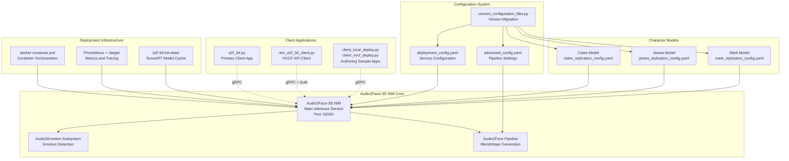
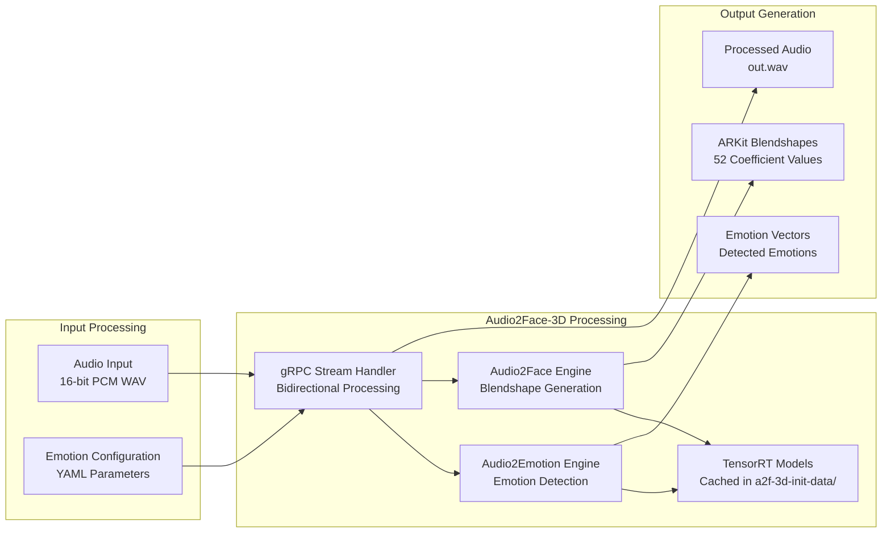

<!-- source: DeepWiki mcp.deepwiki.com · repo NVIDIA/Audio2Face-3D-Samples · page 1 Audio2Face-3D Overview · fetched 2026-10-26 -->

# Audio2Face-3D Overview

Relevant source files

The following files were used as context for generating this wiki page:

- [README.md](README.md)
- [quick-start/README.md](quick-start/README.md)

## Purpose and Scope

This document provides a high-level introduction to NVIDIA's Audio2Face-3D system, its architecture, and the organization of this repository. Audio2Face-3D NIM (NVIDIA Inference Microservice) is a generative AI solution that converts speech audio into facial animations using ARKit Blendshapes, with automatic emotion detection and expression generation.

For detailed information about specific character model configurations, see [Character Models and Stylization](#2). For deployment procedures, see [Deployment and Operations](#5). For client application usage, see [Client Applications and APIs](#4).

Sources: [README.md:1-57](), [quick-start/README.md:1-90]()

## System Architecture

Audio2Face-3D consists of several interconnected components that work together to process audio input and generate facial animation output.

### Core System Components

Sources: [README.md:29-48](), [quick-start/README.md:19-44]()

## Core Components

### Audio2Face-3D NIM Service

The primary service that processes audio input and generates facial animation output. The service operates on port 52000 by default and provides gRPC endpoints for:

- Health checking and service status
- Audio-to-blendshape inference
- Emotion detection and processing
- Performance monitoring and metrics

The service supports three character models: `claire`, `james`, and `mark`, each with distinct facial characteristics and parameter configurations.

### Character Model System

| Character | Model Version | Configuration File | Key Features |
|-----------|---------------|-------------------|--------------|
| Claire | v2.3 | `claire_stylization_config.yaml` | Balanced emotional expression |
| James | v2.3 | `james_stylization_config.yaml` | Masculine facial characteristics |
| Mark | v2.3 | `mark_stylization_config.yaml` | Distinct personality parameters |

Each character model includes Audio2Emotion (A2E) and Audio2Face (A2F) parameter configurations that control blendshape generation and emotional expression intensity.

### Processing Pipeline

Sources: [README.md:5-10](), [quick-start/README.md:41-42](), [quick-start/README.md:50-51]()

## Repository Structure

The repository is organized into functional modules that correspond to different aspects of the Audio2Face-3D system:

### Directory Layout

| Directory | Purpose | Key Files | Wiki Section |
|-----------|---------|-----------|--------------|
| `configs/` | Configuration templates and examples | `deployment_config.yaml`, `advanced_config.yaml`, character configs | [2](#2), [3.2](#3.2) |
| `early_access/` | Early access sample applications | `client_local_deploy.py`, `client_nvcf_deploy.py` | [4.3](#4.3) |
| `example_audio/` | Sample audio files for testing | WAV audio files | [6.2](#6.2) |
| `migration/` | Configuration migration tools | `convert_configuration_files.py` | [3](#3), [3.1](#3.1) |
| `proto/` | gRPC protocol definitions | Proto files and build instructions | [6.1](#6.1) |
| `quick-start/` | Docker deployment files | `docker-compose.yml` | [5.1](#5.1) |
| `scripts/` | Client applications | `a2f_3d.py`, `nim_a2f_3d_client.py` | [4](#4) |

### Configuration Management

The system uses a hierarchical configuration approach:

- **Deployment Configuration**: Service endpoints, authentication, and telemetry settings
- **Advanced Configuration**: Pipeline performance and processing parameters  
- **Stylization Configuration**: Character-specific Audio2Emotion and Audio2Face parameters

Configuration files have evolved from version 1.0 to 1.2, with migration tools provided to upgrade existing configurations.

Sources: [README.md:33-48]()

## Key Technologies and Protocols

### Communication Protocol

Audio2Face-3D uses gRPC for client-server communication, with protocol definitions available in the `nvidia_ace` Python wheel. The service supports:

- Bidirectional streaming for real-time audio processing
- Authentication via API keys for cloud deployments
- Health check endpoints for service monitoring

### Model Execution

The system utilizes TensorRT for optimized model inference:

- Models are compiled to TensorRT format on first startup
- Compiled models are cached in the `a2f-3d-init-data/` directory
- Cache can be invalidated by removing `*.trt` files

### Observability

Integrated monitoring and tracing capabilities:

- Prometheus metrics collection on port 9090
- Jaeger distributed tracing on port 16686
- Configurable telemetry settings in `deployment_config.yaml`

Sources: [quick-start/README.md:50-74](), [README.md:42-43]()

---

