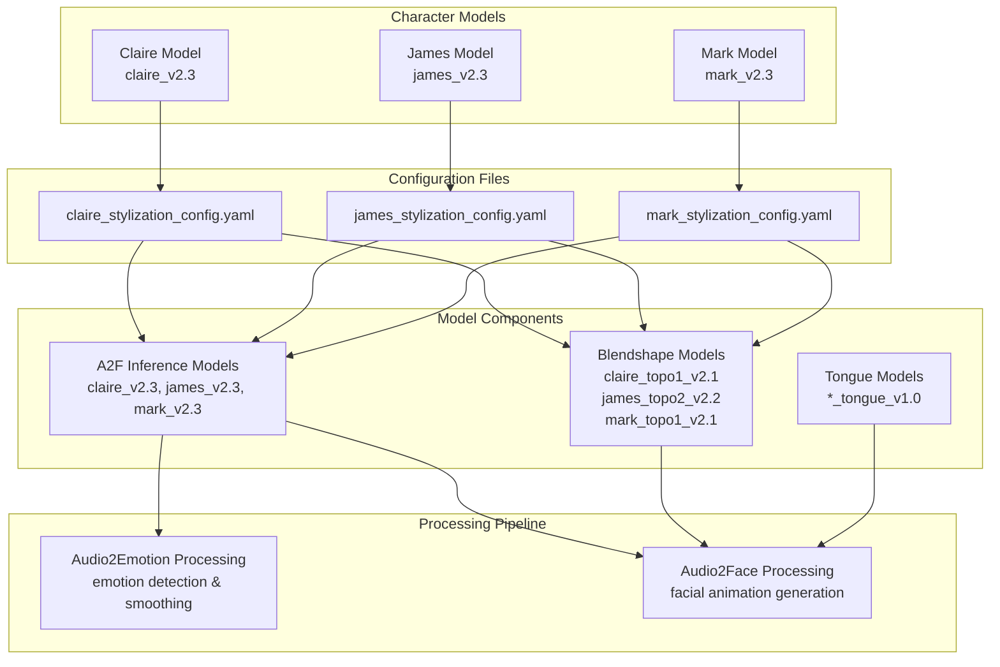
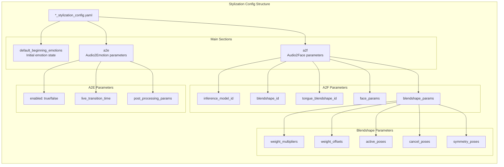
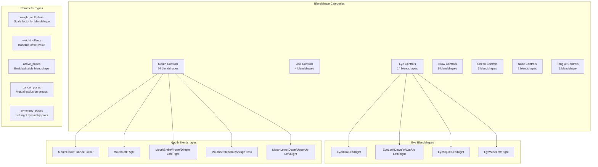

<!-- source: DeepWiki mcp.deepwiki.com · repo NVIDIA/Audio2Face-3D-Samples · page 2 Character Models and Stylization · fetched 2026-10-26 -->

# Character Models and Stylization

Relevant source files

The following files were used as context for generating this wiki page:

- [configs/claire_stylization_config.yaml](configs/claire_stylization_config.yaml)
- [configs/james_stylization_config.yaml](configs/james_stylization_config.yaml)
- [configs/mark_stylization_config.yaml](configs/mark_stylization_config.yaml)

This document covers the three pre-configured character models available in the Audio2Face-3D system: Claire, James, and Mark. It explains the configuration structure, stylization parameters, and how each character's Audio2Emotion (A2E) and Audio2Face (A2F) settings are customized for optimal performance.

For detailed configuration parameters of individual characters, see [Claire Configuration](#2.1), [James Configuration](#2.2), and [Mark Configuration](#2.3). For information about configuration management and migration tools, see [Configuration Management](#3).

## Character Model System Overview

The Audio2Face-3D system provides three distinct character models, each with specialized configuration files that define their emotional response patterns and facial animation parameters. Each character uses specific inference models and blendshape configurations optimized for their facial topology.

### Character Model Architecture

**Sources:** [configs/claire_stylization_config.yaml:42-46](), [configs/james_stylization_config.yaml:42-46](), [configs/mark_stylization_config.yaml:42-46]()

## Configuration File Structure

Each character's stylization configuration follows a consistent YAML structure with four main sections that control different aspects of the character's behavior and appearance.

### Configuration Schema

**Sources:** [configs/claire_stylization_config.yaml:16-332](), [configs/james_stylization_config.yaml:16-332](), [configs/mark_stylization_config.yaml:16-332]()

## Audio2Emotion Configuration

All three characters share identical Audio2Emotion (A2E) processing parameters, providing consistent emotional response behavior across the character set. The A2E system analyzes input audio to detect emotional content and applies smoothing and post-processing to generate natural emotional transitions.

### Emotion Types and Default Values

| Emotion | Default Value | Range | Description |
|---------|---------------|-------|-------------|
| `amazement` | 0.0 | 0.0-1.0 | Wonder and surprise |
| `anger` | 0.0 | 0.0-1.0 | Hostile or aggressive emotion |
| `cheekiness` | 0.0 | 0.0-1.0 | Playful or mischievous behavior |
| `disgust` | 0.0 | 0.0-1.0 | Revulsion or distaste |
| `fear` | 0.0 | 0.0-1.0 | Anxiety or apprehension |
| `grief` | 0.0 | 0.0-1.0 | Deep sorrow or mourning |
| `joy` | 0.0 | 0.0-1.0 | Happiness and pleasure |
| `outofbreath` | 0.0 | 0.0-1.0 | Physical exertion state |
| `pain` | 0.0 | 0.0-1.0 | Physical or emotional suffering |
| `sadness` | 0.0 | 0.0-1.0 | Low-energy negative emotion |

### A2E Processing Parameters

| Parameter | Value | Description |
|-----------|-------|-------------|
| `enabled` | `true` | Enables Audio2Emotion processing |
| `live_transition_time` | `0.5` | Seconds for emotion transitions |
| `emotion_contrast` | `1.0` | Increases spread between emotion values |
| `emotion_strength` | `0.6` | Strength of generated emotions vs neutral |
| `enable_preferred_emotion` | `true` | Blends preferred emotion with auto-emotion |
| `live_blend_coef` | `0.7` | Exponential smoothing coefficient |
| `max_emotions` | `3` | Maximum simultaneous active emotions |
| `preferred_emotion_strength` | `0.5` | Strength of preferred emotion blending |

**Sources:** [configs/claire_stylization_config.yaml:16-39](), [configs/james_stylization_config.yaml:16-39](), [configs/mark_stylization_config.yaml:16-39]()

## Audio2Face Model Configuration

Each character uses distinct Audio2Face models and blendshape configurations tailored to their specific facial topology and animation requirements.

### Character Model Specifications

| Character | Inference Model | Blendshape Model | Tongue Model | Tongue Enabled |
|-----------|----------------|------------------|--------------|----------------|
| Claire | `claire_v2.3` | `claire_topo1_v2.1` | `claire_tongue_v1.0` | `true` |
| James | `james_v2.3` | `james_topo2_v2.2` | `james_tongue_v1.0` | `true` |
| Mark | `mark_v2.3` | `mark_topo1_v2.1` | `mark_tongue_v1.0` | `true` |

### Face Parameter Differences

The characters have distinct face parameter tuning to accommodate their unique facial characteristics:

| Parameter | Claire | James | Mark | Description |
|-----------|--------|-------|------|-------------|
| `eyelid_offset` | `0.0` | `0.06` | `0.06` | Default eyelid pose adjustment |
| `lip_close_offset` | `0.0` | `-0.02` | `-0.03` | Default lip closure pose |
| `input_strength` | `1.0` | `1.0` | `1.3` | Audio input magnitude control |
| `lower_face_smoothing` | `0.006` | `0.006` | `0.0023` | Temporal smoothing for lower face |
| `lower_face_strength` | `1.25` | `1.2` | `1.4` | Range of motion for lower face |
| `skin_strength` | `1.0` | `1.0` | `1.1` | Skin motion range control |

**Sources:** [configs/claire_stylization_config.yaml:48-58](), [configs/james_stylization_config.yaml:48-58](), [configs/mark_stylization_config.yaml:48-58]()

## Blendshape Parameter System

The blendshape system controls facial animation through 52 individual facial poses, each with configurable weight multipliers, offsets, and activation states. All characters use identical blendshape parameter structures but may have different model topologies.

### Blendshape Categories

**Sources:** [configs/claire_stylization_config.yaml:63-331](), [configs/james_stylization_config.yaml:63-331](), [configs/mark_stylization_config.yaml:63-331]()

### Blendshape Control Parameters

Each blendshape is controlled by five parameter types:

- **`weight_multipliers`**: Scaling factor applied to blendshape weights (default: `1.0`)
- **`weight_offsets`**: Baseline offset added to blendshape weights (default: `0.0`)  
- **`active_poses`**: Enable (`1`) or disable (`0`) individual blendshapes
- **`cancel_poses`**: Grouping for mutually exclusive blendshapes (value: `-1`)
- **`symmetry_poses`**: Pairing for left/right symmetric blendshapes (shared group numbers)

### Notable Blendshape Configurations

| Blendshape Group | Active State | Symmetry Groups | Notes |
|------------------|--------------|-----------------|-------|
| Eye Look Controls | Disabled (`0`) | Individual (`-1`) | Gaze tracking disabled by default |
| Tongue Out | Disabled (`0`) | Individual (`-1`) | Requires explicit activation |
| Mouth Smile/Frown | Enabled (`1`) | Paired (`2`/`3`) | Symmetric expression pairs |
| Brow Controls | Enabled (`1`) | Outer paired (`9`), Inner individual | Asymmetric brow capability |

**Sources:** [configs/claire_stylization_config.yaml:171-331](), [configs/james_stylization_config.yaml:171-331](), [configs/mark_stylization_config.yaml:171-331]()

---

