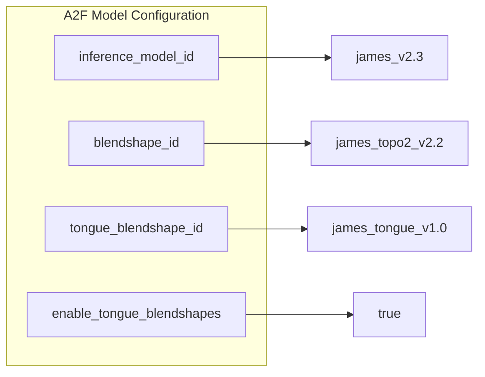
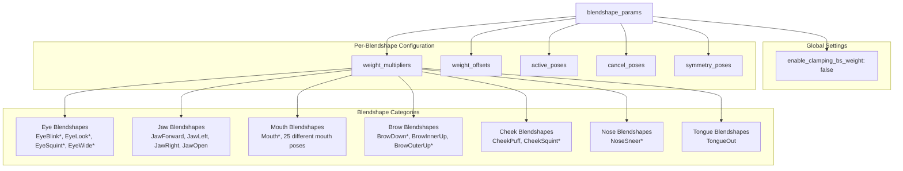
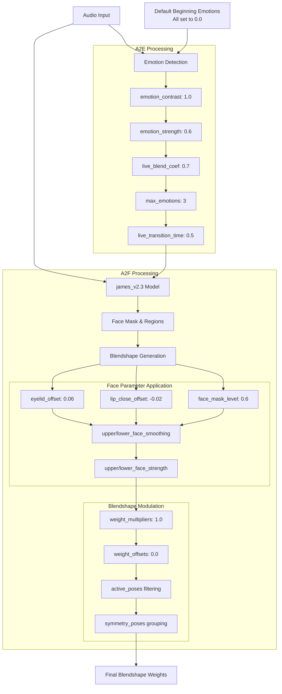

<!-- source: DeepWiki mcp.deepwiki.com · repo NVIDIA/Audio2Face-3D-Samples · page 2.2 James Character Configuration · fetched 2026-10-26 -->

# James Character Configuration

Relevant source files

The following files were used as context for generating this wiki page:

- [configs/james_stylization_config.yaml](configs/james_stylization_config.yaml)

## Purpose and Scope

This document provides detailed documentation of the James character model configuration parameters in the Audio2Face-3D system. The James character is one of three pre-configured character models available in the system, alongside Claire and Mark. This documentation covers the specific parameter settings, blendshape configurations, and emotion processing parameters that define James's unique facial animation characteristics.

For information about other character configurations, see [Claire Character Configuration](#2.1) and [Mark Character Configuration](#2.3). For general information about the configuration management system, see [Configuration Management and Migration](#3).

## James Configuration File Structure

The James character configuration is defined in a YAML file that contains three main sections: default emotions, Audio2Emotion (A2E) processing parameters, and Audio2Face (A2F) animation parameters.

```mermaid
graph TD
    JamesConfig["james_stylization_config.yaml"]
    
    subgraph "Default Emotion Settings"
        DefaultEmotions["default_beginning_emotions"]
        EmotionList["amazement, anger, cheekiness<br/>disgust, fear, grief, joy<br/>outofbreath, pain, sadness"]
    end
    
    subgraph "Audio2Emotion Configuration"
        A2ESection["a2e"]
        A2EEnabled["enabled: true"]
        TransitionTime["live_transition_time: 0.5"]
        PostProcessing["post_processing_params"]
        EmotionContrast["emotion_contrast: 1.0"]
        EmotionStrength["emotion_strength: 0.6"]
        PreferredEmotion["enable_preferred_emotion: true"]
        BlendCoef["live_blend_coef: 0.7"]
        MaxEmotions["max_emotions: 3"]
        PreferredStrength["preferred_emotion_strength: 0.5"]
    end
    
    subgraph "Audio2Face Configuration"
        A2FSection["a2f"]
        ModelConfig["Model Configuration"]
        FaceParams["face_params"]
        BlendshapeParams["blendshape_params"]
        
        ModelID["inference_model_id: james_v2.3"]
        BlendshapeID["blendshape_id: james_topo2_v2.2"]
        TongueID["tongue_blendshape_id: james_tongue_v1.0"]
        EnableTongue["enable_tongue_blendshapes: true"]
    end
    
    JamesConfig --> DefaultEmotions
    JamesConfig --> A2ESection
    JamesConfig --> A2FSection
    
    DefaultEmotions --> EmotionList
    A2ESection --> A2EEnabled
    A2ESection --> TransitionTime
    A2ESection --> PostProcessing
    PostProcessing --> EmotionContrast
    PostProcessing --> EmotionStrength
    PostProcessing --> PreferredEmotion
    PostProcessing --> BlendCoef
    PostProcessing --> MaxEmotions
    PostProcessing --> PreferredStrength
    
    A2FSection --> ModelConfig
    A2FSection --> FaceParams
    A2FSection --> BlendshapeParams
    ModelConfig --> ModelID
    ModelConfig --> BlendshapeID
    ModelConfig --> TongueID
    ModelConfig --> EnableTongue
```

Sources: [configs/james_stylization_config.yaml:1-332]()

## Default Beginning Emotions

The James character starts with all emotions set to neutral (0.0) at the beginning of any audio clip. This provides a consistent baseline for emotion processing across all audio inputs.

| Emotion | Default Value | Range |
|---------|---------------|-------|
| amazement | 0.0 | 0.0 - 1.0 |
| anger | 0.0 | 0.0 - 1.0 |
| cheekiness | 0.0 | 0.0 - 1.0 |
| disgust | 0.0 | 0.0 - 1.0 |
| fear | 0.0 | 0.0 - 1.0 |
| grief | 0.0 | 0.0 - 1.0 |
| joy | 0.0 | 0.0 - 1.0 |
| outofbreath | 0.0 | 0.0 - 1.0 |
| pain | 0.0 | 0.0 - 1.0 |
| sadness | 0.0 | 0.0 - 1.0 |

Sources: [configs/james_stylization_config.yaml:18-28]()

## Audio2Emotion (A2E) Configuration

The A2E system for James is enabled and configured with specific parameters that control how emotions are detected and processed from audio input.

### Core A2E Parameters

| Parameter | Value | Description |
|-----------|-------|-------------|
| `enabled` | `true` | Enables Audio2Emotion processing |
| `live_transition_time` | `0.5` | Time in seconds for emotion transitions |

### Post-Processing Parameters

The James character uses specific post-processing parameters to fine-tune emotion detection:

| Parameter | Value | Description |
|-----------|-------|-------------|
| `emotion_contrast` | `1.0` | Increases spread between emotion values |
| `emotion_strength` | `0.6` | Strength of generated emotions relative to neutral |
| `enable_preferred_emotion` | `true` | Activates preferred emotion blending |
| `live_blend_coef` | `0.7` | Coefficient for exponential emotion smoothing |
| `max_emotions` | `3` | Maximum number of simultaneous emotions |
| `preferred_emotion_strength` | `0.5` | Strength of preferred emotions relative to generated emotions |

Sources: [configs/james_stylization_config.yaml:30-39]()

## Audio2Face (A2F) Configuration

The A2F configuration defines how the James character model generates facial animations from audio input and emotion data.

### Model and Blendshape Identifiers

Sources: [configs/james_stylization_config.yaml:42-46]()

### Face Parameters

The James character uses the following face parameters to control facial animation behavior:

| Parameter | Value | Description |
|-----------|-------|-------------|
| `eyelid_offset` | `0.06` | Adjusts default eyelid open-close pose |
| `face_mask_level` | `0.6` | Boundary between upper and lower face regions |
| `face_mask_softness` | `0.0085` | Smoothness of face region blending |
| `input_strength` | `1.0` | Magnitude control of input audio |
| `lip_close_offset` | `-0.02` | Adjusts default lip close-open pose |
| `lower_face_smoothing` | `0.006` | Temporal smoothing for lower face motion |
| `lower_face_strength` | `1.2` | Range of motion for lower face regions |
| `skin_strength` | `1.0` | Range of motion for skin |
| `upper_face_smoothing` | `0.001` | Temporal smoothing for upper face motion |
| `upper_face_strength` | `1.0` | Range of motion for upper face regions |

Sources: [configs/james_stylization_config.yaml:48-58]()

## Blendshape Parameters

The James character configuration includes comprehensive blendshape parameters that control how each facial blendshape is applied during animation.

### Blendshape Parameter Structure

Sources: [configs/james_stylization_config.yaml:60-332]()

### Weight Multipliers and Offsets

All blendshapes in the James configuration use default weight multipliers of `1.0` and weight offsets of `0.0`, meaning no scaling or baseline adjustment is applied to the blendshape weights during animation.

### Active and Cancel Poses

The James character configuration defines which poses are active during animation:

#### Active Poses (Set to 1)
- **Eye poses**: `EyeBlinkLeft/Right`, `EyeSquintLeft/Right`, `EyeWideLeft/Right`
- **Eye gaze poses**: All `EyeLook*` poses are set to `0` (inactive)
- **Jaw poses**: All jaw movements are active (`JawForward`, `JawLeft/Right`, `JawOpen`)
- **Mouth poses**: All 25 mouth blendshapes are active
- **Brow poses**: All brow movements are active
- **Cheek and nose poses**: Active
- **Tongue poses**: `TongueOut` is set to `0` (inactive)

#### Cancel Poses
All cancel poses are set to `-1`, indicating default cancellation behavior without custom overrides.

Sources: [configs/james_stylization_config.yaml:171-277]()

### Symmetry Pose Groupings

The James character uses symmetry groupings to ensure coordinated movement between paired facial features:

| Symmetry Group | Left Blendshape | Right Blendshape |
|----------------|-----------------|------------------|
| Group 2 | `MouthSmileLeft` | `MouthSmileRight` |
| Group 3 | `MouthFrownLeft` | `MouthFrownRight` |
| Group 4 | `MouthDimpleLeft` | `MouthDimpleRight` |
| Group 5 | `MouthStretchLeft` | `MouthStretchRight` |
| Group 6 | `MouthPressLeft` | `MouthPressRight` |
| Group 7 | `MouthLowerDownLeft` | `MouthLowerDownRight` |
| Group 8 | `MouthUpperUpLeft` | `MouthUpperUpRight` |
| Group 9 | `BrowOuterUpLeft` | `BrowOuterUpRight` |
| Group 10 | `BrowDownLeft` | `BrowDownRight` |
| Group 11 | `CheekSquintLeft` | `CheekSquintRight` |
| Group 12 | `NoseSneerLeft` | `NoseSneerRight` |

Blendshapes with symmetry value `-1` operate independently, while those with value `0` or `1` have special symmetry behaviors.

Sources: [configs/james_stylization_config.yaml:279-331]()

## Parameter Interaction Flow

Sources: [configs/james_stylization_config.yaml:1-332]()

---

