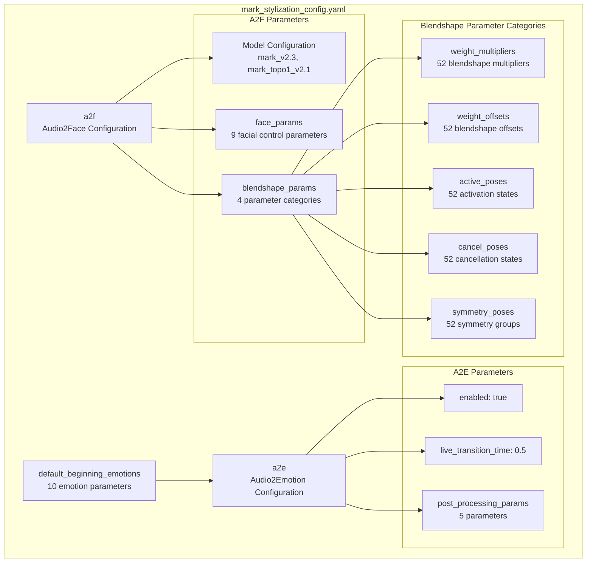
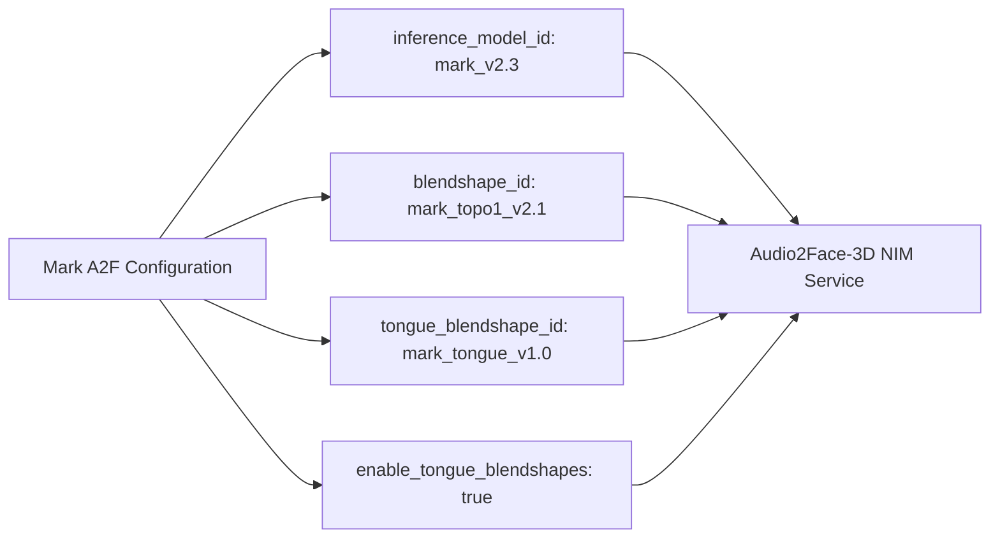
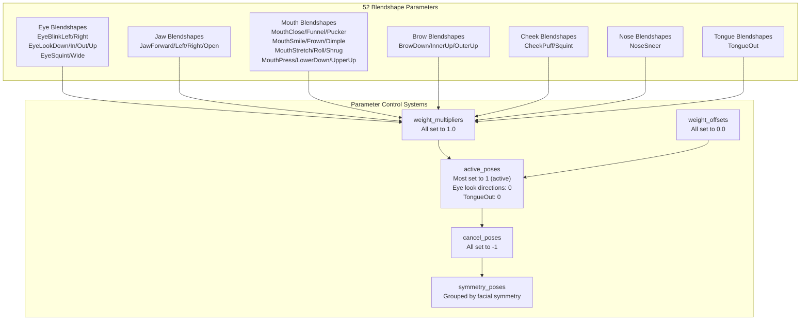

<!-- source: DeepWiki mcp.deepwiki.com · repo NVIDIA/Audio2Face-3D-Samples · page 2.3 Mark Character Configuration · fetched 2026-10-26 -->

# Mark Character Configuration

Relevant source files

The following files were used as context for generating this wiki page:

- [configs/mark_stylization_config.yaml](configs/mark_stylization_config.yaml)

This document provides comprehensive documentation of the Mark character's stylization configuration parameters within the Audio2Face-3D system. The Mark character configuration defines Audio2Emotion (A2E) and Audio2Face (A2F) parameters specific to the `mark_v2.3` inference model, including emotion processing, facial animation controls, and detailed blendshape parameter management.

For information about other character configurations, see [Claire Character Configuration](#2.1) and [James Character Configuration](#2.2). For broader configuration management topics, see [Configuration Management and Migration](#3).

## Configuration File Structure

The Mark character configuration is defined in `mark_stylization_config.yaml` and follows the standard Audio2Face-3D v1.2 configuration format. The configuration is organized into three primary sections: default emotions, Audio2Emotion processing, and Audio2Face model parameters.

### Mark Configuration Architecture

Sources: [configs/mark_stylization_config.yaml:1-331]()

## Default Emotion Configuration

The Mark character begins audio processing with a neutral emotional state, where all emotion parameters are set to `0.0`. This provides a consistent baseline for Audio2Emotion processing.

| Emotion Parameter | Default Value | Description |
|------------------|---------------|-------------|
| `amazement` | 0.0 | Wonder and surprise expression |
| `anger` | 0.0 | Anger and frustration expression |
| `cheekiness` | 0.0 | Playful and mischievous expression |
| `disgust` | 0.0 | Disgust and revulsion expression |
| `fear` | 0.0 | Fear and anxiety expression |
| `grief` | 0.0 | Grief and mourning expression |
| `joy` | 0.0 | Joy and happiness expression |
| `outofbreath` | 0.0 | Breathless and exerted expression |
| `pain` | 0.0 | Pain and discomfort expression |
| `sadness` | 0.0 | Sadness and melancholy expression |

Sources: [configs/mark_stylization_config.yaml:16-28]()

## Audio2Emotion (A2E) Configuration

The Mark character's Audio2Emotion system processes audio input to generate emotional expressions. The configuration enables emotion detection with specific post-processing parameters optimized for the Mark character model.

### A2E Core Parameters

| Parameter | Value | Description |
|-----------|-------|-------------|
| `enabled` | `true` | Enables Audio2Emotion processing |
| `live_transition_time` | `0.5` | Transition time between emotion states (seconds) |

### A2E Post-Processing Parameters

| Parameter | Value | Description |
|-----------|-------|-------------|
| `emotion_contrast` | `1.0` | Increases spread between emotion values |
| `emotion_strength` | `0.6` | Strength of generated emotions relative to neutral |
| `enable_preferred_emotion` | `true` | Activates blending with preferred emotion |
| `live_blend_coef` | `0.7` | Exponential smoothing coefficient for emotions |
| `max_emotions` | `3` | Maximum number of concurrent active emotions |
| `preferred_emotion_strength` | `0.5` | Strength of preferred emotion relative to auto-generated |

Sources: [configs/mark_stylization_config.yaml:30-39]()

## Audio2Face (A2F) Model Configuration

The Mark character utilizes the `mark_v2.3` inference model with associated blendshape topologies for facial animation generation.

### Model Identifiers

Sources: [configs/mark_stylization_config.yaml:42-46]()

### Face Parameters

The Mark character's facial animation is controlled by nine core parameters that govern different aspects of facial movement and expression intensity.

| Parameter | Value | Description |
|-----------|-------|-------------|
| `eyelid_offset` | `0.06` | Default eyelid open-close position adjustment |
| `face_mask_level` | `0.6` | Boundary between upper and lower face regions |
| `face_mask_softness` | `0.0085` | Blending smoothness between face regions |
| `input_strength` | `1.3` | Audio input magnitude control |
| `lip_close_offset` | `-0.03` | Default lip close-open position adjustment |
| `lower_face_smoothing` | `0.0023` | Temporal smoothing for lower face motion |
| `lower_face_strength` | `1.4` | Motion range for lower face regions |
| `skin_strength` | `1.1` | Skin deformation motion range |
| `upper_face_smoothing` | `0.001` | Temporal smoothing for upper face motion |
| `upper_face_strength` | `1.0` | Motion range for upper face regions |

Sources: [configs/mark_stylization_config.yaml:48-58]()

## Blendshape Parameter System

The Mark character configuration includes comprehensive blendshape parameter management across 52 individual facial blendshapes. The system applies the formula: `final_weight = (input_weight * multiplier) + offset` for each active blendshape.

### Blendshape Categories

Sources: [configs/mark_stylization_config.yaml:60-331]()

### Weight Multipliers and Offsets

All blendshape `weight_multipliers` are set to `1.0`, providing neutral scaling of input weights. All `weight_offsets` are set to `0.0`, applying no baseline offset to blendshape activations.

### Active Poses Configuration

The Mark character activates most blendshapes (`active_poses: 1`) with specific exceptions:

| Blendshape Category | Active State | Count |
|-------------------|--------------|-------|
| Eye look directions | `0` (inactive) | 8 blendshapes |
| `TongueOut` | `0` (inactive) | 1 blendshape |
| All other blendshapes | `1` (active) | 43 blendshapes |

Sources: [configs/mark_stylization_config.yaml:171-223]()

### Symmetry Pose Groups

The Mark character configuration defines 12 symmetry groups for bilateral facial features:

| Symmetry Group | Left Blendshape | Right Blendshape |
|---------------|-----------------|------------------|
| Group 2 | `MouthSmileLeft` | `MouthSmileRight` |
| Group 3 | `MouthFrownLeft` | `MouthFrownRight` |
| Group 4 | `MouthDimpleLeft` | `MouthDimpleRight` |
| Group 5 | `MouthStretchLeft` | `MouthStretchRight` |
| Group 6 | `MouthPressLeft` | `MouthPressRight` |
| Group 7 | `MouthLowerDownLeft` | `MouthLowerDownRight` |
| Group 8 | `MouthUpperUpLeft` | `MouthUpperUpRight` |
| Group 9 | `BrowOuterUpLeft` | `BrowOuterUpRight` |
| Group 10 | `BrowDownLeft` | `BrowDownRight` |
| Group 11 | `CheekSquintLeft` | `CheekSquintRight` |
| Group 12 | `NoseSneerLeft` | `NoseSneerRight` |

Blendshapes with symmetry value `-1` operate independently, while `0` indicates no symmetry constraint.

Sources: [configs/mark_stylization_config.yaml:279-331]()

## Configuration Integration

The Mark character configuration integrates with the Audio2Face-3D system through the deployment configuration's character model selection. When `inference_model_id: mark_v2.3` is specified, the system loads the corresponding blendshape topology and applies all Mark-specific parameters during audio processing.

The configuration file is referenced by client applications and the Audio2Face-3D NIM service during character initialization and runtime parameter application.

Sources: [configs/mark_stylization_config.yaml:1-331]()

---

